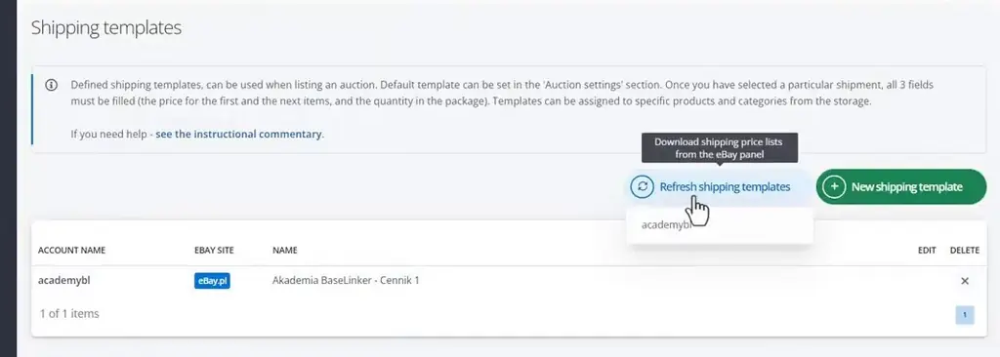
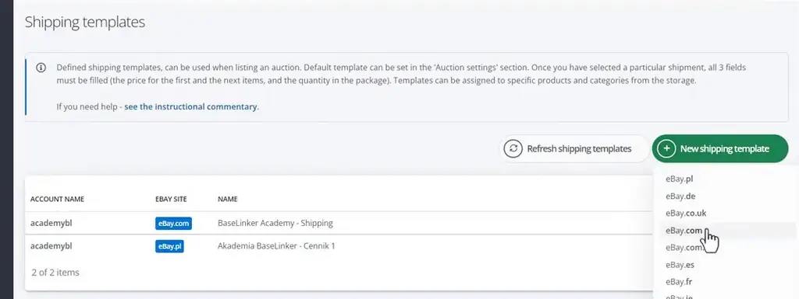
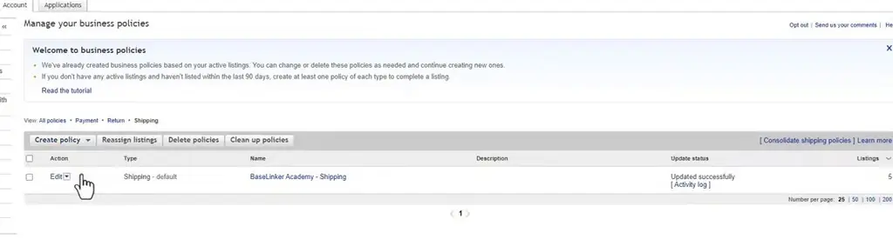
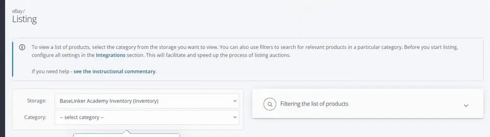
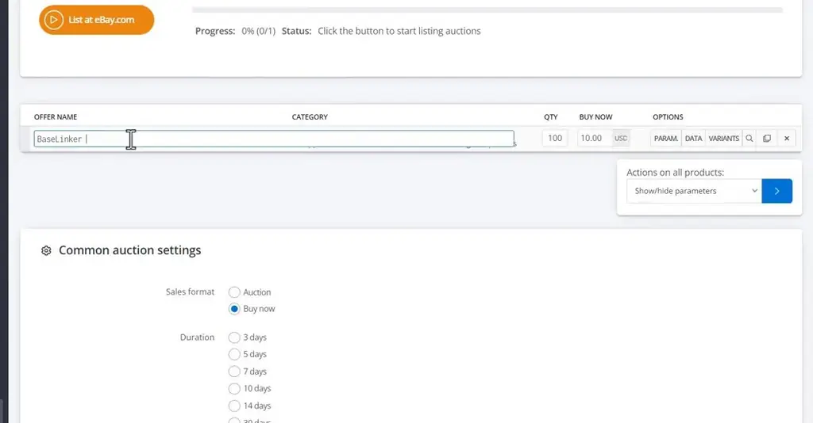
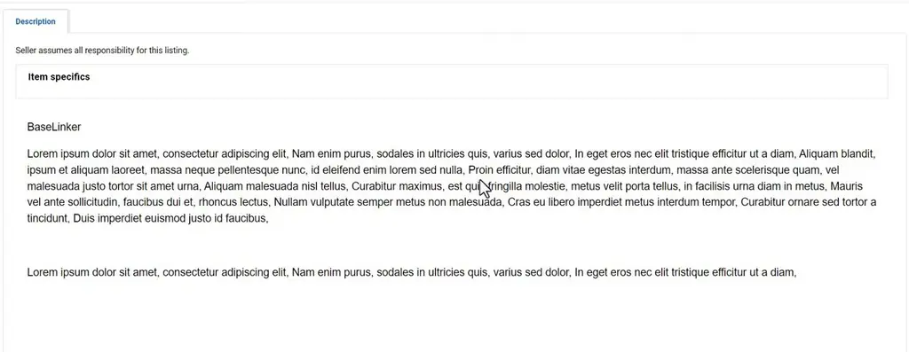

# Offer templates and shipping templates | BaseLinker Academy

*Learn how to import eBay shipping policies into BaseLinker and build offer templates whose tags and previews keep your listings consistent.*

Source: [Offer templates and shipping templates | BaseLinker Academy](https://www.youtube.com/watch?v=dOlIbfhJpY4) · Base · 4 min

## TL;DR

Publishing many offers by hand makes listings look inconsistent and slows down listing and later edits during an auction. BaseLinker addresses this with shipping templates and offer templates that standardize offers. The talk walks through importing eBay shipping policies, creating a shipping template for each eBay site, and building an offer template with tags such as [auction_name] and [description]. Using these templates gives a uniform look and speeds up listing.

## Key takeaways

- Click Refresh to import your eBay shipping policies into BaseLinker.
- Create a shipping template for each eBay site, set the shipping costs, save, and refresh to confirm the template.
- Each shipping template corresponds to one eBay business shipping policy.
- Offer templates use placeholder tags such as [auction_name] and [description] that are filled in from each product.
- Preview an offer template from the Listing tab by picking a product to open its listing.
- The preview shows the offer template's description with the product's data inserted, so you can check it before publishing.
- Shipping and offer templates unify how your published offers look and speed up listing.

## Syncing shipping templates and previewing offer templates

[▶ 00:00:00](https://www.youtube.com/watch?v=dOlIbfhJpY4&t=0s)

Refresh to import your eBay shipping policies.

*[▶ 00:00:15](https://www.youtube.com/watch?v=dOlIbfhJpY4&t=15s) · Shipping templates list with refresh dropdown*

Create a template per eBay site, set costs, save, and refresh to confirm.

*[▶ 00:00:29](https://www.youtube.com/watch?v=dOlIbfhJpY4&t=29s) · Two templates and eBay site dropdown*

Each template matches an eBay business shipping policy.

*[▶ 00:00:42](https://www.youtube.com/watch?v=dOlIbfhJpY4&t=42s) · eBay business policies: shipping policy list*

Offer templates use tags like [auction_name] and [description].

Preview the template from the Listing tab.

*[▶ 00:03:10](https://www.youtube.com/watch?v=dOlIbfhJpY4&t=190s) · BaseLinker eBay Listing page with category selection*

Pick a product to open its listing.

*[▶ 00:03:28](https://www.youtube.com/watch?v=dOlIbfhJpY4&t=208s) · Product list for eBay listing with one product selected*

The preview shows the template description.

*[▶ 00:04:08](https://www.youtube.com/watch?v=dOlIbfhJpY4&t=248s) · eBay listing description rendered from the template*

## Links & resources

- [Link from the video description, purpose not stated in talk](https://bit.ly/3v3n6v3) — <https://bit.ly/3v3n6v3> · video description
