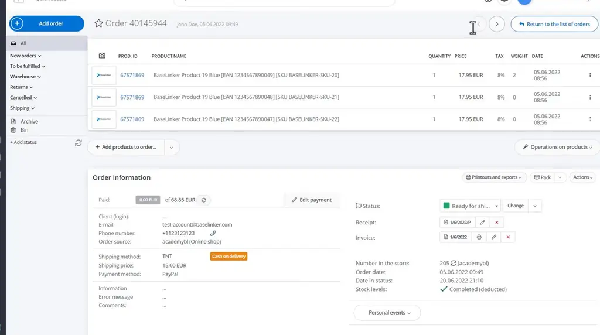
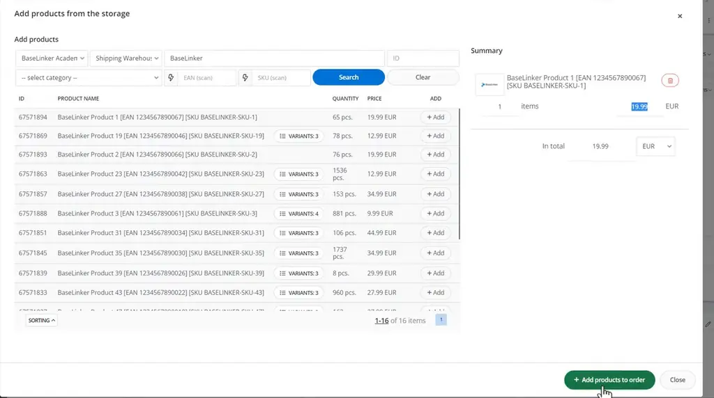
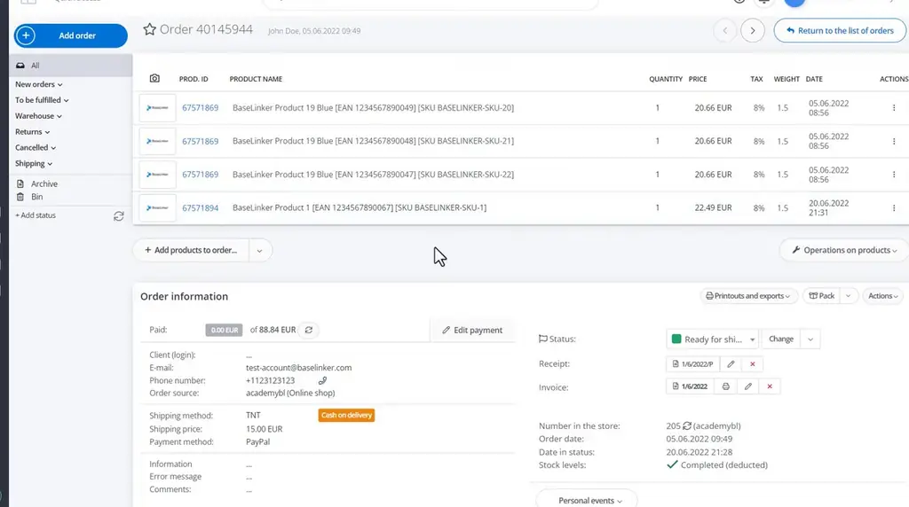
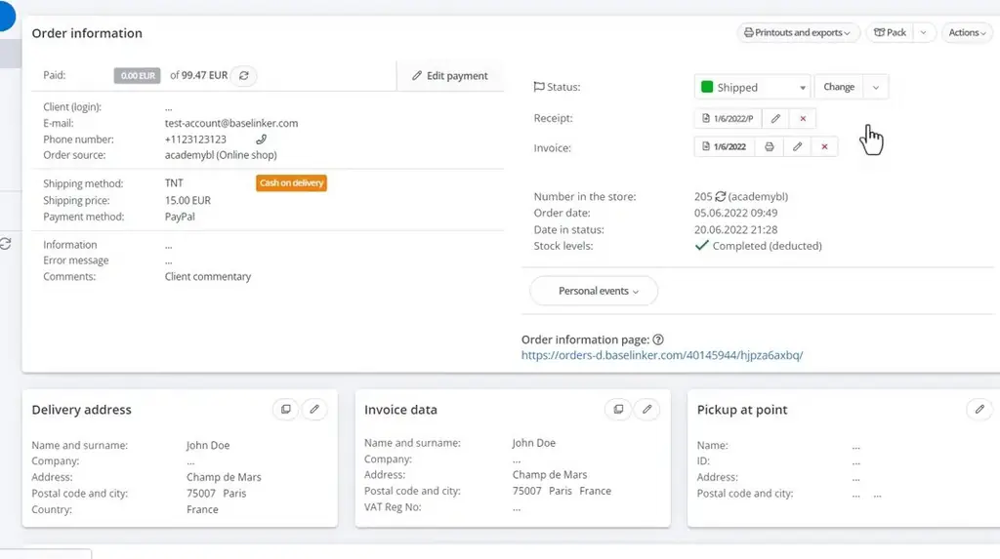
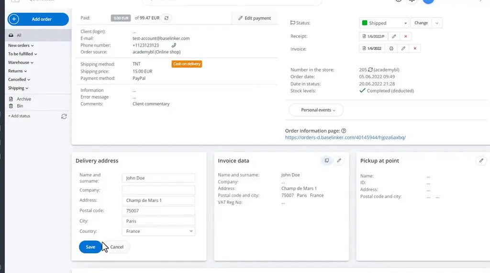
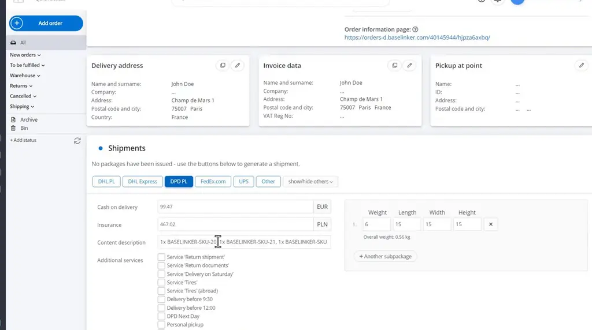

# Order card | BaseLinker Academy

*How to edit orders, bulk-change products, record payments, and create shipments from the BaseLinker order card.*

Source: [Order card | BaseLinker Academy](https://www.youtube.com/watch?v=5-QpZY7GjmA) · Base · 9 min

## TL;DR

The BaseLinker order card holds the full order, and nearly every field on it can be edited in place. Its "Operations on products" section applies one change (weight, VAT, or price) to every line at once, which avoids editing items one by one. Payments, status changes, receipts, invoices, and shipments are handled from the same card. Knowing these options lets staff correct and process orders without leaving the card.

## Key takeaways

- The product table on the order card shows ID, name, quantity, price, VAT rate, weight, and date, and each line's name, quantity, price with currency, VAT rate, and weight can be edited.
- Products can be added to an order by searching the storage catalog or by scanning an EAN or SKU, and scanning is the faster option for in-store sales.
- In Operations on products, a plain number in the weight field sets the total order weight, while a leading "=" sets each product's weight.
- Entering "+5" in the price operation adds a fixed amount to each price, and multiplying by 0.9 gives a 10% discount on every line.
- After making bulk changes, press the refresh button next to the order amount to recalculate the total.
- Record payments from the order information panel by adding a payment, marking the order paid, or marking it unpaid.
- You can change an order's status from the list and click move, optionally without running automatic actions.
- Shipments are created per carrier: fill in cash on delivery, insurance, content description, and additional services, then enter package weight and dimensions and send the package.

## Editing an order in place

[▶ 00:00:00](https://www.youtube.com/watch?v=5-QpZY7GjmA&t=0s)

The order card holds the full order, and each field on it is editable. The product table shows ID, name, quantity, price, VAT rate, weight and date. You can change the name, quantity, price with currency, VAT rate and weight of each line.

*[▶ 00:00:17](https://www.youtube.com/watch?v=5-QpZY7GjmA&t=17s) · Order card overview in BaseLinker*

Products can be added from the storage catalog by search, or by scanning EAN or SKU, which is much faster for in-store sales. A product can also be added manually.

*[▶ 00:01:51](https://www.youtube.com/watch?v=5-QpZY7GjmA&t=111s) · Adding a product from storage catalog*

Under **Operations on products**, one change applies to every line:

- **Weight:** a plain number sets the total order weight; a leading "=" sets each product's weight.
- **VAT:** one rate is applied to all products.
- **Price:** arithmetic on each price. "+5" adds a fixed amount; multiplying by 0.9 gives a 10% discount.

After bulk changes, the refresh button next to the order amount recalculates the total.

*[▶ 00:03:29](https://www.youtube.com/watch?v=5-QpZY7GjmA&t=209s) · Order 40145944 products and order information*

Payments are recorded from the order information panel: add a payment, mark the order paid, or mark it unpaid.

Change the status from the list and click move. You can also move it without running automatic actions. Receipts can be verified, edited or cancelled, and pro forma invoices and invoices can be issued or sent to the printer.

*[▶ 00:04:59](https://www.youtube.com/watch?v=5-QpZY7GjmA&t=299s) · Order card: changing status and receipt actions*

Delivery address, invoice data and pickup-point fields are edited by clicking them. Invoice data can be copied to the delivery address before saving.

*[▶ 00:06:23](https://www.youtube.com/watch?v=5-QpZY7GjmA&t=383s) · Order card: payment, delivery and invoice data*

Shipments are created per carrier. Fill in cash on delivery, insurance, content description and additional services, then enter package weight and dimensions and send the package.

*[▶ 00:06:42](https://www.youtube.com/watch?v=5-QpZY7GjmA&t=402s) · Shipments section: DPD PL package form*

## Links & resources

- [BaseLinker Academy link from video description (purpose not stated in talk)](https://bit.ly/3v3n6v3) — <https://bit.ly/3v3n6v3> · video description
- [Sample order information page (customer-facing order view) on BaseLinker](https://orders-d.baselinker.com/40145944/hjpza6axbq/) — <https://orders-d.baselinker.com/40145944/hjpza6axbq/> · on screen [▶ 00:06:23](https://www.youtube.com/watch?v=5-QpZY7GjmA&t=383s)
- BaseLinker Academy catalog — course catalog on the academy site, URL not shown · mentioned [▶ 00:01:24](https://www.youtube.com/watch?v=5-QpZY7GjmA&t=84s)
- BaseLinker Caller module — plugin for order collection and packaging, URL not shown · mentioned [▶ 00:07:57](https://www.youtube.com/watch?v=5-QpZY7GjmA&t=477s)
