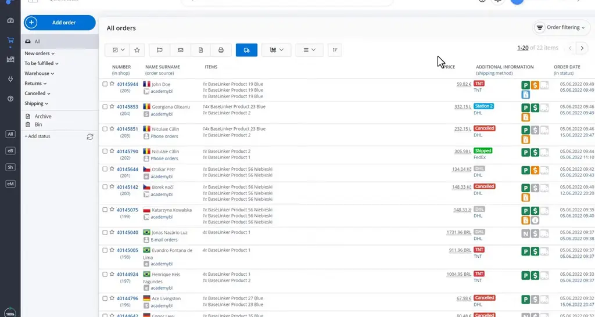
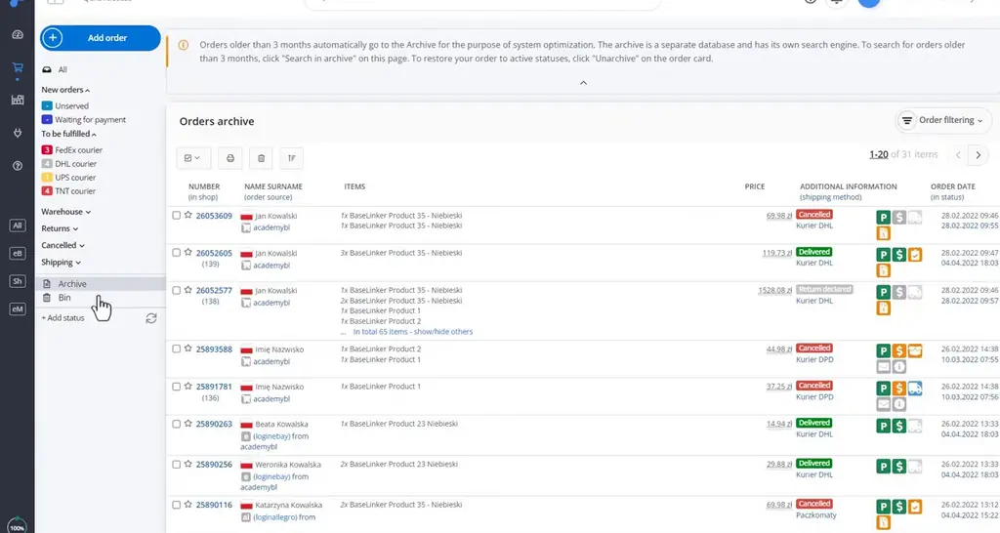
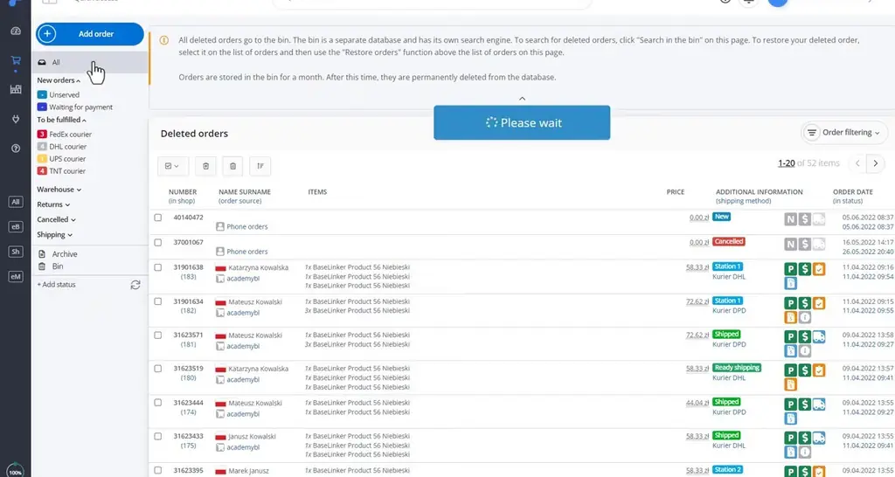
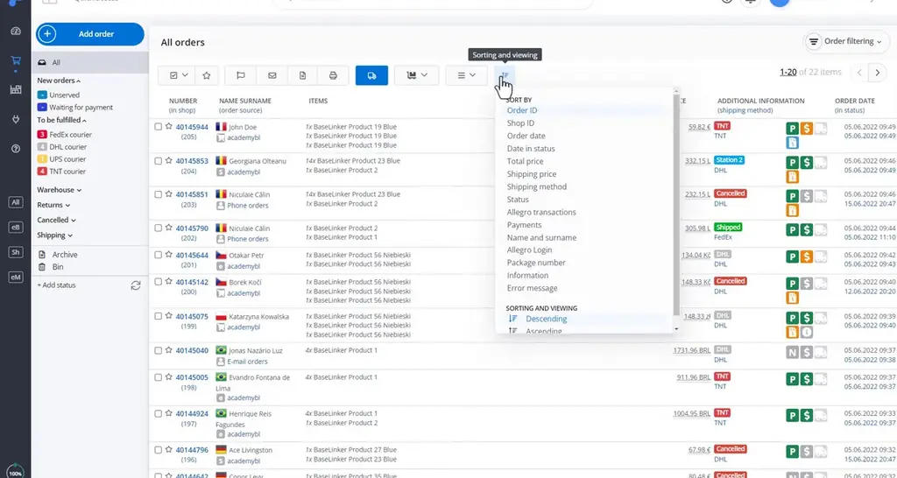
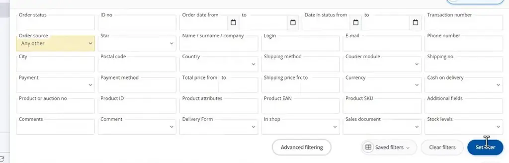
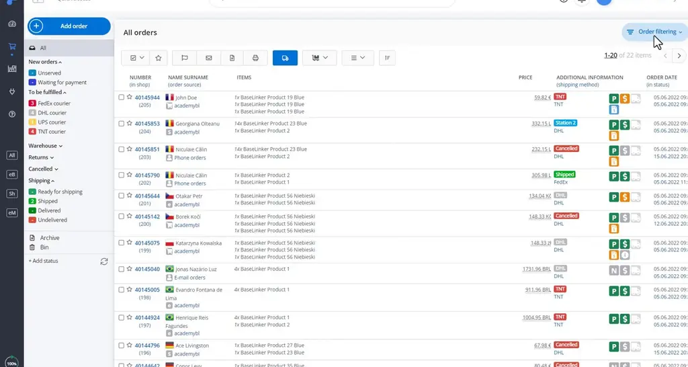

# Order list | BaseLinker Academy

*Learn how to navigate, sort, filter, and save views in the BaseLinker order list, and where older and deleted orders end up.*

Source: [Order list | BaseLinker Academy](https://www.youtube.com/watch?v=W9g3DWq16Y0) · Base · 6 min

## TL;DR

Daily order handling in BaseLinker depends on finding the right orders quickly, and the order list is the main tool for that. The list shows all orders under **All**, with status groups below it that depend on how the account is set up. Orders older than three months move to the Archive, deleted orders sit in the Bin for a month, and advanced filters can combine conditions with AND or OR. Knowing these rules helps you find any order without guessing where it went.

## Key takeaways

- The **All** list shows every order, and the status groups below it vary depending on the account setup.
- Top-bar actions apply either to the orders you have selected or to all orders, so check your selection before running a bulk action.
- Orders older than three months move automatically to the **Archive**, which has its own search.
- Deleted orders go to the **Bin**, where they stay for one month.
- You can sort the order list by ID, date, price, or status, in ascending or descending order.
- AND narrows results and OR widens them: combining Brazil and Shipped with AND returned nothing, so use OR when you want orders matching either condition.
- Advanced filters can be saved as named views and reapplied later instead of rebuilding them each time.

## Navigating and filtering the order list

[▶ 00:00:00](https://www.youtube.com/watch?v=W9g3DWq16Y0&t=0s)

**All** lists every order; the status groups below it depend on account setup. Top-bar actions apply to selected or all orders.

*[▶ 00:00:12](https://www.youtube.com/watch?v=W9g3DWq16Y0&t=12s) · All orders list in the order view*

Orders older than three months move to the **Archive**, which has its own search.

*[▶ 00:00:47](https://www.youtube.com/watch?v=W9g3DWq16Y0&t=47s) · Orders archive with three-month notice*

Deleted orders go to the **Bin**, where they stay for a month.

*[▶ 00:01:00](https://www.youtube.com/watch?v=W9g3DWq16Y0&t=60s) · Deleted orders bin with one-month retention*

Sort by ID, date, price, or status, ascending or descending.

*[▶ 00:01:48](https://www.youtube.com/watch?v=W9g3DWq16Y0&t=108s) · Sort options menu on All orders list*

Advanced filters combine conditions: OR widens results across statuses; AND narrows them, so Brazil plus Shipped returned nothing.

*[▶ 00:02:46](https://www.youtube.com/watch?v=W9g3DWq16Y0&t=166s) · Basic order filtering panel fields*

Filters can be saved as named views and reapplied later.

*[▶ 00:05:18](https://www.youtube.com/watch?v=W9g3DWq16Y0&t=318s) · BaseLinker All orders list with filtering button*

## Links & resources

- [Short link (bit.ly) tied to the talk; destination not described](https://bit.ly/3v3n6v3) — <https://bit.ly/3v3n6v3> · video description
