# Packing Assistant | BaseLinker Academy

*How BaseLinker's Packing Assistant guides order packing, label and invoice issuing, and courier handoff, step by step.*

Source: [Packing Assistant | BaseLinker Academy](https://www.youtube.com/watch?v=Y4s-KyvRPyw) · Base · 10 min

## TL;DR

Packing errors slow down warehouse shipping and cause wrong or incomplete parcels. BaseLinker's Packing Assistant walks staff through each order: they scan or pick an order, verify every item, and then issue labels and commercial documents from the same screen. Orders then move to Ready for shipping and wait for courier pickup, which marks them shipped. This reduces mistakes and keeps packing, shipping, and invoicing in one flow.

## Key takeaways

- To start packing, scan an order or select Pack from the order list in the Packing Assistant.
- Verify each item in the order by scanning it or checking it off manually before the order can be packed.
- Labels and commercial documents are issued from the packing view, and the document is e-mailed to the client.
- Packed orders wait for courier pickup, and the assistant shows order details without opening the full order card.
- The order card shows the DHL PL shipment and its package number, and the order history records when packing finished and at which station (e.g., Station 1).
- Invoices can be opened from the order card, and Ready for shipping icons show that both the shipment and the invoice have been issued.
- If a packed order lacks a label or invoice, reopen it and issue the missing documents from the packing assistant.
- Packing sets an order to Ready for shipping, a courier pickup then marks it as shipped, and the station view lists orders packed and awaiting pickup.

## Packing orders and verifying the result

[▶ 00:00:00](https://www.youtube.com/watch?v=Y4s-KyvRPyw&t=0s)

The packing assistant reduces mistakes. Scan an order or pick **Pack** from the list, then check items by scanning or manually.

Labels and commercial documents are issued from the packing view, and the document is e-mailed to the client.

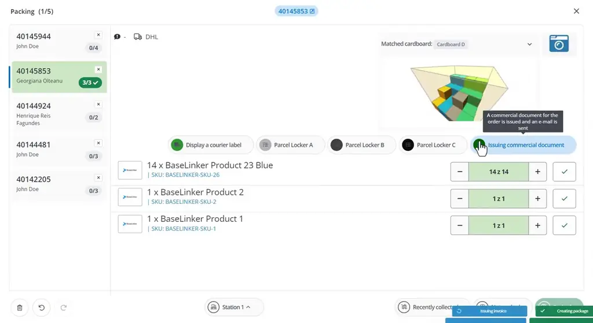
*[▶ 00:03:52](https://www.youtube.com/watch?v=Y4s-KyvRPyw&t=232s) · Packing assistant order list and courier actions*

Packed orders wait for courier pickup, and the assistant shows order details without opening the order card.

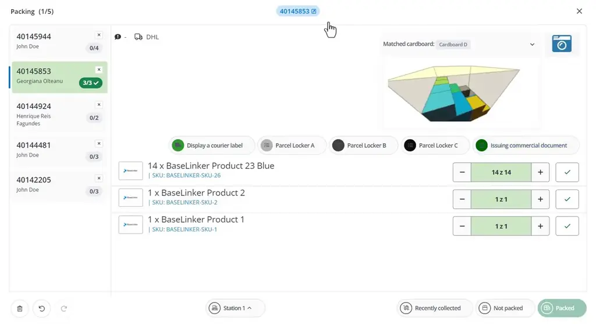
*[▶ 00:03:58](https://www.youtube.com/watch?v=Y4s-KyvRPyw&t=238s) · Packing assistant order list and item packing*

The order card confirms the DHL PL shipment and its package number.

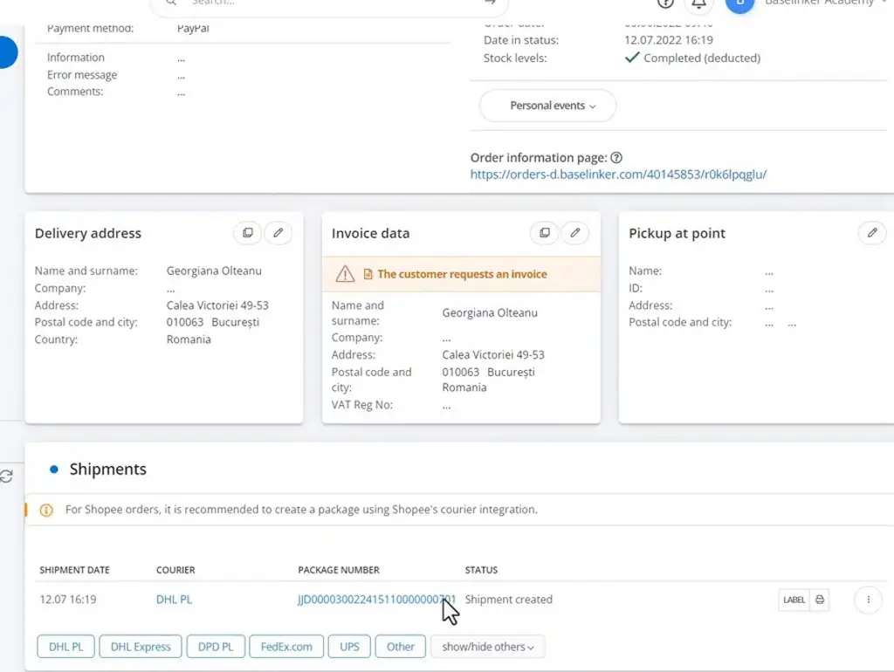
*[▶ 00:04:10](https://www.youtube.com/watch?v=Y4s-KyvRPyw&t=250s) · BaseLinker order card with shipment status*

Its history records packing finished at Station 1.

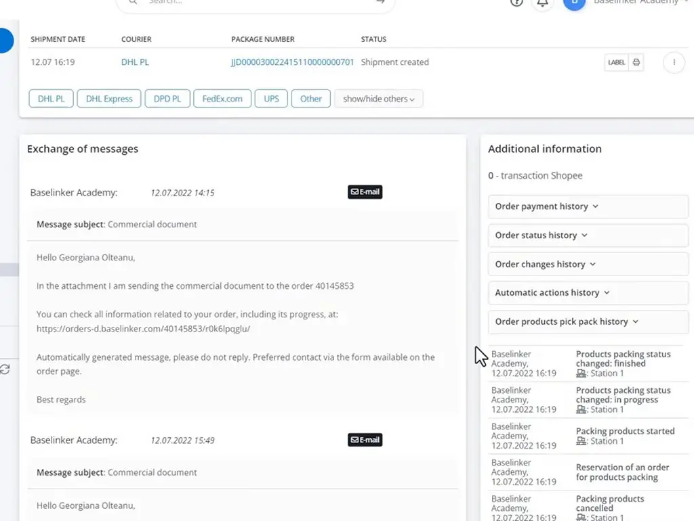
*[▶ 00:05:10](https://www.youtube.com/watch?v=Y4s-KyvRPyw&t=310s) · Order card shipment and packing history*

Invoices open from the order card.

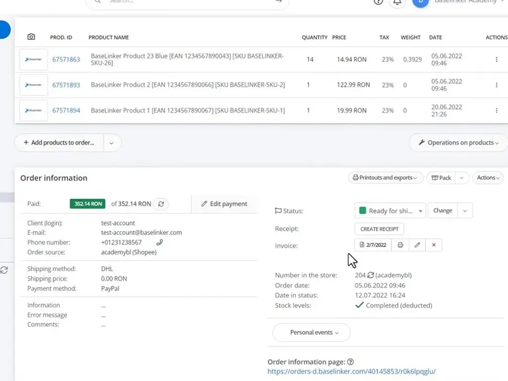
*[▶ 00:05:15](https://www.youtube.com/watch?v=Y4s-KyvRPyw&t=315s) · Order card products and order information*

Ready for shipping icons show that the shipment and invoice are issued.

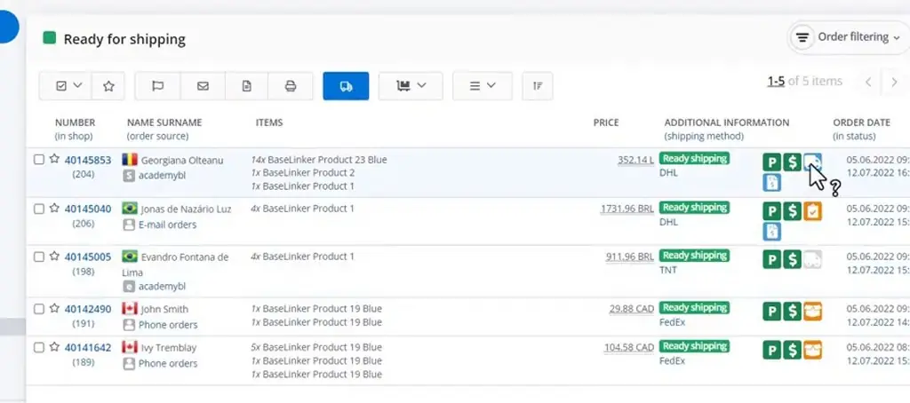
*[▶ 00:05:35](https://www.youtube.com/watch?v=Y4s-KyvRPyw&t=335s) · Order list: ready for shipping*

## Reopening packed orders to finish shipping

[▶ 00:05:50](https://www.youtube.com/watch?v=Y4s-KyvRPyw&t=350s)

Reopen a packed order that lacks a label or invoice and issue both from the packing assistant.

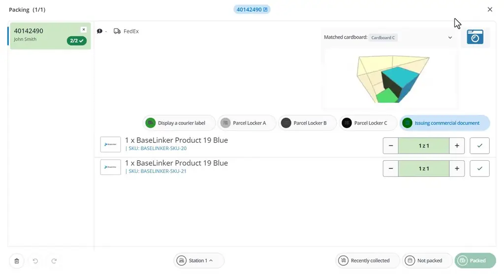
*[▶ 00:06:41](https://www.youtube.com/watch?v=Y4s-KyvRPyw&t=401s) · Packing assistant for order 40142490*

Check off every item to pack an order. It is then ready to send.

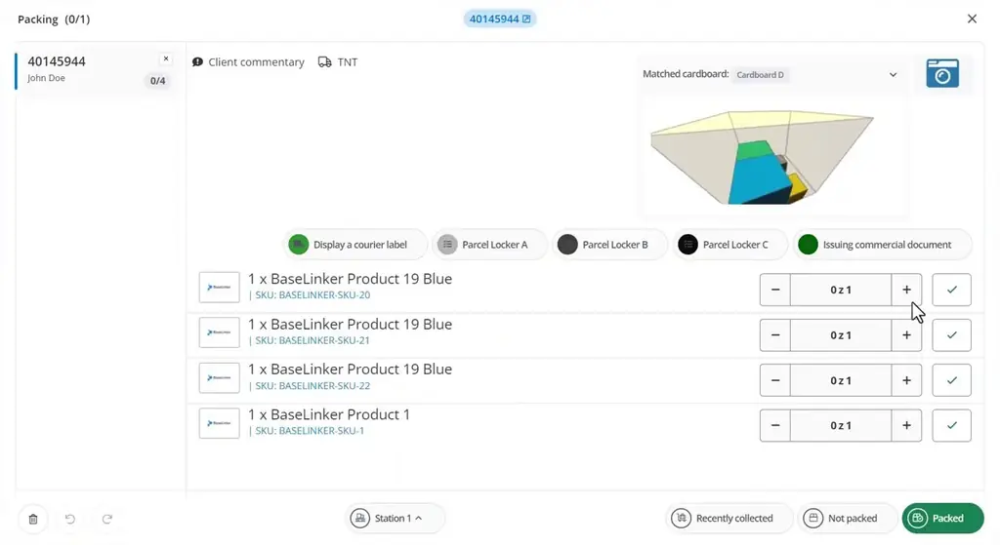
*[▶ 00:07:34](https://www.youtube.com/watch?v=Y4s-KyvRPyw&t=454s) · Packing assistant for order 40145944 before packing*

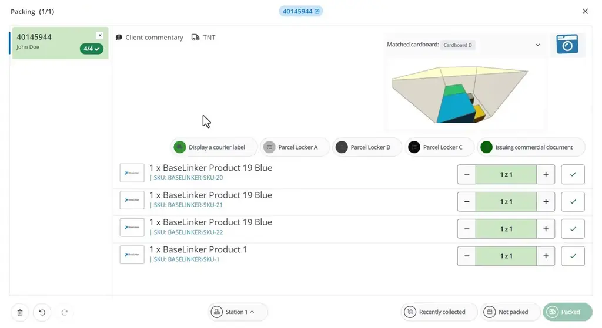
*[▶ 00:07:54](https://www.youtube.com/watch?v=Y4s-KyvRPyw&t=474s) · Packing assistant shows order fully packed*

Packing sets orders to Ready for shipping. A courier pickup then marks them shipped.

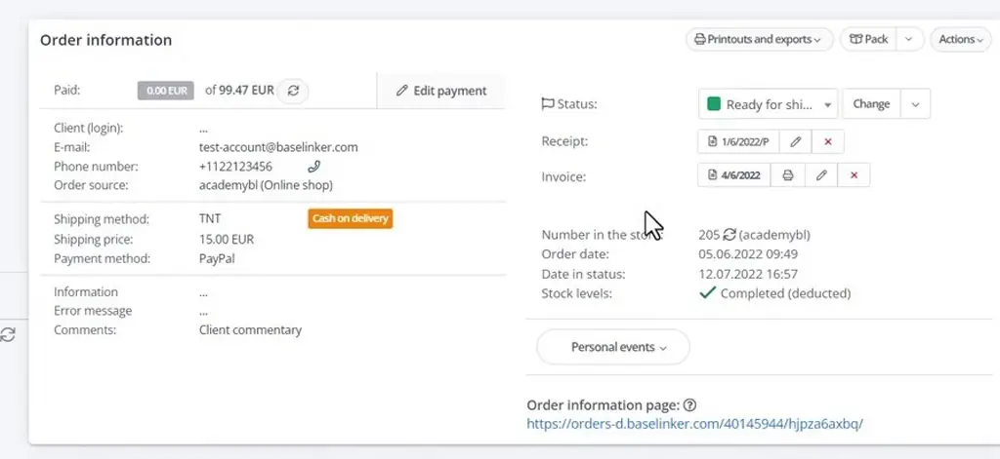
*[▶ 00:08:17](https://www.youtube.com/watch?v=Y4s-KyvRPyw&t=497s) · BaseLinker order card with documents and status*

Remaining orders can be packed manually, or an administrator can automate progression.

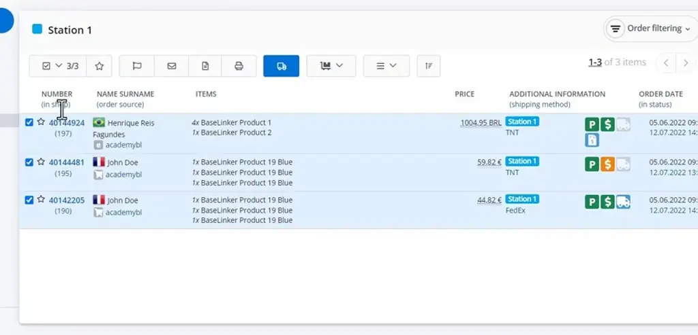
*[▶ 00:09:00](https://www.youtube.com/watch?v=Y4s-KyvRPyw&t=540s) · BaseLinker Station 1 order list, three orders*

The station view lists orders packed and awaiting courier pickup.

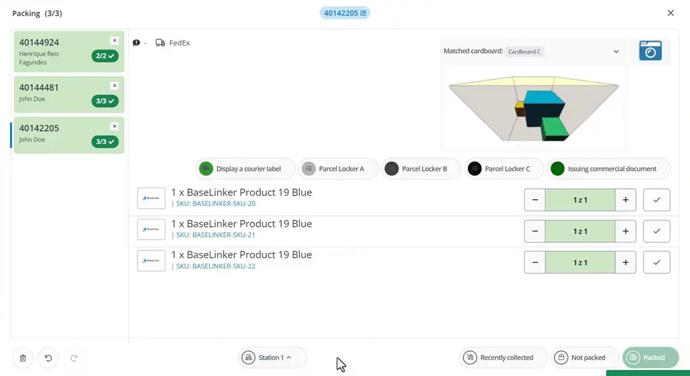
*[▶ 00:09:57](https://www.youtube.com/watch?v=Y4s-KyvRPyw&t=597s) · Packing station view with courier and parcel options*

## Links & resources

- [Packing Assistant — linked resource, purpose not stated](https://bit.ly/3v3n6v3) — <https://bit.ly/3v3n6v3> · video description
