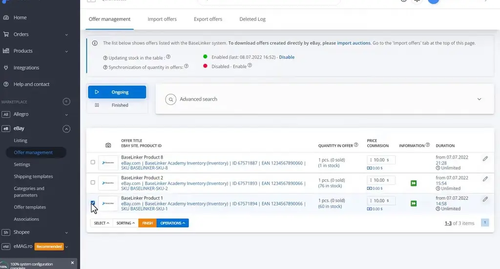
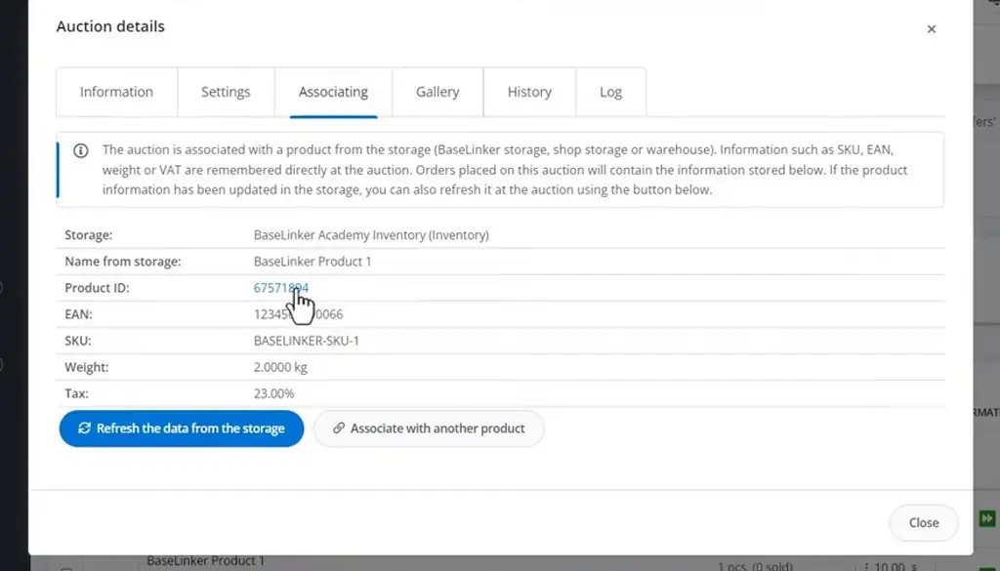
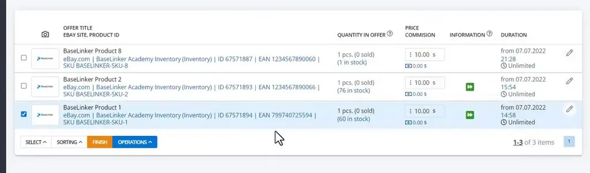
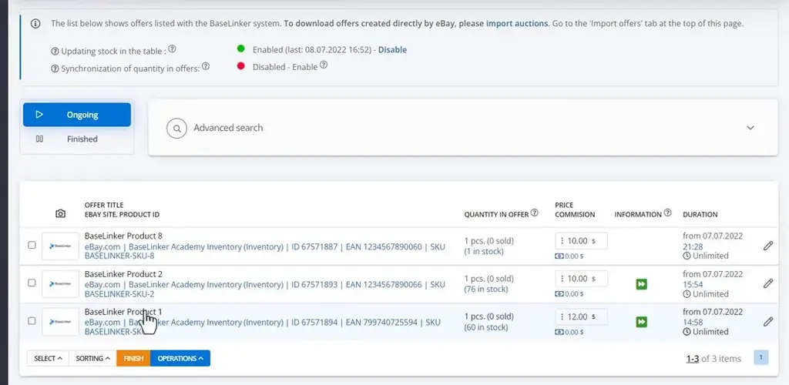
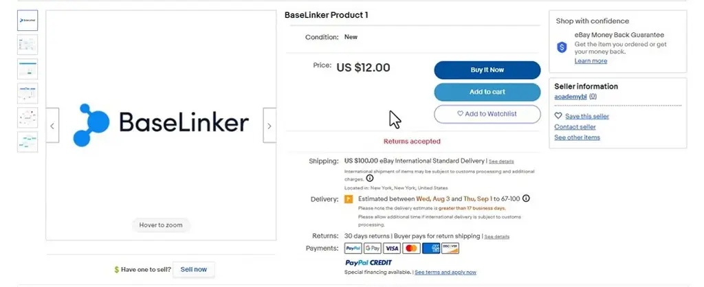
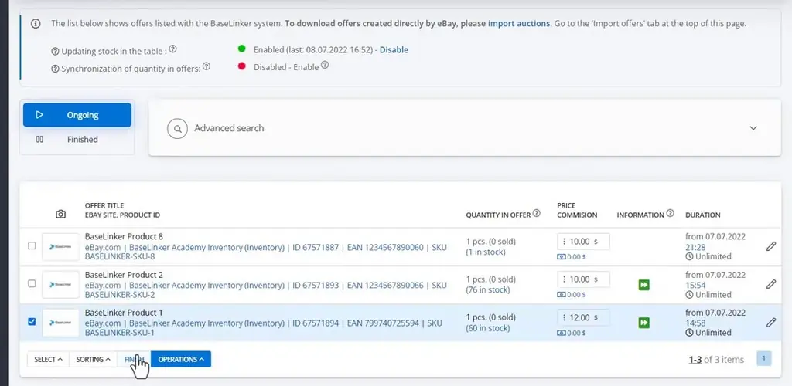

# Performing actions on auctions / offers | BaseLinker Academy

*Learn how to apply bulk changes, such as EAN and price updates, to live eBay offers in BaseLinker and how to finish ongoing auctions.*

Source: [Performing actions on auctions / offers | BaseLinker Academy](https://www.youtube.com/watch?v=5PaKKSCJGDE) · Base · 5 min

## TL;DR

Managing live eBay offers one at a time is slow, and daily offer work in BaseLinker often calls for changes across many listings. The approach shown is to select offers and use the OPERATIONS menu for bulk changes. Auction data such as EAN is stored in BaseLinker, so edits made there can be pushed to ongoing auctions in one step. This saves time on routine offer maintenance, such as keeping identifiers and prices current and ending auctions.

## Key takeaways

- Select the eBay offers you want to change, then use the OPERATIONS menu to apply bulk changes.
- Auctions store storage data such as EAN, so edit the EAN in storage first.
- After editing the EAN in storage, run "Update the ongoing auctions" with Product EAN to push the change to live auctions.
- A $1 price increase in the main list changes the gross price to $12.00 in the example shown.
- Offer names open the eBay pages, so you can check the new price on the live listing.
- Use "Finish ongoing auctions" to end live auctions in bulk.
- Disable automatic re-listing when you finish ongoing auctions if you do not want them listed again.

## Bulk operations on live eBay offers

[▶ 00:00:00](https://www.youtube.com/watch?v=5PaKKSCJGDE&t=0s)

Select offers, then use **OPERATIONS** for bulk changes.

*[▶ 00:00:14](https://www.youtube.com/watch?v=5PaKKSCJGDE&t=14s) · Offer management list with one offer selected*

Auctions store storage data such as EAN.

*[▶ 00:01:26](https://www.youtube.com/watch?v=5PaKKSCJGDE&t=86s) · Auction details: Associating tab*

Edit the EAN in storage, then run **Update the ongoing auctions** with Product EAN.

*[▶ 00:01:59](https://www.youtube.com/watch?v=5PaKKSCJGDE&t=119s) · eBay offer management list with synced offers*

A $1 price increase in the main list changes the gross price to $12.00.

*[▶ 00:04:09](https://www.youtube.com/watch?v=5PaKKSCJGDE&t=249s) · Offer management list with ongoing auctions*

Offer names open eBay pages showing the new price.

*[▶ 00:04:22](https://www.youtube.com/watch?v=5PaKKSCJGDE&t=262s) · eBay listing page showing the new price*

Finish ongoing auctions, optionally with automatic re-listing disabled.

*[▶ 00:04:28](https://www.youtube.com/watch?v=5PaKKSCJGDE&t=268s) · Selecting an auction before finishing it*

## Links & resources

- [Link from the video description (purpose not stated in talk)](https://bit.ly/3v3n6v3) — <https://bit.ly/3v3n6v3> · video description
