# Performing actions on orders | BaseLinker Academy

*How to use BaseLinker's order actions to process single and multiple orders faster, including merging, splitting, similar-order search, and custom events.*

Source: [Performing actions on orders | BaseLinker Academy](https://www.youtube.com/watch?v=Tr1qzpHPl5Y) · Base · 9 min

## TL;DR

Handling orders one at a time in BaseLinker is slow, so the panel offers automatic actions that work on a single order or on a selection in the order list. The built-in actions cover payment status, a one-month Bin with restore, merging, and splitting. Similar-order search groups unserved orders, and admins can define custom events that run from the list, the order card, or a barcode scanner. These actions shorten repetitive order handling, and the automatic actions history confirms what ran.

## Key takeaways

- Each order's page offers custom events and basic actions, and the order list applies the same kinds of actions to selected orders.
- The payment setting marks orders as fully paid or unpaid.
- Deleted orders stay in the Bin for a month and can be restored.
- Merging keeps the main order's number and invoice details, while splitting divides products into two orders and then sets delivery and payment.
- Similar-order search groups unserved orders by buyer email or by name/company after a chosen start date, and matches can be displayed before merging.
- Admins define custom events that can be run from the order list, the order card, or a barcode scanner.
- Cancelling moves an order to Cancelled and emails the customer, and starting a return moves it to Return declared and emails the customer.
- Commercial documents create an invoice and email it, and the automatic actions history confirms the run.

## Running actions on single and multiple orders

[▶ 00:00:00](https://www.youtube.com/watch?v=Tr1qzpHPl5Y&t=0s)

Each order's page offers custom events and basic actions.

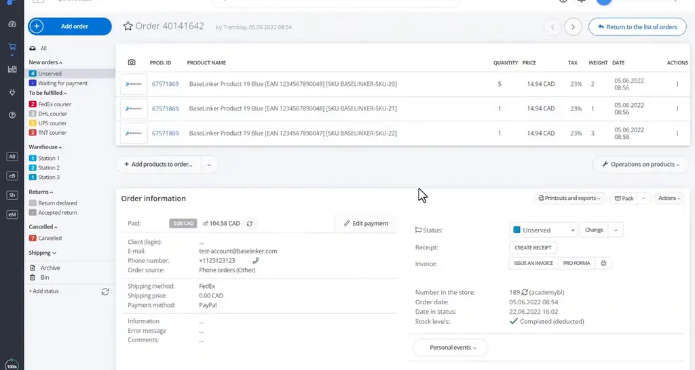
*[▶ 00:00:09](https://www.youtube.com/watch?v=Tr1qzpHPl5Y&t=9s) · BaseLinker order 40141642 detail view*

The list does the same for selected orders.

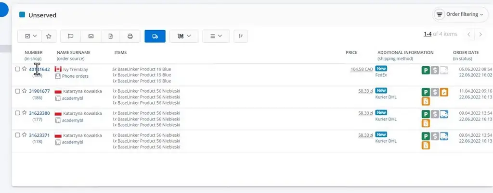
*[▶ 00:00:06](https://www.youtube.com/watch?v=Tr1qzpHPl5Y&t=6s) · Unserved orders list in BaseLinker*

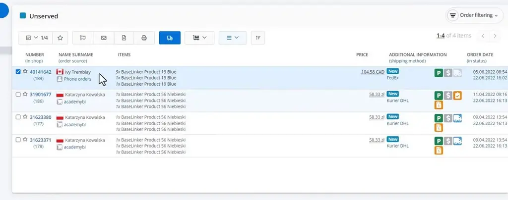
*[▶ 00:00:47](https://www.youtube.com/watch?v=Tr1qzpHPl5Y&t=47s) · Orders list with one order selected*

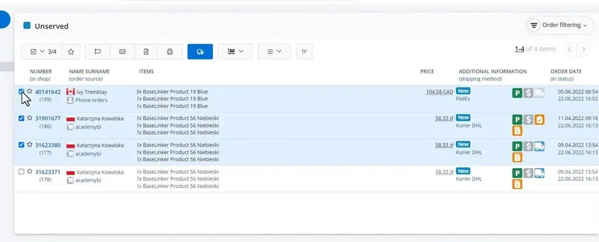
*[▶ 00:01:01](https://www.youtube.com/watch?v=Tr1qzpHPl5Y&t=61s) · Order list with multi-select actions*

Payment setting marks orders fully paid or unpaid.

Deleted orders stay in the Bin for a month and can be restored.

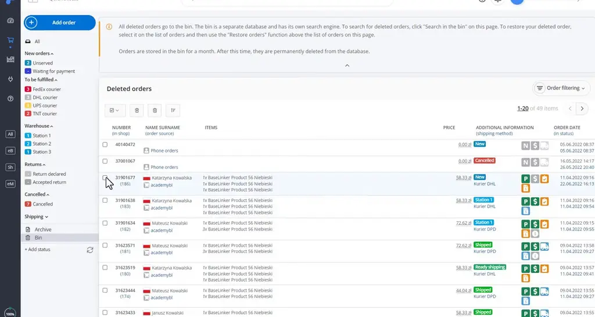
*[▶ 00:02:13](https://www.youtube.com/watch?v=Tr1qzpHPl5Y&t=133s) · Deleted orders bin page*

Merging keeps the main order's number and invoice details.

Splitting divides products into two orders, then sets delivery and payment.

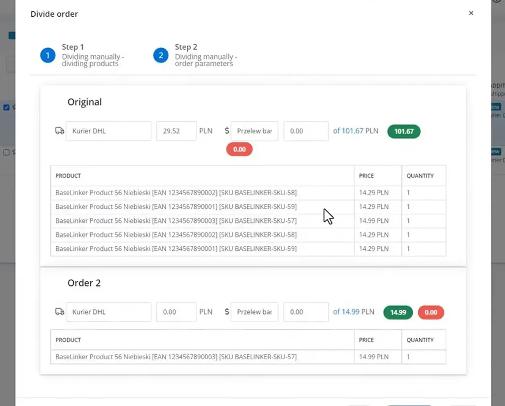
*[▶ 00:03:17](https://www.youtube.com/watch?v=Tr1qzpHPl5Y&t=197s) · Divide order dialog: step 2 order parameters*

## Similar-order search and custom order events

[▶ 00:03:26](https://www.youtube.com/watch?v=Tr1qzpHPl5Y&t=206s)

Similar-order search groups unserved orders by buyer email or name/company after a chosen start date.

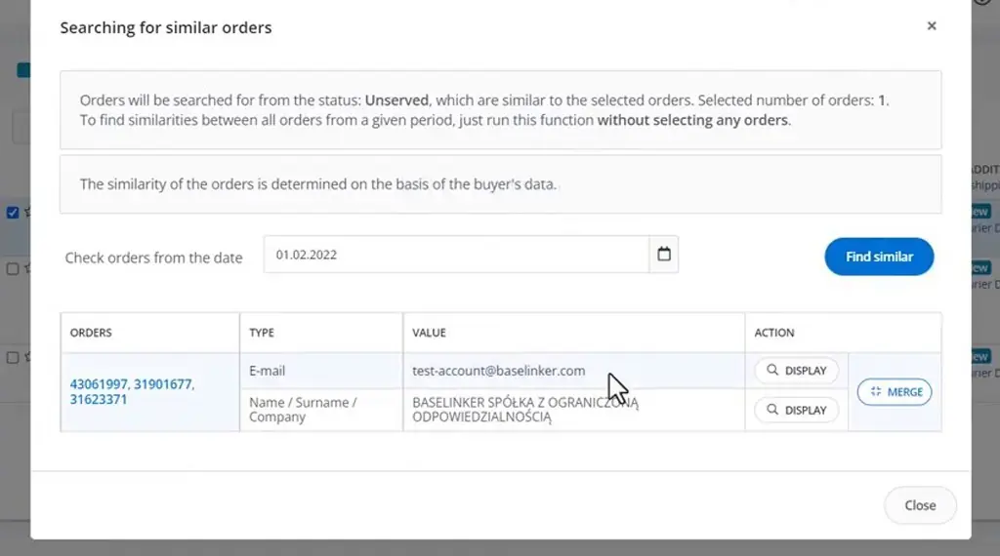
*[▶ 00:04:09](https://www.youtube.com/watch?v=Tr1qzpHPl5Y&t=249s) · Searching for similar orders dialog in BaseLinker*

Matches can be displayed before merging.

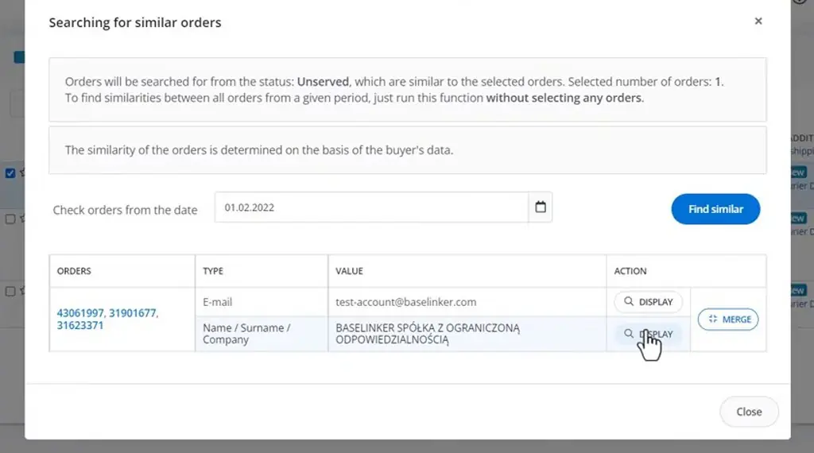
*[▶ 00:04:23](https://www.youtube.com/watch?v=Tr1qzpHPl5Y&t=263s) · Searching for similar orders dialog*

Admins define custom events, run from the list, order card, or barcode scanner.

Cancelling moves the order to Cancelled and emails the customer.

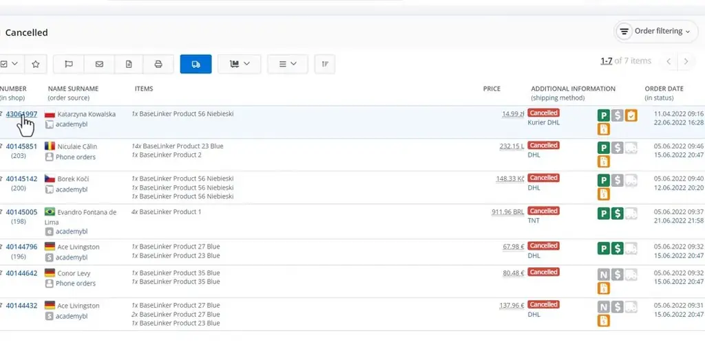
*[▶ 00:06:12](https://www.youtube.com/watch?v=Tr1qzpHPl5Y&t=372s) · Cancelled orders list, 7 items*

Commercial documents create an invoice and email it; the [automatic actions history](https://orders-d.baselinker.com/31901677/dfy82k929j/) confirms the run.

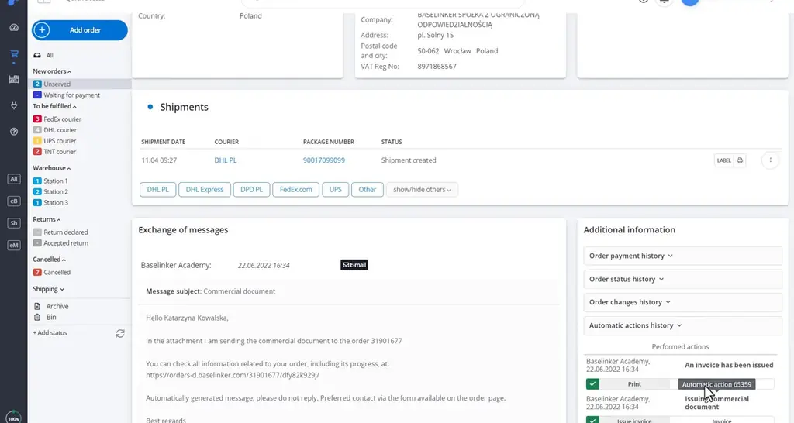
*[▶ 00:07:20](https://www.youtube.com/watch?v=Tr1qzpHPl5Y&t=440s) · Order card: shipments, sent email and action history*

Events run on orders selected in the list; order 31901677 is still Unserved before the return starts.

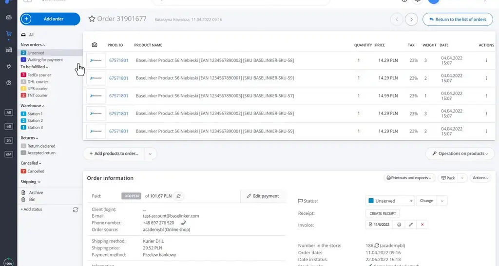
*[▶ 00:07:48](https://www.youtube.com/watch?v=Tr1qzpHPl5Y&t=468s) · Order 31901677 product list and order information*

Start return moves an order to Return declared and emails the customer.

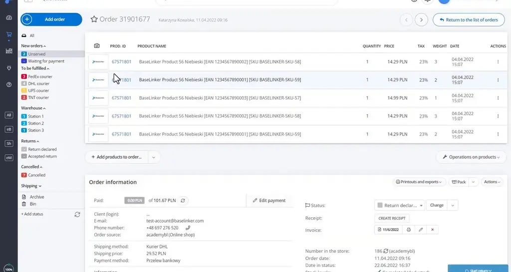
*[▶ 00:08:15](https://www.youtube.com/watch?v=Tr1qzpHPl5Y&t=495s) · Order card with status change in progress*

Quick courier labels skip manual courier choice; parcel locker labels can be set by size.

## Links & resources

- [Link from the video description (purpose not stated in talk)](https://bit.ly/3v3n6v3) — <https://bit.ly/3v3n6v3> · video description
- [Message log and automatic actions history screen on BaseLinker](https://orders-d.baselinker.com/31901677/dfy82k929j/) — <https://orders-d.baselinker.com/31901677/dfy82k929j/> · on screen [▶ 00:08:36](https://www.youtube.com/watch?v=Tr1qzpHPl5Y&t=516s)
