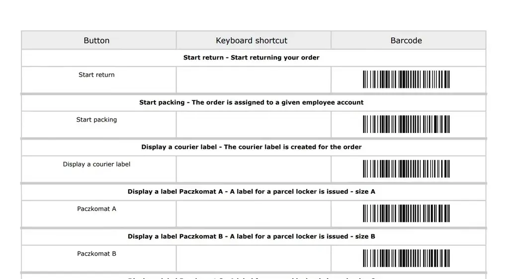
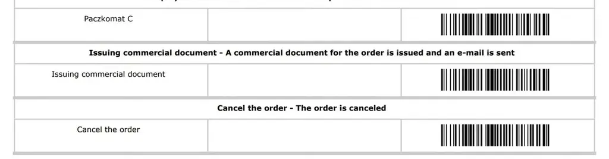
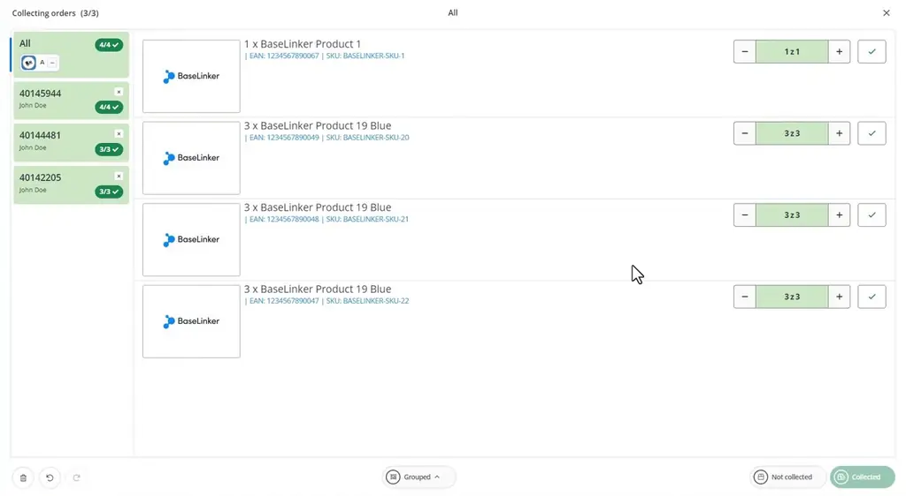
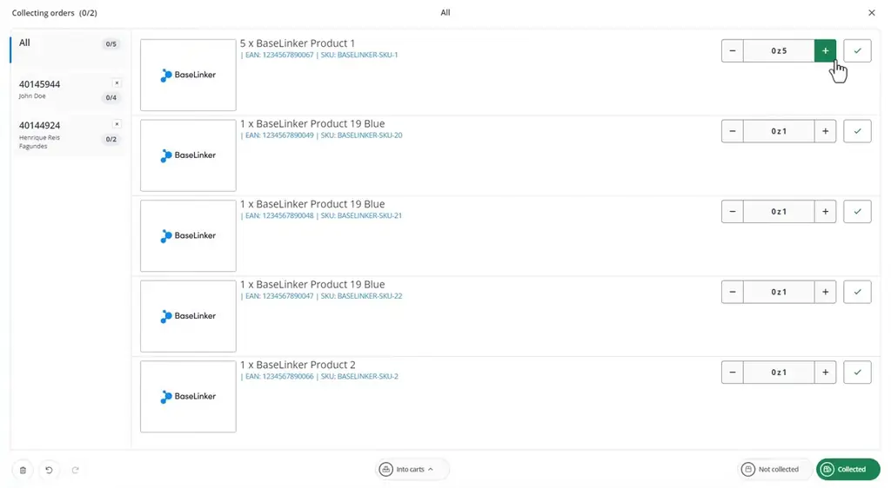
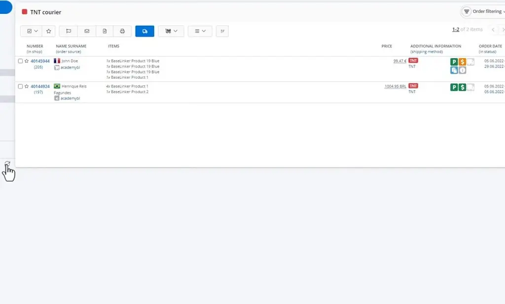
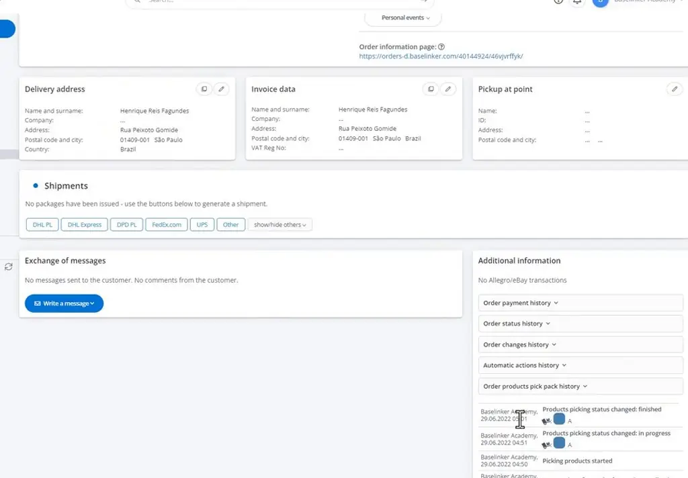

# Picking Assistant | BaseLinker Academy

*Learn the three Picking Assistant modes (separate, grouped, and cart) and how barcode scans, undo, and pick history fit into packing orders in BaseLinker.*

Source: [Picking Assistant | BaseLinker Academy](https://www.youtube.com/watch?v=0gCrfQeHrL0) · Base · 5 min

## TL;DR

Packing a parcel means collecting the right products for each order, which can be slow when orders are handled one at a time. BaseLinker's Picking Assistant automates this with barcode scanning and three collection modes: separate, grouped, and cart. Scanning a barcode can trigger actions such as printing a label or cancelling an order, and completing an order runs its automatic action once. Undo and per-order pick history help correct mistakes and track who handled each order.

## Key takeaways

- Start picking from the "Pick products" option in the order list, or by scanning orders directly.
- Grouped mode lists items from several orders together, and a single check marks those items as collected for all of the orders.
- Cart mode sorts picked items into carts, and scanning a cart's barcode links that cart to the order.
- Any custom event can be assigned a barcode, so a scan can trigger actions beyond picking, such as issuing a label or cancelling an order.
- Completing an order runs its automatic action once, and the Undo function corrects mistakes.
- Orders that have been collected show an orange icon in the list.
- Pick pack history records the user and timestamp for each order, so you can see who handled it and when.

## Scanner-driven picking, grouped and cart modes

[▶ 00:00:00](https://www.youtube.com/watch?v=0gCrfQeHrL0&t=0s)

Barcodes can trigger actions beyond picking, like issuing labels or cancelling orders.

*[▶ 00:00:46](https://www.youtube.com/watch?v=0gCrfQeHrL0&t=46s) · Picking assistant barcode table*

Any custom event can be given a barcode.

*[▶ 00:01:00](https://www.youtube.com/watch?v=0gCrfQeHrL0&t=60s) · Barcode actions: issue document, cancel order*

Start from **Pick products** in the order list or by scanning orders.

Grouped mode lists items from several orders together; one check marks them for all of them.

*[▶ 00:03:08](https://www.youtube.com/watch?v=0gCrfQeHrL0&t=188s) · Grouped collection completed*

Into carts sorts items into carts; scanning a cart's barcode links it to the order.

*[▶ 00:03:33](https://www.youtube.com/watch?v=0gCrfQeHrL0&t=213s) · Into carts collection with order tabs*

Completing an order runs its automatic action once; **Undo** fixes mistakes. Collected orders show an orange icon.

*[▶ 00:04:37](https://www.youtube.com/watch?v=0gCrfQeHrL0&t=277s) · Station 2 order list after collection*

Pick pack history logs the user and timestamps for each order.

*[▶ 00:05:01](https://www.youtube.com/watch?v=0gCrfQeHrL0&t=301s) · Order card with pick pack history*

## Links & resources

- [Link from the video description (purpose not stated in talk)](https://bit.ly/3v3n6v3) — <https://bit.ly/3v3n6v3> · video description
