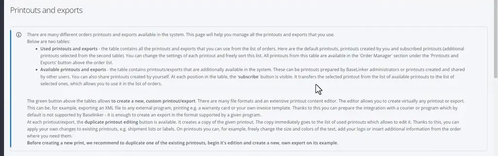
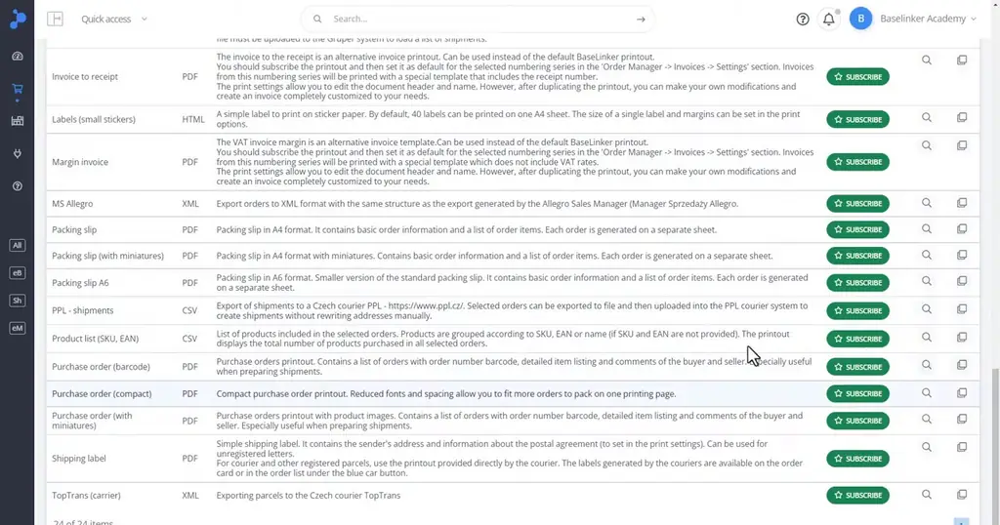
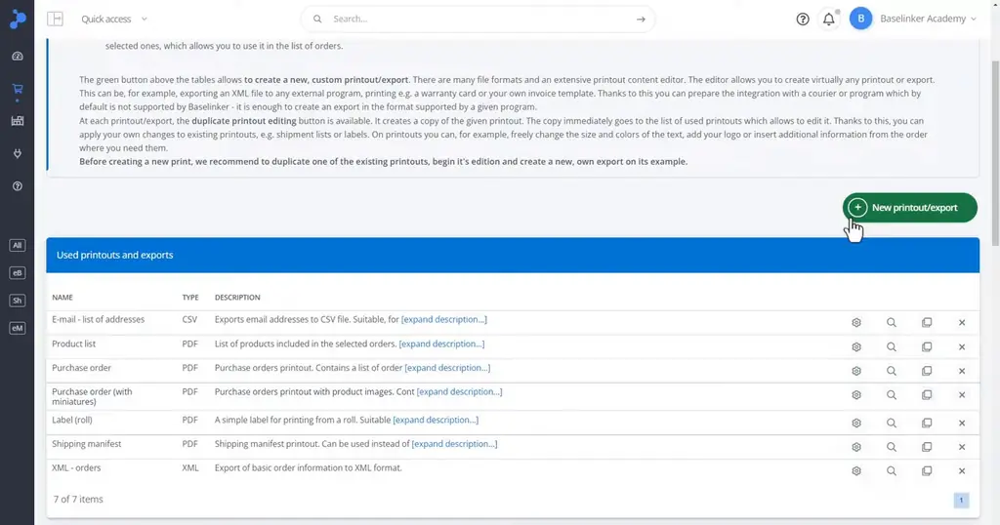
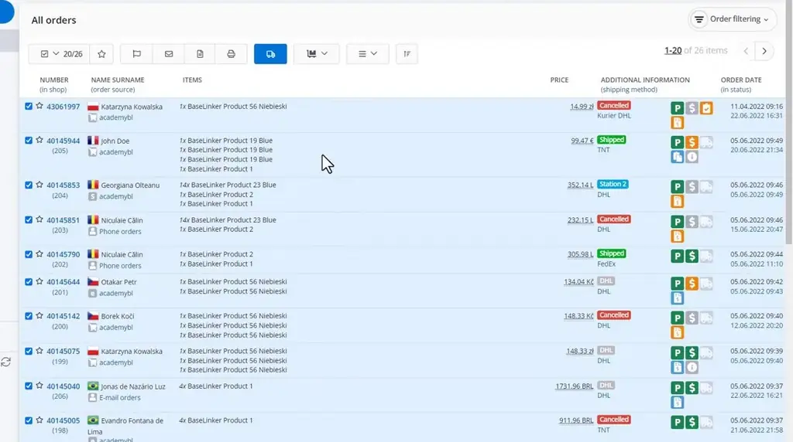
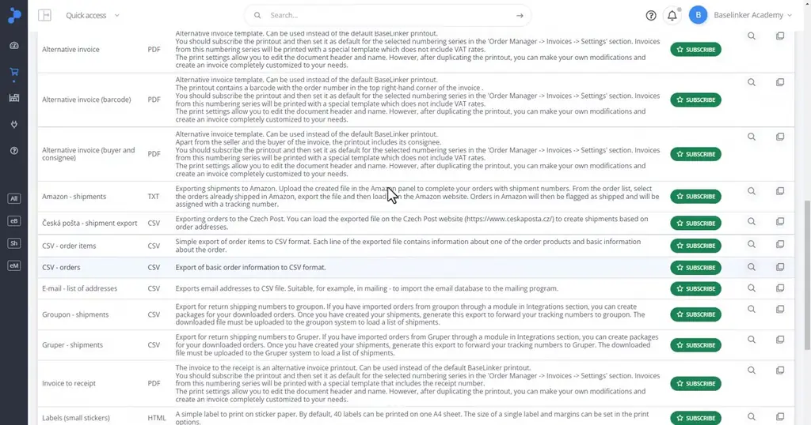

# Reports, printouts, exports | BaseLinker Academy

*Learn how BaseLinker turns order data into printouts and exports, from adding a ready template to combining orders and downloading CSV or XML files.*

Source: [Reports, printouts, exports | BaseLinker Academy](https://www.youtube.com/watch?v=_UaZSSZf50Q) · Base · 4 min

## TL;DR

Sellers often need order data in a physical or file form, such as shipping labels, product lists, or mailing lists, and building these by hand is slow. BaseLinker's printouts and exports convert order data into printed documents or downloadable files. You subscribe to add a ready printout from the Available table, then duplicate it to change things like text size or colours. Because selected orders can merge into one printout and CSV exports cover every order across pages, this saves time on routine fulfilment and reporting work.

## Key takeaways

- Printouts and exports turn BaseLinker order data into printed documents or files, such as labels.
- To add a printout, subscribe and then pick it from the Available table.
- Duplicate an existing printout when you need to change its appearance, such as text size or colours, instead of editing the original.
- Select several orders and generate one combined printout that shows the total product count.
- The E-mail CSV export includes every order across all pages, so it works for building a complete mailing list.
- XML exports download as files that you can preview before using them.

## Generating printouts and exports from orders

[▶ 00:00:00](https://www.youtube.com/watch?v=_UaZSSZf50Q&t=0s)

**Printouts and exports** turn order data into printouts or files such as labels.


*[▶ 00:01:19](https://www.youtube.com/watch?v=_UaZSSZf50Q&t=79s) · Printouts and exports page introduction*

Subscribe to add a printout from the Available table.


*[▶ 00:00:51](https://www.youtube.com/watch?v=_UaZSSZf50Q&t=51s) · Available printouts and exports table*

Duplicate to edit, e.g. text size or colours.


*[▶ 00:01:14](https://www.youtube.com/watch?v=_UaZSSZf50Q&t=74s) · Used printouts and exports table*

Selected orders combine into one printout with a total product count.


*[▶ 00:02:50](https://www.youtube.com/watch?v=_UaZSSZf50Q&t=170s) · All orders list with 20 of 26 selected*

Mailing list: the E-mail CSV export covers every order across pages.


*[▶ 00:03:19](https://www.youtube.com/watch?v=_UaZSSZf50Q&t=199s) · BaseLinker printouts and exports list*

XML exports download as files you can preview.

```xml
<?xml version="1.0" encoding="utf-8"?>
<orders>
<order>
<order_id>43061997</order_id>
<date_add>11.04.2022 09:16:58</date_add>
<payment_name>Przelew bankowy</payment_name>
<payment_status>0</payment_status>
<payment_paid>0.00</payment_paid>
<delivery_type>Kurier DHL</delivery_type>
<delivery_price>0.00</delivery_price>
<buyer_comments></buyer_comments>
<seller_comments></seller_comments>
<client_login></client_login>
<client_email>test-account@baselinker.com</client_email>
<client_phone>+48697276520</client_phone>
<client_name></client_name>
<client_company>BASELINKER SPÓŁKA Z OGRANICZONĄ ODPOWIEDZIALNOŚCIĄ</client_company>
<client_nip>8971868567</client_nip>
<client_postal>50-062</client_postal>
<client_city>Wrocław</client_city>
<client_address>pl. Solny 15</client_address>
<client_want_invoice>1</client_want_invoice>
<address_name>Katarzyna Kowalska</address_name>
<address_company></address_company>
<address_country>Poland</address_country>
<address country code>PL</address country code>
```

*[▶ 00:03:03](https://www.youtube.com/watch?v=_UaZSSZf50Q&t=183s) · XML order export preview in Notepad*

## Links & resources

- [Link from the video description (bit.ly short link, target not stated in talk)](https://bit.ly/3v3n6v3) — <https://bit.ly/3v3n6v3> · video description
