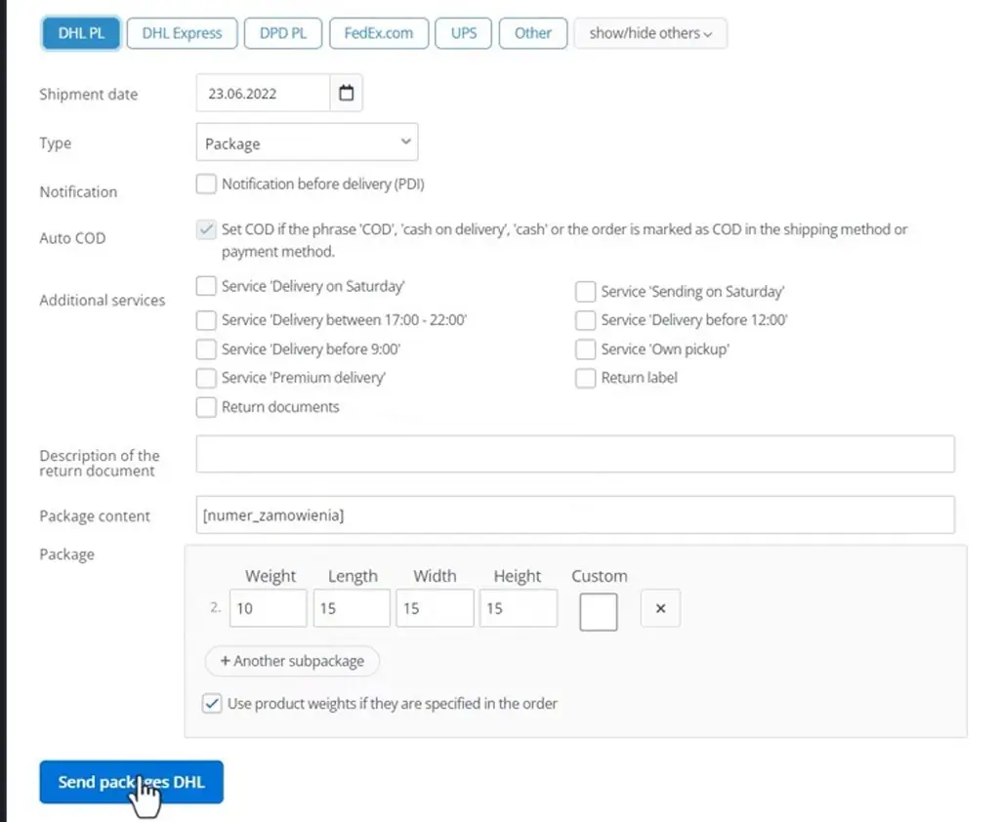
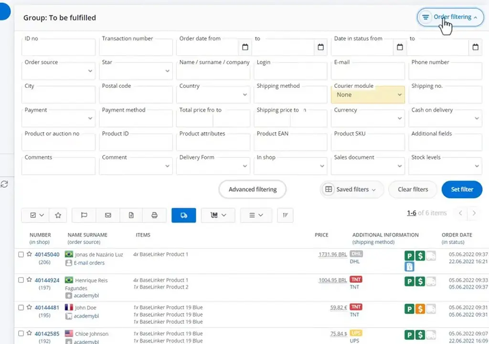
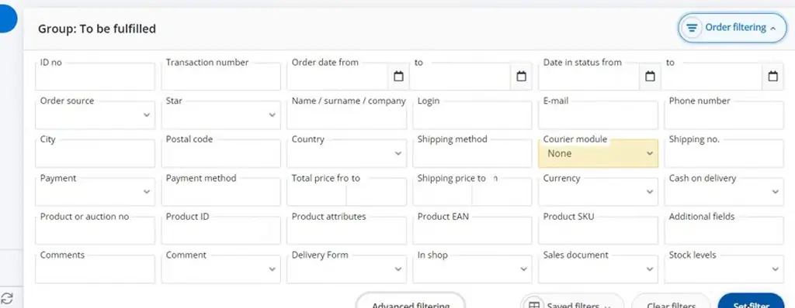
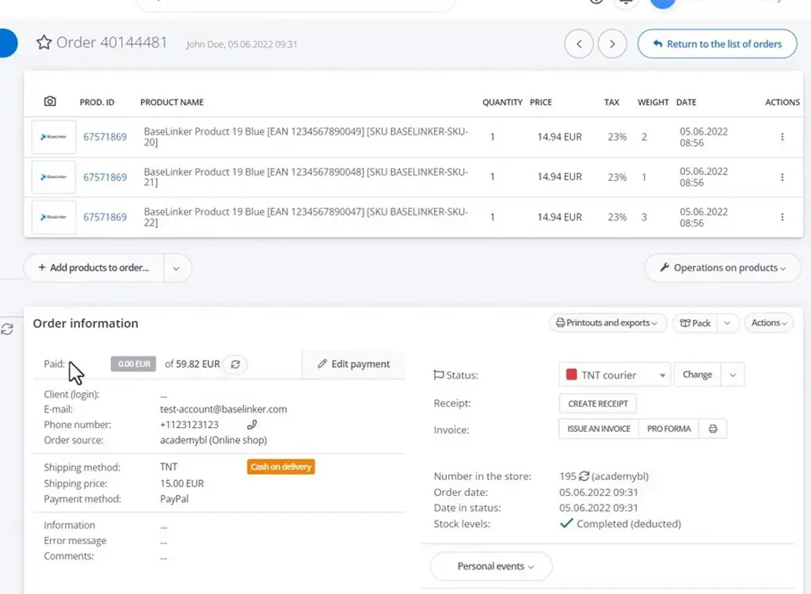
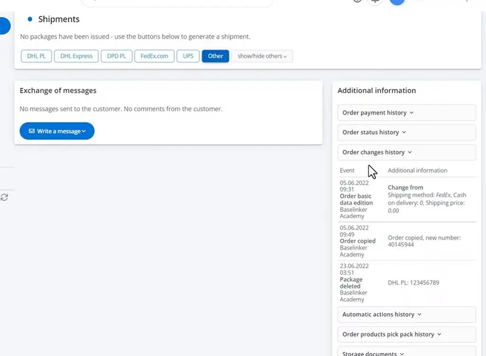
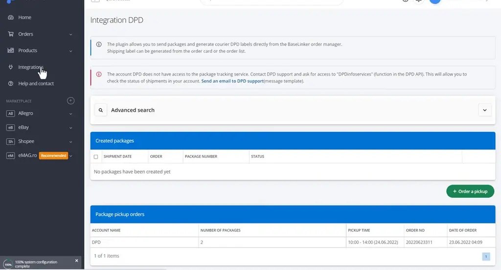

# Shipping parcels | BaseLinker Academy

*Learn how BaseLinker creates single and bulk courier shipments from orders, finds orders still missing labels, and records shipments added outside the system.*

Source: [Shipping parcels | BaseLinker Academy](https://www.youtube.com/watch?v=71XOzTR2BZY) · Base · 8 min

## TL;DR

Sending parcels for many orders through different couriers means repeating the same entry work for each one. BaseLinker creates courier shipments either one at a time from the order card or in bulk from the order list, and the order's shipping method selects the courier. Weight comes from the order and dimensions from the integration defaults, so most fields are filled automatically before you send. Filters and order history help you catch orders that still lack a label and see who deleted a shipment.

## Key takeaways

- Create a single courier shipment from the order card, or create shipments in bulk from the order list, and the courier is set by the order's shipping method.
- In the Shipments section, set the date, package type, COD, insurance and extra services; the weight is taken from the order and the dimensions from the integration defaults.
- Add or remove subpackages before sending a shipment.
- Bulk label generation works for only one delivery method at a time, so group orders by delivery method first.
- To find orders that still lack a label, filter the order list by Courier module: None.
- For a label created outside BaseLinker, enter the courier and package number on the order so it is linked to the order.
- BaseLinker does not track shipment status, but the order's change history records who deleted a shipment and when.
- Each integration page lists the packages created through it, and DPD integrations also offer pickup orders and label and protocol downloads.

## Creating courier shipments from orders, bulk lists and manual entry

[▶ 00:00:00](https://www.youtube.com/watch?v=71XOzTR2BZY&t=0s)

BaseLinker ships parcels one at a time from the order card or in bulk from the order list, with the courier set by the order's shipping method.

In the Shipments section, set the date, package type, COD, insurance and extra services. The weight comes from the order and the dimensions from the integration defaults. Subpackages can be added or removed before sending.

*[▶ 00:03:03](https://www.youtube.com/watch?v=71XOzTR2BZY&t=183s) · DHL PL shipment form*

Bulk generation works for one delivery method at a time.

*[▶ 00:05:50](https://www.youtube.com/watch?v=71XOzTR2BZY&t=350s) · Order filtering panel with courier module None*

To find orders that still lack a label, filter by Courier module: None.

*[▶ 00:04:29](https://www.youtube.com/watch?v=71XOzTR2BZY&t=269s) · Order filtering panel set to Courier module None*

For a label created outside BaseLinker, enter the courier and package number on the order.

*[▶ 00:04:44](https://www.youtube.com/watch?v=71XOzTR2BZY&t=284s) · Order 40144481 detail with TNT courier status*

The shipment's status is not tracked, and the order's change history logs who deleted a shipment and when.

*[▶ 00:05:36](https://www.youtube.com/watch?v=71XOzTR2BZY&t=336s) · Manual shipment entry and order changes history*

Each integration page lists created packages. DPD also offers pickup orders and label and protocol downloads.

*[▶ 00:06:54](https://www.youtube.com/watch?v=71XOzTR2BZY&t=414s) · BaseLinker Integration DPD page*

## Links & resources

- [Link from the video description; purpose not stated in the talk](https://bit.ly/3v3n6v3) — <https://bit.ly/3v3n6v3> · video description
