# Advanced Context Engineering

*Learn how to own the prompt, context, and control flow of an agent so you can push it past the 70–80% quality plateau.*

Source: [Advanced Context Engineering](https://www.youtube.com/watch?v=2yi4mAN3CtE) · Dex · AAIF Live · 29 min

## TL;DR

Many agent projects reach a 70–80% quality bar quickly and then stall, and framework prompts and flows are hard to fix. The talk's answer is to treat an agent as ordinary software: a prompt that returns JSON, a switch statement, a context of events and results, and a for loop that you own. Because the input tokens are the only lever on quality beyond the model and its settings, controlling exactly what goes into the context is what makes an agent reliable. This matters because accuracy is a performance metric like latency or uptime, and the speaker argues it deserves the same engineering discipline.

## Key takeaways

- Check whether a problem needs an agent at all, since one Makefile agent took two hours and still ran tasks out of order while a bash script took about 90 seconds.
- Treat accuracy as a performance metric alongside latency, uptime, cost, and security, because a REST API failing 20% of requests would be an outage.
- Write the agent loop yourself: dispatch tool calls with plain if/elif/else code and include an else branch for unknown tools, rather than relying on a framework.
- Keep long-running agents stateless by saving context under a state ID, launching the job, and reloading the context when the webhook returns the result to append it and call the model again.
- Pass the whole trace in one user message using XML-style tags instead of a chain of tool-call messages, since the speaker's example used 57 tokens versus 87 for the same JSON request.
- Manage error context deliberately by clearing errors after a valid tool call succeeds, summarizing and redacting them, and limiting the loop count so the model does not repeat the same mistake.
- Make human contact a tool call so the model declares its intent to ask a person, and use LLMs only where language or human input is needed.
- Test agent decisions directly, for example by asserting that after a teamId UUID error the next intent is list_teams, and by checking that a full-trace test ends with done_for_now.

## Why Agents Stall at 80%

[▶ 00:00:00](https://www.youtube.com/watch?v=2yi4mAN3CtE&t=0s)

A typical agent project hits a 70–80% quality bar quickly, then stalls. Getting past it means reverse-engineering the framework's prompts and flow, so many builders start over from base API calls.

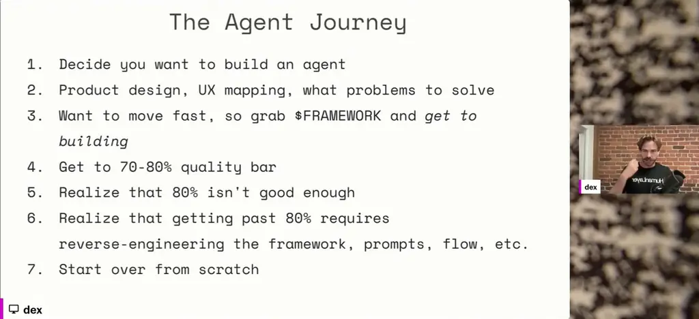
*[▶ 00:02:04](https://www.youtube.com/watch?v=2yi4mAN3CtE&t=124s) · The Agent Journey (steps 1-7)*

Not every problem needs an agent. One Makefile agent took two hours and still ran tasks out of order; a bash script would have taken about 90 seconds.

Accuracy joins latency, uptime, cost and security as a performance metric. A REST API failing on 20% of requests would be an outage, yet people tolerate AI hallucinations.

The [12-Factor Agents](https://github.com/humanlayer/12-factor-agents) repo, published in April, applies Heroku's twelve-factor conventions to agents.

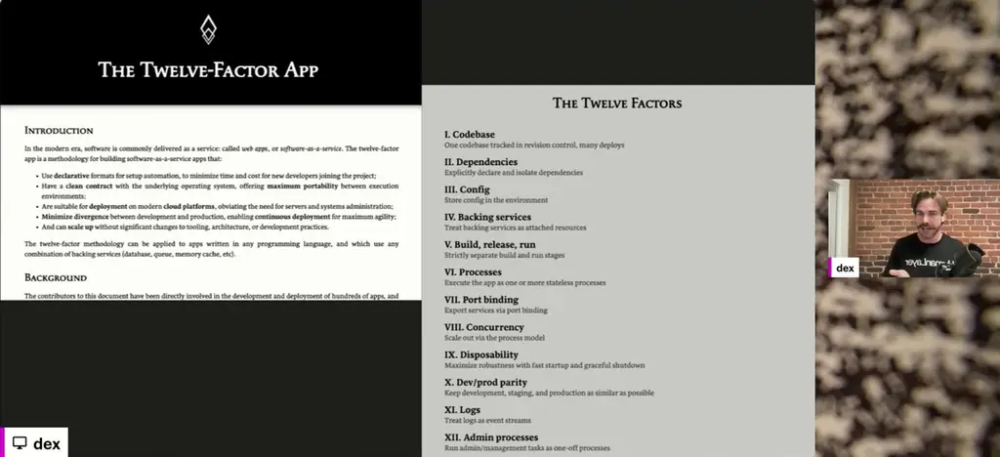
*[▶ 00:05:09](https://www.youtube.com/watch?v=2yi4mAN3CtE&t=309s) · The Twelve-Factor App and its twelve factors*

Its principles include owning prompts, context and control flow, and building stateless reducers.

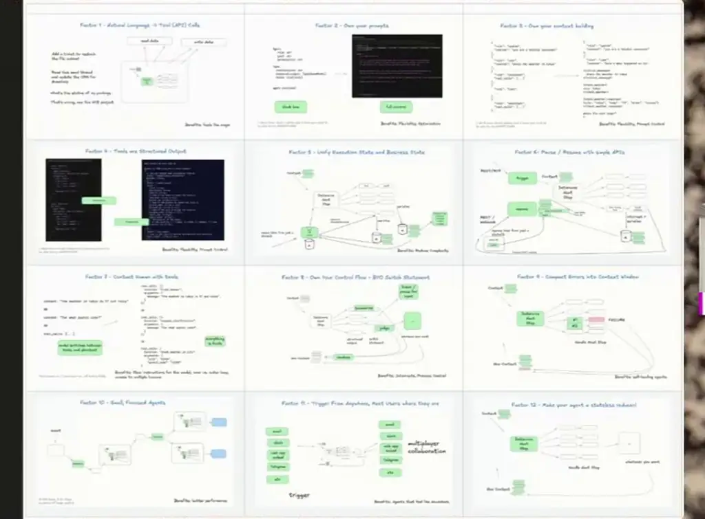
*[▶ 00:00:18](https://www.youtube.com/watch?v=2yi4mAN3CtE&t=18s) · 12 Factor Agents overview grid*

Within months the repo neared 9k GitHub stars and gained 14 contributors.

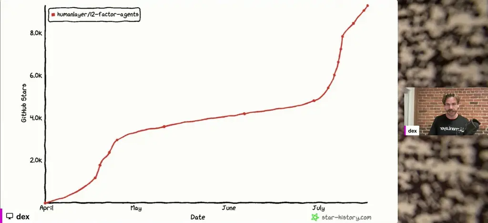
*[▶ 00:05:55](https://www.youtube.com/watch?v=2yi4mAN3CtE&t=355s) · GitHub stars growth, April to July*

In its first four months it outpaced the Model Context Protocol repo.

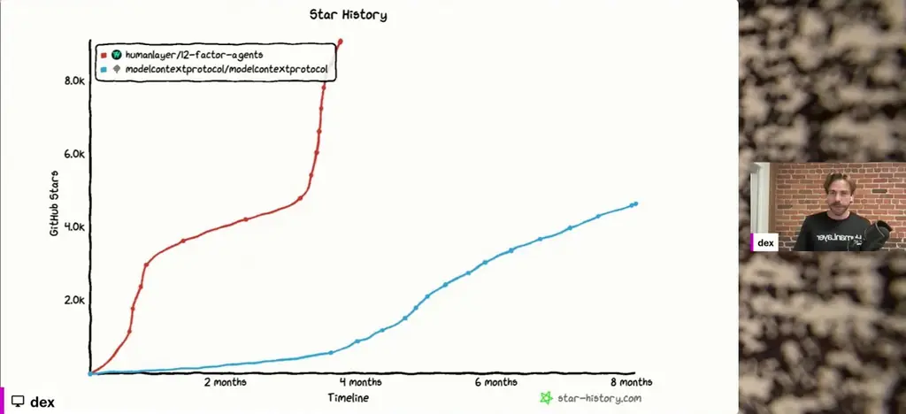
*[▶ 00:06:02](https://www.youtube.com/watch?v=2yi4mAN3CtE&t=362s) · Star history compared with MCP repo*

Context engineering took off in June after Cognition's Walden Yan wrote about multi-agent systems that fail. For the speaker, RAG, prompt engineering, state, memory and structured outputs all sit inside it.

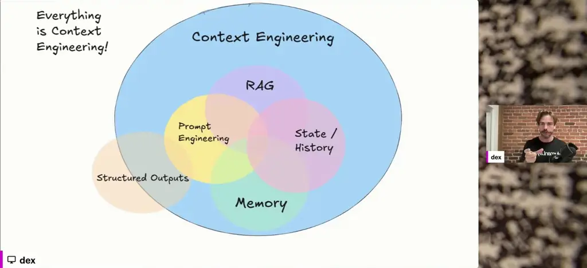
*[▶ 00:06:19](https://www.youtube.com/watch?v=2yi4mAN3CtE&t=379s) · Context engineering as an overlapping Venn diagram*

## The agent loop is ordinary software

[▶ 00:07:20](https://www.youtube.com/watch?v=2yi4mAN3CtE&t=440s)

Tool use is the model emitting JSON, deterministic code acting on it, and optionally results fed back. The payment-link request becomes a `create_payment_link` call with structured parameters.

```json
{
  "function": {
    "name": "create_payment_link",
    "parameters": {
      "amount": 750,
      "customer": "cust_128934ddasf9",
      "product": "prod_8675309",
      "price": "prc_09874329fds",
      "quantity": 1,
      "memo": "Hey Jeff - see below for the payment link for the february ai tinkerers meetup…
    }
  }
}
```

*[▶ 00:09:34](https://www.youtube.com/watch?v=2yi4mAN3CtE&t=574s) · Request converted to create_payment_link JSON*

Dispatch is a plain if/elif/else, with an else branch for tools the code doesn't know.

```python
if nextStep.intent == 'create_payment_link':
    stripe.paymentlinks.create(nextStep.parameters)
    return # or whatever you want, see below
elif nextStep.intent == 'wait_for_a_while':
    # do something monadic idk
else: #... the model didn't call a tool we know about
    # do something else
```

*[▶ 00:10:24](https://www.youtube.com/watch?v=2yi4mAN3CtE&t=624s) · Switch on model's tool-call intent*

DAG orchestrators like Airflow make you write the graph. Agents take an event and a goal and traverse it themselves.

Each iteration the model picks a step and the updated context feeds the next prompt; the whole loop is the agent.

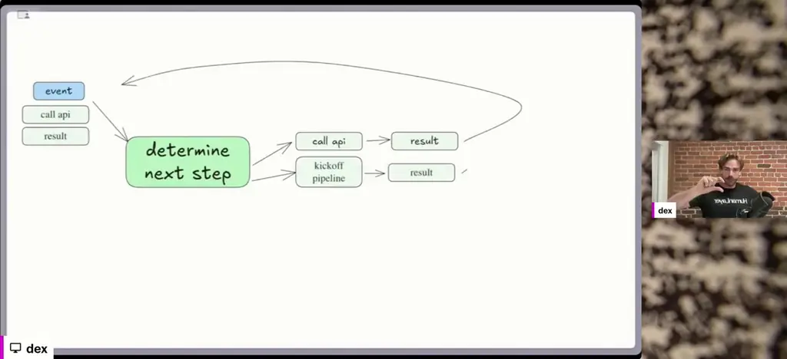
*[▶ 00:11:12](https://www.youtube.com/watch?v=2yi4mAN3CtE&t=672s) · Loop: determine next step, then call API or kick off…*

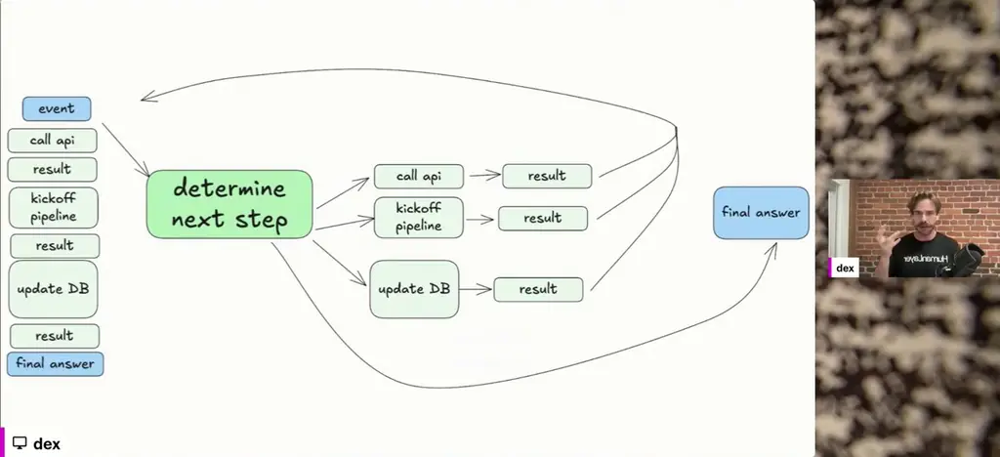
*[▶ 00:11:29](https://www.youtube.com/watch?v=2yi4mAN3CtE&t=689s) · Agent loop: determine next step*

The parts are a prompt returning JSON, a switch statement, context of events and results, and a for loop.

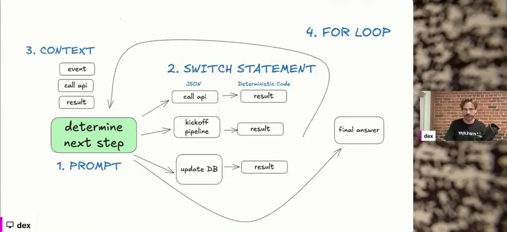
*[▶ 00:12:09](https://www.youtube.com/watch?v=2yi4mAN3CtE&t=729s) · Agent as prompt, switch, context, and loop*

Owning the loop lets you add summarize, judge, or pause-for-input steps before combining results into new context.

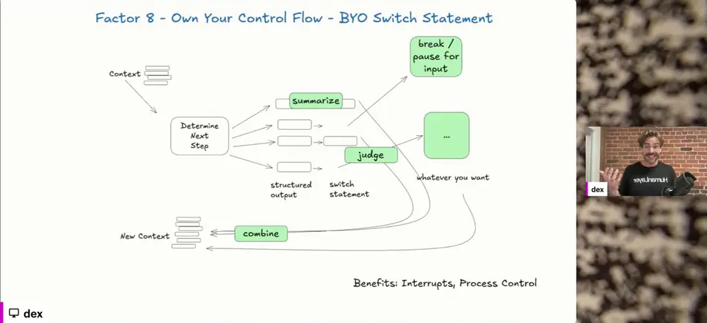
*[▶ 00:12:20](https://www.youtube.com/watch?v=2yi4mAN3CtE&t=740s) · Own Your Control Flow: BYO Switch Statement*

## Stateless Agents and Owned Context

[▶ 00:12:26](https://www.youtube.com/watch?v=2yi4mAN3CtE&t=746s)

Long-running jobs keep the agent stateless. Save the context under a state ID and launch the job. When its webhook posts the result with that state ID, reload the context, append the result, and call the model again.

**Own every prompt token.** LLMs are pure functions, so beyond the model and its settings, the input tokens are the only lever on quality.

Pass the whole trace in one user message as XML-style tags, not as a chain of tool-call messages.

```text
[
  {
    "role": "system",
    "content": "You are a helpful assistant..."
  },
  {
    "role": "user",
    "content": |
        Here's everything that happened so far:

      <slack_message>
          From: @alex
          Channel: #deployments
          Text: Can you deploy the backend?
      </slack_message>

      <list_git_tags>
          intent: "list_git_tags"
      </list_git_tags>

      <list_git_tags_result>
          tags:
            - name: "v1.2.3"
              commit: "abc123"
              date: "2024-03-15T10:00:00Z"
            - name: "v1.2.2"
              commit: "def456"
              date: "2024-03-14T15:30:00Z"
            - name: "v1.2.1"
              commit: "ghi789"
              date: "2024-03-13T09:15:00Z"
      </list_git_tags_result>

      what's the next step?
  }
]
```

*[▶ 00:14:29](https://www.youtube.com/watch?v=2yi4mAN3CtE&t=869s) · Agentic trace as single user message*

XML-style is also denser than JSON: 57 tokens versus 87 for the same request and tool call.

```json
[
  {
    "type": "user_input",
    "data": "can you multiply 3 and 4, then divide the result by 2 and then add 12 to that result?"
  },
  {
    "type": "tool_call",
    "data": {
      "intent": "multiply",
      "a": 3,
      "b": 4
    }
  }
]

<user_input>
can you multiply 3 and 4, then divide the result by 2 and then add 12 to that result?
</user_input>

<multiply>
a: 3
b: 4
</multiply>
```

*[▶ 00:14:57](https://www.youtube.com/watch?v=2yi4mAN3CtE&t=897s) · Token count: JSON vs XML-style input*

A deploy trace with a failed call and a human reply uses the same format.

```xml
<slack_message>
    From: @alex
    Channel: #deployments
    Text: Can you deploy the latest backend to production?
    Thread: []
</slack_message>

<deploy_backend>
    intent: "deploy_backend"
    tag: "v1.2.3"
    environment: "production"
</deploy_backend>

<error>
    error running deploy_backend: Failed to connect to deployment service
</error>

<request_more_information>
    intent: "request_more_information_from_human"
    question: "I had trouble connecting to the deployment service, can you provide more details and/or check on the s…
</request_more_information>

<human_response>
    data:
        response: "I'm not sure what's going on, can you check on the status of the latest workflow?"
</human_response>
```

*[▶ 00:14:37](https://www.youtube.com/watch?v=2yi4mAN3CtE&t=877s) · Slack message and deploy_backend XML trace*

Errors go back into the thread so the model can retry, but the loop can repeat the same mistake. Own the error context:

- Clear errors once a valid tool call succeeds
- Summarize and redact them
- Limit the loop count

Make human contact a tool call, so the model declares its intent to ask a person.

Use LLMs only where language or human input is needed. The deployment agent is mostly deterministic, with a human approval gate.

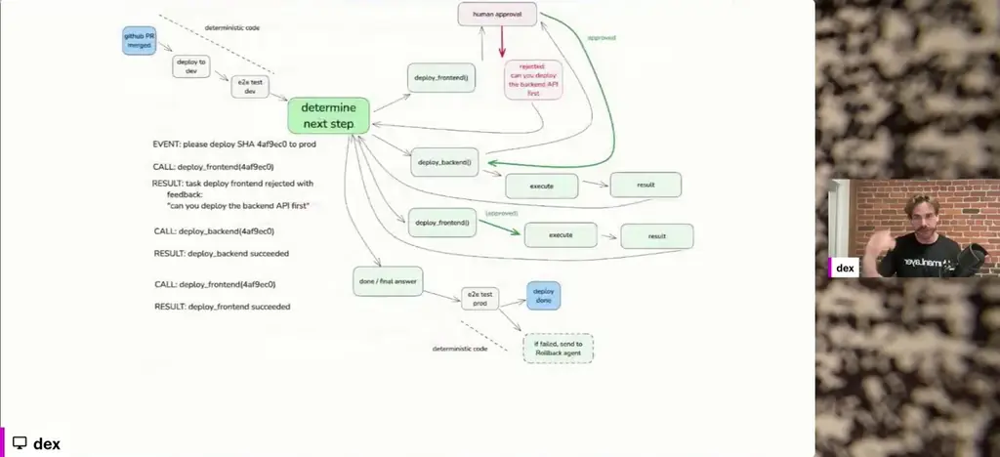
*[▶ 00:17:54](https://www.youtube.com/watch?v=2yi4mAN3CtE&t=1074s) · Deployment agent state machine with human approval*

Test decisions directly. This BAML test checks that after a teamId UUID error, the next intent is `list_teams`:

```text
test TeamIDErrorAsksForMoreInput {
  functions [DetermineNextStep]
  args {
    thread #"
        Events:
            <email_received>:
                {"from_address":"test@example.com","to_address":"support@company.com","subject":"New Ticket","body":"Can you make a new issue for Austin to restock the fridges with tasty beers?","message_id":"test123","previous_thread":[],"raw_email":"raw email content","is_test":null}
            </email_received>

            <create_issue>
                Title: Restock fridges with tasty beers
                Description: Austin is requested to restock the fridges with tasty beers.
                Team ID: team_supply_maintenance
            </create_issue>

            <issue_create_result>
                {"errors": [{"message": "Argument Validation Error", "path": ["issueCreate"], "locations": [{"line": 3, "column": 13}], "extensions": {"code": "INVALID_INPUT", "type": "invalid input", "userError": true, "userPresentableMessage": "teamId must be a UUID."}, "meta": {}}], "data": null}
            </issue_create_result>
    "#
  }
  @assert({{this.intent == "list_teams"}})
}
```

*[▶ 00:19:50](https://www.youtube.com/watch?v=2yi4mAN3CtE&t=1190s) · BAML test asserting next intent after TeamID error*

A full-trace test ends with the intent `done_for_now`:

```text
test CompleteIssueCreate {
  functions [DetermineNextStep]
  args {
    thread #"
        Events:
            <email_received>
                {"from_address":"test@example.com","to_address":"support@company.com","subject":"New Ticket","body":"Can you make a new issue for Austin to restock the fridges with tasty beers?","message_id":"test123","previous_thread":[],"raw_email":"raw email content","is_test":null}
            </email_received>

            <create_issue>
                Title: Restock fridges with tasty beers
                Description: Austin is requested to restock the fridges with tasty beers.
                Team ID: team_supply_maintenance
            </create_issue>

            <issue_create_result>
                {"errors": [{"message": "Argument Validation Error", "path": ["issueCreate"], "locations": [{"line": 3, "column": 13}], "extensions": {"code": "INVALID_INPUT", "type": "invalid input", "userError": true, "userPresentableMessage": "teamId must be a UUID."}, "meta": {}}], "data": null}
            </issue_create_result>

            <request_more_information>
                {"intent": "request_more_information", "message": "The team ID provided (team_supply_maintenance) is not a valid UUID, which caused the issue creation to fail. Please provide a valid UUID for the team."}
            </request_more_information>

            <human_response>
                Message: use a different team id, perhaps try running list-teams?
            </human_response>

            <list_teams>
                {"intent": "list_teams"}
            </list_teams>

            <list_teams_result>
                {"data": {"teams": {"nodes": [{"id": "…", "name": "Operations", "members": {"nodes": [{"email": "…", "id": "…", "displayName": "austin"}, {"email": "…", "id": "…", "displayName": "dexter"}]}}]}}}
            </list_teams_result>

            <create_issue>
                Title: Restock fridges with tasty beers
                Description: Austin is requested to restock the fridges with tasty beers.
                Team ID: …
            </create_issue>

            <issue_create_result>
                {"data": {"issueCreate": {"success": true, "issue": {"id": "…", "title": "Restock fridges with tasty beers", "description": "Austin is requested to restock the fridges with tasty beers."}}}}
            </issue_create_result>
    "#
  }
  @assert({{this.intent == "done_for_now"}})
}
```

*[▶ 00:20:10](https://www.youtube.com/watch?v=2yi4mAN3CtE&t=1210s) · BAML test for full issue-creation trace*

## Own the Loop, Delegate to Humans

[▶ 00:20:16](https://www.youtube.com/watch?v=2yi4mAN3CtE&t=1216s)

Sandi Metz's rule applies to agent libraries: prefer duplication over the wrong abstraction.

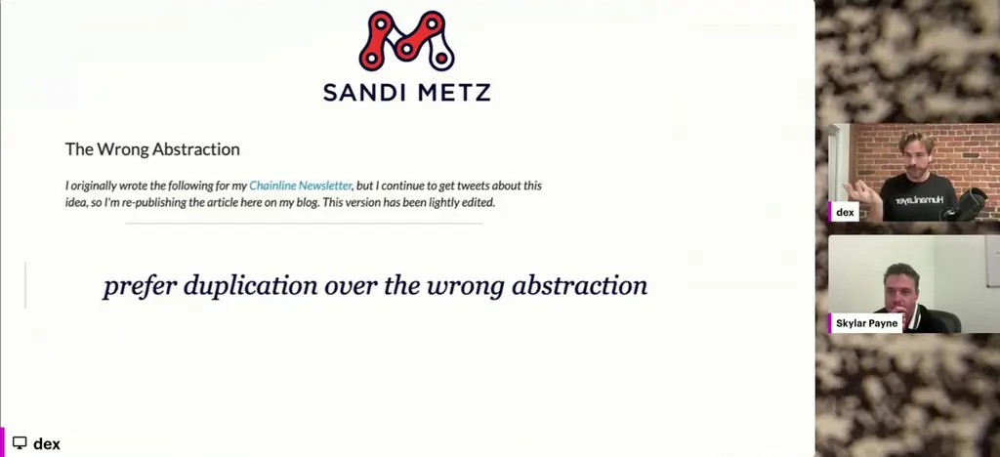
*[▶ 00:20:22](https://www.youtube.com/watch?v=2yi4mAN3CtE&t=1222s) · The Wrong Abstraction (Sandi Metz)*

Agents are software: write the for loop and switch statement yourself. LLMs are stateless functions, so you own state and control flow, and you write code wherever the model falls short.

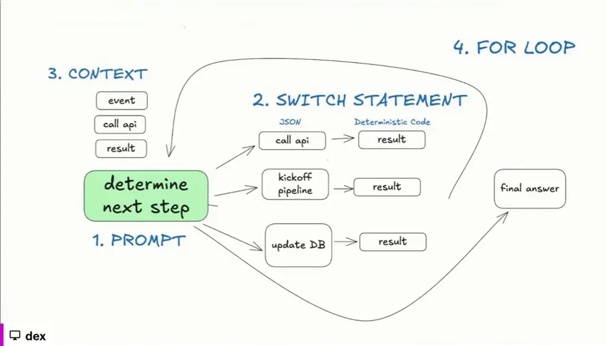
*[▶ 00:20:50](https://www.youtube.com/watch?v=2yi4mAN3CtE&t=1250s) · Agent loop: determine next step*

Connecting agents to humans asynchronously is one of the hard parts worth building, since wrangling APIs and webhooks is tedious.

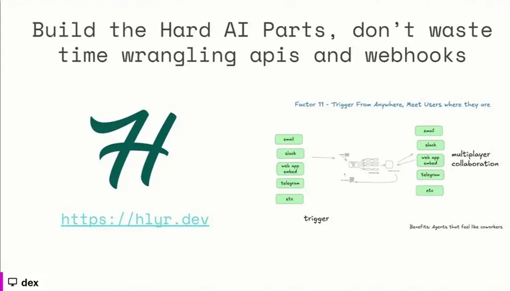
*[▶ 00:21:20](https://www.youtube.com/watch?v=2yi4mAN3CtE&t=1280s) · Build the hard AI parts; Factor 11*

The A2H (Agent-to-Human) protocol, in draft as v0, is a four-endpoint spec. Agents send `contact-human` and `function_call` requests through an A2H server. Human events such as `function_call.completed` return by webhook, resuming the agent in an outer loop.

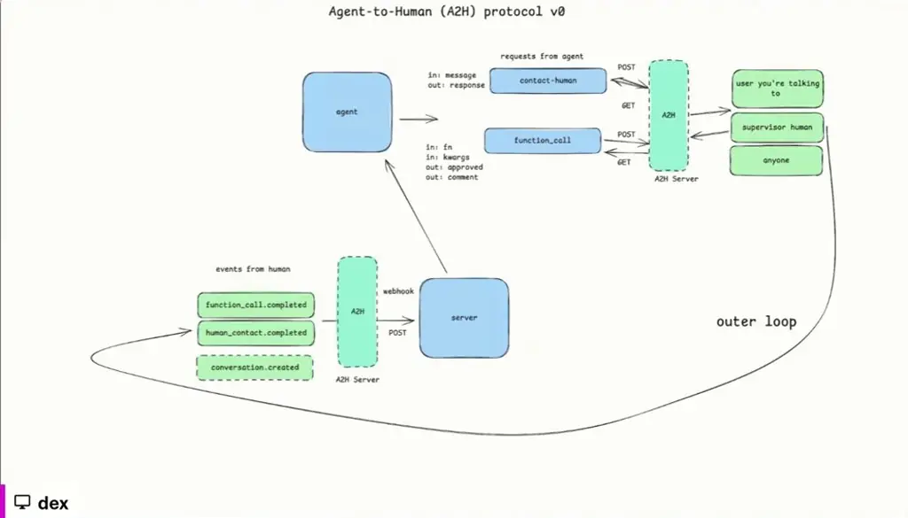
*[▶ 00:21:28](https://www.youtube.com/watch?v=2yi4mAN3CtE&t=1288s) · Agent-to-Human (A2H) protocol v0*

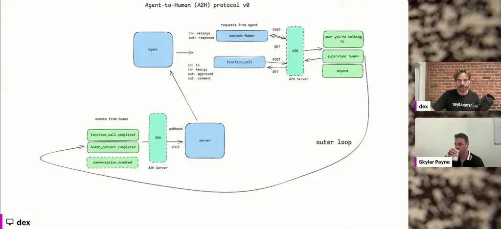
*[▶ 00:21:35](https://www.youtube.com/watch?v=2yi4mAN3CtE&t=1295s) · Agent-to-Human (A2H) protocol v0 diagram*

For code instead of JSON tool calls, delegate: one agent writes code, another reviews it, and a human supplies secrets.

Constrained JSON hurts output. A newline in a JSON string must become a backslash and n, which are two tokens, so forcing it pulls the model away from the newline it prefers. Models write code best in the form their training data uses. XML-style prompts with custom parsers are one alternative; BAML's Rust-based parser repairs broken JSON.

For safety, control every token in and out, and put a small guardrail model before tool output returns.

Follow-up is at [hlyr.dev/12fa](https://hlyr.dev/12fa), with hands-on workshops in [ai-that-works](https://github.com/hellovai/ai-that-works).

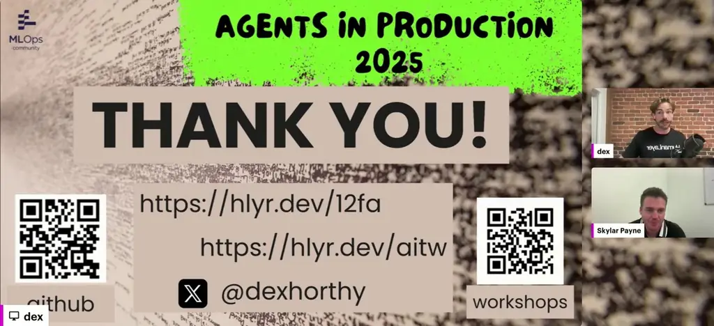
*[▶ 00:22:22](https://www.youtube.com/watch?v=2yi4mAN3CtE&t=1342s) · Thank-you slide with links*

## Links & resources

- [12-Factor Agents GitHub repo: README and source](https://github.com/humanlayer/12-factor-agents) — <https://github.com/humanlayer/12-factor-agents> · on screen [▶ 00:05:36](https://www.youtube.com/watch?v=2yi4mAN3CtE&t=336s)
- [12-Factor Agents project site](https://12factor.net) — <https://12factor.net> · on screen [▶ 00:05:40](https://www.youtube.com/watch?v=2yi4mAN3CtE&t=340s)
- [hlyr.dev/12fa: closing slide with GitHub and workshop links](https://hlyr.dev/12fa) — <https://hlyr.dev/12fa> · on screen [▶ 00:28:04](https://www.youtube.com/watch?v=2yi4mAN3CtE&t=1684s)
- [HumanLayer site: build the hard AI parts, Factor 11](https://hlyr.dev) — <https://hlyr.dev> · on screen [▶ 00:21:20](https://www.youtube.com/watch?v=2yi4mAN3CtE&t=1280s)
- [ai-that-works hands-on workshop schedule](https://github.com/hellovai/ai-that-works) — <https://github.com/hellovai/ai-that-works> · on screen [▶ 00:22:05](https://www.youtube.com/watch?v=2yi4mAN3CtE&t=1325s)
- [ai-that-works workshop links on thank-you slide](https://hlyr.dev/aitw) — <https://hlyr.dev/aitw> · on screen [▶ 00:22:22](https://www.youtube.com/watch?v=2yi4mAN3CtE&t=1342s)
- AI Engineer talk by the speaker, about 17 minutes, URL not shown · mentioned [▶ 00:08:59](https://www.youtube.com/watch?v=2yi4mAN3CtE&t=539s)
