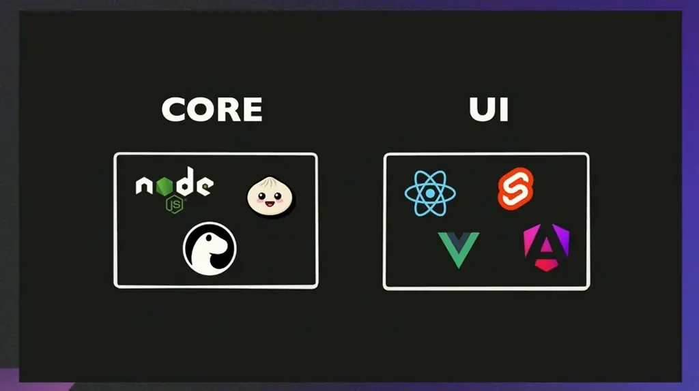
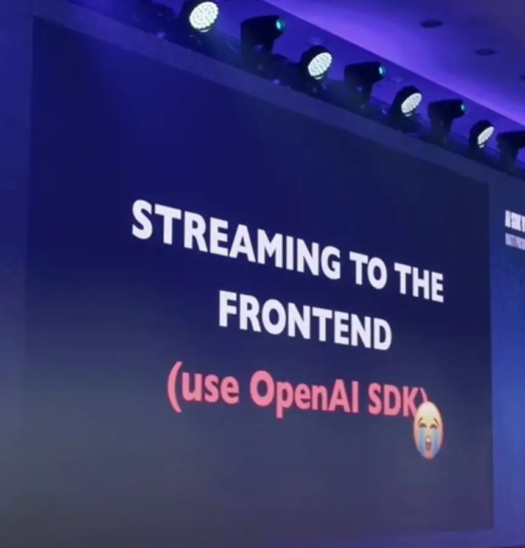
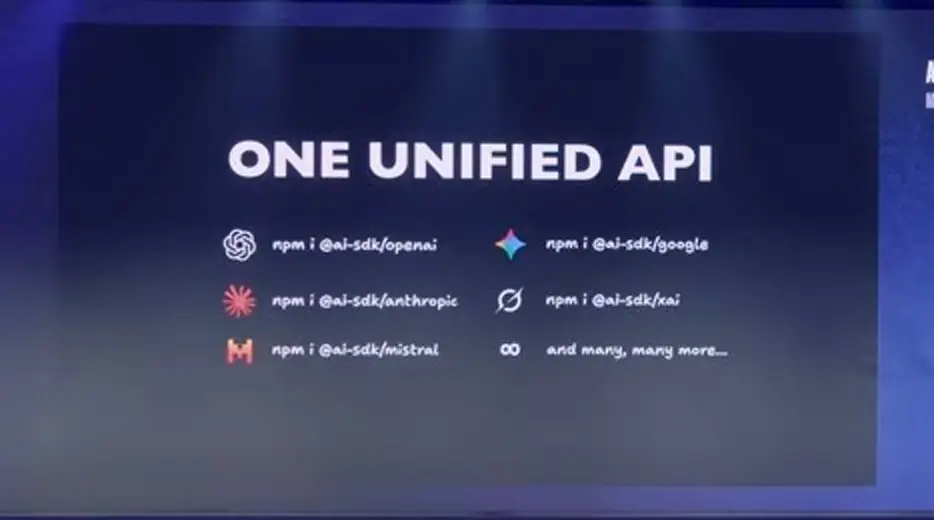
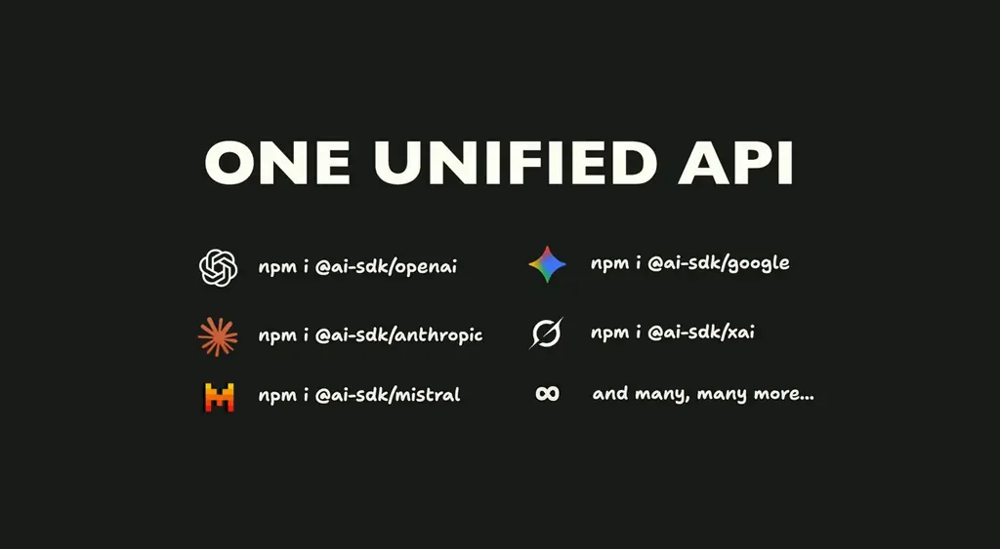
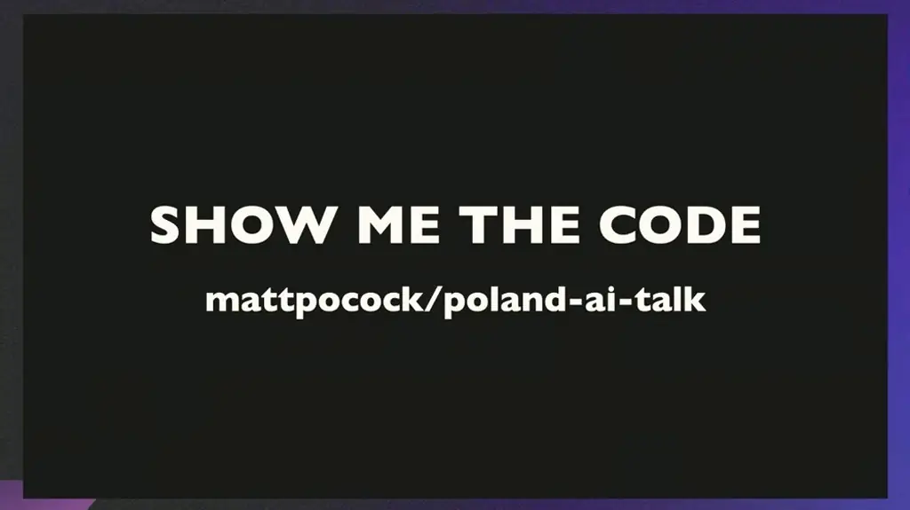
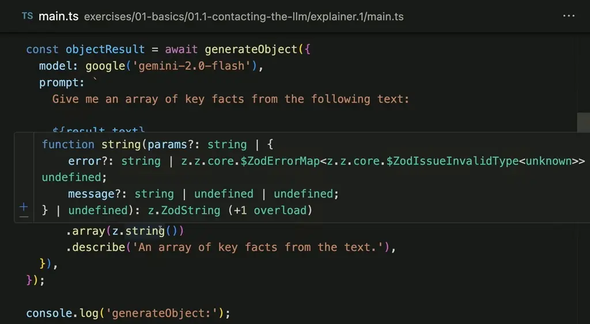
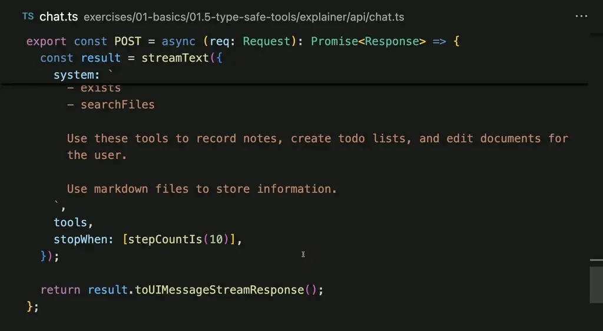

# AI SDK v5: A Crash Course | Matt Pocock at React Universe Conf 2025

*You will learn how to build React AI features with Vercel's AI SDK v5 using one API that works across model providers.*

Source: [AI SDK v5: A Crash Course | Matt Pocock at React Universe Conf 2025](https://www.youtube.com/watch?v=ihHLs6v7Lko) · Matt Pocock · Callstack · 23 min

## TL;DR

Calling a provider's SDK directly locks your app to that vendor, and streaming text to a frontend is harder still because streams carry more than text. Matt Pocock argues for learning AI from the outside in by building apps and observing behavior. His answer is Vercel's AI SDK, which offers one unified API across OpenAI, Anthropic, Google, Mistral and others, so switching providers is a one-line change. This matters because you learn one API instead of each provider's quirks, and you can build generation, streaming, and type-safe tool-using agents on top of it.

## Key takeaways

- Calling a provider's SDK directly causes vendor lock-in, while the AI SDK provides one unified API across OpenAI, Anthropic, Google, xAI, Mistral and more.
- Switching providers takes a one-line change, with each provider installed as its own package and API keys kept in environment variables.
- `generateText` returns the full text only after generation finishes, while `streamText` streams tokens as they generate to lower time to first token.
- `generateObject` takes a Zod schema that describes the output shape to the model and validates the returned JSON at runtime, so `result.object` matches the schema.
- `streamObject` streams a Zod-validated object as it builds, so a UI can render partial results such as facts before generation ends.
- `useChat` keeps messages in state and POSTs them to `/api/chat`, and `toUIMessageStream` converts event chunks into messages the frontend renders.
- A tool is built from a `description`, a Zod `inputSchema` that tells the LLM which arguments it can pass, and an `execute` function that runs locally, not on the model's side.
- By default a model stops after one step, so `stopWhen: [stepCountIs(10)]` lets the LLM keep taking steps and reacting to tool results, and `InferUITools<typeof tools>` keeps tool names and shapes type-safe in the UI.

## Learn AI from the outside in, without vendor lock-in

[▶ 00:00:00](https://www.youtube.com/watch?v=ihHLs6v7Lko&t=0s)

AI is a black box, even to its makers. Learn it from the outside in: build AI-powered apps and observe how it behaves.

The AI SDK's core runs anywhere JavaScript does, including Node.js, Bun and Deno. Its UI part works with React, Svelte, Vue and Angular.


*[▶ 00:03:22](https://www.youtube.com/watch?v=ihHLs6v7Lko&t=202s) · AI SDK core and UI packages*

Calling a provider's SDK directly causes vendor lock-in. Streaming to the frontend is harder still, since streams carry more than text.


*[▶ 00:04:47](https://www.youtube.com/watch?v=ihHLs6v7Lko&t=287s) · Streaming to the frontend*

The AI SDK offers one unified API. Switching providers across OpenAI, Anthropic, Google, xAI, Mistral and more is a one-line change, with each provider installed as its own package.


*[▶ 00:04:59](https://www.youtube.com/watch?v=ihHLs6v7Lko&t=299s) · One unified API with per-provider npm packages*

Learning one API replaces learning each provider's quirks.


*[▶ 00:05:10](https://www.youtube.com/watch?v=ihHLs6v7Lko&t=310s) · One unified API with per-provider npm packages*

The code is in mattpocock/poland-ai-talk.


*[▶ 00:05:38](https://www.youtube.com/watch?v=ihHLs6v7Lko&t=338s) · Show me the code*

## Generating text and objects, then streaming

[▶ 00:05:39](https://www.youtube.com/watch?v=ihHLs6v7Lko&t=339s)

`generateText` returns the full text only after generation ends.

```typescript
import { google } from '@ai-sdk/google';
import { generateObject, generateText, streamText } from 'ai';
import z from 'zod';

const result = await generateText({
  model: google('gemini-2.0-flash'),
  prompt: `
    Give the first paragraph of a story about an imaginary planet.
  `,
});

console.log('generateText:');
console.log(result.text);

// const objectResult = await generateObject({
//   model: google('gemini-2.0-flash'),
//   prompt: `
//     Give me an array of key facts from the following text:
```

*[▶ 00:05:47](https://www.youtube.com/watch?v=ihHLs6v7Lko&t=347s) · generateText call using Google Gemini model*

Output arrives only after a wait.

```text
✔ Which exercise do you want to run? (type to search) › 01.1
✔ Select a subfolder › explainer.1
Running 1.1 explainer.1...
generateText:
The wind on Xylos tasted of iron and starlight, a gritty, metallic tang that coated your tongue and made your teeth ache. Above, the twin suns, Xantus and Lyra, blazed in a perpetual dance, casting long, skeletal shadows across the crimson plains. Here, silica sand, ground finer than flour by millennia of solar winds, stretched to a horizon that blurred into the heat haze. Towering above the dunes were the petrified remains of colossal, fungal forests, their fossilized caps gleaming like obsidian mirrors, reflecting the harsh light and whispering forgotten secrets to the empty sky.

Matthews-MacBook-Air-2:poland-ai-talk matt$

import { google } from '@ai-sdk/google';
import { generateObject, generateText, streamText } from 'ai';
```

*[▶ 00:06:26](https://www.youtube.com/watch?v=ihHLs6v7Lko&t=386s) · Running generateText explainer in terminal*

`generateObject` extracts key facts from that text.

```typescript
…
import z from 'zod';

const result = await generateText({
  model: google('gemini-2.0-flash'),
  prompt: `
    Give the first paragraph of a story about an imaginary planet.
  `,
});

console.log('generateText:');
console.log(result.text);

// const objectResult = await generateObject({
//   model: google('gemini-2.0-flash'),
//   prompt: `
//     Give me an array of key facts from the following text:

//     ${result.text}
```

*[▶ 00:06:51](https://www.youtube.com/watch?v=ihHLs6v7Lko&t=411s) · Uncommenting generateObject key-facts prompt*

Its Zod schema describes the shape to the model and validates the JSON at runtime.

```typescript
…
});

console.log('generateText:');
console.log(result.text);

const objectResult = await generateObject({
  model: google('gemini-2.0-flash'),
  prompt: `
    Give me an array of key facts from the following text:

    ${result.text}

    Remove all flowerly language. Speak as if you are a scientist.
  `,
  schema: z.object({
    facts: z
      .array(z.string())
      .describe('An array of key facts from the text.'),
```

*[▶ 00:07:10](https://www.youtube.com/watch?v=ihHLs6v7Lko&t=430s) · generateObject prompt with generated text and zod schema*

So `result.object` matches the schema.

```typescript
const objectResult = await generateObject({
  model: google('gemini-2.0-flash'),
  prompt: `
    Give me an array of key facts from the following text:

    ${result.text}

    Remove all flowerly language. Speak as if you are a scientist.
  `,
  schema: z.object({
    facts: z
      .array(z.string())
      .describe('An array of key facts from the text.'),
  }),
});

console.log('generateObject:');
```

*[▶ 00:07:40](https://www.youtube.com/watch?v=ihHLs6v7Lko&t=460s) · generateObject call with prompt and Zod schema*

Hovering `z.string()` shows its type.


*[▶ 00:07:45](https://www.youtube.com/watch?v=ihHLs6v7Lko&t=465s) · Hover tooltip over z.string() type signature*

For UIs, `streamText` streams tokens as they generate, lowering time to first token.

```typescript
import { google } from '@ai-sdk/google';
import { streamObject, streamText } from 'ai';
import z from 'zod';

const result = streamText({
  model: google('gemini-2.0-flash'),
  prompt: `
    Give the first paragraph of a story about an imaginary planet.
  `,
});

console.log('streamText:');
for await (const chunk of result.textStream) {
  process.stdout.write(chunk);
}
console.log('\n');

// const objectResult = streamObject({
```

*[▶ 00:08:33](https://www.youtube.com/watch?v=ihHLs6v7Lko&t=513s) · streamText code with textStream loop*

## Swapping providers and streaming chat UIs

[▶ 00:09:27](https://www.youtube.com/watch?v=ihHLs6v7Lko&t=567s)

`streamObject` streams a Zod-validated object as it builds, so a UI can render facts before generation ends.

```typescript
const result = streamText({
});

console.log('streamText:');
for await (const chunk of result.textStream) {
  process.stdout.write(chunk);
}
console.log('\n');

// const objectResult = streamObject({
//   model: google('gemini-2.0-flash'),
//   prompt: `
//     Give me an array of key facts from the following text:
//
//     ${await result.text}
//
//     Remove all flowerly language. Speak as if you are a scientist.
//   `,
```

*[▶ 00:09:29](https://www.youtube.com/watch?v=ihHLs6v7Lko&t=569s) · streamText loop and commented streamObject call*

Its schema defines a `facts` string array.

```typescript
const objectResult = streamObject({
  schema: z.object({
    facts: z
      …
      .describe('An array of key facts from the text.'),
  }),
});

console.log('streamObject:');
for await (const chunk of objectResult.partialObjectStream) {
  console.log(chunk);
}
console.log('\n');
```

*[▶ 00:09:32](https://www.youtube.com/watch?v=ihHLs6v7Lko&t=572s) · streamObject schema and partialObjectStream loop*

Uncommenting the call wires in a prompt built from the streamed text.

```typescript
for await (const chunk of result.textStream) {
  process.stdout.write(chunk);
}
console.log('\n');

const objectResult = streamObject({
  model: google('gemini-2.0-flash'),
  prompt: `
    Give me an array of key facts from the following text:

    ${await result.text}

    Remove all flowerly language. Speak as if you are a scientist.
  `,
  schema: z.object({
    facts: z
      .array(z.string())
      .describe('An array of key facts from the text.'),
  …
```

*[▶ 00:09:41](https://www.youtube.com/watch?v=ihHLs6v7Lko&t=581s) · Uncommented streamObject prompt and schema*

Logged output starts empty, then grows fact by fact.

```text
 hummed with an energy that prickled the skin and whispered secrets in a language no human ear could understand.


streamObject:
{}
{ facts: [ 'Xylos has twin suns, one peach' ] }
{
  facts: [
    'Xylos has twin suns, one peach-colored and one crimson.',
    'The landscape contains bioluminescent, pulsating mushrooms.'
  ]
}
{
  facts: [
    'Xylos has twin suns, one peach-colored and one crimson.',
    'The landscape contains bioluminescent, pulsating mushrooms.',
    'The landscape contains crystalline grass that tinkles in the breeze.',
```

*[▶ 00:10:09](https://www.youtube.com/watch?v=ihHLs6v7Lko&t=609s) · Terminal output of streamed partial objects*

```text
    'Xylos has three moons.',
    'Rivers of liquid mercury flow through obsidian'
  ]
}
{
  facts: [
    'Xylos has twin suns, one peach-colored and one crimson.',
    'The landscape contains bioluminescent, pulsating mushrooms.',
    'The landscape contains crystalline grass that tinkles in the breeze.',
    'Xylos has three moons.',
    'Rivers of liquid mercury flow through obsidian canyons.',
    'Gravity on Xylos is inconsistent.',
    'The air on Xylos contains an unintelligible energy.'
  ]
}
○ Matthews-MacBook-Air-2:poland-ai-talk matt$
```

*[▶ 00:10:03](https://www.youtube.com/watch?v=ihHLs6v7Lko&t=603s) · Partial object stream output in terminal*

Swapping models takes one import and one model string; keys stay in environment variables, which avoids vendor lock-in.

`useChat` keeps messages in state and POSTs them to `/api/chat`, where they convert to model messages.

```typescript
export const POST = async (req: Request): Promise<Response> => {
  const streamTextResult = streamText({
    model: google('gemini-2.0-flash'),
    messages: modelMessages,
  });

  // NOTE: We convert the stream to the format
  // expected by the client.
  const stream = streamTextResult.toUIMessageStream();

  // NOTE: We create the response for the client.
  return createUIMessageStreamResponse({
    stream,
  });
};
```

*[▶ 00:14:43](https://www.youtube.com/watch?v=ihHLs6v7Lko&t=883s) · Streaming chat route converting to UI message stream*

`toUIMessageStream` turns the event chunks into messages the frontend renders.

## Type-safe tools and agent loops

[▶ 00:14:40](https://www.youtube.com/watch?v=ihHLs6v7Lko&t=880s)

Tools are built with `tool`, combining a `description`, a Zod `inputSchema` that tells the LLM which arguments it can pass, and an `execute` function.

```typescript
export type MyUIMessage = UIMessage<
  never,
  InferUITools<typeof tools>
>;

const tools = {
  writeFile: tool({
    description: 'Write to a file',
    inputSchema: z.object({
      path: z
        .string()
        .describe('The path to the file to create'),
      content: z
        .string()
        .describe('The content of the file to create'),
    }),
    execute: async ({ path, content }) => {
      return fsTools.writeFile(path, content);
```

*[▶ 00:15:43](https://www.youtube.com/watch?v=ihHLs6v7Lko&t=943s) · writeFile tool description and execute*

`execute` runs locally, never on the model's side. The LLM requests a call, your code runs it, and the result goes back to the LLM. That loop is tool calling.

```typescript
const tools = {
  writeFile: tool({
    description: 'Write to a file',
    inputSchema: z.object({
      path: z
        .string()
        .describe('The path to the file to create'),
      content: z
        .string()
        .describe('The content of the file to create'),
    }),
    execute: async ({ path, content }) => {
      return fsTools.writeFile(path, content);
    },
  }),
  readFile: tool({
    description: 'Read a file',
    inputSchema: z.object({
```

*[▶ 00:16:11](https://www.youtube.com/watch?v=ihHLs6v7Lko&t=971s) · writeFile tool full definition, readFile start*

The tools are passed to `streamText` with a system prompt.

```typescript
export const POST = async (req: Request): Promise<Response> => {
  const { messages } = body;

  const result = streamText({
    model: google('gemini-2.5-flash'),
    messages: convertToModelMessages(messages),
    system: `
      You are a helpful assistant that can use a sandboxed file system to create, ed…

      You have access to the following tools:
      - writeFile
      - readFile
      - deletePath
      - listDirectory
      - createDirectory
      - exists
      - searchFiles
```

*[▶ 00:16:26](https://www.youtube.com/watch?v=ihHLs6v7Lko&t=986s) · streamText call with tools system prompt*

An agent is a loop: the LLM takes several steps and gets feedback from the world at each one. By default it stops after one step, so it never reacts to a tool result. `stopWhen: [stepCountIs(10)]` hands control to the LLM, which decides when to finish within 10 steps.


*[▶ 00:16:37](https://www.youtube.com/watch?v=ihHLs6v7Lko&t=997s) · chat.ts stopWhen and response stream*

Because `InferUITools<typeof tools>` feeds `MyUIMessage`, the UI knows each tool's name and shape. Renaming a tool makes the code error until it matches.

```typescript
const tools = {
  readFile: tool({
    description: 'Read a file',
    inputSchema: z.object({
      path: z.string().describe('The path to the file to read'),
    }),
    execute: async ({ path }) => {
      return fsTools.readFile(path);
    },
  }),
  deletePath: tool({
    description: 'Delete a file or directory',
    inputSchema: z.object({
      path: z
        .string()
        .describe('The path to the file or directory to delete'),
    }),
    …
```

*[▶ 00:17:52](https://www.youtube.com/watch?v=ihHLs6v7Lko&t=1072s) · Tools object with readFile and deletePath*

The `tool-writeFile` branch in `Message` is type-safe.

```tsx
export const Message = ({
  return (
    <div className="flex flex-col gap-2">
      {parts.map((part, index) => {
        if (part.type === 'text') {
          return (
            <div key={index} className="prose prose-invert my-6">
              <ReactMarkdown>{prefix + part.text}</ReactMarkdown>
            </div>
          );
        }
        // NOTE: Note how the tool-writeFile part
        // is type-safe. Beautiful.
        if (part.type === 'tool-writeFile') {
          return (
            <div
              key={index}
              className="bg-blue-900/20 border border-blue-700 rounded p-3 text-s…
```

*[▶ 00:19:05](https://www.youtube.com/watch?v=ihHLs6v7Lko&t=1145s) · Message component with type-safe tool-writeFile branch*

He calls the AI SDK a highway, not a gateway, and "the perfect abstraction."

## Links & resources

- mattpocock/poland-ai-talk — speaker's GitHub repo for the AI talk code (URL not shown on screen) · mentioned [▶ 00:05:35](https://www.youtube.com/watch?v=ihHLs6v7Lko&t=335s)
- [Resource link from video description (clstk short link; destination not verified)](https://clstk.com/3JR3Xqx) — <https://clstk.com/3JR3Xqx> · video description
- [Resource link from video description (clstk short link; destination not verified)](https://clstk.com/4ggwqSK) — <https://clstk.com/4ggwqSK> · video description
