# How We Build Effective Agents: Barry Zhang, Anthropic

*Learn how to decide between single LLM calls, workflows, and agents, and how to keep an agent simple enough to debug by checking what it sees in its context window.*

Source: [How We Build Effective Agents: Barry Zhang, Anthropic](https://www.youtube.com/watch?v=D7_ipDqhtwk) · Barry Zhang · AI Engineer · 15 min

## TL;DR

Teams often reach for agents when a simpler design would work, and agents add cost, latency, and error risk. The talk separates three stages (single-LLM features, workflows, and agents) and offers four questions to decide which fits a task: is it complex, is it valuable, are all parts doable, and what does an error cost. An agent is a model using tools in a loop, defined by its environment, tools, and system prompt, so keeping those simple speeds iteration. Reviewing the agent's context window, the only thing it sees, reveals gaps in instructions and tool descriptions before they cause failures.

## Key takeaways

- Classify your system into one of three stages: single-LLM features (summarization, classification, extraction), workflows (multiple calls in predefined control flows), or agents (LLMs choosing their own trajectory from environment feedback).
- Before building an agent, check four things: the task is complex, the task is valuable (about $0.10 per task favors workflows), every part of the task is doable, and the cost of errors is acceptable.
- If an error would be costly or hard to spot, limit the agent to read-only actions or keep a human in the loop.
- An agent is a model using tools in a loop, defined by three parts: an environment, a set of tools, and a system prompt. Use cases differ mainly in their tools and prompts.
- Keep the initial agent simple, since up-front complexity slows iteration; optimize cost, latency, and progress display only after the behavior works.
- Think like your agent: it sees only its context window (roughly 10 to 20k tokens), so check for missing details such as screen resolution, screenshot frequency, or blockers like reCAPTCHA.
- Ask Claude to review your agent's context, including ambiguous system prompt instructions, unclear tool descriptions, and full trajectories that explain why it made each choice. Use this to supplement your own understanding, not replace it.
- Treat open problems such as budget-awareness (enforcing time, money, and token limits), self-evolving tools, and multi-agent communication as areas still under exploration.

## From workflows to agents: when to build one

[▶ 00:00:00](https://www.youtube.com/watch?v=D7_ipDqhtwk&t=0s)

Co-written with Erik Schluntz, the post found that successful agents used simple, composable patterns, not complex frameworks.

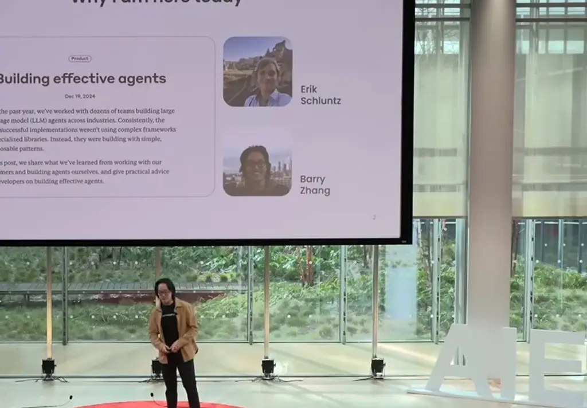
*[▶ 00:00:30](https://www.youtube.com/watch?v=D7_ipDqhtwk&t=30s) · Why I am here today: Building effective agents*

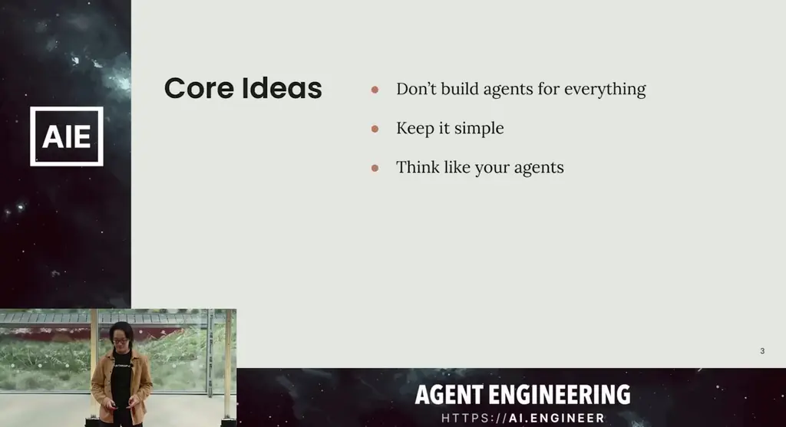
*[▶ 00:01:01](https://www.youtube.com/watch?v=D7_ipDqhtwk&t=61s) · Core Ideas*

Three stages:

- **Single-LLM features**: summarization, classification, extraction.
- **Workflows**: multiple calls in predefined control flows.
- **Agents**: LLMs decide their own trajectory from environment feedback.

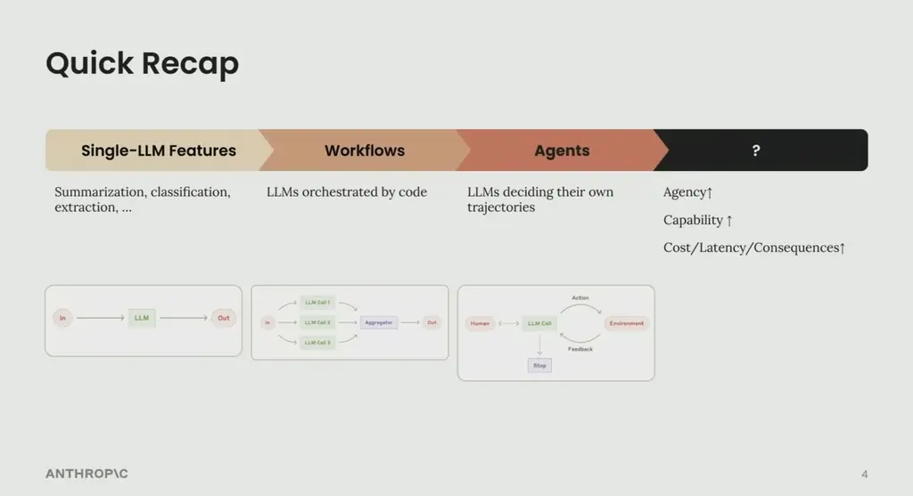
*[▶ 00:01:25](https://www.youtube.com/watch?v=D7_ipDqhtwk&t=85s) · Quick Recap: progression to agents*

More agency adds capability but also cost, latency and error consequences.

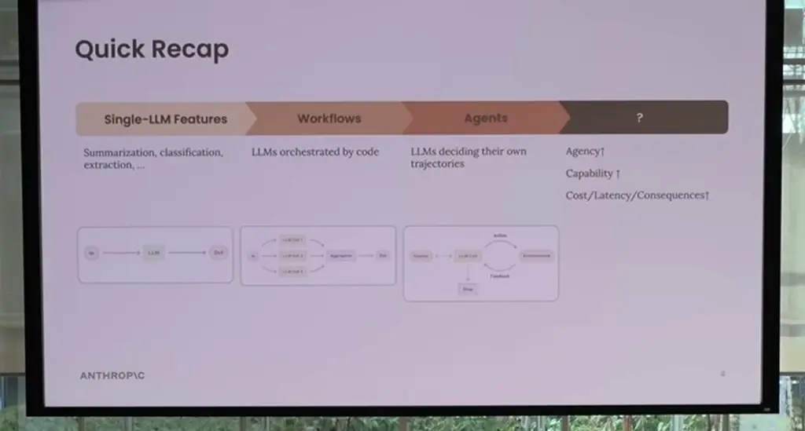
*[▶ 00:01:45](https://www.youtube.com/watch?v=D7_ipDqhtwk&t=105s) · Quick Recap on the projected screen*

Agents suit complex, valuable tasks, not every use case.

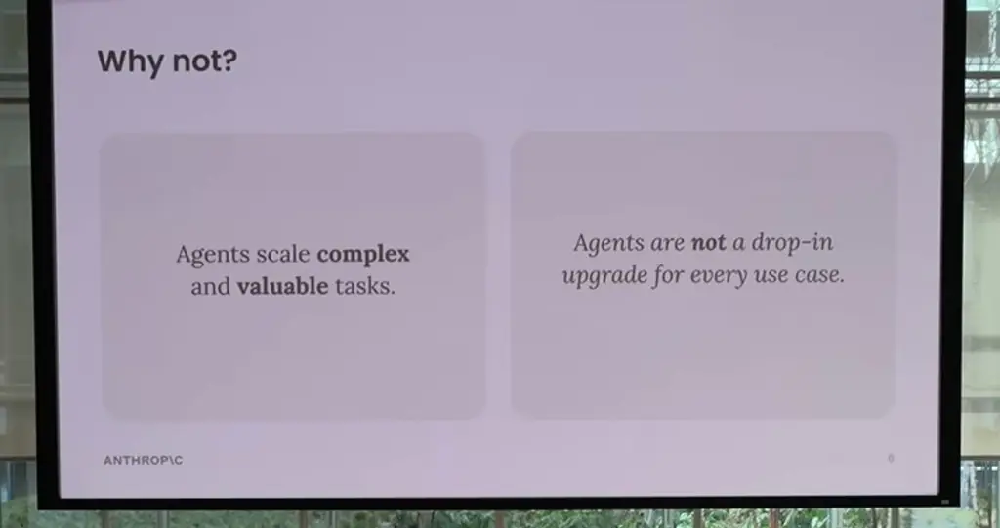
*[▶ 00:02:40](https://www.youtube.com/watch?v=D7_ipDqhtwk&t=160s) · Why not? Agent use cases*

Ask four questions first:

- **Complex?** Ambiguous problems suit agents; mappable decision trees belong in workflows.
- **Valuable?** About $0.10 per task favors workflows.
- **All parts doable?** If not, reduce scope.
- **Error cost?** Costly, hard-to-spot errors call for read-only or human-in-the-loop.

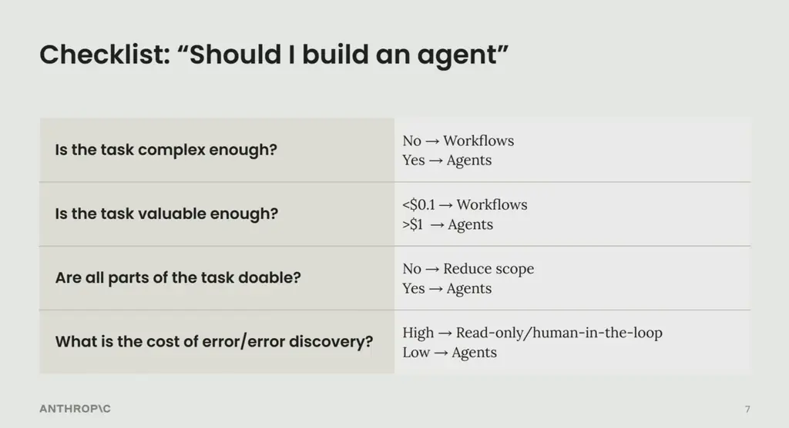
*[▶ 00:03:11](https://www.youtube.com/watch?v=D7_ipDqhtwk&t=191s) · Checklist: Should I build an agent*

## Keep the agent simple and see through its context window

[▶ 00:05:00](https://www.youtube.com/watch?v=D7_ipDqhtwk&t=300s)

Coding suits agents because the task is complex, valuable, and verifiable with unit tests and CI.

An agent is a model using tools in a loop, defined by an **environment**, **tools**, and a **system prompt**.

```python
env = Environment()
tools = Tools(env)
system_prompt = "Goals, constraints, and how to act"

while True:
    action = llm.run(system_prompt + env.state)
    env.state = tools.run(action)
```

*[▶ 00:06:02](https://www.youtube.com/watch?v=D7_ipDqhtwk&t=362s) · Agents are models using tools in a loop*

Keep these simple, since up-front complexity slows iteration. Use cases differ mainly in their tools and prompts.

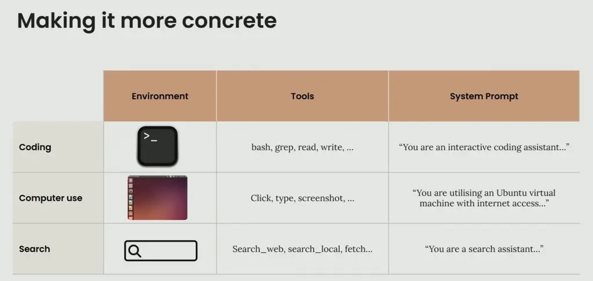
*[▶ 00:06:57](https://www.youtube.com/watch?v=D7_ipDqhtwk&t=417s) · Making it more concrete*

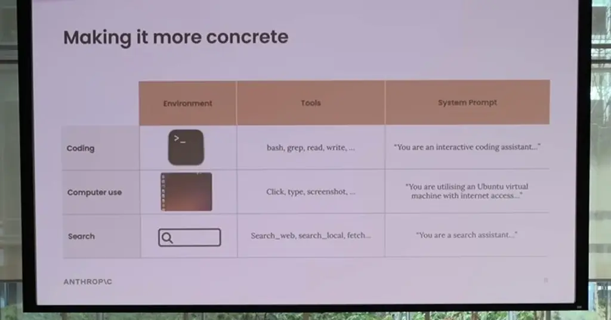
*[▶ 00:07:34](https://www.youtube.com/watch?v=D7_ipDqhtwk&t=454s) · Making it more concrete*

Optimize only after the behavior works: cut cost, cut latency, and show progress to build trust.

Think like your agent. It sees only its context window, roughly 10 to 20k tokens, so check that this input is sufficient and coherent.

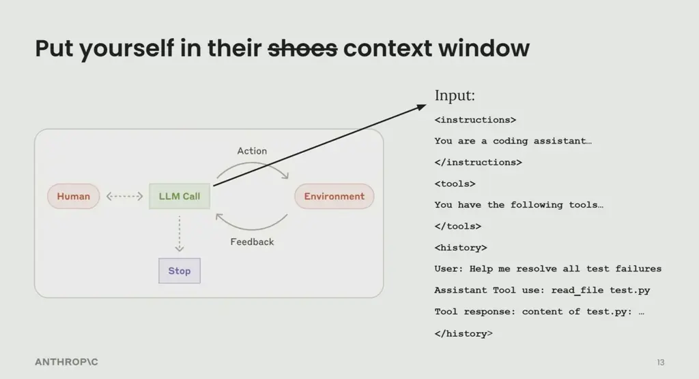
*[▶ 00:08:41](https://www.youtube.com/watch?v=D7_ipDqhtwk&t=521s) · Put yourself in their context window*

A computer use agent sees a static screenshot, so each click is like closing your eyes for 3-5 seconds.

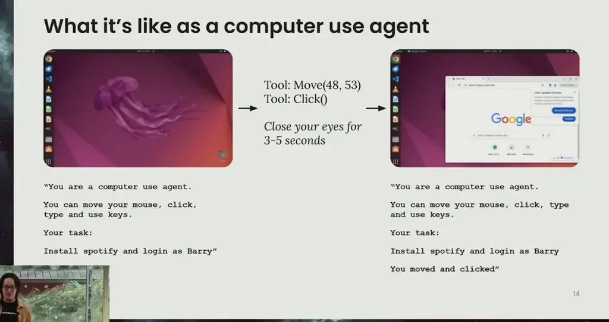
*[▶ 00:09:53](https://www.youtube.com/watch?v=D7_ipDqhtwk&t=593s) · Before and after the click, agent view*

Its missing context becomes clear: screen resolution (1024x768), screenshot frequency, terminal installs, and limits such as reCAPTCHA.

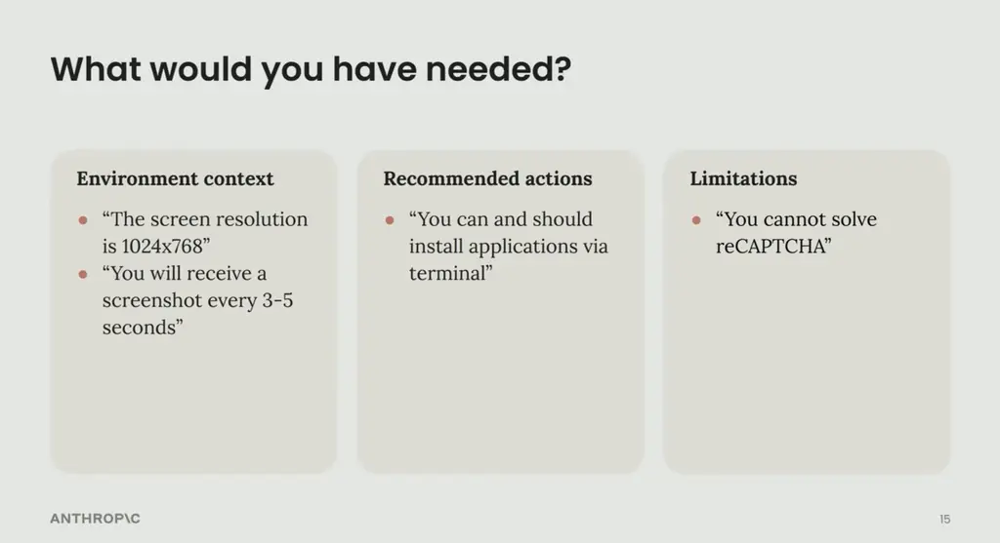
*[▶ 00:10:18](https://www.youtube.com/watch?v=D7_ipDqhtwk&t=618s) · What would you have needed?*

## Open Problems and Takeaways

[▶ 00:10:40](https://www.youtube.com/watch?v=D7_ipDqhtwk&t=640s)

Ask Claude to review your context. Check whether system prompt instructions are ambiguous, whether tool descriptions are clear and need more or fewer parameters, and why it made a choice by feeding in full trajectories. This supplements your own understanding; it doesn't replace it.

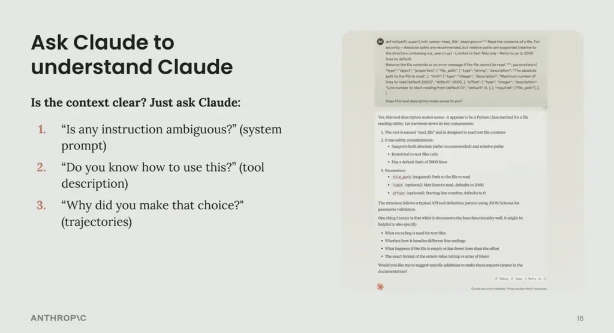
*[▶ 00:10:57](https://www.youtube.com/watch?v=D7_ipDqhtwk&t=657s) · Ask Claude to understand Claude*

One reply to a `read_file` description flagged gaps in encoding, line endings, empty files, and return format.

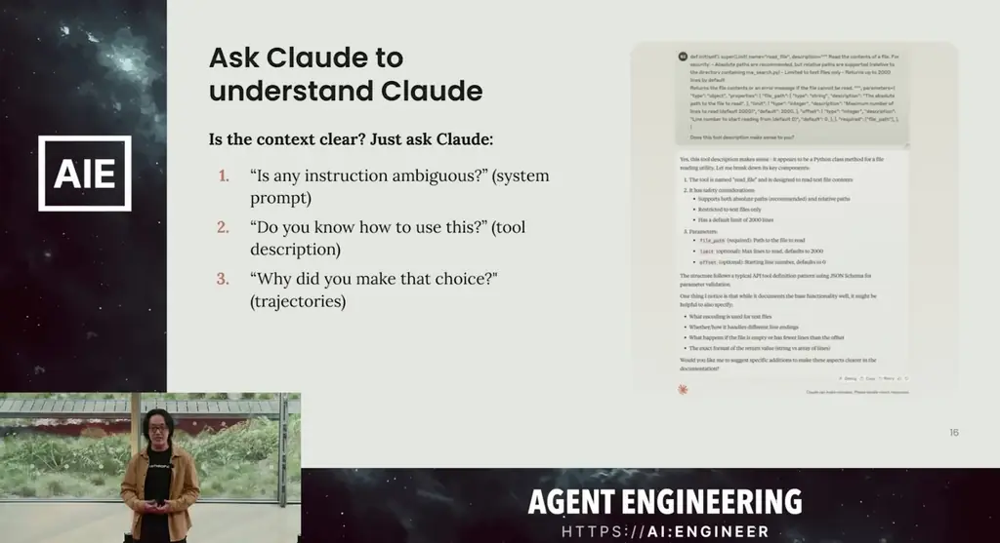
*[▶ 00:11:09](https://www.youtube.com/watch?v=D7_ipDqhtwk&t=669s) · Ask Claude to understand Claude*

Open questions:

- **Budget-awareness:** enforcing time, money, and token limits on agents.
- **Self-evolving tools:** models improving their own tool ergonomics.
- **Multi-agent communication:** moving beyond synchronous USER:ASSISTANT turns.

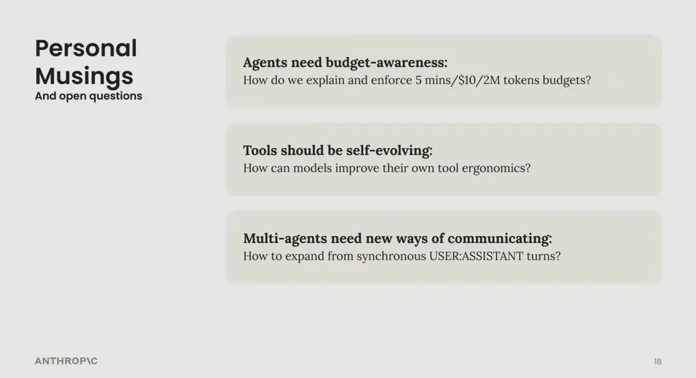
*[▶ 00:11:54](https://www.youtube.com/watch?v=D7_ipDqhtwk&t=714s) · Personal Musings: open questions*

Takeaways: don't build agents for everything; keep them simple as long as possible; and think like your agent while iterating.

## Links & resources

- Building Effective Agents — blog post, URL not shown · mentioned [▶ 00:00:31](https://www.youtube.com/watch?v=D7_ipDqhtwk&t=31s)
- Swix blog post — mentioned by speaker, URL not shown · mentioned [▶ 00:14:24](https://www.youtube.com/watch?v=D7_ipDqhtwk&t=864s)
