# Anthropic engineers just released the best 1-hour course on building…

*How Anthropic's Managed Agents split an agent into session, brain and hands, and how to build, evaluate and deploy one with Opus 5.5.*

Source: [Anthropic engineers just released the best 1-hour course on building…](https://x.com/i/status/2110853512594948519) · Residual · 1 h 38 min

## TL;DR

Agent harnesses that bundle session, loop and sandbox in one container become fragile and hard to debug, and their built-in assumptions go stale as models improve. Anthropic's Managed Agents fix this by splitting the agent into an append-only session log, a stateless brain (Claude plus the loop), and on-demand sandboxed hands. The talk walks through the API's resources (environments, agents, sessions), outcomes with graded rubrics, skills, vaults, memory, and dreaming, using a SEC-filing research workshop as the running example. It matters because the design lets failed sandboxes or harnesses be replaced without losing work, and because the speaker stresses running evals on each new model before deciding how thick the harness should be.

## Key takeaways

- An agent is a model in a loop with tools, and the harness runs that loop and encodes what the model cannot do alone; those assumptions should be revisited as models improve.
- Split the agent into an append-only session log, a stateless brain (Claude plus the loop), and hands (sandboxes and tools) provisioned on demand, so that only the session needs protecting.
- A dead sandbox becomes a failed tool call that Claude retries on a fresh container, and a dead harness resumes from the last event in the log.
- Route credentials through a vault and proxy so the sandbox and model never see real tokens, and only the host domains you specify receive the swapped-in value.
- Create a reusable environment once, define agents separately from environments, and bind an agent ID and environment ID to each session; messages go in as user.message events and replies stream back as agent.message and agent.tool_use.
- Use user-defined outcomes (description, rubric, max_iterations) with a separate grader to check results, and mount shared memory stores so sessions learn from one another.
- Run evals on your own task types, built from scored historical sessions, before trusting a setup, because garbage data produces meaningless scores even at 100%.
- For multi-tenant apps, avoid bring-your-own-key and use workspaces as the access boundary, since there is no RBAC below the workspace and everyone in a workspace can access all its resources.

## The agent loop and the pet-to-cattle redesign

[▶ 00:00:00](https://x.com/i/status/2110853512594948519)

An agent is a model in a loop with tools: it picks the next action, calls a tool, reads the result, and repeats until the task is done.

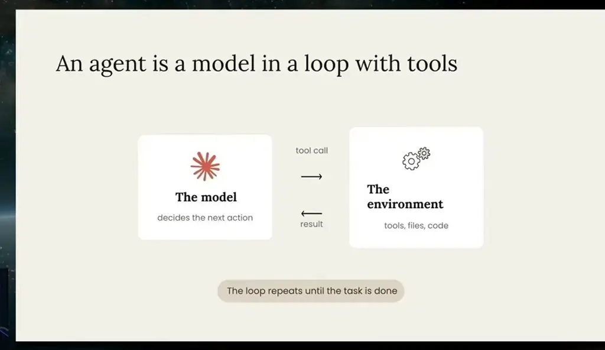
*[▶ 00:00:23](https://x.com/i/status/2110853512594948519) · An agent is a model in a loop with tools*

The **harness** runs the loop and encodes what the model cannot do alone. Those assumptions go stale: Sonnet 4.5 wrapped up tasks early near its context limit, so context resets were added to the harness, and Opus 4.5 did not need them.

Generated code is untrusted, so each task runs in its own isolated, disposable sandbox that limits the blast radius.

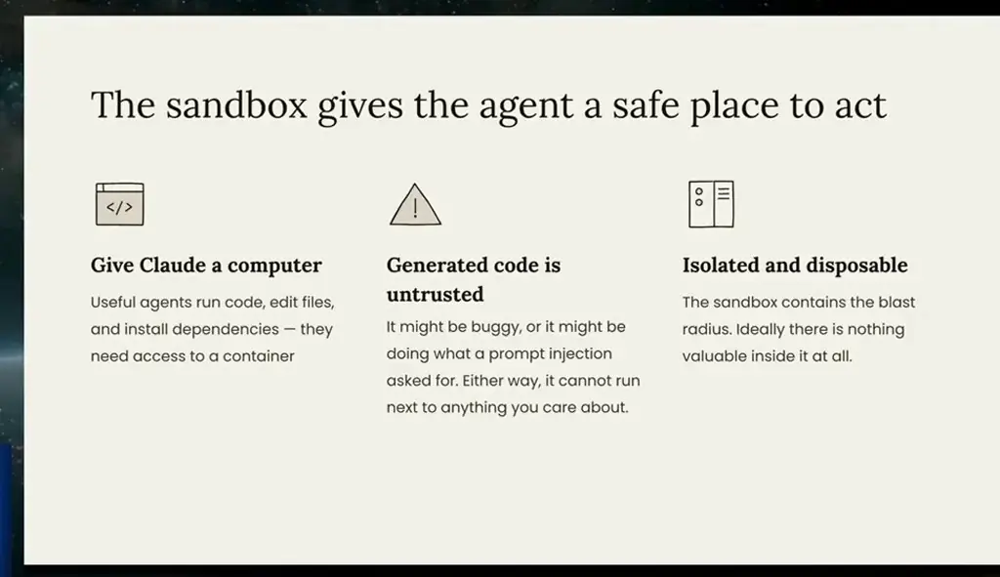
*[▶ 00:02:27](https://x.com/i/status/2110853512594948519) · The sandbox gives the agent a safe place to act*

The first architecture put session, harness and sandbox in one container. It was simple, but every container became a pet: losing one lost the session, debugging was blind, and reaching a customer's VPC meant peering networks or shipping them the harness.

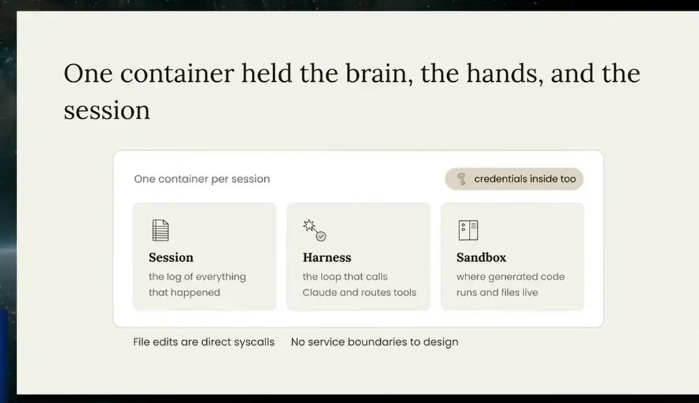
*[▶ 00:03:58](https://x.com/i/status/2110853512594948519) · One container holds brain, hands, and session*

The fix split the agent into an append-only **session** log, a stateless **brain** (Claude plus the loop), and **hands** (sandboxes and tools) provisioned on demand.

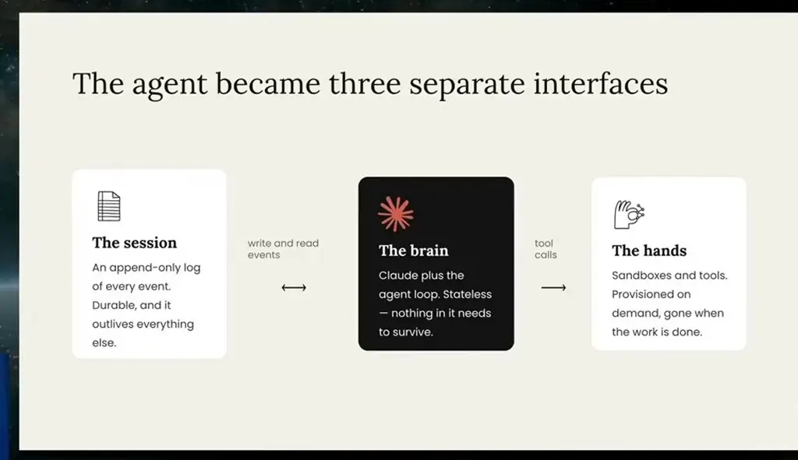
*[▶ 00:11:14](https://x.com/i/status/2110853512594948519) · The agent became three separate interfaces*

A dead sandbox becomes a failed tool call that Claude retries on a fresh container. A dead harness is replaced by one that reads the event log and resumes from the last event. Only the session is worth protecting.

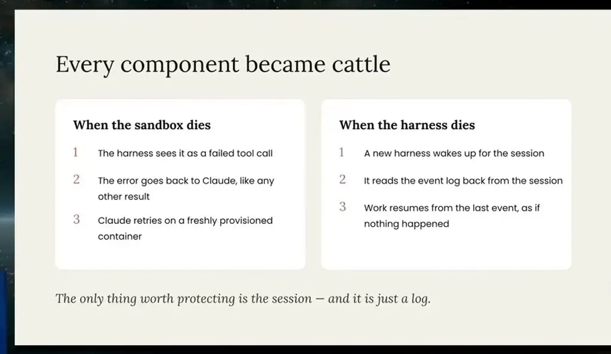
*[▶ 00:07:16](https://x.com/i/status/2110853512594948519) · Every component became cattle*

A proxy fetches credentials from a vault and makes external calls, so the sandbox and model never see tokens and prompt injection has nothing to extract.

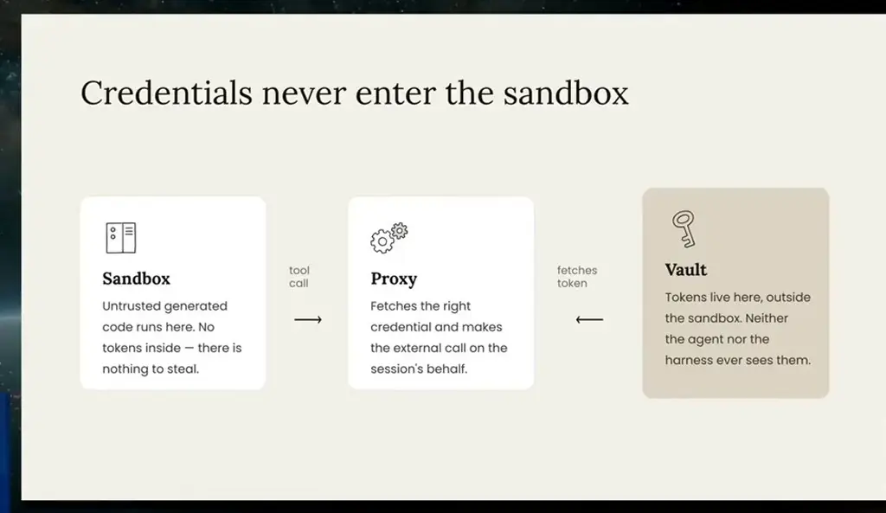
*[▶ 00:08:01](https://x.com/i/status/2110853512594948519) · Credentials never enter the sandbox*

Inference starts without waiting for a sandbox, cutting p95 time-to-first-token by about 90%.

Takeaway: harnesses encode assumptions that go stale, so design interfaces that outlast them.

## Environment, agent and session as separate resources

[▶ 00:11:15](https://x.com/i/status/2110853512594948519)

Managed Agents uses three beta resources.

An **environment** is the sandbox template. It sets networking, either unrestricted or limited to specific domains and MCP servers, and the packages to install. Create it once and reuse its ID; each session gets a fresh, isolated container.

```python
env = client.beta.environments.create(
name="joke-teller-env" , config={ "type":
"cloud", "networking": {"type":
"unrestricted" }, }, )
```

*[▶ 00:12:39](https://x.com/i/status/2110853512594948519) · Step 1: create the environment*

An **agent** is a reusable definition of model, system prompt and tools. It doesn't know which environment it will run against. The built-in toolset provides bash, read, write and grep.

```python
agent = client.beta.agents.create( name="Joke teller" , model={"id": "claude-opus-4-8" },
system= "You are a comedian. Find a fresh joke on the topic and deliver it well." ,
tools=[{"type": "agent_toolset_20260401" }],
)
```

*[▶ 00:13:43](https://x.com/i/status/2110853512594948519) · Step 2: create the agent*

A **session** binds an agent ID and an environment ID. It stays idle until you send an event.

```python
session = client.beta.sessions.create(
agent=agent.id, environment_id=env.id,
title="Open mic night" , )
```

*[▶ 00:14:03](https://x.com/i/status/2110853512594948519) · Step 3: create the session*

You send `user.message`; Claude returns `agent.message` and `agent.tool_use` on the same stream.

The workshop code is in `research-desk` under `cwc-workshops`.

```bash
git clone
https://github.com/anthropics/cwc-workshops/

cd research-desk

npm install / bun i
```

*[▶ 00:15:20](https://x.com/i/status/2110853512594948519) · Build a financial analytics agent*

The [Claude Console](https://platform.claude.com) Quickstart generates the agent config from one line of text.

```yaml
name: Joke Teller
description: An agent that tells jokes on any given topic.
model: claude-sonnet-4-6
system: You are a witty comedian who tells jokes on any topic the user gives you. When given a topic, immediately deliver 3-5 fresh, clever jokes about it — a mix of puns, one-liners, and observational humor. Keep jokes clean and suitable for all audiences unless the user specifies otherwise. After delivering the jokes, invite them to give you another topic. Never refuse a topic; if it's obscure, lean into the absurdity.
tools:
  - type: agent_toolset_20260401
```

*[▶ 00:16:41](https://x.com/i/status/2110853512594948519) · Generated Joke Teller agent config (YAML)*

A session given "Tell me jokes about cats!" returned a joke. Anthropic manages the hosting, harness, sandbox, scaling and event-log storage.

```json
ant beta:sessions create <<YAML
environment_id: env_01HSHG48nxLprjYZmiHFdz25
agent:
  type: agent
  id: agent_01Kn78f1XMYWNct8gNGnJP3Q
YAML

ant beta:sessions:events send --session-id sesn_019ahUEJmTCDhuF5RQZcaKvm \
  --event '{"type":"user.message","content":[{"type":"text","text":"Tell me jokes about cats!"}]}'

"content": [
  {
    "text": "# … Cat Jokes, Coming Right Up!\n\n---\n\n**1. The Pun Opener**\nWhy don't cats ever win at poker?\n…",
    "type": "text"
  }
],
"id": "sevt_019fl4m7vXJqrPUNyyz94HUc",
"processed_at": "2026-06-30T18:06:31.109930Z",
"type": "agent.message"
```

*[▶ 00:18:07](https://x.com/i/status/2110853512594948519) · Starting a session and receiving the joke reply*

## Setting up the Research Desk and first chat

[▶ 00:18:16](https://x.com/i/status/2110853512594948519)

The workshop builds an agent that reads SEC filings and compares instruments, in stages: a chat interface, sub-agents with an SEC skill, long-running async runs, map-reduce across many sessions, and scheduled recurring runs.

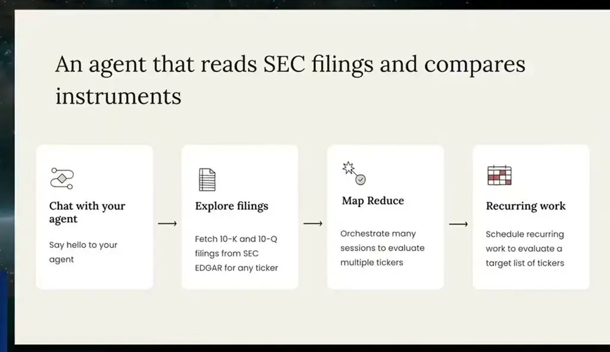
*[▶ 00:19:24](https://x.com/i/status/2110853512594948519) · Agent workflow: chat, explore, map-reduce, recurring*

Clone the repo, run `bun i` or `npm install`, then start the app with `bun run dev`, which serves on port 3100.

```shell
Claude Code v2.1.196
Opus 4.8 (1M context) with high effort · Claude Enterprise
~/code/cwc-workshops/research-desk
⚠ 5 MCP servers need authentication · run /mcp
| /remote-control is active · Continue here, on your phone, or at
| https://claude.ai/code/session_01GRnyn1PSK39srXCd2nCwRz

…un run dev
next dev --port 3100
▲ Next.js 15.5.19
- Local:        http://localhost:3100
- Network:      http://10.41.241.194:3100
- Environments: .env.local
✓ Starting...
✓ Ready in 953ms
```

*[▶ 00:21:57](https://x.com/i/status/2110853512594948519) · Claude Code and Next.js dev server terminals*

The setup page needs two values in `.env.local`. The first is `ANTHROPIC_API_KEY` or `ANTHROPIC_AUTH_TOKEN`, which stays on the server. The second is `EDGAR_IDENTITY`, because the SEC requires callers to identify themselves.

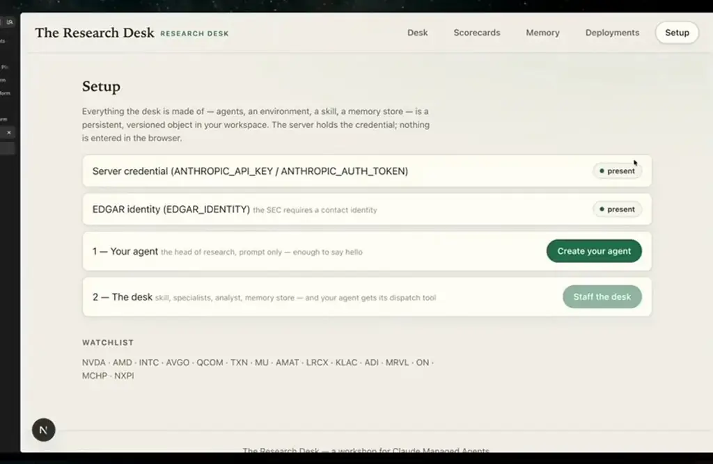
*[▶ 00:22:24](https://x.com/i/status/2110853512594948519) · Research Desk setup page*

In Claude Code, `/workshop start` checks prerequisites and records your mode, either "do it and teach me" or "coach me". `/workshop next` advances through the six acts, with progress saved to `.workshop-progress.json`.

```shell
– .env.local present, with your API credential and EDGAR identity both detected
– Dev server is already up on http://localhost:3100

What's not done yet — everything else. This is a clean start:
– No desk.json → the desk hasn't been provisioned (no agents, skill, or memory store created yet)
– All 7 TODO(workshop-N) stubs are still empty across 5 files
– No progress file, no scorecards

So next up is Act 1 — Say hello. You'll click "Create your agent" on the Setup tab to mint the Environment + the head-of-research agent (version 1, just a system prompt). Then fill the first two TODOs so the Desk tab can send a message and stream the reply back.

---
Before we dive in, one choice that sets the tone for the whole workshop:

● User answered Claude's questions:
  └ How do you want to work through the acts? → Do it and teach me
● Locked in — do it and teach me. I'll make the changes and walk you through each one; you can switch to "coach me" anytime. Let me record that and start Act 1.
● Write(.workshop-progress.json)
  └ Wrote 1 lines to .workshop-progress.json
    1 {"mode": "do-and-teach", "completed_acts": [0], "notes": "fresh start; desk not yet provisioned"}
  Read 1 file

● Now the SSE stream route for TODO 2:
  Read 1 file
  └ Interrupted · What should Claude do instead?

❯ /workshop next

✻ Flowing… (8s · thinking with high effort)
  └ Tip: Run tasks in the cloud while you keep coding locally · clau.de/web

❯
⏵⏵ auto mode on (shift+tab to cycle) · esc to interrupt · ← for agents

un run dev
next dev --port 3100
▲ Next.js 15.5.19
- Local: http://localhost:3100
- Network: http://10.41.241.194:3100
- Environments: .env.local
✓ Starting...
✓ Ready in 953ms
✓ Compiled /api/desk/status in 289ms (420 modules)
GET /api/desk/status 200 in 391ms
✓ Compiled /api/desk/provision in 141ms (421 modules)
{"ts":"1782843283.285","level":"info","event":"desk_hello_provisioned","steps":[{"step":"environment","id":"env_0186NWfPWEzYWSmiAdiAkyBF"},{"step":"head of research (version 1 — prompt only)","id":"agent_0147TNivS1thfohvVCy59e81"}]}
POST /api/desk/provision 200 in 799ms
✓ Compiled /api/desk/status in 33ms (229 modules)
GET /api/desk/status 200 in 62ms
```

*[▶ 00:27:17](https://x.com/i/status/2110853512594948519) · Claude Code terminal and dev server log*

"Create your agent" provisions two persistent objects. The environment is a sandbox template with access to a few websites, mainly the SEC, plus extra Python packages. The head-of-research agent is version 1: a system prompt with basic built-in tools, but no skills or sub-agents yet.

Everything runs over one event stream. Sending a chat message appends a `user.message` event to the session. The backend then relays the session's events to the browser as Server-Sent Events, so the UI renders replies live.

```text
❯ [Request interrupted by user]
…text", text }] }],
-   …
-   void client;
-   void text;
-   throw new Error("TODO(workshop-1): send the user.message event in sendToHead (src/lib/orchestrator.ts)");
+   // A chat message is one event appended to the session's durable log.
+   await client.beta.sessions.events.send(sessionId, {
+     events: [{ type: "user.message", content: [{ type: "text", text }] }],
+   });
-   return sessionId;
  }
Update(src/app/api/desk/stream/route.ts)
  Added 36 lines, removed 37 lines
  }

  const client = getClient();
-   // TODO(workshop-2): reading a conversation is streaming the session's events.
-   //
-   // 1. Open the live event stream:
-   //    const upstream = (await client.beta.sessions.events.stream(sessionId)) as AsyncIterable<unknown>;
-   //    (wrap it in try/catch and return a 502 with the error if it fails)
-   // 2. Forward every event to the browser as a Server-Sent Events frame:
-   //    const encoder = new TextEncoder();
-   //    const stream = new ReadableStream<Uint8Array>({
-   //      async start(controller) {
-   //        try {
-   //          for await (const event of upstream) {
-   //            if (request.signal.aborted) break;
```

*[▶ 00:27:53](https://x.com/i/status/2110853512594948519) · Claude Code diff wiring chat send and SSE stream*

```text
…sessionId, error: String(error) });
+   return new Response(JSON.stringify({ error: String(error) }), { status: 502 });
+ }
+
+ // Forward every event to the browser as a Server-Sent Events frame.
+ const encoder = new TextEncoder();
+ const stream = new ReadableStream<Uint8Array>({
+   async start(controller) {
+     try {
+       for await (const event of upstream) {
+         if (request.signal.aborted) break;
+         controller.enqueue(encoder.encode(`data: ${JSON.stringify(event)}\n\n`));
+       }
+     } catch (error) {
+       if (!request.signal.aborted) {
+         logEvent("warning", "stream_proxy_error", { session_id: sessionId, error: String(error) });
+       }
+     } finally {
+       controller.close();
+     }
+   },
+ });
+
+ return new Response(stream, {
+   headers: {
+     "content-type": "text/event-stream",
+     "cache-control": "no-cache, no-transform",
+     "x-accel-buffering": "no",
+   },
+ });
```

*[▶ 00:28:08](https://x.com/i/status/2110853512594948519) · Claude Code diff completing SSE stream forwarding*

Saying "hi" gets a reply from the head of research, which confirms the chat path works end to end. Stopping here gives a basic chat app; the later acts add tools and agents.

Asked where the agents run, the presenter said Anthropic's own infrastructure today, with an AWS-hosted option for AWS credits. Bringing your own sandbox through providers such as Vercel, Modal, or Daytona is covered later.

## Coordinator analysts and memory-mounted sessions

[▶ 00:28:34](https://x.com/i/status/2110853512594948519)

The filing analyst coordinates the financials and risk specialists and includes a `self` entry, so it can spawn copies of itself with the same prompt and tools.

```text
+        items: { type: "string" },
+        description: "Tickers to analyze, one analyst per ticker,"
+      },
+      focus: { type: "string", description: "Optional angle for the analysts to emphasize" },
+    },
+    required: ["tickers"],
+  },
+};

  const AGENT_TOOLSET = {
    type: "agent_toolset_20260401",

//   { type: "self" },
//   ],
//   },
-  const analyst = todoStub("TODO(workshop-3): create the filing-analyst coordinator agent in src/lib/provision.ts");
+  const analyst = await client.beta.agents.create({
+    name: `${agentPrefix}-filing-analyst`,
+    model: MODEL,
+    system: loadPrompt("analyst_system.md", { edgar_identity: cfg.edgar_identity }),
+    tools: [AGENT_TOOLSET],
+    skills: skillsRef,
+    multiagent: {
+      type: "coordinator",
+      agents: [
+        { type: "agent", id: financials.id },
+        { type: "agent", id: risk.id },
+        { type: "self" },
+      ],
+    },
+  } as never);
```

*[▶ 00:30:19](https://x.com/i/status/2110853512594948519) · Coordinator analyst agent creation diff*

A security review caught raw error text going to the browser. The fix returns a generic message, and the detailed error stays in the server log.

```text
upstream = (await client.beta.sessions.events.stream(sessionId)) as AsyncIterable<unknown>;
} catch (error) {
  logEvent("warning", "stream_proxy_open_failed", { session_id: sessionId, error: String(error) });
-   return new Response(JSON.stringify({ error: String(error) }), { status: 502 });
+   return new Response(JSON.stringify({ error: "failed to open event stream" }), { status: 502 });
}

// Forward every event to the browser as a Server-Sent Events frame.
```

*[▶ 00:31:17](https://x.com/i/status/2110853512594948519) · Security review fix in stream route*

```text
upstream = (await client.beta.sessions.events.stream(sessionId)) as AsyncIterable<unknown>;
} catch (error) {
  logEvent("warning", "stream_proxy_open_failed", { session_id: sessionId, error: String(error) });
-   return new Response(JSON.stringify({ error: String(error) }), { status: 502 });
+   return new Response(JSON.stringify({ error: "failed to open event stream" }), { status: 502 });
}

// Forward every event to the browser as a Server-Sent Events frame.
```

*[▶ 00:31:21](https://x.com/i/status/2110853512594948519) · Stream route fix and next steps*

Sessions start from an agent ID and an environment ID; messages go in as `user.message` events.

```bash
ant beta:sessions create <<YAML
environment_id: env_01HSHG48nxLprjYZmiHFdz25
agent:
  type: agent
  id: agent_01Kn7Bf1XMYWNct8gNnJP3Q
YAML

ant beta:sessions:events send --session-id sesn_019ahUEJmTCDhuF5RQZcaKvm \
  --event '{"type":"user.message","content":[{"type":"text","text":"Tell me jokes about cats!"}]}'
```

*[▶ 00:31:46](https://x.com/i/status/2110853512594948519) · Creating a session and sending a message via CLI*

Analysis sessions mount the desk memory store read-write, so runs share what they learn.

```typescript
Now both edits. TODO 5 — create the analyst session with the desk memory mounted as a resource:
Update(src/lib/analysis.ts)
  Added 14 lines, removed 3 lines
  //       instructions: MEMORY_MOUNT_INSTRUCTIONS,
  //     },
  //   ],
-  const session = todoStub<{ id: string }>({
-    "TODO(workshop-5): create the analyst session with the memory store attached",
-  });
+  const session = await client.beta.sessions.create({
+    agent: cfg.analyst_agent_id,
+    environment_id: cfg.environment_id,
+    title: `Filing analysis: ${record.ticker}`,
+    metadata: { ticker: record.ticker, kind: "analysis" },
+    resources: [
+      {
+        type: "memory_store",
+        memory_store_id: cfg.memory_store_id,
+        access: "read_write",
+        instructions: MEMORY_MOUNT_INSTRUCTIONS,
+      },
+    ],
+  } as never);
   record.sessionId = session.id;
   record.url = sessionUrl(session.id);
   logEvent("info", "analysis_started", { ticker: record.ticker, session_id: session.id });
```

*[▶ 00:33:33](https://x.com/i/status/2110853512594948519) · Claude Code diff wiring session with memory store*

Outcomes are a `user.define_outcome` event with a description, rubric and `max_iterations`.

```typescript
  // rubric: { type: "text", content: rubric },
  // max_iterations: maxIterations,
  // }
-  void client;
-  void sessionId;
-  void description;
-  void rubric;
-  void maxIterations;
-  throw new Error("TODO(workshop-6): send the user.define_outcome event in defineOutcome");
+  // The description IS the task: declare what "done" looks like,
+  // attach the rubric, and let the platform's grader iterate the agent until satisfied.
+  await client.beta.sessions.events.send(sessionId, {
+    events: [
+      {
+        type: "user.define_outcome",
+        description,
+        rubric: { type: "text", content: rubric },
+        max_iterations: maxIterations,
+      },
+    ],
+  } as never);
 }
/**
```

*[▶ 00:34:13](https://x.com/i/status/2110853512594948519) · defineOutcome sends user.define_outcome event*

## Outcomes with rubrics, graded runs, and live skills

[▶ 00:33:43](https://x.com/i/status/2110853512594948519)

A user-defined outcome gives a session a description, a rubric, and a maximum iteration count. The demo rubric required a memory check, a memory note, and a JSON scorecard. SEC access needs `EDGAR_IDENTITY`.

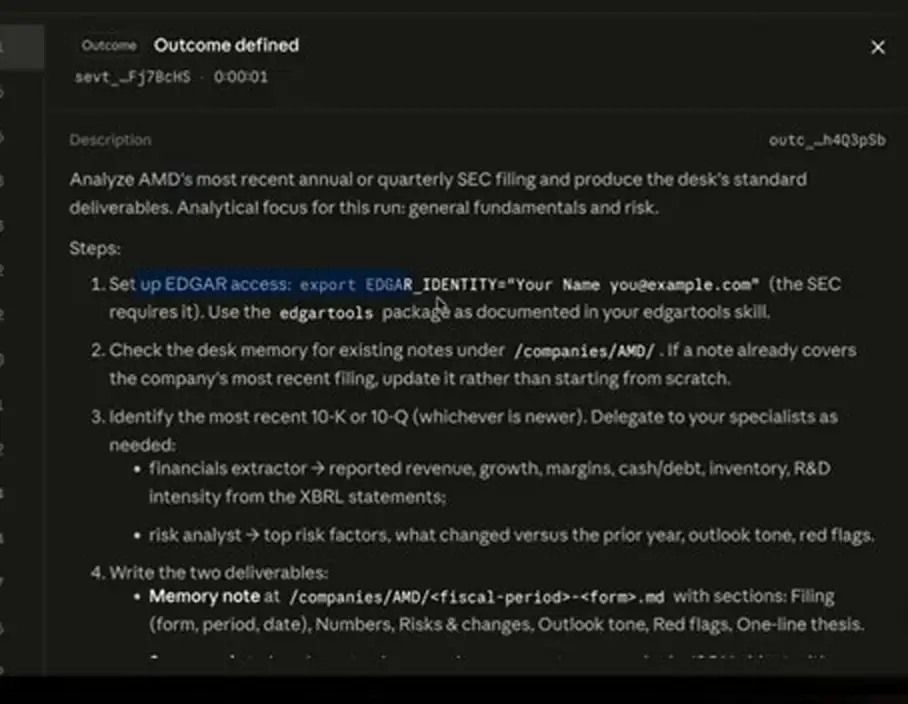
*[▶ 00:35:00](https://x.com/i/status/2110853512594948519) · Claude Console outcome definition for AMD filing analysis*

The main agent delegated to a financials extractor and a risk analyst, each running as a thread that reports back.

A separate grader checked the rubric against the artifacts and marked soft spots as caveats, not facts.

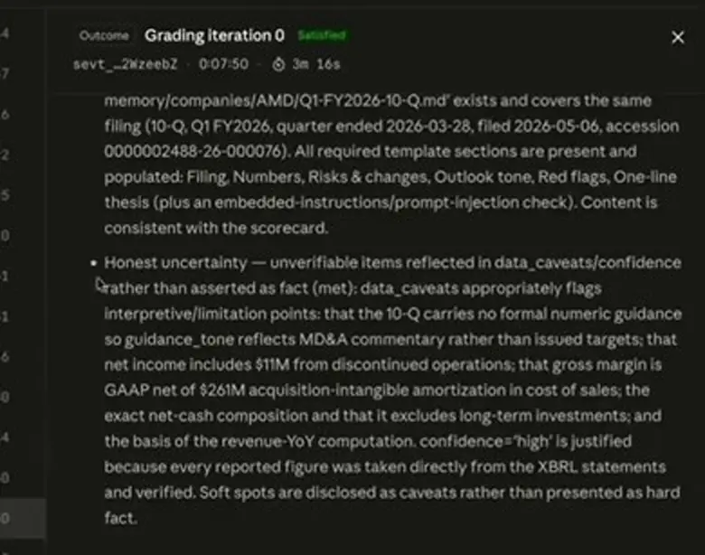
*[▶ 00:36:45](https://x.com/i/status/2110853512594948519) · Grader verifies outcome satisfied at iteration 0*

The verdict also confirmed the scorecard's field types and list caps.

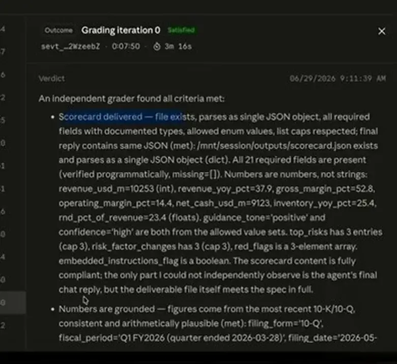
*[▶ 00:37:04](https://x.com/i/status/2110853512594948519) · Grader verdict on the AMD filing session*

Skills are live: adding a "Margins and inventory trend" recipe to the edgartools skill reaches any session that loads it.

````text
76 +# Pull a line by its label (inspect with `income` / `dir(income)` if labels differ),
77 +# then compute the ratio per period rather than reporting a single point.
78 +def margin(numerator, denominator):
79 +    return None if not denominator else round(numerator / denominator * 100, 1)
80 +
81 +# gross / operating / net margin, current vs prior — a falling margin is the signal
82 +# inventory-to-revenue (or inventory growth vs revenue growth): inventory rising
83 +# faster than revenue is the classic "inventory is building" warning.
84 +```
85 +
86 +Report each margin **as a pair (current vs prior) with the delta in percentage points**, not a lone number — durability is about the direction. For inventory, compare its year-over-year growth to revenue growth: inventory outpacing sales is the build to flag. Always name the filing each figure came from.
87 +
88 ## Segment and geographic revenue
89
90 Consolidated revenue hides the story; the segment note is where concentration and regional shifts show up. Segment data lives in the financial-statement notes (ASC 280), not the primary statements.
````

*[▶ 00:38:22](https://x.com/i/status/2110853512594948519) · Claude Code editing skill and publishing new version*

Each publish creates an immutable version. OAuth tokens need `Authorization: Bearer` and the `oauth-2025-04-20` beta; `x-api-key` returns a 401.

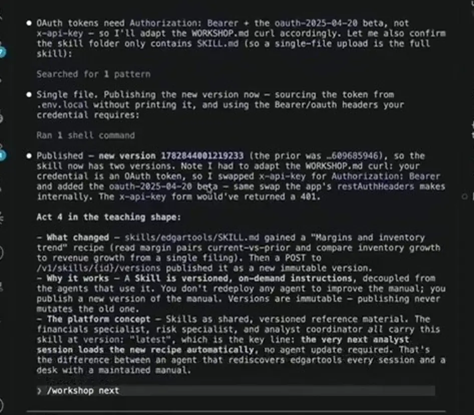
*[▶ 00:38:58](https://x.com/i/status/2110853512594948519) · Skill published as new immutable version*

The Skills page lists the custom skill with its version history.

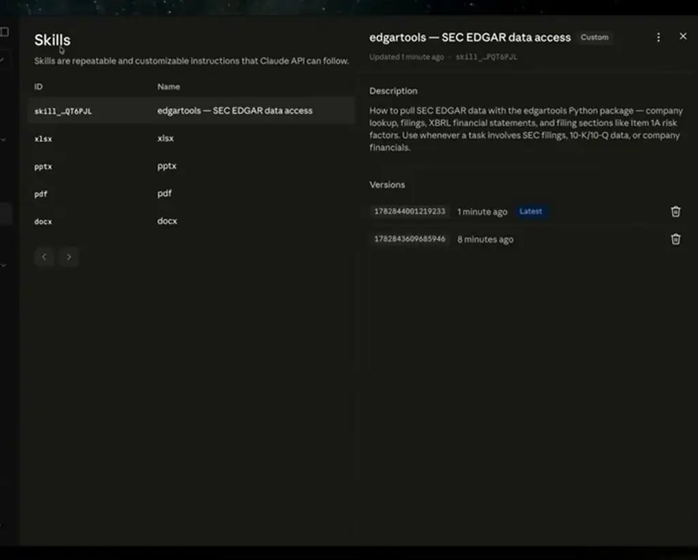
*[▶ 00:41:12](https://x.com/i/status/2110853512594948519) · Custom edgartools SEC EDGAR skill in Console*

## Vaults keep secrets out of the sandbox; memory and grading run per session

[▶ 00:39:53](https://x.com/i/status/2110853512594948519)

Vaults keep real secrets out of the sandbox. The session gets a placeholder, and egress swaps in the real value only for the host domains you specify. A key scoped to the SEC is never sent to anthropic.com.

In the [Claude Console](https://platform.claude.com), create a vault, bundle credentials such as MCP OAuth or a CLI's API key, and pass the vault ID when you reference a session.

The hosted harness is not the Agent SDK. The SDK is a headless Claude Code binary you run yourself; the managed harness is a generic rebuild inspired by Claude Code's.

Loop and token guardrails are left to you. Per-session budget caps are being explored but are not offered today.

To correct a run, send a `user.message` event; it queues. There is no rewind, and session forking is on the roadmap.

Memory stores persist across sessions, and agents write their own findings as they run. In the NVDA demo, the main agent delegated to two sub-agents and wrote a memory note.

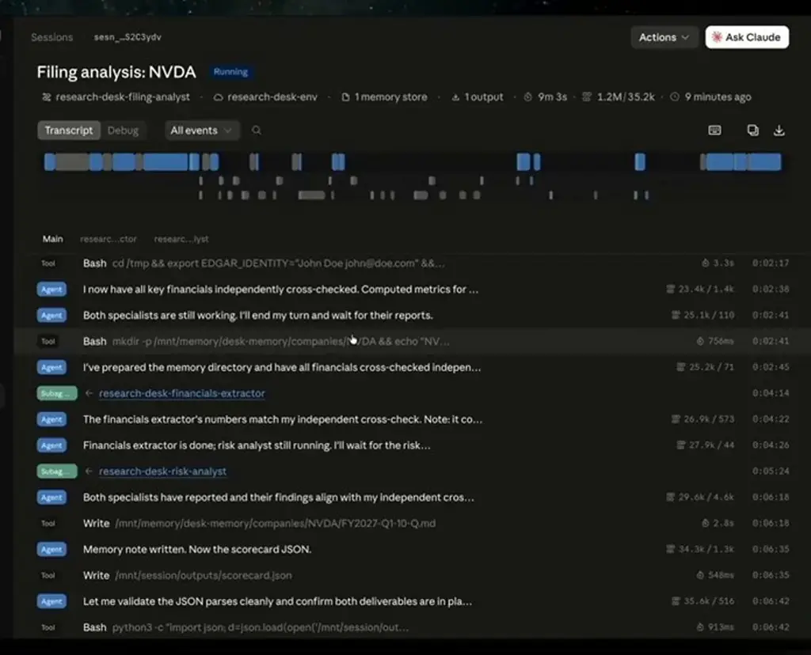
*[▶ 00:44:17](https://x.com/i/status/2110853512594948519) · NVDA filing analysis session transcript*

Grading happens at session level: you define the outcome, the main agent uses sub-agents to reach it, and sub-outcomes are not supported. The grader's final message listed the scorecard and memory note as deliverables.

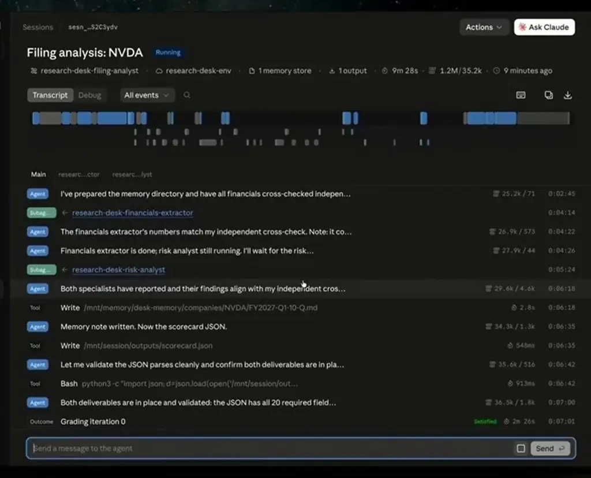
*[▶ 00:44:28](https://x.com/i/status/2110853512594948519) · Session transcript with grading outcome*

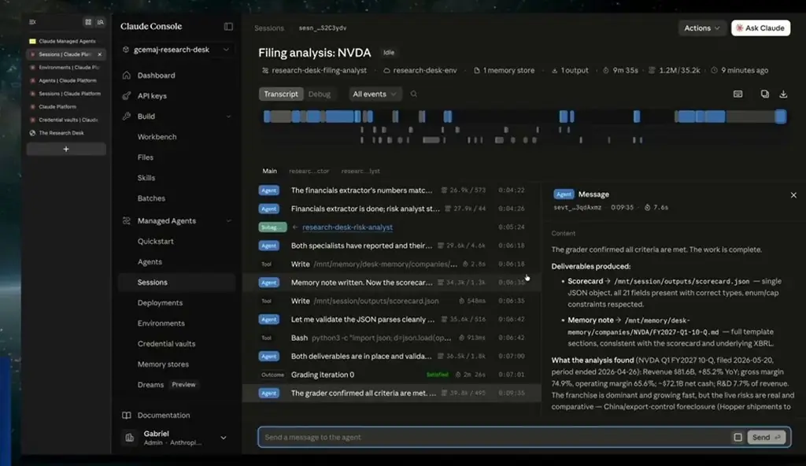
*[▶ 00:45:44](https://x.com/i/status/2110853512594948519) · Claude Console session transcript for NVDA filing analysis*

Each note holds one company's filing figures and caveats, which later sessions read before re-analyzing that company.

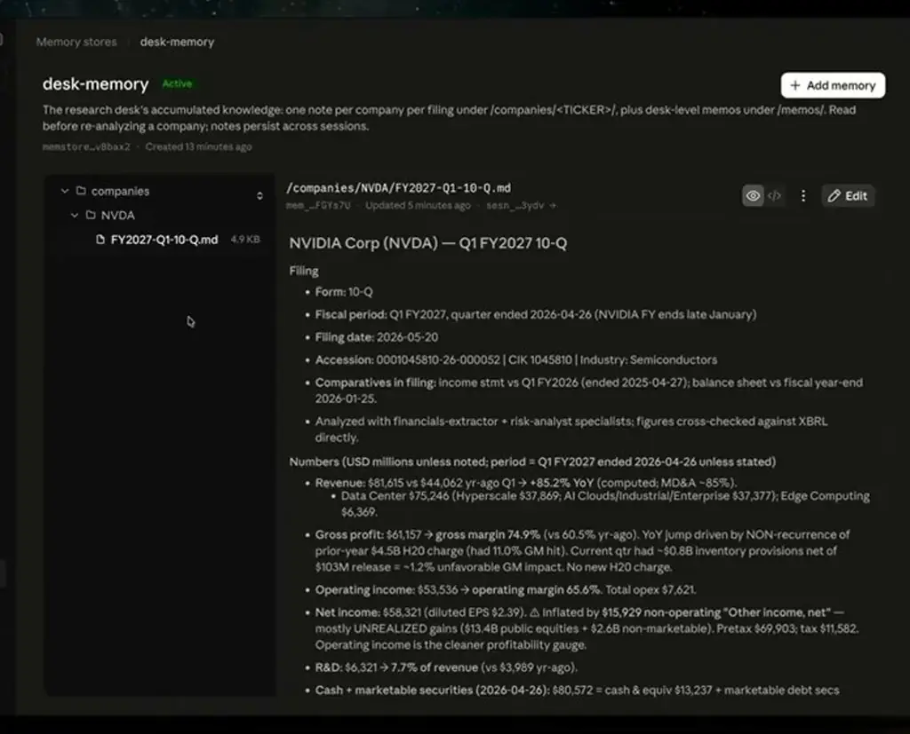
*[▶ 00:46:09](https://x.com/i/status/2110853512594948519) · desk-memory store: NVDA 10-Q note*

You can attach several stores, such as user-level and org-wide, and everything is API-accessible, so notes can move to other systems. No other memory provider is built in; you would add an MCP server or custom tool.

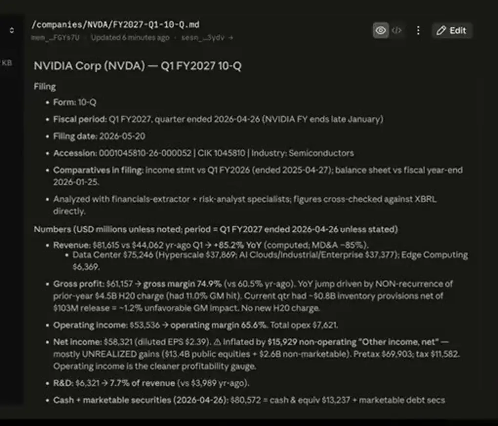
*[▶ 00:47:36](https://x.com/i/status/2110853512594948519) · Claude Console desk-memory store with NVDA note*

Dreaming analyzes transcripts and memories across sessions to update memory stores. It is limited to memory stores for now; skills, prompts and agent definitions could follow.

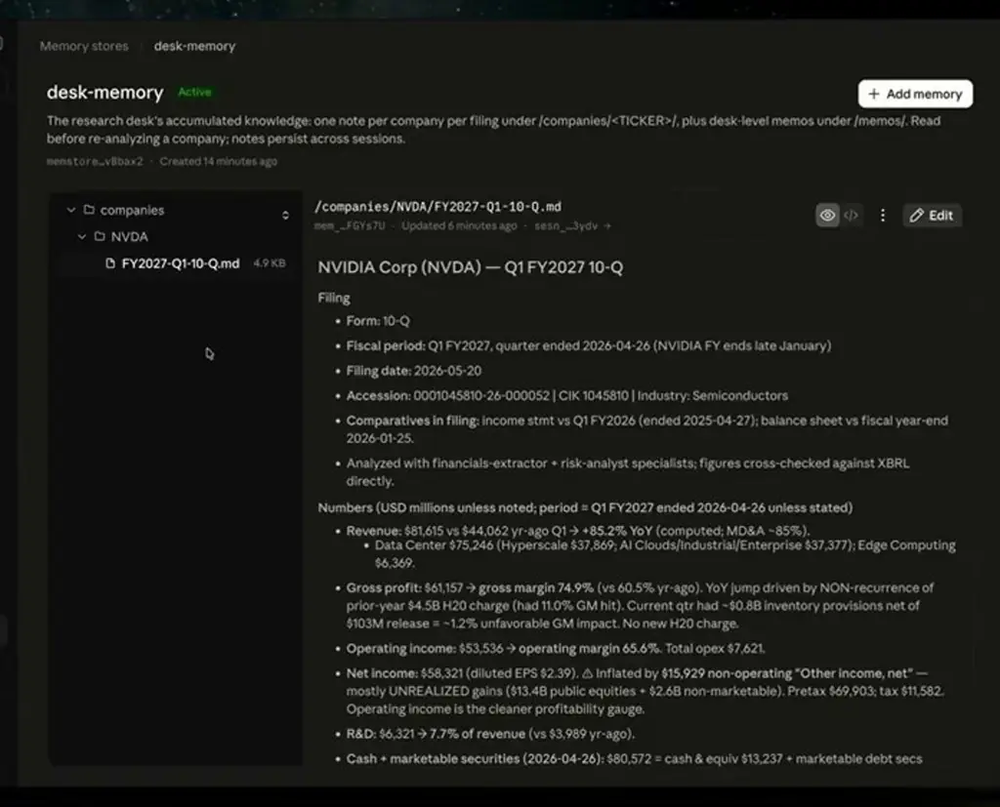
*[▶ 00:47:01](https://x.com/i/status/2110853512594948519) · desk-memory store: same NVDA 10-Q note*

## Private data access and standing deployments

[▶ 00:49:04](https://x.com/i/status/2110853512594948519)

For a CLI, API, or MCP server, wrap it as an MCP server with an auth vault, and the agent calls it directly. To avoid exposing it to the internet, use **MCP tunnels**, which need no inbound firewall rules, or a **self-hosted sandbox** peered with your network.

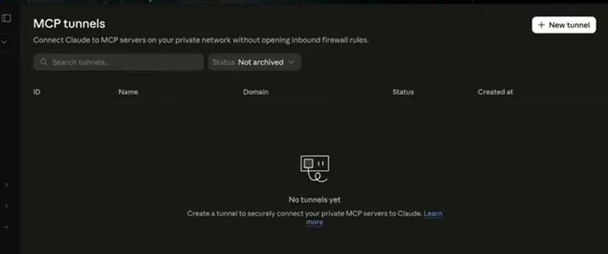
*[▶ 00:51:18](https://x.com/i/status/2110853512594948519) · MCP tunnels page, empty state*

A **deployment** binds an agent, a cron schedule, and initial messages. The demo's weekly memo runs `0 13 * * 1`, Mondays at 1 PM UTC.

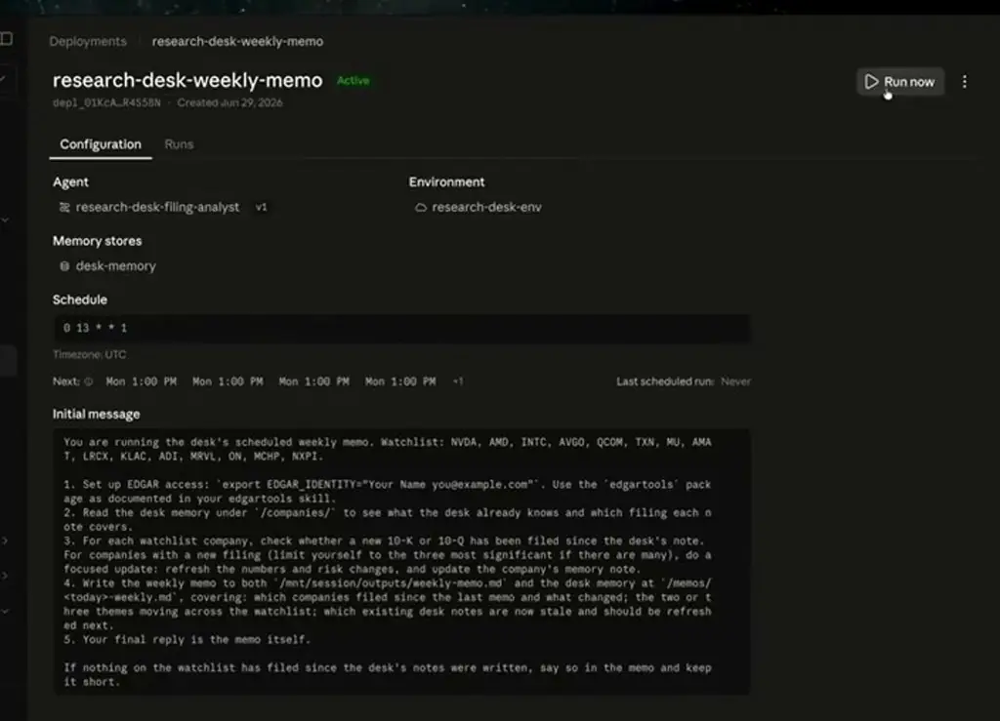
*[▶ 00:54:01](https://x.com/i/status/2110853512594948519) · Deployment config for weekly memo agent*

Its runs can be triggered manually. Two recent manual runs failed, and the speaker hadn't diagnosed them.

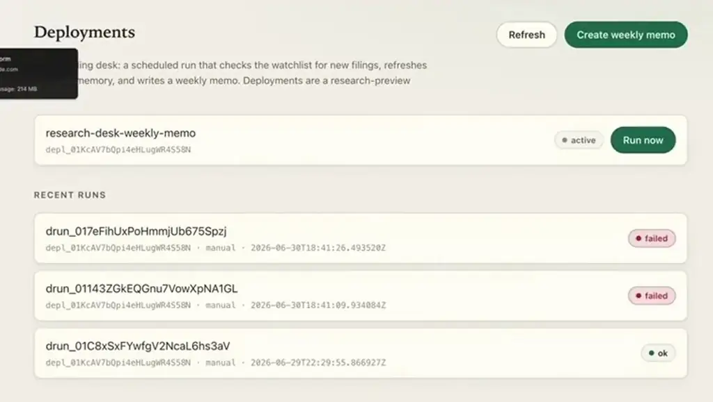
*[▶ 00:54:32](https://x.com/i/status/2110853512594948519) · Research Desk deployments page with recent runs*

Deployments are standing, not summoned. No orchestrator answers custom tools during a scheduled run, so the memo works from memory and EDGAR directly.

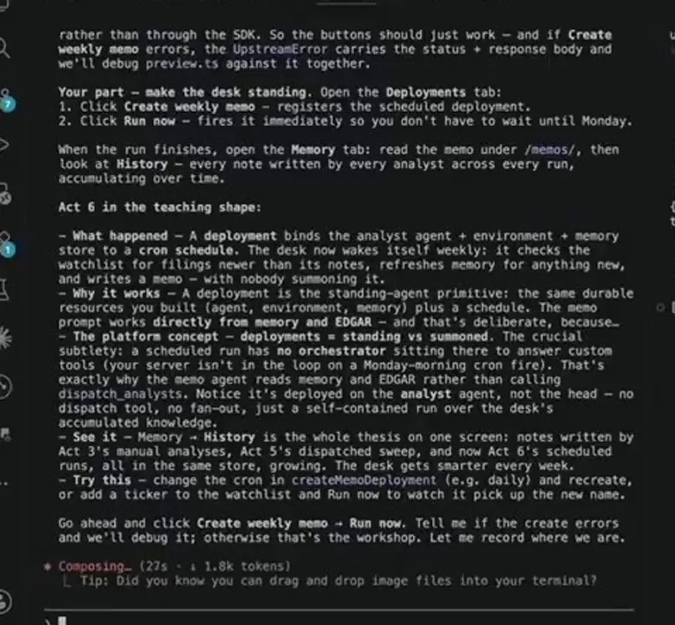
*[▶ 00:53:06](https://x.com/i/status/2110853512594948519) · Claude Code in IDE: Act 6 deployment instructions*

Act 6 closes the workshop.

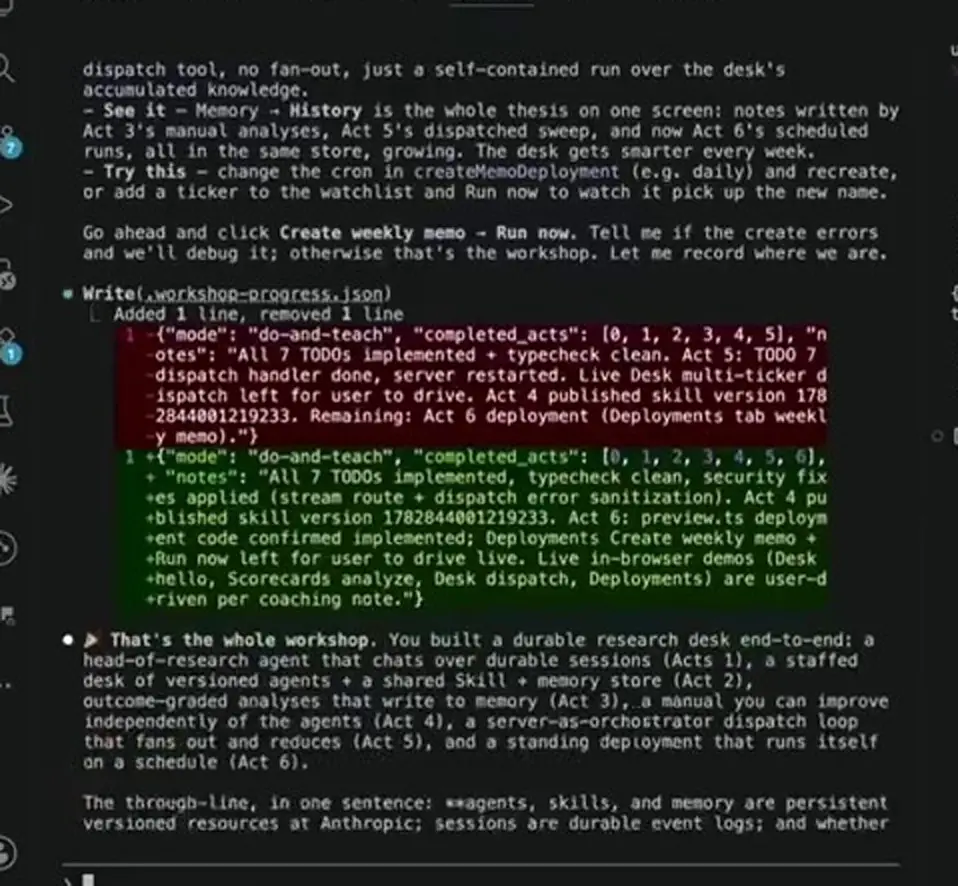
*[▶ 00:53:13](https://x.com/i/status/2110853512594948519) · Workshop progress JSON diff and final summary*

**Dreaming** reviews recent sessions from up to 30 days, using sub-agents to find memory gaps and recurring failures. In the demo, it found gaps in the skill and rewrote memory to cover them.

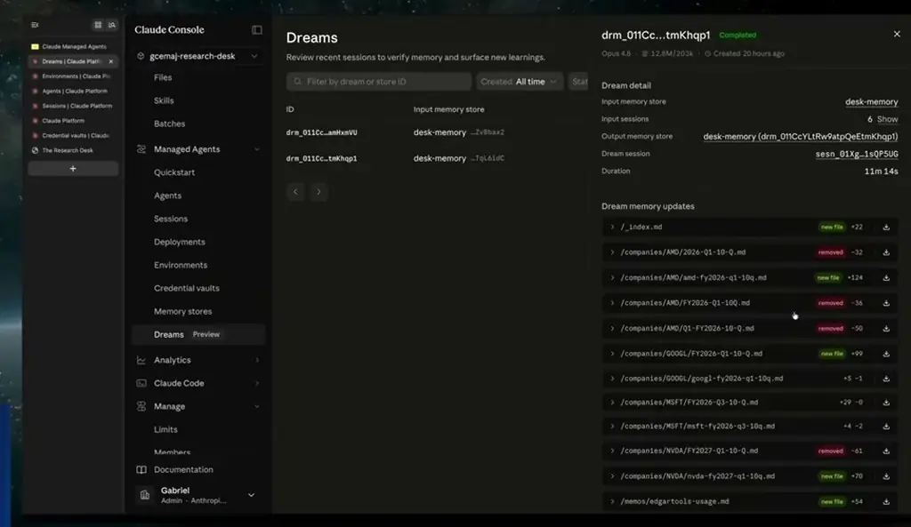
*[▶ 00:55:36](https://x.com/i/status/2110853512594948519) · Claude Console Dreams page with completed dream*

It also wrote `/memos/edgartools-usage.md`, a set of EDGAR gotchas that later sessions read before pulling XBRL data.

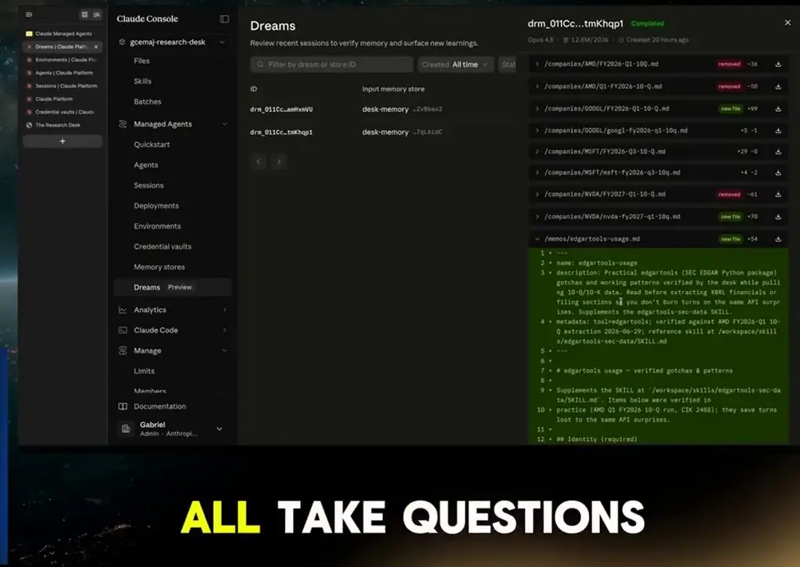
*[▶ 00:56:14](https://x.com/i/status/2110853512594948519) · Claude Console Dreams reviewing memory store updates*

## Built-in event telemetry, long-running sessions, and evals

[▶ 00:56:13](https://x.com/i/status/2110853512594948519)

Observability is built in. A session's Debug view lists every event with timestamps, including when each model call started and ended, so latency can be derived from it. Custom metrics mean filtering that stream yourself. To export elsewhere, such as to OpenTelemetry, build a connector on the API.

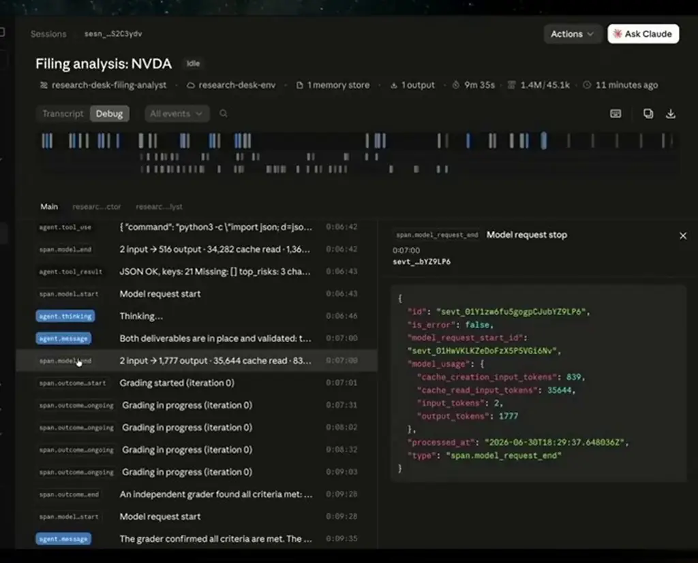
*[▶ 00:57:07](https://x.com/i/status/2110853512594948519) · Claude Console session debug event log*

Each model call's token usage is logged as an event:

```json
{
  "id": "sevt_01Y1zm6fu5gogpCJubYZ9LP6",
  "is_error": false,
  "model_request_start_id": "sevt_01HwVKLKZeDoFzX5P5VGi6Nv",
  "model_usage": {
    "cache_creation_input_tokens": 839,
    "cache_read_input_tokens": 35644,
    "input_tokens": 2,
    "output_tokens": 1777
  },
  "processed_at": "2026-06-30T18:29:37.648036Z",
  "type": "span.model_request_end"
}
```

*[▶ 01:01:10](https://x.com/i/status/2110853512594948519) · Claude Console debug view of model request stop*

Compaction runs for you; ten-hour sessions have run in production, and a daily task can run for six months. Status and token use per session appear in the Sessions view.

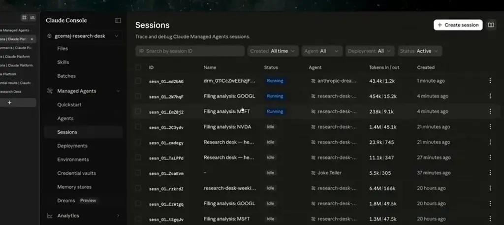
*[▶ 00:56:35](https://x.com/i/status/2110853512594948519) · Claude Console sessions list with status and tokens*

Dreams lists the memory-store file diffs from recent sessions, so memory changes can be inspected.

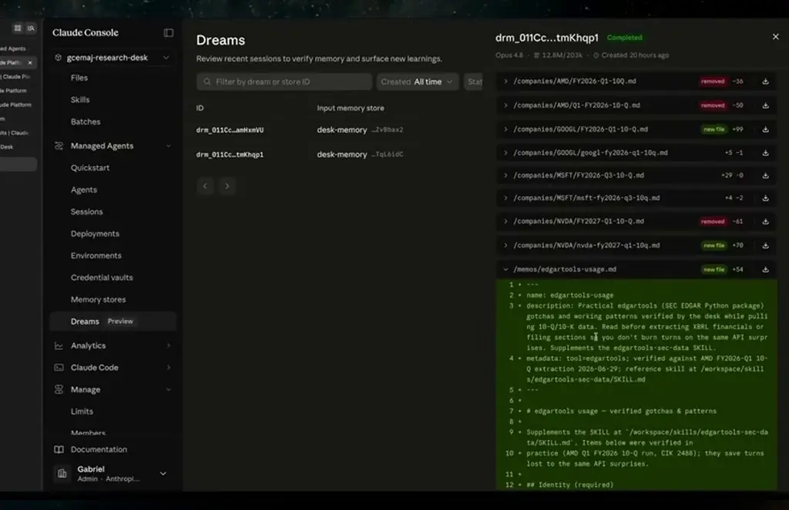
*[▶ 00:56:28](https://x.com/i/status/2110853512594948519) · Claude Console Dreams review of memory edits*

Here, harness means the tool loop: managing context and session state so the agent can do its work. Most builders mean coordinating several agents; this API gives one session as the unit to build that on. Orchestration today means sub-agents, and graph topologies are not supported yet.

Confidence comes from evals on your task types. Outcomes steer the agent toward an exact rubric, with max iterations, and an independent grader checks the result.

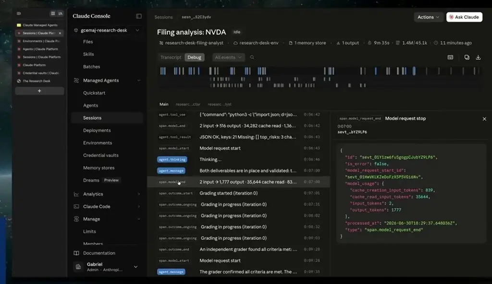
*[▶ 00:57:50](https://x.com/i/status/2110853512594948519) · Claude Console session debug trace, NVDA filing*

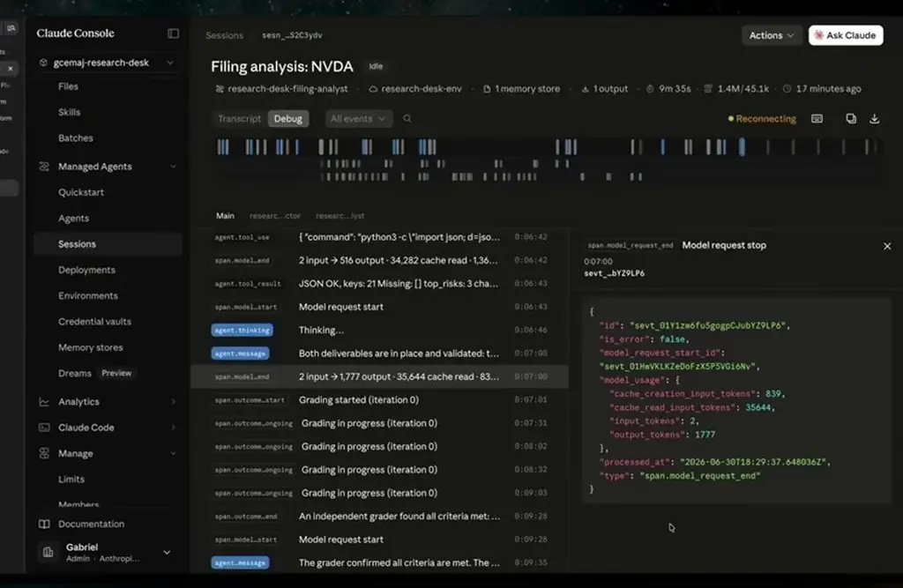
*[▶ 01:02:57](https://x.com/i/status/2110853512594948519) · Console session trace for NVDA filing analysis*

## Thinning harnesses and evaluating dreaming

[▶ 01:03:23](https://x.com/i/status/2110853512594948519)

Thick versus thin harness keeps shifting as models improve. The advice is to run evals on each new model. Skills suit today, but the speaker expects them to thin out, and he finds multi-agent setups more useful now.

**Dreaming** analyzes an agent's sessions over a chosen window, then builds a new memory store for those tasks. Customers report significant eval gains, but it is in research preview. Runs can diverge and one session can contradict the rest, so pair dreaming with your own evals.

The API draws on Claude Code's harness but targets bring-your-own context, not Claude Code in a box.

[Claude Console](https://platform.claude.com) shows session event logs and token usage per request. It is not on Bedrock; it is available via Claude Platform for AWS.

```json
{
  "id": "sevt_01Y1zm6fu5gogpCJubYZ9LP6",
  "is_error": false,
  "model_request_start_id": "sevt_01HwVKLKZeDoFzX5P5VGi6Nv",
  "model_usage": {
    "cache_creation_input_tokens": 839,
    "cache_read_input_tokens": 35644,
    "input_tokens": 2,
    "output_tokens": 1777
  },
  "processed_at": "2026-06-30T18:29:37.648036Z",
  "type": "span.model_request_end"
}
```

*[▶ 01:08:23](https://x.com/i/status/2110853512594948519) · Claude Console session debug log, model request stop*

## Workspaces as the tenancy unit, with no scaling knobs

[▶ 01:09:34](https://x.com/i/status/2110853512594948519)

Models are Claude-only for now. Non-Anthropic models aren't supported.

End users don't need a Console account. You sign up (free), create an API key, and pay per token. You build your own UI and call the API. The speaker says Notion external agents and Jira integrations are built this way.

For multi-tenancy, avoid bring-your-own-key. Runs bill to the end user's key, so you lose observability. Use **workspaces** as the tenancy unit instead:

- One workspace for all customers, with your own mapping from customer to agent.
- One workspace per customer. This is harder, because you recreate agents in each one.

There is no RBAC below the workspace. Everyone in a workspace can access everything in it.

Runs in a workspace appear in the Console session log, with per-request token usage:

```json
{
  "id": "sevt_01Y1zm6fu5gogbCJubYZ9LP6",
  "is_error": false,
  "model_request_start_id": "sevt_01HwVKLKZeDoFzX5P5V6i6Nv",
  "model_usage": {
    "cache_creation_input_tokens": 839,
    "cache_read_input_tokens": 35644,
    "input_tokens": 2,
    "output_tokens": 1777
  },
  "processed_at": "2026-06-30T18:29:37.648036Z",
  "type": "span.model_request_end"
}
```

*[▶ 01:11:30](https://x.com/i/status/2110853512594948519) · Managed agent session log in Claude Console*

There are no scaling parameters. You create as many sessions as you want, subject to rate limits. There are no pod counts, autoscaling settings, or timeouts to manage.

The speaker points to a production NVDA filing-analysis run as evidence that this is already in use. Its event trace and token counts are visible per step:

```json
{
  "id": "sevt_01Y1zm6fu5gogbCJubYZ9LP6",
  "is_error": false,
  "model_request_start_id": "sevt_01HwVKLKZeDoFzX5P5VGi6Nv",
  "model_usage": {
    "cache_creation_input_tokens": 839,
    "cache_read_input_tokens": 35644,
    "input_tokens": 2,
    "output_tokens": 1777
  },
  "processed_at": "2026-06-30T18:29:37.648036Z",
  "type": "span.model_request_end"
}
```

*[▶ 01:14:58](https://x.com/i/status/2110853512594948519) · Claude Console session trace for NVDA filing*

## Starting points and eval-driven confidence

[▶ 01:16:44](https://x.com/i/status/2110853512594948519)

Start with the Managed Agents skill in Claude Code, which builds a first agent from natural language.

Coworker suits personal agents; Managed Agents suits team or customer-facing agents.

On-prem is a frequent enterprise ask. Anthropic is considering it but has nothing to share yet.

A CLI wraps the API, so long-lived resources can live as YAML in the codebase, applied from CI/CD on each change.

Messages can queue while the model works, but not while it awaits a custom tool result. Sending one then returns a 400.

Anthropic runs many evals, especially as new models arrive, since it gets access before customers.

## Evals depend on good data, and workspaces set resource access

[▶ 01:21:58](https://x.com/i/status/2110853512594948519)

Cloud sessions make evals cheap to run. You can start thousands in parallel, score the results, then tune prompts and add or remove harness parts for each model release.

The main advice is high-quality data. Claude Code can build an eval for you, but garbage in, garbage out. Early eval ideas were often ill-defined, so a 100% score may mean little. Build the dataset by scoring your historical sessions.

Resources such as the memory store or MCP channel are bound to the workspace, and any API key in that workspace can access them. Admins create workspaces and assign who gets access to each one, so design workspaces around your access boundaries. There are no fine-grained controls for sharing individual resources. Partial sharing is something the builder implements in the integration, so end users see only part of the stack.

## CI-triggered agent reviews, QA sandboxes, and per-customer isolation

[▶ 01:26:03](https://x.com/i/status/2110853512594948519)

Anthropic runs CMA in CI: each PR starts sessions with sub-agents that evaluate the change and look for bugs. This cut PR time and bug counts, but the open problem is keeping up with the much higher PR volume.

A deploy agent can ship a branch to a sandbox, where the agent runs the app and validates its own changes as a QA agent. Tunneling into a running session isn't supported yet.

For per-customer setups:
- Use an agent, workspace, or org per customer, and keep the customer-to-agent mapping.
- Legally required data segregation needs separate workspaces, because resources are allocated per workspace.
- Keep one agent definition in code (e.g., YAML) and sync it to every workspace through CI. Or use one agent and tag each session with a customer ID in its metadata field.

Custom compute, such as GPUs or more memory, requires self-hosted sandboxes, e.g., on Modal. The default sandboxes are all identical.

For multiplayer chat, map each thread to a session and inject each message as `user.message` naming the sender.

## Long runs, checkpoints, and sub-agents that keep working

[▶ 01:33:07](https://x.com/i/status/2110853512594948519)

Agents can share memory across sessions and post to Slack through a tool, deciding for themselves when to reply. Priyanka suggests one agent per Slack channel, each with its own memory and access only to that channel's messages.

Long runs need no special setup: exit criteria keep the agent iterating until a grader's rubric passes, even past six hours.

```json
{
  "id": "sevt_01Y1zm6fu5gogpCJubYZ9LP6",
  "is_error": false,
  "model_request_start_id": "sevt_01HwVKLKZeDoFzXSP5VGi6Nv",
  "model_usage": {
    "cache_creation_input_tokens": 839,
    "cache_read_input_tokens": 35644,
    "input_tokens": 2,
    "output_tokens": 1777
  },
  "processed_at": "2026-06-30T18:29:37.648036Z",
  "type": "span.model_request_end"
}
```

*[▶ 01:34:47](https://x.com/i/status/2110853512594948519) · Claude Console session event log with browser tooltip*

Checkpoints and status come from the session event stream.

```json
{
  "description": "Analyze NVDA's most recent annual or quarterly SEC filing and produce the desk's standard deliverables. Analytical focus for this run: general fundamentals and risk.\n\nSteps:\n\n1. Set up EDGAR access: `export EDGAR_IDENTITY=\"John Doe john@doe.com\"` (the SEC requires it). Use the `edgartools` package as documented in your edgartools skill.\n2. Check the desk memory for existing notes under `/companies/NVDA/`. If a note already covers the company's most recent filing, update it rather than starting from scratch.\n3. Identify the most recent 10-K or 10-Q (whichever is newer). Delegate to your specialists as needed:\n   - financials extractor → reported revenue, growth, margins, cash/debt, inventory, R&D intensity from the XBRL statements;\n   - risk analyst → top risk factors, what changed versus the prior year, outlook tone, red flags.\n4. Write the two deliverables:\n   - **Memory note** at `/companies/NVDA/<fiscal-period>-<form>.md` with…
```

*[▶ 01:35:30](https://x.com/i/status/2110853512594948519) · Claude Console session event stream for NVDA filing*

The coordinator can show idle while sub-agents still work, as this NVDA run shows.

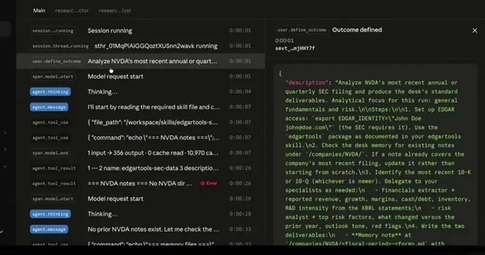
*[▶ 01:37:35](https://x.com/i/status/2110853512594948519) · Debug event timeline: idle main thread, sub-agent work*

Sub-agents also do the retrieval, such as pulling raw filing text from EDGAR.

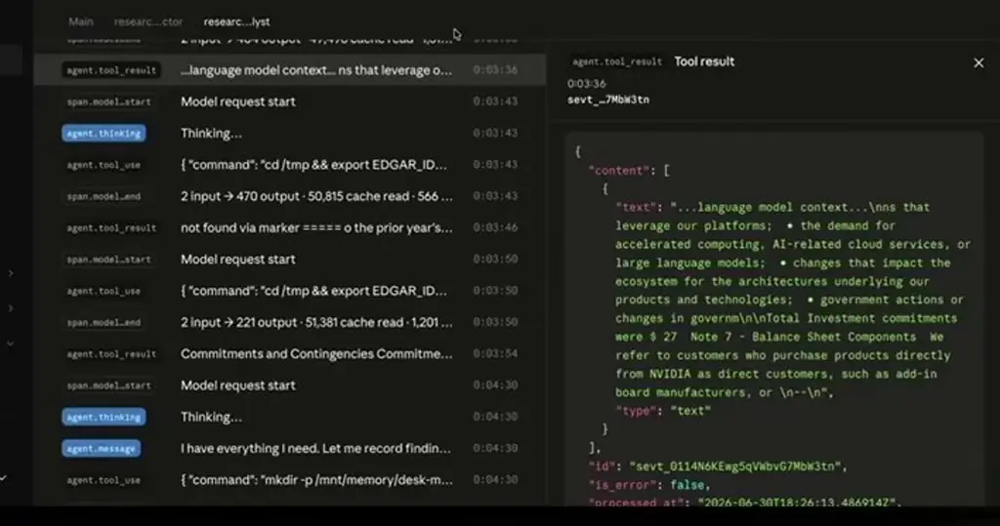
*[▶ 01:38:04](https://x.com/i/status/2110853512594948519) · Tool result JSON and later event rows*

Put a custom tool that waits on a human on a sub-agent so the coordinator stays free. Its thread is part of the same session, and results are routed by IDs.

## Links & resources

- [Claude Console — session event log, shown on screen](https://platform.claude.com) — <https://platform.claude.com> · on screen [▶ 01:34:47](https://x.com/i/status/2110853512594948519)
- Research desk workshop repo — git clone, URL not shown · mentioned [▶ 00:18:50](https://x.com/i/status/2110853512594948519)
- Workshop slide deck — shared after the talk, URL not shown · mentioned [▶ 00:00:40](https://x.com/i/status/2110853512594948519)
- API credits QR code — sign in to Claude Platform, URL not shown · mentioned [▶ 00:10:10](https://x.com/i/status/2110853512594948519)
- SEC filings skill sample — fetches SEC filings by ticker, URL not shown · mentioned [▶ 00:20:00](https://x.com/i/status/2110853512594948519)
- Other workshop talk repos — speaker's GitHub, URL not shown · mentioned [▶ 01:21:26](https://x.com/i/status/2110853512594948519)
