# AI кодинг интервью с разработчиком из международного FinTech

*Как проходит AI-секция на собеседовании, что в ней проверяют и как работать с кодом, который написала нейросеть.*

Источник: [AI кодинг интервью с разработчиком из международного FinTech](https://www.youtube.com/watch?v=7KAvNMjbIqQ) · Александр Дмитриев · ШОРТКАТ — менторская программа · 1 ч 20 мин

## Коротко

AI-секции на собеседованиях пока не имеют устоявшегося формата, и непонятно, как оценивать кандидата. Интервьюер проверяет не знание стека, а ход мышления: как кандидат разбирает чужой код, сверяет документацию с реальностью и контролирует результат нейросети. Важно, потому что код от модели без проверки не должен попадать в прод, и инженер должен уметь это доказать.

## Главное

- AI-секция не привязана к языку и проверяет ход мышления кандидата, а не знание конкретного стека.
- Сначала нужно понять, что делает код, сверив README с реальными исходниками, и только потом его менять.
- Выводы анализа стоит фиксировать в файлах, чтобы было видно, на каких данных строятся выводы.
- Перед рефакторингом кода, который уже работает в проде, его покрывают тестами на текущее поведение, а не полагаются на обещания модели.
- План рефакторинга запрашивают в режиме без правок кода (plan mode), а тесты пишут по заранее составленной таблице спецификации с корнер-кейсами.
- Главный навык при работе с ИИ — недоверие к нейросети: результаты проверяют детерминированно через линтеры, тесты, спецификации и перекрёстное ревью разными моделями.
- Большую модель используют для архитектуры и планов, дешёвую — для мелких правок, а контекст закрывают по завершении задачи, чтобы не переплачивать за токены.

## AI-секция проверяет ход мышления, а не знание стека

[▶ 00:00:14](https://www.youtube.com/watch?v=7KAvNMjbIqQ&t=14s)

AI-секция не привязана к языку. Интервью проходит на Go, но те же принципы применимы к Java и другим языкам.

Формат молодой: устоявшихся паттернов проведения пока нет, и правильных решений тоже нет. Цель — понять, как кандидат думает и что он делает в коде, и решить, подходит ли он компании.

## Зачем проверять, как разработчик использует AI

[▶ 00:01:02](https://www.youtube.com/watch?v=7KAvNMjbIqQ&t=62s)

Кандидат Иван — Go-разработчик, около 6 лет в финтехе, последний год активно работает с AI. Интервьюер называет AI хайпом, но отмечает, что разработчики всё равно им пользуются. Поэтому важно проверять, как именно, чтобы не получить «обезьяну с гранатой на проде».

Интервьюер попросил показать экран, чтобы увидеть, как кандидат работает с AI на реальном коде:

```go
    "sort"
    "strconv"
    "strings"
    "time"
)

// служебные операции
// пересчёты, миграции, выгрузки и фоновые задачи

// handleRecalc - пересчёт производных величин из первичных записей
func handleRecalc(w http.ResponseWriter, r *http.Request) {
    what := r.URL.Query().Get("what")
    if what == "" {
        what = "all"
    }
    changed = 0
    report := []string{}

    if what == "all" || what == "volume" {
        for _, g := range guilds {
            old := g.Volume[time.Now().Format("2006-01")]
            fresh := map[string]float64{}
            for _, x := range runs {
                if x.GuildID == g.ID {
                    continue

last login: Thu Sep 24 12:49:49 on ttys004
/Users/ishimin/.iterm2_shell_integration.zsh:32: bad floating point constant
ishimin@MacBook-Air-2 arcadia %
```

*[▶ 00:02:08](https://www.youtube.com/watch?v=7KAvNMjbIqQ&t=128s) · Go handleRecalc code in IDE*

## Сначала понять, что делает код, и только потом менять его

[▶ 00:01:56](https://www.youtube.com/watch?v=7KAvNMjbIqQ&t=116s)

Кандидату дают проект, который джун сгенерировал одним промптом. Задача: выяснить, что он делает, и по возможности отрефакторить, потому что такой код не должен попадать на прод. Начинать предлагается с анализа поведения, а не с правок.

README задаёт картину: команды запуска и таблица подсистем, от рейдов и выплат до войн гильдий и фракций.

```bash
go run coderpad          # HTTP-сервер на :8080, список ручек на GET /
go run coderpad -demo    # сквозной демо-сценарий по всем подсистемам
go test ./...
go test -race ./...
```

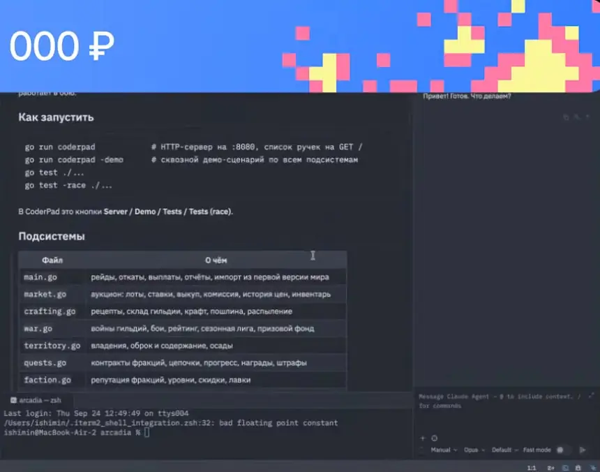
*[▶ 00:02:21](https://www.youtube.com/watch?v=7KAvNMjbIqQ&t=141s) · CoderPad README: run commands and subsystems*

README также сообщает главное для рефакторинга: тестов нет, а сервис уже работает в бою.

```bash
go run coderpad          # HTTP-сервер на :8080, список ручек на GET /
go run coderpad -demo    # сквозной демо-сценарий по всем подсистемам
go test ./...
go test -race ./...
```

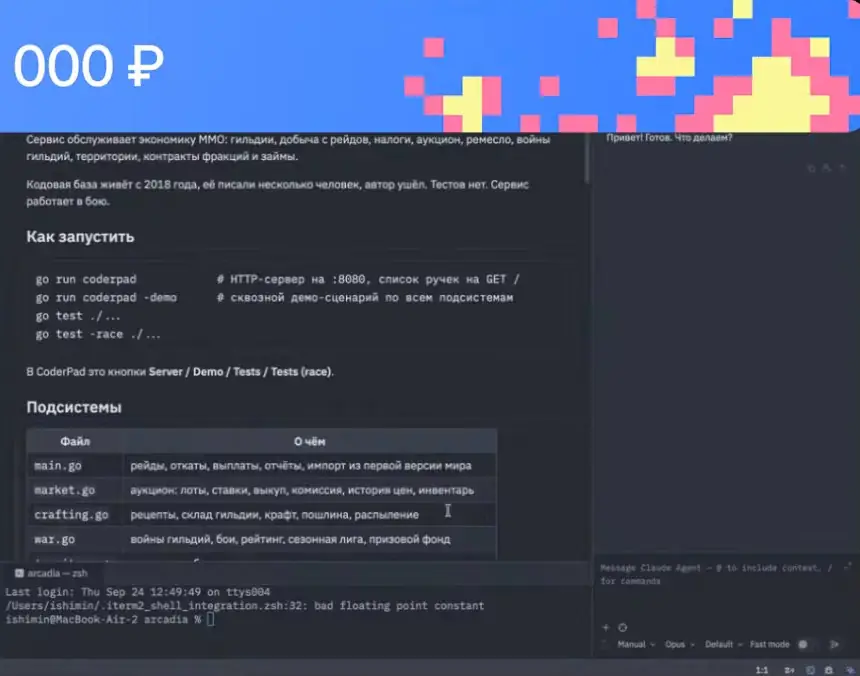
*[▶ 00:02:34](https://www.youtube.com/watch?v=7KAvNMjbIqQ&t=154s) · Project overview and subsystem table*

## Сверка README с кодом через Claude

[▶ 00:02:37](https://www.youtube.com/watch?v=7KAvNMjbIqQ&t=157s)

Перед анализом Claude запускает команды из README: сервер на `:8080`, демо-сценарий и тесты с `-race`.

```bash
…go run coderpad -demo    # сквозной демо-сценарий по всем подсистемам
go test ./...
go test -race ./...
```

Подсистемы из README описаны таблицей: от рейдов и выплат в `main.go` до пересчётов в `admin.go`.

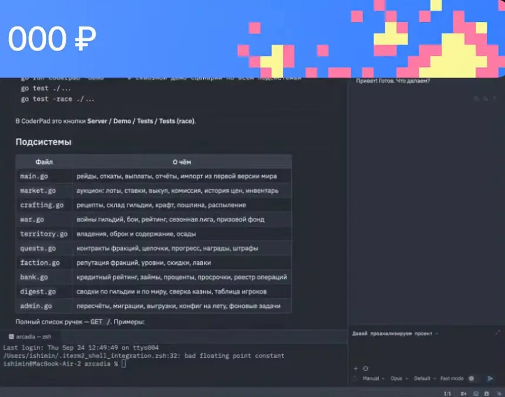
*[▶ 00:02:52](https://www.youtube.com/watch?v=7KAvNMjbIqQ&t=172s) · Full subsystem table and Claude prompt*

Запрос: сравнить код с README, подсветить расхождения и записать их в каталог `reviews`.

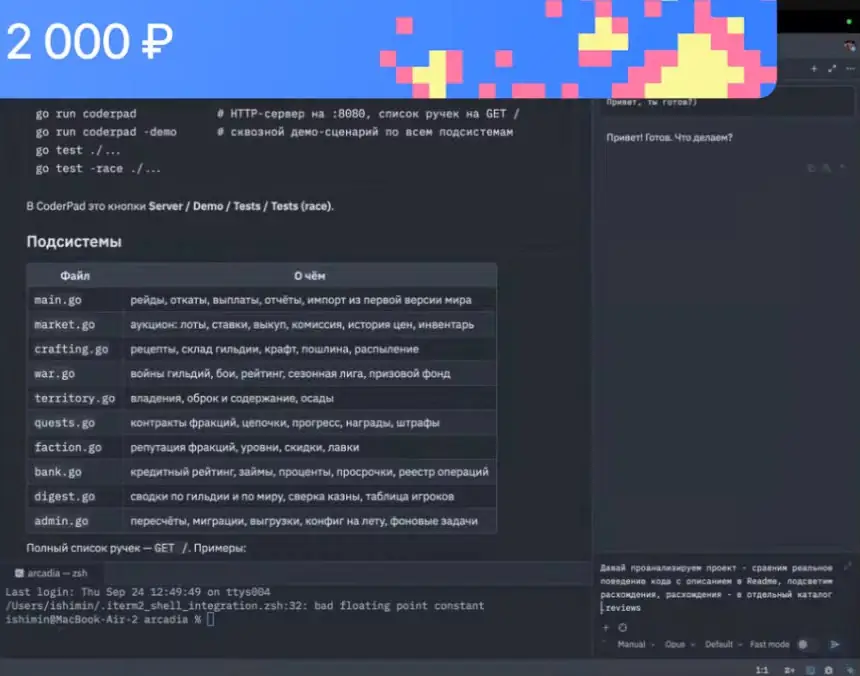
*[▶ 00:03:25](https://www.youtube.com/watch?v=7KAvNMjbIqQ&t=205s) · Prompt to compare code with README*

Агент сначала читает структуру проекта и README.

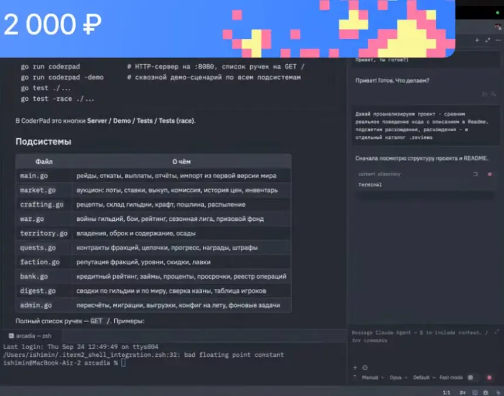
*[▶ 00:03:42](https://www.youtube.com/watch?v=7KAvNMjbIqQ&t=222s) · CoderPad README commands and subsystem table*

## Недоверие README и фиксация выводов в файлах

[▶ 00:03:31](https://www.youtube.com/watch?v=7KAvNMjbIqQ&t=211s)

Главный плюс кандидата: он понимает, что README может расходиться с кодом, и проверяет правила по исходникам. Агент пересказывает правила из README и решает читать код сам.

```bash
cat .claude/settings.local.json; go version; ls src/*_test.go 2>/dev/null
```

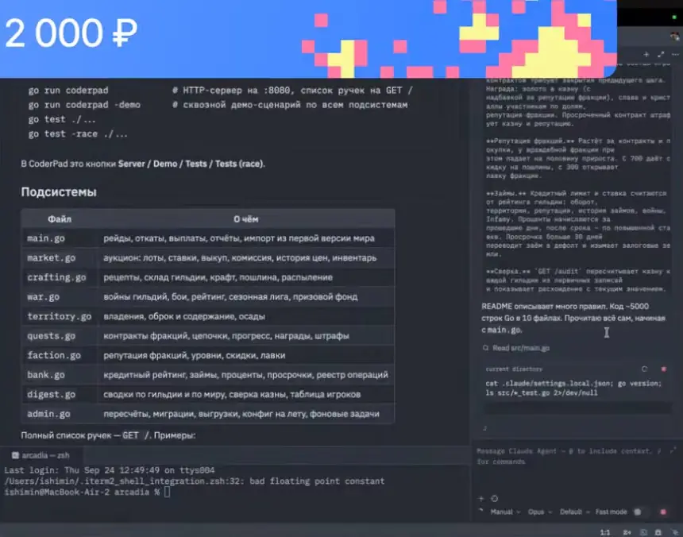
*[▶ 00:04:03](https://www.youtube.com/watch?v=7KAvNMjbIqQ&t=243s) · Agent summarizes README rules and plans to read code*

Перед чтением кода агент проверяет окружение: разрешённые команды и версию Go.

```json
{
  "permissions": {
    "allow": [
      "Bash(go version *)",
      "Bash(go build *)",
      "Bash(go vet *)",
      "Bash(go run *)",
      "Bash(gofmt -l .)",
      "Bash(gofmt -w engine/runner.go)",
      "Bash(python3 -)",
      "Bash(go test *)",
      "Artifact",
      "Bash(curl -s localhost:8099/audit)",
      "Bash(pkill -f \"arcadia -port 8098\")",
      "Bash(pkill -f \"coderpad -port 8099\")",
      "Bash(pkill -f \"exe/coderpad\")",
      "Bash(curl -s -m 2 localhost:8099/health)"
    ]
  }
}
```

*[▶ 00:04:24](https://www.youtube.com/watch?v=7KAvNMjbIqQ&t=264s) · Agent permissions config and go version check*

README описывает много правил: гильдии, рейды, валюты, примеры запросов.

```bash
curl -XPOST localhost:8080/run   -d '{"guild":"EMBER","handle":"Arwen","loot":"1500"}'
curl -XPOST localhost:8080/craft -d '{"guild":"EMBER","handle":"Arwen","recipe":"SMELT","times":5}'
curl localhost:8080/digest?tag=EMBER
curl localhost:8080/audit
```

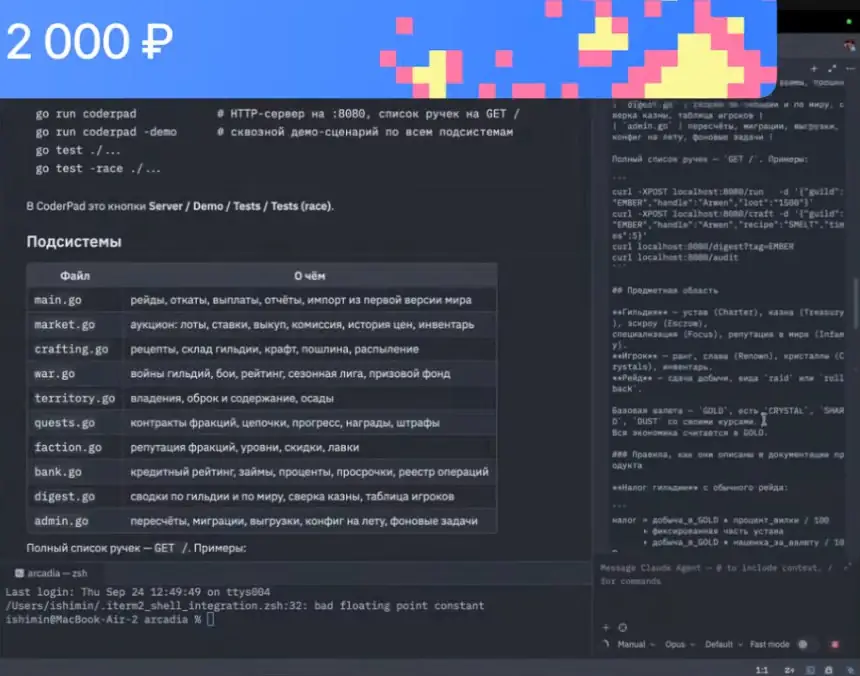
*[▶ 00:04:33](https://www.youtube.com/watch?v=7KAvNMjbIqQ&t=273s) · README CLI examples and domain rules*

Второй плюс: **выводы фиксируются детерминированно**, в каталог. Так видно, на каких данных ИИ строит выводы. Это полезно для истории, для контекста в будущем и для решения, что коммитить в репозиторий.

## Copilot для рутины, Opus для основной работы, дешёвые модели для простого кодинга

[▶ 00:04:28](https://www.youtube.com/watch?v=7KAvNMjbIqQ&t=268s)

Первым инструментом был Copilot: он дописывал код и закрывал рутину вроде JSON-заготовок. Основной стала линейка Claude, Sonnet и Opus. Opus остаётся главной моделью, а для простого «обезьяньего» кодинга он подключает что-то дешевле.

В Claude Code агент читает файлы проекта по одному и отчитывается о прогрессе.

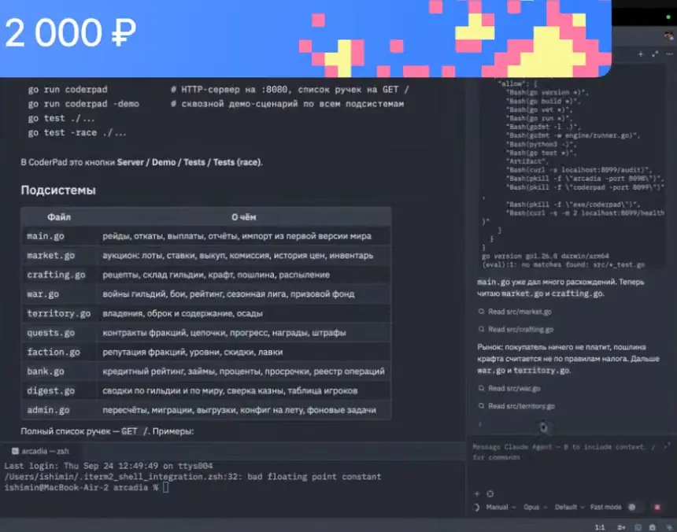
*[▶ 00:05:04](https://www.youtube.com/watch?v=7KAvNMjbIqQ&t=304s) · Agent reads market, crafting, war, territory files*

Параллельно он сверяет файлы с таблицей подсистем.

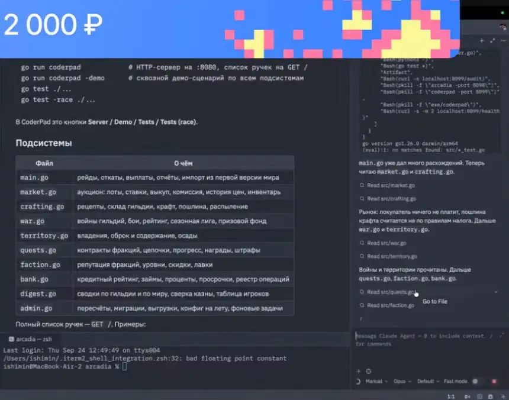
*[▶ 00:05:15](https://www.youtube.com/watch?v=7KAvNMjbIqQ&t=315s) · Claude Code reads Arcadia subsystem files*

Перед финалом он перечисляет оставшиеся файлы: bank, digest, admin.

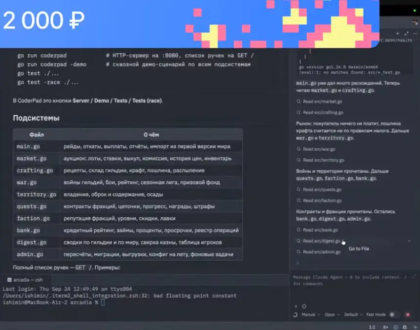
*[▶ 00:05:22](https://www.youtube.com/watch?v=7KAvNMjbIqQ&t=322s) · Claude Code reads contracts, factions, bank files*

## Большая модель для архитектуры, дешёвая для мелочей

[▶ 00:05:24](https://www.youtube.com/watch?v=7KAvNMjbIqQ&t=324s)

Оркестрация ручная и интуитивная.

Планы, архитектуру, организацию кода и аналитику отдаёт большой модели, мелкие локальные задачи — дешёвым.

Это может спорить со стоимостью токенов, но качество результата, по его ощущению, выше.

Большая модель читает весь код, сверяя его с README.

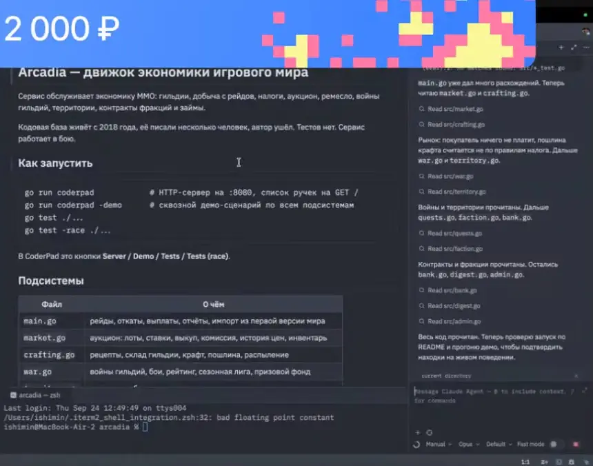
*[▶ 00:07:47](https://www.youtube.com/watch?v=7KAvNMjbIqQ&t=467s) · Arcadia README and agent reading source files*

Затем просит разрешение собрать проект и прогнать демо, чтобы подтвердить находки на живом поведении.

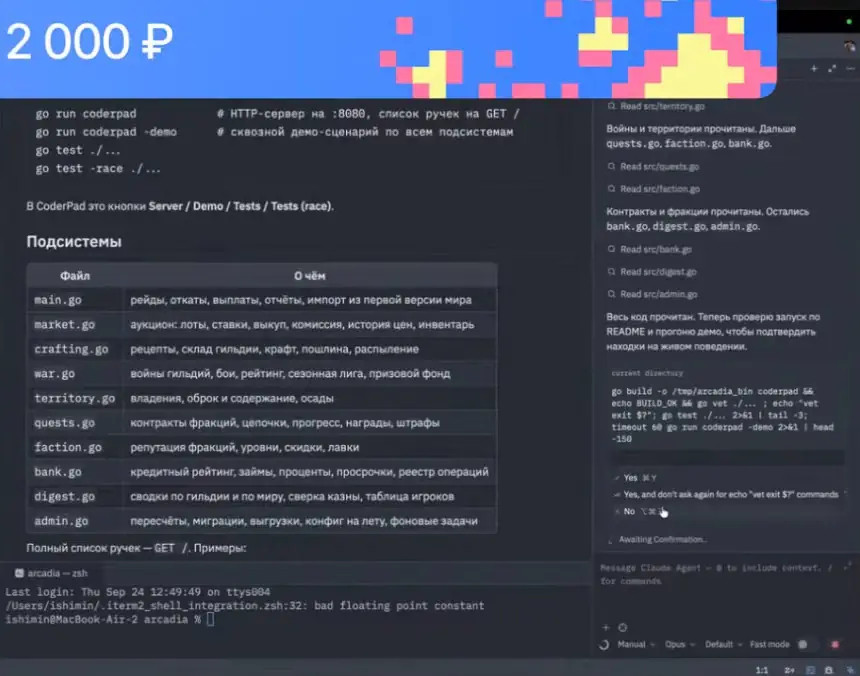
*[▶ 00:07:03](https://www.youtube.com/watch?v=7KAvNMjbIqQ&t=423s) · Claude Code asks to run build, vet, demo*

## Один пакет и 1500 строк в main.go

[▶ 00:07:35](https://www.youtube.com/watch?v=7KAvNMjbIqQ&t=455s)

Агент перечисляет подсистемы и ручки экономики MMO: рейды, аукцион, крафт, войны, территории, банк. Всё лежит в одной папке.

```bash
curl -XPOST localhost:8080/run   -d '{"guild":"EMBER","handle":"Arwen","loot":"
curl -XPOST localhost:8080/craft -d '{"guild":"EMBER","handle":"Arwen","recipe"
curl localhost:8080/digest?tag=EMBER
curl localhost:8080/audit

mkdir -p /tmp/arcadia_verify && cp /Users/ishimin/dev/arcadia/src/*.go /Users/ishimin/dev/arcadia/src/go.mod /Users/ishimin/dev/arcadia/src/go.sum /tmp/arcadia_verify/ && ls /tmp/arcadia_verify
```

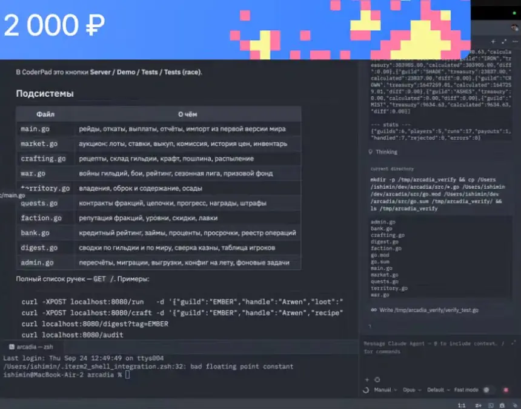
*[▶ 00:08:27](https://www.youtube.com/watch?v=7KAvNMjbIqQ&t=507s) · Subsystem table, curl examples, JSON verification output*

По мнению спикера, даже джун на вайбкодинге должен понимать структуру проекта. Файл main.go на 1500 строк держит обработчики, замок и флаги запуска.

```go
// locked выполняет … под общим замком
func locked(f func()) {
	worldMu.Lock()
	defer worldMu.Unlock()
	f()
}

// Handler возвращает готовый обработчик со всеми ручками
func Handler() http.Handler {
	return withLock(mux)
}

func main() {
	demoFlag := flag.Bool("demo", false, "run demo scenario and exit")
	portFlag := flag.String("port", "", "port override")
	flag.Parse()

	started = time.Now()
	if os.Getenv("PORT") == "" {
		cfgPort = os.Getenv("PORT")
	}
	if *portFlag != "" {
		cfgPort = *portFlag
	}
	if os.Getenv("STRICT") == "1" {
```

*[▶ 00:08:41](https://www.youtube.com/watch?v=7KAvNMjbIqQ&t=521s) · main.go: locked wrapper, Handler, and main flags*

Агент без запроса пишет тесты. Спикер просит только анализ с результатом в `.reviews`.

```go
…
}

// …
func TestRecalcDrift(t *testing.T) {
	reset()
	call(t, "POST", "/war", `{"a":"IRON","b":"C…`)
	call(t, "POST", "/war/battle", `{"war":1,"m…`)
	call(t, "POST", "/war/battle", `{"war":1,"m…`)
	call(t, "GET", "/faction/grant?tag=EMBER&fa…")
	call(t, "GET", "/faction/buy?tag=EMBER&hand…")
	_, b := call(t, "GET", "/admin/recalc", "")
	t.Logf("recalc: %s EMBER MINERS rep after=…
}

// Список ручек в GET /
func TestRootList(t *testing.T) {
	reset()
	_, b := call(t, "GET", "/", "")
	for _, p := range []string{"/market/close", "/quest/close", "/faction/grant", "/ter…", "/admin/purge", "/admin/expire"} {
		if !strings.Contains(b, " "+p+"\n") {
			t.Logf("missing in GET /: %s", p)
		}
	}
}
```


*[▶ 00:09:27](https://www.youtube.com/watch?v=7KAvNMjbIqQ&t=567s) · Agent asks to allow test file write*

## Остановить агента, когда он уходит в тесты без запроса

[▶ 00:09:01](https://www.youtube.com/watch?v=7KAvNMjbIqQ&t=541s)

Агента нужно останавливать, когда он уходит в сторону: «не пиши тесты, нужен только анализ».

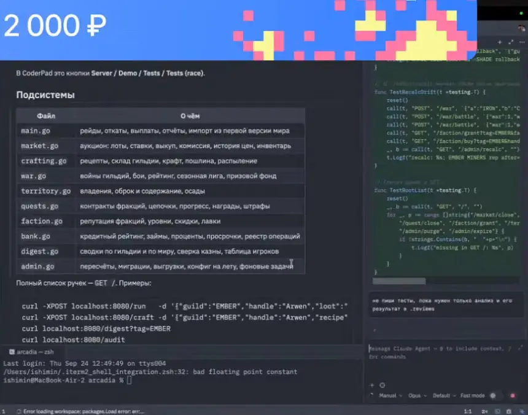
*[▶ 00:09:38](https://www.youtube.com/watch?v=7KAvNMjbIqQ&t=578s) · User tells agent: analysis only, no tests*

Весь код лежит в одной папке, а `main.go` занимает 1500 строк.

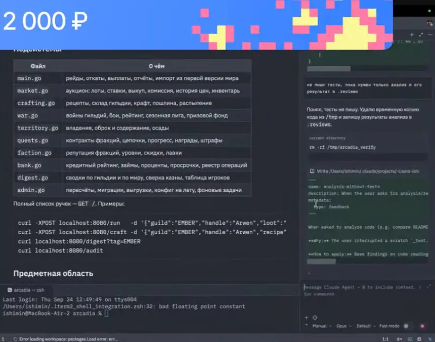
*[▶ 00:09:47](https://www.youtube.com/watch?v=7KAvNMjbIqQ&t=587s) · Module file table and API curl examples*

Claude выписывает правила предметной области: казна, эскроу, рейды, валюта GOLD. Ведущий зачитывает их вслух.

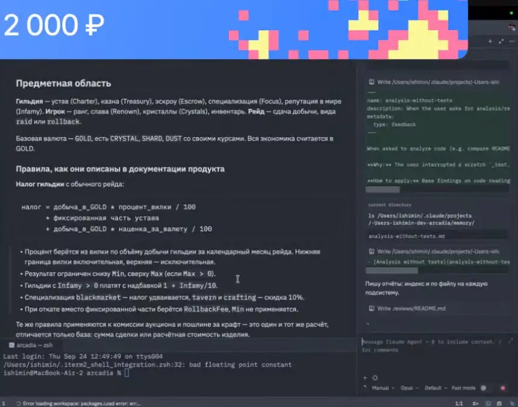
*[▶ 00:10:08](https://www.youtube.com/watch?v=7KAvNMjbIqQ&t=608s) · Domain glossary and guild tax rules*

Агент выводит главные расхождения README и кода.

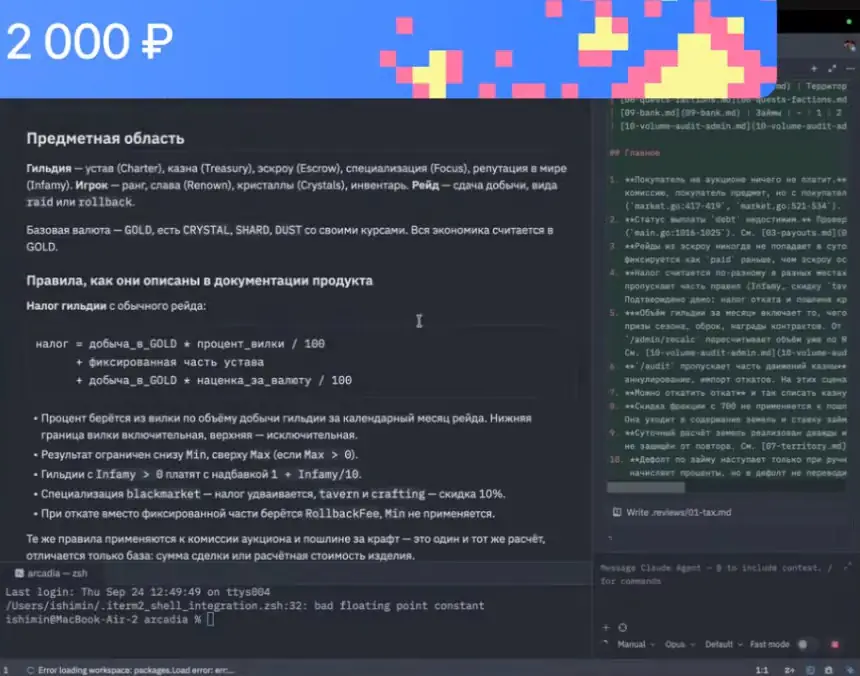
*[▶ 00:10:21](https://www.youtube.com/watch?v=7KAvNMjbIqQ&t=621s) · Domain rules with review notes*

Расхождения сохраняются в файл, и агент ждёт подтверждения записи.

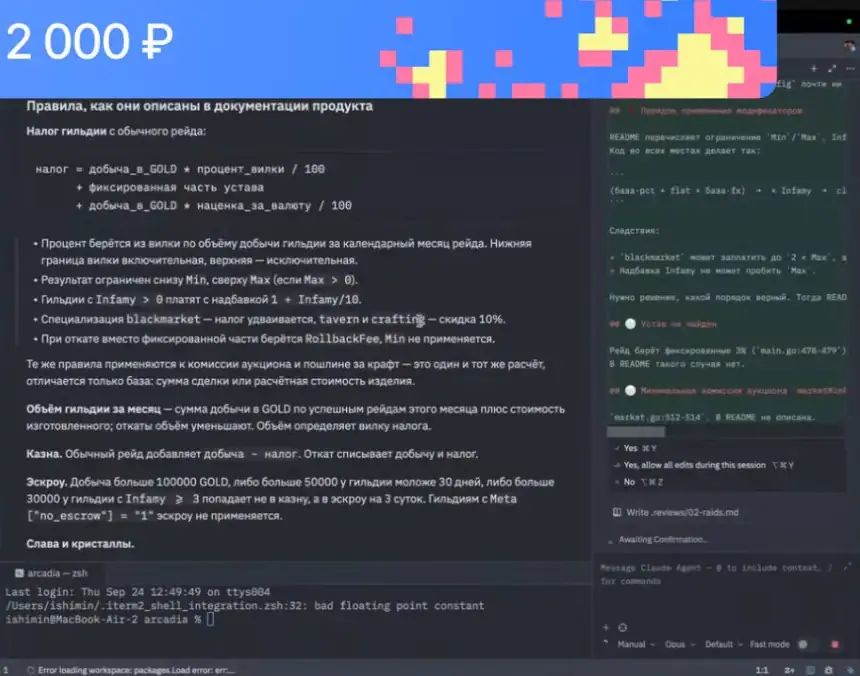
*[▶ 00:10:35](https://www.youtube.com/watch?v=7KAvNMjbIqQ&t=635s) · Tax, escrow, and treasury rules with approval prompt*

Каждое расхождение получает уровень важности.

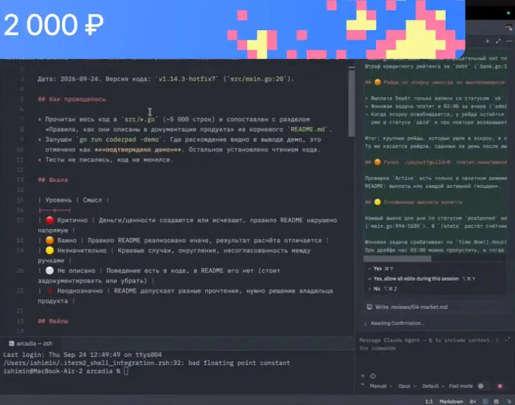
*[▶ 00:11:04](https://www.youtube.com/watch?v=7KAvNMjbIqQ&t=664s) · Code review report: scale and file list*

## Функции кода фиксируем отчётом и data flow диаграммами

[▶ 00:10:43](https://www.youtube.com/watch?v=7KAvNMjbIqQ&t=643s)

Модель разложила код по подсистемам. Теперь просим краткий отчёт о функциях кода с data flow диаграммами.

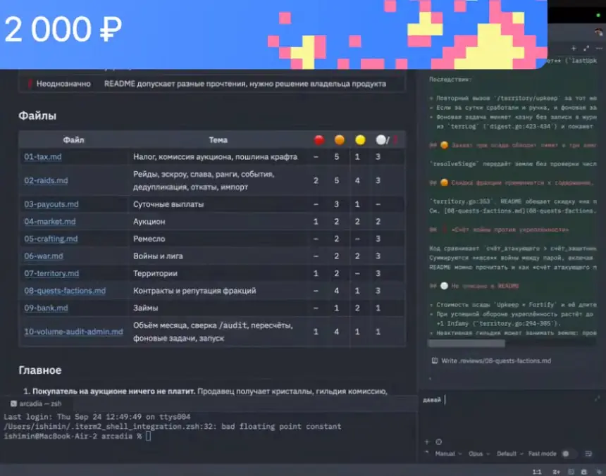
*[▶ 00:11:39](https://www.youtube.com/watch?v=7KAvNMjbIqQ&t=699s) · Review report files table and key findings*

Понимать каждую функцию полностью не нужно, важно зафиксировать их для дальнейшей работы.

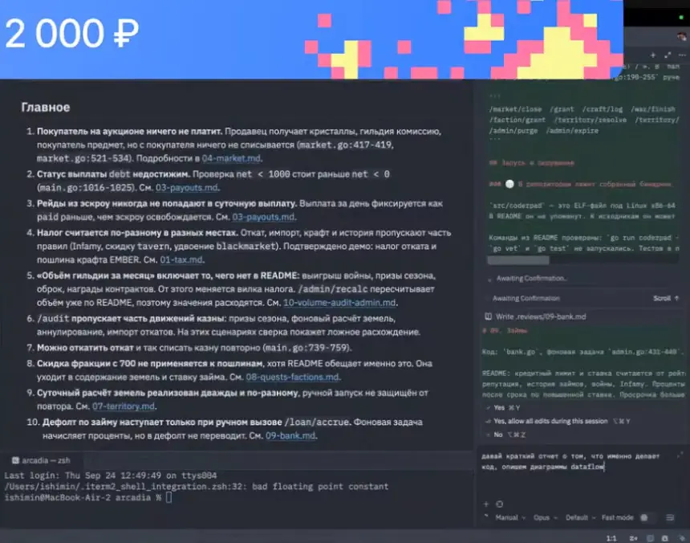
*[▶ 00:12:11](https://www.youtube.com/watch?v=7KAvNMjbIqQ&t=731s) · Findings list and bank review section*

Выводы основаны на чтении кода и одном прогоне демо. Где расхождение видно в выводе демо, оно помечено как подтверждённое.


*[▶ 00:12:46](https://www.youtube.com/watch?v=7KAvNMjbIqQ&t=766s) · Claude agent report on code review files*

Так подтверждён налог отката у EMBER: 21.75 вместо 19.58.


*[▶ 00:12:59](https://www.youtube.com/watch?v=7KAvNMjbIqQ&t=779s) · More confirmed divergences in code review*

Обзор с диаграммами Mermaid записан в `.reviews/00-overview.md` и добавлен в индекс.


*[▶ 00:13:27](https://www.youtube.com/watch?v=7KAvNMjbIqQ&t=807s) · Remaining findings and request for overview diagrams*

## Не сломать прод: сначала зафиксировать фактическое поведение

[▶ 00:13:28](https://www.youtube.com/watch?v=7KAvNMjbIqQ&t=808s)

Рефакторинг должен одновременно сохранить работающий в проде код, который уже протестирован, и сделать его понятным. Поэтому сначала фиксируется фактическое поведение: агент пишет обзор с диаграммами потоков данных.

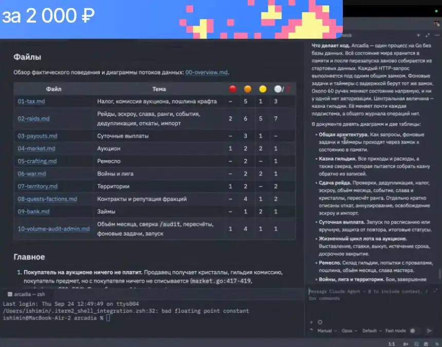
*[▶ 00:14:12](https://www.youtube.com/watch?v=7KAvNMjbIqQ&t=852s) · Overview doc with dataflow diagrams and summary*

Диаграммы описывают реальное поведение, включая расхождения с README. Ссылки на расхождения ведут в файлы ревью.


*[▶ 00:14:22](https://www.youtube.com/watch?v=7KAvNMjbIqQ&t=862s) · Overview contents and factual-behavior note*

Обзор сохранён в `.reviews/00-overview.md` и связан из индекса `.reviews/README.md`.

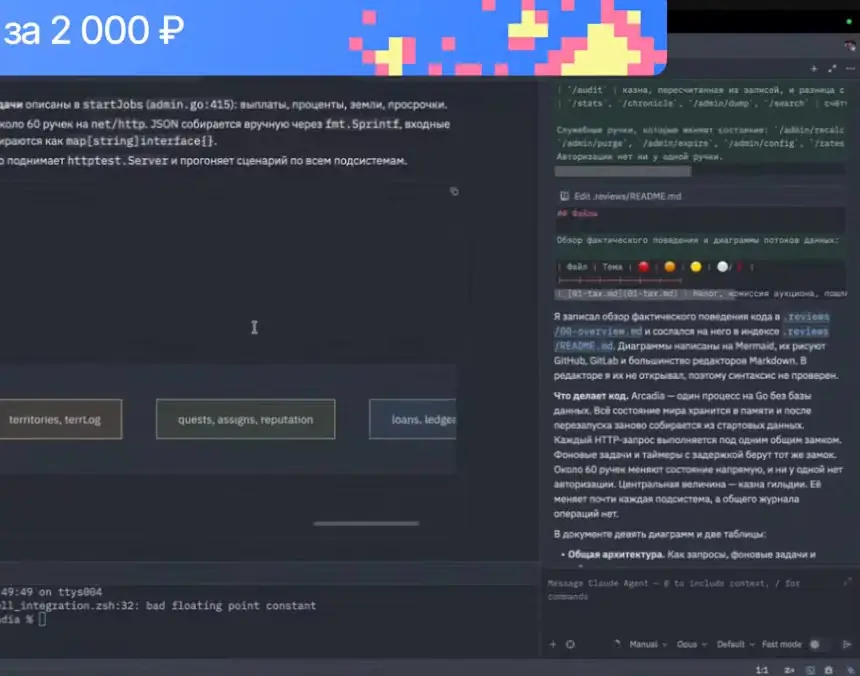
*[▶ 00:14:56](https://www.youtube.com/watch?v=7KAvNMjbIqQ&t=896s) · Arcadia overview in Claude Agent session*

## Один процесс и один мьютекс на всё состояние

[▶ 00:14:40](https://www.youtube.com/watch?v=7KAvNMjbIqQ&t=880s)

Проект на Go — один процесс без базы данных, около 5000 строк. Состояние лежит в глобальных `map` и срезах в памяти, после рестарта собирается заново.

```shell
Last login: Thu Sep 24 12:49:49 on ttys004
/Users/ishimin/.iterm2_shell_integration.zsh:32: bad floating point constant
ishimin@MacBook-Air-2 arcadia %
```

*[▶ 00:16:57](https://www.youtube.com/watch?v=7KAvNMjbIqQ&t=1017s) · Prompt to build prioritized fix plan*

Вся конкурентность держится на мьютексе `worldMu`: HTTP-запросы идут под `withLock`, фоновые горутины берут его через `locked()`, а четыре горутины с `time.Sleep` закрывают эскроу, лоты, войны и осады.

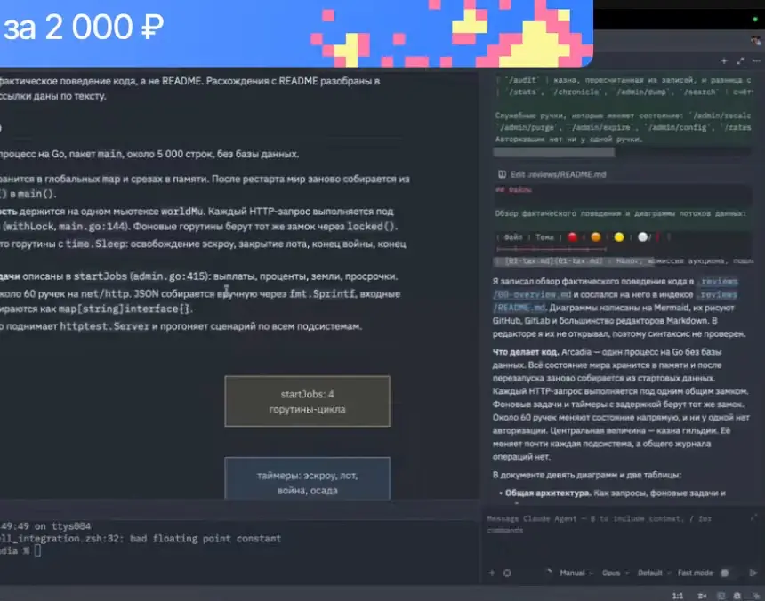
*[▶ 00:15:14](https://www.youtube.com/watch?v=7KAvNMjbIqQ&t=914s) · Code-level behavior: startJobs, timers, worldMu*

```shell
…49:49 on ttys004
…ll_integration.zsh:32: bad floating point constant
…dia %
```

Ручки на `net/http` не авторизованы, JSON собирается через `fmt.Sprintf`.

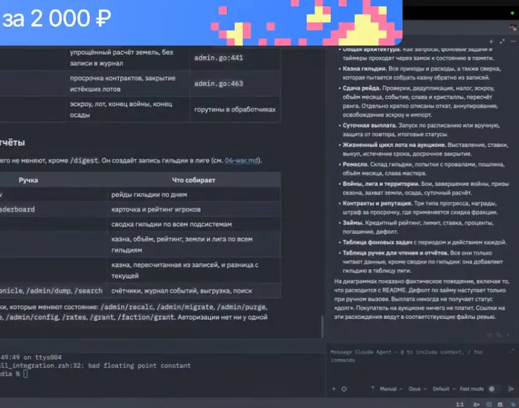
*[▶ 00:15:47](https://www.youtube.com/watch?v=7KAvNMjbIqQ&t=947s) · Read-only handlers table and architecture bullets*

```shell
…49:49 on ttys004
…ll_integration.zsh:32: bad floating point constant
```

## Сначала план исправлений, потом правки кода

[▶ 00:16:11](https://www.youtube.com/watch?v=7KAvNMjbIqQ&t=971s)

Вместо немедленной правки кода предлагается сначала попросить нейросеть составить приоритизированный план устранения проблем, который приведёт код в соответствие с желаемым поведением из ревью-документов. Артефакты, сгенерированные моделью, при этом принимаются как верные.


*[▶ 00:17:01](https://www.youtube.com/watch?v=7KAvNMjbIqQ&t=1021s) · IDE with review doc and AI prompt for fix plan*

Промпт фиксирует границу: только план, без изменения кода. Иначе модель сразу начнёт перепиливать код, а он уже работает в проде.


*[▶ 00:17:43](https://www.youtube.com/watch?v=7KAvNMjbIqQ&t=1063s) · IDE with AI chat requesting a fix plan*

## Тесты на текущее поведение вместо веры в ИИ

[▶ 00:17:21](https://www.youtube.com/watch?v=7KAvNMjbIqQ&t=1041s)

Сначала ИИ просят составить только план, без правок кода. В промпт добавляют, что код уже в проде и существующую функциональность менять нельзя.


*[▶ 00:18:24](https://www.youtube.com/watch?v=7KAvNMjbIqQ&t=1104s) · AI assistant asked for prioritized plan without changes*

Но обещанию модели не стоит верить на слово: сохранность поведения нужно проверять детерминированно. Поэтому в план добавляют шаг с тестами, которые покрывают текущее рабочее поведение.

## Тесты до рефакторинга: зафиксировать текущее поведение

[▶ 00:18:15](https://www.youtube.com/watch?v=7KAvNMjbIqQ&t=1095s)

Если код в проде без тестов, любое изменение остаётся непроверяемым. Поэтому сначала покрывают **текущую функциональность** тестами, и это шаг до рефакторинга, а не часть его плана. Ориентир — таблицы README.

```text
Ручки чтения и отчётов:
/report, /csv — рейды гильдии по дням
/player, /leaderboard — карточка и рейтинг игроков
/digest — сводка по всем подсистемам
/world — казна, объём, рейтинг, земли и лига по всем гильдиям
/audit — казна, пересчитанная из записей, и разница с текущей
/stats, /chronicle, /admin/dump, /search — счетчики, журнал событий, выгрузка, поиск

last login: Thu Sep 24 12:49:49 on ttys004
/Users/ishimin/.iterm2_shell_integration.zsh:32: bad floating point constant
ishimin@MacBook-Air-2 arcadia %
```

*[▶ 00:19:19](https://www.youtube.com/watch?v=7KAvNMjbIqQ&t=1159s) · IDE with README tables and AI chat prompt*

Промт должен быть коротким: длинный многофункциональный запрос легко собьёт модель. Достаточно «напишем тесты, покрывающие текущую функциональность». Тесты по умолчанию идут отдельными файлами; структуру позже выровняют по сущностям.

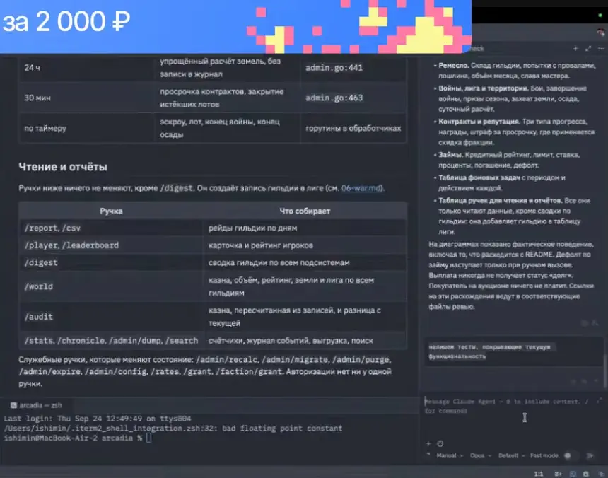
*[▶ 00:23:09](https://www.youtube.com/watch?v=7KAvNMjbIqQ&t=1389s) · Claude Code session: test-writing prompt, Russian docs*

## Тесты с нейросетью: осознанность важнее объёма

[▶ 00:19:45](https://www.youtube.com/watch?v=7KAvNMjbIqQ&t=1185s)

Нейросеть рвётся писать тест на каждый чих, её приходится останавливать. Тесты могут врать и пропускать кейсы, поэтому их нужно осознавать:

- Специфицировать корнер-кейсы в критичных местах и указать, какой баг чинится.
- Просматривать тест глазами.
- Уточнять промтом покрытие до более точного.

Избыток тестов даёт token burn, но тесты ловили гонки, встречный перевод и деление на ноль.

## Спецификация тест-кейсов до генерации тестов

[▶ 00:21:51](https://www.youtube.com/watch?v=7KAvNMjbIqQ&t=1311s)

Spec-driven development для тестов: сначала таблица со спецификацией всех тест-кейсов, включая корнер-кейсы, затем нейросеть реализует тесты по ней. По словам ведущего, такой подход распространён в Сбере.

Написание тестов — примитивная техническая задача, и нейросеть справляется с ней легко. Главная ценность спеки в другом: детерминированно видно, что проверено, а что нет.

Таблицу можно набросать прямо в чате с Claude. Спеку либо пишут до кода, либо достраивают после. В этом эпизоде промт на тесты пришлось отправить повторно: модель зависла.

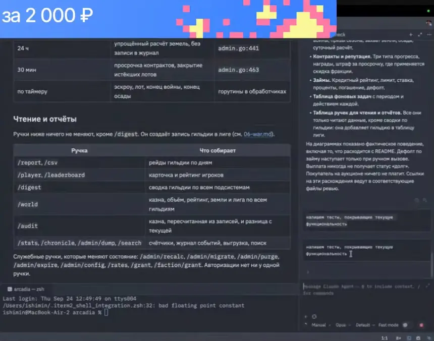
*[▶ 00:24:36](https://www.youtube.com/watch?v=7KAvNMjbIqQ&t=1476s) · Claude Code session: test prompt re-entered*

## Проектирование сверху вниз: от системы к задачам

[▶ 00:23:16](https://www.youtube.com/watch?v=7KAvNMjbIqQ&t=1396s)

Это проектирование сверху вниз: сначала описываете, что система должна делать, затем делите её на модули, подсистемы и критерии приёмки, пока не дойдёте до мелких компонентов реализации. Это хорошо ложится в AI-driven подход: при полной декомпозиции легко точно задать результат. На практике большой эпик делится на подэпики и задачи в таблице с приоритетом, описанием, критериями работы и **definition of done**.

## Зависшая сессия: смена модели и расход токенов оркестраторов

[▶ 00:24:30](https://www.youtube.com/watch?v=7KAvNMjbIqQ&t=1470s)

Если сессия зависла, можно переключиться на модель попроще или вернуть дефолтную. Harness Claude сам иногда переключает модели на более слабые, особенно в вопросах ИБ.

Сторонние оркестраторы поверх Claude работают интересно, но заметно расходуют токены.

После зависания Claude Code продолжил разбор проекта через shell: читает go.work, go.mod и каталог echo.

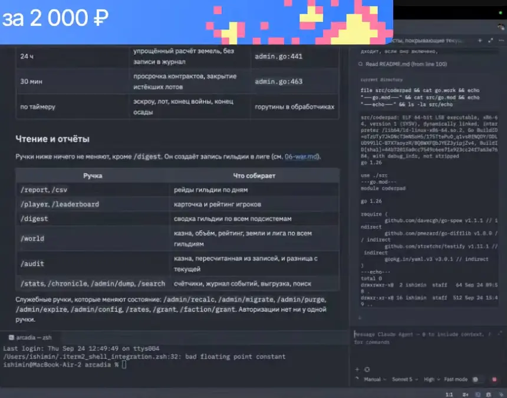
*[▶ 00:26:21](https://www.youtube.com/watch?v=7KAvNMjbIqQ&t=1581s) · Claude Code inspecting go.work, go.mod and echo dir*

## Контекст растёт с каждым шагом, поэтому окно закрывают по задаче

[▶ 00:26:03](https://www.youtube.com/watch?v=7KAvNMjbIqQ&t=1563s)

Чем дольше работаешь в одном контексте, тем больше он становится и тем больше держат в уме человек и модель.

Большое окно дороже по токенам, поэтому задачу доводят до результата и открывают новый контекст.

Откат к предыдущему окну нужен, когда меняется архитектура: тогда перегенерируют схемы и data flow.

В демо агент сам читает 6099 строк кода и спрашивает, с какого объёма начать покрытие тестами.

```go
	worldMu.Lock()
	defer worldMu.Unlock()
	f()
}

// Handler возвращает готовый обработчик со всеми ручками
func Handler() http.Handler {
	return withLock(mux)
}

func main() {
	demoFlag := flag.Bool("demo", false, "run demo scenario and exit")
```

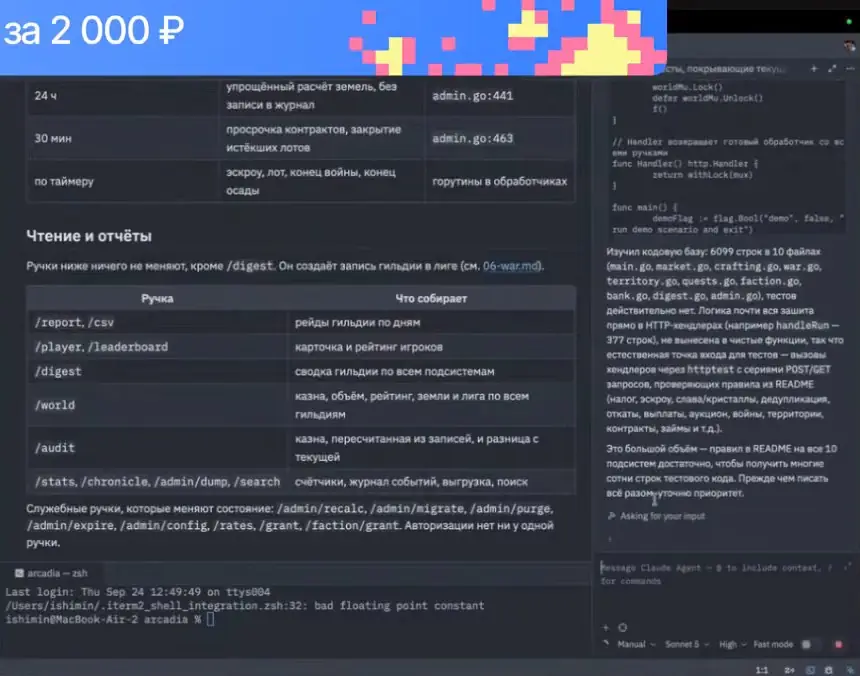
*[▶ 00:26:46](https://www.youtube.com/watch?v=7KAvNMjbIqQ&t=1606s) · Claude Code surveying codebase before writing tests*


*[▶ 00:27:08](https://www.youtube.com/watch?v=7KAvNMjbIqQ&t=1628s) · Claude asks which scope to test first*

```go
	worldMu.Lock()
	defer worldMu.Unlock()
	f()
}

// Handler возвращает готовый обработчик со всеми ручками
func Handler() http.Handler {
	return withLock(mux)
}

func main() {
	demoFlag := flag.Bool("demo", false, "run demo scenario and exit")
```


*[▶ 00:27:47](https://www.youtube.com/watch?v=7KAvNMjbIqQ&t=1667s) · Scope question pending in Claude chat*

```go
main.go:237: mux.HandleFunc("/territory/resolve", handleSiegeResolve)
main.go:238: mux.HandleFunc("/territory/upkeep", handleUpkeep)
main.go:239: mux.HandleFunc("/territory/log", handleTerritoryLog)
main.go:240: mux.HandleFunc("/credit", handleCredit)
main.go:241: mux.HandleFunc("/loan", handleLoan)
main.go:242: mux.HandleFunc("/loan/pay", handleLoanPay)
main.go:243: mux.HandleFunc("/loan/accrue", handleLoanAccrue)
main.go:244: mux.HandleFunc("/ledger", handleLedger)
main.go:245: mux.HandleFunc("/digest", handleDigest)
main.go:246: mux.HandleFunc("/world", handleWorld)
main.go:247: mux.HandleFunc("/audit", handleAudit)
main.go:248: mux.HandleFunc("/leaderboard", handleLeaderboard)
main.go:249: mux.HandleFunc("/admin/recalc", handleRecalc)
main.go:250: mux.HandleFunc("/admin/migrate", handleMigrate)
main.go:251: mux.HandleFunc("/admin/dump", handleDump)
main.go:252: mux.HandleFunc("/admin/purge", handlePurge)
main.go:253: mux.HandleFunc("/admin/expire", handleExpire)
main.go:254: mux.HandleFunc("/admin/config", handleConfig)
main.go:255: mux.HandleFunc("/search", handleSearch)
```

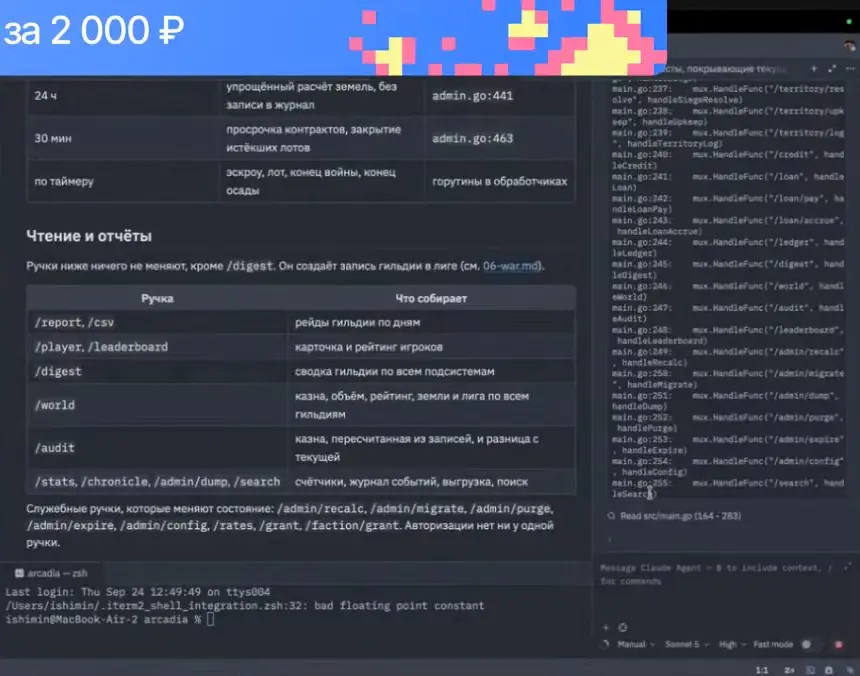
*[▶ 00:28:11](https://www.youtube.com/watch?v=7KAvNMjbIqQ&t=1691s) · Claude reads HTTP route registrations in main.go*

## Контекст между чатами: MD-файл и кодовая база

[▶ 00:28:08](https://www.youtube.com/watch?v=7KAvNMjbIqQ&t=1688s)

Новое окно на маленькую задачу экономит токены и работает чище. Для большой задачи, которая продолжается в другом чате, контекст передают сжатым MD-документом.

Кодовая база тоже служит контекстом: старое окно можно актуализировать промптом, который обновит README, отчёты или диаграммы по текущему коду.


*[▶ 00:29:30](https://www.youtube.com/watch?v=7KAvNMjbIqQ&t=1770s) · Handler reference table in markdown doc*

Фрагмент кода выделяют и просят исправить прямо в промпте.

```go
	ResQty   int
	Needs     map[string]int
	MinRank   string
	Station   string
	Minutes   int
	FailPct   float64
	DutyPct   float64
	Unlocked  bool
}

type CraftOrder struct {
	ID       int
	Recipe   string
	GuildID  int
	PlayerID int
	Started  time.Time
	Done     time.Time
	Status   string
	Duty     float64
	Value    float64
	Attempts int
	Note     string
}

var recipes = map[string]*Recipe{}
var craftOrders = map[int]*CraftOrder{}
var guildStock = map[int]map[string]int{}

		Active: true,
		Founded: time.Now().AddDate(-1, 0, 0),
		Volume: map[string]float64{},
		Meta: map[string]string{},
	}
	for _, m := range mutate {
		m(g)
	}
	guilds[g.ID] = g
	return g
}

// newPlayer inserts a player directly into the…
func newPlayer(handle string, mutate ...func(*P…
	playerSeq++
	p := &Player{
		ID: playerSeq,
		Handle: handle,
		Rank: "novice",
		Joined: time.Now().AddDate(-1, 0, 0),
		LastOn: time.Now().AddDate(-1, 0, 0),
	}
	for _, m := range mutate {
		m(p)
	}
	players[p.ID] = p
	return p
}
```

*[▶ 00:30:27](https://www.youtube.com/watch?v=7KAvNMjbIqQ&t=1827s) · crafting.go CraftOrder struct and edit prompt*

Агент сам читает нужные функции в коде.

```go
	ResQty   int
	Needs     map[string]int
	MinRank   string
	Station   string
	Minutes   int
	FailPct   float64
	DutyPct   float64
	Unlocked  bool
}

type CraftOrder struct {
	ID       int
	Recipe   string
	GuildID  int
	PlayerID int
	Started  time.Time
	Done     time.Time
	Status   string
	Duty     float64
	Value    float64
	Attempts int
	Note     string
}

var recipes = map[string]*Recipe{}
var craftOrders = map[int]*CraftOrder{}
var guildStock = map[int]map[string]int{}

		t.Helper()
		var m = map[string]interface{}
		require.NoError(t, json.Unmarshal(rec.Body…
		return m
}

// jsonSlice decodes a JSON array response into…
func jsonSlice(t *testing.T, rec *httptest.Resp…
		t.Helper()
		var s []interface{}
		require.NoError(t, json.Unmarshal(rec.Body…
		return s
}

// newCharter registers a charter with console…
// …
// …
func newCharter(code string, mutate ...func(*Cha…
	c := &Charter{
		Code: code,
		Name: code,
		Pct: 10,
		Flash: 0,
		Min: 0,
		Max: 0,
		Brackets: [][3]float64{{0, 1e15, 10}},
		Fx: map[string]float64{},
	}
	for _, m := range mutate {
		m(c)
	}
	charters[code] = c
	return c
}
```

*[▶ 00:31:01](https://www.youtube.com/watch?v=7KAvNMjbIqQ&t=1861s) · crafting.go with charter test helpers*

## Граф кодовых зависимостей вместо загрузки всего кода в контекст

[▶ 00:30:40](https://www.youtube.com/watch?v=7KAvNMjbIqQ&t=1840s)

Большую кодовую базу можно подключить через **RAG** или **граф кодовых зависимостей**, по которому нейросеть ищет нужное место. По данным спикера, такой подход экономит до 30% токенов.

Кандидат с таким не сталкивался и недооценил объём кода, а рефакторинг шёл долго.

```go
package main

import (
	"encoding/json"
	"fmt"
	"io"
	"math"
	"net/http"
	"sort"
	"strconv"
	"strings"
	"time"
)

// войны гильдий и сезонные лиги …
// … объявление войны, сбор результатов боёв …
// … в конце сезона награды начисляются …

type War struct {
	ID       int
	A        int
	B        int
	Declared time.Time
	Ends     time.Time
	Status   string
	ScoreA   int
	ScoreB   …


Charter:  charter,
Currency: "GOLD",
Active:   true,
Founded:  time.Now().AddDate(-1, 0, 0),
Volume:   map[string]float64{},
Meta:     map[string]string{},
}
for _, m := range mutate {
	m(g)
}
guilds[g.ID] = g
return g
}

// newPlayer creates a player element; …
func newPlayer(handle string, mutate …
	playerSeq++
	p := &Player{
		ID:      playerSeq,
		Handle:  handle,
		Rank:    "novice",
		Joined:  time.Now().AddDate(-1, 0, 0),
		LastRun: time.Now().AddDate(-1, 0, 0),
	}
	for _, m := range mutate {
		m(p)
	}
	players[p.ID] = p
	return p
}
```

*[▶ 00:31:30](https://www.youtube.com/watch?v=7KAvNMjbIqQ&t=1890s) · Go IDE with Claude agent session on war.go*

Агент опирался на обзор, описывающий фактическое поведение кода, а не README.


*[▶ 00:32:15](https://www.youtube.com/watch?v=7KAvNMjbIqQ&t=1935s) · IDE: Arcadia overview doc and Claude agent writing tests*

Тесты он начал с хелперов, создавая контексты.

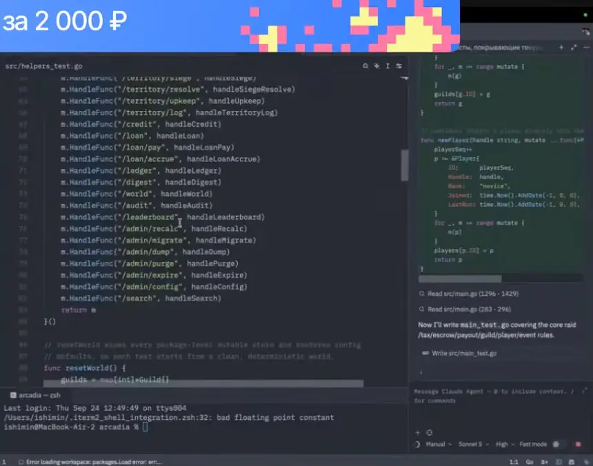
*[▶ 00:32:20](https://www.youtube.com/watch?v=7KAvNMjbIqQ&t=1940s) · Claude agent writing Go test helpers in IDE*

## Ревью тестов: фиксируем то, что код делает сейчас

[▶ 00:32:20](https://www.youtube.com/watch?v=7KAvNMjbIqQ&t=1940s)

Хелперы сущностей полезны во всех тестах.

```go
    "time"
    "github.com/stretchr/testify/assert"
    "github.com/stretchr/testify/require"
)

func TestHandleHealthAndStats(t *testing.T) {
    resetWorld()
    newGuild("EMBER", "")
    rec := doReq(t, "GET", "/health", "")
    require.Equal(t, 200, rec.Code)
    m := jsonMap(t, rec)
    assert.Equal(t, "ok", m["status"])
    assert.EqualValues(t, 1, m["guilds"])

    rec = doReq(t, "GET", "/stats", "")
    m = jsonMap(t, rec)
    assert.EqualValues(t, 1, m["guilds"])
    assert.EqualValues(t, 0, m["runs"])
}

func TestHandleRun_TaxBracketByVolume(t *testing.T) {
    resetWorld()
    newCharter("BRK", func(c *Charter) {
        c.Pct = 5
        c.Brackets = [][3]float64{{0, 1000, 5}, {1000, 1e15, 8}}
    })

rec := doReq(t, "POST", "/run", `{"guild":"…

func TestHandleReport(t *testing.T) {
    resetWorld()
    newCharter("REP", func(c *Charter) { c.Pct…
    newGuild("EMBER", "REP")
    rec := doReq(t, "POST", "/run", `{"guild":"…
    require.Equal(t, 200, rec.Code, rec.Body.St…
    rec := doReq(t, "GET", "/report?tag=EMBER", "")
    assert.Contains(t, rec.Body.String(), "OT…
    rec := doReq(t, "GET", "/report?tag=MISSING", "")
    assert.Equal(t, 404, rec.Code)
}

$ go vet ./... 2>&1 | head -100
…
```

*[▶ 00:33:12](https://www.youtube.com/watch?v=7KAvNMjbIqQ&t=1992s) · Go handler tests open in IDE editor*

Тесты проверяют налог и фокус гильдии, но ожидаемое поведение неизвестно: README прочитан не полностью, и тесты фиксируют то, что код делает фактически.

```go
	m := jsonMap(t, rec)
	// base tax 100, surcharge *(1+5/10)…1.5 … 150
	assert.InDelta(t, 150, m["tax"], 0.001)
}

func TestHandleRun_FocusAdjustments(t *testing.T) {
	resetWorld()
	newCharter("FOC", func(c *Charter) { c.Pct = 10 })

	newGuild("SHADE", "FOC", func(g *Guild) { g.Focus = "blackmarket" })
	rec := doReq(t, "POST", "/run", `[{"guild":"SHADE","loot":"1000"}]`)
	m = jsonMap(t, rec)
	assert.InDelta(t, 200, m["tax"], 0.001) // doubled

	newGuild("EMBER", "FOC", func(g *Guild) { g.Focus = "tavern" })
	rec = doReq(t, "POST", "/run", `[{"guild":"EMBER","loot":"1000"}]`)
	m = jsonMap(t, rec)
	assert.InDelta(t, 90, m["tax"], 0.001) // 10% discount
}

func TestHandleRun_MinMaxClamp(t *testing.T) {
	resetWorld()
	newCharter("CLAMP", func(c *Charter) {
		c.Pct = 1
		c.Min = 500
		c.Max = 50
	…
```

*[▶ 00:33:58](https://www.youtube.com/watch?v=7KAvNMjbIqQ&t=2038s) · Go handler tests in main_test.go*

Упавший тест `TestHandleRun_TaxBracketByVolume` агент разбирает сам.


*[▶ 00:34:26](https://www.youtube.com/watch?v=7KAvNMjbIqQ&t=2066s) · IDE with Go tests and agent test run output*

Правку в `main_test.go` подтверждают вручную.


*[▶ 00:34:54](https://www.youtube.com/watch?v=7KAvNMjbIqQ&t=2094s) · Agent asks to confirm an edit to main_test.go*

Escrow-сабтест расходится на 30000, и тесты показывают это расхождение.

```text
=== RUN   TestHandleRun_EscrowThresholds
=== RUN   TestHandleRun_EscrowThresholds/large_loot_always_escrows
=== RUN   TestHandleRun_EscrowThresholds/young_guild_escrows_above_50000
=== RUN   TestHandleRun_EscrowThresholds/infamous_guild_escrows_above_30000
=== RUN   TestHandleRun_EscrowThresholds/no_escrow_meta_overrides_all_thresholds
    main_test.go:141: resp=map[crystals:0 id:4 loot:200000 rank:… 0 status:ok tax:30000 treasury:170000]
    main_test.go:143:
        Error Trace:    /Users/ishimin/dev/arcadia/src/main_test.go:143
        Error:          Max difference between 200000 and 179000 allowed is 0.001, but difference was 30000
        Test:           TestHandleRun_EscrowThresholds/no_escrow_meta_overrides_all_thresholds
--- FAIL: TestHandleRun_EscrowThresholds (0.00s)
    --- PASS: TestHandleRun_EscrowThresholds/large_loot_always_escrows (0.00s)
    --- PASS: TestHandleRun_EscrowThresholds/young_guild_escrows_above_50000 (0.00s)
    --- PASS: TestHandleRun_EscrowThresholds/infamous_guild_escrows_above_30000 (0.00s)
    --- FAIL: TestHandleRun_EscrowThresholds/no_escrow_meta_overrides_all_thresholds (0.00s)
FAIL
FAIL	coderpad	0.218s
FAIL
```

*[▶ 00:35:11](https://www.youtube.com/watch?v=7KAvNMjbIqQ&t=2111s) · Escrow threshold test run with failing subtest*

Правило: баги не чиним, пишем только тесты.

```go
		m := jsonMap(t, rec)
		// base tax 100, surcharge *(1+5/10)=1.5 -> 150
		assert.InDelta(t, 150, m["tax"], 0.001)
	}

func TestHandleRun_FocusAdjustments(t *testing.T) {
	resetWorld()
	newCharter("FOC", func(c *Charter) { c.Pct = 10 })

	newGuild("SHADE", "FOC", func(g *Guild) { g.Focus = "blackmarket" })
	rec := doReq(t, "POST", "/run", `{"guild":"SHADE","loot":"1000"}`)
	m = jsonMap(t, rec)
	assert.InDelta(t, 200, m["tax"], 0.001) // doubled

	newGuild("EMBER", "FOC", func(g *Guild) { g.Focus = "tavern" })
	rec = doReq(t, "POST", "/run", `{"guild":"EMBER","loot":"1000"}`)
	m = jsonMap(t, rec)
	assert.InDelta(t, 90, m["tax"], 0.001) // 10% discount
}

func TestHandleRun_MinMaxClamp(t *testing.T) {
	resetWorld()
	newCharter("CLAMP", func(c *Charter) {
		c.Pct = 1
		c.Min = 500
		c.Max = 50
	})

// helpers_test.go diff pane (partly illegible comments)
func newCharter(code string, mutate ...func(*Charter)) *Charter {
	c := &Charter{
		Code:     code,
		Name:     code,
		Pct:      10,
		Flat:     0,
		Min:      0,
		Max:      0,
		Brackets: [][3]float64{{0, 1e15, 10}},
		Fx:       map[string]float64{},
	}
```

*[▶ 00:35:33](https://www.youtube.com/watch?v=7KAvNMjbIqQ&t=2133s) · Agent edits helpers_test.go newCharter helper*

## Табличные тесты: удобны для спецификации, но не для любого проекта

[▶ 00:35:21](https://www.youtube.com/watch?v=7KAvNMjbIqQ&t=2121s)

Спикер предпочитает табличные тесты, потому что по ним легче писать спецификацию и быстро дописывать кейсы. Агент же написал нетабличные тесты, и спикер сказал, что исправил бы это.

```go
	cases := []struct {
		name   string
		method string
		body   string
		code   int
	}{
		{"wrong method", "GET", "", 405},
		{"bad json", "POST", "not json", 400},
		{"missing guild", "POST", `{"loot":"100"}`, 400},
		{"missing loot", "POST", `{"guild":"EMBER"}`, 400},
		{"unknown guild", "POST", `{"guild":"NOPE","loot":"100"}`, 404},
		{"bad loot format", "POST", `{"guild":"EMBER","loot":"abc"}`, 400},
		{"loot too small", "POST", `{"guild":"EMBER","loot":"0.1"}`, 400},
		{"loot limit exceeded", "POST", `{"guild":"EMBER","loot":"2000000"}`, 402},
		{"inactive guild", "POST", `{"guild":"DEAD","loot":"100"}`, 402},
		{"infamy too high", "POST", `{"guild":"INFAMOUS","loot":"100"}`, 402},
		{"banned player", "POST", `{"guild":"EMBER","handle":"Cheater","loot":"100"}`, …},
	}
	for _, c := range cases {
		t.Run(c.name, func(t *testing.T) {
			rec := doReq(t, c.method, "/run", c.body)
			assert.Equal(t, c.code, rec.Code, rec.Body.String())
		})
	}
}
```

*[▶ 00:36:19](https://www.youtube.com/watch?v=7KAvNMjbIqQ&t=2179s) · Table-driven validation test cases in main_test.go*

Однако он сомневается, что табличный подход подходит этому проекту: по его словам, проект, возможно, слишком мал, и он неверно оценил его размер.

## MCP как tool calling и проверка «тесты зелёные» через -race

[▶ 00:36:13](https://www.youtube.com/watch?v=7KAvNMjbIqQ&t=2173s)

MCP — коннекторы поверх tool calling: сервер описывает модели функции, например над PostgreSQL, Prometheus или Kibana. Автор использует его для поиска ошибок в логах Kibana.

В демо агент заявил «все тесты проходят», но `-race` нашёл гонку.

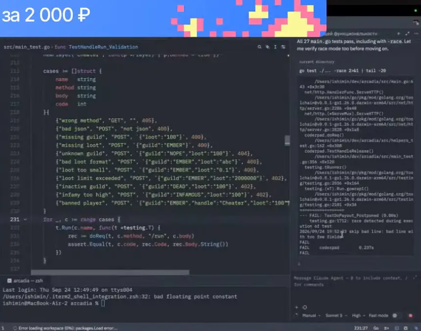
*[▶ 00:37:26](https://www.youtube.com/watch?v=7KAvNMjbIqQ&t=2246s) · Race detector reports failure in TestDoPayout_Postponed*

Трасса ведёт к горутине handleRun.

```text
Goroutine 46 (running) created at:
  coderpad.handleRun()
      /Users/ishimin/dev/arcadia/src/main.go:43 +0x3c30
  net/http.HandlerFunc.ServeHTTP()
      /Users/ishimin/go/pkg/mod/golang.org/toolchain@v0.0.1-go1.26.0.darwin-arm64/src/net/http/server.go:2286 +0x48
  net/http.(*ServeMux).ServeHTTP()
      /Users/ishimin/go/pkg/mod/golang.org/toolchain@v0.0.1-go1.26.0.darwin-arm64/src/net/http/server.go:2828 +0x1a8
  coderpad.doReq()
      /Users/ishimin/dev/arcadia/src/helpers_test.go:162 +0x308
  coderpad.TestHandleRelease()
      /Users/ishimin/dev/arcadia/src/main_test.go:356 +0x120
  testing.tRunner()
      /Users/ishimin/go/pkg/mod/golang.org/toolchain@v0.0.1-go1.26.0.darwin-arm64/src/testing/testing.go:2036 +0x164
  testing.(*T).Run.gowrap1()
      /Users/ishimin/go/pkg/mod/golang.org/toolchain@v0.0.1-go1.26.0.darwin-arm64/src/testing/testing.go:2381 +0x34
==================
--- FAIL: TestDoPayout_Postponed (0.00s)
    testing.go:1712: race detected during execution of test
```

*[▶ 00:37:54](https://www.youtube.com/watch?v=7KAvNMjbIqQ&t=2274s) · Race report stack traces continue*

Кейс DOMINION проверяет обход лимита.

```go
		{"wrong method", "GET", "", 405},
		{"bad json", "POST", "not json", 400},
		{"missing guild", "POST", `{"loot":"100"}`, 400},
		{"missing loot", "POST", `{"guild":"EMBER"}`, 400},
		{"unknown guild", "POST", `{"guild":"NOPE","loot":"100"}`, 404},
		{"bad loot format", "POST", `{"guild":"EMBER","loot":"abc"}`, 400},
		{"loot too small", "POST", `{"guild":"EMBER","loot":"0.1"}`, 400},
		{"loot limit exceeded", "POST", `{"guild":"EMBER","loot":"2000000"}`, 402},
		{"inactive guild", "POST", `{"guild":"DEAD","loot":"100"}`, 402},
		{"infamy too high", "POST", `{"guild":"INFAMOUS","loot":"100"}`, 402},
		{"banned player", "POST", `{"guild":"EMBER","handle":"Cheater","loot":"100"}`, 403},
	}
	for _, c := range cases {
		t.Run(c.name, func(t *testing.T) {
			rec := doReq(t, c.method, "/run", c.body)
			assert.Equal(t, c.code, rec.Code, rec.Body.String())
		})
	}

	t.Run("DOMINION charter bypasses loot cap", func(t *testing.T) {
		rec := doReq(t, "POST", "/run", `{"guild":"DOM","loot":"2000000"}`)
		assert.Equal(t, 200, rec.Code, rec.Body.String())
	})
}

func TestHandleRollback_Basic(t *testing.T) {
	resetWorld()
```

*[▶ 00:38:10](https://www.youtube.com/watch?v=7KAvNMjbIqQ&t=2290s) · Test table and new DOMINION bypass test in IDE*

Таблица кейсов ошибок.

```go
        "wrong method", "GET", "", 405},
        {"bad json", "POST", "not json", 400},
        {"missing guild", "POST", "{"loot":"100"}", 400},
        {"missing loot", "POST", `{"guild":"EMBER"}`, 400},
        {"unknown guild", "POST", `{"guild":"NOPE","loot":"100"}`, 404},
        {"bad loot format", "POST", `{"guild":"EMBER","loot":"abc"}`, 400},
        {"loot too small", "POST", `{"guild":"EMBER","loot":"0.1"}`, 400},
        {"loot limit exceeded", "POST", `{"guild":"EMBER","loot":"2000000"}`, 402},
        {"inactive guild", "POST", `{"guild":"DEAD","loot":"100"}`, 402},
        {"infamy too high", "POST", `{"guild":"INFAMOUS","loot":"100"}`, 402},
        {"banned player", "POST", `{"guild":"EMBER","handle":"Cheater","loot":"100"…
    }
    for _, c := range cases {
        t.Run(c.name, func(t *testing.T) {
            rec := doReq(t, c.method, "/run", c.body)
            assert.Equal(t, c.code, rec.Code, rec.Body.String())
        })
    }

    t.Run("DOMINION charter bypasses loot cap", func(t *testing.T) {
        rec := doReq(t, "POST", "/run", `{"guild":"DOM","loot":"2000000"}`)
        assert.Equal(t, 200, rec.Code, rec.Body.String())
    })
}

func TestHandleRollback_Basic(t *testing.T) {
 resetWorld()
```

*[▶ 00:38:41](https://www.youtube.com/watch?v=7KAvNMjbIqQ&t=2321s) · IDE test table with DOMINION loot-cap case*

Агент нашёл гонку в handleRun, правки предложил только в тестах.


*[▶ 00:38:48](https://www.youtube.com/watch?v=7KAvNMjbIqQ&t=2328s) · Agent flags latent data race in handleRun*

Правка: пауза в resetWorld и очистка карт.

```go
        "wrong method", "GET", "", 405},
        {"bad json", "POST", "not json", 400},
        {"missing guild", "POST", "{"loot":"100"}", 400},
        {"missing loot", "POST", `{"guild":"EMBER"}`, 400},
        {"unknown guild", "POST", `{"guild":"NOPE","loot":"100"}`, 404},
        {"bad loot format", "POST", `{"guild":"EMBER","loot":"abc"}`, 400},
        {"loot too small", "POST", `{"guild":"EMBER","loot":"0.1"}`, 400},
        {"loot limit exceeded", "POST", `{"guild":"EMBER","loot":"2000000"}`, 402},
        {"inactive guild", "POST", `{"guild":"DEAD","loot":"100"}`, 402},
        {"infamy too high", "POST", `{"guild":"INFAMOUS","loot":"100"}`, 402},
        {"banned player", "POST", `{"guild":"EMBER","handle":"Cheater","loot":"100"…
    }
    for _, c := range cases {
        t.Run(c.name, func(t *testing.T) {
            rec := doReq(t, c.method, "/run", c.body)
            assert.Equal(t, c.code, rec.Code, rec.Body.String())
        })
    }

    t.Run("DOMINION charter bypasses loot cap", func(t *testing.T) {
        rec := doReq(t, "POST", "/run", `{"guild":"DOM","loot":"2000000"}`)
        assert.Equal(t, 200, rec.Code, rec.Body.String())
    })
}

func TestHandleRollback_Basic(t *testing.T) {
 resetWorld()
```

*[▶ 00:39:20](https://www.youtube.com/watch?v=7KAvNMjbIqQ&t=2360s) · Race detected; resetWorld settle fix diff*

## Read-only доступ ИИ к инфраструктуре

[▶ 00:38:57](https://www.youtube.com/watch?v=7KAvNMjbIqQ&t=2337s)

Агенту дают только read-only доступ к инфраструктуре, потому что при записи нейросеть может наделать бед. Внедрить это в текущую инфраструктуру — ближайший шаг.

Агент писал тесты и находил баги в собственных тестах. Существующий код ему запретили править, поэтому он правит только свои тесты.

Race detector всё ещё валит TestDoPayout_Postponed, и спикер переходит дальше.

```go
        "wrong method", "GET", "", 405},
        {"bad json", "POST", "not json", 400},
        {"missing guild", "POST", "{"loot":"100"}", 400},
        {"missing loot", "POST", `{"guild":"EMBER"}`, 400},
        {"unknown guild", "POST", `{"guild":"NOPE","loot":"100"}`, 404},
        {"bad loot format", "POST", `{"guild":"EMBER","loot":"abc"}`, 400},
        {"loot too small", "POST", `{"guild":"EMBER","loot":"0.1"}`, 400},
        {"loot limit exceeded", "POST", `{"guild":"EMBER","loot":"2000000"}`, 402},
        {"inactive guild", "POST", `{"guild":"DEAD","loot":"100"}`, 402},
        {"infamy too high", "POST", `{"guild":"INFAMOUS","loot":"100"}`, 402},
        {"banned player", "POST", `{"guild":"EMBER","handle":"Cheater","loot":"100"…
    }
    for _, c := range cases {
        t.Run(c.name, func(t *testing.T) {
            rec := doReq(t, c.method, "/run", c.body)
            assert.Equal(t, c.code, rec.Code, rec.Body.String())
        })
    }

    t.Run("DOMINION charter bypasses loot cap", func(t *testing.T) {
        rec := doReq(t, "POST", "/run", `{"guild":"DOM","loot":"2000000"}`)
        assert.Equal(t, 200, rec.Code, rec.Body.String())
    })
}

func TestHandleRollback_Basic(t *testing.T) {
 resetWorld()
```

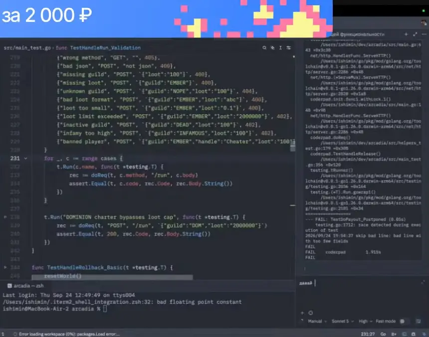
*[▶ 00:40:14](https://www.youtube.com/watch?v=7KAvNMjbIqQ&t=2414s) · Test run reports race in TestDoPayout_Postponed*

## Реструктуризация кода раньше багфиксов

[▶ 00:40:13](https://www.youtube.com/watch?v=7KAvNMjbIqQ&t=2413s)

Два пути: идти по таблице расхождений README, строя план под каждый баг, или дробить сущности на файлы, чтобы код было визуально проще оценивать.

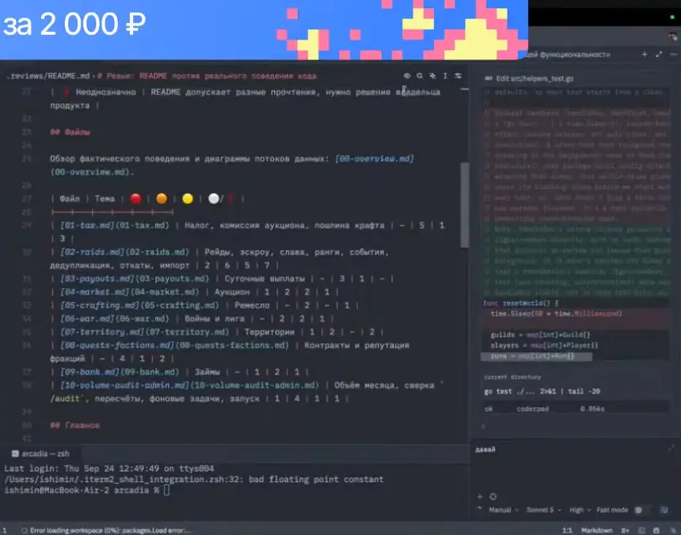
*[▶ 00:41:04](https://www.youtube.com/watch?v=7KAvNMjbIqQ&t=2464s) · README discrepancy table in IDE*

```go
func resetWorld() {
	time.Sleep(50 * time.Millisecond)
	guilds = map[int]*Guild{}
	players = map[int]*Player{}
	runs = map[int]*Run{}
}
```

Спикер выбирает второй путь: без него оценить качество кода нельзя, значит и работать с первым нельзя.


*[▶ 00:42:02](https://www.youtube.com/watch?v=7KAvNMjbIqQ&t=2522s) · Rendered README table and Go handler code*

```go
144:func withLock(h http.Handler) http.Handler
145-	return http.HandlerFunc(func(w http.ResponseWriter, r *http.Request) {
146-		worldMu.Lock()
147-		defer worldMu.Unlock()
148-		h.ServeHTTP(w, r)
149-	})
150-}
151-
152:// locked выполняет фоновую операцию под общим замком
153:func locked(f func()) {
154-	worldMu.Lock()
155-	defer worldMu.Unlock()
156-	f()
157-}
158-
159:// Handler возвращает готовый обработчик со всеми ручками
160:func Handler() http.Handler {
161-	return withLock(mux)
162-}
163-
164:func main() {
165-	demoFlag := flag.Bool("demo", false, "run demo scenario and exit")
166-	portFlag := flag.String("port", "", "port override")
167-	flag.Parse()
168-
```

Тесты уже проходят: `go test ./... -race` завершается ok.

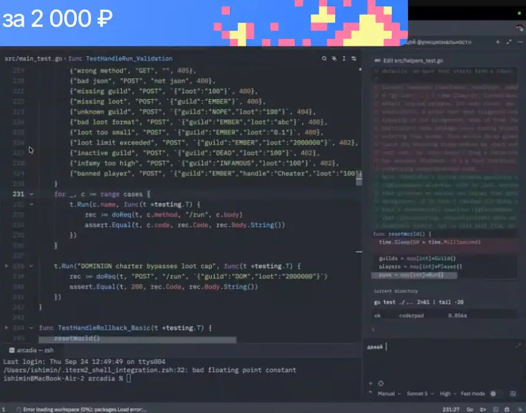
*[▶ 00:40:47](https://www.youtube.com/watch?v=7KAvNMjbIqQ&t=2447s) · Tests pass after resetWorld fix*

```go
        "wrong method", "GET", "", 405},
        {"bad json", "POST", "not json", 400},
        {"missing guild", "POST", "{"loot":"100"}", 400},
        {"missing loot", "POST", `{"guild":"EMBER"}`, 400},
        {"unknown guild", "POST", `{"guild":"NOPE","loot":"100"}`, 404},
        {"bad loot format", "POST", `{"guild":"EMBER","loot":"abc"}`, 400},
        {"loot too small", "POST", `{"guild":"EMBER","loot":"0.1"}`, 400},
        {"loot limit exceeded", "POST", `{"guild":"EMBER","loot":"2000000"}`, 402},
        {"inactive guild", "POST", `{"guild":"DEAD","loot":"100"}`, 402},
        {"infamy too high", "POST", `{"guild":"INFAMOUS","loot":"100"}`, 402},
        {"banned player", "POST", `{"guild":"EMBER","handle":"Cheater","loot":"100"…
    }
    for _, c := range cases {
        t.Run(c.name, func(t *testing.T) {
            rec := doReq(t, c.method, "/run", c.body)
            assert.Equal(t, c.code, rec.Code, rec.Body.String())
        })
    }

    t.Run("DOMINION charter bypasses loot cap", func(t *testing.T) {
        rec := doReq(t, "POST", "/run", `{"guild":"DOM","loot":"2000000"}`)
        assert.Equal(t, 200, rec.Code, rec.Body.String())
    })
}

func TestHandleRollback_Basic(t *testing.T) {
 resetWorld()
```

Сначала план перед реализацией: запрос на приведение кода к clean architecture с разбиением крупных сущностей.

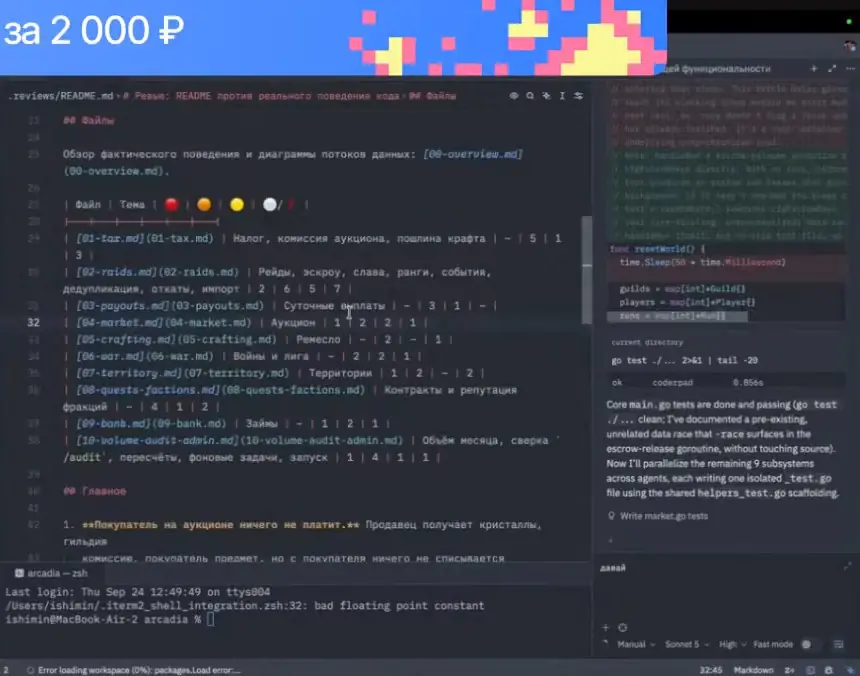
*[▶ 00:41:46](https://www.youtube.com/watch?v=7KAvNMjbIqQ&t=2506s) · README file table, auction rule, IDE view*


*[▶ 00:42:41](https://www.youtube.com/watch?v=7KAvNMjbIqQ&t=2561s) · Go struct and lock code while planning refactor*

```go
59-	Loot float64
60-	Currency string
61-	Gold float64
62-	Tax float64
153:func locked(f func()) {
154-	worldMu.Lock()
155-	defer worldMu.Unlock()
156-	f()
157-}
158-
159:// Handler возвращает готовый обработчик со всеми ручками
160-func Handler() http.Handler {
161-	return withLock(mux)
162-}
163-
144:func withLock(h http.Handler) http.Handler {
145-	return http.HandlerFunc(func(w http.ResponseWriter, r *http.Request) {
146-		worldMu.Lock()
147-		defer worldMu.Unlock()
148-		h.ServeHTTP(w, r)
149-	})
150-}
151-
152:// locked выполняет фоновую операцию под общим замком
153-func locked(f func()) {
154-	worldMu.Lock()
155-	defer worldMu.Unlock()
156-	f()
157-}
158-
159:// Handler возвращает готовый обработчик со всеми ручками
```

## Дробление крупных сущностей по SOLID и KISS

[▶ 00:42:08](https://www.youtube.com/watch?v=7KAvNMjbIqQ&t=2528s)

Цель рефакторинга — привести код к Clean Architecture, потому что текущие сущности слишком крупные. Спор о том, что лучше, Clean Architecture или гексагональная архитектура, периодически возникает, но автору ближе первый вариант. Чтобы сущности стали меньше и легче читались человеком, он опирается на **SOLID** и **KISS**.

Крупные структуры с десятками полей и логика записи леджера в `bank.go` показывают, где сущности разрастаются:

```go
31-	Focus string
32-	Currency string
33-	Active bool
34-	Founded time.Time
35-	Treasury float64
36-	Escrow float64
37-	Volume map[string]float64
38-	Meta map[string]string
39-	Infamy int
40-}
41-
42-type Player struct {
43-	ID int
44-	Handle string
45-	Contact string
46-	Rank string
/Users/ishimin/dev/arcadia/src/bank.go:55:func writeLedger(gid int, kind string, amount float64, ref string) {
/Users/ishimin/dev/arcadia/src/bank.go:56-	g := guilds[gid]
/Users/ishimin/dev/arcadia/src/bank.go:57-	bal := 0.0
/Users/ishimin/dev/arcadia/src/bank.go:58-	if g != nil {
/Users/ishimin/dev/arcadia/src/bank.go:59-		bal = g.Treasury
/Users/ishimin/dev/arcadia/src/bank.go:60-		ledgerSeq++
/Users/ishimin/dev/arcadia/src/bank.go:62-		ledger = append(ledger, LedgerRec{ID: ledgerSeq, At: time.Now(), GuildID: gid, Kind: kind, Amount: amount, Balance: bal, Ref: ref})
/Users/ishimin/dev/arcadia/src/bank.go:63-		…
```

*[▶ 00:43:24](https://www.youtube.com/watch?v=7KAvNMjbIqQ&t=2604s) · Large Go structs and bank.go grep output*

Задача для агента формулируется одним промптом: составить план приведения кода в соответствие с Clean Architecture и раздробить сущности по SOLID и KISS.


*[▶ 00:43:34](https://www.youtube.com/watch?v=7KAvNMjbIqQ&t=2614s) · AI agent refactoring plan for Go code*

## Plan mode: режим без правок кода, а не слово «план»

[▶ 00:43:30](https://www.youtube.com/watch?v=7KAvNMjbIqQ&t=2610s)

Plan mode в Claude Code не пишет код и не редактирует файлы; фраза «давай составим план» его не гарантирует. В обычном режиме агент полез в код, его остановили.

```bash
cat <<'EOF' > /tmp/fmtcheck.go
package main
import "fmt"
func main(){
	fmt.Println(fmt.Sprint(10000.0))
	fmt.Println(fmt.Sprint(5000.0))
	fmt.Println(fmt.Sprintf("%v", 1016.0))
}
EOF
go run /tmp/fmtcheck.go
```


*[▶ 00:44:18](https://www.youtube.com/watch?v=7KAvNMjbIqQ&t=2658s) · Agent runs grep and a Go float formatting check*

Перед разделением сущностей агент ищет лимиты лута и обработчик `handleRun`.

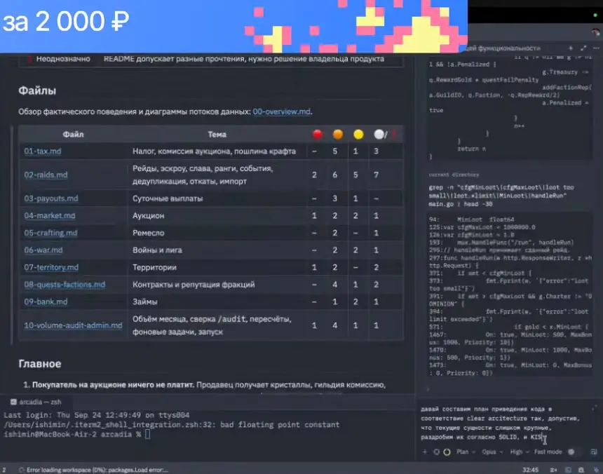
*[▶ 00:44:47](https://www.youtube.com/watch?v=7KAvNMjbIqQ&t=2687s) · Agent greps loot limits in main.go*

Агент выписал фоновые задачи: выплаты раз в сутки, проценты по займам каждые 6 ч, просрочка каждые 30 минут.

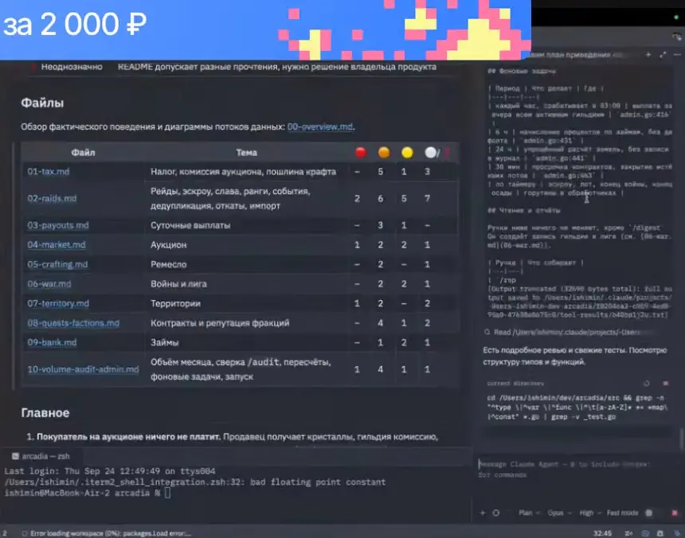
*[▶ 00:45:42](https://www.youtube.com/watch?v=7KAvNMjbIqQ&t=2742s) · Agent summarizes background tasks and reports*

## Раскладка пакетов Go и внешний контракт

[▶ 00:47:03](https://www.youtube.com/watch?v=7KAvNMjbIqQ&t=2823s)

Для раскладки пакетов Claude предлагает фича + слой: `internal/<context>/{domain,app}` и `internal/adapters/{http,memory,jobs}`. Ведущий считает, что однозначного ответа нет.


*[▶ 00:47:34](https://www.youtube.com/watch?v=7KAvNMjbIqQ&t=2854s) · Agent questions: package layout and HTTP contract*

Логика скидок фракций разбросана по файлам.


*[▶ 00:47:50](https://www.youtube.com/watch?v=7KAvNMjbIqQ&t=2870s) · Terminal grep for factionDiscount usages*

Баги из ревью сохраняем: план их не чинит, трогаем только критичные.


*[▶ 00:48:12](https://www.youtube.com/watch?v=7KAvNMjbIqQ&t=2892s) · Review plan files table in editor and terminal*

Go vet и тесты идут в фоне, пока пишется черновик плана.


*[▶ 00:49:17](https://www.youtube.com/watch?v=7KAvNMjbIqQ&t=2957s) · Parallel agents run Go vet and tests*

Найденные баги: дубли рейдов в одну секунду, недостижимый статус debt, гонка на cfgEscrowDays.


*[▶ 00:50:24](https://www.youtube.com/watch?v=7KAvNMjbIqQ&t=3024s) · Claude Code proposes review findings and verification steps*

Внешний HTTP-контракт держат байт-в-байт, потому что проект уже в проде. Скилл — это MD-файл с промптом, а линтеры на архитектуру стоят выше обычных.

## Линтеры подключают после того, как код приведён в порядок

[▶ 00:49:30](https://www.youtube.com/watch?v=7KAvNMjbIqQ&t=2970s)

Линтеры и форматтеры нужны не каждому проекту, а на определённом этапе его зрелости. Порядок такой:

1. Сначала проект пишется в режиме вайбкодинга.
2. Промтом код приводят в относительный порядок.
3. Подключают линтеры и устраняют найденные замечания.
4. Дальше работают в рамках линтеров.

Модель соглашается с этим подходом и просит после каждого файла проверять, что найденные замечания устранены.

## Разбор плана Claude: от общего к микроправкам

[▶ 00:50:25](https://www.youtube.com/watch?v=7KAvNMjbIqQ&t=3025s)

План сохраняют в `.plans` и разбирают по пунктам.


*[▶ 00:50:44](https://www.youtube.com/watch?v=7KAvNMjbIqQ&t=3044s) · Asking agent to save the plan to .plans*

Каждая подсистема получает отдельный тестовый файл.

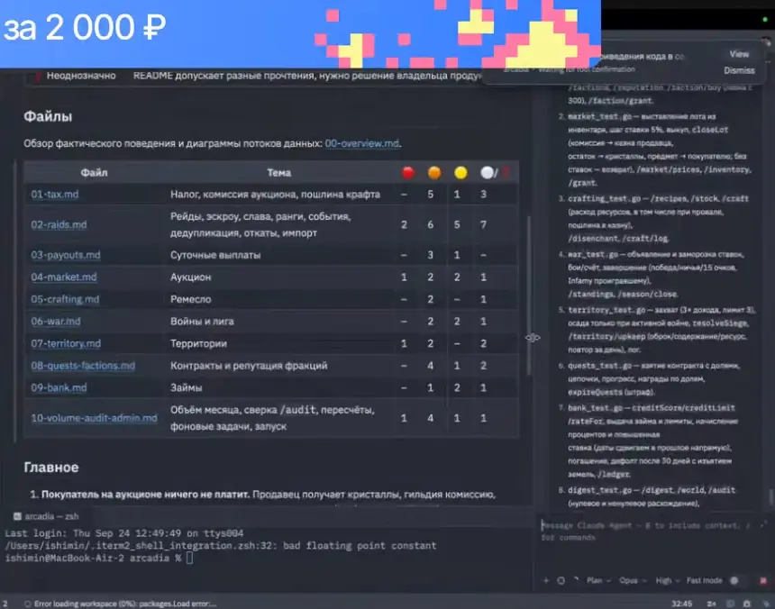
*[▶ 00:50:48](https://www.youtube.com/watch?v=7KAvNMjbIqQ&t=3048s) · Agent's list of planned test files*

Ведущий считает план без конкретики непригодным к исполнению.


*[▶ 00:51:35](https://www.youtube.com/watch?v=7KAvNMjbIqQ&t=3095s) · Claude Code plan: test steps and findings*

На подсистему: читать файл целиком, писать тест, запускать `go test ./...`, править только тест.

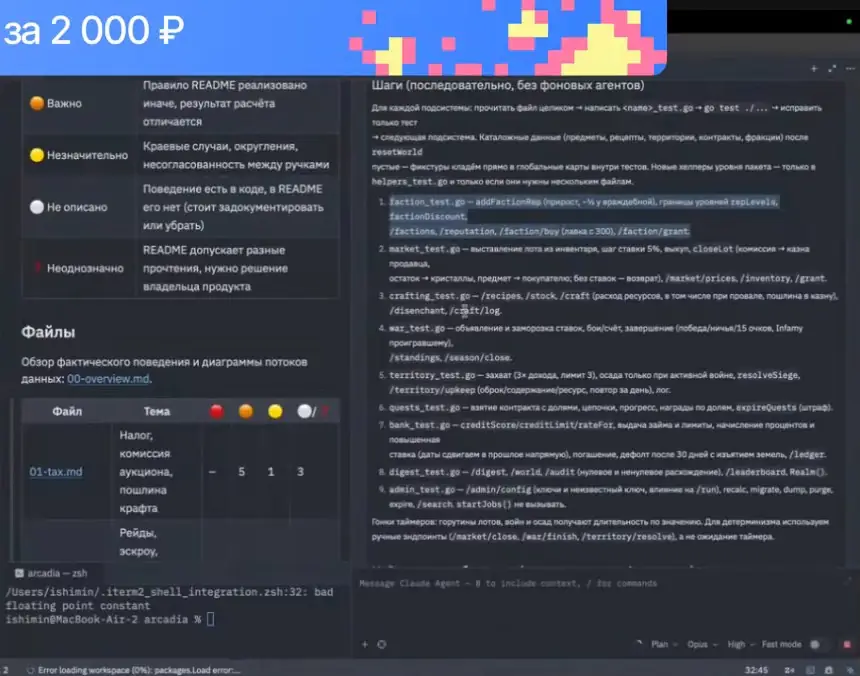
*[▶ 00:51:58](https://www.youtube.com/watch?v=7KAvNMjbIqQ&t=3118s) · Claude Code plan: per-subsystem test steps*

Баги не чинят, только фиксируют: dedup `/run` склеивает рейды в одну секунду, а проверка `Net < 1000` стоит раньше `Net < 0`, поэтому статус debt недостижим.

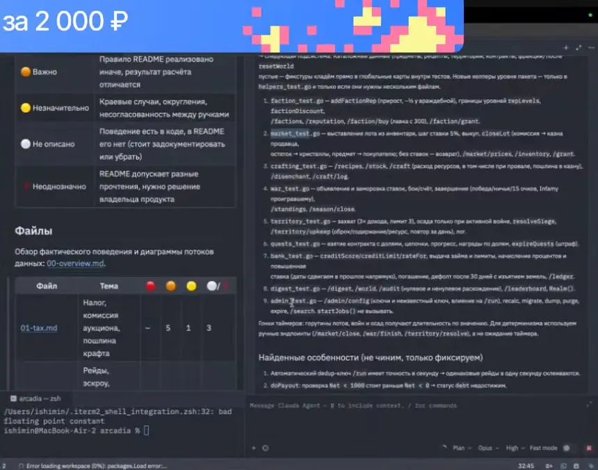
*[▶ 00:52:11](https://www.youtube.com/watch?v=7KAvNMjbIqQ&t=3131s) · Claude Code plan: numbered test steps (scrolled)*

## Оценка дифа и пошаговая реализация плана

[▶ 00:52:02](https://www.youtube.com/watch?v=7KAvNMjbIqQ&t=3122s)

Оцените дифф каждого шага. Крупный шаг дробите на микроправки, которые проще контролировать глазами, например по файлам.


*[▶ 00:55:02](https://www.youtube.com/watch?v=7KAvNMjbIqQ&t=3302s) · Claude Agent session: test-coverage findings notes*

Шаги идут по очереди: прочитать файл целиком, написать тест, запустить `go test ./...`, исправить только тест.

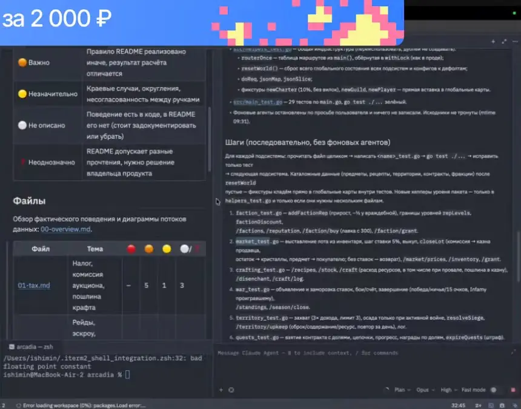
*[▶ 00:52:32](https://www.youtube.com/watch?v=7KAvNMjbIqQ&t=3152s) · Claude Code status: helpers, main_test, and plan*

Перед одобрением проверьте правила плана: менять можно только тестовые файлы.

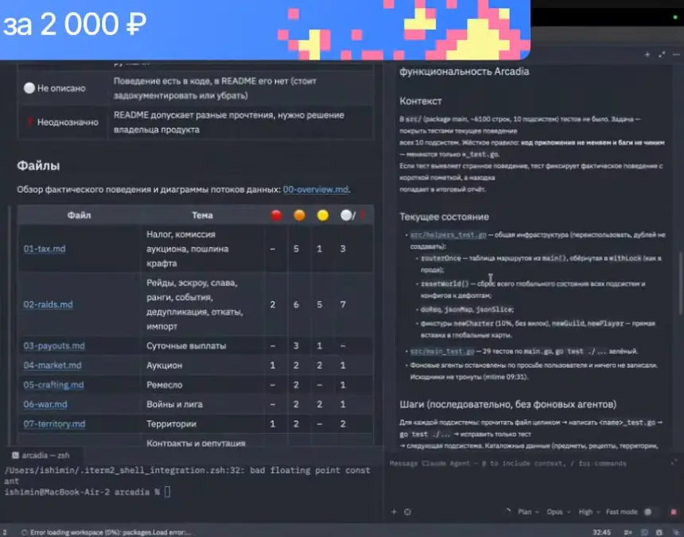
*[▶ 00:52:47](https://www.youtube.com/watch?v=7KAvNMjbIqQ&t=3167s) · Claude Code context and current state*

Для быстрых задач используйте скиллы: реализация, ревью двумя агентами, которые правят друг друга, и общая сводка из двух ревью.

## Кросс-ревью: модели проверяют планы друг друга

[▶ 00:53:57](https://www.youtube.com/watch?v=7KAvNMjbIqQ&t=3237s)

**Кросс-ревью** — когда Claude проверяет Codex и наоборот. Ценность в разном обучении моделей: они замечают разные вещи. Лучше всего работает на архитектуре и планах больших проектов. Порядок такой: сначала кросс-ревью плана с просьбой перепроверять наличие проблем, и только потом сверка с кодом, потому что на большом объёме глазами читать дольше. Многие харнессы уже выносят кросс-ревью в отдельную функцию.

## Shortcut: мок-интервью за 2 000 рублей и план развития

[▶ 00:55:51](https://www.youtube.com/watch?v=7KAvNMjbIqQ&t=3351s)

Shortcut — менторская платформа. По словам спикера, у неё более 150 менторов из BigTech, стартапов и небольших компаний. Входная точка — **мок-интервью**: часовое собеседование один на один с ментором за 2 000 рублей. Ментора выбирают по компании или сфере, а секцию задаёт клиент: кодинг, LeetCode, system design, языковая секция.

Деньги за мок возвращают по любой причине: достаточно сказать «просто хочу деньги вернуть». По словам спикера, из 2 000 моков возврат был 12 раз.

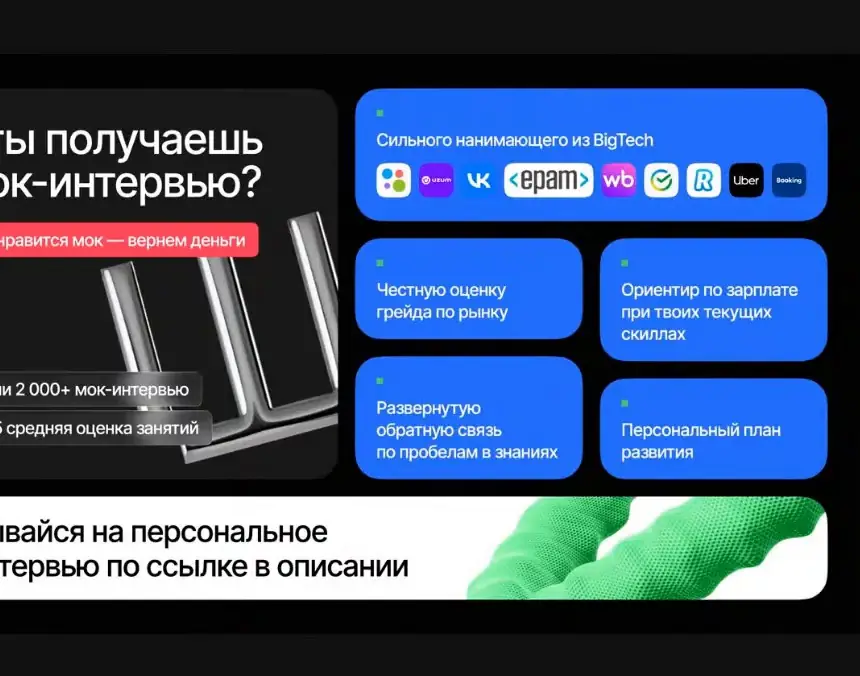
*[▶ 00:59:25](https://www.youtube.com/watch?v=7KAvNMjbIqQ&t=3565s) · Mock interview with money-back guarantee*

После интервью ментор готовит подробный фидбэк: сильные и слабые стороны, вилку зарплаты сейчас и после прокачки, порядок изучения тем до следующего грейда. Фидбэк генерирует система, ментор его проверяет.

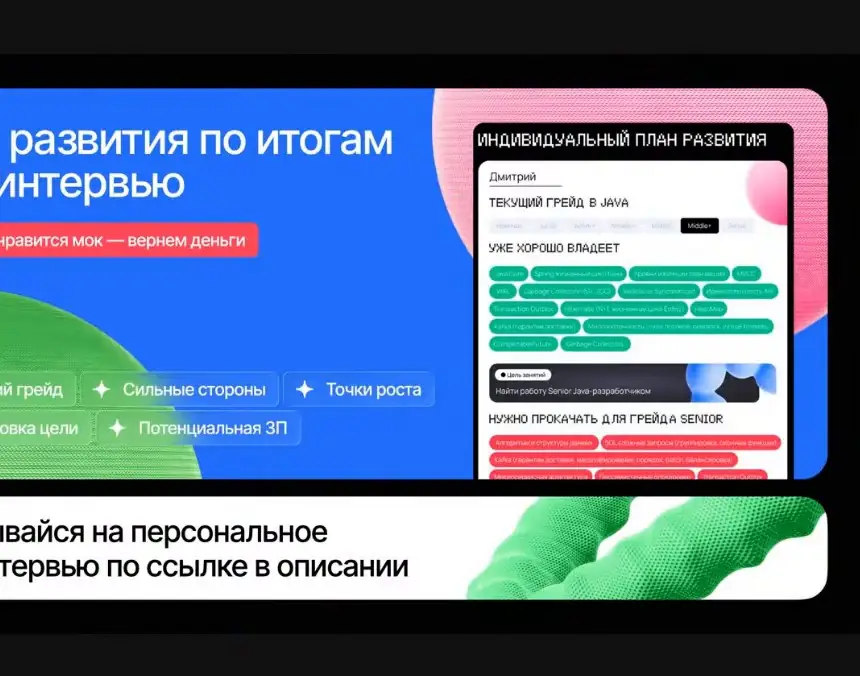
*[▶ 01:00:04](https://www.youtube.com/watch?v=7KAvNMjbIqQ&t=3604s) · Development plan after the interview*

Мок часто показывает разрыв между практикой и теорией: кандидат хорошо знает то, что использовал в проде, но слабее в теоретических вопросах.

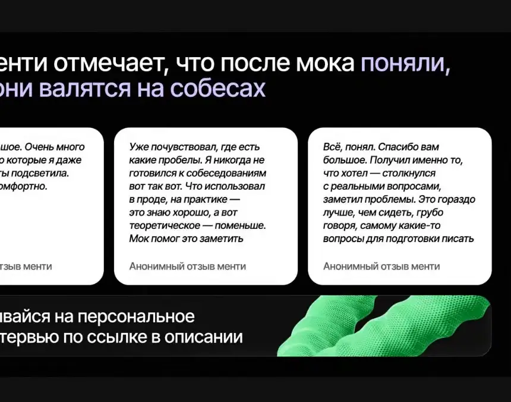
*[▶ 01:00:37](https://www.youtube.com/watch?v=7KAvNMjbIqQ&t=3637s) · Mentee testimonials after mock interview*

Затем менеджер проводит фидбэк-колл и предлагает план роста. Заниматься самостоятельно или с платформой решает клиент, но спикер рекомендует с ментором: так быстрее.

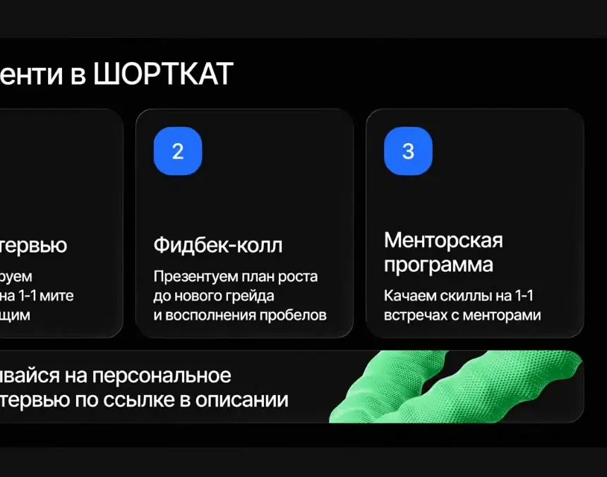
*[▶ 01:00:58](https://www.youtube.com/watch?v=7KAvNMjbIqQ&t=3658s) · Фидбек-колл и менторская программа*

Менторская программа: 1-1 уроки по каждой теме, домашки с code review, личный чат с ментором между занятиями. Помощь с наймом: консультации HR, готовое резюме, рефералки в BigTech.

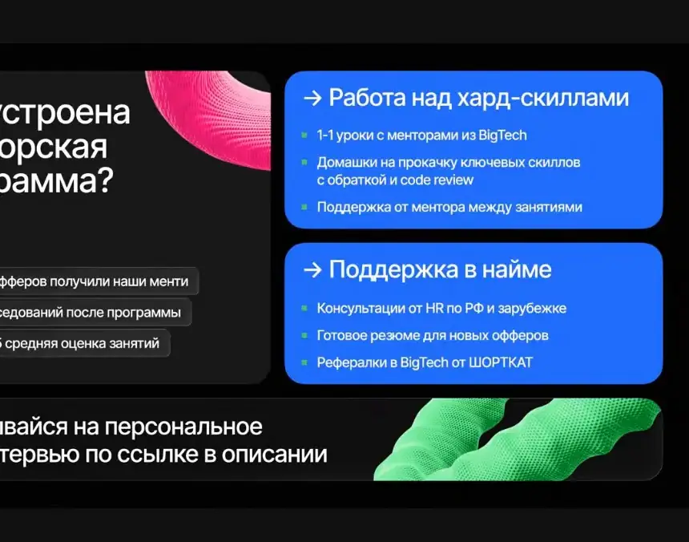
*[▶ 01:02:15](https://www.youtube.com/watch?v=7KAvNMjbIqQ&t=3735s) · Как устроена менторская программа*

Платформа обещает пять собеседований, потому что часть компаний по договору зовёт кандидатов от Shortcut. Спикер называет целями поиск работы за рубежом, смену работы, рост по грейду и подготовку к тимлиду или CTO, и советует уделять не меньше 10 часов в неделю.

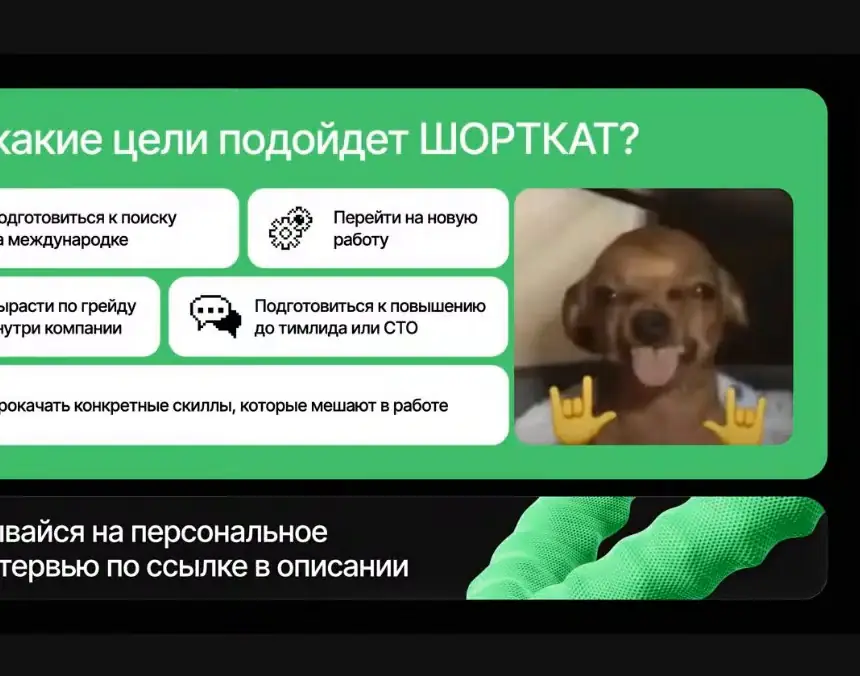
*[▶ 01:04:31](https://www.youtube.com/watch?v=7KAvNMjbIqQ&t=3871s) · Какие цели подойдёт ШОРТКАТ?*

## Проверяется мышление инженера, а не умение промптить

[▶ 01:06:07](https://www.youtube.com/watch?v=7KAvNMjbIqQ&t=3967s)

Получить код одним промптом может любой, поэтому AI-секция проверяет системное мышление. Важно, можно ли допустить кандидата до прода как инженера, работающего с нейросетью, а не как «мясной проксик», который принимает результат модели без проверки.

Кандидат должен:

- сам проверять результат и получать детерминированный выход;
- находить, где модель ошиблась;
- писать тесты и разбирать тест-кейсы, а не отдавать их нейросети.

По словам интервьюера, без такого подхода код от нейросети не работает: так, по его наблюдению, и выглядят многие B2B SaaS.

## AI-секции на собеседованиях скоро устаканятся

[▶ 01:09:48](https://www.youtube.com/watch?v=7KAvNMjbIqQ&t=4188s)

Ведущий считает, что формат AI-секции устаканится примерно через год. Сначала кандидатов спрашивают о разном, а затем вопросы начинают повторяться. Аудиторию он попросил оценить, является ли формат скамом или будущим стандартом собеседований.

## Чек-лист AI-навыков: интерес, модели, недоверие к нейросети

[▶ 01:11:55](https://www.youtube.com/watch?v=7KAvNMjbIqQ&t=4315s)

Готового набора навыков нет, важнее интерес и понимание:

- **MCP** — уже стандарт рынка.
- **Фронтир-модели**: знать отличия и брать дешевле модели для простых задач, а не кодить всё самой дорогой.
- **Харнесы**: изучать их функции и проводить ревью.

Главный навык — **недоверие к нейросети**: это перемножение матриц, которое иногда ошибается. Входы и выходы нужно зажимать детерминированно: линтеры, тесты, спеки, перепроверка разными нейросетями.

## Мок-интервью за 2000 рублей с ментором из целевой компании

[▶ 01:13:47](https://www.youtube.com/watch?v=7KAvNMjbIqQ&t=4427s)

По мнению ведущего, проверка работы с AI уже встречается на многих собеседованиях или появится в ближайшие 1–1,5 года.

Платное мок-собеседование стоит 2000 рублей и включает:
- часовое собеседование с ментором из компании, куда вы хотите попасть;
- подробный фидбэк о том, что делать дальше;
- возврат денег, если что-то не понравится.

Заявка оставляется по ссылке в описании эфира: [shortcut_py_bot](https://t.me/shortcut_py_bot?start=youtube_video_pythonsobes_131026).

## Ссылки и материалы

- [Telegram-бот shortcut_py_bot — запись на платное мок-собеседование из описания](https://t.me/shortcut_py_bot?start=youtube_video_pythonsobes_131026) — <https://t.me/shortcut_py_bot?start=youtube_video_pythonsobes_131026> · описание видео
- [go-spew — Go-библиотека для вывода структур, зависимость проекта echo](https://github.com/davecgh/go-spew) — <https://github.com/davecgh/go-spew> · на экране [▶ 00:26:21](https://www.youtube.com/watch?v=7KAvNMjbIqQ&t=1581s)
- [go-difflib — Go-библиотека для diff, зависимость проекта echo](https://github.com/pmezard/go-difflib) — <https://github.com/pmezard/go-difflib> · на экране [▶ 00:26:21](https://www.youtube.com/watch?v=7KAvNMjbIqQ&t=1581s)
- [testify — тестовый фреймворк для Go, зависимость проекта echo](https://github.com/stretchr/testify) — <https://github.com/stretchr/testify> · на экране [▶ 00:26:21](https://www.youtube.com/watch?v=7KAvNMjbIqQ&t=1581s)
