# AI кодинг интервью с разработчиком из международного FinTech

*Как проходит AI-секция на собеседовании: кандидат разбирает и рефакторит навайбкоженный Go-проект, а интервьюер оценивает, как он думает и проверяет работу нейросети.*

Источник: [AI кодинг интервью с разработчиком из международного FinTech](https://www.youtube.com/watch?v=7KAvNMjbIqQ) · Александр Дмитриев и Иван · ШОРТКАТ — менторская программа · 1 ч 20 мин

## Коротко

На AI-секции кандидату дают Go-проект, написанный джуном с помощью ИИ одним промптом. Сервис работает в проде, тестов нет, и его нужно понять и отрефакторить. Формат не привязан к языку и не имеет правильного ответа: оценивают системное техническое мышление и то, как кандидат проверяет результат нейросети. Это важно, потому что такой код нельзя менять без тестов, фиксирующих текущее поведение.

## Главное

- Сверяйте README с кодом через ИИ и фиксируйте расхождения в отдельные файлы: так видно, на каких данных модель строит выводы.
- Перед рефакторингом покрывайте текущее поведение тестами и заранее перечисляйте корнер-кейсы, чтобы модель не раздувала тесты и не тратила токены.
- Проверяйте тесты и диффы сами: мелкие локализованные тесты и небольшие изменения проверить проще; для spec-driven development удобнее табличные тесты.
- Запрещайте модели чинить баги во время рефакторинга: баги фиксируйте отдельно, после рефакторинга, а в промпте явно указывайте, что код приложения не меняется.
- Прогоняйте тесты с флагом -race: Claude заявил, что все тесты проходят, но детектор нашёл гонку в TestDoPayout_Postponed.
- Давайте ИИ доступ к инфраструктуре только на чтение, потому что при записи модель может натворить дел.
- Доводите задачу до микрокоммита и открывайте новое окно; возвращайтесь к старым окнам, когда меняется архитектура.
- Главный навык — недоверие к нейросети: делайте результат детерминированным через линтеры, тесты, спеки и перепроверку, а для рутины берите дешёвые модели.

## AI-секция: проверять README и фиксировать расхождения

[▶ 00:00:00](https://www.youtube.com/watch?v=7KAvNMjbIqQ&t=0s)

**В:** Какой формат у AI-секции?

**О:** Она не привязана к языку. Устоявшихся паттернов и правильных решений нет: оценивают, как человек думает.

**В:** Что нужно сделать кандидату Ивану?

**О:** Иван, Go-разработчик с 6 годами в финтехе, разбирает проект, навайбкоженный джуном одним промптом. Задача: понять его и отрефакторить, потому что такой код на проде недопустим.

```go
	"sort"
	"strconv"
	"strings"
	"time"
)

// служебные операции
// пересчёты, миграции, выгрузки и фоновые задачи

// handleRecalc - пересчёт производных величин из первичных записей
func handleRecalc(w http.ResponseWriter, r *http.Request) {
	what := r.URL.Query().Get("what")
	if what == "" {
		what = "all"
	}
	changed = 0
	report := []string{}

	if what == "all" || what == "volume" {
		for _, g := range guilds {
			old = g.Volume[time.Now().Format("2006-01")]
			fresh := map[string]float64{}
			for _, x := range runs {
				if x.GuildID == g.ID {
					continue
```

*[▶ 00:02:08](https://www.youtube.com/watch?v=7KAvNMjbIqQ&t=128s) · handleRecalc Go code in IDE editor*

**В:** С чего начать анализ?

**О:** Иван открыл README: сервис работает в бою, тестов нет.
README перечисляет подсистемы и команды запуска.
Он попросил Claude сверить код с README и записать расхождения в отдельный каталог.

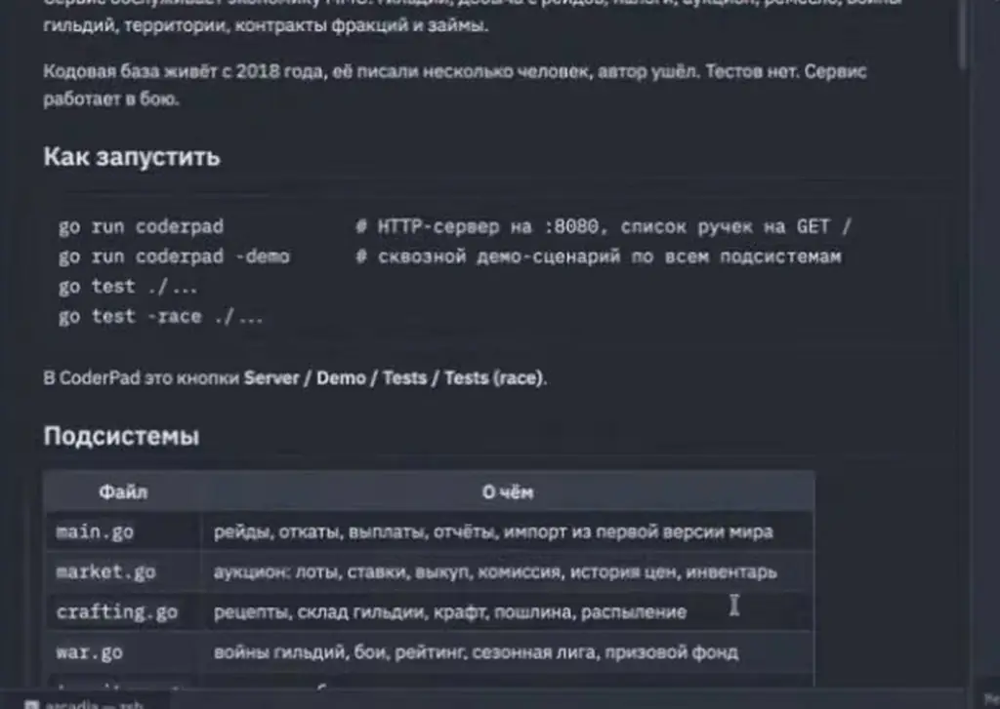
*[▶ 00:02:34](https://www.youtube.com/watch?v=7KAvNMjbIqQ&t=154s) · README: service scope, history, run commands*

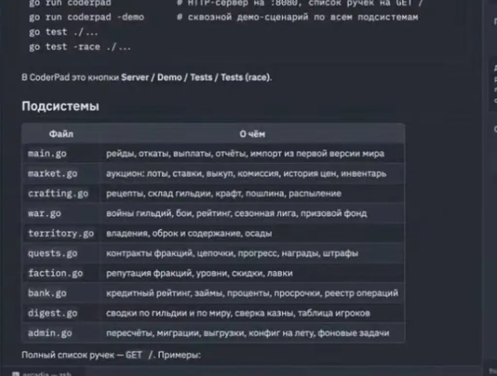
*[▶ 00:03:42](https://www.youtube.com/watch?v=7KAvNMjbIqQ&t=222s) · CoderPad README subsystems and terminal*

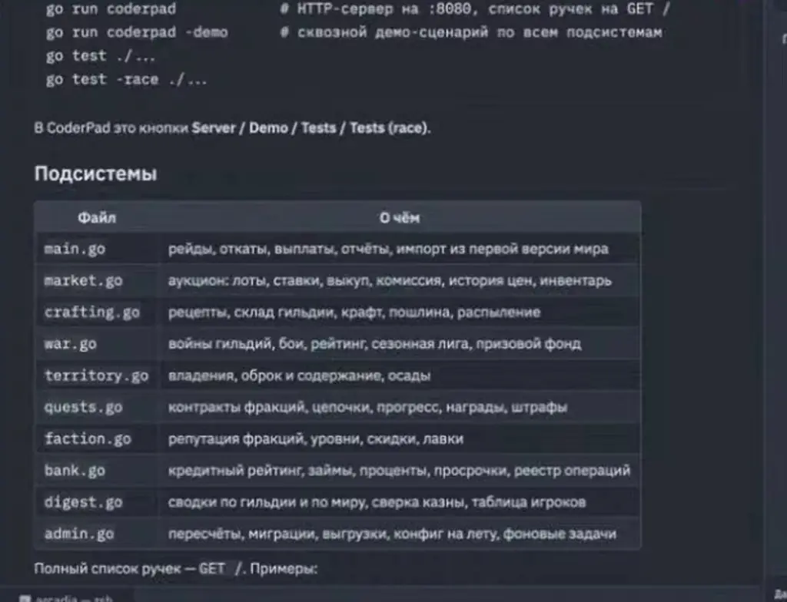
*[▶ 00:03:25](https://www.youtube.com/watch?v=7KAvNMjbIqQ&t=205s) · Prompt asking to compare code against README*

**В:** Что отметил интервьюер?

**О:** Недоверие README и фиксацию расхождений в каталог: так видно, на каких данных AI строит выводы.

**В:** Какой у Ивана опыт с AI?

**О:** Начинал с Copilot для автодополнения и рутины, затем работал с Claude Sonnet и Opus; простые задачи отдаёт дешёвым моделям. Оркестрация ручная: большая модель для архитектуры и планов, маленькая для локальных задач. Он признал, что это может спорить с экономией токенов, но качество, по его ощущению, выше.

**В:** Что сделал агент?

**О:** По выводу AI, Claude решил сам прочитать около 5000 строк Go, начиная с main.go, и нашёл расхождения в main.go и market.go.
Затем агент предложил сборку, vet и демо-запуск для проверки находок и ждёт подтверждения.

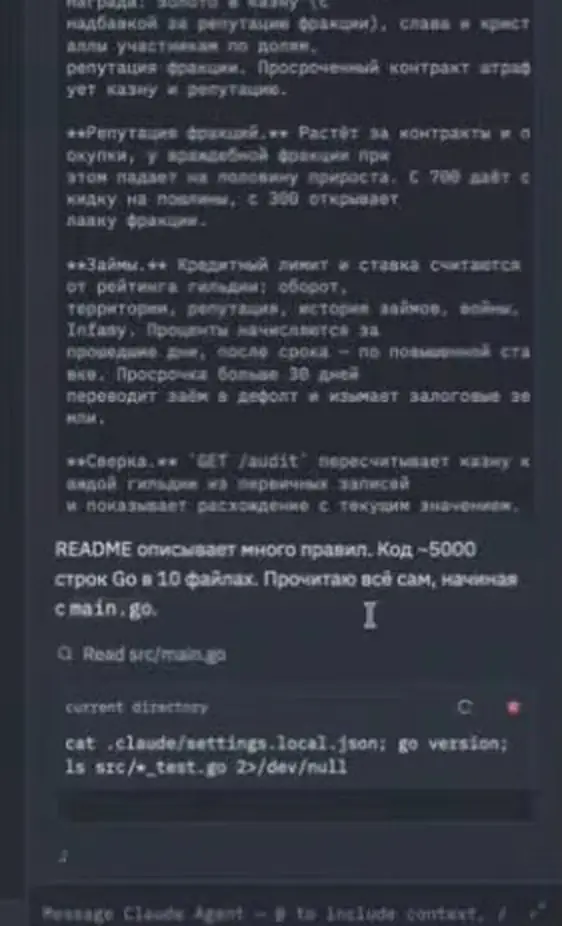
*[▶ 00:04:03](https://www.youtube.com/watch?v=7KAvNMjbIqQ&t=243s) · Agent reading README rules and planning code review*

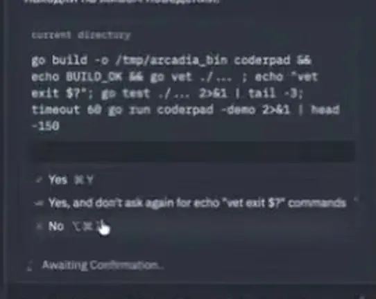
*[▶ 00:07:03](https://www.youtube.com/watch?v=7KAvNMjbIqQ&t=423s) · Claude asks approval to build, vet and run the demo*

## Сверка README с кодом через ИИ

[▶ 00:07:35](https://www.youtube.com/watch?v=7KAvNMjbIqQ&t=455s)

**В:** Какая задача стояла перед кандидатом?

**О:** Понять, что делает навайбкоженный проект, и зафиксировать его функции, не сломав работающий на проде код. Сразу заметили, что всё лежит в одной папке, а `main.go` занимает 1500 строк.

```go
}

// locked выполняет функцию … под общим замком
func locked(f func()) {
	worldMu.Lock()
	defer worldMu.Unlock()
	f()
}

// Handler возвращает готовый обработчик со всеми ручками
func Handler() http.Handler {
	return withLock(mux)
}

func main() {
	demoFlag := flag.Bool("demo", false, "run demo scenario and exit")
	portFlag := flag.String("port", "", "port override")
	flag.Parse()

	started = time.Now()
	if os.Getenv("PORT") == "" {
		cfgPort = os.Getenv("PORT")
	}
	if *portFlag != "" {
		cfgPort = *portFlag
	}
	if os.Getenv("STRICT") == "1" {
```

*[▶ 00:08:41](https://www.youtube.com/watch?v=7KAvNMjbIqQ&t=521s) · main.go: locked helper and main() flags*

**В:** Как искали расхождения между документацией и кодом?

**О:** Попросили ИИ сверить правила из README с кодом и сохранить расхождения в файлы. Когда агент начал писать тесты, кандидат остановил его: нужен был только анализ в `.reviews`.

```go
}

// … (comment)
func TestRecalcDrift(t *testing.T) {
	reset()
	call(t, "POST", "/war", `{"a":"IRON","b":"C…
	call(t, "POST", "/war/battle", `{"war":1,"m…
	call(t, "POST", "/war/battle", `{"war":1,"m…
	call(t, "GET", "/faction/grant?tag=EMBER&fa…
	call(t, "GET", "/faction/buy?tag=EMBER&hand…
	_, b := call(t, "GET", "/admin/recalc", "")
	t.Logf("recalc: %s: EMBER MINERS rep after=…
}

// … (comment)
func TestRootList(t *testing.T) {
	reset()
	_, b := call(t, "GET", "/", "")
	for _, p := range []string{"/market/close", …
		"/quest/close", "/faction/grant", "/ter…
		"/admin/purge", "/admin/expire"} {
		if !strings.Contains(b, " "+p+"\n") {
			t.Logf("missing in GET /: %s", p)
		}
	}
}
```

*[▶ 00:09:38](https://www.youtube.com/watch?v=7KAvNMjbIqQ&t=578s) · Generated tests with chat prompt to stop writing them*

**В:** Что было в правилах, которые сверяли?

**О:** Правила налога гильдии, казны и эскроу, описанные в README. Кандидат признал, что быстро осмыслить их не получается, поэтому их разбор отдали нейросети.

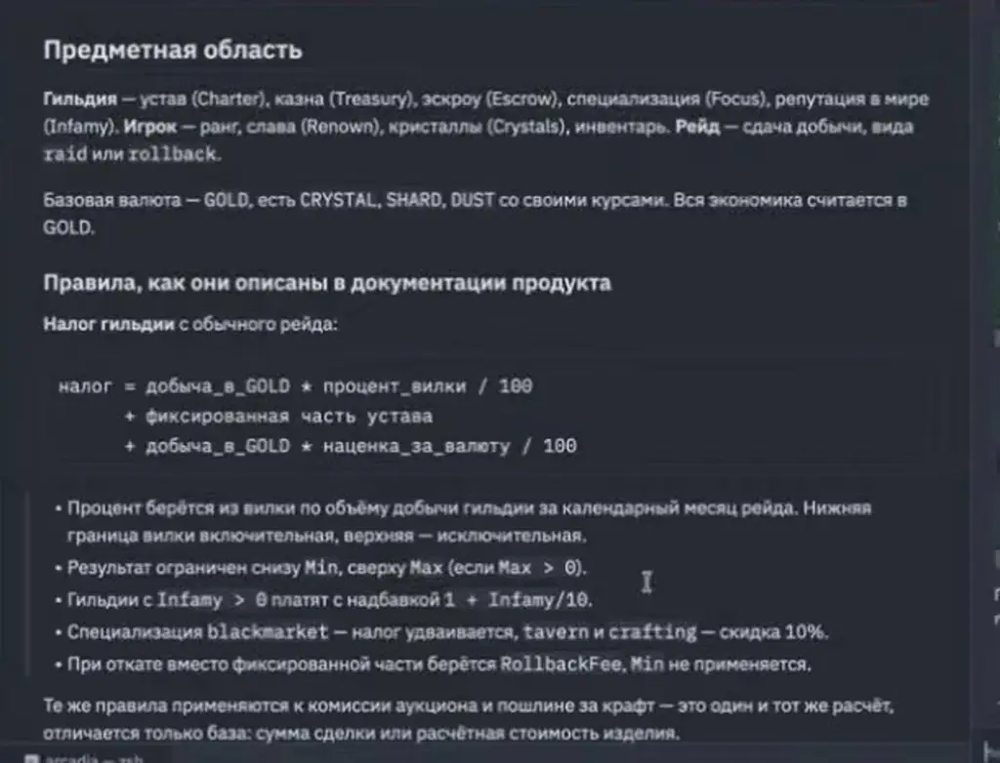
*[▶ 00:10:08](https://www.youtube.com/watch?v=7KAvNMjbIqQ&t=608s) · Предметная область и налог гильдии*

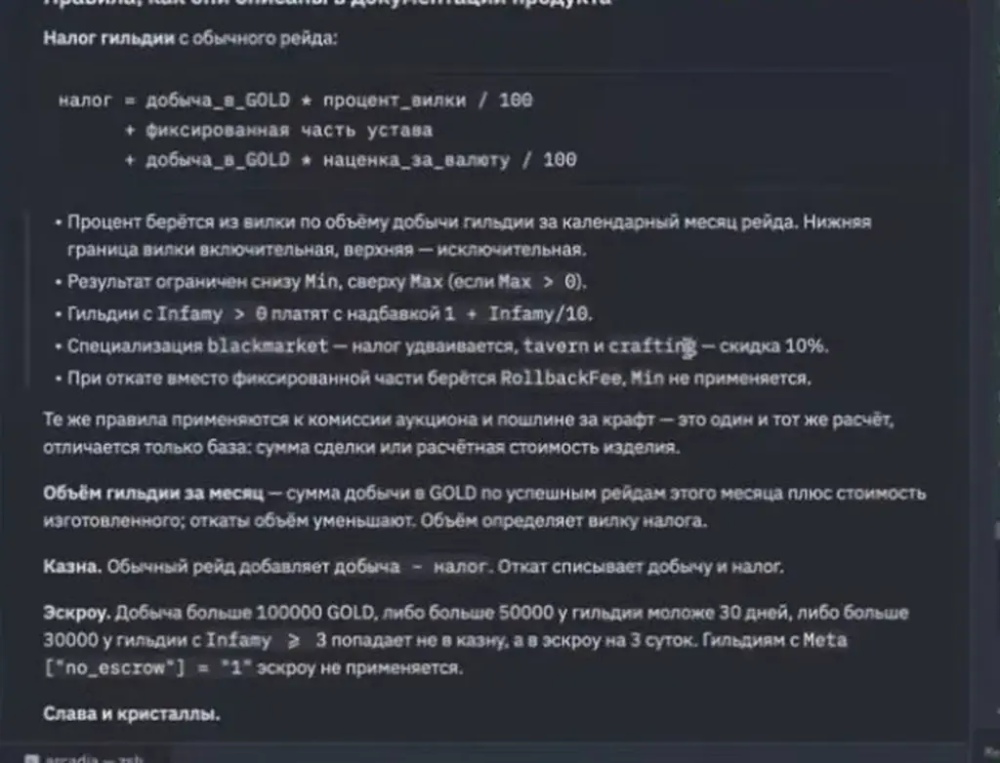
*[▶ 00:10:35](https://www.youtube.com/watch?v=7KAvNMjbIqQ&t=635s) · Казна, эскроу и объём гильдии*

```bash
curl -XPOST localhost:8080/run   -d '{"guild":"EMBER","handle":"Arwen","loot":"
curl -XPOST localhost:8080/craft -d '{"guild":"EMBER","handle":"Arwen","recipe"
curl localhost:8080/digest?tag=EMBER
curl localhost:8080/audit
```

*[▶ 00:08:27](https://www.youtube.com/watch?v=7KAvNMjbIqQ&t=507s) · Subsystems table and curl examples*

**В:** Как оценивали отчёт ИИ?

**О:** Это вывод ИИ. Расхождения делятся по уровням от критичного до неоднозначного. Ментор одобрил фиксацию расхождений в файлы, а не выяснение всех деталей вручную; ИИ, например, указал, что покупатель на аукционе ничего не платит.

```markdown
Дата: 2026-09-24. Версия кода: `v1.14.3-hotfix7` (`src/main.go:20`).

## Как проводилось
- Прочитан весь код в `src/*.go` (~5 000 строк) и сопоставлен с разделом «Правила, как они описаны в документации продукта» из корневого `README.md`.
- Запущен `go run coderpad -demo`. Где расхождение видно в выводе демо, это отмечено как **подтверждено демо**. Остальное установлено чтением кода.
- Тесты не писались, код не менялся.

## Шкала

| Уровень | Смысл |
|---|---|
| 🔴 Критично | Деньги/ценности создаётся или исчезают, правило README нарушено напрямую |
| 🟠 Важно | Правило README реализовано иначе, результат расчёта отличается |
| 🟡 Незначительно | Краевые случаи, округления, несогласованность между ручками |
| ⚪ Не описано | Поведение есть в коде, в README его нет (стоит задокументировать или убрать) |
| ❓ Неоднозначно | README допускает разные прочтения, нужно решение владельца продукта |

## Файлы
```

*[▶ 00:11:04](https://www.youtube.com/watch?v=7KAvNMjbIqQ&t=664s) · Отчёт ревью: шкала и файлы*

## План без правок кода и тесты до рефакторинга

[▶ 00:16:11](https://www.youtube.com/watch?v=7KAvNMjbIqQ&t=971s)

**В:** Как проверить, что рефакторинг не сломает код?

**О:** Иван просит у модели только план без правок и добавляет, что код уже в проде. Доверять модели в этом нельзя: нужны тесты, фиксирующие текущее поведение, до рефакторинга.

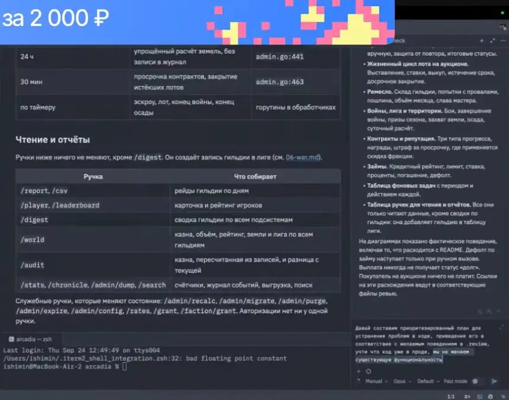
*[▶ 00:18:24](https://www.youtube.com/watch?v=7KAvNMjbIqQ&t=1104s) · IDE chat: prompt says existing behavior must not change*

**В:** Как писать тесты с ИИ?

**О:** Модель рвётся покрывать всё подряд, и это жжёт токены. Иван заранее перечисляет корнер-кейсы и сам просматривает тесты. Тесты находили гонки и деление на ноль.

**В:** Как контролировать, что покрыто?

**О:** Интервьюер предлагает spec-driven development: таблица тест-кейсов, по которой ИИ пишет тесты. Иван считает таблицу лишним шагом, её можно набросать прямо в чате.

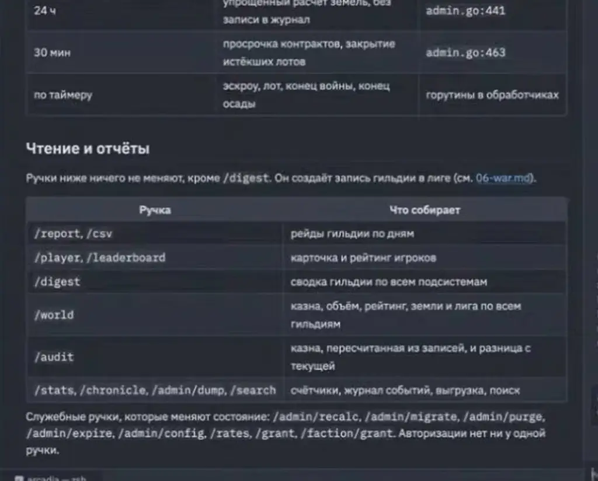
*[▶ 00:23:09](https://www.youtube.com/watch?v=7KAvNMjbIqQ&t=1389s) · Doc tables and agent prompt to write tests*

**В:** Как это связано с проектированием?

**О:** Это проектирование сверху вниз: эпик, подэпики, задачи с критериями приёмки и definition of done. В ходе разговора модель затупила на промпте, который не является настоящей спецификацией.

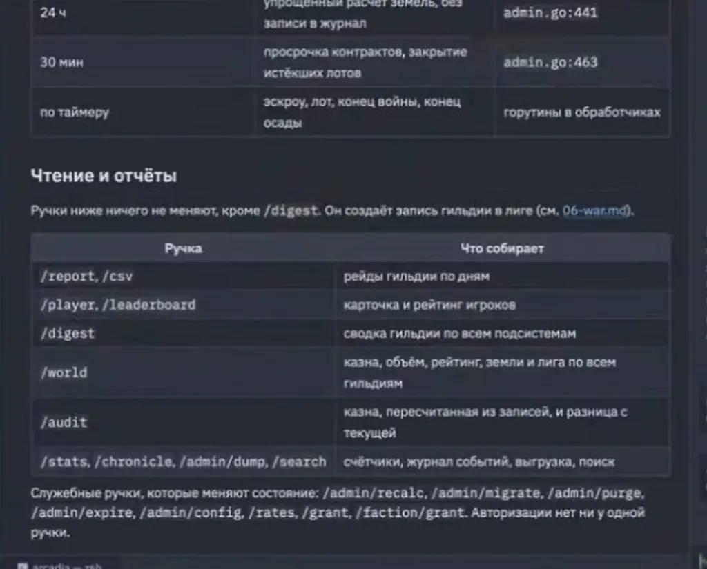
*[▶ 00:24:36](https://www.youtube.com/watch?v=7KAvNMjbIqQ&t=1476s) · Test-writing prompt sent again in agent panel*

## Смена модели и новое окно на задачу

[▶ 00:24:30](https://www.youtube.com/watch?v=7KAvNMjbIqQ&t=1470s)

**В:** Что делать, если Claude завис?

```go
main.go:237: mux.HandleFunc("/territory/resolve", handleSiegeResolve)
main.go:238: mux.HandleFunc("/territory/upkeep", handleUpkeep)
main.go:239: mux.HandleFunc("/territory/log", handleTerritoryLog)
main.go:240: mux.HandleFunc("/credit", handleCredit)
main.go:241: mux.HandleFunc("/loan", handleLoan)
main.go:242: mux.HandleFunc("/loan/pay", handleLoanPay)
main.go:243: mux.HandleFunc("/loan/accrue", handleLoanAccrue)
main.go:244: mux.HandleFunc("/ledger", handleLedger)
main.go:245: mux.HandleFunc("/digest", handleDigest)
main.go:246: mux.HandleFunc("/world", handleWorld)
main.go:247: mux.HandleFunc("/audit", handleAudit)
main.go:248: mux.HandleFunc("/leaderboard", handleLeaderboard)
main.go:249: mux.HandleFunc("/admin/recalc", handleRecalc)
main.go:250: mux.HandleFunc("/admin/migrate", handleMigrate)
main.go:251: mux.HandleFunc("/admin/dump", handleDump)
main.go:252: mux.HandleFunc("/admin/purge", handlePurge)
main.go:253: mux.HandleFunc("/admin/expire", handleExpire)
main.go:254: mux.HandleFunc("/admin/config", handleConfig)
main.go:255: mux.HandleFunc("/search", handleSearch)
```

*[▶ 00:28:11](https://www.youtube.com/watch?v=7KAvNMjbIqQ&t=1691s) · Route registrations in main.go (grep output)*

**О:** Переключить модель на меньшую или дефолтную. Харнесс Claude сам может переключаться на более слабые модели, особенно в вопросах ИБ. Сторонние оркестраторы работают интересно, но жгут токены.

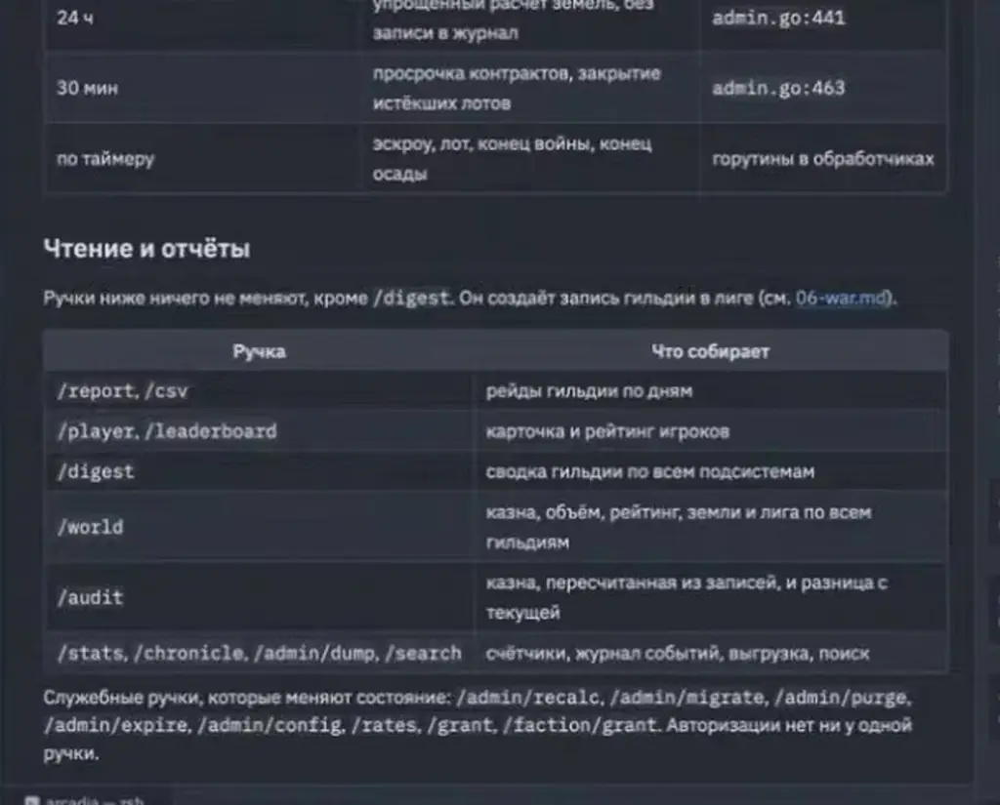
*[▶ 00:25:16](https://www.youtube.com/watch?v=7KAvNMjbIqQ&t=1516s) · Three queued test prompts in agent panel*

**В:** Что такое раздувание контекстного окна?

**О:** Чем дольше сессия, тем больше нужно держать в уме и модели, и человеку. Точную связь стоимости токенов с размером окна не назвали. Практика: довести задачу до микрокоммита и открыть новое окно.

**В:** Когда возвращаться к старым окнам?

**О:** Когда меняется архитектура: откатиться и перегенерировать схемы или data flow отчёт.

Для задачи покрыть тестами все 10 подсистем агент сначала вывел структуру Go-workspace:

```shell
file src/coderpad && cat go.work && echo "---go.mod---" && cat src/go.mod && echo "---echo---" && ls -la src/echo
src/coderpad: ELF 64-bit LSB executable, x86-64, version 1 (SYSV), dynamically linked, interpreter /lib64/ld-linux-x86-64.so.2, Go BuildID=…, with debug_info, not stripped
go 1.26

use ./src
---go.mod---
module coderpad

go 1.26

require (
    github.com/davecgh/go-spew v1.1.1 // indirect
    github.com/pmezard/go-difflib v1.0.0 // indirect
    github.com/stretchr/testify v1.11.1 // indirect
    gopkg.in/yaml.v3 v3.0.1 // indirect
)
---echo---
total 0
drwxrwxr-x@ 2 ishimin staff 64 Sep 24 09:58 .
drwxr-xr-x@ 16 ishimin staff 512 Sep 24 15:49 ..
```

*[▶ 00:26:21](https://www.youtube.com/watch?v=7KAvNMjbIqQ&t=1581s) · Agent runs shell listing of go.work and echo*

Затем он прочитал код: 6099 строк в 10 файлах, тестов нет, логика в HTTP-хендлерах. Поэтому он предложил тестировать через httptest.

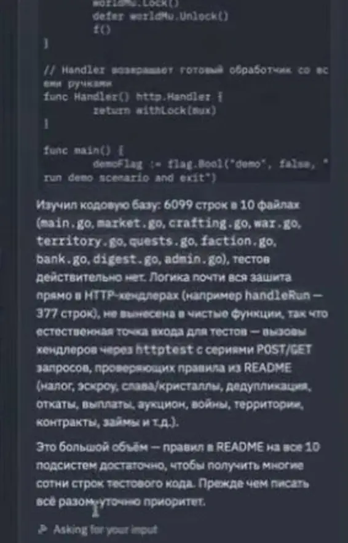
*[▶ 00:26:46](https://www.youtube.com/watch?v=7KAvNMjbIqQ&t=1606s) · Claude Code codebase scan and test-coverage plan*

Ответ заканчивался вопросом о приоритете: только main.go (ядро, 3660 строк), все 10 подсистем или выбор файлов вручную.

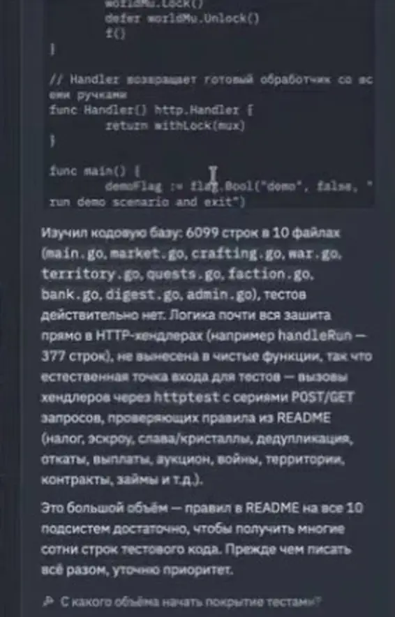
*[▶ 00:27:47](https://www.youtube.com/watch?v=7KAvNMjbIqQ&t=1667s) · Claude Code codebase scan before scope question*

Агент ждал выбора в интерфейсе: три варианта объёма и поле для своего ответа.

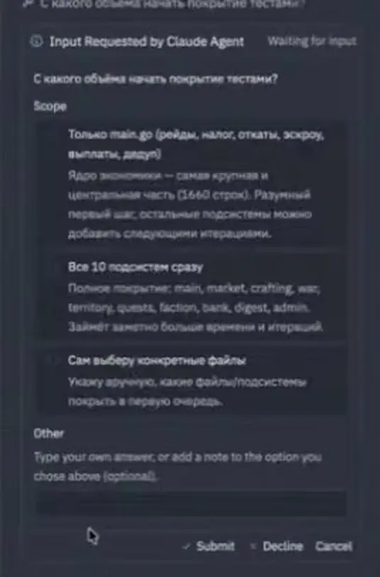
*[▶ 00:27:08](https://www.youtube.com/watch?v=7KAvNMjbIqQ&t=1628s) · Claude Code asks which scope to test first*

## Контекст между чатами и кодовая база как источник правды

[▶ 00:28:08](https://www.youtube.com/watch?v=7KAvNMjbIqQ&t=1688s)

**В:** Как передавать контекст между чатами?

**О:** Иван: для больших задач сжатой MD-документацией. Кодовая база тоже служит контекстом.

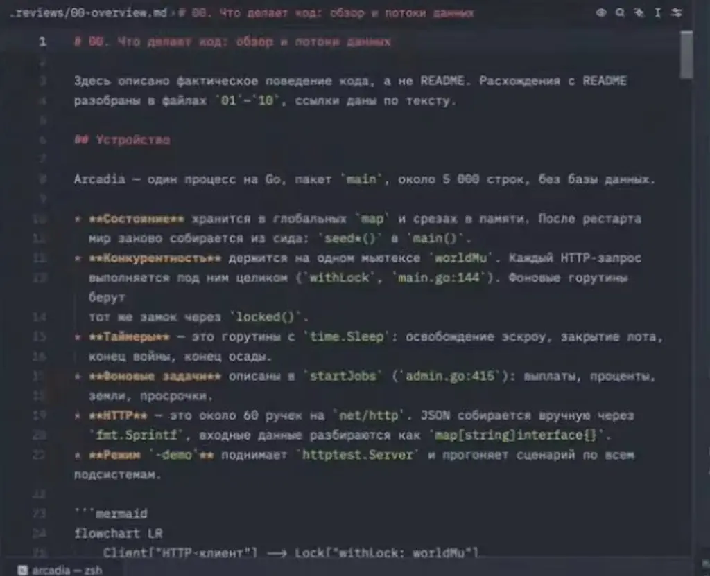
*[▶ 00:32:15](https://www.youtube.com/watch?v=7KAvNMjbIqQ&t=1935s) · 00-overview.md: what the code actually does*

**В:** Что делать со старым окном после изменений в коде?

**О:** Промт актуализирует устаревший контекст и обновляет README или диаграммы.

**В:** Можно ли добавить в промт выделенный код?

**О:** Да, выделенный фрагмент можно править прямо в промте.

```go
    ResQty int
    Needs map[string]int
    MinRank string
    Station string
    Minutes int
    FailPct float64
    DutyPct float64
    Unlocked bool
}

type CraftOrder struct {
    ID int
    Recipe string
    GuildID int
    PlayerID int
    Started time.Time
    Done time.Time
    Status string
    Duty float64
    Value float64
    Attempts int
    Note string
}

var recipes = map[string]*Recipe{}
var craftOrders = map[int]*CraftOrder{}
var guildStock = map[int]map[string]int{}
```

*[▶ 00:30:27](https://www.youtube.com/watch?v=7KAvNMjbIqQ&t=1827s) · crafting.go CraftOrder struct in editor*

**В:** Как работать с большой кодовой базой?

**О:** Иван не сталкивался с такими инструментами и недооценил объём кода. Интервьюер советует графы зависимостей и RAG: по его словам, они экономят до 30% токенов.

```go
package main

import (
	"encoding/json"
	"fmt"
	"io"
	"math"
	"net/http"
	"sort"
	"strconv"
	"strings"
	"time"
)

// Войны гильдий и сезонные лиги: …
// …
// …

type War struct {
	ID       int
	A        int
	B        int
	Declared time.Time
	Ends     time.Time
	Status   string
	ScoreA   int
	Score… int
```

*[▶ 00:31:30](https://www.youtube.com/watch?v=7KAvNMjbIqQ&t=1890s) · src/war.go: imports and War struct*

Тем временем Claude начал писать тесты с хелперов.

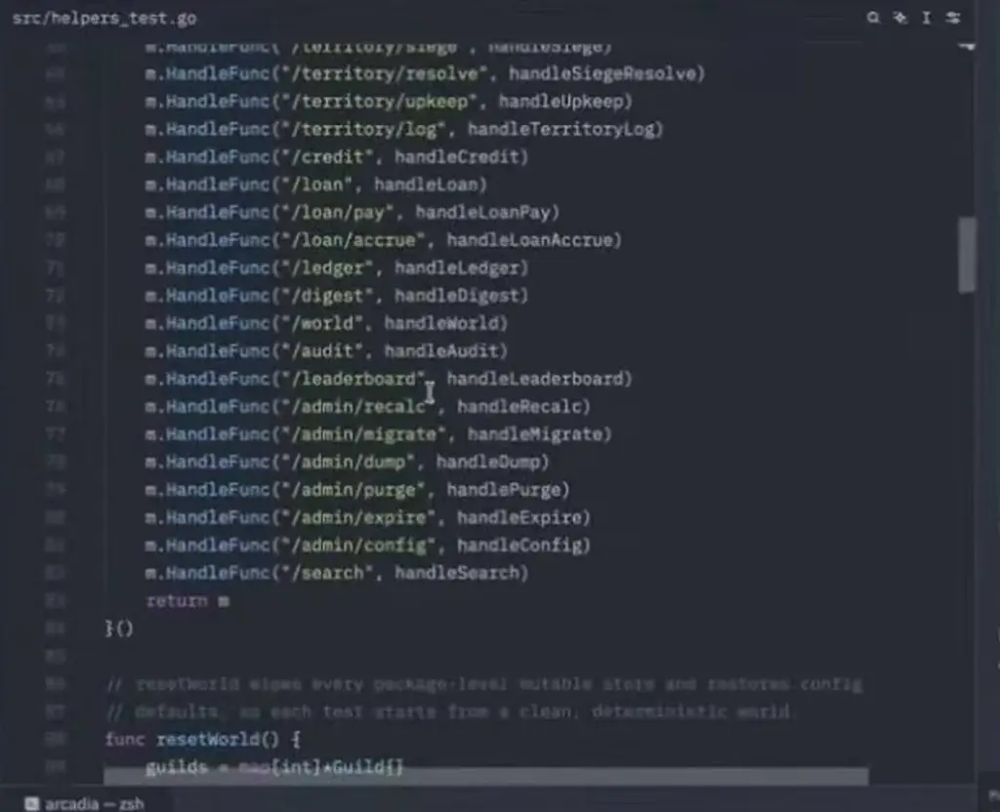
*[▶ 00:32:20](https://www.youtube.com/watch?v=7KAvNMjbIqQ&t=1940s) · helpers_test.go: route registration and resetWorld*

## Ревью тестов от нейросети и MCP

[▶ 00:32:20](https://www.youtube.com/watch?v=7KAvNMjbIqQ&t=1940s)

**В:** Как Иван оценивает тесты, которые сгенерировал Claude?

**О:** Смотрит на структуру: мелкие локализованные тесты и небольшие диффы проверять проще. Сначала важно покрыть существующее поведение.

Тесты на `/health` и налоговые скобки.

```go
	"time"

…
	"github.com/stretchr/testify/assert"
	"github.com/stretchr/testify/require"
)

func TestHandleHealthAndStats(t *testing.T) {
	resetWorld()
	newGuild("EMBER", "")
	rec := doReq(t, "GET", "/health", "")
	require.Equal(t, 200, rec.Code)
	m := jsonMap(t, rec)
	assert.Equal(t, "ok", m["status"])
	assert.EqualValues(t, 1, m["guilds"])

	rec = doReq(t, "GET", "/stats", "")
	m = jsonMap(t, rec)
	assert.EqualValues(t, 1, m["guilds"])
	assert.EqualValues(t, 0, m["runs"])
}

func TestHandleRun_TaxBracketByVolume(t *testing.T) {
	resetWorld()
	newCharter("BRK", func(c *Charter) {
		c.Pct = 5
		c.Brackets = [][3]float64{{0, 1000, 5}, {1000, 1e15, 8}}
	})
```

*[▶ 00:33:12](https://www.youtube.com/watch?v=7KAvNMjbIqQ&t=1992s) · main_test.go: health, stats and tax tests*

Далее идут тесты на фокус гильдии и min/max.

```go
	m := jsonMap(t, rec)
	// base tax 100, surcharge *(1+5/10)=1.5 … 150
	assert.InDelta(t, 150, m["tax"], 0.001)
}

func TestHandleRun_FocusAdjustments(t *testing.T) {
	resetWorld()
	newCharter("FOC", func(c *Charter) { c.Pct = 10 })

	newGuild("SHADE", "FOC", func(g *Guild) { g.Focus = "blackmarket" })
	rec := doReq(t, "POST", "/run", `{"guild":"SHADE","loot":"1000"}`)
	m = jsonMap(t, rec)
	assert.InDelta(t, 200, m["tax"], 0.001) // doubled

	newGuild("EMBER", "FOC", func(g *Guild) { g.Focus = "tavern" })
	rec = doReq(t, "POST", "/run", `{"guild":"EMBER","loot":"1000"}`)
	m = jsonMap(t, rec)
	assert.InDelta(t, 90, m["tax"], 0.001) // 10% discount
}

func TestHandleRun_MinMaxClamp(t *testing.T) {
	resetWorld()
	newCharter("CLAMP", func(c *Charter) {
		c.Pct = 1
		c.Min = 500
		c.Max = 50
	})
```

*[▶ 00:33:58](https://www.youtube.com/watch?v=7KAvNMjbIqQ&t=2038s) · main_test.go: focus adjustments and clamp tests*

Агент при этом правит хелпер `newCharter`, хотя промпт запрещал чинить баги.

```go
func newCharter(code string, mutate ...func(*Charter)) *Charter {
	c := &Charter{
		Code:  code,
		Name:  code,
		Pct:   10,
		Flat:  0,
		Min:   0,
		Max:   0,
		Brackets: [][3]float64{{0, 1e15, 10}},
		Fx:    map[string]float64{},
	}
		Code:  code,
		Name:  code,
		Pct:   10,
		Flat:  0,
		Min:   0,
		Max:   0,
		Fx:    map[string]float64{},
	}
```

*[▶ 00:35:33](https://www.youtube.com/watch?v=7KAvNMjbIqQ&t=2133s) · Agent edits helpers_test.go newCharter helper*

**В:** Что не нравится интервьюеру в тестах?

**О:** Они нетабличные. Он предпочитает табличные тесты для spec-driven development, Иван согласен.

```go
cases := []struct {
    name   string
    method string
    body   string
    code   int
}{
    {"wrong method", "GET", "", 405},
    {"bad json", "POST", "not json", 400},
    {"missing guild", "POST", `{"loot":"100"}`, 400},
    {"missing loot", "POST", `{"guild":"EMBER"}`, 400},
    {"unknown guild", "POST", `{"guild":"NOPE","loot":"100"}`, 404},
    {"bad loot format", "POST", `{"guild":"EMBER","loot":"abc"}`, 400},
    {"loot too small", "POST", `{"guild":"EMBER","loot":"0.1"}`, 400},
    {"loot limit exceeded", "POST", `{"guild":"EMBER","loot":"2000000"}`, 402},
    {"inactive guild", "POST", `{"guild":"DEAD","loot":"100"}`, 402},
    {"infamy too high", "POST", `{"guild":"INFAMOUS","loot":"100"}`, 402},
    {"banned player", "POST", `{"guild":"EMBER","handle":"Cheater","loot":"100"}…
}
for _, c := range cases {
    t.Run(c.name, func(t *testing.T) {
        rec := doReq(t, c.method, "/run", c.body)
        assert.Equal(t, c.code, rec.Code, rec.Body.String())
    })
}
```

*[▶ 00:36:26](https://www.youtube.com/watch?v=7KAvNMjbIqQ&t=2186s) · Table-driven validation cases in main_test.go*

**В:** Что показал прогон тестов?

**О:** Claude заявил, что все 27 тестов `main.go` проходят, включая `-race`.

```bash
go test ./... -v 2>&1 | grep -E "^(--- FAIL|FAIL|ok)"
ok  	coderpad	0.209s
go test ./... -race 2>&1 | tail -20
```

*[▶ 00:37:07](https://www.youtube.com/watch?v=7KAvNMjbIqQ&t=2227s) · Agent runs Go tests, then race mode*

Race-детектор затем нашёл гонку в `TestDoPayout_Postponed`.

```text
/Users/ishimin/dev/arcadia/src/main.go:643 +0x3c38
  net/http.HandlerFunc.ServeHTTP()
  net/http.(*ServeMux).ServeHTTP()
  coderpad.doReq()
  coderpad.TestHandleRelease()
  testing.tRunner()
  testing.(*T).Run.gowrap1()
==================
--- FAIL: TestDoPayout_Postponed (0.00s)
    testing.go:1712: race detected during execution of test
2026/09/24 19:52:43 skip bad line: bad line with too few fields
FAIL
FAIL	coderpad	0.237s
FAIL
```

*[▶ 00:37:26](https://www.youtube.com/watch?v=7KAvNMjbIqQ&t=2246s) · Race detector reports data race in test*

**В:** Знает ли Иван, что такое MCP?

**О:** Только смутно, как гардрейлы для нейросети. Интервьюер объясняет: MCP — протокол поверх tool calling, описание функций, которые модель может вызвать. MCP-сервер над PostgreSQL, Prometheus или Kibana даёт модели данные для разбора инцидентов.

## Read-only доступ для AI и выбор стратегии рефакторинга

[▶ 00:38:57](https://www.youtube.com/watch?v=7KAvNMjbIqQ&t=2337s)

**Q:** Какой доступ давать AI к инфраструктуре?

**О:** Обычно только read-only: при записи нейросеть может натворить дел.

Агент сам писал тесты и правил свои ошибки, а кандидат запретил трогать существующий код.

```go
		{"wrong method", "GET", "", 405},
		{"bad json", "POST", "not json", 400},
		{"missing guild", "POST", `{"loot":"100"}`, 400},
		{"missing loot", "POST", `{"guild":"EMBER"}`, 400},
		{"unknown guild", "POST", `{"guild":"NOPE","loot":"100"}`, 404},
		{"bad loot format", "POST", `{"guild":"EMBER","loot":"abc"}`, 400},
		{"loot too small", "POST", `{"guild":"EMBER","loot":"0.1"}`, 400},
		{"loot limit exceeded", "POST", `{"guild":"EMBER","loot":"2000000"}`, 402},
		{"inactive guild", "POST", `{"guild":"DEAD","loot":"100"}`, 402},
		{"infamy too high", "POST", `{"guild":"INFAMOUS","loot":"100"}`, 402},
		{"banned player", "POST", `{"guild":"EMBER","handle":"Cheater","loot":"100"}`, 402},
	}
	for _, c := range cases {
		t.Run(c.name, func(t *testing.T) {
			rec := doReq(t, c.method, "/run", c.body)
			assert.Equal(t, c.code, rec.Code, rec.Body.String())
		})
	}

	t.Run("DOMINION charter bypasses loot cap", func(t *testing.T) {
		rec := doReq(t, "POST", "/run", `{"guild":"DOM","loot":"2000000"}`)
		assert.Equal(t, 200, rec.Code, rec.Body.String())
	})
}

func TestHandleRollback_Basic(t *testing.T) {
	resetWorld()
```

*[▶ 00:40:14](https://www.youtube.com/watch?v=7KAvNMjbIqQ&t=2414s) · Race detector failure output in terminal pane*

После правки helpers_test.go прогон с -race проходит.

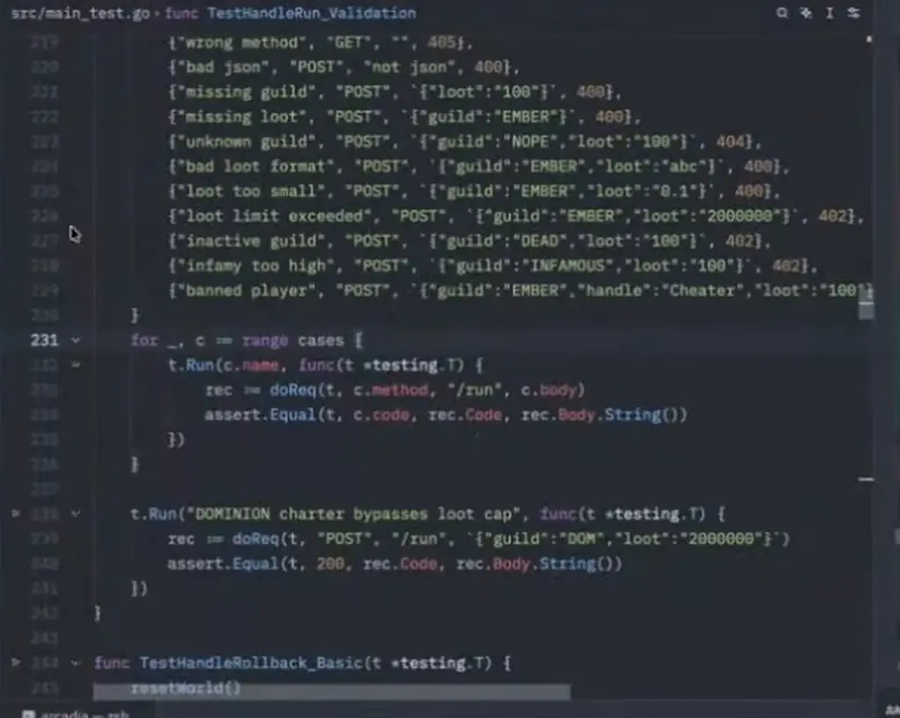
*[▶ 00:40:47](https://www.youtube.com/watch?v=7KAvNMjbIqQ&t=2447s) · Race-enabled test run passes after fix*

**Q:** Идти по плану расхождений из README или реструктурировать код?

**О:** Выбрали реструктуризацию: без дробления сущностей трудно оценить работу AI.

```markdown
| ❗ Неоднозначно | README допускает разные прочтения, нужно решение владельца продукта |

## Файлы

Обзор фактических поведения и диаграммы потоков данных: [00-overview.md](00-overview.md).

| Файл | Тема | 🔴 | 🟠 | 🟡 | ⚪ | … |
…
| [01-tax.md](01-tax.md) | Налог, комиссия аукциона, пошлина крафта | – | 5 | 1 | 3 |
| [02-raids.md](02-raids.md) | Рейды, эскроу, слава, ранги, события, дедупликация, откаты, импорт | 2 | 6 | 5 | 7 |
| [03-payouts.md](03-payouts.md) | Суточные выплаты | – | 3 | 1 | – |
| [04-market.md](04-market.md) | Аукцион | 1 | 2 | 2 | 1 |
| [05-crafting.md](05-crafting.md) | Ремесло | – | 2 | – | 1 |
| [06-war.md](06-war.md) | Войны и лига | – | 2 | 2 | 1 |
| [07-territory.md](07-territory.md) | Территории | 1 | 2 | – | 2 |
| [08-quests-factions.md](08-quests-factions.md) | Контракты и репутация фракций | – | 4 | 1 | 2 |
| [09-bank.md](09-bank.md) | Займы | – | 1 | 2 | 1 |
| [10-volume-audit-admin.md](10-volume-audit-admin.md) | Объём месяца, сверка /audit, пересчёты, фоновые задачи, запуск | 1 | 4 | 1 | 1 |

## Главное
```

*[▶ 00:41:04](https://www.youtube.com/watch?v=7KAvNMjbIqQ&t=2464s) · IDE: README discrepancy table in raw markdown*

По отчёту AI, тесты main.go проходят, остальные девять подсистем он пишет параллельно.

```markdown
## Файлы

Обзор фактических поведения и диаграммы потоков данных: [00-overview.md](00-overview.md).

| Файл | Тема | 🔴 | 🟠 | 🟡 | ⚪ | … |
…
| [01-tax.md](01-tax.md) | Налог, комиссия аукциона, пошлина крафта | – | 5 | 1 | 3 |
| [02-raids.md](02-raids.md) | Рейды, эскроу, слава, ранги, события, дедупликация, откаты, импорт | 2 | 6 | 5 | 7 |
| [03-payouts.md](03-payouts.md) | Суточные выплаты | – | 3 | 1 | – |
| [04-market.md](04-market.md) | Аукцион | 1 | 2 | 2 | 1 |
| [05-crafting.md](05-crafting.md) | Ремесло | – | 2 | – | 1 |
| [06-war.md](06-war.md) | Войны и лига | – | 2 | 2 | 1 |
| [07-territory.md](07-territory.md) | Территории | 1 | 2 | – | 2 |
| [08-quests-factions.md](08-quests-factions.md) | Контракты и репутация фракций | – | 4 | 1 | 2 |
| [09-bank.md](09-bank.md) | Займы | – | 1 | 2 | 1 |
| [10-volume-audit-admin.md](10-volume-audit-admin.md) | Объём месяца, сверка /audit, пересчёты, фоновые задачи, запуск | 1 | 4 | 1 | 1 |

## Главное

1. **Покупатель на аукционе ничего не платит.** Продавец получает кристаллы, гильдия
   …
```

*[▶ 00:41:46](https://www.youtube.com/watch?v=7KAvNMjbIqQ&t=2506s) · IDE: README table; agent reports test progress*

В промпт ушла просьба составить план перехода к clean architecture с дроблением сущностей по SOLID.

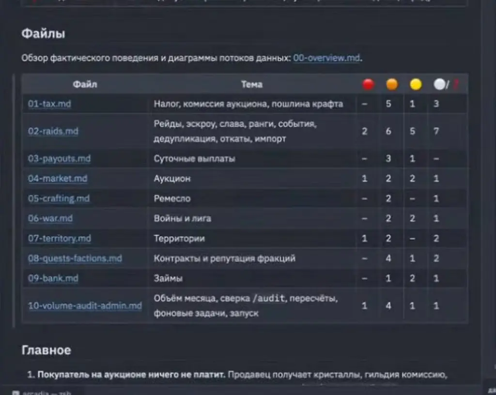
*[▶ 00:43:24](https://www.youtube.com/watch?v=7KAvNMjbIqQ&t=2604s) · Rendered README table; SOLID refactor prompt*

**Q:** Чем просьба «составь план» отличается от plan mode в Claude Code?

**О:** Plan mode не пишет код, а обычный запрос может запустить правки. Агента остановили кнопкой стопа.

```go
cat <<'EOF' > /tmp/fmtcheck.go
package main
import "fmt"
func main(){
	fmt.Println(fmt.Sprint(10000.0))
	fmt.Println(fmt.Sprint(5000.0))
	fmt.Println(fmt.Sprintf("%v", 1016.0))
}
EOF
go run /tmp/fmtcheck.go
```

*[▶ 00:44:18](https://www.youtube.com/watch?v=7KAvNMjbIqQ&t=2658s) · Claude Code session with plan-mode prompt*

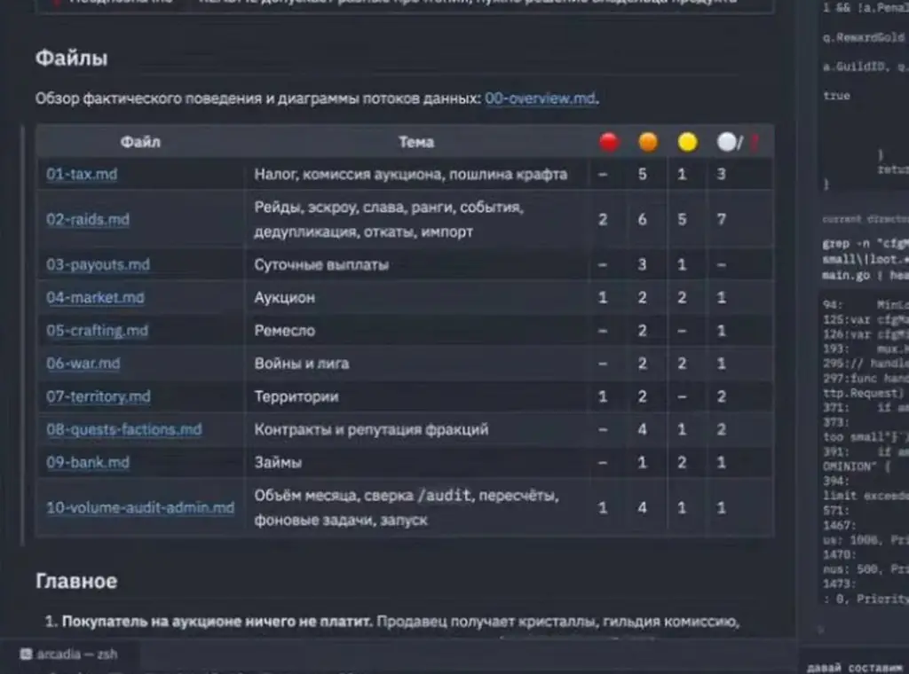
*[▶ 00:44:47](https://www.youtube.com/watch?v=7KAvNMjbIqQ&t=2687s) · IDE with file overview table and Claude Code pane*

## Скиллы как MD-промты и решения по рефакторингу

[▶ 00:45:36](https://www.youtube.com/watch?v=7KAvNMjbIqQ&t=2736s)

**В:** Знаком ли Иван со скиллами Claude?

**О:** Поверхностно, например для экспорта PDF. Скилл — это MD-файл с промтом. Чаще всего он использует скиллы для работы с файлами и диаграммами.

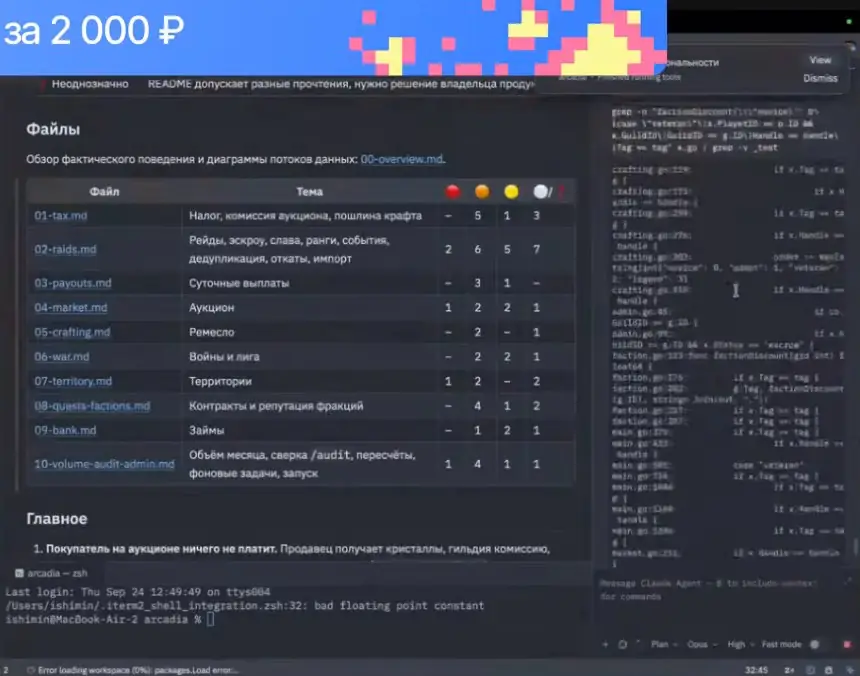
*[▶ 00:46:23](https://www.youtube.com/watch?v=7KAvNMjbIqQ&t=2783s) · Markdown file table beside Claude Code terminal*

**В:** Есть ли у него скиллы для ревью?

**О:** Да, кастомные инструкции в MD-файле с ограничениями и гардрейлами. Он не называл их скиллом, пока не зашёл разговор.

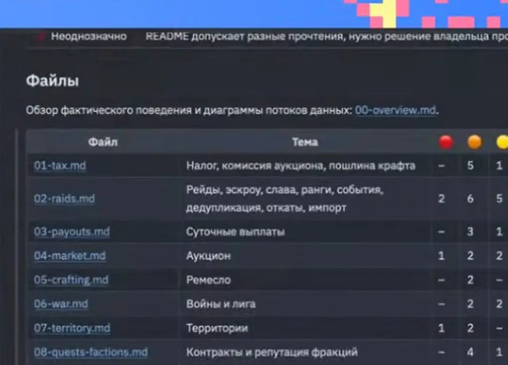
*[▶ 00:46:14](https://www.youtube.com/watch?v=7KAvNMjbIqQ&t=2774s) · Claude Code terminal and file-table review*

```bash
grep -n "factionDiscount(\)\"novice\": 0…
…
crafting.go:119: if x.Tag == ta
{
crafting.go:173: if x.H…
crafting.go:259: if x.Tag == ta
{
crafting.go:276: if x.Handle ==
handle }
crafting.go:303: order := map[string]int{"novice": 0, "adept": 1, "veteran": 2, "legend": 3}
admin.go:45: if ...
GuildID == g.ID
faction.go:123:func factionDiscount(gid int) …
main.go:585: case "veteran":
main.go:724: if x.Tag == tag {
main.go:1160: if x.Handle ==
main.go:1284: if x.Tag == ta
…
```

*[▶ 00:47:50](https://www.youtube.com/watch?v=7KAvNMjbIqQ&t=2870s) · Terminal grep output over the review code*

**В:** Как команды используют скилл для форматирования?

**О:** Большой MD-файл с архитектурой команды подключают к новым или старым проектам. Это не совсем линтер, а более высокоуровневый, про архитектуру.

**В:** Что Иван ответил агенту про баги и пакеты?

**О:** Баги оставил 1:1, чинить после рефакторинга. Пакеты — «фича + слой». Ментор сказал, что правильного ответа нет.

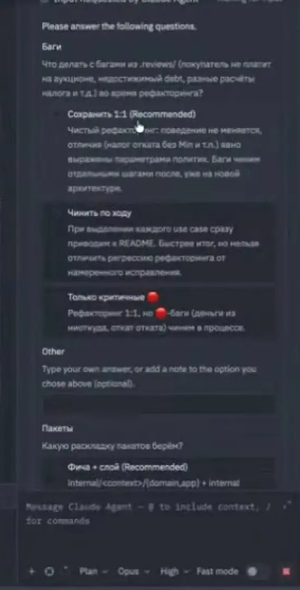
*[▶ 00:47:05](https://www.youtube.com/watch?v=7KAvNMjbIqQ&t=2825s) · Claude Code question form: bug handling options*

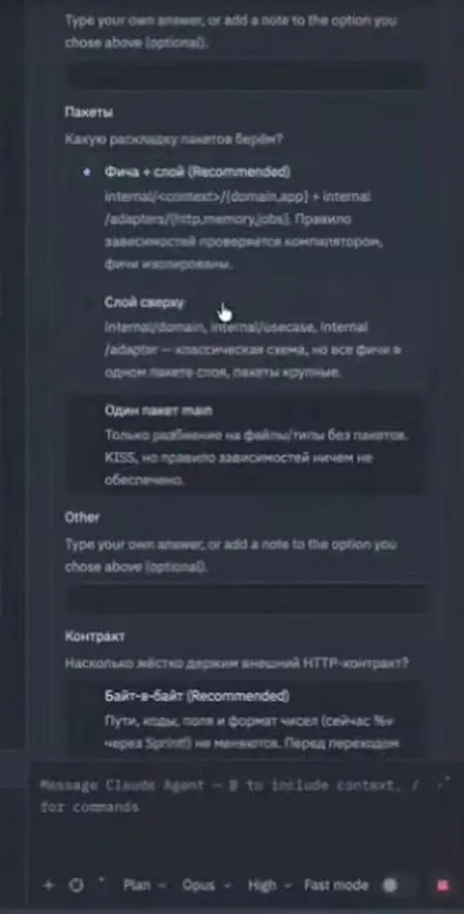
*[▶ 00:47:34](https://www.youtube.com/watch?v=7KAvNMjbIqQ&t=2854s) · Claude Code question form: package layout options*

```bash
cd /Users/ishimin/dev/arcadia/src && go vet ./... && go test ./....
go test -race ./...
```

*[▶ 00:50:24](https://www.youtube.com/watch?v=7KAvNMjbIqQ&t=3024s) · Plan verification steps and approval options*

## Проверка плана перед реализацией

[▶ 00:49:30](https://www.youtube.com/watch?v=7KAvNMjbIqQ&t=2970s)

**Q:** Нужны ли линтеры и форматтеры в эпоху нейросетей?

**A:** Да, но не каждому проекту, а на определённой зрелости: сначала навайбкодить, затем промтом привести код в порядок и подключить линтеры.

**Q:** Что Иван думает о плане, который выдал Claude?

**A:** Это вывод ИИ. Иван смотрит на него верхнеуровнево: покрытие по модулям и шаги, которые показались расплывчатыми.

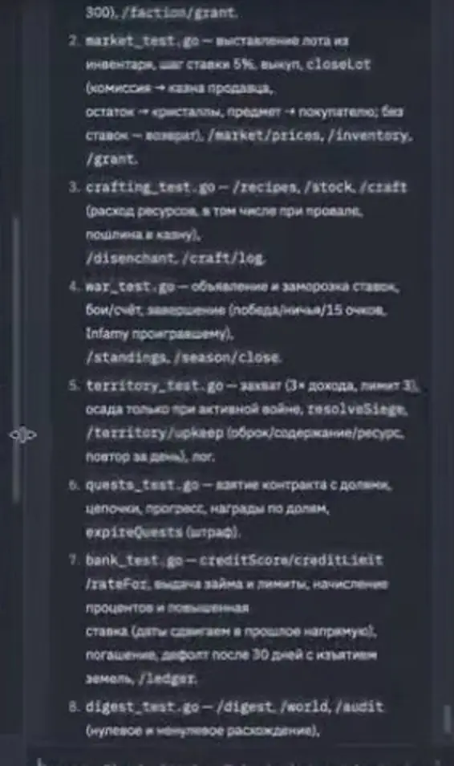
*[▶ 00:50:48](https://www.youtube.com/watch?v=7KAvNMjbIqQ&t=3048s) · Per-module test coverage plan*

**Q:** Что делать с найденными особенностями?

**A:** Claude предлагает фиксировать их, не чиня. Иван хочет проверить каждое замечание по коду, так как часть может быть сделана намеренно.

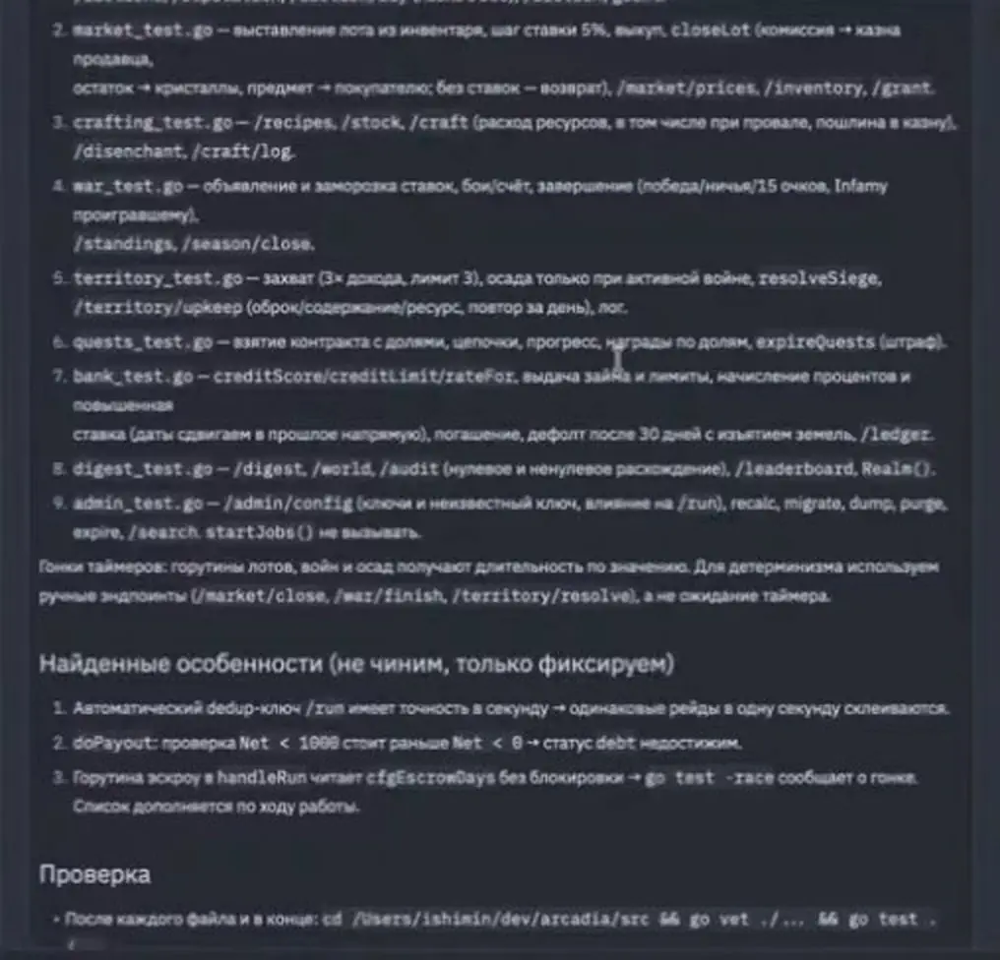
*[▶ 00:51:35](https://www.youtube.com/watch?v=7KAvNMjbIqQ&t=3095s) · Arcadia test-coverage plan in Claude Code*

**Q:** Как проверять шаги плана?

**A:** Оценить объём дифа каждого шага, например шага по faction_test, а крупные раздробить на микроправки.

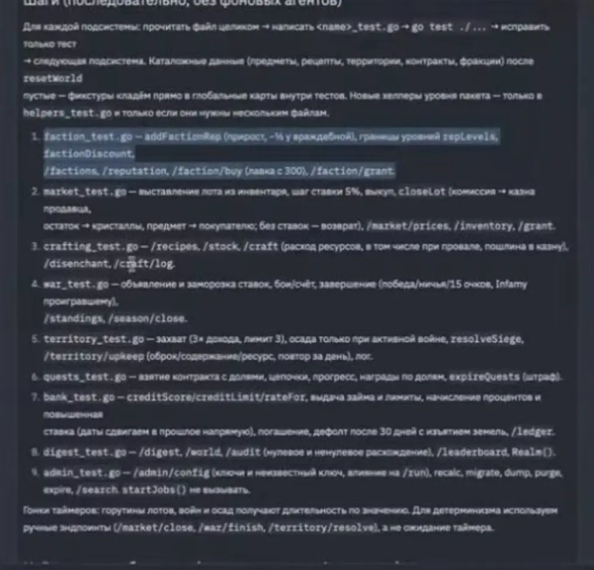
*[▶ 00:51:58](https://www.youtube.com/watch?v=7KAvNMjbIqQ&t=3118s) · Step-by-step test plan, first items highlighted*

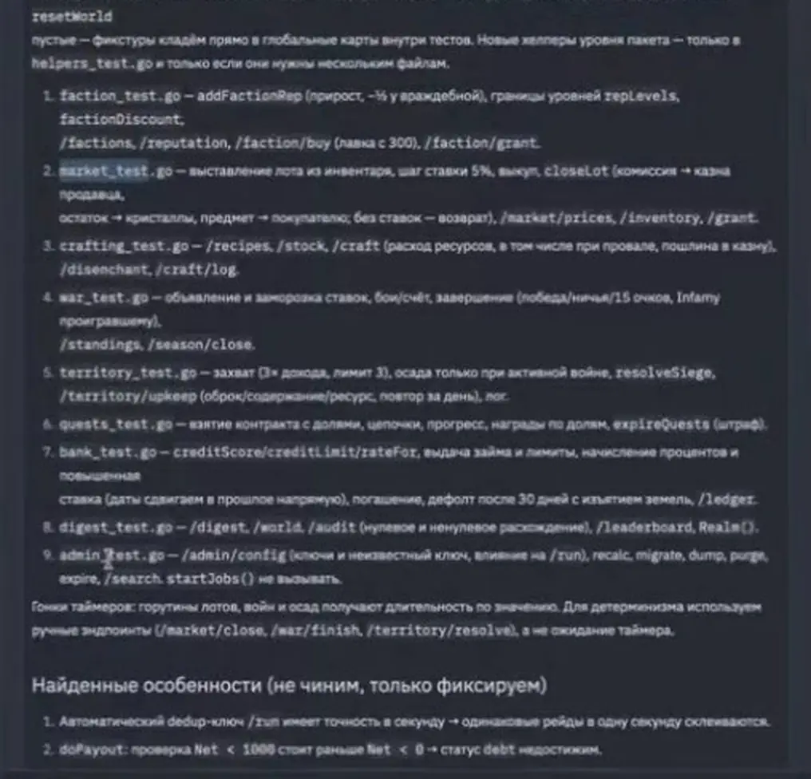
*[▶ 00:52:11](https://www.youtube.com/watch?v=7KAvNMjbIqQ&t=3131s) · Plan steps with market_test and findings*

**Q:** Что в контексте и текущем состоянии?

**A:** Общие хелперы переиспользуются, исходники не тронуты, фоновые агенты остановлены.

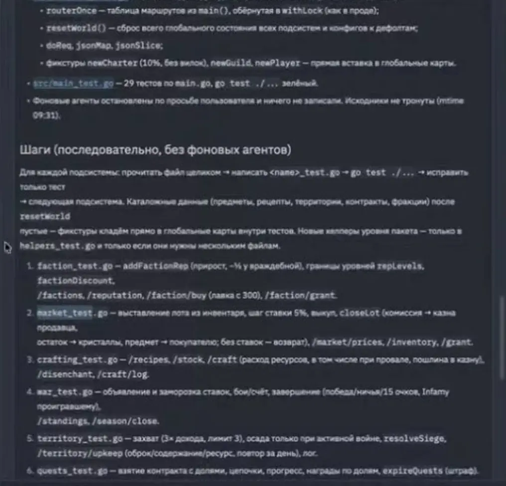
*[▶ 00:52:32](https://www.youtube.com/watch?v=7KAvNMjbIqQ&t=3152s) · Context, current state and plan steps*

**Q:** Какие правила заданы?

**A:** Код приложения не меняется, баги не чинятся, меняются только файлы *_test.go.

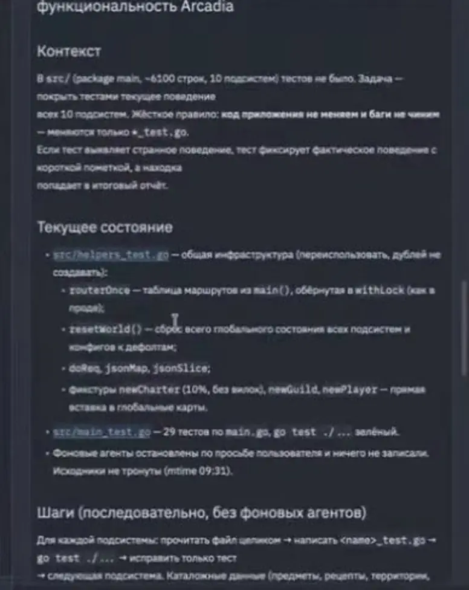
*[▶ 00:52:47](https://www.youtube.com/watch?v=7KAvNMjbIqQ&t=3167s) · Task context, rules and current state*

**Q:** Нужно ли кросс-ревью?

**A:** Иван предлагает сначала кросс-ревью плана другой моделью. Собеседник отмечает, что модели замечают разное, и это полезно для архитектуры и планов в больших проектах.

## Что проверяет AI-секция и какие навыки нужны

[▶ 01:06:07](https://www.youtube.com/watch?v=7KAvNMjbIqQ&t=3967s)

**В:** Что проверяет AI-секция?

**О:** Саша (интервьюер): системное техническое мышление. Нужен инженер с нейросетью, а не «мясной проксик»: кандидат сам проверяет результат и получает детерминированный итог. Грейда как такового нет, есть набор оценок.

**В:** Как прошёл собес Ивана?

**О:** Саша отметил, что Иван покрывал код тестами, проверял работу нейросети и решал, правильно ли она сделала. Такой кандидат, по его словам, подошёл бы в команду: главное — не навредить инструментами.

**В:** Каковы ожидания кандидата?

**О:** Иван (кандидат): это его первое AI-собеседование, о нём он узнал из шортката. Ожидания в целом совпали с реальностью, а разбор показал пробелы.

**В:** Будет ли такой формат нормой?

**О:** В эфире прозвучало мнение, что формат устаканится примерно через год: сначала вопросы будут разными, потом почти одинаковыми.

**В:** Какой уровень владения нейросетями считается хорошим?

**О:** Саша (ответ на вопрос ведущего): готового набора нет, важны интерес и понимание:
- знать MCP, который уже стал стандартом рынка;
- понимать отличия фронтир-моделей и брать дешёвые для рутины;
- изучать функции харнессов;
- главный навык: недоверие нейросети, которая перемножает матрицы и может ошибаться;
- делать результат детерминированным: линтеры, тесты, спеки, перепроверка.

## Ссылки и материалы

- [Бот-бот для записи на платный сервис (2000 руб.), ссылка из описания видео](https://t.me/shortcut_py_bot?start=youtube_video_pythonsobes_131026) — <https://t.me/shortcut_py_bot?start=youtube_video_pythonsobes_131026> · описание видео
