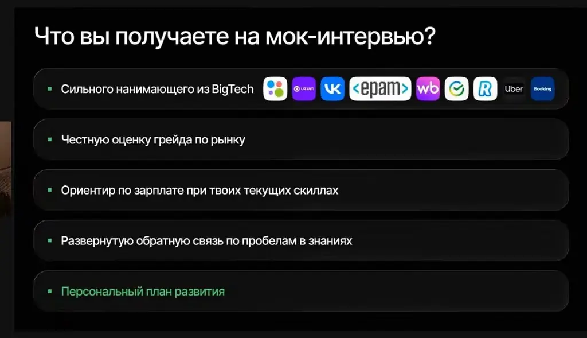
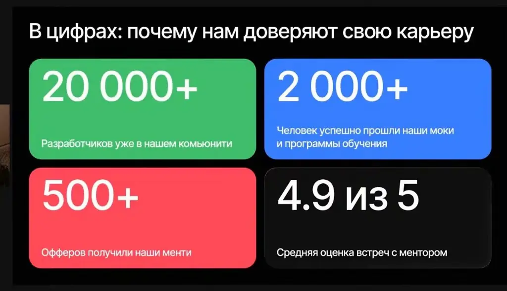
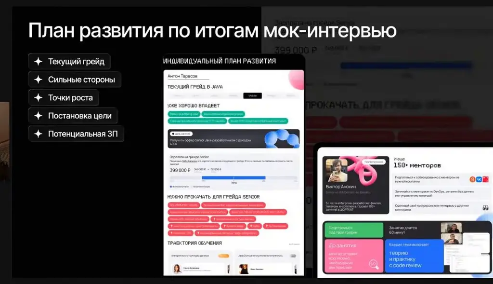
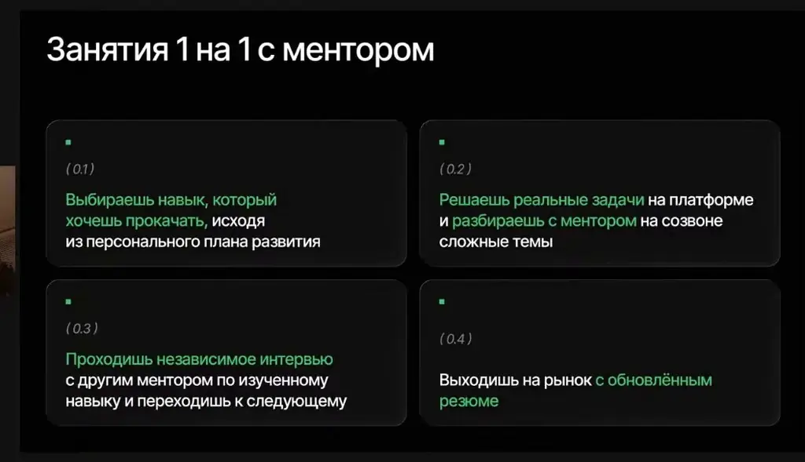
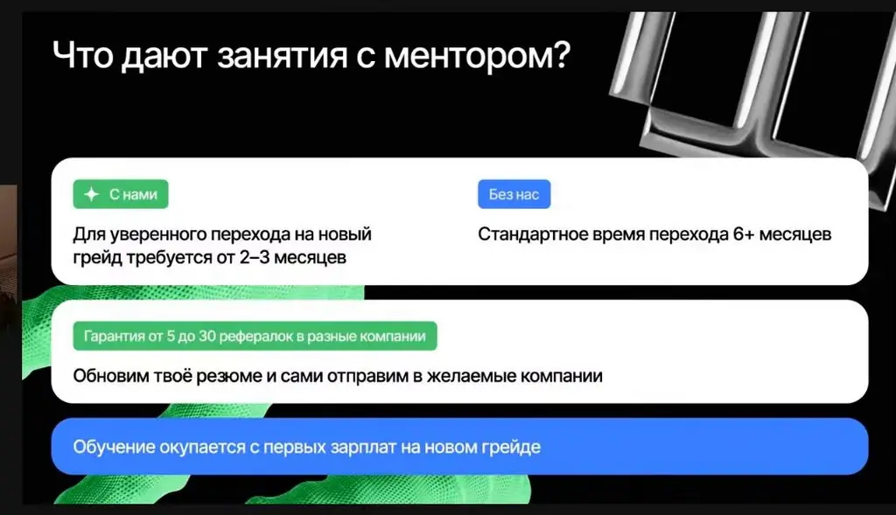
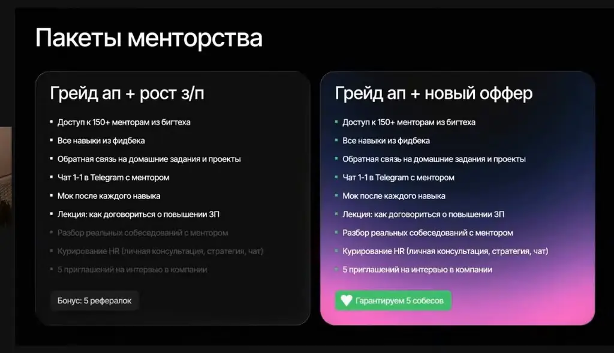

# Java Senior Interview с ментором из Uzum, ex WB 1

*Разбор реального технического собеседования на Senior Java: какие темы проверяют, какие ошибки кода разбирает ментор и что нужно знать для роста до сеньора.*

Источник: [Java Senior Interview с ментором из Uzum, ex WB 1](https://www.youtube.com/watch?v=Vivtr3grCt4) · Сергей Чамкин · ШОРТКАТ — менторская программа · 1 ч 50 мин

## Коротко

На живом мок-собесе кандидат уровня Middle+ рассказывает о проектах, PostgreSQL, многопоточности и кэшировании, а интервьюер Сергей Чамкин из Uzum разбирает его ответы и код. Главная мысль: на Senior проверяют понимание систем, конкурентности и ограничений, а не перечень технологий. Это важно, потому что разобранные ошибки, например сравнение байтовых ключей и кэш без лимита, приводят к неверной работе кэша и OutOfMemoryError в продакшене.

## Главное

- Массивы байтов не переопределяют equals и hashCode, поэтому HashMap сравнивает такие ключи по ссылке, и get с новым массивом с тем же содержимым не найдёт запись.
- Кэш без ограничения размера и TTL растёт бесконечно и может привести к OutOfMemoryError; для многопоточного кэша используйте ConcurrentHashMap с computeIfAbsent или Caffeine с настройками TTL и размера.
- Чтобы увидеть содержимое кэша при OOM, задайте флаг -XX:+HeapDumpOnOutOfMemoryError: в логах ошибка может не появиться, а дамп памяти покажет всё.
- Распределить события outbox между подами можно столбцом locked_until: под проставляет время блокировки и быстро закрывает транзакцию, а при падении записи обработаются повторно через заданное время.
- Ретраи и circuit breaker лучше задавать в конфигурации клиента, чтобы бизнес-код не тянул инфраструктуру; circuit breaker перестаёт обращаться к упавшему сервису по заданному условию и через время снова пропускает запросы.
- Spring Retry работает через прокси бина, поэтому ретрай-метод нужно вызывать через отдельный бин, иначе ретрай не сработает.
- На финальном собеседовании описывайте работу через бизнес-результат, например запуск кредитного продукта в мобильном приложении, а не перечень сервисов и терминов, потому что там может сидеть нанимающий менеджер без технического бэкграунда.
- Для продакшена берите LTS-версию Java (сейчас это 25): LTS получает обновления безопасности долго, а нелтс-версии обновляются недолго, и закрывать уязвимости придётся самим.

## Масштаб нагрузки и бизнес-язык на финале

[▶ 00:00:00](https://www.youtube.com/watch?v=Vivtr3grCt4&t=0s)

Масштаб нагрузки задаёт уровень задач: тысячи запросов в секунду уже серьёзно, десятки считаются стандартными.

Интересными называются задачи с конкурентностью и нетривиальной логикой, а не простой CRUD. Типичные примеры:

- кэширование, Kafka и паттерн Outbox;
- настройка REST-клиентов с ретраями, корректной обработкой исключений и circuit breaker;
- оптимизация запросов PostgreSQL: раздувание индексов (bloat) и долгие транзакции, из-за которых не запускается vacuum. Решения: добавить недостающие индексы, убрать лишние или настроить очистку.

По его опыту, на финале может сидеть нанимающий менеджер, который не знает, что такое Kafka. Рассказывать о работе нужно через бизнес-результат, например через запуск нового кредитного продукта в мобильном приложении, а не через перечень сервисов и терминов.

Самопрезентацию стоит готовить заранее, даже к первому HR-созвону: ответы могут записываться, транскрибироваться и передаваться выше, и по ним решают, вести ли кандидата дальше по воронке.

## Потоки, конкурентность и реактивный клиент

[▶ 00:10:39](https://www.youtube.com/watch?v=Vivtr3grCt4&t=639s)

Конкурентность означает, что система ведёт несколько задач, переключаясь между ними, даже на одном ядре. Параллелизм означает, что задачи реально выполняются одновременно на нескольких ядрах.

Обычные Java-потоки мапятся на потоки операционной системы, и ОС распределяет им кванты времени. Виртуальные потоки переключаются быстрее, потому что ими управляет JVM.

Корутины Kotlin работают на executor, который отдаёт им рабочие потоки. На долгом ожидании (I/O) корутина снимается с потока, и поток берёт другую задачу. Под капотом это state machine с точками приостановки.

CPU-bound задачи (например, расчёт криптограмм или векторов) лучше выносить в отдельный пул: воркеров мало, и долгая задача их блокирует.

Синхронный WebClient, по словам спикера, сейчас почти бессмыслен. Его вызов блокирует поток, и пул потоков клиента может закончиться.

## Fail-fast итераторы, Caffeine и ретраи через прокси

[▶ 00:19:19](https://www.youtube.com/watch?v=Vivtr3grCt4&t=1159s)

**ReadWriteLock** оправдан, когда операций чтения заметно больше записи. При соотношении 50 на 50 смысла, по оценке в эфире, почти нет.

**Fail-fast итераторы** падают, если коллекцию изменили во время обхода. Для этого используется счётчик модификаций: проверять содержимое хэшем по всем элементам слишком дорого.

**Caffeine** даёт локальный кэш с настройками TTL, размера и инвалидации. Пример: запрос «найти задачи на обработку» вызывается несколько раз в секунду с каждого пода. Если задач нет, состояние кэшируют на 5–10 секунд, и база разгружается почти мгновенно. Кэш хранит одну переменную, поэтому память почти не тратится.

**Локальный кэш против Redis:** в одной команде кэш на каждом поде разросся до 700 МБ. Архитектор, вернувшись через год, попросил вынести его в Redis. Вывод спикера: иногда лучше сразу вынести.

**Spring Retry** работает через прокси бина. Без проксирования не работают и транзакции репозиториев, и `@Async`, поэтому вызов ретрай-метода должен идти через отдельный бин. Спикер не уверен, нужно ли включать поддержку ретраев в конфигурации.

Ретраи можно задавать в конфигурации клиента: для Kafka это настраивается на стороне Kafka, для REST — в клиенте. Так бизнес-код не тащит инфраструктуру.

## Circuit breaker, собственные стартеры и распределение задач между подами

[▶ 00:30:18](https://www.youtube.com/watch?v=Vivtr3grCt4&t=1818s)

Ретраи и circuit breaker настраиваются в конфигурации клиента. Circuit breaker переключается между состояниями closed и open: по заданному условию, например числу падений за последние 50 вызовов, он перестаёт обращаться к сервису и отдаёт ошибку «сервис недоступен». Через заданное время (в примере 10 секунд) он снова начинает пропускать запросы. Так внешний сервис не добивают, пока он лежит.

Собственный стартер нужен для логики, которую переиспользуют несколько сервисов. Если публикуете библиотеку, публикуйте и исходники: иначе её пользователи видят декомпилированный байткод без комментариев.

`@ConditionalOnMissingBean` создаёт бин только тогда, когда такого бина в контексте ещё нет. Это удобно, когда к проекту подключают библиотеку, в которой бин может быть, а может не быть.

ShedLock гарантирует, что задача выполняется только на одном поде. Блокировка хранится в таблице БД; в talk упоминается PostgreSQL, а таблицу создают миграцией.

Распределить события outbox между десятью подами можно двумя способами. Первый: `select for update` внутри транзакции. Но долгие транзакции плохи, особенно при отправке в Kafka или запросах наружу. Второй: столбец `locked_until`. Под проставляет время блокировки и быстро закрывает транзакцию. Если под упал, записи через заданное время (в примере 15 минут) обработаются повторно.

## Байтовые ключи в кэше и double-check

[▶ 00:39:23](https://www.youtube.com/watch?v=Vivtr3grCt4&t=2363s)

Для брокеров с pull-моделью нагрузку контролирует потребитель, а при большом числе брокеров и партиций она распределяется между ними.

На вопрос, где в CAP лежит PostgreSQL, кандидат не дал однозначного ответа. Ключевая мысль: при мастер-слейв репликации падение одной ноды не критично, но если прекращается синхронизация, данные перестают совпадать. BASE — альтернатива строгой консистентности; кандидат не вспомнил её расшифровку.

Разбор кода начинается с ключей.

```java
import java.util.HashMap;
import java.util.Map;

public abstract class Digest {

    private Map<byte[], byte[]> cache = new HashMap<byte[], byte[]>();

    public byte[] digest(byte[] input) {
        byte[] result = cache.get(input);
        if (result == null) {
            synchronized (cache) {
                result = cache.get(input);
                if (result == null) {
                    result = doDigest(input);
                    cache.put(input, result);
                }
            }
        }
        return result;
    }

    protected abstract byte[] doDigest(byte[] input);
}
```

*[▶ 00:47:15](https://www.youtube.com/watch?v=Vivtr3grCt4&t=2835s) · Digest.java: cache with double-checked synchronized block*

Ментор указал, что у массивов байтов не переопределены `equals` и `hashCode`, поэтому `HashMap` сравнивает ключи по ссылке. Код компилируется, но `get` с новым массивом с тем же содержимым не найдёт запись, и кэш работает неправильно.

Двойная проверка: первый `get` вне блока, затем повторный внутри `synchronized`. Она нужна, чтобы не вычислять значение повторно, если другой поток уже положил его в кэш. Ментор назвал такую конструкцию необычной.

Кэш без ограничения размера растёт бесконечно. По мнению ментора, с байтовыми ключами это приведёт к `OutOfMemoryError`.

## Кэш без лимитов ведёт к OOM; агентам нужны ограничения доступа

[▶ 00:50:02](https://www.youtube.com/watch?v=Vivtr3grCt4&t=3002s)

WeakHashMap для кэша удобен тем, что записи уходят, когда ключ больше никому не нужен. Но у него нет TTL и фиксированного размера, поэтому ненужные значения копятся и приложение уходит в OutOfMemoryError. Для многопоточного кэша берут ConcurrentHashMap и `computeIfAbsent`. Проще всего, как и в Caffeine, поставить аннотацию кэширования.

OOM не всегда попадает в лог: при занятых 95% heap может упасть даже аллокация маленького массива, а логирование и скип логов не гарантируют видимость. Надёжнее задать флаг `-XX:+HeapDumpOnOutOfMemoryError`: дамп памяти с прода или теста покажет всё содержимое кэша.

В работе автор использует внутренний агент Ness с MCP-серверами (Jira, вики) и авторежимом. Однажды агент через MCP Grafana сам достал токен и напрямую поменял настройку. Доверие не должно быть полным: ограничивайте доступ на уровне MCP и аккаунта, используйте сервисные аккаунты. По расходу: Opus за ночь сжёг около 12 млн токенов, Codex — 20 млн; мультиагентные сессии съедают их за 3–4 часа.

## Мок-интервью: оценка грейда и план развития

[▶ 00:57:36](https://www.youtube.com/watch?v=Vivtr3grCt4&t=3456s)

Мок-интервью в ШОРТКАТ — симуляция собеседования один на один с практикующим инженером из BigTech. Его цель — найти слабые места до реального работодателя. Спикер рекомендует его особенно тем, кто давно не проходил собеседования или испытывает проблемы с резюме.

На выходе — честная оценка грейда по рынку, ориентир зарплаты при текущих навыках и развёрнутая обратная связь по пробелам в знаниях.


*[▶ 00:59:19](https://www.youtube.com/watch?v=Vivtr3grCt4&t=3559s) · Что вы получаете на мок-интервью?*


*[▶ 00:58:54](https://www.youtube.com/watch?v=Vivtr3grCt4&t=3534s) · В цифрах: почему нам доверяют свою карьеру*

План развития включает текущий грейд, сильные стороны, точки роста, цель (повышение грейда или зарплаты, смена работы, первая работа) и потенциальную зарплату.


*[▶ 01:00:28](https://www.youtube.com/watch?v=Vivtr3grCt4&t=3628s) · План развития по итогам мок-интервью*

Занятия с ментором проходят 1-на-1, длятся минимум час, в среднем требуют от 10 часов в неделю. Путь к новому грейду состоит из четырёх шагов:

1. Выбрать навык из персонального плана.
2. Решать реальные задачи на платформе и разбирать сложные темы на созвоне.
3. Пройти независимое интервью с другим ментором по этому навыку.
4. Выйти на рынок с обновлённым резюме.


*[▶ 01:01:10](https://www.youtube.com/watch?v=Vivtr3grCt4&t=3670s) · Занятия 1 на 1 с ментором*

Спикер утверждает, что с ментором переход на новый грейд занимает 2–3 месяца против 6+ месяцев самостоятельно, а обучение окупается с первых зарплат на новом грейде.


*[▶ 01:03:47](https://www.youtube.com/watch?v=Vivtr3grCt4&t=3827s) · Mentor sessions: training pays for itself*

Пакеты различаются гарантиями: в «Грейд ап + рост з/п» бонус — 5 рефералок, в «Грейд ап + новый оффер» — 5 приглашений на интервью и гарантия 5 собеседований.


*[▶ 01:05:40](https://www.youtube.com/watch?v=Vivtr3grCt4&t=3940s) · Пакеты менторства*

## Что проверяют на собеседовании на сеньора

[▶ 01:08:57](https://www.youtube.com/watch?v=Vivtr3grCt4&t=4137s)

По оценке ведущего, кандидат уверенно проходит уровень Middle+. До Senior не хватает многопоточности, и её нужно прочувствовать на практике: книг и теории мало, полезнее писать стартеры и разбирать собственные задачи.

Собеседование проверяет знания, а не умение казаться гуру. Системный дизайн в его глазах — навык от Middle+ и выше, а для сеньора его обязательно нужно знать: без понимания, как устроена система, сложно объяснить бизнесу, куда и что уходит. Вместе с код-ревью это главные темы; остальное, по его словам, можно доверить агентам.

В системном дизайне сначала выясняют требования: сколько пользователей и какой RPS. Считать в уме не стоит, в 80% случаев ошибаются. Нужно учитывать часы работы: у интернет-магазина запросов ночью, примерно с 2–3 до 7 утра, почти нет, поэтому делить суточный поток на 24 неверно.

Микросервисы сейчас популярны, потому что проще и удобнее. Монолит с 20–30 разработчиками становится тесным, а деплоить его бывает тяжело.

ИИ пока не заменит разработчика: модели, даже самые дорогие, пишут не идеально. Окно контекста можно расширить до 10 млн токенов, но ограничение упирается в инференс, а контекст всё равно нужно вести. Разработчик должен уметь делать код-ревью и отличать хороший код от плохого.

AWS и Azure в России не используют из-за закона о хранении данных российских пользователей внутри страны. Яндекс Облако дорогое. Инфраструктуру в хорошей компании обычно настраивает DevOps.

## Редкий ReadWriteLock и выбор LTS-версии Java

[▶ 01:22:58](https://www.youtube.com/watch?v=Vivtr3grCt4&t=4978s)

Вопрос про ReadWriteLock редкий: в продакшене его используют нечасто, и ведущий не нашёл его в кодовой базе. Спрашивать его всё равно стоит, так как он проверяет понимание многопоточности.

Для продакшена берите LTS-версию Java. Сейчас это 25, а до неё LTS были 21, 17, 11 и 8. Версия 26 уже вышла, но она не LTS:

- LTS получает обновления безопасности долго.
- Нелтс-версия обновляется недолго, и взломы придётся закрывать самим.

Сканер, настроенный в GitLab, покажет уязвимости в собранном образе. Критичные уязвимости, связанные с JRE, нужно исправлять срочно.

## Виртуальные потоки, микрофреймворки и Kubernetes

[▶ 01:31:37](https://www.youtube.com/watch?v=Vivtr3grCt4&t=5497s)

Кандидат использовал виртуальные потоки Java 21 в WB и остался доволен. Пулы для каждой задачи теряют смысл: можно взять executor с новым виртуальным потоком на задачу, но не заменять этим каждый пул.

Kora — фреймворк, альтернатива Spring. Ведущий считает идею здоровой: если нужен только лёгкий DI, достаточно простого решения. Dagger из Android собирает зависимости в одном файле без больших конфигураций. По его опыту, микрофреймворки заметно быстрее Spring и проще в настройке.

Kubernetes спрашивают у разработчиков на собеседованиях и будут спрашивать. Некоторые компании, в том числе крупные, обходятся без него и запускают JAR-файлы на проде напрямую. Другие пишут собственный аналог Kubernetes, но его придётся поддерживать старшим инженерам.

## Kubernetes для разработчика и офис по решению проекта

[▶ 01:37:35](https://www.youtube.com/watch?v=Vivtr3grCt4&t=5855s)

По мнению ведущего, разработчик должен заниматься разработкой, а не инфраструктурой. Но базовые действия в Kubernetes нужно уметь: смотреть логи, пробрасывать порты, проверять состояние и масштабировать в ноль. Для практики он советует поставить Lens и Minikube.

Postgres в крупных компаниях обычно не запускают в Kubernetes, а выносят на отдельную виртуалку на железе. Отличие StatefulSet от ReplicaSet в том, что StatefulSet хранит состояние. Этот вопрос, по его словам, задают на собеседованиях.

Требование ходить в офис зависит от проекта и руководства. Например, в Яндексе можно было работать удалённо полгода, а потом ходить в офис, и на практике это почти не проверяли.

## Удалёнка с гибким стартом и цена рефералки

[▶ 01:43:33](https://www.youtube.com/watch?v=Vivtr3grCt4&t=6213s)

Идеальный формат работы, по мнению ведущего, это удалёнка с гибким началом: например, старт с 9 до 11 или позже. Офис полезен для быстрого решения проблем и общения с командой, но обязательным он быть не должен. Один из спикеров за 7 лет работы был в офисе всего неделю.

Рефералка гарантирует только то, что с вами свяжутся и пригласят на собеседование. Дальше нужна подготовка: злой интервьюер, которому утром «упал прод», может провалить и сильного кандидата.

Системное проектирование для Senior обязательно во многих компаниях, начиная с Middle+.

## Ссылки и материалы

- Сайт RabbitMQ со схемами RPC — упоминается, URL не показан · упомянуто [▶ 00:38:36](https://www.youtube.com/watch?v=Vivtr3grCt4&t=2316s)
