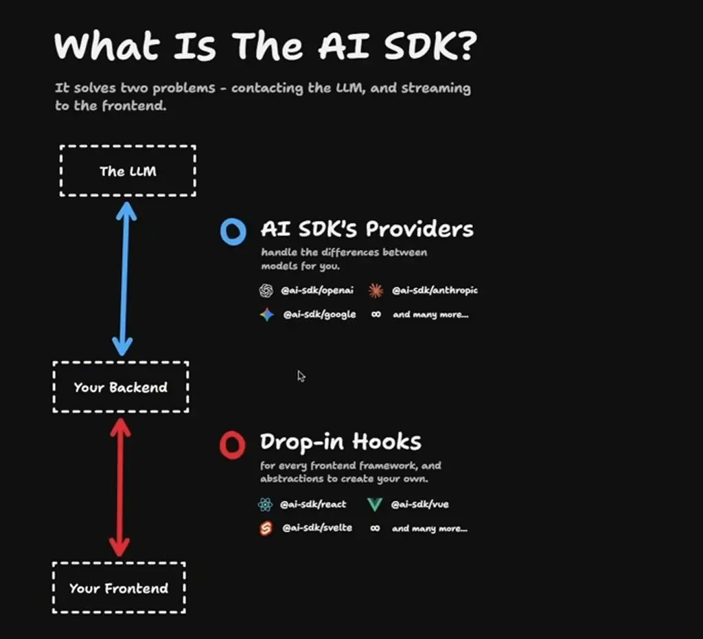
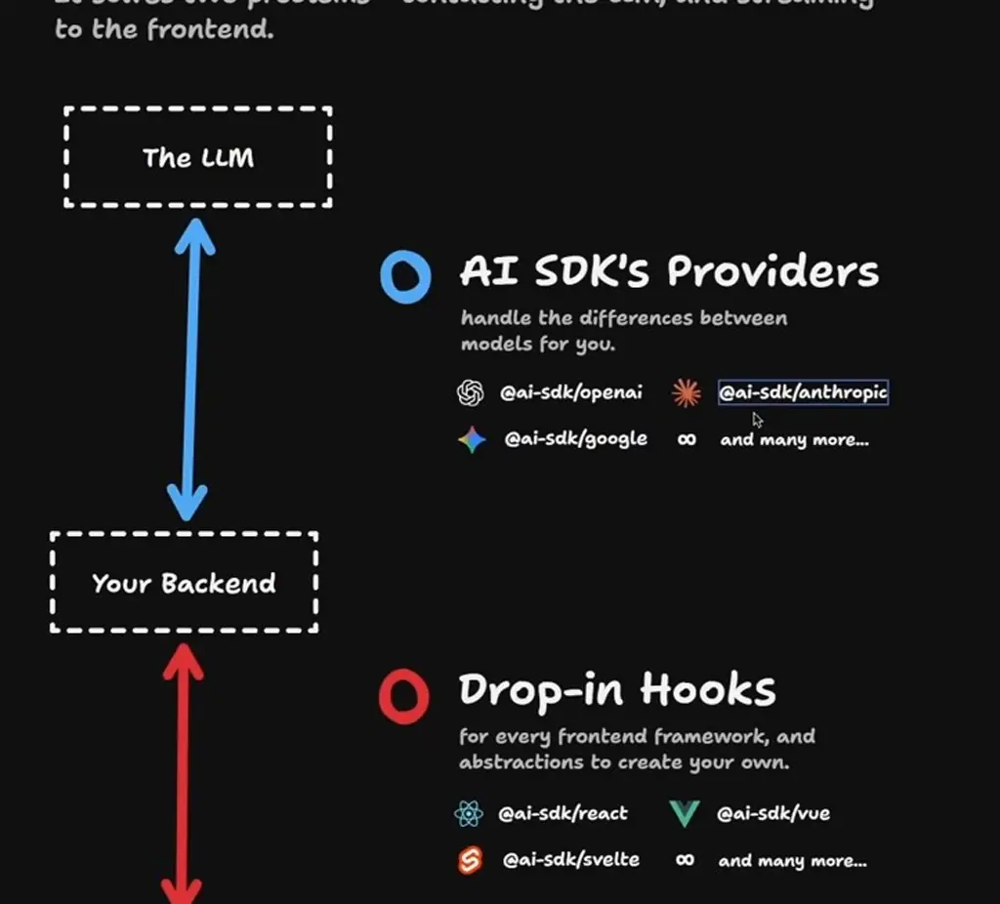
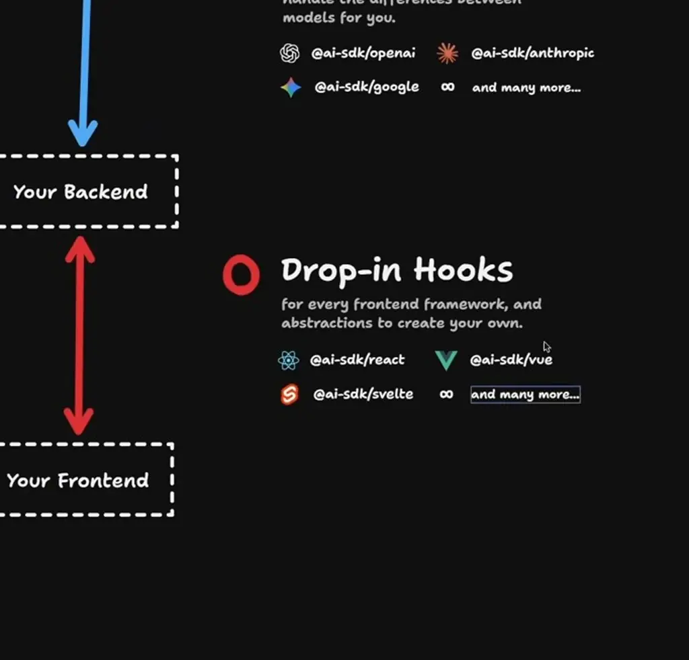
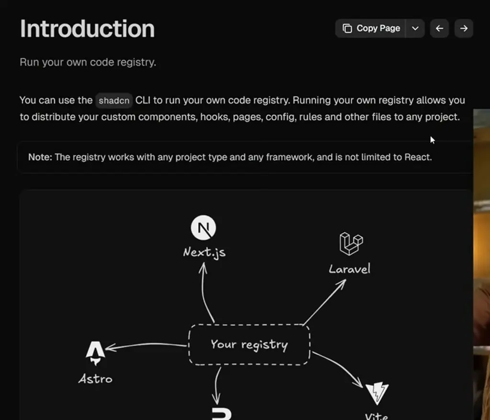

# AI SDK 6 is SWEET

*Learn how AI SDK 6's tool approval gates LLM tool calls behind a human decision, and how its new Agent abstraction separates agent declaration from use.*

Source: [AI SDK 6 is SWEET](https://www.youtube.com/watch?v=YCrj0E_P6ls) · Matt Pocock · 9 min

## TL;DR

Giving an LLM powerful tools like file writing is risky, but restricting them too much makes a coding agent useless. AI SDK 6 (in beta) addresses this with tool execution approval, which pauses a tool call until the frontend approves or denies it. The release also adds a `ToolLoopAgent` abstraction that separates agent declaration from where it is used, which makes agents easier to package and share. The major version bump reflects an updated internal Language Model Specification, so few breaking changes are expected.

## Key takeaways

- Set `needsApproval: true` on a tool in AI SDK 6 so that its `execute` function does not run until the frontend approves the call.
- Use `addToolApprovalResponse` from `useChat` to send each Approve or Deny click back to the model.
- Set `sendAutomaticallyWhen` to `lastAssistantMessageIsCompleteWithApprovalResponses` so the conversation is sent once every pending approval has a response.
- Render tool parts in the `approval-requested` state with Approve and Deny buttons to implement human-in-the-loop approval in the UI.
- Declare an agent with `ToolLoopAgent` by giving it a model, instructions and tools, then run it with `generate` or `stream`.
- Keep agent declarations in separate files so they can be packaged and shared, for example through registries like ShadCN.
- Implement the `Agent` interface directly in a class when you need a custom agent implementation, though the exported types may make the result hard to read.
- Expect few breaking changes when migrating to AI SDK 6, because the major version bump comes from an updated internal Language Model Specification rather than a redesign.

## Human-in-the-loop tool approval in AI SDK 6

[▶ 00:00:00](https://www.youtube.com/watch?v=YCrj0E_P6ls&t=0s)

AI SDK 6 is in beta, and the `ai` package's npm downloads grew from about 400,000 to nearly 4 million in a year. The major version bump comes from an updated internal Language Model Specification, not a redesign, so few breaking changes are expected.

The SDK solves two problems. Provider packages such as `@ai-sdk/openai`, `@ai-sdk/anthropic` and `@ai-sdk/google` handle differences between models, and framework hooks such as `@ai-sdk/react`, `@ai-sdk/vue` and `@ai-sdk/svelte` stream results to the frontend.


*[▶ 00:01:17](https://www.youtube.com/watch?v=YCrj0E_P6ls&t=77s) · What Is The AI SDK?*


*[▶ 00:01:23](https://www.youtube.com/watch?v=YCrj0E_P6ls&t=83s) · AI SDK providers and hooks (zoomed)*


*[▶ 00:01:35](https://www.youtube.com/watch?v=YCrj0E_P6ls&t=95s) · Drop-in hooks for frontend frameworks (zoomed)*

**Tool execution approval** keeps a human in the loop. Giving an LLM too much power is dangerous, as Cursor's "Yolo mode" showed when users lost whole directories, but giving it too little makes a coding agent useless.

Setting `needsApproval: true` on a tool stops `execute` from running until the frontend approves the call.

```typescript
const tools = {
  calculator: tool({
    description:
      'A simple calculator to perform basic arithmetic operations.',
    inputSchema: z.object({
      operation: z.enum([
        'add',
        'subtract',
        'multiply',
        'divide',
      ]),
      a: z.number(),
      b: z.number(),
    }),
    needsApproval: true,
    execute: async ({ operation, a, b }) => {
      switch (operation) {
        case 'add':
          return a + b;
        case 'subtract':
          return a - b;
        case 'multiply':
          return a * b;
```

*[▶ 00:03:43](https://www.youtube.com/watch?v=YCrj0E_P6ls&t=223s) · Calculator tool with needsApproval flag*

```typescript
const tools = {
  calculator: tool({
    inputSchema: z.object({
      operation: z.enum([
        …'add',
        'subtract',
        'multiply',
        'divide',
      ]),
      a: z.number(),
      b: z.number(),
    }),
    needsApproval: true,
    execute: async ({ operation, a, b }) => {
      switch (operation) {
        case 'add':
          return a + b;
        case 'subtract':
          return a - b;
        case 'multiply':
          return a * b;
        case 'divide':
          if (b === 0) {
            return 'Cannot divide by zero.';
```

*[▶ 00:03:58](https://www.youtube.com/watch?v=YCrj0E_P6ls&t=238s) · Calculator tool with needsApproval in chat.ts*

On the frontend, `ApprovalToolbar` collects `tool-calculator` parts in the `approval-requested` state and renders Approve and Deny buttons. Each click calls `addToolApprovalResponse` from `useChat`, and `sendAutomaticallyWhen` set to `lastAssistantMessageIsCompleteWithApprovalResponses` sends the conversation once every approval has a response.

```typescript
(alias) function lastAssistantMessageIsCompleteWithApprovalResponses({ messages, }: {
    messages: UIMessage[];
}): boolean
import lastAssistantMessageIsCompleteWithApprovalResponses
```

*[▶ 00:05:01](https://www.youtube.com/watch?v=YCrj0E_P6ls&t=301s) · Hover docs for lastAssistantMessageIsCompleteWithApprovalResponses*

The speaker had built this by hand before and found it very painful. Because it is now part of the framework, he can teach approval in a beginner course instead of an advanced one.

## Declaring agents and custom implementations

[▶ 00:05:41](https://www.youtube.com/watch?v=YCrj0E_P6ls&t=341s)

`ToolLoopAgent` declares a model, instructions and tools, then runs via `generate` or `stream`.

```typescript
import { openai } from '@ai-sdk/openai';
import { ToolLoopAgent } from 'ai';
import { weatherTool } from '@/tool/weather';

export const weatherAgent = new ToolLoopAgent({
  model: openai('gpt-4o'),
  instructions: 'You are a helpful weather assistant.',
  tools: {
    weather: weatherTool,
  },
});

// Use the agent
const result = await weatherAgent.generate({
  prompt: 'What is the weather in San Francisco?',
});
```

*[▶ 00:06:08](https://www.youtube.com/watch?v=YCrj0E_P6ls&t=368s) · Default ToolLoopAgent implementation example*

`streamText` with `stopWhen` already loops; the new part is separating declaration from use.

Separate files make agents easier to package and share, like registry components.


*[▶ 00:07:34](https://www.youtube.com/watch?v=YCrj0E_P6ls&t=454s) · shadcn docs: run your own code registry*

`Agent` is an interface, so classes can implement it directly.

```typescript
import { Agent } from 'ai';
// Build your own multi-agent orchestrator that delegates to speci…
class Orchestrator implements Agent {
  constructor(private subAgents: Record<string, Agent>) {
    /* Implementation */
  }
}

const orchestrator = new Orchestrator({
  subAgents: {
    // your subagents
  },
});
```

*[▶ 00:07:58](https://www.youtube.com/watch?v=YCrj0E_P6ls&t=478s) · AI SDK 6 docs: Custom Agent Implementations*

He started with a `CustomAgent` class.

```typescript
import {
  createAgentUIStreamResponse,
  type Agent,
  type UIMessage,
} from 'ai';

class CustomAgent implements Agent {
  constructor() {}
  version = 'agent-v1' as const;
}

export const POST = async (req: Request): Promise<Response> => {
  const body: {
    messages: UIMessage[];
  } = await req.json();
  const { messages } = body;

  const agent = new CustomAgent();

  return createAgentUIStreamResponse({
    agent,
    messages,
  });
};
```

*[▶ 00:08:01](https://www.youtube.com/watch?v=YCrj0E_P6ls&t=481s) · CustomAgent class in chat.ts (initial)*

Adding `stream` gave an unreadable type; the underlying types aren't exported.

```typescript
import {
  createAgentUIStreamResponse,
  type Agent,
  type ModelMessage,
  type StreamTextResult,
  type UIMessage,
} from 'ai';

class CustomAgent implements Agent {
  constructor() {}
  version = 'agent-v1' as const;

  stream(
    options: { options?: never } & (
      | {
          prompt: string | Array<ModelMessage>;
          messages?: never;
        }
      | { messages: Array<ModelMessage>; prompt?: never }
    ),
  ): PromiseLike<StreamTextResult<{}, never>> {}
}

export const POST = async (req: Request): Promise<Response> => {
```

*[▶ 00:08:15](https://www.youtube.com/watch?v=YCrj0E_P6ls&t=495s) · CustomAgent stream() method type error*

He rates the release 6/10; tool approval is the one addition he values.

```typescript
import { tool } from 'ai';
import { z } from 'zod';

export const weatherTool = tool({
  description: 'Get the weather in a location',
  inputSchema: z.object({
    city: z.string(),
  }),
  needsApproval: true, // Require user approval
  execute: async ({ city }) => {
    const weather = await fetchWeather(city);
    return weather;
  },
});
```

*[▶ 00:08:41](https://www.youtube.com/watch?v=YCrj0E_P6ls&t=521s) · AI SDK 6 docs: tool approval with needsApproval*

## Links & resources

- [aihero.dev — the speaker's site (Matt Pocock), from the video description](https://aihero.dev) — <https://aihero.dev> · video description
- [AI SDK v5 crash course — the speaker's workshop, from the video description](https://www.aihero.dev/workshops/ai-sdk-v5-crash-course) — <https://www.aihero.dev/workshops/ai-sdk-v5-crash-course> · video description
- [AI Hero Discord community — linked in the video description](https://aihero.dev/discord) — <https://aihero.dev/discord> · video description
- AI SDK — the project discussed throughout; no URL shown on screen · mentioned [▶ 00:00:14](https://www.youtube.com/watch?v=YCrj0E_P6ls&t=14s)
- ai-sdk/openai, ai-sdk/anthropic, ai-sdk/google — provider packages named on screen; URL not shown · mentioned [▶ 00:01:23](https://www.youtube.com/watch?v=YCrj0E_P6ls&t=83s)
- ai-sdk/react and related hooks — front-end hooks linking back-end to UI; URL not shown · mentioned [▶ 00:01:23](https://www.youtube.com/watch?v=YCrj0E_P6ls&t=83s)
