# Прожарка резюме разработчиков: почему не зовут на собеседования

*Как устроены фильтры hh.ru и ATS, что проверяют рекрутеры в резюме разработчика и как составить резюме, которое получает приглашения на собеседование.*

Источник: [Прожарка резюме разработчиков: почему не зовут на собеседования](https://www.youtube.com/watch?v=tqW9-uGZxp4) · ШОРТКАТ — менторская программа · 2 ч 22 мин

## Коротко

На одну IT-вакансию в 2026 году приходится в среднем 21 резюме, рынок стал рынком работодателя, а отклики проходят автоматический отбор на hh.ru и в ATS. Главные ошибки резюме, из-за которых его отсеивают, — навыки без подтверждения в опыте, описание процессов вместо результатов и пустые формулировки. Основная идея выпуска: каждая технология и достижение должны иметь контекст, результат и соответствие требованиям вакансии, иначе резюме не пройдёт ни фильтры, ни рекрутера. Это важно, потому что на плохом рынке даже сильный кандидат остаётся без приглашений, если резюме не объясняет его опыт.

## Главное

- Индекс hh 21 означает около 21 резюме на одну IT-вакансию; по оценке ведущего, значение от 10 уже означает высокую конкуренцию.
- Осенью (с сентября по ноябрь) найм активнее, потому что компании закрывают ставки, которые иначе сгорят, а летом и в январе-феврале он тише.
- Базовый автоотбор hh.ru бесплатен и работает по простым правилам: срок опыта, наличие навыка в списке, локация и возраст; несоответствие опыта, региона, зарплаты или навыков ведёт к автоотказу.
- Ключевые технологии из вакансии нужно описывать в контексте: что использовали, что сделали и что получилось, а не одной строкой внизу резюме.
- Версии резюме должны совпадать, потому что ATS хранит все версии, а дубли склеиваются по контактам, дате рождения, местам работы и вузу; смена имени не помогает.
- Каждое упоминание в резюме нужно уметь объяснить на собеседовании, поэтому назвайте резюме так же, как вакансию, и выделите 3–5 основных требований вакансии.
- Причину увольнения лучше назвать самому спокойно и по существу, так как часть компаний запрашивает справку СТД-Р из Госуслуг с основанием увольнения.
- Для каждого проекта укажите ссылку на GitHub, опишите, зачем он нужен, что получилось и почему выбран стек, оставив три-четыре самых сильных пункта.

## Рынок 2026: нелинейный поиск и конкуренция 21 резюме на вакансию

[▶ 00:00:00](https://www.youtube.com/watch?v=tqW9-uGZxp4&t=0s)

Поиск работы в 2026 году нелинейный. Кандидаты проходят эмоциональную кривую из десяти этапов: от «Обновил резюме – сейчас посыпятся офферы» до «Всё бесполезно, все места заняты» и выхода к офферу. Отказы на первых откликах не означают, что с кандидатом что-то не так: сложно и кандидатам, и бизнесу.

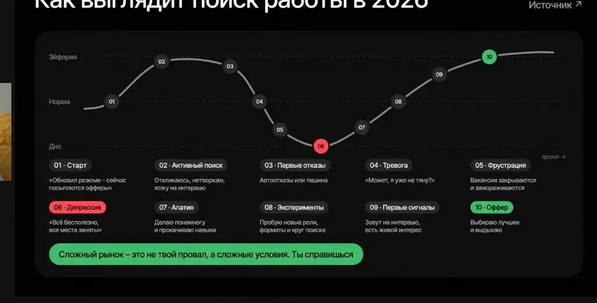
*[▶ 00:05:16](https://www.youtube.com/watch?v=tqW9-uGZxp4&t=316s) · Как выглядит поиск работы в 2026*

Рынок стал рынком работодателя: вакансий меньше, конкуренция за каждую выше, а старые источники, включая [hh.ru](https://hh.ru), работают иначе из-за ИИ-изации и ИИ-рекрутеров. Индекс hh (резюме на одну IT-вакансию) достиг 21 и вырос в 1,5 раза к сентябрю 2025 года, а расходы на найм сокращаются. По оценке ведущего, значение от 10 уже означает высокую конкуренцию.

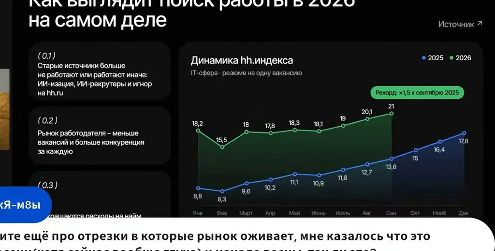
*[▶ 00:09:50](https://www.youtube.com/watch?v=tqW9-uGZxp4&t=590s) · Как выглядит поиск работы в 2026 на самом деле*

Одного отклика на одном сайте мало. Ведущий советует действовать проактивно: писать работодателю напрямую и использовать реферальную программу в [Shortcut](https://t.me/shortcut_sh_bot?start=youtube_video_live_Java_17_10_2026_mock_2000_lead).

## Осенний найм и автоматический отсев на hh.ru

[▶ 00:07:49](https://www.youtube.com/watch?v=tqW9-uGZxp4&t=469s)

Осень — активный период найма: с сентября по ноябрь компании закрывают ставки, которые иначе сгорят. Лето и январь-февраль обычно тише.

На hh.ru сложнее попасть на глаза рекрутеру: ИИ работает с двух сторон. Кандидаты пишут резюме с модными метриками, а рекрутеры используют формальные критерии, чтобы отсеять лишнее.

- **ИИ-помощник** (платный, с 1 октября доступен на премиум-тарифе). Рекрутер задаёт критерии, например коммерческий опыт от 4 лет, и получает summary по каждому отклику. Доступ пока ограничен.
- **Авторазбор** — простые if..then по вакансии: срок опыта, наличие навыка в списке навыков, локация, возраст.

Сильнейшая связка — авторазбор и ИИ-помощник, а массовые автоотклики и «веерная рассылка» резюме работают против кандидата.

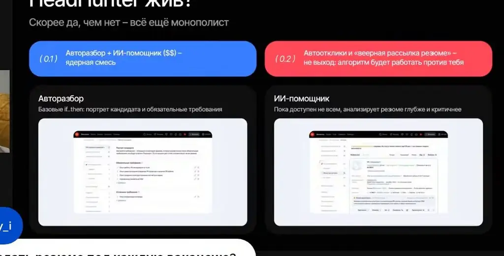
*[▶ 00:14:33](https://www.youtube.com/watch?v=tqW9-uGZxp4&t=873s) · Headhunter жив?*

Ключевые слова должны встречаться в контексте, а не списком: мало написать «Java», нужно описать фреймворки и архитектуру. Базовое резюме лучше адаптировать под вакансию небольшими правками, а не распылять позиционирование.

Фильтр по возрасту есть в кабинете работодателя, хотя по Трудовому кодексу такая дискриминация незаконна. По словам спикера, отсев по возрасту всё ещё встречается; убрав возраст, фильтр можно пройти.

## Автоотбор откликов на hh.ru: как пройти фильтры

[▶ 00:16:39](https://www.youtube.com/watch?v=tqW9-uGZxp4&t=999s)

Отклик сначала проходит автоматический отбор. Базовый инструмент hh.ru бесплатен и работает без человека; платный, более новый, пока меньше проверен. Общих чёрных списков резюме для всех рекрутеров не существует.

По зарубежным данным, на один найм теперь приходится 291 отклик против примерно 100 раньше, поэтому формулы «столько откликов — приглашение» больше нет.

Вопросы бота заранее прописаны по сценарию: умный уточняет навыки, которых нет в резюме, простой опрашивает про стаж. Ответы на них вместе с соответствием критериям решают, получит ли отклик приглашение или отказ. Отвечайте коротко и по делу. Обойти бота можно через реферальную программу или прямой контакт с рекрутером.

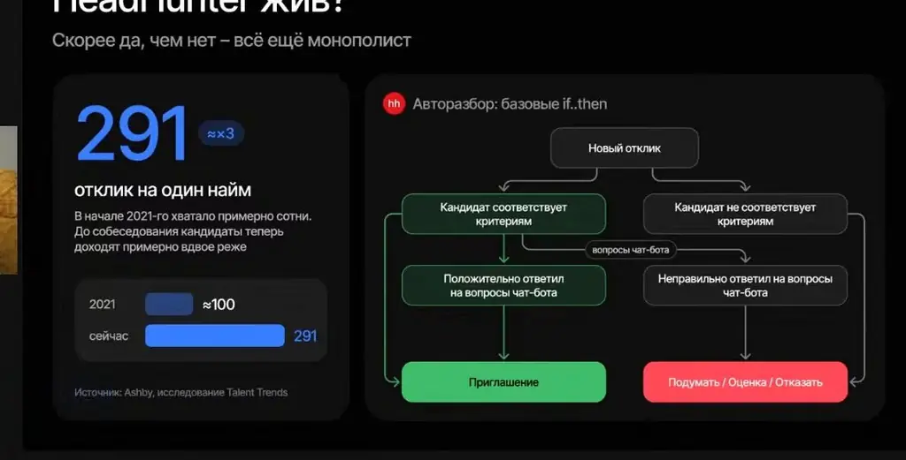
*[▶ 00:21:20](https://www.youtube.com/watch?v=tqW9-uGZxp4&t=1280s) · Headhunter жив? Отклики и авторазбор if..then*

Фильтры hh.ru на практике:

- Обновляйте резюме или поднимайте его кнопкой: свежие резюме выше в выдаче. Называйте резюме так же, как вакансию.
- Точно заполняйте опыт, регион, зарплату и навыки: по ним работает автофильтр, и несоответствие ведёт к автоотказу.
- Держите ключевые технологии из вакансии в резюме, желательно в контексте результатов: сортировка «по соответствию» ставит первыми самых подходящих.

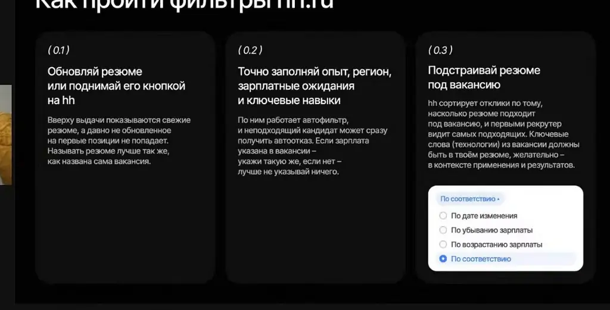
*[▶ 00:27:54](https://www.youtube.com/watch?v=tqW9-uGZxp4&t=1674s) · Как пройти фильтры hh.ru*

Если в вакансии указан офис, а вы не можете там работать, отказ почти неизбежен. Зарплату в открытом резюме лучше не указывать: фильтры настроены непредсказуемо, а низкий запрос, по оценке спикерки, отсеивает примерно в 15% случаев.

Тестовые задания полезны, но компании ждут созвона с объяснением решения. Перед откликом проверьте компанию в реестре юрлиц и на официальных сайтах: долги, суды.

## Как пройти фильтры: локация, навыки, контакты и ATS

[▶ 00:25:52](https://www.youtube.com/watch?v=tqW9-uGZxp4&t=1552s)

Если компания указала локацию или формат работы, ставьте их же. Если вакансия офисная, удалёнка отсеет вас на первичном фильтре. Зарплату в резюме лучше не указывать, но если вилка уже есть в вакансии, пишите такую же, не сочиняя. Окончательный минимум обсуждается с рекрутером.

Если в вакансии названа технология с конкретным контекстом, поднимите её выше и объясните, где и как вы её применяли. Одна строка Node.js внизу резюме фильтр не пройдёт.

Перед откликом:

- выделите 3–5 основных требований вакансии;
- переставьте пункты, подняв релевантные достижения;
- упомяните нужные технологии в первой части резюме;
- проверьте наличие ключевых слов.

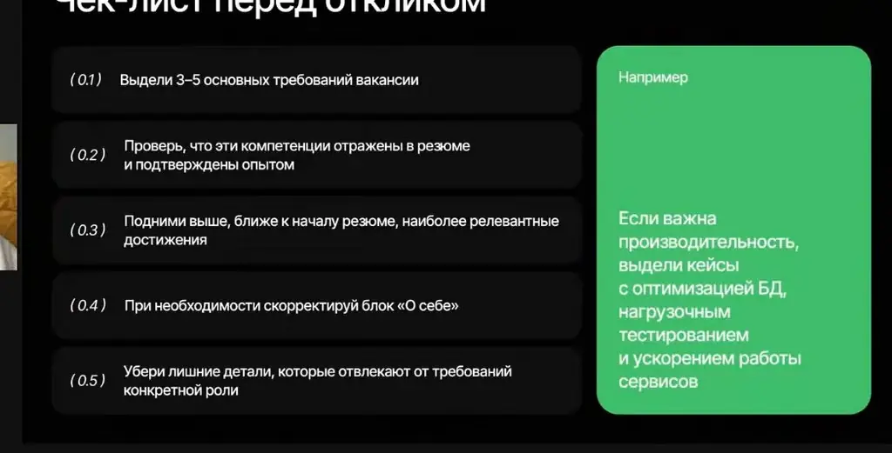
*[▶ 00:33:19](https://www.youtube.com/watch?v=tqW9-uGZxp4&t=1999s) · Чек-лист перед откликом*

Блок «О себе» спорен. Автор советует использовать его для контактов и не сужать воронку фразами вроде «только e-com компании».

Указывайте все доступные контакты. В одних компаниях рабочий мессенджер Telegram, в других Max. Возраст по году окончания вуза вычислить легко, и рекрутеры так делают, хотя автофильтр это пока не умеет.

LinkedIn не подходит для откликов, но помогает найти контакты рекрутеров и лидов. Автор на восьми вакансиях получила отказ по стандартному пайплайну. Личные письма лидам с конкретными причинами, почему вы полезны, работают: лид запомнит вас и может вернуть в процесс. Без сталкинга: домашние адреса и посылки не нужны.

ATS (Applicant Tracking System) хранит все версии ваших резюме, историю интервью и офферы. Каждая компания использует свою, часто самописную. Популярные в России Хантфлоу и Талантик интегрированы с [hh.ru](https://hh.ru) и LinkedIn.

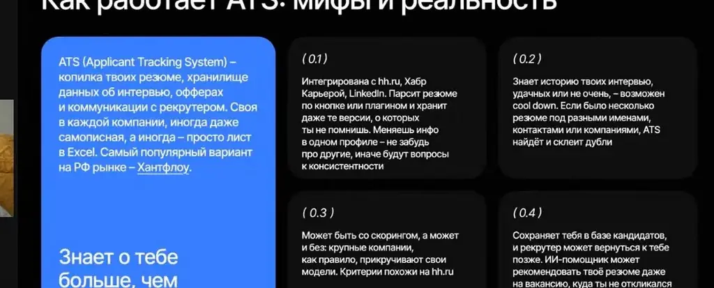
*[▶ 00:41:35](https://www.youtube.com/watch?v=tqW9-uGZxp4&t=2495s) · Как работает ATS: мифы и реальность*

- Версии резюме должны совпадать: ATS хранит даже те, о которых вы забыли.
- Дубли склеиваются по контактам, дате рождения, местам работы и вузу, поэтому смена имени не поможет.
- Общего чёрного списка нет: у каждой компании своя база.
- ИИ в ATS может предложить вас рекрутеру на вакансию, на которую вы не откликались.
- Согласие на хранение данных отзывается письмом в компанию.

## Три фильтра до собеседования и шесть вопросов к резюме

[▶ 00:41:21](https://www.youtube.com/watch?v=tqW9-uGZxp4&t=2481s)

Резюме проходит три фильтра: поиск на [hh.ru](https://hh.ru) и в ATS по стеку и грейду, просмотр рекрутером и, не во всех компаниях, нанимающий менеджер. В бигтехе отдельного этапа часто нет: ИИ, рекрутер или оба отсеивают резюме и зовут на собеседование, а нанимающий менеджер смотрит на результаты уже после него.

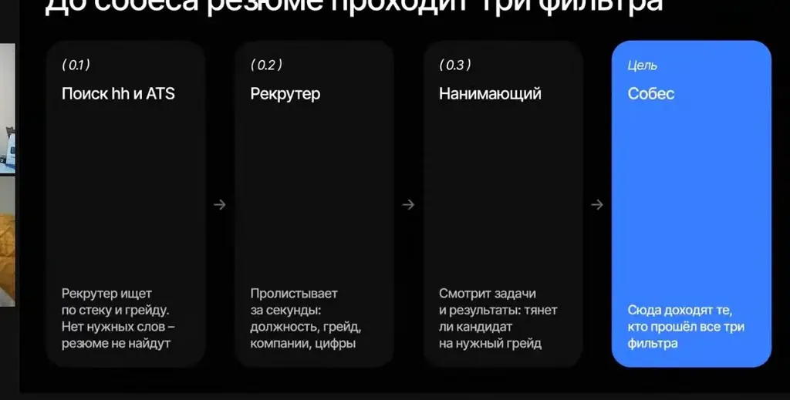
*[▶ 00:45:00](https://www.youtube.com/watch?v=tqW9-uGZxp4&t=2700s) · Three filters before the interview*

Опыт в базе ATS сам не обновляется. Он меняется только из новых версий резюме и профилей, которые вы публикуете. Если резюме нигде не появлялось, старые данные там и останутся.

Нанимающий менеджер проверяет задачи и достижения вопросами. Если написано «обрабатывал 500 000 RPS», будьте готовы рассказать, как поддерживали нагрузку. Один менеджер выбирал из списка навыков случайный пункт и спрашивал: «Что ты делал с SQL в последний раз?» Автоматический скрининг в ATS, по словам спикера, для российского рынка сейчас нерелевантен.

Каждое резюме разбирается по шести вопросам:

- Заголовок и грейд: совпадают ли с тем, что ищет рекрутер.
- Ключевые слова: есть ли технологии из типичных вакансий.
- Результаты и цифры: «делал сервисы» или «ускорил ответ в N раз».
- Грейд за 10 секунд: виден ли уровень, на который претендуете.
- Лишнее: старый опыт, длинные списки, «коммуникабельный».
- Вердикт: позвали бы на собеседование, на какой грейд и вилку.

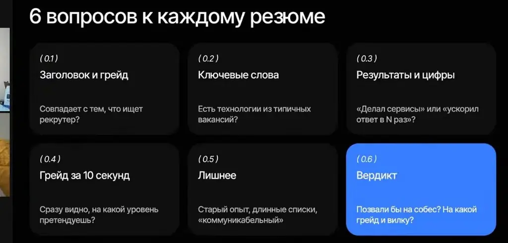
*[▶ 00:47:38](https://www.youtube.com/watch?v=tqW9-uGZxp4&t=2858s) · 6 вопросов к каждому резюме (repeat)*

Разбор начинается с резюме .NET-разработчика. Желаемая должность видна сразу. Если откликаетесь на конкретную вакансию, называйте резюме так же, как она называется: это даёт очки и ИИ, и рекрутеру.

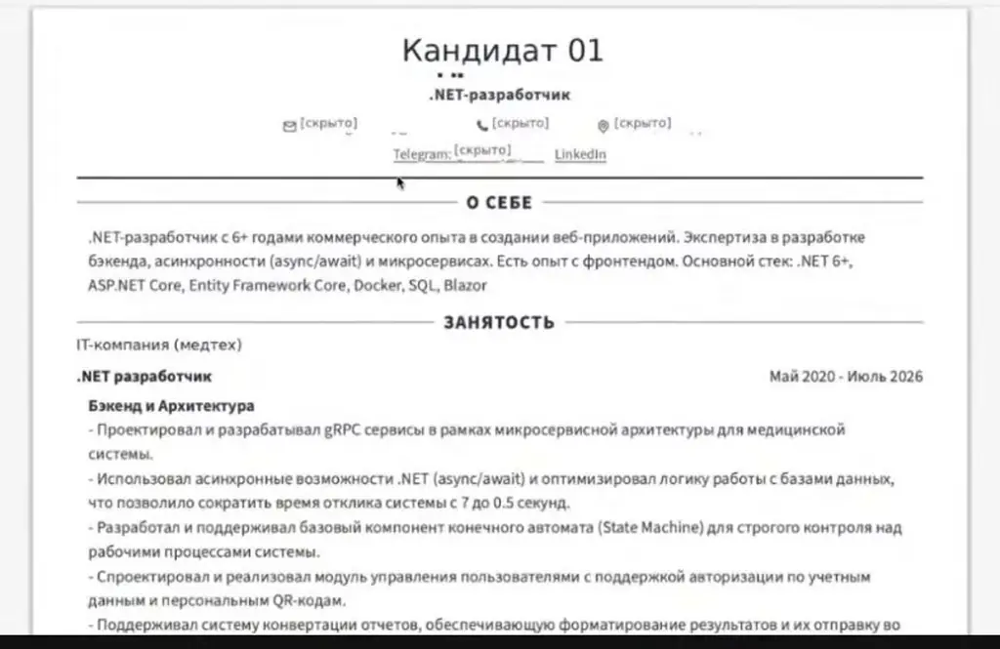
*[▶ 00:53:23](https://www.youtube.com/watch?v=tqW9-uGZxp4&t=3203s) · Кандидат 01: резюме .NET-разработчика*

LinkedIn полезен и для российских компаний, поэтому добавляйте профиль, если не стыдно его показать. Даты, должности, компании и технологии в резюме и профиле должны совпадать. Блок «О себе» в начале допустим: такой шаблон читается глазом и хорошо парсится. Опыт с фронтендом в интро сразу бросается в глаза. Если вакансия его не требует, не упоминайте, чтобы не размывать позиционирование.

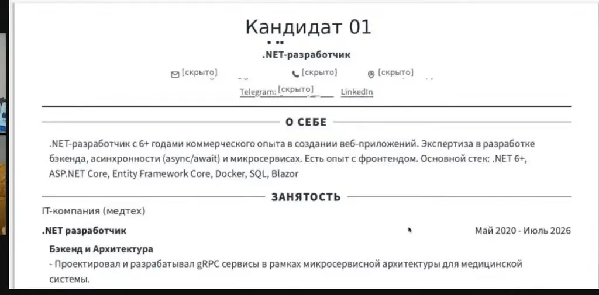
*[▶ 00:56:33](https://www.youtube.com/watch?v=tqW9-uGZxp4&t=3393s) · Кандидат 01: шапка и первый опыт работы*

## Опыт работы: подтверждать заявленное и называть достижения

[▶ 00:55:48](https://www.youtube.com/watch?v=tqW9-uGZxp4&t=3348s)

Фразы вроде «6+ лет коммерческого опыта» безвредны, но их нужно обновлять вместе с датами: компания фильтрует по реальной длительности опыта, а не по тексту.

Заявленная экспертиза должна находиться в описании работы. Если в профиле написано про асинхронность и микросервисы, рекрутер будет искать это в опыте.

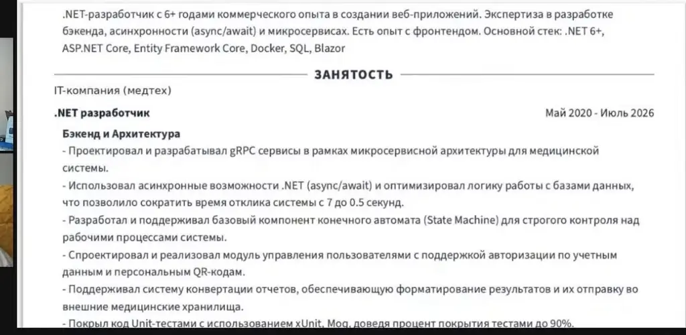
*[▶ 00:57:59](https://www.youtube.com/watch?v=tqW9-uGZxp4&t=3479s) · Резюме: опыт работы, backend-пункты*

Разбивка на блоки «Фронтенд», «Бэкенд», «DevOps» выглядит сгенерированной ИИ. Лучше писать явные достижения и формулировки из вакансии, а инфраструктуру упоминать, если вакансия её требует.

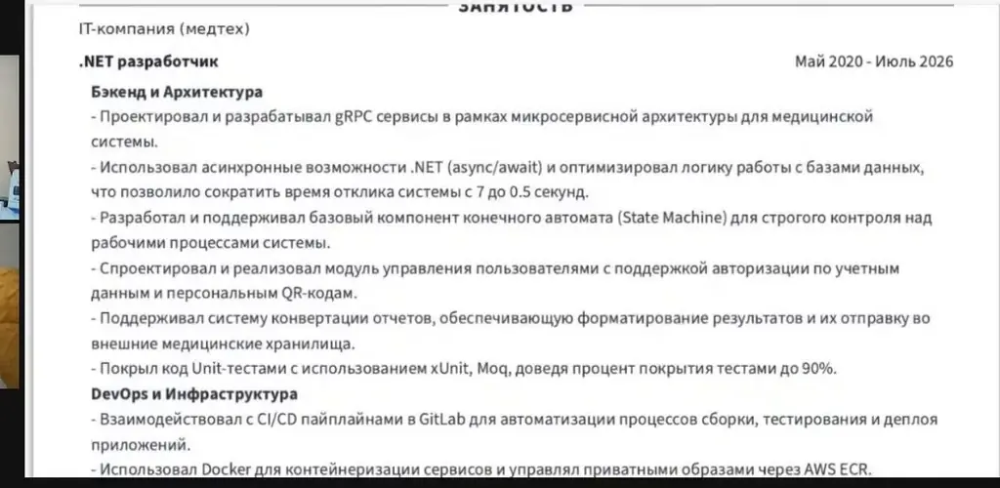
*[▶ 01:01:42](https://www.youtube.com/watch?v=tqW9-uGZxp4&t=3702s) · Резюме: бэкенд и DevOps блоки*

Пауза с июля 2026 будет видна сразу: в карточке на hh.ru первым идёт последнее место работы с датами. Рекрутер спросит причину, поэтому готовьте объяснение и подкрепляйте его личными проектами и ссылками на GitHub.

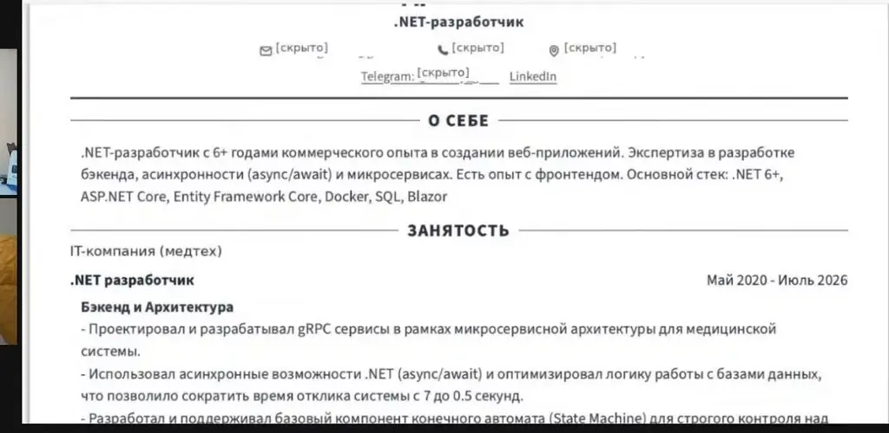
*[▶ 01:02:08](https://www.youtube.com/watch?v=tqW9-uGZxp4&t=3728s) · Resume: .NET developer profile and first experience*

Тестирование, код-ревью и менторство стоит упоминать, это признак налаженных процессов. Покрытие 90% — достижение, но, по мнению разработчика в разборе, лучше писать ближе к 100.

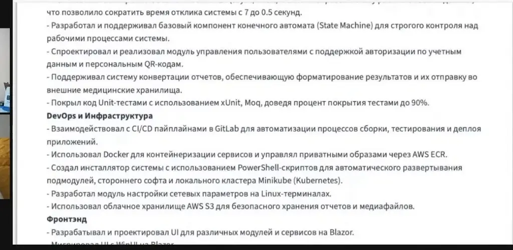
*[▶ 01:05:02](https://www.youtube.com/watch?v=tqW9-uGZxp4&t=3902s) · Резюме: опыт работы и DevOps (продолжение)*

Опыт CI/CD-пайплайнов полезен. Про Docker и Kubernetes пишите, если работали с ними. Инсталлятор на PowerShell назвали интересным, а отдельные скрипты выносить не нужно.

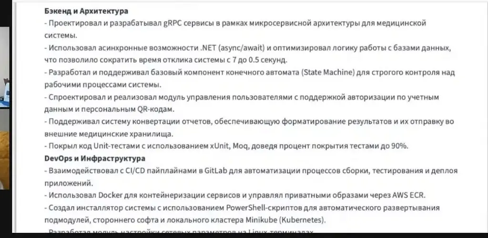
*[▶ 01:04:32](https://www.youtube.com/watch?v=tqW9-uGZxp4&t=3872s) · Resume: backend and DevOps experience bullets*

Фронтенд-пункт можно убрать, если вакансия его не требует.

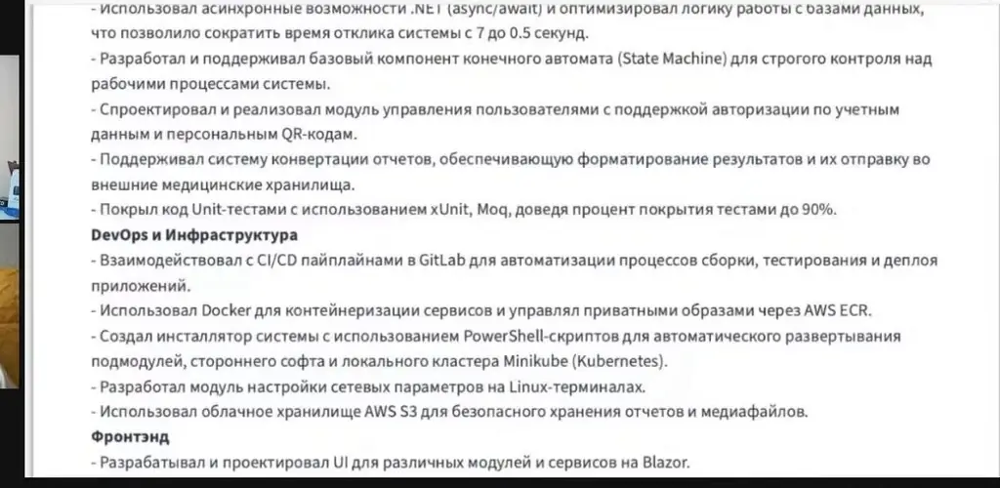
*[▶ 01:05:00](https://www.youtube.com/watch?v=tqW9-uGZxp4&t=3900s) · Резюме: опыт работы, DevOps и фронтенд*

## Резюме: каждое упоминание должно иметь контекст и результат

[▶ 01:05:53](https://www.youtube.com/watch?v=tqW9-uGZxp4&t=3953s)

Рекрутер и нанимающий менеджер сверяют каждое упоминание в резюме с требованиями вакансии. Всё, что не объяснено, станет вопросом на собеседовании.

Техническая специальность говорит о базовой подготовке. Для стажировок вуз важнее, потому что продакшн-опыта и собственных проектов обычно мало. Для российских компаний не пишите «русский — родной»: это и так подразумевается.

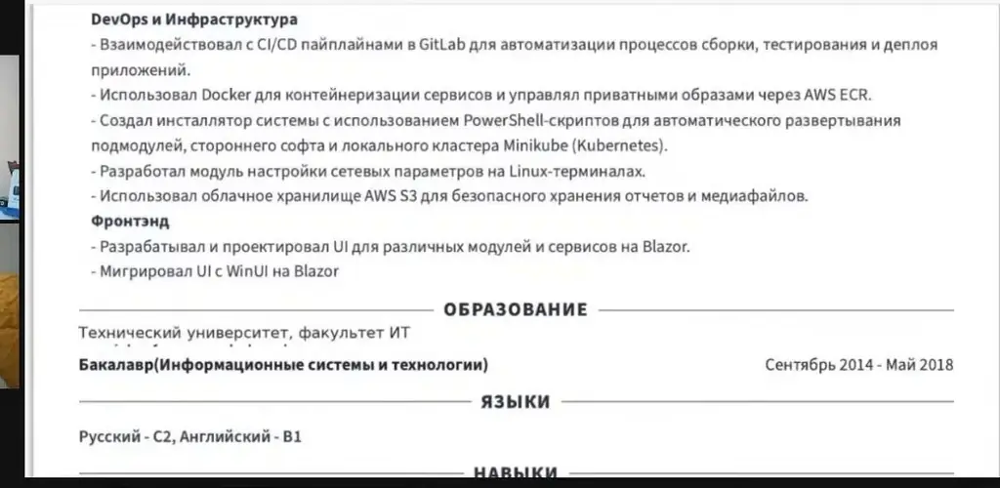
*[▶ 01:07:00](https://www.youtube.com/watch?v=tqW9-uGZxp4&t=4020s) · Резюме: образование и языки*

Список навыков полезен, если он совпадает с вакансией. Технология, упомянутая в навыках и нигде не описанная в опыте, вызывает вопрос: где и зачем её использовали. Не нужно отдельно описывать каждый инструмент вроде GitLab, но фреймворки, базы, инфраструктуру и CI/CD стоит показать в опыте с контекстом и результатом.

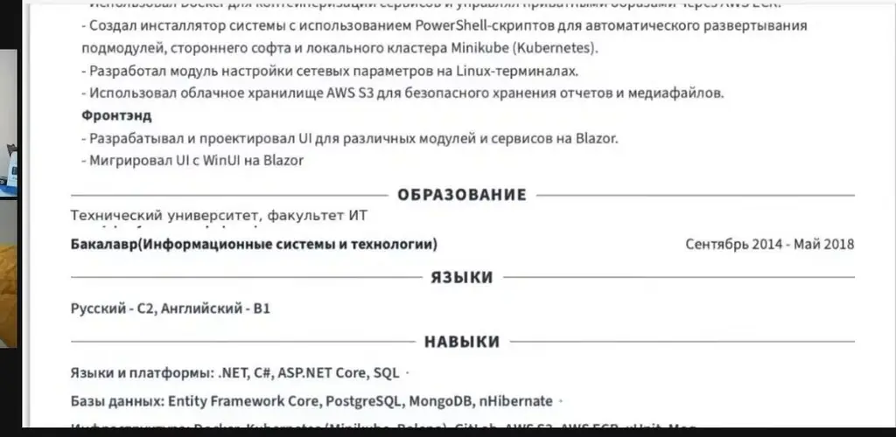
*[▶ 01:07:20](https://www.youtube.com/watch?v=tqW9-uGZxp4&t=4040s) · Резюме: навыки и образование*

Технологии без результата тоже нужно упоминать, но вклад лучше показывать в бизнес-ценности. Фраза «поддерживал систему конвертации отчётов» мало что говорит нанимающему. Если цифр нет, используйте качественные метрики. Полностью из достижений резюме на зрелом этапе не составить.

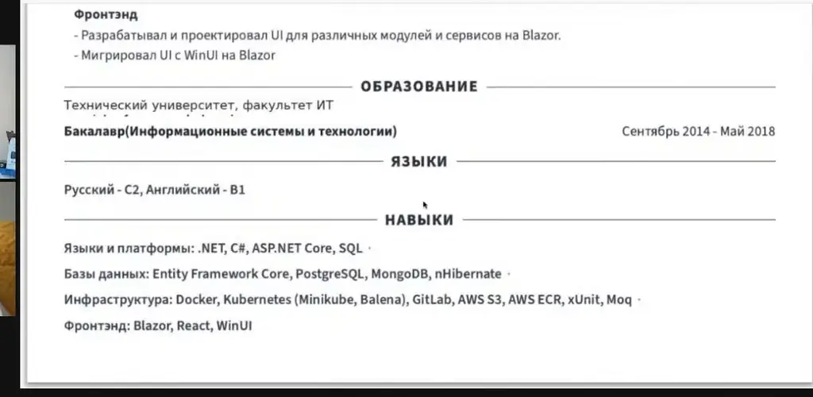
*[▶ 01:08:49](https://www.youtube.com/watch?v=tqW9-uGZxp4&t=4129s) · Resume skills and education section*

Ответ на вопрос из чата о технологиях без достижений:

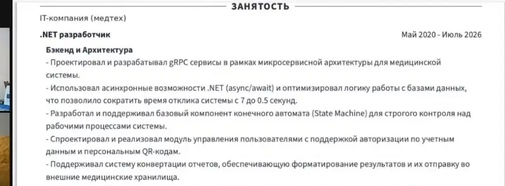
*[▶ 01:11:24](https://www.youtube.com/watch?v=tqW9-uGZxp4&t=4284s) · Resume entry under ЗАНЯТОСТЬ with a chat question overlaid*

Процент покрытия тестами стоит подать как дельту, например с 89 до 90. Это повод спросить, как устроено тестирование.

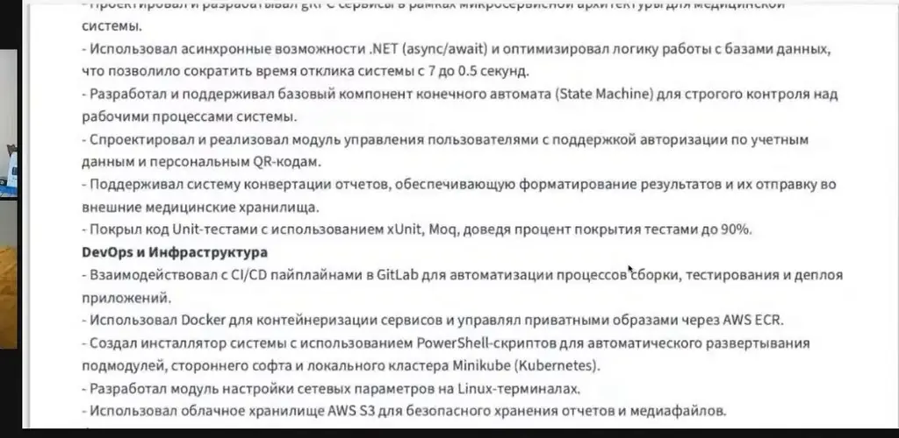
*[▶ 01:13:19](https://www.youtube.com/watch?v=tqW9-uGZxp4&t=4399s) · Резюме .NET разработчика: DevOps и инфраструктура*

Шесть лет на одном месте ни плюс, ни минус. Рекрутер будет расспрашивать о проектах за это время и о причинах ухода, потому что после долгого срока уход обычно связан с чем-то существенным.

Если коммерческого опыта мало, курсы лучше не выносить на первый план. Некоторые компании относятся к недавним выпускникам курсов с предубеждением, другие берут их через партнёрство. Выигрышнее показывать собственные проекты, например сделанные с ментором в [Shortcut](https://t.me/shortcut_sh_bot?start=youtube_video_live_Java_17_10_2026_mock_2000_lead).

Стажёру стоит указать, сколько часов в неделю он может работать, например 30 часов для полной занятости, поскольку диплом ещё не получен. В разделе «О себе» убирайте оценочные фразы вроде «уверенно работаю», если их не подтверждает резюме, и общие утверждения без примеров. Интересы стоит назвать, но не ограничивать себя только бигтехом.

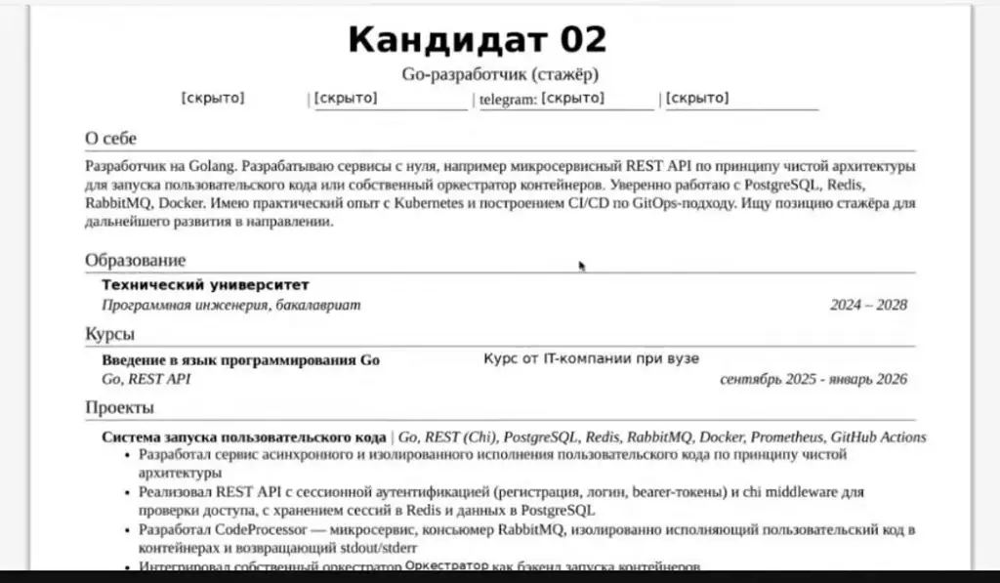
*[▶ 01:22:08](https://www.youtube.com/watch?v=tqW9-uGZxp4&t=4928s) · Кандидат 02 — профиль и образование*

## Проекты в резюме: ссылки на GitHub и отбор

[▶ 01:21:51](https://www.youtube.com/watch?v=tqW9-uGZxp4&t=4911s)

Курс из вуза сам по себе мало что говорит, поэтому его стоит перенести ниже проектов. Главный вопрос рекрутера: существуют ли проекты. Поэтому к каждому нужна ссылка на GitHub.

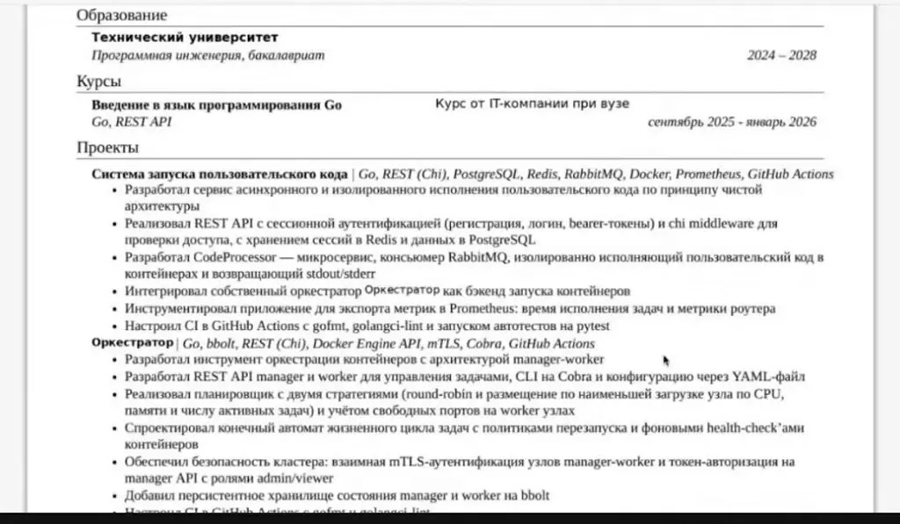
*[▶ 01:23:02](https://www.youtube.com/watch?v=tqW9-uGZxp4&t=4982s) · Resume: system, orchestrator and project bullets*

Проекты стоит упорядочить по сложности и оставить у каждого три-четыре самых сильных пункта. Длинный список размывает главное: оркестратор описан семью пунктами.

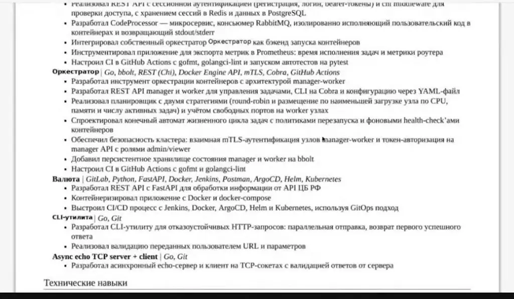
*[▶ 01:23:05](https://www.youtube.com/watch?v=tqW9-uGZxp4&t=4985s) · Resume: orchestrator, currency service, CLI and echo server*

Мониторинг в Prometheus стоит оставить, он выделяется. Утилиту можно сократить, если она не работает на вакансию. Принцип «чистой архитектуры» без примеров кода не проверить, и он только ослабляет позицию.

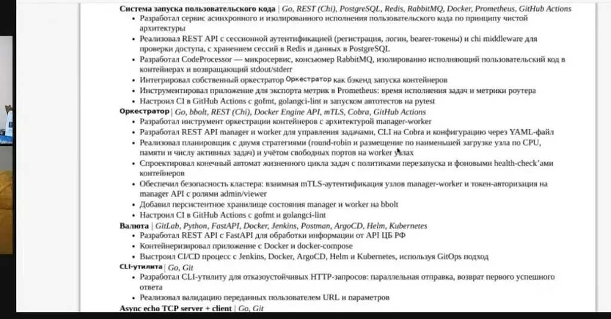
*[▶ 01:24:53](https://www.youtube.com/watch?v=tqW9-uGZxp4&t=5093s) · Resume: user-code runner project and stack lines*

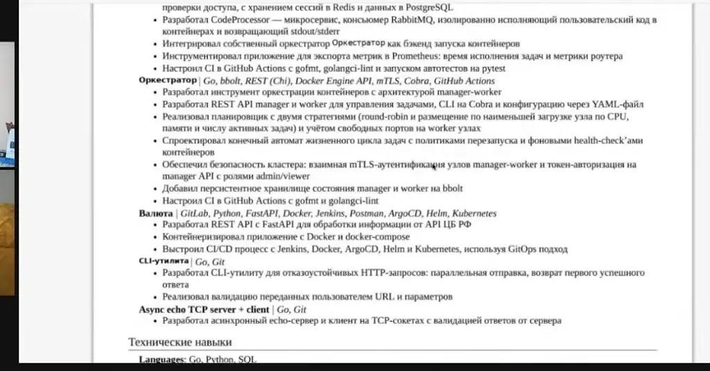
*[▶ 01:23:39](https://www.youtube.com/watch?v=tqW9-uGZxp4&t=5019s) · Resume: orchestrator, currency and CLI projects*

Стек нужно сверить с описаниями проектов: часть технологий нигде в проектах не упомянута. Оставляйте только навыки, которые пересекаются с вакансией.

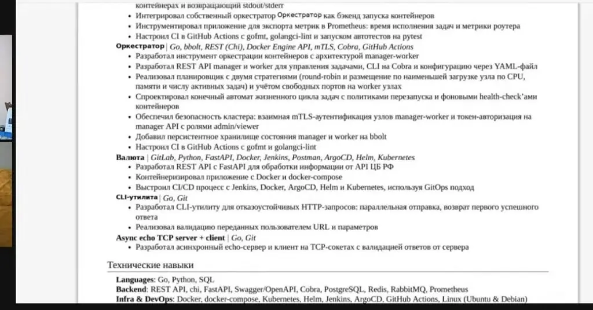
*[▶ 01:25:37](https://www.youtube.com/watch?v=tqW9-uGZxp4&t=5137s) · Resume: tech skills section*

Детализация вроде названий линтеров мало что добавляет.

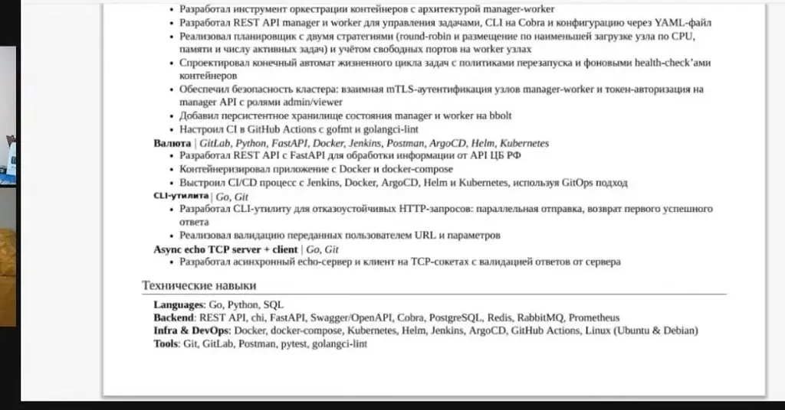
*[▶ 01:26:29](https://www.youtube.com/watch?v=tqW9-uGZxp4&t=5189s) · Resume: full technical skills list*

ИИ сам по себе не минус, если кандидат может объяснить код. Ключевой навык, по мнению ведущих, — ревью, в том числе сгенерированного кода. В бигтехе стоит указать, где ИИ уже встроен в процесс разработки.

В резюме кандидата 03 расплывчатая желаемая должность «Frontend web developer»: её стоит сверить с названием вакансии. Сплошной текст без абзацев и пробелов тяжело читать.

## Резюме: результат важнее списка функций и технологий

[▶ 01:33:40](https://www.youtube.com/watch?v=tqW9-uGZxp4&t=5620s)

Описание собственного продукта должно отвечать на вопросы: зачем он был нужен, что получилось и почему выбран стек. Перечень функций отвлекает внимание от кандидата. Если известны метрики, например снижение числа сбоев или рост отзывов пользователей, добавьте их. Объясните выбор технологий: почему MongoDB, почему Node.js, почему React и TypeScript.

Чтобы пройти фильтр, достаточно одного пункта на каждую ключевую технологию из вакансии: что использовали, что сделали, что получилось.

Fullstack MVP описан только бизнес-логикой. Не видно, какой был фронтенд и какие технологии применялись.

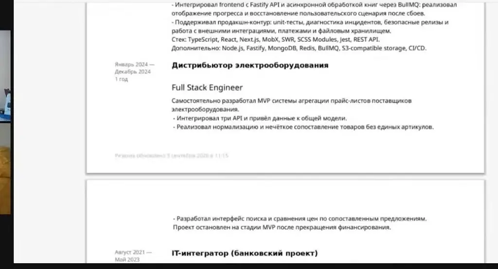
*[▶ 01:37:45](https://www.youtube.com/watch?v=tqW9-uGZxp4&t=5865s) · Resume: distributor role and bank project start*

Ведущий разработчик банковского CRM — самая сильная запись по бизнес-контексту, но стек перечислен без пояснений о том, что конкретно делалось.

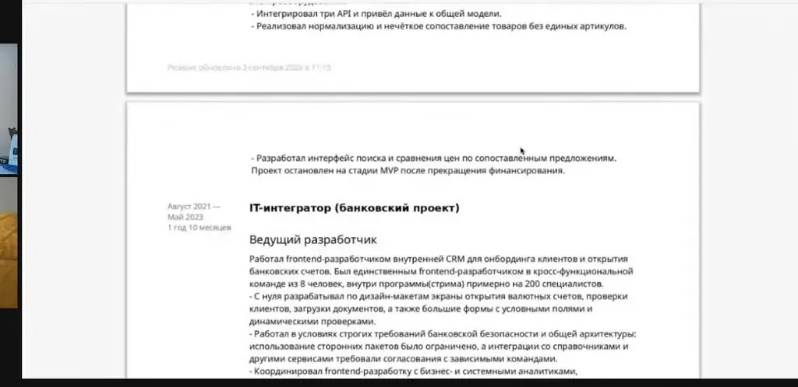
*[▶ 01:40:29](https://www.youtube.com/watch?v=tqW9-uGZxp4&t=6029s) · Resume: price comparison and bank CRM roles*

Размер команды (8 человек, около 200 специалистов) и подробности о ограничениях безопасности занимают много места. Ограничения лучше показать как результат: что удалось сделать, несмотря на них.

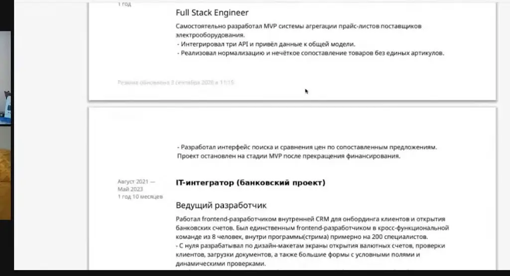
*[▶ 01:37:51](https://www.youtube.com/watch?v=tqW9-uGZxp4&t=5871s) · Resume: distributor MVP and bank project*

Опыт веб-студии занимает в резюме больше места, чем более свежие проекты, хотя он старше и технологически слабее.

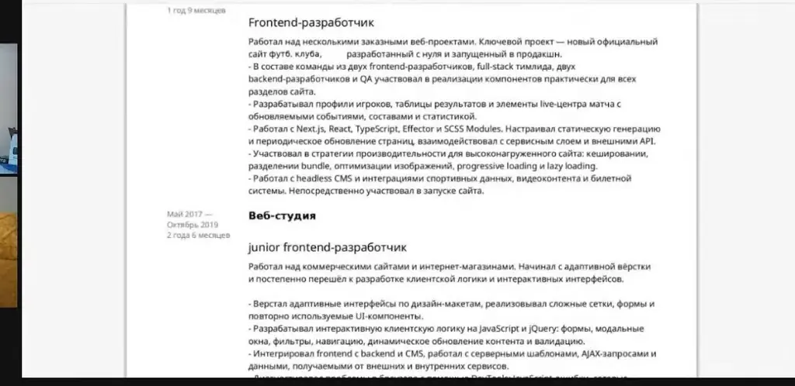
*[▶ 01:40:19](https://www.youtube.com/watch?v=tqW9-uGZxp4&t=6019s) · Resume: frontend role on football club site*

Вёрстку и jQuery сейчас может делать ИИ, поэтому пункты джуновского опыта стоит сократить до двух-трёх ключевых.

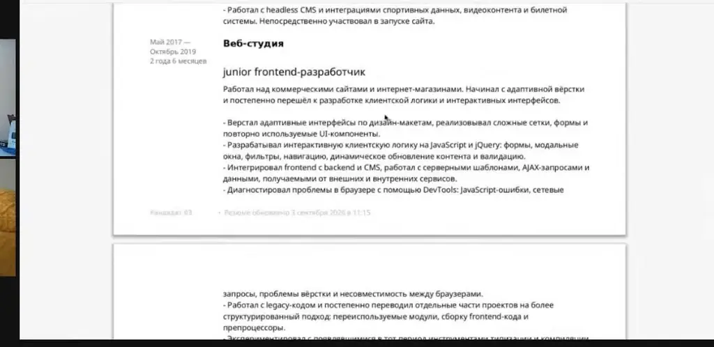
*[▶ 01:40:12](https://www.youtube.com/watch?v=tqW9-uGZxp4&t=6012s) · Resume: web studio junior frontend role*

Незаконченное нетехническое образование не блокер. Онлайн-школе нужны реальные проекты, иначе навыки не видны.

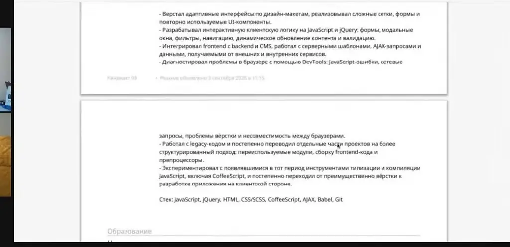
*[▶ 01:41:05](https://www.youtube.com/watch?v=tqW9-uGZxp4&t=6065s) · Resume: web studio role end and skills*

Описать самый сложный проект в одном предложении нельзя. Порядок такой: описание проекта, пункты технологий, проверка по требованиям вакансии, при возможности метрики.

## Описывать проект для незнакомца и заранее готовить ответы на риски

[▶ 01:45:12](https://www.youtube.com/watch?v=tqW9-uGZxp4&t=6312s)

Описывайте сложный проект от большего к меньшему. Слушатель не работал над ним, не знает ваших задач и может не знать технологий, поэтому текст должен быть понятен без контекста и не перегружен деталями.

Бизнес-метрику (например, рост потока кредитов) стоит указывать, но будьте готовы объяснить, как её посчитали и какое влияние было прямым. Аргумент: вы рассказывали о функциональности на общих встречах компании, а позже метрику пересчитали.

**Оверквалифайд.** Срезать опыт (5 лет, где вы уже были синьором) имеет смысл, если вакансия явно требует меньше. Иначе возникают вопросы: почему откликается на более низкую позицию, не заскучает ли, не перерастёт ли проект и не будет ли медленнее учиться. Это допущение, которое компания должна проверить, а не приговор.

**Аутстафф.** Можно указать название проекта, но честно пояснить на собеседовании, что вы оформлены подрядчиком. Указывать только компанию без проекта вызывает подозрение.

**Причина ухода.** «Неинтересные задачи» провоцируют вопросы «какие именно» и «что тогда интересно», поэтому лучше не использовать эту формулировку.

Подтверждение через Госуслуги и корпоративную почту в LinkedIn пока не значимый критерий, но может измениться. Зарплата «от одного рубля» воспринимается как розыгрыш.

## Как объяснять увольнение и причину поиска работы

[▶ 01:56:31](https://www.youtube.com/watch?v=tqW9-uGZxp4&t=6991s)

Главные ошибки резюме, из-за которых его отсеивают до собеса: **неподтверждённые навыки** (технология без контекста применения становится баззвордом), описание процессов вместо результатов и пустые слова вроде «коммуникабельный» или «быстро обучаюсь».

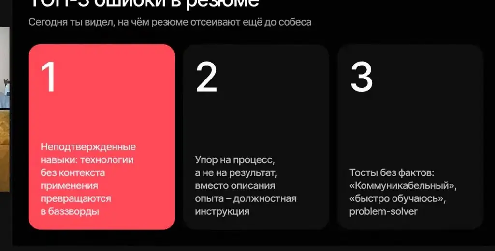
*[▶ 02:07:31](https://www.youtube.com/watch?v=tqW9-uGZxp4&t=7651s) · ТОП-3 ошибки в резюме*

На собеседовании оценивают то, что интервьюер услышал, а не то, что кандидат знает. Сбивчивый ответ снижает оценку, и недооценка на собесе означает более низкий грейд и зарплату. Спикер считает, что ответы на собеседовании — навык, который тренируют на живых интервью.

*[▶ 02:08:41](https://www.youtube.com/watch?v=tqW9-uGZxp4&t=7721s) · Оффер получает не тот, кто больше знает*

Часть компаний на этапе оффера запрашивает выписку из Госуслуг (справку СТД-Р), где видно основание увольнения. Работодатель может запросить и отзыв у прошлого, иногда без согласия. Поэтому причину лучше назвать самому:

- **Соглашение сторон** — не красный флаг и не блокер. Спикер замечает, что это часто просто более удобный для компании вариант сокращения.
- **Сокращение** — говорить спокойно: что произошло, по какой причине, и что сейчас вы ищете работу. Спикер сам был сокращён, проходил стадии от принятия до депрессии, а потом научился отвечать на собеседовании нейтрально.
- **Аутстафф** — можно указать агентство или компанию-заказчика. Проектные сотрудники обычно списывают трудозатраты в общей системе, но HR не всегда может её проверить.

Если вы ещё работаете, назовите 2–3 аргументированные причины: не хватает задач, технологий или условий, и вы пытались это изменить. Интерес к новым технологиям и задачам важнее. Про деньги можно говорить, но не первым пунктом.

Спикер также продаёт платное мок-интервью с нанимающими из BigTech (60 минут один на один). На выходе — разбор ошибок и план развития.

*[▶ 02:10:02](https://www.youtube.com/watch?v=tqW9-uGZxp4&t=7802s) · Что ты получишь на мок-интервью*

Пример такого плана: текущий грейд Junior+ и цель — оффер Middle Frontend-разработчиком.

*[▶ 02:10:22](https://www.youtube.com/watch?v=tqW9-uGZxp4&t=7822s) · План развития по итогам мок-интервью*

## Мок-интервью и рефералки как ответ на плохой рынок

[▶ 02:10:35](https://www.youtube.com/watch?v=tqW9-uGZxp4&t=7835s)

Спикер из [Shortcut](https://t.me/shortcut_sh_bot?start=youtube_video_live_Java_17_10_2026_mock_2000_lead) называет свои цифры: 20 000+ в сообществе, около 3 000 моков со средней оценкой 4,9 и 500+ менти с офферами.

*[▶ 02:10:57](https://www.youtube.com/watch?v=tqW9-uGZxp4&t=7857s) · В цифрах: почему нам доверяют свою карьеру*

Один менти отправил 400 откликов и получил звонки только от Яндекса и Тинькова, где спрашивали алгоритмы. Проблема была в многопоточности, которую он не разбирал. После правок резюме и рефералки он за полтора месяца попал в компанию, куда его раньше не звали.

По словам спикера, менти получают оффер примерно каждые три дня.

*[▶ 02:12:00](https://www.youtube.com/watch?v=tqW9-uGZxp4&t=7920s) · Истории наших менти: отзывы о получении офферов*

Мок один на один с нанимающим из BigTech, по его словам, выявляет пробелы до настоящего собеса. Для зрителей эфира он стоил 2 000 ₽ вместо 7 900 ₽.

*[▶ 02:13:18](https://www.youtube.com/watch?v=tqW9-uGZxp4&t=7998s) · Сколько это стоит на самом деле: стоимость мока*

Условие: возврат 100% денег в течение 7 дней, если мок не был полезен.

*[▶ 02:14:01](https://www.youtube.com/watch?v=tqW9-uGZxp4&t=8041s) · Спецусловия на мок-интервью для зрителей*

Возражения спикер разбирает так: «не готов» — мок выявляет пробелы; «не зовут» — сначала правят резюме; «уже проходил моки» — здесь интервьюер нанимает в BigTech; «резюме нормальное» — проверка по шести вопросам.

*[▶ 02:15:55](https://www.youtube.com/watch?v=tqW9-uGZxp4&t=8155s) · «А если...» objections and answers*

Дальше — менторство: занятия по навыкам из плана, code review и рефералки. Новый грейд, по его словам, — от 2–3 месяцев против 6+ без помощи.

*[▶ 02:17:00](https://www.youtube.com/watch?v=tqW9-uGZxp4&t=8220s) · Mentoring next steps and referral comparison*

Софт-скиллы тоже отсеивают: замкнутость и токсичность мешают работе, поэтому их стоит описать в резюме и заранее готовить ответы рекрутеру.

## Ссылки и материалы

- [hh.ru — job board; the ATS myths and reality screen](https://hh.ru) — <https://hh.ru> · на экране [▶ 00:41:35](https://www.youtube.com/watch?v=tqW9-uGZxp4&t=2495s)
- [Shortcut (ATS-бот в Telegram) — хранит резюме и отклики](https://t.me/shortcut_sh_bot?start=youtube_video_live_Java_17_10_2026_mock_2000_lead) — <https://t.me/shortcut_sh_bot?start=youtube_video_live_Java_17_10_2026_mock_2000_lead> · описание видео
- Хабр Карьера — джоб-борд, ссылка не показана · упомянуто [▶ 00:33:57](https://www.youtube.com/watch?v=tqW9-uGZxp4&t=2037s)
- LinkedIn — поиск контактов рекрутеров, не отклики; ссылка не показана · упомянуто [▶ 00:33:57](https://www.youtube.com/watch?v=tqW9-uGZxp4&t=2037s)
