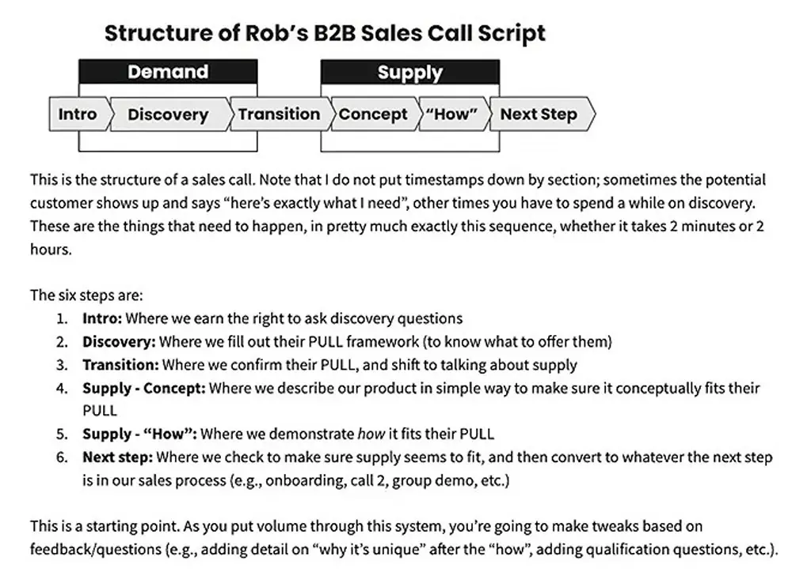
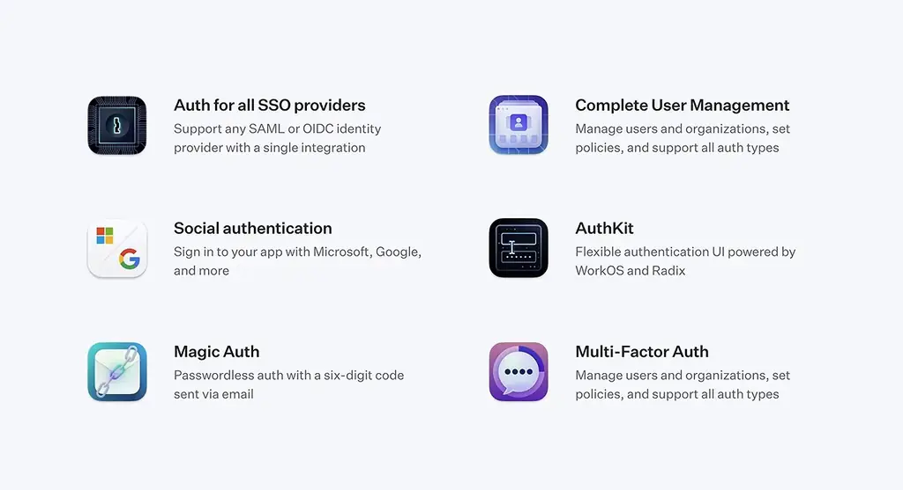
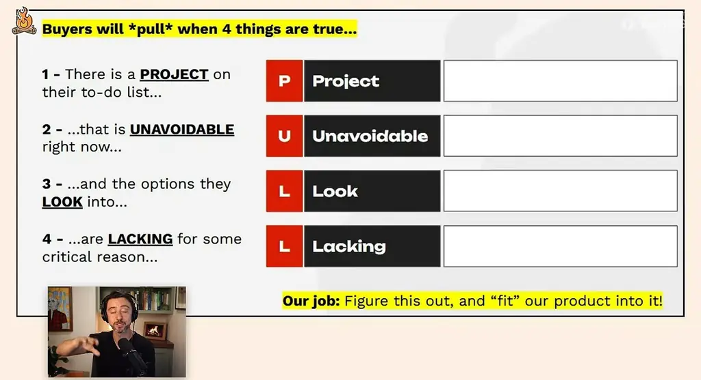

# An 86-minute guide to finding PMF | Rob Snyder (Author, The Power of Pull)

*Rob Snyder's PULL framework for finding a product that customers buy, from choosing an idea to closing your first deals.*

Source: [An 86-minute guide to finding PMF | Rob Snyder (Author, The Power of Pull)](https://www.youtube.com/watch?v=19qrLchbQEc) · Rob Snyder · Lenny's Podcast · 1 h 26 min

## TL;DR

Many founders build products that customers agree are useful but never prioritize buying, which Rob Snyder calls the absence of pull. Pull belongs to one person whose task is urgent and blocked by existing options, and it can be found through firsthand observation and tested with short conversations. Rob's PULL framework (Project, Unavoidable, List of options, Limitations) gives founders a way to check for that buying urgency before building. This matters because a product without pull can consume years of effort with no sales.

## Key takeaways

- Pull is a specific person's priority: a task they must finish now that their existing tools cannot handle, so they would reprioritize to buy.
- Pull requires all four PULL conditions at once: a Project, an Unavoidable reason to act now, a List of options they considered, and Limitations that make those options not good enough.
- Test a pull hypothesis with two slides: restate the buyer's situation and ask 'Is that roughly right?', then outline how you would help, looking for a clear 'Oh my god, yes.'
- Real buying intent shows up as a pull-shaped action, such as asking how to get started or whether the product exists yet; 'let's think about it' or 'send more information' signals no pull.
- When interest is lukewarm, ask the Hail Mary question: 'Is there anything on your to-do list that you would pay me to do right now?'
- Avoid design partners and pilots unless the buyer requires one, since they generate feedback without purchases and signal weak pull.
- Send about 20 LinkedIn connection requests a day with a short, interesting hook rather than a pitch, and save the pitch for a 30-minute discovery call.
- Stop pursuing an idea when prospects say the existing options are good enough, and when they have no pull after about five calls, revise the hypothesis and test again.

## Pull is a person's priority, not a company's pain

[▶ 00:00:00](https://www.youtube.com/watch?v=19qrLchbQEc&t=0s)

Rob's sales call is built to test pull. It follows a fixed sequence, whether it takes two minutes or two hours.


*[▶ 00:00:12](https://www.youtube.com/watch?v=19qrLchbQEc&t=12s) · Structure of Rob's B2B Sales Call Script*

Pull belongs to a person, not a company. You are not selling to SpaceX. You are selling to the head of legal there, who has a project on her to-do list that she cannot finish with her existing tools.

Pull is not pain points, big problems, or differentiated value. Rob's startup had design partners using the product every day and still spent two years pushing it and pivoting aimlessly. Prospects agreed it solved their problems but would not reprioritize to buy it.

Pull comes from priority. A person trying to finish a task now, but stuck with existing tools, is a coiled spring. A product that gets them unstuck gets ripped out of your hands. PULL is the acronym for that pattern.

The sponsor, WorkOS, turns enterprise requirements such as SSO and audit logs into drop-in APIs.


*[▶ 00:07:13](https://www.youtube.com/watch?v=19qrLchbQEc&t=433s) · WorkOS feature grid: SSO, user management, auth*

Its Node.js SDK exchanges an SSO code for a user profile and access token, returned as JSON.

```javascript
// Get a user's access token and
// profile data from an Identity Provider

import WorkOS from '@workos-inc/node';

const workos = new WorkOS('sk_example_123456789');

const profile = await workos.sso.getProfileAndToken({
  code: '01E2R34C05B52KKZ8FSRDAP233',
  clientID: 'client_123456789',
});

HTTP 200
Response {...}
  "access_token": "01DMEK0J53CVMC32CK5SE0KZ8Q",
  "profile": {
    "id": "prof_01DMC79VC8ZGNY3099737PSVF1",
    "connection_id": "conn_01E4ZCR3C56J083X43JQXF3JK5",
    "connection_type": "okta",
    "email": "alan@foo-corp.com",
    "first_name": "Alan",
    "last_name": "Turing",
    "idp_id": "00u1a0ufom6J1zPlk357",
    "object": "profile",
    "raw_attributes": {...}
  }
}
```

*[▶ 00:07:26](https://www.youtube.com/watch?v=19qrLchbQEc&t=446s) · Node.js SDK: getProfileAndToken example and HTTP 200 response*

## Four conditions that make customers buy

[▶ 00:07:30](https://www.youtube.com/watch?v=19qrLchbQEc&t=450s)

Pull is an acronym for four conditions. All four must hold at once:

- **Project**: a job the customer is trying to get done, such as hiring more employees.
- **Unavoidable**: the customer has to do it now, for a specific reason why now.
- **List of options**: the alternatives the customer considered.
- **Limitations**: why those options aren't good enough.

Jump, an AI note-taker for financial advisors, found pull this way. Advisors had to take client meeting notes and enter them in their CRM, and failing to do so could land them in jail. Generic AI note-takers fell short because they didn't integrate with the CRM and weren't clearly compliant with SEC rules. Jump's first try with insurance agents failed: agents had the same project but no requirement to log notes, so the unavoidable piece was missing.

Missing one piece means customers complain but don't buy. With a project and an unavoidable need but adequate options, they build the solution themselves.

## Pull Is Found, Not Created

[▶ 00:13:53](https://www.youtube.com/watch?v=19qrLchbQEc&t=833s)

Pull already exists in a person's to-do list, independent of your product, so you find it rather than create it. In his early days, he assumed he was bad at convincing the market to buy. Realizing that pull exists on its own turned the problem into a search.

Most prospects are polite but "fine," and that is not pull. A person with pull finds it weird not to buy. Their questions are "How do we get started? Does the product exist yet?" Enthusiasm that never asks to start means pull is missing.

Pull belongs to a person, not a company. Even enterprise deals start with one individual: the head of legal at a large company who has a project she can't do herself.

To find an idea:

- Hypothesize a specific person who is stuck.
- Test whether they try to buy before a product exists.
- Get in the weeds: go in person or embed with them. Thirty-minute Zoom interviews are not enough.

A friend who wanted to serve small businesses shadowed industries for days at a time. He hated solar panel installers and they hated him. Independent physical therapists were different: he loved them, and watching over their shoulders showed him where they were stuck. He even considered buying a physical therapy franchise to see its P&L.

Firsthand experience matters for two reasons. Pull doesn't emerge from a whiteboard or even an interview; it became visible only through observation. And a company exists to serve one kind of person, so you need that experience to make the thousands of decisions that building for them requires.

## Testing a pull hypothesis and finding real buying intent

[▶ 00:22:34](https://www.youtube.com/watch?v=19qrLchbQEc&t=1354s)

To test a pull hypothesis, use **two slides**. Don't show the [PULL framework](https://thephysicsofstartups.substack.com/p/the-pull-framework) itself, because buyers won't understand it. The first slide restates their situation: "You're trying to do X right now because of Y, and you've considered Z, but it's not good enough for this reason. Is that roughly right?" The second slide outlines how you would help. You want a clear "Oh my god, yes" on the first one.

Rob Snyder's fill-in template for the first slide follows the four PULL conditions:


*[▶ 00:25:02](https://www.youtube.com/watch?v=19qrLchbQEc&t=1502s) · Four conditions that make buyers pull*

Real intent shows up as a **pull-shaped action**: the buyer asks how to get started now. One pharma executive told a founder, before any product existed, "if you can do that I will pay you right now." Weak signals are "let's think about it," "send more information so our team can review," or "I could see us using this in Q4." Those mean the idea is being pushed into the future.

"Solve your own problem" works only when you would have paid someone else to solve it. Emily, who worked in security engineering at AWS, found a problem she would have paid to solve. Be honest about a problem you think the world needs but wouldn't pay for yourself.

When interest is lukewarm, ask the **Hail Mary** question: "Is there anything on your to-do list that you would pay me to do right now?" One startup selling applicant tracking systems to governments got a reply about job descriptions. That became its first contract.

Rob says this question also reframes selling for introverts. You are not persuading anyone. You are checking whether they're stuck on something you can help with.

Common traps:
- Building the product first. With AI this can take weeks, but delay hides the cold reality you need to face.
- Design partners. In his experience, they give lots of feedback and never buy. People with a real problem want it solved, not a partnership.

Most ideas come from firsthand work. Rob estimates about 90% of the companies he has advised found their idea by doing the work alongside the people affected, and 10% from their own experience.

## Cold outreach to land the first call

[▶ 00:34:46](https://www.youtube.com/watch?v=19qrLchbQEc&t=2086s)

Your first conversations come from cold outreach on LinkedIn or email, using a short, interesting message rather than a pitch. Rob calls this **founder magic**. Templates that name pain points or pitch a product get no replies. The message only needs to earn a call. Whether the prospect has pull is decided on the call, so don't sell in the message.


*[▶ 00:40:54](https://www.youtube.com/watch?v=19qrLchbQEc&t=2454s) · Measure and benchmark the impact of AI*

Good hooks are simple: "Snoop Dogg invested in us, thought you'd find it interesting, would you be open to chat?" or a founder who dropped out of a PhD to work on something for content marketers. Match the hook to the buyer. For HVAC companies, a family plumbing business in high school may land better than a famous investor.

Personalization isn't needed. AI-written personalization usually restates what the prospect already knows and reads as generated.

Start on LinkedIn. Send 100 to 150 connection requests per week (about 20 a day), then message people when they accept. Expect:

- 30 to 40% accept the connection request
- 30 to 50% of those reply
- Most repliers say "yeah, sure, why not"

If acceptance is low, your profile may be the problem. If people accept but don't reply, the message isn't interesting enough.


*[▶ 00:41:00](https://www.youtube.com/watch?v=19qrLchbQEc&t=2460s) · Where AI is helping and where it's creating bottlenecks*


*[▶ 00:41:07](https://www.youtube.com/watch?v=19qrLchbQEc&t=2467s) · Monitor costs and licenses*

## Running the first sales call

[▶ 00:41:27](https://www.youtube.com/watch?v=19qrLchbQEc&t=2487s)

The first sales call has two parts: pull discovery, then a short pitch of how you might help. Stay curious, not persuasive. A customer with pull will push to buy.

Run the call in three moves:

- Thank them and ask why they took the call. They often describe their pull for you.
- Restate their answer as an agenda and get their agreement.
- Ask permission for context questions. Once they agree, it doesn't feel like an interrogation.

Book 30 minutes; smaller slots get no-shows. Skip demos early, when you may have nothing to show.

A call succeeds when you've mapped their pull or learned why they have none. After about five calls with no engagement, something is wrong. One founder's five banking calls went nowhere; a defense referral changed the hypothesis.

Sell to learn, not to push. If you feel yourself convincing, that's a red flag.

## Pitch small once the pull is visible

[▶ 00:46:56](https://www.youtube.com/watch?v=19qrLchbQEc&t=2816s)

Once you have pull, the pitch is simple. Don't describe a large vision. Restate the customer's problem in small terms, for example: "It sounds like you want to make a website without the hassle of point-and-click tools. Is that roughly it?" If they keep pulling out details, you are onto something.

Shape your questions around the PULL framework. Asking "Is there anything in your QA process you've been unable to do with your existing tools?" surfaces the need and the alternatives in one question. Then test urgency: "Is there a reason you have to do this now?"

The scariest question is "Are the other options good enough?" If they say yes, stop. Pushing further risks years spent on a product the market doesn't want.

The status quo is usually fine, so target people for whom it isn't: those already trying to change, who need no convincing.

Rob doesn't think in terms of "10x." He asks whether the customer is a coiled spring. In his HR software attempt, a better user experience failed because buyers didn't care how the product looked.

## Closing: return with a concept, price from value, and work back from a deadline

[▶ 00:54:08](https://www.youtube.com/watch?v=19qrLchbQEc&t=3248s)

Closing depends on deal size, but the next step is to return with a concept and a plan. In one case, a founder got a Hail Mary intro to a pharma executive, who said current market research was slow. The founder offered to come back in a couple of days with a rough mockup, built quickly, and asked what else was needed to decide. The executive then asked for the price.

Pricing starts from two bounds: the value of getting the project done, and the cost of the alternatives. If market research consultants cost about $50,000 a year, charging that same amount gives buyers a price they already understand.

In larger organizations, ask the champion when the project must show results, such as "Q1 next year," then work backward through every required step. That date is a **forcing function** for the rest of the sales process.

Avoid design partnerships that give the product away. They signal weak pull, while buyers with real pull are put off by them. Instead, sell a **service-shaped** offer: an AI product manager, for example, delivered by hand while the automated version is built behind the scenes. This validates the pull and shows what to build. The trade-off is that you can get stuck in a low-margin services business.

## Test willingness to transact, then iterate or go goblin mode

[▶ 01:00:41](https://www.youtube.com/watch?v=19qrLchbQEc&t=3641s)

Early on, test willingness to transact, not willingness to pay, so don't optimize price with the first customers. For a large first enterprise deal, avoid naming a bare number. Present a case study and ask for a reaction: "Others have paid from $80,000 for a small project up to $1 million, and many land in the middle. How are you thinking about this?" Both sides then react to a shared example.

If a first batch of calls shows no pull, which is the usual result:

1. Analyze each call and ask whether any showed real pull.
2. Ask the Hail Mary question: "Is there anything we can do for you right now that's a problem on your to-do list?"
3. Write a new pull hypothesis and run about five more calls.
4. Repeat until pull is clear.

**Goblin mode** is a break-glass tactic: an all-out, sometimes unhealthy effort to reach buyers now. One friend scheduled 20 meetings at a single conference. The founder of Tiro, a dental staffing company for hygienists, had his parents go door to door at dental offices to get customer conversations.

## Onboarding to the moment customers can't go without

[▶ 01:06:56](https://www.youtube.com/watch?v=19qrLchbQEc&t=4016s)

Everyone who buys will churn until they reach a milestone, X, after which quitting would seem weird. Design onboarding as a bullet train that gets every customer there. X is rarely usage or NPS. It is a leading indicator. At Slack, it was an early message count. In his restaurant retention startup, it was an alert about a likely cancellation that customers could act on within two weeks.

Deliver hands-on rather than sending a login. Keep asking, "Are you going to turn now?" until you find the moment customers say they can't live without it.

If most customers churn, find out why. Often one segment keeps using a horizontal product. An AI workflow startup found that freight forwarders stayed and pivoted to them.

## A case study factory for repeatable growth

[▶ 01:11:37](https://www.youtube.com/watch?v=19qrLchbQEc&t=4297s)

Rob Snyder's model reduces a startup to one repeated case study: a customer pulls the product before buying ("hell yes") and then stays. Your job is to build a **case study factory** that produces that customer again and again, in three steps:

- **Pipeline:** getting people to talk to you.
- **Sales:** turning prospects into customers.
- **Delivery:** keeping customers from churning.

Apply the theory of constraints: find the current bottleneck, such as too little pipeline or a low close rate, focus only on it, then move to the next one.

The case study doubles as a sales tool. Prospects who don't resemble it are poor fits, so it qualifies and disqualifies them. You don't have to publish it; the model is what matters. "We don't make software here. We make case studies."

Hell-yes customers pull the product out of your hands and use it compulsively. Your job is to find more who are clones of them.

Skip pilots, proofs of concept and design partners unless the buyer requires one, and don't offer them proactively.

Inside established companies, the same process applies to new products. In one new-product leader's experience, ideas that came from customers asking for something on sales calls all worked, while whiteboarded ideas never did. Test each idea with five existing customers and see whether they would buy. Founders should lead this. Non-founders doing zero-to-one work should focus on selling and learn from it.

When stuck, go into goblin mode: talk to many people, take flights, and hold in-person meetings until something works.

## Keep the test simple and avoid tarpit ideas

[▶ 01:20:03](https://www.youtube.com/watch?v=19qrLchbQEc&t=4803s)

The method is simple: state the pull hypothesis, show it to people, and see whether they try to buy. In Rob's experience, founders over-complicate this by trying to solve every variable in advance. He compares the framework to a metal detector on a beach. It doesn't guarantee metal where you dig, but it beats searching the sand with a spoon.

**Tarpit ideas** are markets where a clear winner already exists and the founder has no theory of how to be different. Copying a successful competitor usually fails. The exception is a customer the incumbent doesn't serve, unblocked in a way that justifies something different.

"Better" is rarely enough. People buy when they are blocked, not when a product is merely superior. A 100x better printer doesn't sell to someone who isn't blocked.

Rob is still developing the framework and asks for feedback. He also writes [The Physics of Startups](https://thephysicsofstartups.substack.com).

## Links & resources

- [The Pull Framework — Rob Snyder's written overview of the framework](https://thephysicsofstartups.substack.com/p/the-pull-framework) — <https://thephysicsofstartups.substack.com/p/the-pull-framework> · video description
- [Talk slides and materials — Dropbox folder from the description](https://www.dropbox.com/scl/fo/yxi4s2w998p1gvtpu4193/AMdNPR8AOw0lMklwtnC0TrQ?rlkey=j06x0nipoti519e0xgm23zsn9&st=ahz0fj11&dl=0) — <https://www.dropbox.com/scl/fo/yxi4s2w998p1gvtpu4193/AMdNPR8AOw0lMklwtnC0TrQ?rlkey=j06x0nipoti519e0xgm23zsn9&st=ahz0fj11&dl=0> · video description
- [An 86-minute guide to finding PMF — Lenny's Newsletter write-up of the talk](https://www.lennysnewsletter.com/p/an-86-minute-guide-to-finding-pmf) — <https://www.lennysnewsletter.com/p/an-86-minute-guide-to-finding-pmf> · video description
- [The Physics of Startups — Rob Snyder's Substack](https://thephysicsofstartups.substack.com) — <https://thephysicsofstartups.substack.com> · video description
- [Rob Snyder's website](https://robsnyder.org) — <https://robsnyder.org> · video description
- The Power of Pull — Rob Snyder's book, URL not shown · mentioned
