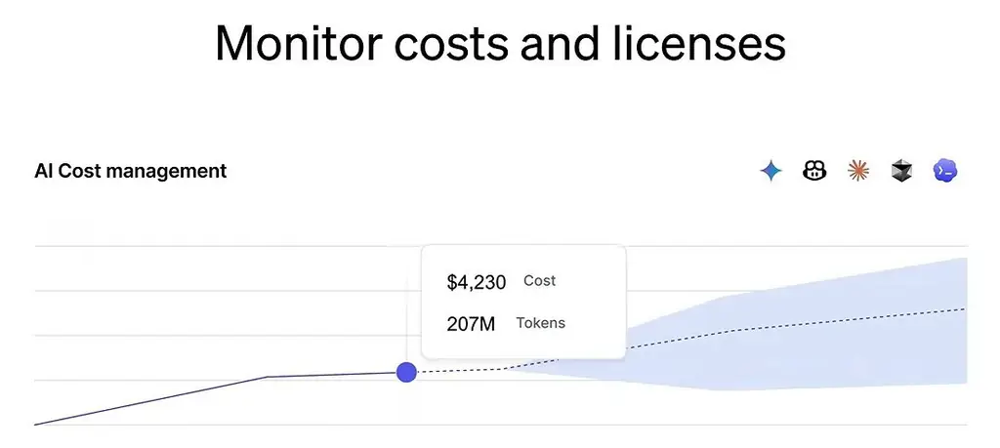
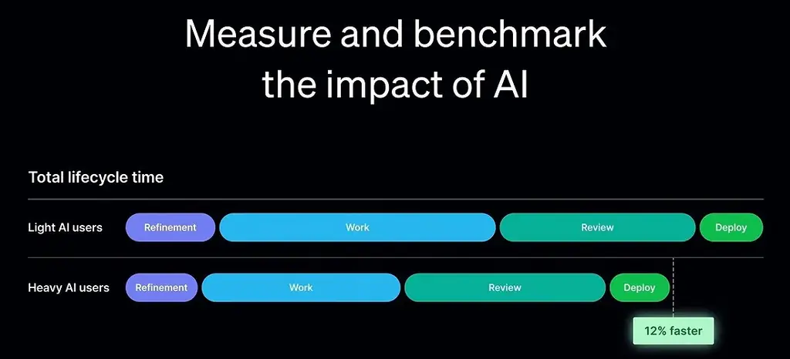
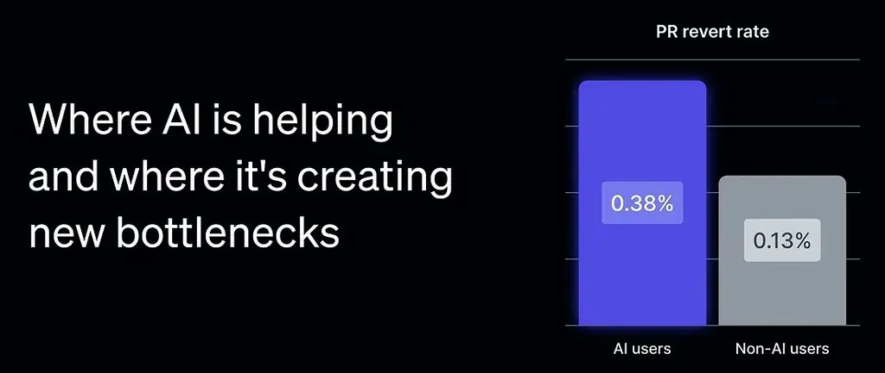

# An 86-minute guide to finding PMF | Rob Snyder (Author, The Power of Pull)

*A step-by-step walkthrough of Rob Snyder's PULL framework for finding product-market fit, from choosing an idea to closing your first handful of deals.*

Source: [An 86-minute guide to finding PMF | Rob Snyder (Author, The Power of Pull)](https://www.youtube.com/watch?v=19qrLchbQEc) · Lenny and Rob Snyder · Lenny's Podcast · 1 h 26 min

## TL;DR

Many early founders build products that people like but never buy, because pain points and value propositions don't create urgency. Rob Snyder argues that real demand is pull: a specific person with a project they must finish now, who is blocked by their current options. He describes the PULL framework (Project, Unavoidable, List of options, Limitations) and a process for testing it through firsthand discovery, cold outreach, and discovery-first sales calls. This matters because it helps founders tell real buying intent from polite interest before they build the wrong product.

## Key takeaways

- PULL has four parts that must all exist together: a Project to get done, an Unavoidable reason it must happen now, the List of options people consider, and the Limitations that make those options not good enough.
- Pull is a priority, not a pain point: prospects may agree a product is great but won't reprioritize unless they are blocked from doing the job another way.
- Pull belongs to an individual, so sell to the specific person who has the problem rather than to a company or segment.
- Find ideas by working firsthand with the people you want to help; Rob estimates about 90% of the ideas from his roughly 50 companies came from that work, and about 10% from the founder's own experience.
- Test a pull hypothesis by showing one person a two-slide summary of their situation and asking whether it's them, then talk to about five similar people; real intent sounds like "How do we get started?" rather than "send more information."
- For cold outreach, send a short, interesting message instead of a pitch or pain question; Rob's targets are 30–40% connection acceptance and 30–50% of those replying, with low acceptance pointing to your profile and low replies pointing to your message.
- Run the first call as discovery: ask why they took the meeting, book 30 minutes, and leave with a filled-in PULL framework; if after about five calls you learn nothing, change the hypothesis.
- Sell directly rather than offering free design partnerships, and deliver a service-shaped first version manually while automating behind the scenes; treat mass churn as a signal to work out whether the product or the customer lacks pull.

## Pull is a priority, not a pain point

[▶ 00:00:00](https://www.youtube.com/watch?v=19qrLchbQEc&t=0s)

Lenny interviews Rob Snyder. Rob opens by describing a fixed six-step B2B sales call script he uses to test whether a prospect has pull: he first fills out the PULL framework in discovery, then shifts to supply.


*[▶ 00:00:12](https://www.youtube.com/watch?v=19qrLchbQEc&t=12s) · Structure of Rob's B2B Sales Call Script*

**Q:** Where does your insight on finding product-market fit come from?

**A:** Rob says he was "punched in the face" trying to go from zero to one as a founder. He later found his way almost by accident, and friends then started asking him to help their startups with the same stage.

**Q:** What is the PULL framework?

**A:** It describes a person who would be weird not to buy your product. Rob found that pain points, big problems and value propositions don't cause pull: prospects agree a product is great but won't drop their priorities to buy it. Pull comes from a priority, a project on someone's to-do list that they can't finish with their current tools. That person is a coiled spring, and a product that unsticks them gets ripped out of your hands. The acronym is covered in the next section.


*[▶ 00:07:13](https://www.youtube.com/watch?v=19qrLchbQEc&t=433s) · WorkOS feature grid: SSO, user management, auth*

```javascript
// Get a user's access token and
// profile data from an Identity Provider

import WorkOS from '@workos-inc/node';

const workos = new WorkOS('sk_example_123456789');

const profile = await workos.sso.getProfileAndToken({
  code: '01E2R34C05B52KKZ8FSRDAP233',
  clientID: 'client_123456789',
});

HTTP 200
Response {...}
  "access_token": "01DMEK0J53CVMC32CK5SE0KZ8Q",
  "profile": {
    "id": "prof_01DMC79VC8ZGNY3099737PSVF1",
    "connection_id": "conn_01E4ZCR3C56J083X43JQXF3JK5",
    "connection_type": "okta",
    "email": "alan@foo-corp.com",
    "first_name": "Alan",
    "last_name": "Turing",
    "idp_id": "00u1a0ufom6J1zPlk357",
    "object": "profile",
    "raw_attributes": {...}
  }
}
```

*[▶ 00:07:26](https://www.youtube.com/watch?v=19qrLchbQEc&t=446s) · Node.js SDK: getProfileAndToken example and HTTP 200 response*

## The four parts of PULL

[▶ 00:07:30](https://www.youtube.com/watch?v=19qrLchbQEc&t=450s)

**Q:** What do the letters of PULL mean?

**A:** The talk defines four parts:
- **P**: a project, a job to be done.
- **U**: unavoidable, a task that must happen now, for a stated reason.
- **L**: the options considered to do the project.
- **L**: the limitations that make those options not good enough.

**Q:** Why do the options and limitations matter so much?

**A:** Buyers whose existing options work won't buy. They must be blocked, not merely able to get the job done another way.

**Q:** How did Jump find PULL?

**A:** Jump makes an AI note-taker for financial advisors. Advisors had to write client meeting notes into their CRM and wanted to do it faster. It was unavoidable because skipping it could mean jail. Generic AI note-takers fell short: they didn't integrate with the CRM, and their SEC compliance was unclear. When Jump showed up, prospects ripped the product out of their hands.

**Q:** What happens when a part is missing?

**A:** Jump also talked to insurance agents, who had a similar project but no U, since they weren't required to log notes in a CRM. They were fine without a solution, so the framework didn't fill out. All four parts must exist together.

**Q:** What if a product is struggling?

**A:** Probably one part is missing. With P but no U, buyers complain and don't buy. With P and U but good-enough options, they solve it themselves.

## Finding pull instead of creating it

[▶ 00:13:53](https://www.youtube.com/watch?v=19qrLchbQEc&t=833s)

**Q:** Is pull something you create, or does it already exist?

**A:** Rob says pull already exists, independent of the founder. He once thought he was bad at convincing people to buy, but realizing pull is already there meant he only had to find it. He doubts it can be created.

**Q:** How do you tell real pull from polite interest?

**A:** A person with pull finds it weird not to buy. They ask how to get started and whether the product exists yet. Others can be enthusiastic and kind, but they never say, "I need this right now."

**Q:** Is pull a property of a company or of a person?

**A:** Of a person. Rob says founders often say they sell to a company or segment, but you sell to the individual with the problem, such as the head of legal at SpaceX with a project she can't do herself.

**Q:** How should you find a startup idea?

**A:** Form a specific hypothesis about who is stuck, then test it, ideally before building anything. Rob thinks founders take this stage too lightly. He suggests going in person and experiencing the work firsthand.

**Q:** Can you give an example?

**A:** A friend who wanted to serve small businesses shadowed industries for days at a time. Solar installers didn't work out, but independent physical therapists did. Watching them revealed where they were stuck, which led him to an idea.

**Q:** Why does firsthand experience matter so much?

**A:** Ideas don't come from whiteboards, and a company exists to serve a specific person. Founders need that firsthand understanding to make the many decisions building for them requires.

## Testing Pull with Two Slides and Spotting Real Buyers

[▶ 00:22:34](https://www.youtube.com/watch?v=19qrLchbQEc&t=1354s)

**Q:** What do you do once you have a pull hypothesis?

**A:** Write the insight in PULL form: a specific person, a project they want to do, why it's unavoidable now, and why existing options fall short. Show it to that person and ask, "Is this you?" If they say yes and would buy a fix, talk to about five similar people. Rob Snyder's physical therapy example followed this path, and the five others also pulled.

**Q:** What should the first customer conversation look like?

**A:** Use two slides. The first states what you heard ("You're trying to do X because of Y, you've considered Z, but it isn't good enough because...") and asks if that's roughly right. The second gives a conceptual overview of how you could help. Don't show the framework itself, since no one will follow it. The fill-in template below is what you test with buyers.


*[▶ 00:25:02](https://www.youtube.com/watch?v=19qrLchbQEc&t=1502s) · Four conditions that make buyers pull*

**Q:** What counts as real buying intent?

**A:** A buyer who tries to buy: "Okay, cool. How do we get started?" Rob cites a pharma executive who said he would pay right away. Leaned-out enthusiasm, like "send more information" or "we'll think about it," isn't worth chasing. Rob calls the real signal a "pull-shaped action": "I need this now," not "I could see us using this in Q4."

**Q:** Is solving your own problem a valid path?

**A:** Yes, if you would have paid someone else to solve it. Emily at Clearly AI found a security engineering problem at AWS that she would have paid to have solved. It fails when you wouldn't have paid for the fix and just think the world needs it. Be honest with yourself.

**Q:** Does this apply to consumer products?

**A:** Mostly B2B, but Rob has seen consumer founders use it. Spanx is an example of one-on-one selling used to learn which product details mattered.

**Q:** What do you ask when the reaction is lukewarm?

**A:** The "Hail Mary" question: "Is there anything on your to-do list you'd pay me to take off your plate right now?" Rob has seen startups pivot from it. One team selling applicant tracking systems to governments heard about a job-description task, which became their first contract.

**Q:** What traps should founders avoid?

**A:** Building the product before talking to customers. Rob says AI can shorten the build to weeks, but you should still face customers early. He is also skeptical of design partners: those who give lots of feedback on their vision often never buy, while people with a pressing problem just want it solved.

**Q:** Where do good ideas come from?

**A:** From an "earned secret," a term the host attributes to a Floodgate VC, gained by living with the people you'll help. Rob says the method matters less than learning from reality rather than theory. Across about 50 companies he has worked with, he estimates roughly 10% of ideas came from the founder's own experience and 90% from firsthand work with others. Some first sold the wrong product.

## Cold outreach to land the first call

[▶ 00:34:46](https://www.youtube.com/watch?v=19qrLchbQEc&t=2086s)

**Q:** How do you get a first conversation with no warm intros?

**A:** Reach out cold on LinkedIn or email with a short, interesting message, not a pitch or pain question; templates get almost no replies. Rob calls this "founder magic": a line like "Snoop Dogg invested in us, thought you'd find it interesting" works. Choose the hook for your audience. For HVAC owners, a high-school job at a family plumbing company may land better.


*[▶ 00:41:07](https://www.youtube.com/watch?v=19qrLchbQEc&t=2467s) · Monitor costs and licenses*

**Q:** Does AI-written personalization help?

**A:** Not at this stage. Rob hasn't seen it work. It restates what the recipient already knows and reads as machine-written. Personalization isn't needed either; a line about attending a conference and pitching is enough.


*[▶ 00:40:54](https://www.youtube.com/watch?v=19qrLchbQEc&t=2454s) · Measure and benchmark the impact of AI*

**Q:** How many should you send, and what should the numbers look like?

**A:** Start on LinkedIn with about 20 connection requests a day, then message those who accept. Rob's targets: 30–40% accept, 30–50% of those reply, and a subset say yes. Low acceptance points to your profile; low replies point to your message.


*[▶ 00:41:00](https://www.youtube.com/watch?v=19qrLchbQEc&t=2460s) · Where AI is helping and where it's creating bottlenecks*

## Running discovery, not pitching, on the first call

[▶ 00:41:27](https://www.youtube.com/watch?v=19qrLchbQEc&t=2487s)

**Q:** What's the structure of a first sales call?

**A:** It has two steps: pull discovery, then a short pitch on how you might help. Go in relaxed and don't try to convince anyone. If they have pull, they'll pull the product out of your hands.

**Q:** How do you open the call?

**A:** Ask why they took it. They often describe their pull for you. Turn their answer into an agenda, get their agreement, then ask permission for discovery questions so it doesn't feel like an interrogation.

**Q:** How long should the call be, and where does a demo fit?

**A:** Book 30 minutes, since smaller blocks get no-shows. Early on you likely have no demo. Later, a very short one can fit in the first call.

**Q:** What counts as a good call?

**A:** Either you surface the buyer's pull, or you learn why they have none. You should leave with a filled-in pull framework.

**Q:** When is there no pull?

**A:** Check in after about five calls. If everyone leans back and you learn nothing, something is wrong. One startup with five banking calls and no pull got a defense intro and changed its hypothesis.

**Q:** What mindset should you bring?

**A:** Sell to learn, not to push. If they don't try to buy, you've learned something. If you feel you're convincing them, that's a red flag.

## Pitching on pull, and whether you must be 10x better

[▶ 00:46:56](https://www.youtube.com/watch?v=19qrLchbQEc&t=2816s)

**Q:** What does a good sales call and pitch look like?

**A:** Get the pull out of the prospect first. One person wanted a website but found point-and-click builders too much effort. Once you have pull, the pitch is one small sentence describing their problem. They then pull more detail out of you, and that is the sign you are on to something.

**Q:** Do you run the framework in your head during calls?

**A:** Yes. Asking what they have been unable to do with their existing tools surfaces all the elements. Some people fill in the framework live. The scariest question is "are the other options good enough?" If they say yes, stop rather than push a product the market doesn't want.

**Q:** Does your product need to be 10 times better than the alternative?

**A:** Rob doesn't think in 10x. He asks how stuck customers are with their current options. For Jump, generic AI note-takers that fail to do the job make it "infinitely better."

**Q:** Does pull explain why Linear beats Jira on experience?

**A:** Only if a group is blocked by Jira's experience. Rob's better-UX bet failed in HR software, where buyers didn't care about the interface. Stronger pull means faster growth. He has seen an enterprise deal close in about two weeks.

## Closing with a concept, a price, and a service-shaped first sale

[▶ 00:54:08](https://www.youtube.com/watch?v=19qrLchbQEc&t=3248s)

**Q:** What comes after a first call when the prospect wants to buy an early product?

**A:** Come back with a concept and a plan sized to the deal. A pharma-research founder, after a Hail Mary intro, restated the need as faster research that matches current quality. The executive agreed. The founder then vibe-coded a rough mockup within days, got feedback, and was asked for a price. No slides were needed.

**Q:** How do you set price?

**A:** Use PULL to set bounds: the value of the job, or the cost of current alternatives. If consultants cost about $50,000 a year, pricing near that is intuitive to buyers.

**Q:** Beyond fit, what about running the deal?

**A:** In large deals, the champion may need many demos and committee meetings. Ask the champion when the project must show results, then work backward through the steps. That deadline is a forcing function.

**Q:** Should you offer a free design partnership?

**A:** No. Rob says it signals low pull to buyers who have real pull, and it attracts those who don't. Sell directly.

**Q:** Must the full platform exist before selling?

**A:** No. Sell something service-shaped: the team delivers manually while automation is built behind the scenes. Buyers shouldn't expect an enterprise-grade platform yet, and this validates pull and shows what to build.

The host noted that services often become low-margin consulting. Rob agreed it has downsides but expects AI to take over more of this work, and doing it reveals the real problems.

## Testing price, reading weak results, and goblin mode

[▶ 01:00:41](https://www.youtube.com/watch?v=19qrLchbQEc&t=3641s)

**Q:** What price should a founder open with in a first pitch?

**A:** Early on, the goal is testing willingness to transact, not maximizing price. For a first enterprise deal where revenue matters, Rob suggests a case-study prompt: say that other customers have paid anywhere from a small project at 80,000 to a million, that most land in the middle, and ask how the buyer thinks about it. Both sides then react to an example rather than the founder proposing a number.

**Q:** What comes after the first batch of sales calls?

**A:** If prospects have pull, deliver, repeat, and systematize. If responses are odd, review the calls to see whether any showed pull, write a new hypothesis, and test again. Rob says pull is usually absent. He has seen it from the first call only once or twice.

**Q:** What is the Hail Mary question?

**A:** Ask whether there is anything they could help with that is a problem on their to-do list right now. The answer can reveal something worth pursuing.

**Q:** What is "goblin mode"?

**A:** A break-glass tactic: going all out, even in unhealthy ways, to find who will buy now, then forming a hypothesis from the results. Rob can do this only occasionally. A friend building Tiro, a dental staffing company, had his parents visit dental offices door to door to get people to talk to him.

**Q:** How many calls before deciding?

**A:** Roughly five, then assess. With no pull, try a Hail Mary question or goblin mode, form a new hypothesis, run five more calls, and repeat until pull appears.

## Finding the Point Where Customers Stay

[▶ 01:06:56](https://www.youtube.com/watch?v=19qrLchbQEc&t=4016s)

**Q:** What happens after people buy, and how do you design onboarding that keeps them?

**A:** Every buyer churns until they reach a point X, after which churning would be weird. Find X, which is almost never usage or NPS, and design onboarding to get every customer there. Once a few customers say yes, deliver firsthand and keep asking, "Are you going to churn now?" Look for the moment they say they can't live without it.

**Q:** How do you tell whether churn means the product isn't working?

**A:** Mass churn must be explained. If 90%+ of customers churn, ask whether the cause is your product or the customer, since that reveals who has pull. One horizontal AI workflow startup found that one or two customer types kept using it, and it pivoted the company to premium freight forwarders.

## Turning traction into a repeatable case study factory

[▶ 01:11:37](https://www.youtube.com/watch?v=19qrLchbQEc&t=4297s)

**Q:** How do you turn early traction into a repeatable system?

**A:** Think of the startup as one case study repeated: a customer pulls the product before buying and says "hell yes" after. Build a factory for it with three steps: pipeline (getting people to talk to you), sales (turning them into customers), and delivery (keeping them from churning). Using the theory of constraints, find the current bottleneck, focus on it alone, then move on.

**Q:** What does "hell yes" mean?

**A:** A customer who pulls the product out of your hands before buying and uses it as if it were addictive. Your job is to find more clones of them.

**Q:** Should you offer pilots, proofs of concept, or design partners?

**A:** No. Go straight to selling and rollout. If a buyer insists on a pilot, accept it, but don't offer one.

**Q:** Does this apply at mature companies launching new products?

**A:** Yes. Rob mentions founders selling new features before building them. At one company, a product leader said every idea that worked came from sales calls where customers asked for an extra capability; whiteboarded ideas never worked. Treat each such request as a pull hypothesis and test it with existing customers. Founders should run this; non-founders on zero-to-one work should focus on selling and learning from sales.

**Q:** What if nothing works?

**A:** Try "goblin mode": talk to many people, travel, and take many meetings to find something. Rob calls these emergency moves, since staying stuck is painful.

## Keep it simple and avoid tarpit ideas

[▶ 01:20:03](https://www.youtube.com/watch?v=19qrLchbQEc&t=4803s)

**Q:** Anything to stress before the lightning round?

**A:** Keep it simple: use the framework, show it to people, sell, and see if they try to buy. Rob compares it to a metal detector rather than a spoon. It won't always find value, but it spares you years of building the wrong thing.

**Q:** Which books do you recommend most?

**A:** Christopher Alexander's four-volume *The Nature of Order*, on architecture.

**Q:** What are tarpit ideas, the term Dalton Caldwell uses?

**A:** Entering a space where a clear winner already exists, with no theory of being different. These almost always fail unless you find customers the winner leaves blocked and build something different for them. Rob's printer example: a 100x better printer still wouldn't sell to him, because he isn't blocked.

**Q:** How can listeners help?

**A:** Use the framework, tell others, read the book, and send ideas for improving it. Rob says it is still in development.

## Links & resources

- [The Pull Framework — Rob Snyder's written overview of the framework](https://thephysicsofstartups.substack.com/p/the-pull-framework) — <https://thephysicsofstartups.substack.com/p/the-pull-framework> · video description
- [Talk slides and materials — Dropbox folder from the description](https://www.dropbox.com/scl/fo/yxi4s2w998p1gvtpu4193/AMdNPR8AOw0lMklwtnC0TrQ?rlkey=j06x0nipoti519e0xgm23zsn9&st=ahz0fj11&dl=0) — <https://www.dropbox.com/scl/fo/yxi4s2w998p1gvtpu4193/AMdNPR8AOw0lMklwtnC0TrQ?rlkey=j06x0nipoti519e0xgm23zsn9&st=ahz0fj11&dl=0> · video description
- [An 86-minute guide to finding PMF — Lenny's Newsletter write-up of the talk](https://www.lennysnewsletter.com/p/an-86-minute-guide-to-finding-pmf) — <https://www.lennysnewsletter.com/p/an-86-minute-guide-to-finding-pmf> · video description
- [The Physics of Startups — Rob Snyder's Substack](https://thephysicsofstartups.substack.com) — <https://thephysicsofstartups.substack.com> · video description
- [Rob Snyder's website](https://robsnyder.org) — <https://robsnyder.org> · video description
- The Power of Pull — Rob Snyder's book, URL not shown · mentioned
