# 谷歌工程师刚刚推出了一门从零开始的代理工程1小时课程： 0% - 00:00 – 如何构建你的第一个AI代理 25% - 08:24 –…

*How to build AI agents with Google's ADK, from a first tool-using assistant to memory, MCP tools, and multi-agent systems with validation.*

Source: [谷歌工程师刚刚推出了一门从零开始的代理工程1小时课程： 0% - 00:00 – 如何构建你的第一个AI代理 25% - 08:24 –…](https://x.com/i/status/2114978265928753278) · Dobby · 1 h 12 min

## TL;DR

Building useful AI agents means more than calling a model: agents need tools, memory that survives restarts, a way to sleep and resume over days or weeks, and checks on their own output. The article walks through Google's Agent Development Kit (ADK) to address each of these, covering ReAct loops, session and state handling, Vertex AI Memory Bank, MCP tool servers, and multi-agent systems with LLM-as-judge verification. These patterns matter because they turn chatbots into agents that can run multi-step workflows and produce checked results.

## Key takeaways

- Agents run a ReAct loop: reason, act (such as calling an API), observe the result, then adjust and choose the next step.
- Pick the orchestration pattern to fit the problem: sequential for fixed steps, reactive for flexible step choice, and planning for multi-step goals with dependencies.
- Reusing one ADK session keeps short-term memory across turns, and writing state through context.state (not session.state directly) makes changes persist in the event log.
- Swapping InMemorySessionService for DatabaseSessionService keeps conversations across restarts, while a user profile table with user_id and preference_key personalizes new chats.
- For long-term memory, Vertex AI Memory Bank provides semantic search (so "two-wheeled vehicle" finds "user owns a bicycle"), and PreloadMemoryTool injects relevant facts into each turn's prompt.
- Long-running agents need three properties: sleep until a webhook, schedule, or human approval wakes them, checkpoint state on every transition, and use a separate evaluator because agents overrate their own output.
- MCP replaces the middleware between a model and an API: one MCP server exposes tools with JSON schemas, so the model discovers inputs and outputs itself instead of relying on hard-coded routing.
- Give each agent a single purpose and use LLM-as-judge verification (for example, a url_verifier agent that labels claims verified, not verified, or inconclusive), and use cheaper models for simple steps and stronger models for harder reasoning.

## ReAct loops and a validated blog-writing agent in ADK

[▶ 00:00:00](https://x.com/i/status/2114978265928753278)

Agents run a ReAct loop: reason, act (for example, call an API), observe the result, then adjust and decide the next step.

Three patterns fit different problems:

- **Sequential**: fixed steps like an assembly line. Predictable but rigid.
- **Reactive**: picks each step from the current state. Flexible, but no lookahead.
- **Planning**: plans first, then executes. Suits multi-step goals with dependencies.

The example is a blog agent. Start with the imports in `agent.py`.

```python
# agent.py
import os
import sys
from pathlib import Path
import datetime

from dotenv import load_dotenv
from google.adk.agents import Agent, LoopAgent
from google.adk.tools import agent_tool
```

*[▶ 00:03:19](https://x.com/i/status/2114978265928753278) · Step 1: Imports and config*

The planner must return a Markdown outline: title, intro, 4–6 sections with 2–3 bullets each, and a conclusion. Its `output_key` saves it to state as `blog_outline`.

```python
# ── Sub-Agent: Planner ─────────────────────────────
blog_planner = Agent(
    name="BlogPlanner",
    model=MODEL,
    description="Creates a practical, skimmable outline in Markdown.",
    instruction="""
You are a technical content strategist. Produce a clear Markdown outline with:
- Title
- Short intro
- 4-6 main sections (each with 2-3 bullets)
- Conclusion

If `codebase_context` exists in state, weave in specific sections/snippets.
Return only the outline in Markdown.
""",
    output_key="blog_outline",
)
```

*[▶ 00:03:55](https://x.com/i/status/2114978265928753278) · Meet the planner agent*

A checker replies `ok` or `retry` based on those parts, and stores the answer as `validation_result`.

```python
class OutlineValidationChecker(Agent):
    def __init__(self):
        super().__init__(
            name="OutlineValidationChecker",
            model=MODEL,
            description="Validates that the outline is usable.",
            instruction="""
Check the outline in state `blog_outline`. If it has a title, intro, 4-6 sections, and a conclusion, respond exactly "ok". Otherwise respond exactly "retry" and list missing pieces.
""",
            output_key="validation_result",
        )
```

*[▶ 00:04:42](https://x.com/i/status/2114978265928753278) · Outline validation checker class*

A `LoopAgent` reruns planning up to three times when validation fails.

```python
robust_blog_planner = LoopAgent(
    name="RobustBlogPlanner",
    description="Retries planning if validation fails.",
    sub_agents=[blog_planner, OutlineValidationChecker()],
    max_iterations=3,
)
```

*[▶ 00:05:07](https://x.com/i/status/2114978265928753278) · Code: The robust_blog_planner*

The writer turns `blog_outline` into a Markdown article for software engineers, explaining the how and the why, and saves it as `blog_post`.

```python
# — Sub-Agent: Writer ———————————————————
blog_writer = Agent(
    name="BlogWriter",
    model=MODEL,
    description="Writes a technical blog post from the outline.",
    instruction="""
Write a complete Markdown article from the outline in `blog_outline`.

Guidelines:
- Audience: software engineers; skip basics and focus on practical insight.
- Explain both the 'how' and the 'why'.
- Include concise code snippets when helpful.
- Follow the outline's structure (H2/H3).
- Output only the final article in Markdown (no fence around the whole post).
""",
    output_key="blog_post",
)
```

*[▶ 00:05:41](https://x.com/i/status/2114978265928753278) · Code: The blog_writer_agent*

A root agent, `blogger`, calls the planner and writer loops, wrapped as `agent_tool.AgentTool` tools, then adds three titles and two tweet-length hooks. Run `adk web` and open the local link to try it.

```bash
adk web
```

*[▶ 00:07:20](https://x.com/i/status/2114978265928753278) · Run adk web command in terminal*

## A session is the unit of short-term memory

[▶ 00:08:32](https://x.com/i/status/2114978265928753278)

A **session** is one continuous conversation thread, kept by the default `InMemorySessionService`. A new session makes the agent forget everything. Reusing one session across turns lets the agent answer "plan day 2" using earlier interests.

```python
print(f"Created a single session for our trip: {trip_session.id}")

# --- Turn 1: The user initiates the trip ---
query1 = "Hi! I want to plan a 2-day trip to Tokyo. I'm interested in historic sites and sushi..."
print(f"\n User (Turn 1): '{query1}'")
await run_agent_query(multi_day_agent, query1, trip_session, user_id, session_service)

# --- Turn 2: The user gives FEEDBACK and asks for a CHANGE ---
# We use the EXACT SAME `trip_session` object!
query2 = "That sounds pretty good, do you remember what I liked about the food?"
print(f"\n User (Turn 2 - Feedback): '{query2}'")
await run_agent_query(multi_day_agent, query2, trip_session, user_id, session_service)

# --- Turn 3: The user ask for day 2 plan ---
# We use the EXACT SAME `trip_session` object!
query3 = "Can you give me the plan for day 2?"
print(f"\n User (Turn 3 - Day 2 Plan): '{query3}'")
await run_agent_query(multi_day_agent, query3, trip_session, user_id, session_service)

(memory_agent) qingyue-mac:step_01_session_agent qingyue$ uv run python main.py
Now, let's plan for **Day 2**, keeping your interest in historic sites and sushi in mind, and ensuring we offer new experiences.
### Day 2: Serene Shrines, Market History & Elegant Gardens
*   **Morning (9:00 AM - 12:00 PM): Meiji Jingu Shrine & Yoyogi Park
```

*[▶ 00:11:11](https://x.com/i/status/2114978265928753278) · Reusing one session across three turns in code*

**Events** are the full transcript, including media inputs. **State** is a key-value scratchpad for values the agent needs quickly, so the model doesn't reread the whole history.

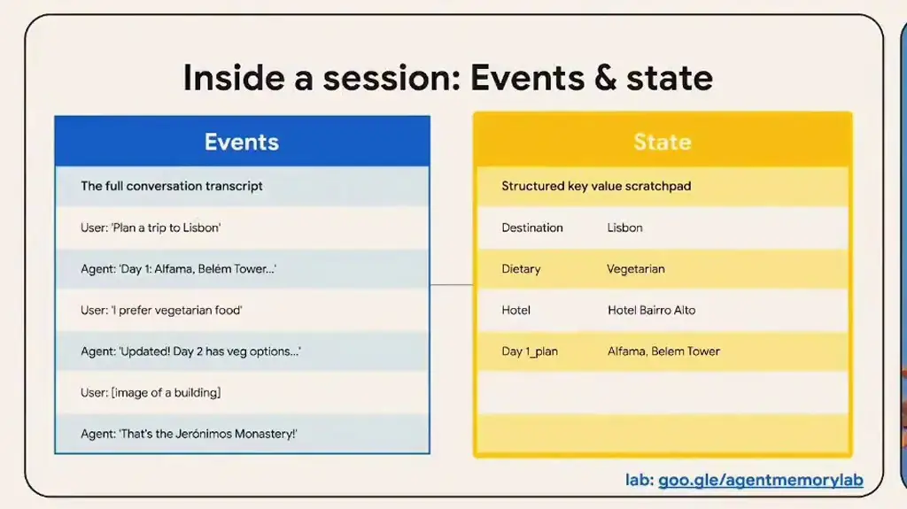
*[▶ 00:11:50](https://x.com/i/status/2114978265928753278) · Inside a session: Events & state*

Agents pass data through state. `output_key` saves an agent's answer to a key, and the next agent's instruction reads it through a placeholder like `{destination}`.

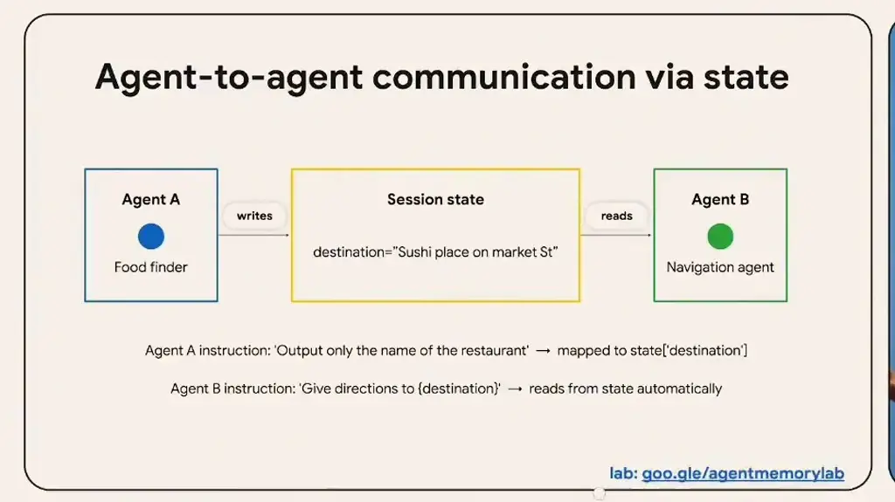
*[▶ 00:12:16](https://x.com/i/status/2114978265928753278) · Agent-to-agent communication via session state*

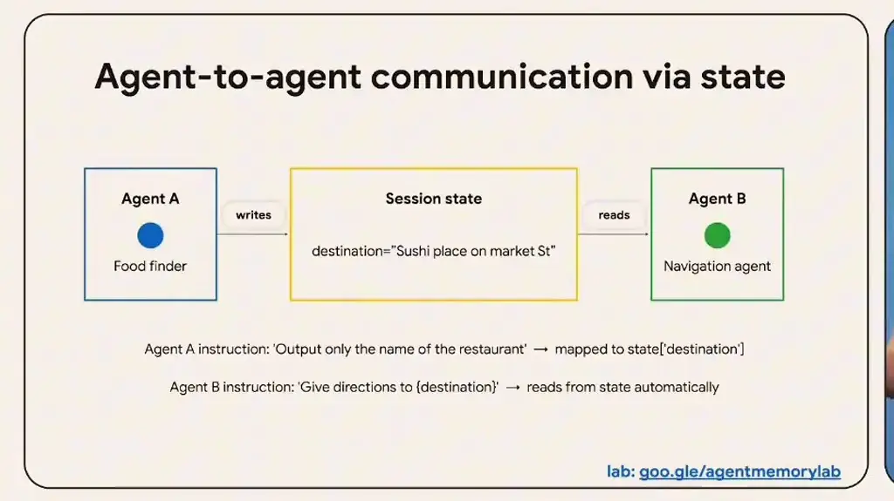
*[▶ 00:12:44](https://x.com/i/status/2114978265928753278) · Agent-to-agent communication via state*

```python
…
load_dotenv()

# --- Agent Definitions for our Specialist Team (Refactored for Sequential Workflow) ---

# Note the new `output_key` and the more specific instruction.
foodie_agent = LlmAgent(
    name="foodie_agent",
    model="gemini-2.5-flash",
    tools=[google_search],
    instruction="""You are an expert food critic. Your goal is to find the best restaurant based on…

    When you recommend a place, you must output *only* the name of the establishment and nothing el…
    For example, if the best sushi is at 'Jin Sho', you should output only: Jin Sho
    """,
    output_key="destination"  # ADK will save the agent's final response to state['destination']
)

# The `{destination}` placeholder is automatically filled by the ADK from the state.
transportation_agent = LlmAgent(
    name="transportation_agent",
    model="gemini-2.5-flash",
    tools=[google_search],
    instruction="""You are a navigation assistant. Given a destination, provide clear directions.
    The user wants to go to: {destination}.

    Analyze the user's full original query to find their starting point.
    Then, provide clear directions from that starting point to {destination}.
    """,
)

# This agent will run foodie_agent, then transportation_agent, in that exact order.
root_agent = SequentialAgent(
    name="find_and_navigate_agent",
```

*[▶ 00:12:20](https://x.com/i/status/2114978265928753278) · Foodie and transport agents with output_key*

Write state through `context.state` in tools or callbacks. Writing to `session.state` directly skips the event log, so the change won't persist.

```python
# ✅ CORRECT — ADK records the change with the event
def my_tool(context: ToolContext):
    context.state['destination'] = 'Sushi Place'
    # ADK logs this change → survives restart in Ep2 & Ep3

# ❌ INCORRECT — bypasses the event log
def my_tool(session, context):
    session.state['destination'] = 'Sushi Place'
    # Change NOT recorded → won't persist to database or memory bank
```

*[▶ 00:13:28](https://x.com/i/status/2114978265928753278) · Correct vs incorrect state writes in tools*

## Persistent sessions and a user profile store

[▶ 00:13:57](https://x.com/i/status/2114978265928753278)

Swapping `InMemorySessionService` for `DatabaseSessionService` writes every message, reply and state change to disk, so a restart keeps the history.

```python
# Replace InMemorySessionService with DatabaseSessionService
session_service = DatabaseSessionService(db_url='sqlite:///agent.db')
```

*[▶ 00:16:02](https://x.com/i/status/2114978265928753278) · DatabaseSessionService replaces InMemorySessionService*

A `get_or_create_session` helper resumes an existing session or creates one, without changing agent logic. Each session is one chat thread, so conversations stay separate.

```python
# Replace InMemorySessionService with DatabaseSessionService
session_service = DatabaseSessionService(db_url='sqlite:///agent.db')

# Helper: resume existing session or start fresh
def get_or_create_session(app_name, user_id, session_id):
    session = session_service.get_session(
        app_name=app_name,
        user_id=user_id,
        session_id=session_id
    )
    if session is None:
        session = session_service.create_session(
            app_name=app_name, user_id=user_id, session_id=session_id
        )
    return session  # resume or fresh — agent logic unchanged
```

*[▶ 00:16:49](https://x.com/i/status/2114978265928753278) · get_or_create_session pattern*

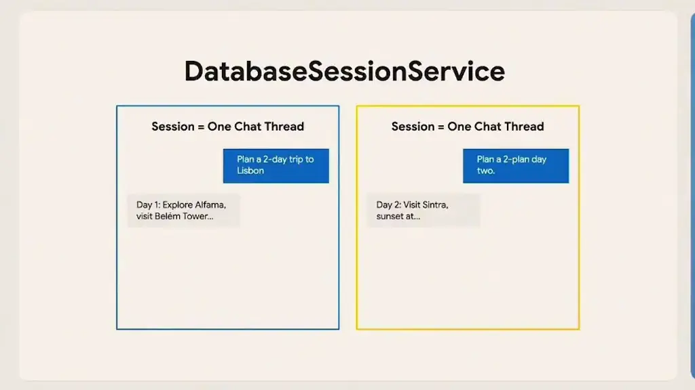
*[▶ 00:16:25](https://x.com/i/status/2114978265928753278) · DatabaseSessionService: one session per chat thread*

`InMemorySessionService` is RAM-only and suits quick tests. `VertexAISessionsService` is managed on Google Cloud.

A **user profile store** is one small table with a row per `user_id` and `preference_key`. Two tools, `recall_user_preferences` and `save_user_preferences`, read and write it for the current user, so new chats are personalized.

```python
from dotenv import load_dotenv
from google.adk.agents import LlmAgent
try:
    from .tools import setup_user_db, save_tool, recall_tool
except ImportError:
    from tools import setup_user_db, save_tool, recall_tool

load_dotenv()

# Setup the DB when the agent module is loaded
setup_user_db()

root_agent = LlmAgent(
    name="profile_planner",
    model="gemini-2.5-flash",
    tools=[save_tool, recall_tool],
    instruction="""
        You are a hyper-personalized Master Trip Planner.
        1. Recall first: at the very start of a conversation, call 'recall_user_preferen…
        2. Personalize and plan: use whatever you find.
        3. Present and learn: after planning, ask if there's anything new to save.
        4. Save last: if the user provides a new fact, call 'save_user_preferences' befo…
    """,
```

*[▶ 00:19:07](https://x.com/i/status/2114978265928753278) · Root agent with recall and save instructions*

The instruction orders the agent: recall first, personalize, ask about new facts, save last.

The restart test: `uv run adk web` clears RAM, but the session and saved preference survive on disk.

```python
if current_dir not in sys.path:
    sys.path.append(current_dir)

from google.adk.agents import Agent
from google.genai import types
from google.adk.runners import Runner
from google.adk.sessions import Session, InMemorySessionService
from agent import root_agent

# --- A Helper Function to Run Our Agents ---
async def run_agent_query(agent: Agent, query: str, session: Session, user_id: str, session_service…
    """Initializes a runner and executes a query for a given agent and session."""
    print(f"\n… Running query for agent: '{agent.name}' in session: '{session.id}'...")

    runner = Runner(
        agent=agent,

shell output:
(memory_agent) qingyue-mac:memory_agent qingyue$ INFO:     Shutting down
INFO:     Waiting for application shutdown.
…
INFO:     Application shutdown complete.
INFO:     Finished server process [18137]

Aborted!
(memory_agent) qingyue-mac:memory_agent qingyue$ uv run adk web
```

*[▶ 00:20:00](https://x.com/i/status/2114978265928753278) · Helper runner code and restart in terminal*

Sessions survive restarts; the profile store personalizes new chats.

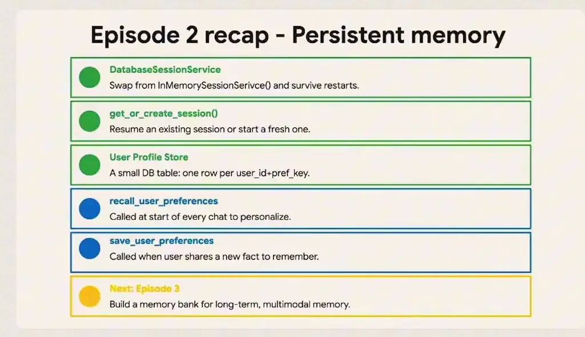
*[▶ 00:21:03](https://x.com/i/status/2114978265928753278) · Episode 2 recap with next-episode teaser*

## Long-term memory with Vertex AI Memory Bank

[▶ 00:22:22](https://x.com/i/status/2114978265928753278)

SessionService manages the live chat. MemoryService is the long-term archive, with two options:

- **InMemoryMemory**: RAM storage and keyword search. Fine for local tests, lost on restart.
- **VertexAiMemoryBankService**: cloud storage with semantic search. "Two-wheeled vehicle" finds "user owns a bicycle."

The memory bank runs on an Agent Engine instance.

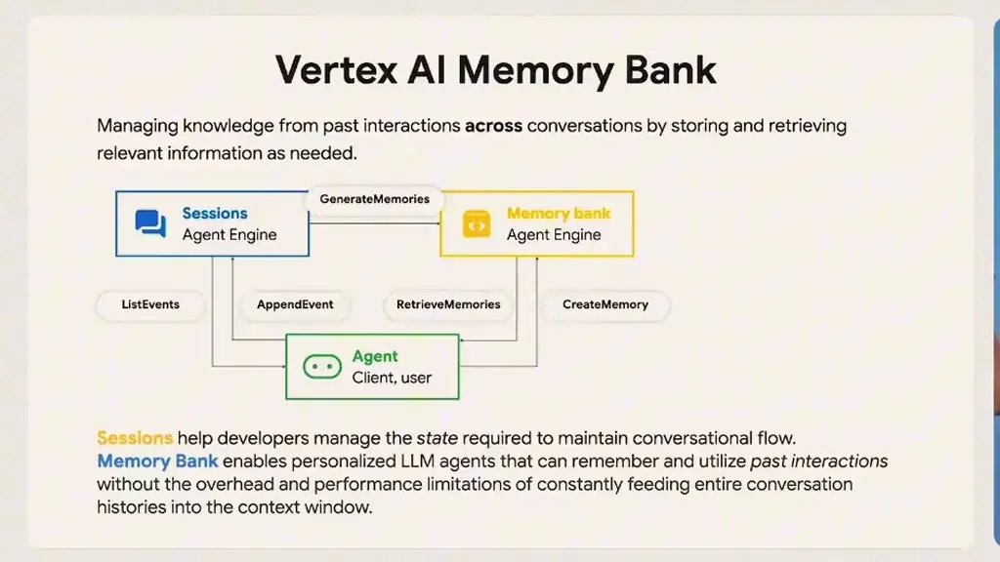
*[▶ 00:24:04](https://x.com/i/status/2114978265928753278) · Vertex AI Memory Bank*

Setup picks a generation model to extract facts and an embedding model for search.

```python
# Configure Agent Engine with fact extraction + embedding models
agent_engine = AgentEngine.create(
    generation_model='gemini-2.5-pro',     # extracts facts
    embedding_model='text-embedding-005', # embeds for search
    topics=['user_preferences', 'travel_experiences'],
)

# Wire both services to the same engine
session_service = VertexAiSessionService(agent_engine_id=agent_engine.id)
memory_service = VertexAiMemoryBankService(agent_engine_id=agent_engine.id)

# Key point: this is a service, not just a table —
# it processes content, extracts facts, and makes them searchable
```

*[▶ 00:24:32](https://x.com/i/status/2114978265928753278) · Setting up the memory bank (Agent engine)*

`add_session_to_memory` archives a finished session.

```python
print("Conversation finished. Consolidating all memories at once...")
final_session_state = await session_service.get_session(
    app_name=APP_NAME, user_id=USER_ID, session_id=session.id
)
await memory_service.add_session_to_memory(final_session_state)
print("✅ Full conversation context (Image, Video, Audio) saved to Mem…")
print("…")

# 5. New Session - Recall
new_session = await session_service.create_session(
```

*[▶ 00:26:33](https://x.com/i/status/2114978265928753278) · main.py saves session to memory bank*

Files can also be uploaded directly, even ones not from a chat.

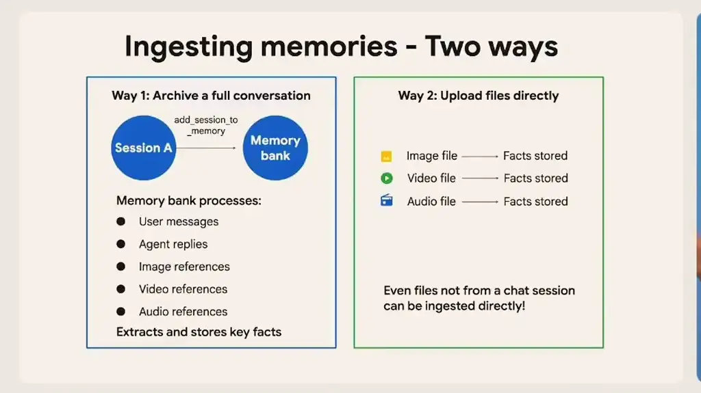
*[▶ 00:25:43](https://x.com/i/status/2114978265928753278) · Ingesting memories: two ways*

PreloadMemoryTool runs every turn. It searches the bank with the new message and injects relevant facts into the prompt.

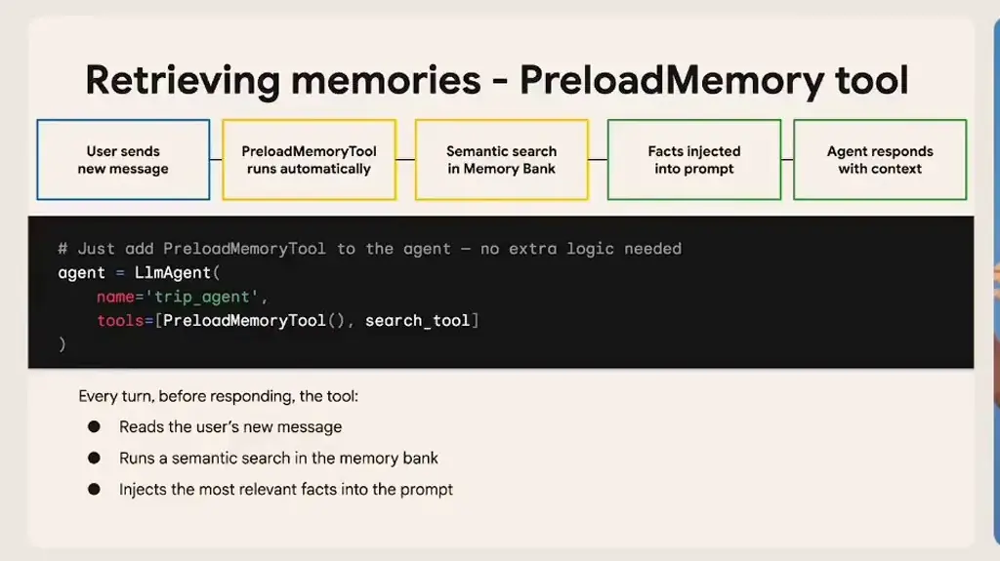
*[▶ 00:26:09](https://x.com/i/status/2114978265928753278) · Retrieving memories with PreloadMemory tool*

```python
# Just add PreloadMemoryTool to the agent — no extra logic needed
agent = LlmAgent(
    name='trip_agent',
    tools=[PreloadMemoryTool(), search_tool]
)
```

```python
load_dotenv()

root_agent = LlmAgent(
    model="gemini-2.5-flash",
    name="TripPlanner",
    instruction="""You are an advanced trip planning assistant with memory and tools.

    Your capabilities:
      - Access to user's complete travel history through memories
      - Use 'calculate_trip_budget' to provide cost estimates
      - Remember all conversations and preferences

    Tool usage guidelines:
      - Always mention what memories influenced your suggestions
      - After providing budget, ask if they want adjustments

    Be personal and reference specific past experiences when available.
    If not available, just keep talking with the user. Don't make up facts.
    """,
    tools=[PreloadMemoryTool(), budget_tool],
)
```

*[▶ 00:26:15](https://x.com/i/status/2114978265928753278) · Root agent with PreloadMemoryTool*

In the demo, a new session with empty state recalled an earlier photo, video, and audio.

## A long-running agent that sleeps between steps

[▶ 00:28:41](https://x.com/i/status/2114978265928753278)

A new-hire onboarding coordinator built on ADK can run for weeks, pausing for signatures, IT provisioning and laptop delivery.

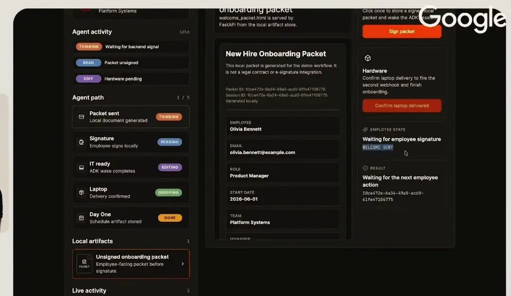
*[▶ 00:30:25](https://x.com/i/status/2114978265928753278) · HR onboarding agent demo: employee portal and command center*

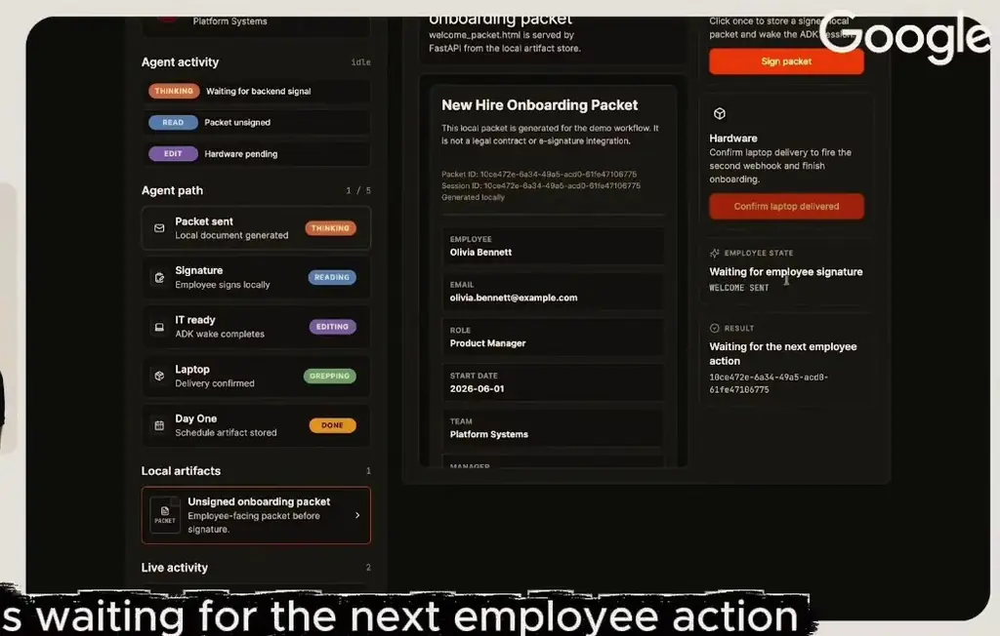
*[▶ 00:30:35](https://x.com/i/status/2114978265928753278) · HR onboarding app waiting for employee signature*

After sending the welcome packet, the agent logs its activity and goes dormant: no polling loop, no spinning thread, only an external event wakes it.

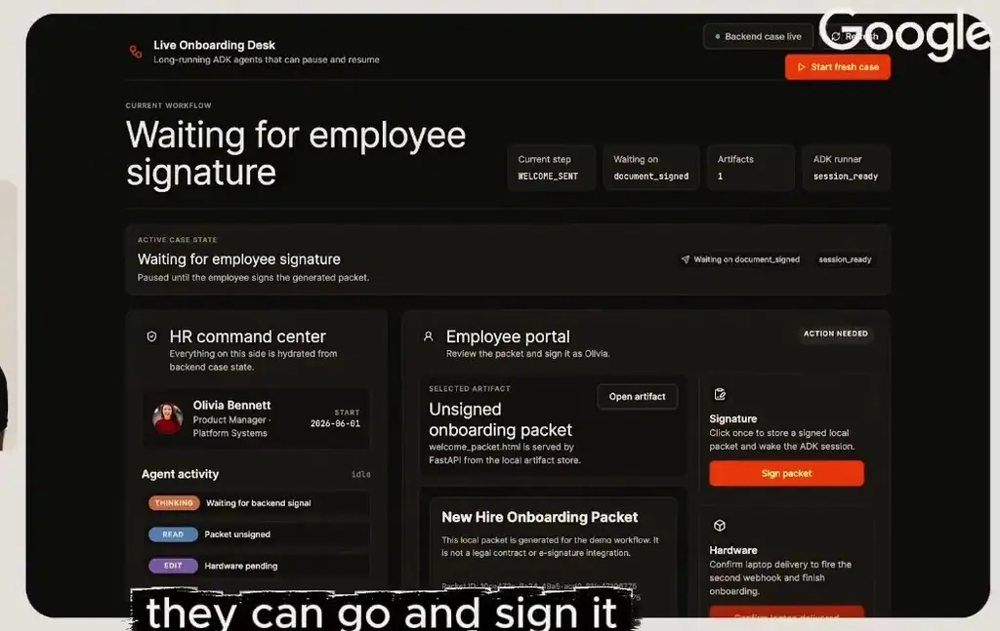
*[▶ 00:31:13](https://x.com/i/status/2114978265928753278) · Live onboarding desk waiting for employee signature*

Signing is that event. The UI waits for the backend resume turn to finish before updating, so it never shows optimistic state.

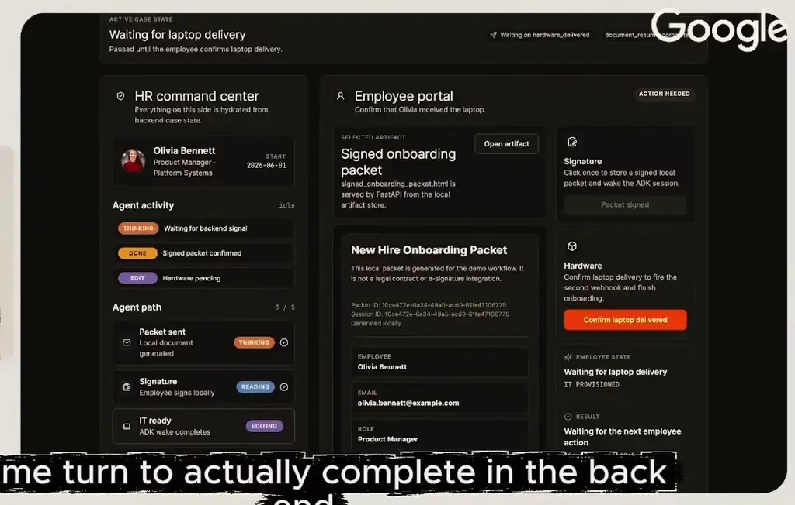
*[▶ 00:31:50](https://x.com/i/status/2114978265928753278) · HR and employee portal paused for laptop delivery*

A stateless agent replays full history into one context window, which fills and gets discarded; a long-running agent keeps state across sessions for hours, days or weeks.

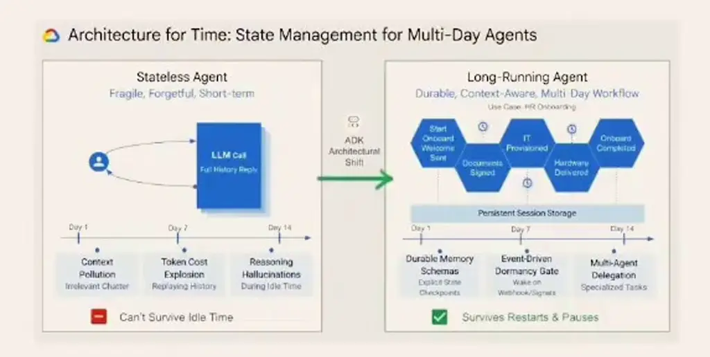
*[▶ 00:29:54](https://x.com/i/status/2114978265928753278) · Architecture diagram: stateless vs long-running agent*

Three things differ: **durable memory schemas**, where state is an enum in a database rather than raw chat logs; **event-driven dormancy**, with the agent at rest between gates; and **multi-agent delegation** to a specialized sub-agent.

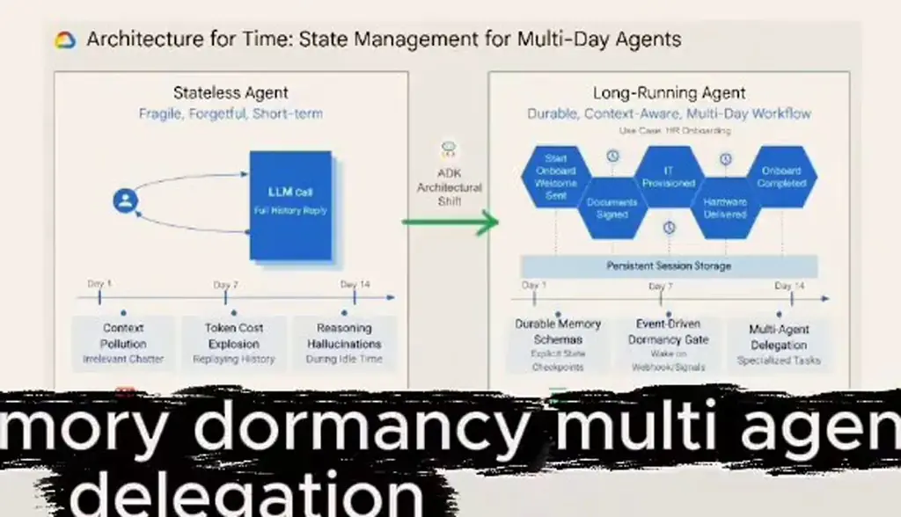
*[▶ 00:29:45](https://x.com/i/status/2114978265928753278) · Stateless vs long-running agent architecture*

## Sleep, checkpoints, and separate evaluation

[▶ 00:34:58](https://x.com/i/status/2114978265928753278)

Long-running agents need three properties:

1. **Sleep:** No polling or blocked threads. A webhook, schedule, human approval, or tool callback wakes the dormant agent.
2. **Checkpointing:** Persist state on every transition. A crashed container can redeploy, and a human can take days to act before the agent resumes exactly where it stopped.
3. **Separate evaluation:** Agents overrate their own output, so use a separate evaluator that tests live results.

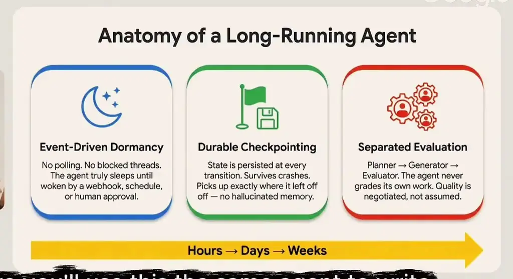
*[▶ 00:36:39](https://x.com/i/status/2114978265928753278) · Anatomy of a Long-Running Agent*

Together, these properties turn chatbots into agents for multi-day or multi-week workflows.

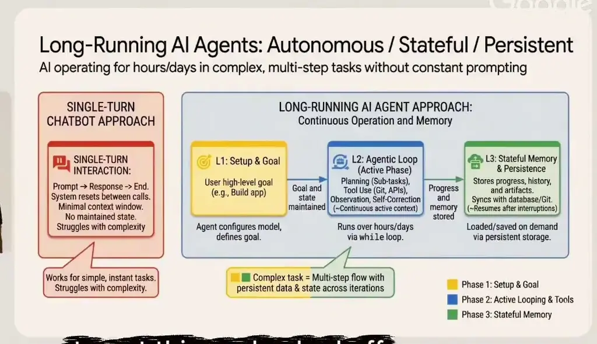
*[▶ 00:38:04](https://x.com/i/status/2114978265928753278) · Long-Running AI Agents: Single-Turn vs. Agentic Loop*

Agents hit three walls: context degrades, persistent state is missing, and they can't verify they're done.

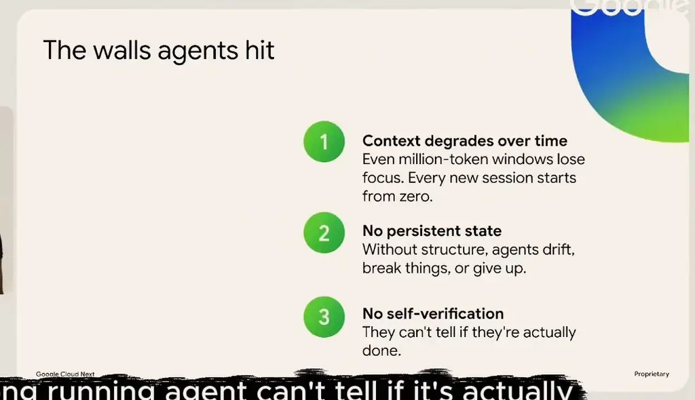
*[▶ 00:38:58](https://x.com/i/status/2114978265928753278) · The walls agents hit*

Three breakthroughs help:

- **Harnesses** split planning, building, and evaluating into separate agents, with git commits, progress files, and automated tests.
- **Persistent memory:** markdown living plans, changelogs as lab notes, and a "Ralph loop" that sends the agent back when it claims completion early.
- **Managed cloud:** Agent Engine sessions and Memory Bank.

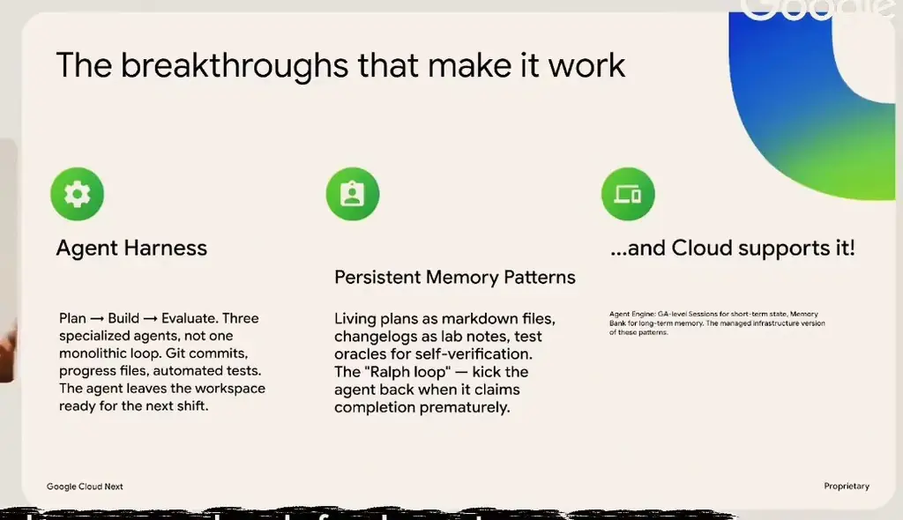
*[▶ 00:39:58](https://x.com/i/status/2114978265928753278) · The breakthroughs that make it work*

## One stdio server, one tool: wiring Trends into the agent

[▶ 00:40:13](https://x.com/i/status/2114978265928753278)

The server is one file, `server.py`, that exposes a single tool, `trends`, over stdio. Its imports pull in the MCP SDK and ADK's `FunctionTool`.

```python
#!/usr/bin/env python3
"""
Minimal MCP server exposing a single tool: `trends`

Fast & demo-friendly:
- quick=True (default) returns only related queries (fastest)
- quick=False returns related + interest_over_time (slower)
- Tight pytrends timeouts, no retries
- Fallbacks: daily & realtime trending when related_queries is empty/errs
- No prints to stdout before handshake (stderr only for logs)
"""

import asyncio, json, os, sys
from typing import Dict, List, Optional

# MCP (low-level stdio)
from mcp import types as mcp_types
from mcp.server.lowlevel import Server, NotificationOptions
from mcp.server.models import InitializationOptions
import mcp.server.stdio

# ADK FunctionTool wrapper + schema conversion
from google.adk.tools.function_tool import FunctionTool
```

*[▶ 00:43:40](https://x.com/i/status/2114978265928753278) · server.py module docstring and imports*

**FunctionTool** wraps the plain Python function. It reads the function's signature and docstring to build the tool name and schema, so no schema is written by hand. The `Server("adk-trends-mcp")` object is the MCP endpoint the client sees during the handshake.

```python
        return payload

    except Exception as e:
        _log(f"fatal error: {e}")
        return {"status": "error", "message": f"trends fai…

# Wrap as ADK FunctionTool
trends_tool = FunctionTool(trends)

# MCP app
app = Server("adk-trends-mcp")

@app.list_tools()
async def list_tools() -> list[mcp_types.Tool]:
```

*[▶ 00:44:13](https://x.com/i/status/2114978265928753278) · Wrapper, Server object, and list_tools start*

`list_tools` answers "what tools do you have?" by returning the ADK tool converted with `adk_to_mcp_tool_type`. That converter takes a `BaseTool` and returns an MCP `Tool`, giving the client the tool's names, parameters, types and description.

```python
        return {"status": "error", "message": f"trends failed: {e}"}

# Wrap as ADK FunctionTool
trends_tool = FunctionTool(trends)

# MCP app
app = Server("adk-trends-mcp")

@app.list_tools()
async def list_tools() -> list[…
    return [adk_to_mcp_tool_type(trends_tool)]

@app.call_tool()
async def call_tool(name: str, arguments: dict) -> list[mcp_types.Content]:
    if name != trends_tool.name:
        err = {"error": f"unknown tool '{name}'"}
        return [mcp_types.TextContent(type="text", text=json.dumps(err))]
    try:
        result = await trends_tool.run_async(args=arguments, tool_context=None)
        …mps(result, indent=2
```

*[▶ 00:44:58](https://x.com/i/status/2114978265928753278) · list_tools returns converted Trends tool*

```python
    return [adk_to_mcp_tool_type(trends_tool)]

@app.call_tool()
async def call_tool(name: str, arguments: dict) -> list[mcp_types.Content]:
    if name != trends_tool.name:
        err = {"error": f"unknown tool '{name}'"}
        return [mcp_types.TextContent(type="text", text=json.dumps(err))]
    try:
        …
        …
    except Exception as…
```

*[▶ 00:45:03](https://x.com/i/status/2114978265928753278) · adk_to_mcp_tool_type hover documentation*

`call_tool` checks the requested name, forwards the arguments to `trends_tool.run_async`, and returns the result as JSON text content. Failures return a JSON error, with details logged to stderr so stdout stays clean for the protocol.

```python
    return [adk_to_mcp_tool_type(trends_tool)]

@app.call_tool()
async def call_tool(name: str, arguments: dict) -> list[mcp_types.Content]:
    if name != trends_tool.name:
        err = {"error": f"unknown tool '{name}'"}
        return [mcp_types.TextContent(type="text", text=json.dumps(err))]
    try:
        result = await trends_tool.run_async(args=arguments, tool_context=None)
        return [mcp_types.TextContent(type="text", text=json.dumps(result, indent=2))]
    except Exception as e:
        _log(f"call_tool error: {e}")
```

*[▶ 00:45:22](https://x.com/i/status/2114978265928753278) · list_tools and call_tool handlers in editor*

```python
@app.list_tools()
async def list_tools() -> list[mcp_types.Tool]:
    return [adk_to_mcp_tool_type(trends_tool)]

@app.call_tool()
async def call_tool(name: str, arguments: dict) -> list[mcp_types.Content]:
    if name != trends_tool.name:
        err = {"error": f"unknown tool '{name}'"}
        return [mcp_types.TextContent(type="text", text=json.dumps(err))]
    try:
        result = await trends_tool.run_async(args=arguments, tool_context=None)
        return [mcp_types.TextContent(type="text", text=json.dumps(result, indent=2))]
    except Exception as e:
        _log(f"call_tool error: {e}")
        err = {"error": f"Execution failed: {e}"}
        return [mcp_types.TextContent(type="text", text=json.dumps(err))]

# stdio runner
async def run_stdio():
    async with mcp.server.stdio.stdio_server() as (r, w):
```

*[▶ 00:45:39](https://x.com/i/status/2114978265928753278) · MCP call_tool handler forwarding to Python function*

The protocol reduces to name plus arguments in, JSON out. In `agent.py`, the MCP tool is added to the root agent's tools next to the planner and writer, so the agent calls it like a local function tool.

## Why models need MCP, not just APIs

[▶ 00:48:33](https://x.com/i/status/2114978265928753278)

APIs assume both sides already know what to expect. A client sends a request to an endpoint and gets a predictable JSON response. Developers document, secure, and version them.

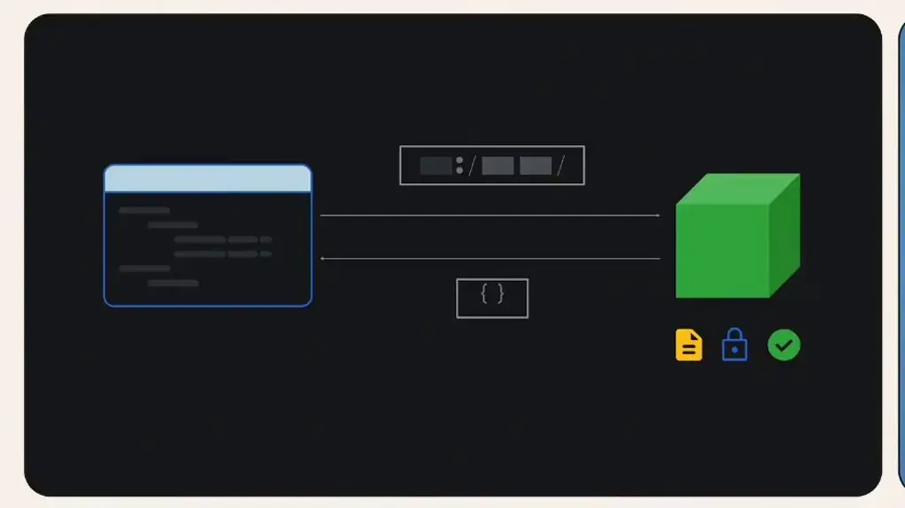
*[▶ 00:50:46](https://x.com/i/status/2114978265928753278) · API request and JSON response flow*

A model lacks that prior knowledge. Without clear labels, it cannot tell which function to call or which parameters to pass, so developers hard-code the routing or keep re-explaining it in prompts.

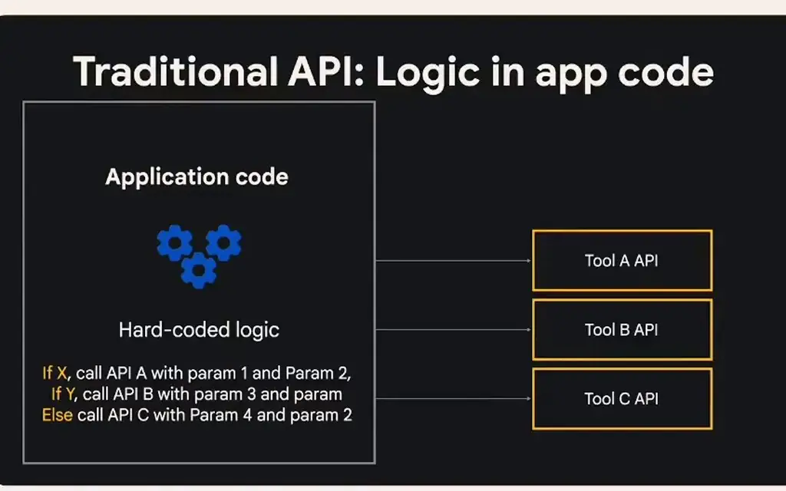
*[▶ 00:53:03](https://x.com/i/status/2114978265928753278) · Traditional API: logic in app code*

MCP moves that logic into the model's reasoning layer. A server describes its tools with JSON schemas, and the model discovers their inputs and outputs on its own.

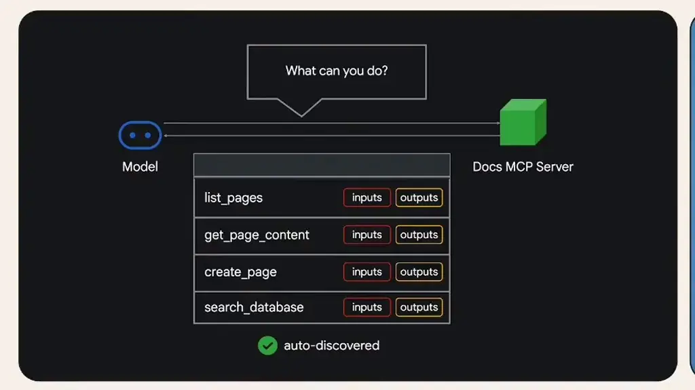
*[▶ 00:51:22](https://x.com/i/status/2114978265928753278) · MCP server auto-discovers tools*

The agent is the MCP client. It lists tools and calls them, and the MCP server forwards each call to the underlying API.

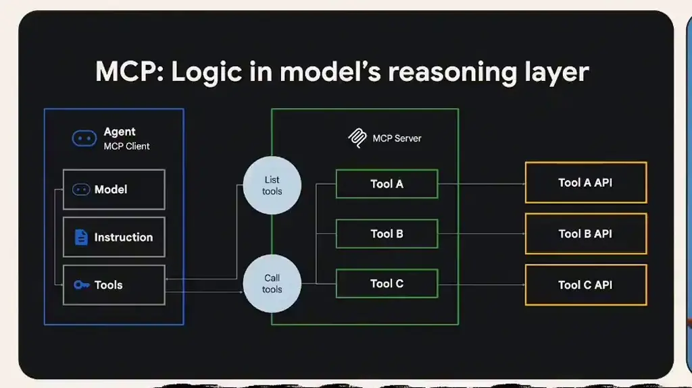
*[▶ 00:53:19](https://x.com/i/status/2114978265928753278) · MCP: Logic in model's reasoning layer*

The model connects over WebSocket or HTTP and receives standardized JSON Schema metadata. Instead of building 100 custom integrations, you build one MCP interface that any compatible model can use.

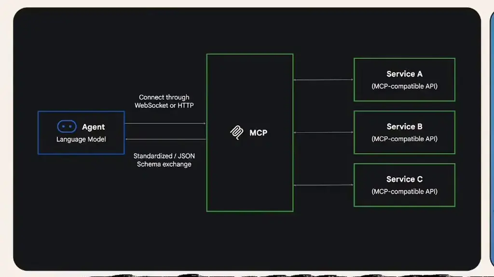
*[▶ 00:54:09](https://x.com/i/status/2114978265928753278) · Agent connects to services through MCP*

MCP does not replace your backend or APIs. It replaces the middleware between the model and the API, and the client changes from a program to the model itself. Models consume context (structured descriptions, schemas, and examples) to reason, plan, and act.

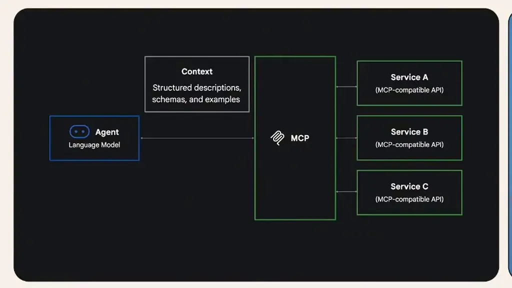
*[▶ 00:56:31](https://x.com/i/status/2114978265928753278) · Agent, context and MCP connecting services*

Adoption is the main open challenge, since servers, clients, and tools must agree on one standard. Permission controls for tool calls are the other, and the spec's capabilities, scopes, and authentication methods are meant to address them.

## From hello world to a verified multi-agent system

[▶ 01:00:00](https://x.com/i/status/2114978265928753278)

ADK (Agent Development Kit) is a framework for building agents, where an agent is an LLM with tools running in a loop until the task is done. ADK handles the tool wiring and loop control and provides local testing interfaces. Setup needs an API key from AI Studio for the Gemini API, the Google ADK pip package, and a virtual environment.

Create the project with `adk create first_agent`, then choose a model. A minimal agent needs only a `model`, a `name`, a `description`, and an `instruction` (the system prompt).

```bash
…adk create first_agent
…der already exist: '/Users/greg/code/google/adk/first_agent'
…ting content? [y/N]: n
```

*[▶ 01:01:47](https://x.com/i/status/2114978265928753278) · Running adk create first_agent*

```python
from google.adk.agents.llm_agent import Agent

root_agent = Agent(
    model='gemini-3-flash-preview',
    name='root_agent',
    description='A helpful assistant for user questions.',
    instruction='Answer user questions to the best of your knowledge',
)
```

*[▶ 01:02:14](https://x.com/i/status/2114978265928753278) · Defining root_agent in agent.py*

Renaming the agent and giving it a brief instruction is enough for a working assistant.

```python
from google.adk.agents.llm_agent import Agent

root_agent = Agent(
    model='gemini-3-flash-preview',
    name='getting_started',
    description='A helpful assistant for user questions.',
    instruction='You are a assistant who is helpful but brief.',
)
```

*[▶ 01:02:43](https://x.com/i/status/2114978265928753278) · Getting-started agent definition*

`adk run first_agent` opens a terminal chat for testing locally.

```bash
(venv) ➜ adk adk run first_agent
Log setup complete: /var/folders/1_/rhgwkj_92xd0f1lvgfg9f1tr0000gn/T/agents_log/agent.20260402_132354.log
To access latest log: tail -F /var/folders/1_/rhgwkj_92xd0f1lvgfg9f1tr0000gn/T/agents_log/agent.latest.log
Running agent getting_started, type exit to exit.
[user]: hello how are you today?
[getting_started]: Hello! I'm doing well, thank you. How can I help you today?
[user]: ^C
[user]: exit

Aborted!
(venv) ➜ adk adk run
```

*[▶ 01:03:16](https://x.com/i/status/2114978265928753278) · Running agent in terminal and web*

`adk web` starts a browser interface at `127.0.0.1:8000` that shows the stack trace, which makes it useful for debugging.

```text
.latest.log
Running agent getting_started, type exit to exit.
[user]: hello how are you today?
[getting_started]: Hello! I'm doing well, thank you. How can I help you today?
[user]: ^C
[user]: exit

Aborted!
(venv) → adk adk web
2026-04-02 13:24:23,967 - INFO - service_factory.py:266 - Using in-memory memory service
2026-04-02 13:24:23,967 - INFO - local_storage.py:84 - Using per-agent session storage rooted at /Users/greg/code/google/adk
2026-04-02 13:24:23,967 - INFO - local_storage.py:110 - Using file artifact service at /Users/greg/code/google/adk/.adk/artifacts
INFO:     Started server process [57281]
INFO:     Waiting for application startup.

+…+
| ADK Web Server started …|
|…|
| For local testing, access at http://127.0.0.1:8000 …|
+…+

INFO:     Application startup complete.
INFO:     Uvicorn running on http://127.0.0.1:8000 (Press CTRL+C to quit)
```

*[▶ 01:03:24](https://x.com/i/status/2114978265928753278) · Running adk web and its terminal output*

An LLM alone can't know the current time because its training data has a cutoff. A tool fixes this. A tool is a plain Python function passed in a `tools` list, and the list can hold several.

```python
import datetime
from google.adk.agents.llm_agent import Agent

def get_current_time() -> str:
    """Returns the current date and time."""
    return datetime.datetime.now().strftime("%Y-%m-%d %H:%M:%S")

root_agent = Agent(
    model='gemini-3-flash-preview',
    name='root_agent',
    description='An assistant that can provide the current time.',
    instruction='Answer user questions. Use the get_current_time tool if the user asks for…
    tools=[get_current_time],
)
```

*[▶ 01:05:30](https://x.com/i/status/2114978265928753278) · Full agent file with time tool*

Instead of writing a tool, an agent can import the built-in `GoogleSearchTool`. By default an agent makes only one tool call, but search often needs several, so `bypass_multi_tools_limit=True` lifts that limit. Answers take noticeably longer but are more complete, and the web console lists the sources searched.

Search answers can still contain hallucinated URLs, and some sources in the answer returned 404s.

The fix is a `url_verifier` agent with a fetch-URL tool. It returns the text of a page and labels the claim verified, not verified, or inconclusive. This is LLM-as-judge: one model's output is checked by another model with verification tools.

A researcher agent then uses agents as tools: the search agent and `url_verifier`. Each agent has a single purpose, which gives control over performance, memory, and cost. Simple steps can use a cheaper, faster model, while harder reasoning can use a stronger one.

## Links & resources

- Blog-writing agent code from the first video — in description box · mentioned [▶ 00:07:55](https://x.com/i/status/2114978265928753278)
- Session state agent-communication example source code — on screen/QR, URL not shown · mentioned [▶ 00:12:12](https://x.com/i/status/2114978265928753278)
- Session and memory example source code — on screen/QR, URL not shown · mentioned [▶ 00:16:24](https://x.com/i/status/2114978265928753278)
- User profile personalization demo — on screen/QR, URL not shown · mentioned [▶ 00:20:34](https://x.com/i/status/2114978265928753278)
- Long-term multimodal recall demo — on screen/QR, URL not shown · mentioned [▶ 00:27:21](https://x.com/i/status/2114978265928753278)
- Demos and setup steps — in the video description, URL not shown · mentioned [▶ 00:28:07](https://x.com/i/status/2114978265928753278)
- Building Long Running AI Agents that Never Lose Context with ADK — blog post by Shubham and Eric · mentioned [▶ 00:28:17](https://x.com/i/status/2114978265928753278)
- Open-source long-running agent repo with customizable front end — URL not shown · mentioned [▶ 00:33:48](https://x.com/i/status/2114978265928753278)
- Blog-writing agent repository from the first video — linked in description · mentioned [▶ 00:42:44](https://x.com/i/status/2114978265928753278)
