# Black October Isn't Just A PHP Bug. Attackers Want Your AI Keys.

*This digest covers the October 2026 security failures involving stolen AI API keys, PHP and eMudhra, and the specific updates, connection cuts, and checks to make this week.*

Source: [Black October Isn't Just A PHP Bug. Attackers Want Your AI Keys.](https://www.youtube.com/watch?v=qDYe2eTl_D4) · AI News & Strategy Daily | Nate B Jones · 26 min

## TL;DR

A stolen AI API key lets someone run up charges on your bill, and a LiteLLM release (v1.107.0) and the Postiz shutdown showed how that happens in practice. PHP's October 21 fixes for two critical remote code execution flaws, and the weak eMudhra intermediate keys, show that one mistake can spread across the internet. AI agents work the same investigative loop for attackers and defenders, so shields buy time but do not replace patches. The practical response is to update systems, prune connected apps and extensions, treat AI keys like cash, and rotate secrets when a breach notice arrives.

## Key takeaways

- Treat an AI API key like cash: check your provider billing for evidence the key was used, because anyone holding it can spend it and you pay.
- A shield from a front-end provider such as Cloudflare or Vercel buys time before you patch PHP, but it is not a patch, so update PHP as well.
- Review connected-app permissions on important accounts, keep only the access you need, and remove the rest to shrink your attack surface.
- After a compromise like LiteLLM v1.107.0, treat the environment as compromised, follow containment steps, and rotate secrets even when the source tag looks clean.
- Test candidate AI models on a replayed incident whose answer you already know, and check whether they trace from the clean repository to the build record and link the build identity to credentials.
- Watch for AI tools leaking personal data or credentials, such as an email address embedded in URLs when an agent declares itself to a website, or a GitHub credential in a response that could reach logs.
- A breach notice should state where you were exposed, whether access has stopped, and what to do; "we think everything is fine" is not enough.
- Restrict browser extensions to the sites they need, use a password manager with unique passwords and MFA, and add a family voice passphrase against deepfakes.

## Stolen AI keys, agents as defenders, and trust failures in PHP and eMudhra

[▶ 00:00:00](https://www.youtube.com/watch?v=qDYe2eTl_D4&t=0s)

A stolen AI API key turns into charges on your bill. Tokens behave like cash.

*[▶ 00:00:34](https://www.youtube.com/watch?v=qDYe2eTl_D4&t=34s) · Tokens behave like cash: key to bill flow*

A LiteLLM release (v1.107.0) stole developers' keys. Postiz shut down after warnings that its Anthropic and Stripe keys were compromised.

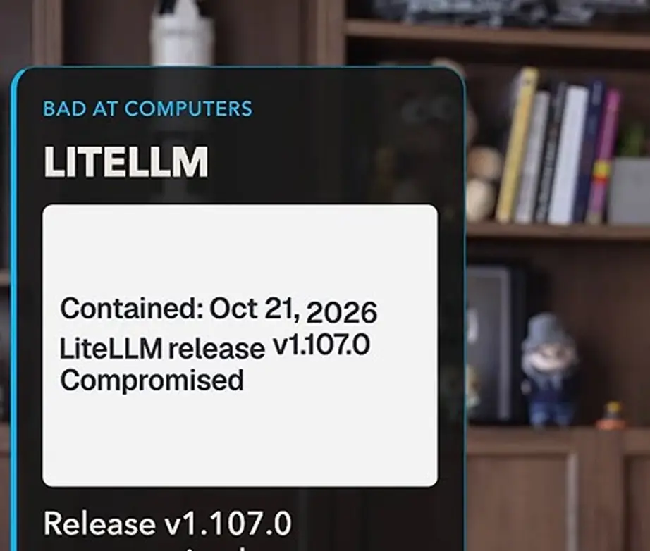
*[▶ 00:00:41](https://www.youtube.com/watch?v=qDYe2eTl_D4&t=41s) · LiteLLM release v1.107.0 compromised card*

Agents are native to computers: they investigate, test, and follow connections without tiring.

*[▶ 00:01:55](https://www.youtube.com/watch?v=qDYe2eTl_D4&t=115s) · Agents are native to computers*

PHP fixed two critical remote code execution flaws on October 21. With Apache's mod_php, attacker code runs before the site's own code.

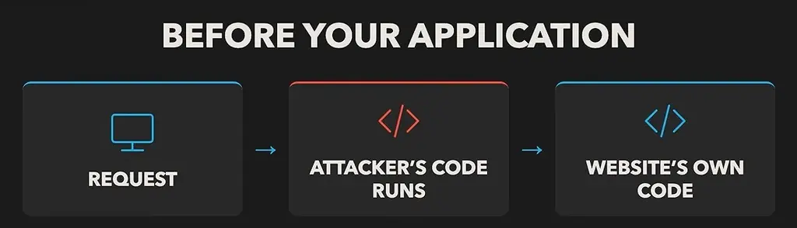
*[▶ 00:02:57](https://www.youtube.com/watch?v=qDYe2eTl_D4&t=177s) · Request flow before your application*

UK and European agencies told organizations to isolate or take down systems they cannot patch fast.

eMudhra's intermediate keys were trivially weak. Scott Helme recovered them in under a second, and one "secret" key was 4. Browsers trust that chain, so one mistake spread across the internet.

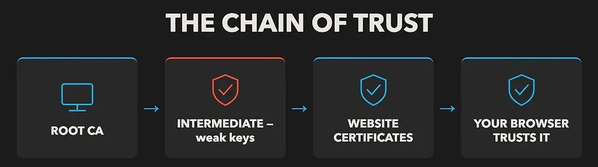
*[▶ 00:04:23](https://www.youtube.com/watch?v=qDYe2eTl_D4&t=263s) · The chain of trust*

Three takeaways follow: what to update, which connections to cut, and what to do when a service gets hit.

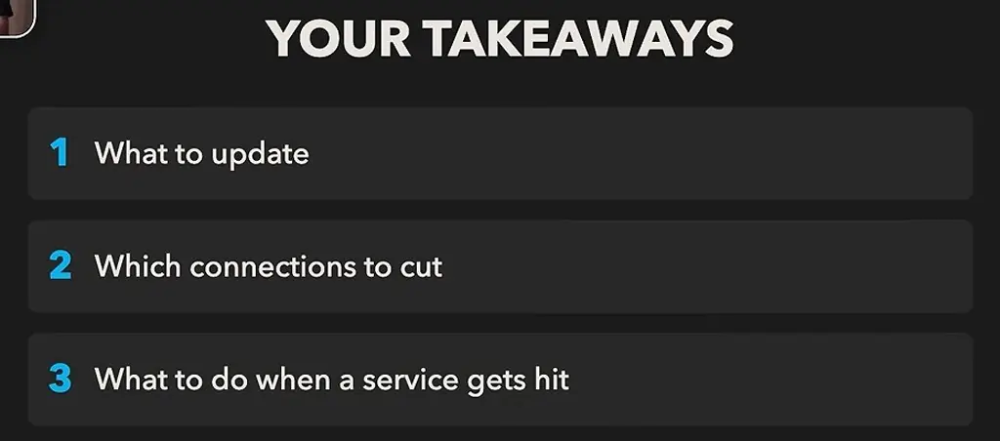
*[▶ 00:01:25](https://www.youtube.com/watch?v=qDYe2eTl_D4&t=85s) · Your takeaways list*

## Shields Buy Time, and Agents Work the Same Loop for Both Sides

[▶ 00:04:41](https://www.youtube.com/watch?v=qDYe2eTl_D4&t=281s)

Cloudflare and Vercel front many sites, so they can shield them even before owners patch PHP. A shield is not a patch.

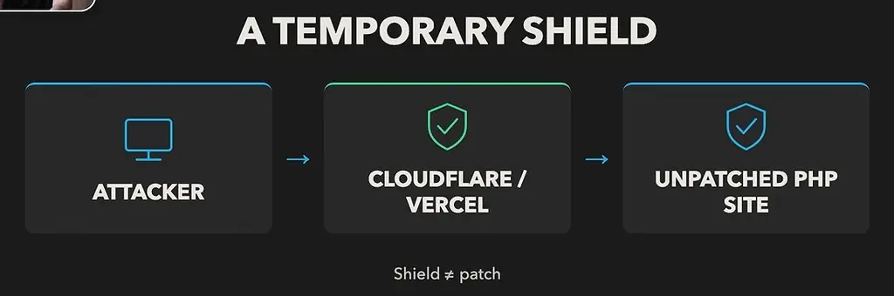
*[▶ 00:05:19](https://www.youtube.com/watch?v=qDYe2eTl_D4&t=319s) · A temporary shield*

An agent reads unfamiliar code, notices anomalies, tests them, runs them, and retries when its explanation is wrong. Offense and defense use nearly the same loop, so safeguards that stop attackers also block defenders.

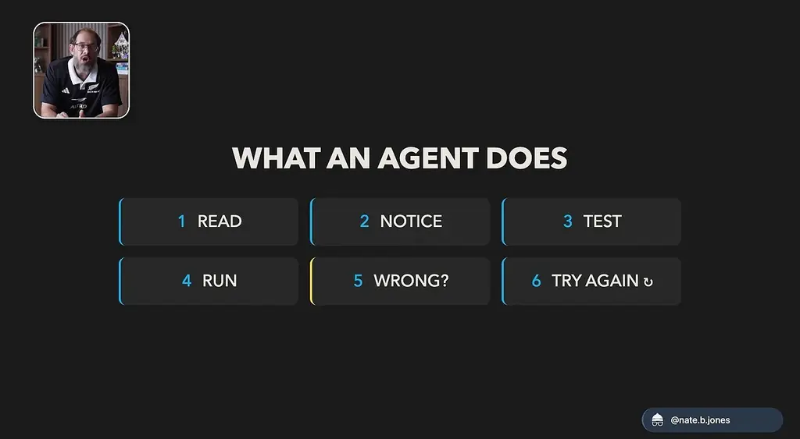
*[▶ 00:06:55](https://www.youtube.com/watch?v=qDYe2eTl_D4&t=415s) · What an agent does*

A model refused to help investigate a breach, forcing teams onto other LLMs during emergencies. Defenders should use the strongest cyber-defense model available, because attackers will.

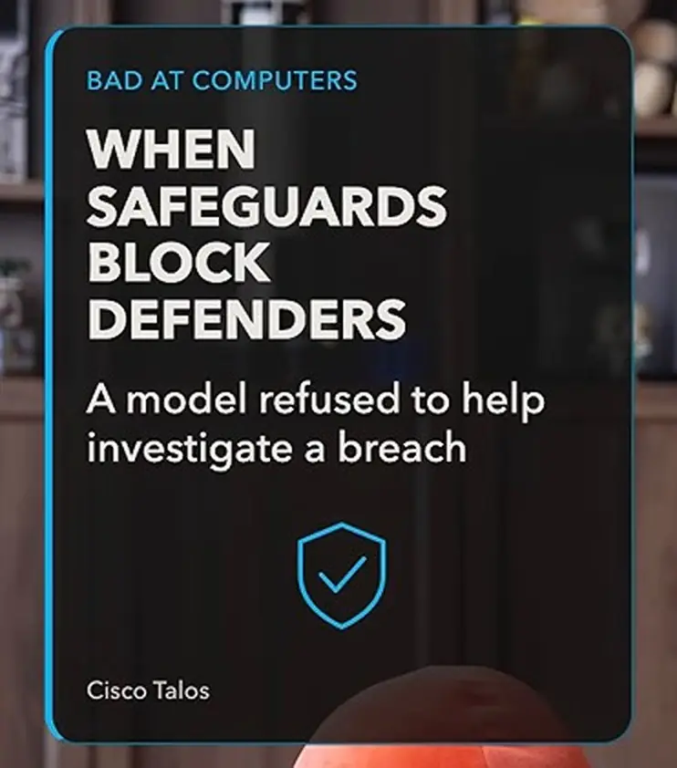
*[▶ 00:07:16](https://www.youtube.com/watch?v=qDYe2eTl_D4&t=436s) · Bad at computers: when safeguards block defenders*

Attacks now scale with computation: one person with a fleet of agents can run a cheap, well-equipped operation.

PHP maintainers spotted this problem in 2024, but compatibility risks and scarce expert time stalled the fix. AI leaves no time for years-long trade-off debates. Anthropic reported 29,000+ candidate vulnerabilities from six months of scanning, with about 6,000 reviewed so far.

## Prune connected apps and trace what the build could reach

[▶ 00:10:32](https://www.youtube.com/watch?v=qDYe2eTl_D4&t=632s)

Reasonable app connections carry hidden risk: an app you authorize can depend on a hosting provider and software you've never heard of, so a weakness anywhere along that path can expose information or access you care about.

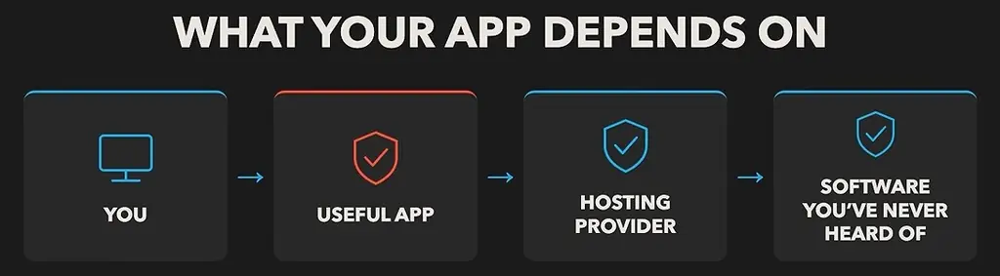
*[▶ 00:11:07](https://www.youtube.com/watch?v=qDYe2eTl_D4&t=667s) · What your app depends on*

Review the connected-app permissions on your important accounts. Keep the access you need, remove the rest, and you shrink your attack surface.

LiteLLM shows this at company scale. Its October release v1.107.0 carried credential-stealing malware even though the source tag was clean. Treat the environment as compromised, follow containment steps, and rotate secrets.

Ask what code actually executed. A finished build job can be gone while its identity still had permission to retrieve production provider keys.

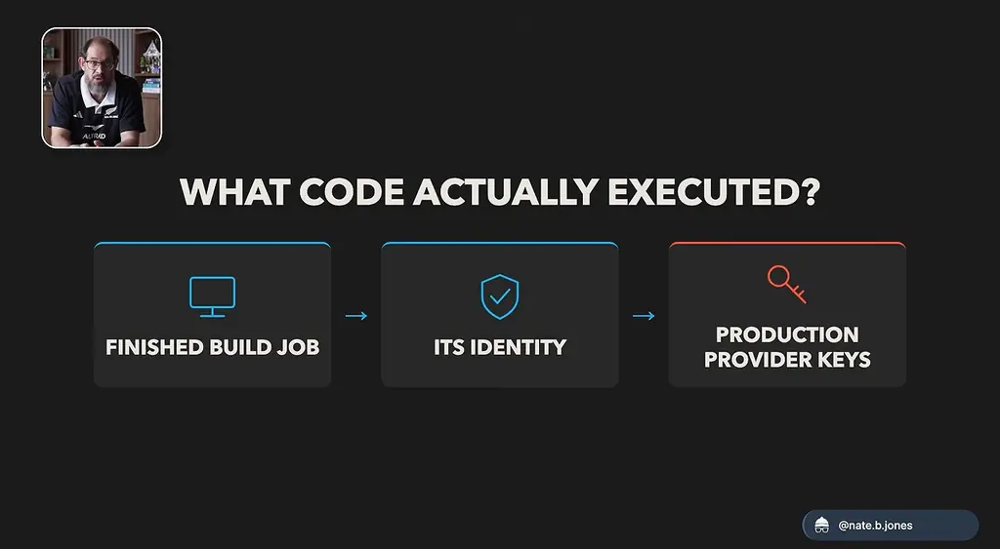
*[▶ 00:14:36](https://www.youtube.com/watch?v=qDYe2eTl_D4&t=876s) · What code actually executed?*

Test candidate models on a replayed incident whose answer you already know. Do they go past the clean repository to the build record, and do they link the build identity to credentials? Don't choose cheap.

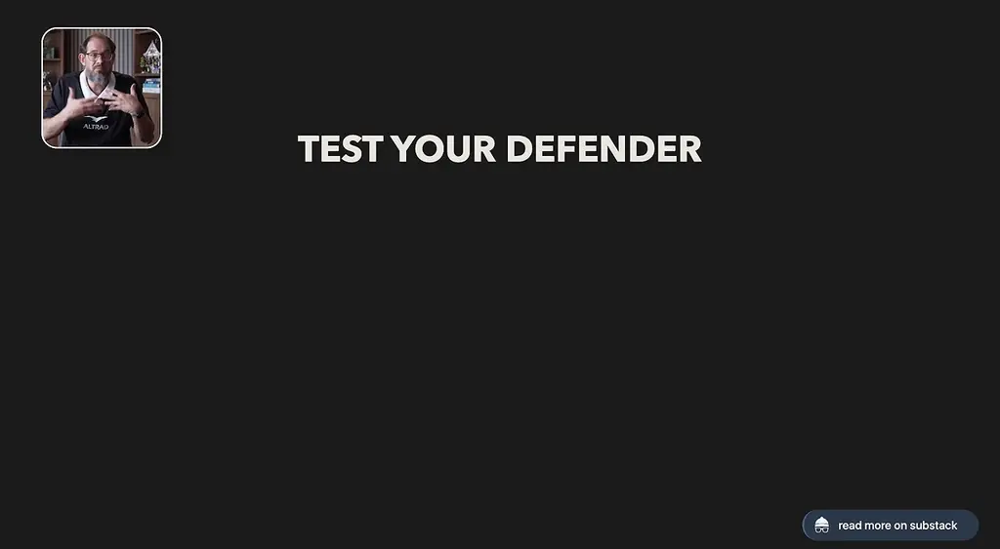
*[▶ 00:15:07](https://www.youtube.com/watch?v=qDYe2eTl_D4&t=907s) · Test your defender*

An AI API key is like cash: someone else can spend it and you pay. Check for evidence the key was used or billed.

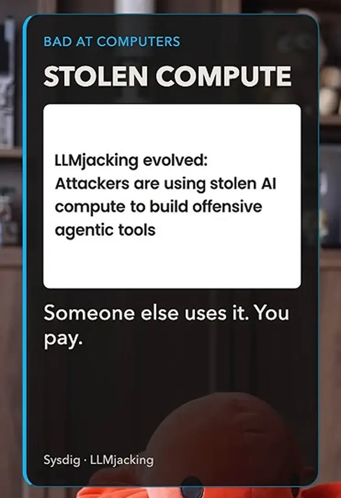
*[▶ 00:16:22](https://www.youtube.com/watch?v=qDYe2eTl_D4&t=982s) · Stolen compute: LLMjacking evolved*

Postiz's founder shut the service down on October 21 after warnings that Anthropic and Stripe keys were compromised.

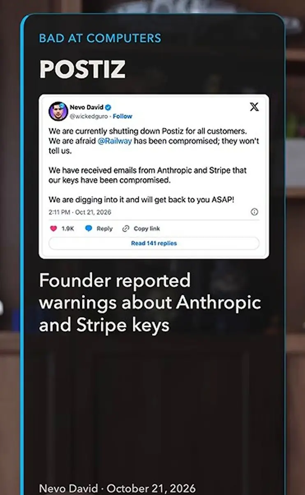
*[▶ 00:17:03](https://www.youtube.com/watch?v=qDYe2eTl_D4&t=1023s) · Postiz shutdown tweet and founder warnings*

He suspected Railway, a service Postiz depended on, was compromised. That remains an allegation.

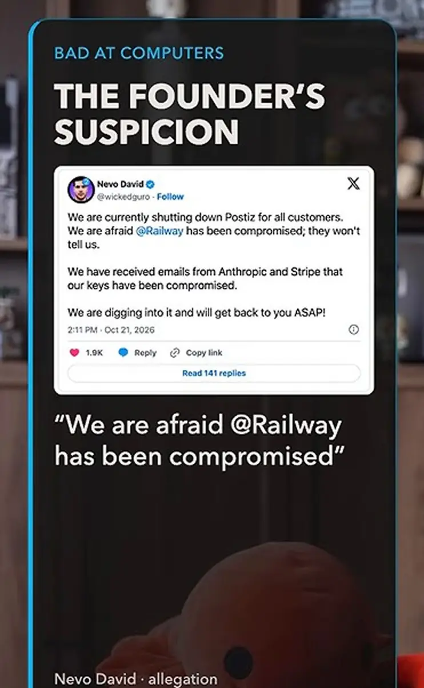
*[▶ 00:17:11](https://www.youtube.com/watch?v=qDYe2eTl_D4&t=1031s) · The founder's suspicion about Railway*

## AI tools as leak paths, and five personal defenses

[▶ 00:17:34](https://www.youtube.com/watch?v=qDYe2eTl_D4&t=1054s)

LiteLLM reported that Claude Code put a GitHub credential into a response that could reach logs, and attackers got credentials from deployment logs. Agents also embed personal data, like an email address, in URLs when they declare themselves to websites. Treat both as security flaws to investigate.

A breach notice should say where you were exposed, whether access has stopped, and what to do. "We think everything is fine" is not enough.

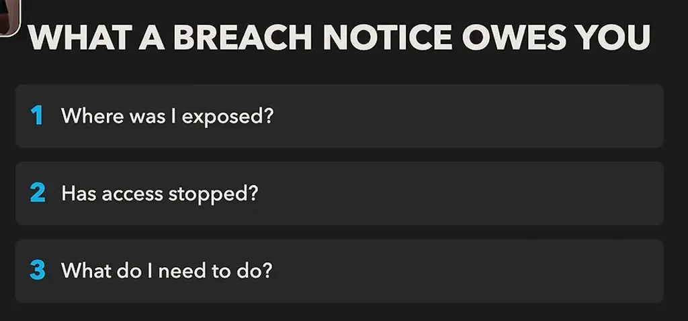
*[▶ 00:20:03](https://www.youtube.com/watch?v=qDYe2eTl_D4&t=1203s) · What a breach notice owes you*

Anthropic found almost 500 chances across 25 projects to cut exposed code and unsafe configuration interactions. Two settings can each look fine yet together silently defeat a security check.

*[▶ 00:21:38](https://www.youtube.com/watch?v=qDYe2eTl_D4&t=1298s) · Configuration interactions diagram*

Claude helped find OpenSSH signature-handling code reachable before login, even when its algorithm was off. OpenSSH 10.6 removed about one fifth of the code reachable before login.

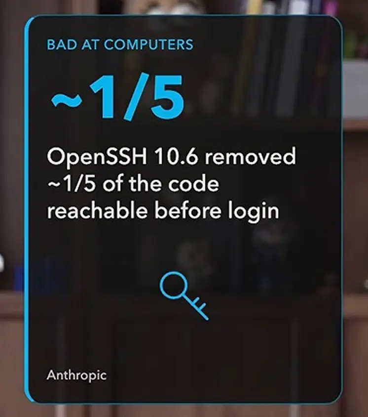
*[▶ 00:21:49](https://www.youtube.com/watch?v=qDYe2eTl_D4&t=1309s) · OpenSSH 10.6 removed about one fifth of reachable code*

Agents can investigate and follow connections, which makes them strong defenders and also the tool attackers use.

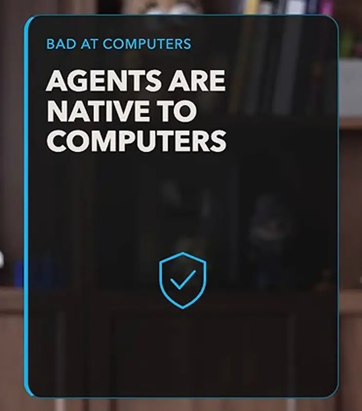
*[▶ 00:23:19](https://www.youtube.com/watch?v=qDYe2eTl_D4&t=1399s) · Callout: agents are native to computers*

Five personal steps:

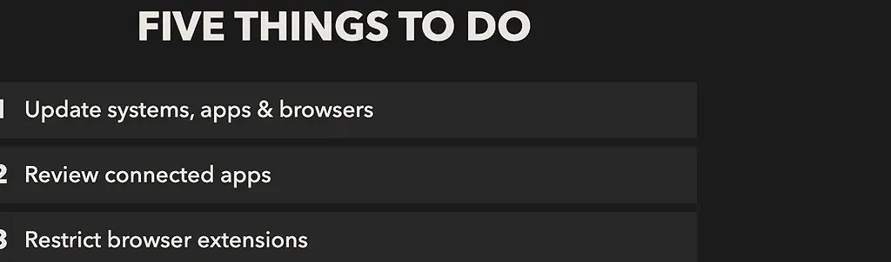
*[▶ 00:25:03](https://www.youtube.com/watch?v=qDYe2eTl_D4&t=1503s) · Five things to do (individual personal tips)*

1. **Update** systems, apps and browsers, and finish required restarts.
2. **Review connected apps**, removing unused ones and limiting the rest.
3. **Restrict browser extensions** to the sites they need.
4. **Use a password manager** with unique passwords and MFA. Add a family voice passphrase against deepfakes.
5. **Act on breach notices**: change exposed passwords and revoke affected connections. Developers should rotate API secrets.

## Links & resources

- [AI agents cybersecurity article on Nate's newsletter (linked in description)](https://natesnewsletter.substack.com/p/ai-agents-cybersecurity?utm_source=youtube&utm_medium=video&utm_campaign=ai-agents-cybersecurity-launch&utm_content=description) — <https://natesnewsletter.substack.com/p/ai-agents-cybersecurity?utm_source=youtube&utm_medium=video&utm_campaign=ai-agents-cybersecurity-launch&utm_content=description> · video description
- [Talk tracks guide: how to connect Nate's library (linked in description)](https://unlock-ai.natebjones.com/guides/how-to-connect-nates-library?utm_source=youtube&utm_medium=video&utm_campaign=ai-agents-cybersecurity-launch&utm_content=description) — <https://unlock-ai.natebjones.com/guides/how-to-connect-nates-library?utm_source=youtube&utm_medium=video&utm_campaign=ai-agents-cybersecurity-launch&utm_content=description> · video description
