# Anthropic Just Filed Its S-1. Here's What The Headlines Are Missing.

*What Anthropic's S-1 reveals about enterprise AI spending, why current budgets understate the market, and what would have to happen for usage to grow beyond engineering teams.*

Source: [Anthropic Just Filed Its S-1. Here's What The Headlines Are Missing.](https://www.youtube.com/watch?v=EAEixlPC6L4) · AI News & Strategy Daily | Nate B Jones · 32 min

## TL;DR

Anthropic's S-1 shows that more than half of the Fortune 500 pay it at least $100K a year, yet the average publicly traded Fortune 500 customer spends under $1 with Anthropic per $1,000 of total expenses. The speaker argues this gap means today's AI budgets understate the market, because most enterprises have won a team-level foothold but have not yet built AI into real budgets. Growth depends on deployments spreading department by department, supported by forward-deployed engineers and training customers' own engineers. The filing supports the expansion case in some areas, such as gross margin and revenue growth, but leaves cost per cohort, custom-work dependence, and the value of forward-deployed engineers unproven.

## Key takeaways

- Winning a customer and becoming important to one are different: the S-1 counts any customer with at least $100K in trailing-12-month revenue, which can be just a few teams.
- The top 10 Fortune 500 customers spend more than eight times the group average, but still remain under 1% of their companies' expenses.
- Net revenue retention is about 900%, meaning customers who paid in Q3 2025 spent roughly 9x as much in Q3 2026, excluding Claude Pro/Max subscribers.
- The speaker's adoption model has three stages: table stakes, deeply embedded, then disproportionate value; the filing suggests most enterprises have reached only the first.
- Claude Code was the beachhead, and the S-1 shows Cowork, a non-technical product, growing faster than Claude Code did.
- Repeatable enterprise deployment requires connecting data, systems and context, deciding how work is checked, and building a repeatable process, and each deployment makes the next one easier.
- Over 80% of September-quarter revenue came from models released in the prior six months, and cheaper tokens have not capped growth: Opus 5.5 cut customer cost per task about 40% versus Opus 5, while usage kept rising.
- Anthropic's $100M Claude Frontier Academy aims to train 10,000 engineers by the end of next year to lead customer deployments, which puts deployment ability inside buying organizations.

## Under 1%: The Room Left in Enterprise Budgets

[▶ 00:00:00](https://www.youtube.com/watch?v=EAEixlPC6L4&t=0s)

Anthropic's S-1 shows the average publicly traded Fortune 500 customer spends less than $1 with Anthropic per $1,000 of total expenses. The speaker's claim is that today's AI budgets understate the size of the market.

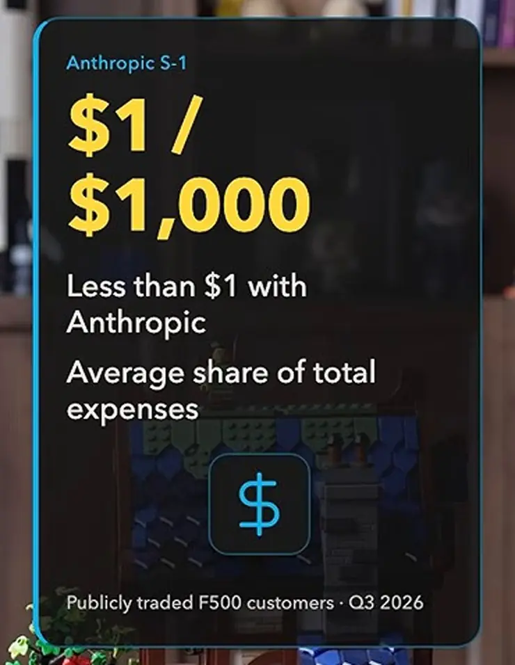
*[▶ 00:00:24](https://www.youtube.com/watch?v=EAEixlPC6L4&t=24s) · Customer spend per $1,000 of expenses*

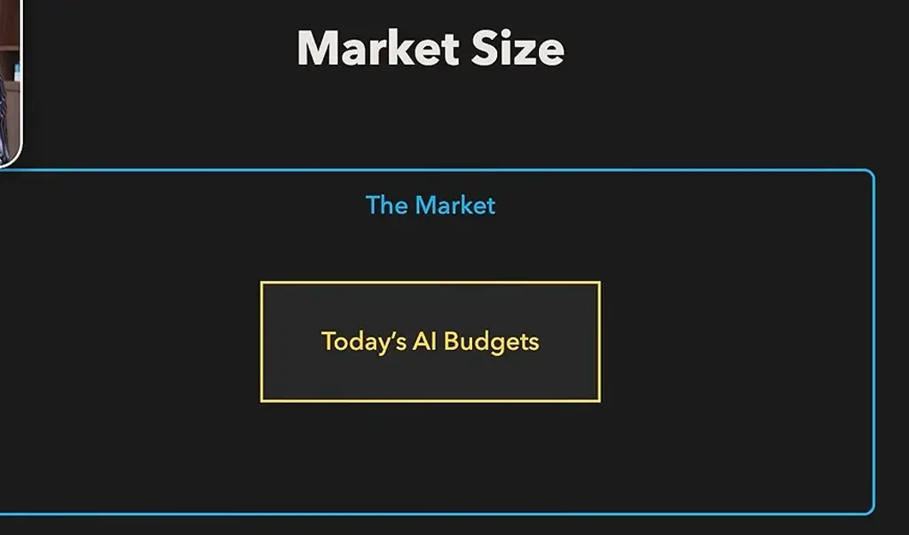
*[▶ 00:00:41](https://www.youtube.com/watch?v=EAEixlPC6L4&t=41s) · Market Size nested boxes*

The S-1 counts a customer as anyone with at least $100K in trailing-12-month revenue, which can be a few teams and a logo. **Winning a customer** is different from **becoming important** to one, which means expanding department by department into a real budget. Anthropic's filing says most enterprises use Claude in a small number of teams and use cases.

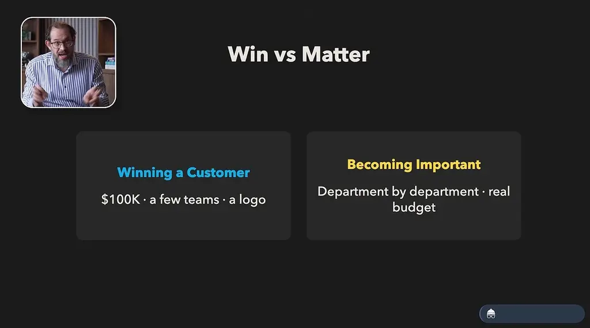
*[▶ 00:03:45](https://www.youtube.com/watch?v=EAEixlPC6L4&t=225s) · Win vs Matter*

The top 10 Fortune 500 customers spend more than eight times the group average, yet remain under 1% of expenses. Net revenue retention is about 900%: customers who paid in Q3 2025 spent roughly 9x as much in Q3 2026, excluding Claude Pro/Max subscribers.

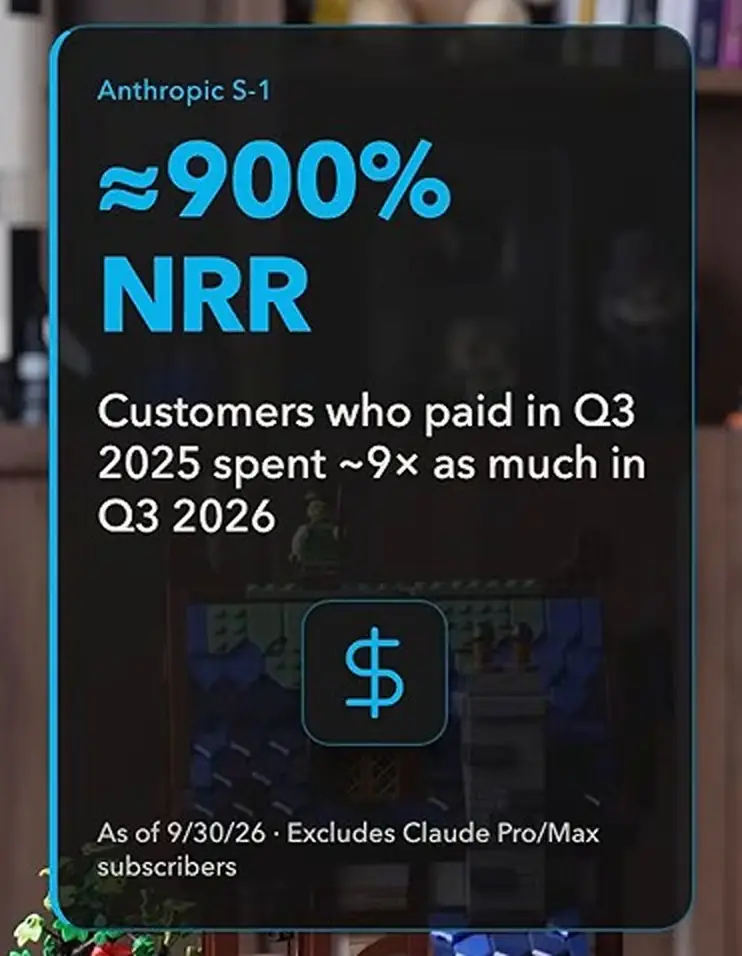
*[▶ 00:05:21](https://www.youtube.com/watch?v=EAEixlPC6L4&t=321s) · Anthropic S-1 900% NRR stat card*

The bear reading is that buyers are "seeing the limits." The bull reading is that value expands across the company. In the speaker's view, large companies adopt without deliberate ROI planning: engineers get Claude Code because peers did, and the company then watches what happens.

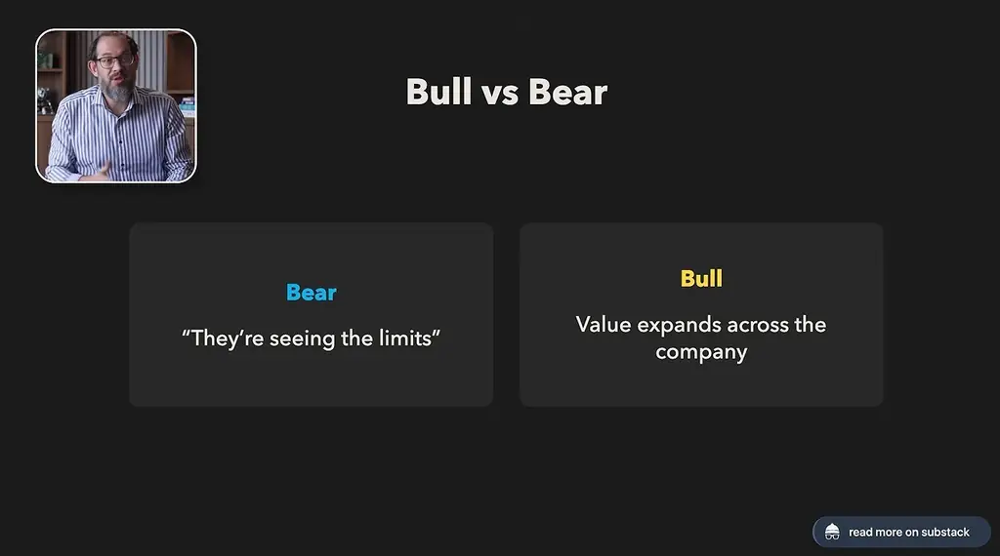
*[▶ 00:06:50](https://www.youtube.com/watch?v=EAEixlPC6L4&t=410s) · Bull vs Bear*

He describes three steps: **table stakes**, **deeply embedded**, then **disproportionate value**. Adoption has reached the first. The bull case requires companies to reorient operations around AI. If they don't, growth tops out in engineering departments.

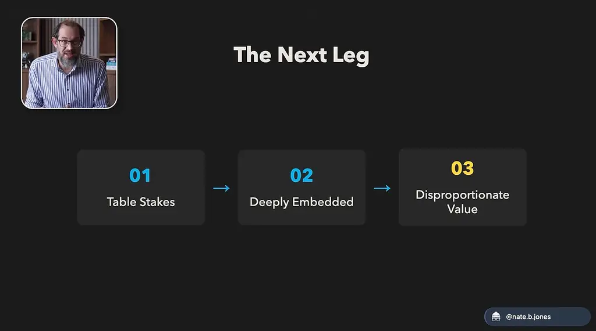
*[▶ 00:08:09](https://www.youtube.com/watch?v=EAEixlPC6L4&t=489s) · The Next Leg: three-step progression*

## Cowork Widens the Beachhead

[▶ 00:08:45](https://www.youtube.com/watch?v=EAEixlPC6L4&t=525s)

The S-1 shows Cowork, a non-technical product, growing faster than Claude Code did. Claude Code was only the beachhead.

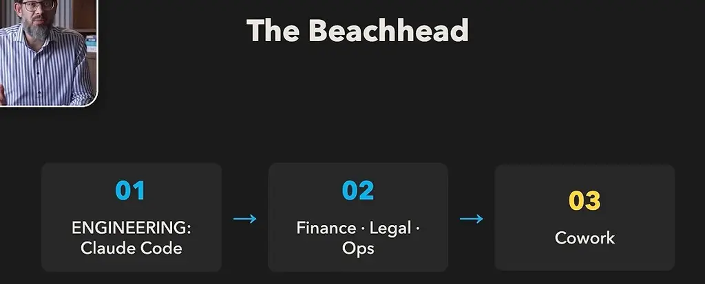
*[▶ 00:09:23](https://www.youtube.com/watch?v=EAEixlPC6L4&t=563s) · The Beachhead*

He expects $100,000 to become a table-stakes million-dollar number within a year.

Usage spreads from one person to code, analysis and research, then the company.

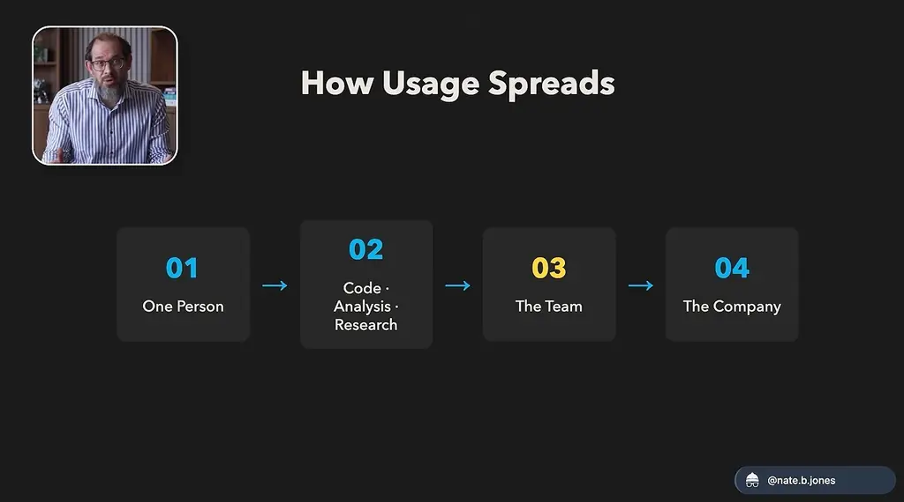
*[▶ 00:10:41](https://www.youtube.com/watch?v=EAEixlPC6L4&t=641s) · How Usage Spreads*

Anthropic and OpenAI are investing in forward-deployed engineers (FDEs).

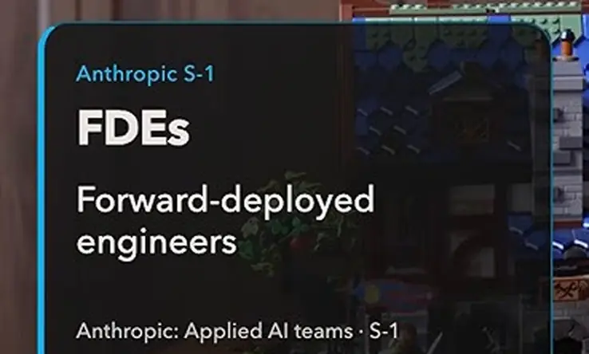
*[▶ 00:11:20](https://www.youtube.com/watch?v=EAEixlPC6L4&t=680s) · Lower-third definition: FDEs*

Repeatability needs three things:

- Connect data, systems and context.
- Decide how work is checked.
- Build a repeatable process.

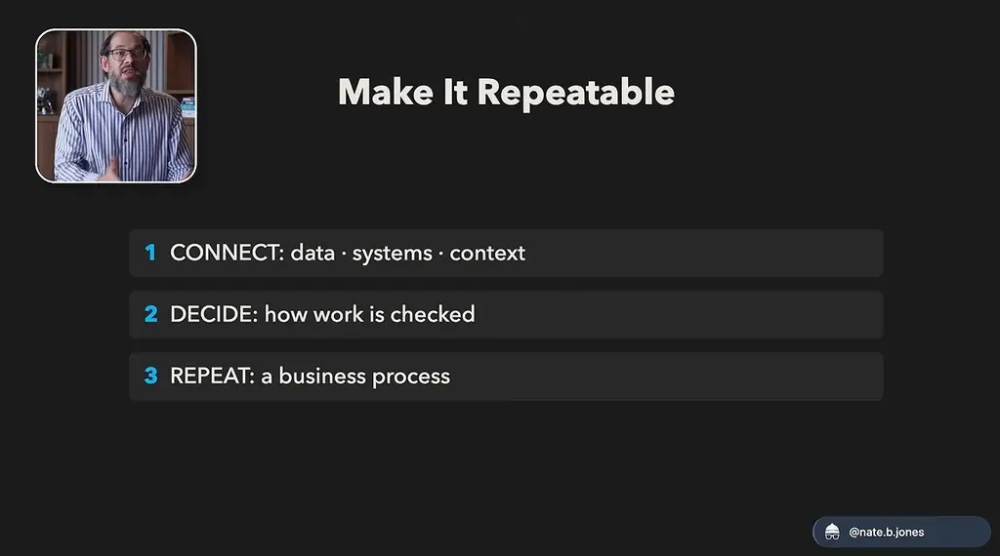
*[▶ 00:11:50](https://www.youtube.com/watch?v=EAEixlPC6L4&t=710s) · Make It Repeatable*

Each deployment makes the next easier.

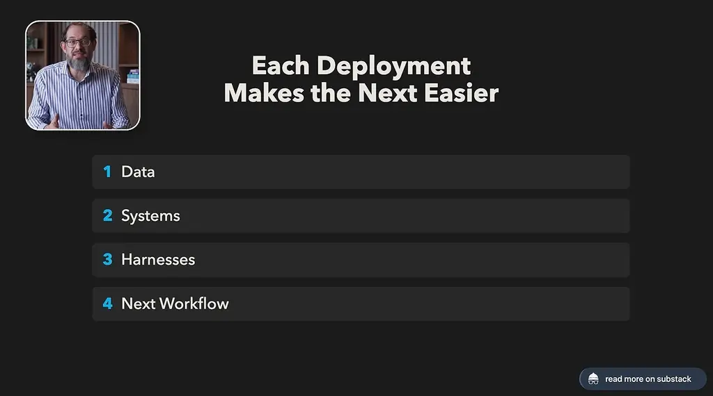
*[▶ 00:12:23](https://www.youtube.com/watch?v=EAEixlPC6L4&t=743s) · Each Deployment Makes the Next Easier*

It says Claude can suggest the next workflow worth automating.

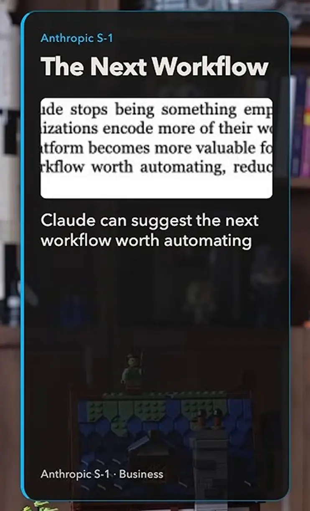
*[▶ 00:12:38](https://www.youtube.com/watch?v=EAEixlPC6L4&t=758s) · The Next Workflow (Anthropic S-1)*

## Demand beyond seats, driven by new models

[▶ 00:13:13](https://www.youtube.com/watch?v=EAEixlPC6L4&t=793s)

Some companies embed Claude in products they sell, so customers can pay twice.

Demand comes from three places:

- Helping employees: SaaS.
- Running processes: not necessarily SaaS.
- Selling inside a product: definitely not SaaS.

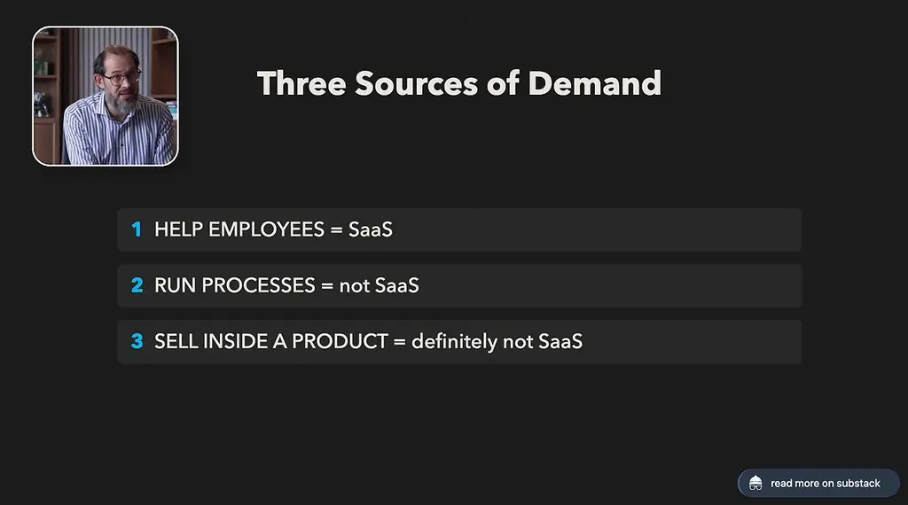
*[▶ 00:14:11](https://www.youtube.com/watch?v=EAEixlPC6L4&t=851s) · Three Sources of Demand*

Counting employees misses much of the value. More than half of customers with at least $100,000 in trailing annual revenue used both the Claude platform and a first-party app like Claude Code in the September quarter.

48% of H1 2026 revenue came through cloud marketplaces.

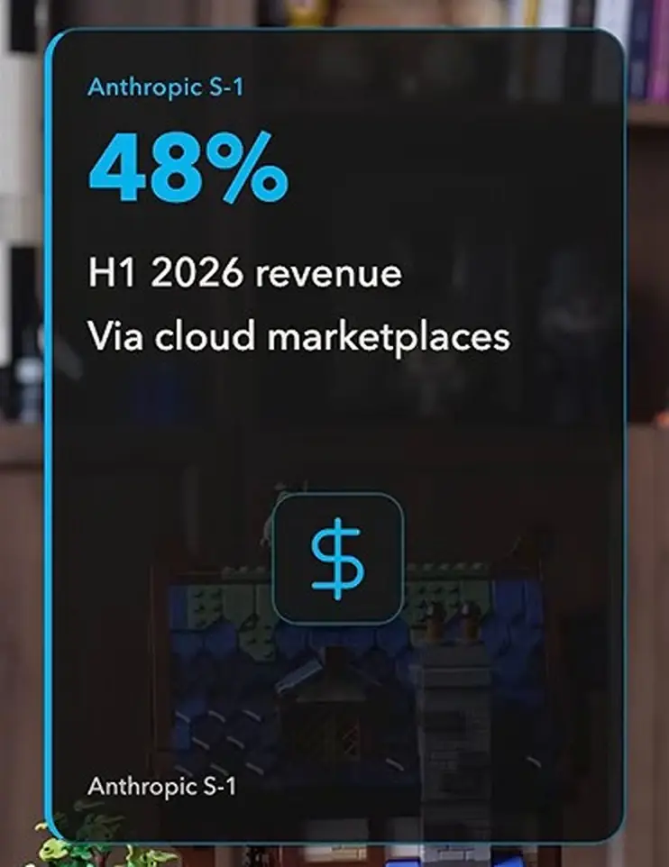
*[▶ 00:15:33](https://www.youtube.com/watch?v=EAEixlPC6L4&t=933s) · Anthropic S-1: 48% of H1 2026 revenue via cloud*

Customers reach Claude through cloud, apps, or other companies' products.

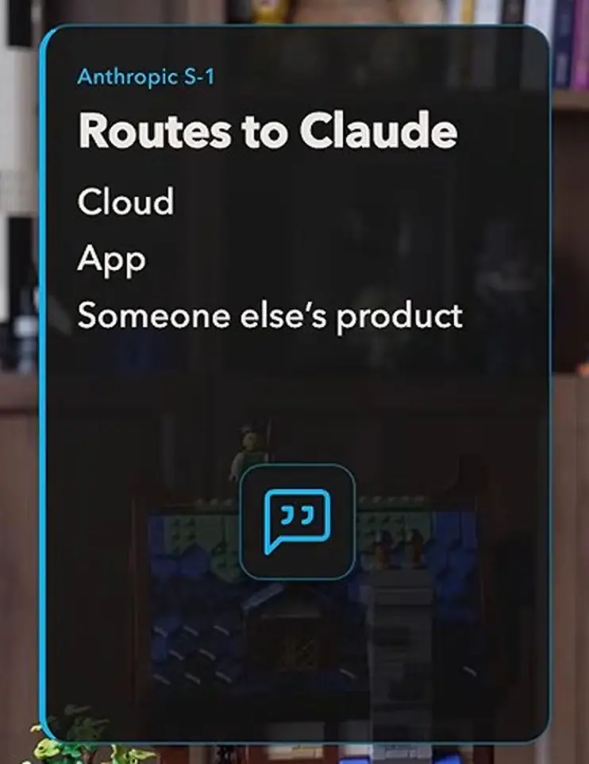
*[▶ 00:16:13](https://www.youtube.com/watch?v=EAEixlPC6L4&t=973s) · Anthropic S-1: routes to Claude*

Over 80% of September-quarter revenue came from models released in the prior six months. Customers learn new uses as the product improves, so falling prices don't cap growth.

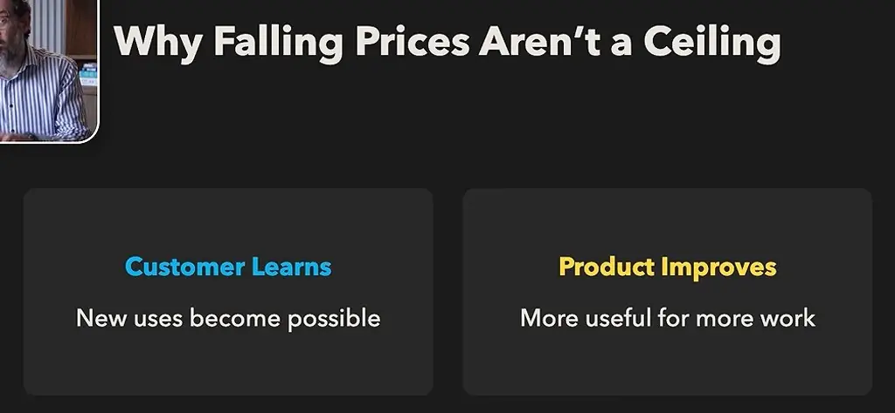
*[▶ 00:18:05](https://www.youtube.com/watch?v=EAEixlPC6L4&t=1085s) · Why Falling Prices Aren't a Ceiling*

## Cheaper tokens expand demand

[▶ 00:18:01](https://www.youtube.com/watch?v=EAEixlPC6L4&t=1081s)

Falling prices don't signal a ceiling. The filing reports Opus 5.5 cut customer cost per task about 40% versus Opus 5. The speaker's own cost per useful task improved, yet he uses as many or more tokens. This is **Jevons paradox**: cheaper resources expand use, so the question is whether extra work outweighs lower per-task cost.

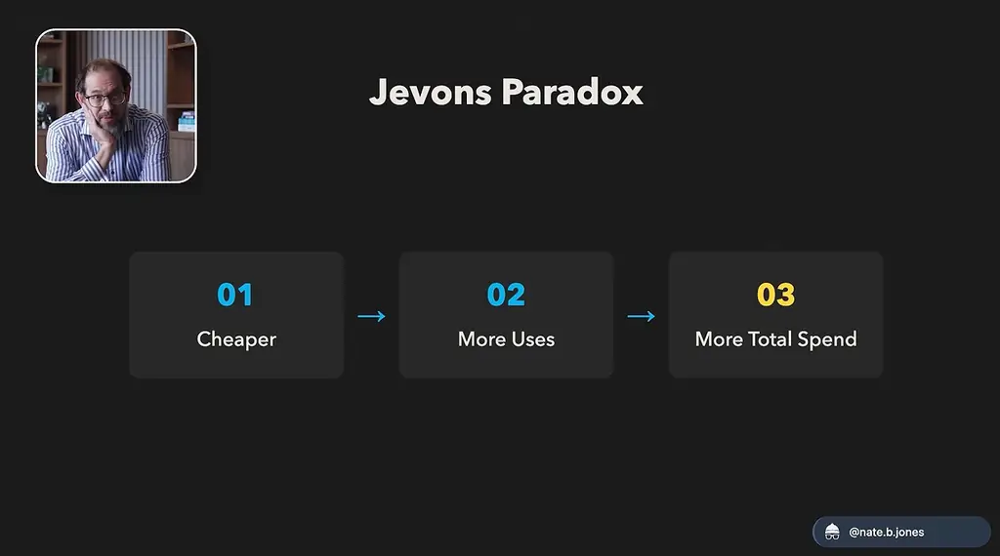
*[▶ 00:19:46](https://www.youtube.com/watch?v=EAEixlPC6L4&t=1186s) · Jevons Paradox*

RAMP data shows token volume across labs rose about 52% between September 13 and October 11, and spending rose 23%.

Growth can come from deeper use of existing workflows or from new workflows.

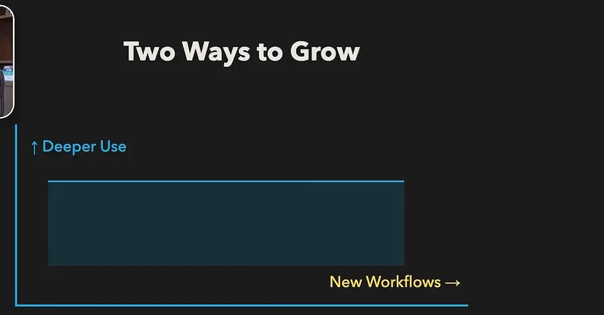
*[▶ 00:22:07](https://www.youtube.com/watch?v=EAEixlPC6L4&t=1327s) · Two Ways to Grow*

Enterprises already spend on expertise, software, information and capital, and intelligence lets that spend do more.

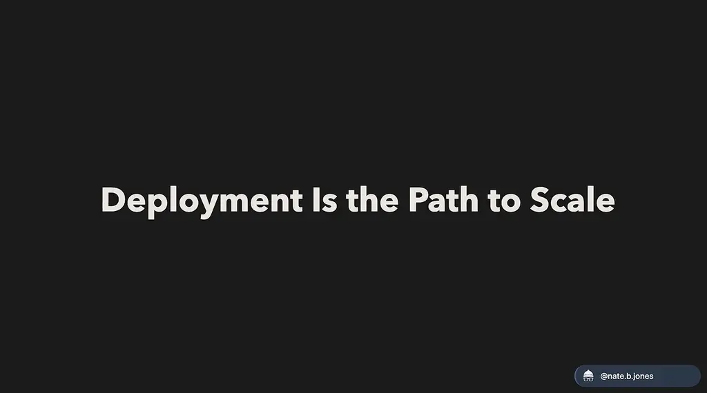
*[▶ 00:22:39](https://www.youtube.com/watch?v=EAEixlPC6L4&t=1359s) · Reasons to Buy Intelligence*

## Deployment as the Path to Scale

[▶ 00:22:39](https://www.youtube.com/watch?v=EAEixlPC6L4&t=1359s)

Anthropic committed $100 million to Claude Frontier Academy, aiming to train 10,000 engineers by the end of next year to lead customer deployments. The first useful deployment acts as a "gateway drug" for the next several.

Training customers' own engineers puts the ability to deploy inside buying organizations and speeds cross-departmental expansion.

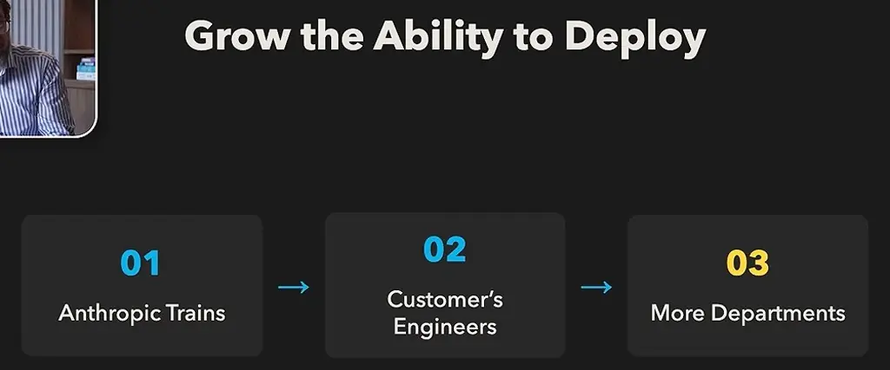
*[▶ 00:24:04](https://www.youtube.com/watch?v=EAEixlPC6L4&t=1444s) · Grow the Ability to Deploy*

Deployment effort is hard to estimate. Workflows are unique, oddly configured, poorly documented and vary in complexity, and no one has mapped them across corporate America.

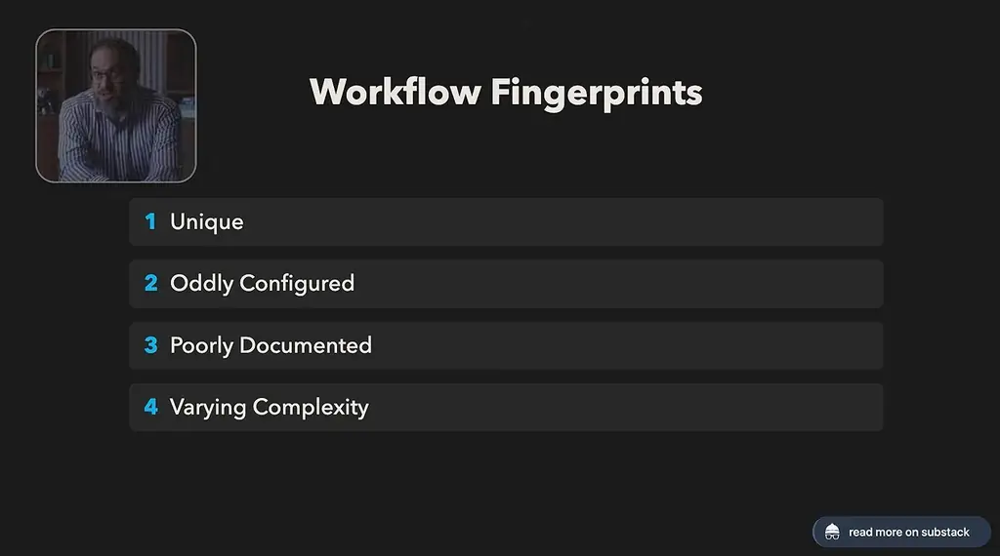
*[▶ 00:24:46](https://www.youtube.com/watch?v=EAEixlPC6L4&t=1486s) · Workflow Fingerprints*

Cheaper intelligence also expands demand, so the market is hard to size.

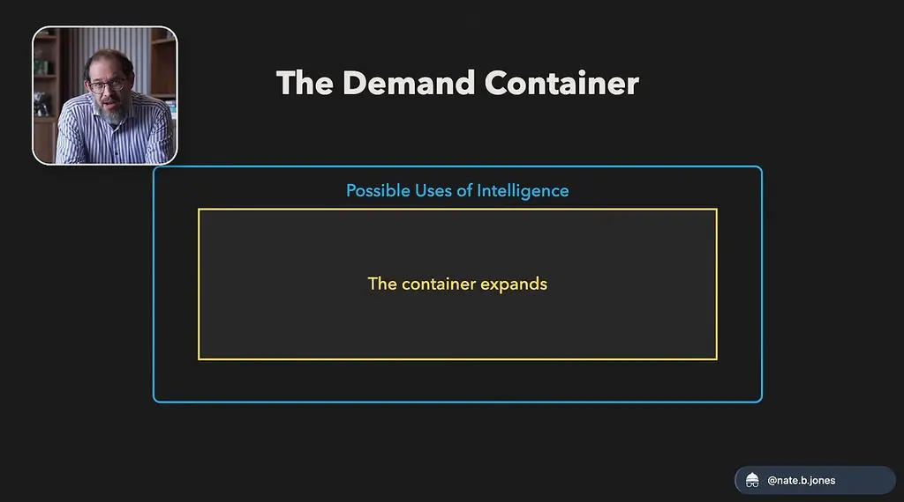
*[▶ 00:26:27](https://www.youtube.com/watch?v=EAEixlPC6L4&t=1587s) · The Demand Container*

The S-1 answers the five questions from June:

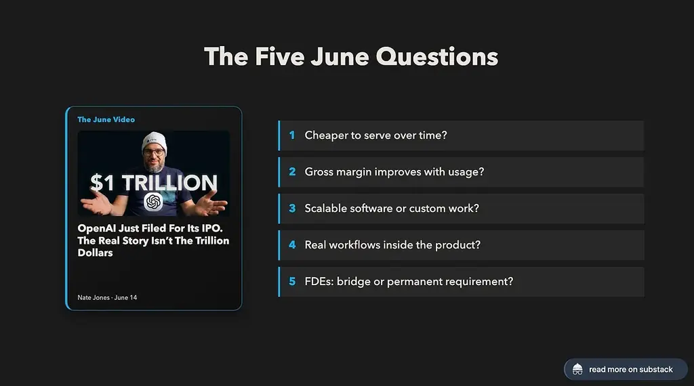
*[▶ 00:28:12](https://www.youtube.com/watch?v=EAEixlPC6L4&t=1692s) · The Five June Questions*

**Cheaper to serve over time:** not shown. Revenue grew faster than compute spending (Q2 2026 year over year: revenue +1,368%, compute +300%), but cost per cohort is absent.

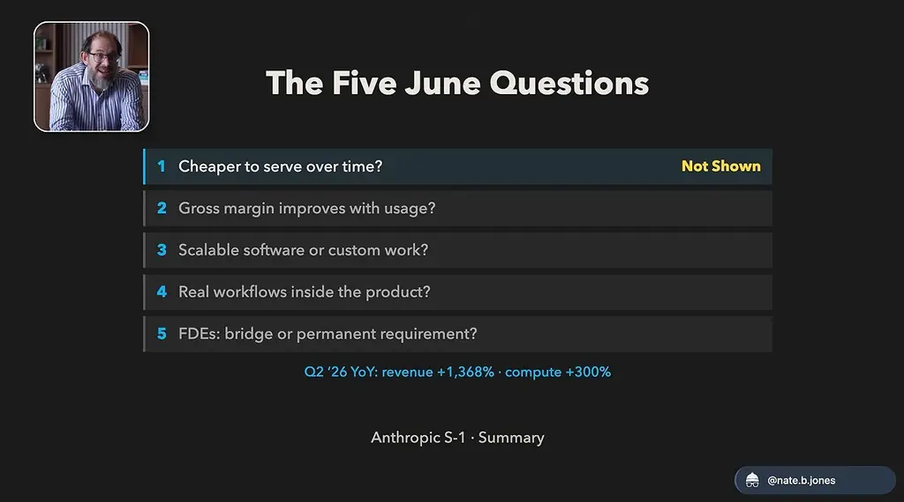
*[▶ 00:28:26](https://www.youtube.com/watch?v=EAEixlPC6L4&t=1706s) · Five June Questions with S-1 answer status*

**Gross margin improves with usage:** yes. It rose from about 40% in 2025 to about 85% in the first half of 2026, excluding R&D. Compute commitments remain ahead.

**Software or custom work:** both. The filing doesn't show how much growth depends on custom engineering.

**Real workflows inside the product:** yes. Customers use Claude for insurance underwriting, clinical reports and portfolio analysis.

**Forward-deployed engineers:** jury's out. Trained customer engineers might reduce dependence, but that link is unproven.

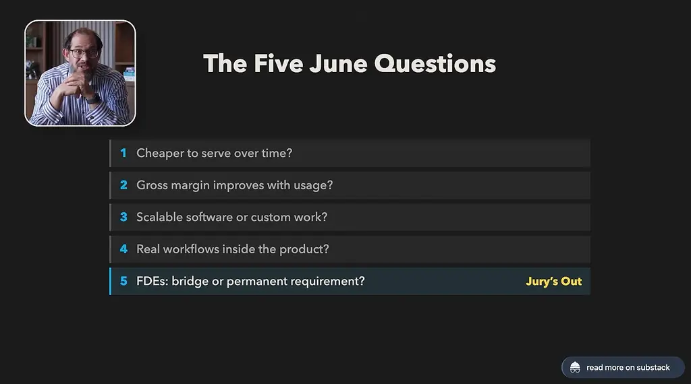
*[▶ 00:30:41](https://www.youtube.com/watch?v=EAEixlPC6L4&t=1841s) · The Five June Questions*

## Links & resources

- [Nate's S-1 analysis article on Substack, the written companion to this talk](https://natesnewsletter.substack.com/p/anthropic-ipo-s1-analysis?utm_source=youtube&utm_medium=video&utm_campaign=anthropic-ipo-s1-analysis-launch&utm_content=description) — <https://natesnewsletter.substack.com/p/anthropic-ipo-s1-analysis?utm_source=youtube&utm_medium=video&utm_campaign=anthropic-ipo-s1-analysis-launch&utm_content=description> · video description
- [Guide to connecting Nate's library, on Unlock AI](https://unlock-ai.natebjones.com/guides/how-to-connect-nates-library?utm_source=youtube&utm_medium=video&utm_campaign=anthropic-ipo-s1-analysis-launch&utm_content=description) — <https://unlock-ai.natebjones.com/guides/how-to-connect-nates-library?utm_source=youtube&utm_medium=video&utm_campaign=anthropic-ipo-s1-analysis-launch&utm_content=description> · video description
- [Nate's Substack newsletter homepage](https://natesnewsletter.substack.com/?utm_source=youtube&utm_medium=video&utm_campaign=anthropic-ipo-s1-analysis-launch&utm_content=description) — <https://natesnewsletter.substack.com/?utm_source=youtube&utm_medium=video&utm_campaign=anthropic-ipo-s1-analysis-launch&utm_content=description> · video description
