# Are Your AI Agents Doing Real Work Or Productivity Theater? Here Are 4 Principles I Use.

*Four principles for managing AI agents so they produce useful work instead of busywork, including how to budget your attention with a chief-of-staff agent.*

Source: [Are Your AI Agents Doing Real Work Or Productivity Theater? Here Are 4 Principles I Use.](https://www.youtube.com/watch?v=NIRFVjttNvA) · Nate B Jones · AI News & Strategy Daily | Nate B Jones · 19 min

## TL;DR

AI agents can make you look busy while producing little of value, a pattern the talk calls productivity theater. The core idea is to judge agent output by the human work it creates afterward, not by how much work the agent did. The talk recommends exploring cheaply, setting stop conditions, and giving a chief-of-staff agent an attention budget so it interrupts you only for commitments at risk or new evidence. This matters because every output still costs human reading, judgment, and attention.

## Key takeaways

- Before trusting an agent's output, ask who will use it, what happens next, and whether it deserves your time, since producing output is only the first cost.
- Judge an agent's output by the human-equivalent week it would have taken, not by whether it demonstrates capability.
- Run more cheap experiments than you commit to, and treat discarding an idea as a valid result.
- Use parallel agents on one central problem, such as cancellation reasons, help-seeking points, and returner-versus-leaver comparisons, rather than five agents giving near-identical answers.
- Give every recurring agent a stop condition in advance, such as stopping a weekly email if you don't respond within three days.
- Give your chief-of-staff agent an attention budget by listing your existing commitments and what a new assignment would add, so it surfaces only what matters.
- Have the chief-of-staff agent interrupt you only for commitments at risk or new evidence that could change a decision, and have it explain what changed and list your choices.
- For each agent, ask whether it serves something you care about, is a learning experiment, or was forgotten and needs stopping; track the fail mode where many agents overwhelm you.

## Count the Human Work After the Agent Finishes

[▶ 00:00:00](https://www.youtube.com/watch?v=NIRFVjttNvA&t=0s)

Productivity theater looks like work and burns tokens like work, but produces little.

The first principle is to count the human work after the agent finishes.

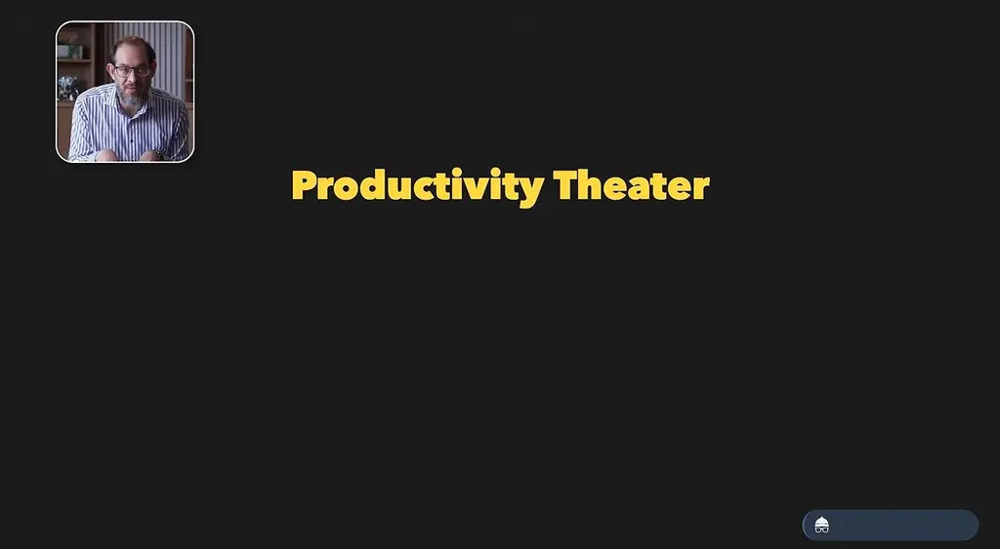
*[▶ 00:00:21](https://www.youtube.com/watch?v=NIRFVjttNvA&t=21s) · Productivity Theater*

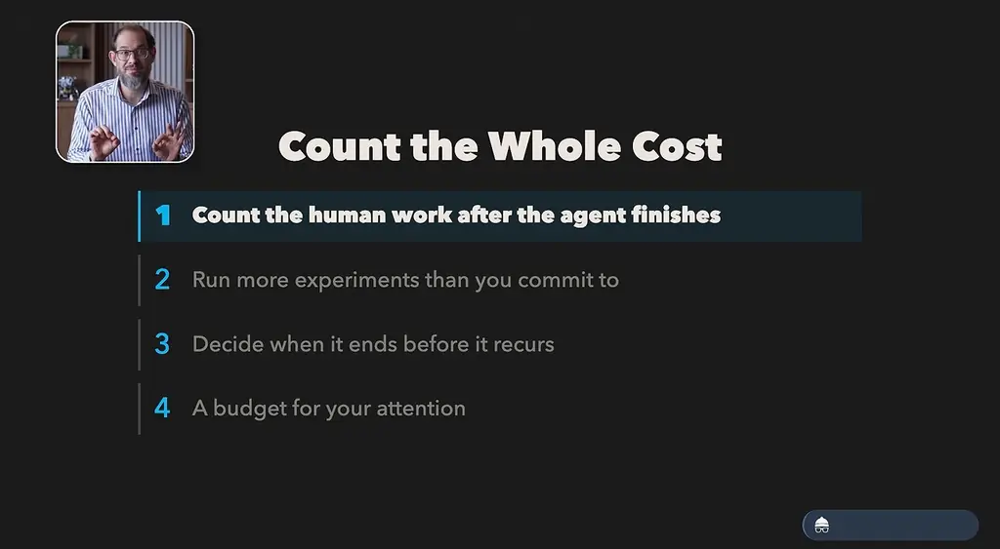
*[▶ 00:01:45](https://www.youtube.com/watch?v=NIRFVjttNvA&t=105s) · Count the Whole Cost*

Ask who will use the output, what happens next, and whether you want to spend your time on it.

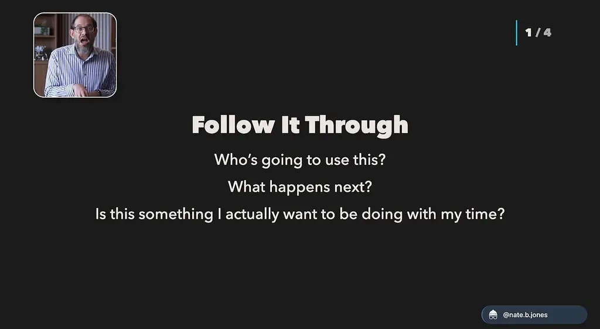
*[▶ 00:02:31](https://www.youtube.com/watch?v=NIRFVjttNvA&t=151s) · Follow It Through*

Judging output by the week a developer or team would have needed measures capability, not whether it deserves your time.

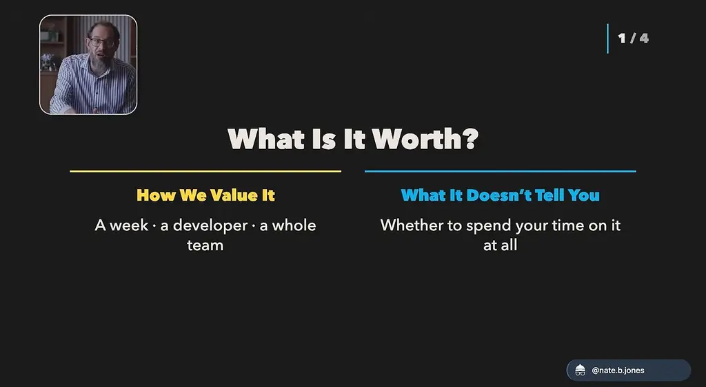
*[▶ 00:02:47](https://www.youtube.com/watch?v=NIRFVjttNvA&t=167s) · What Is It Worth?*

Producing an output is only the first cost: you still have to read it, decide what you believe, and judge whether anyone cares. Sharing it passes that cost to your team, and a recurring report becomes a recurring claim on their attention.

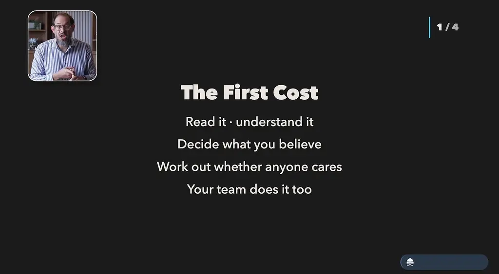
*[▶ 00:03:22](https://www.youtube.com/watch?v=NIRFVjttNvA&t=202s) · The First Cost*

Painting contractor Tony Severino had Claude read blueprints for bids and caught a floor-area multiplier used in place of actual wall measurements. He now asks it to show its work before he trusts a price.

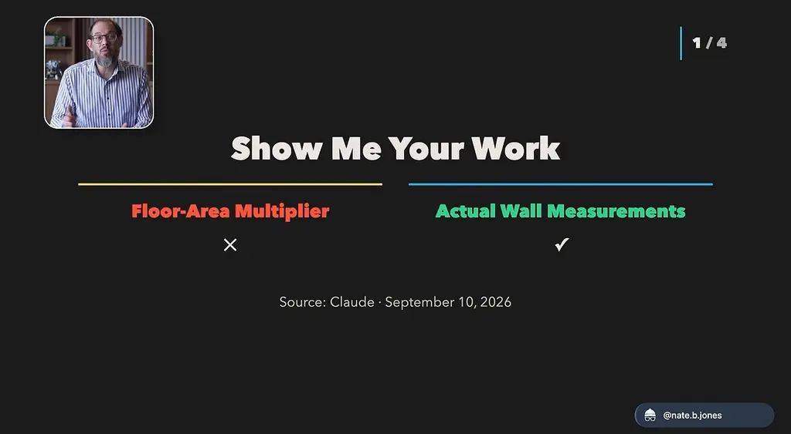
*[▶ 00:04:16](https://www.youtube.com/watch?v=NIRFVjttNvA&t=256s) · Show Me Your Work*

## Explore Cheaply, Stop on Purpose, Budget Your Attention

[▶ 00:05:31](https://www.youtube.com/watch?v=NIRFVjttNvA&t=331s)

Run more experiments than you commit to. Agents make it cheap to test an idea and discard it, and that is valuable even when nothing is kept. The advantage fades when every experiment must become a project with decisions, feedback, and maintenance competing for your week.

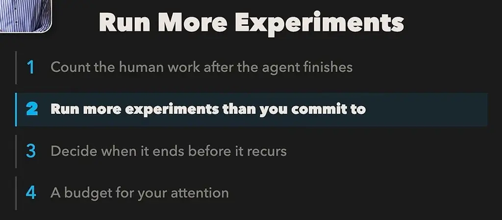
*[▶ 00:05:56](https://www.youtube.com/watch?v=NIRFVjttNvA&t=356s) · Run More Experiments*

Parallel agents work best on one central problem, with your attention staying on it. For a business where customers try the service once and don't return, one agent can review cancellation reasons, another can find where people ask for help, and another can compare returners with leavers.

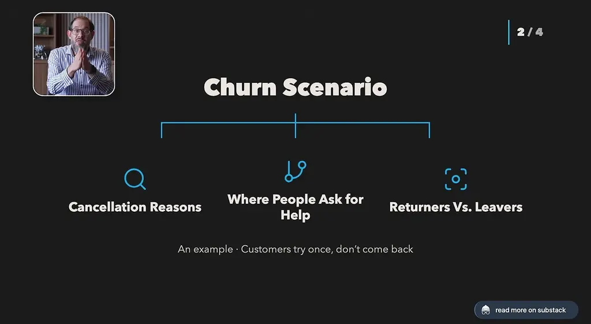
*[▶ 00:06:56](https://www.youtube.com/watch?v=NIRFVjttNvA&t=416s) · Churn Scenario*

Five agents producing near-identical answers only create a heavy comparison job. Some uncertainty no agent can resolve: whether customers will pay requires asking them. Build your own conviction rather than accepting an agent's proposal.

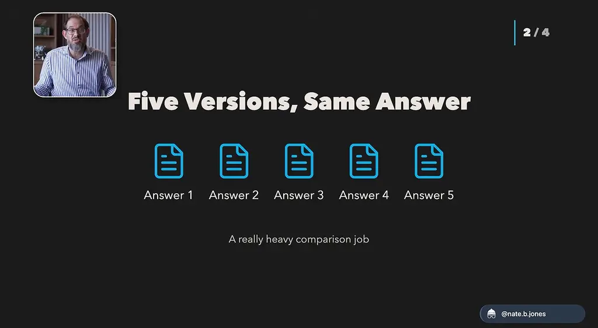
*[▶ 00:08:56](https://www.youtube.com/watch?v=NIRFVjttNvA&t=536s) · Five Versions, Same Answer*

Decide when an assignment ends before it recurs. A recurring agent can outlive the reason it was created.

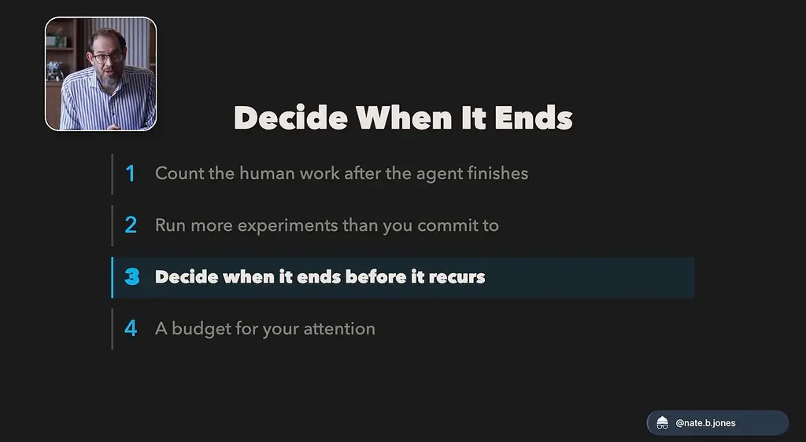
*[▶ 00:09:56](https://www.youtube.com/watch?v=NIRFVjttNvA&t=596s) · Decide When It Ends*

The speaker chose a different market two months ago, yet a weekly update still arrives and goes unread. Give recurring agents **stop conditions** in advance, such as "If I don't respond to this email in three days, just stop sending it." Decide yourself what is worth pursuing; don't let the agent set your curiosity.

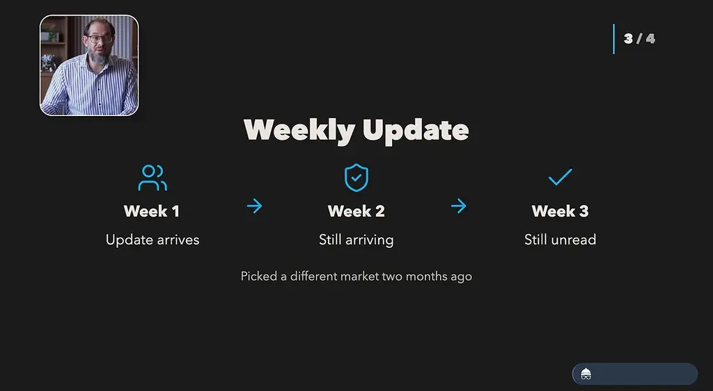
*[▶ 00:10:10](https://www.youtube.com/watch?v=NIRFVjttNvA&t=610s) · Weekly Update*

Give the agent managing your work an **attention budget**. A chief-of-staff agent needs your existing commitments and what a new assignment would add, so it surfaces only what matters to you. Agents have infinite attention and are always working. You have to touch grass, have a life, and focus your attention somewhere.

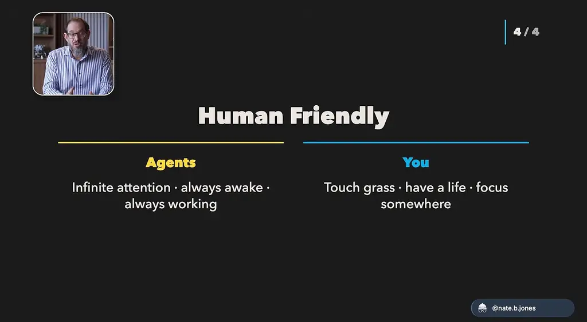
*[▶ 00:14:39](https://www.youtube.com/watch?v=NIRFVjttNvA&t=879s) · Human Friendly: Agents vs You*

## Interrupt Only for Commitments and New Evidence

[▶ 00:14:38](https://www.youtube.com/watch?v=NIRFVjttNvA&t=878s)

Interrupt the human only for commitments at risk and new evidence that could change a decision. The chief of staff explains what changed and lists the choices.

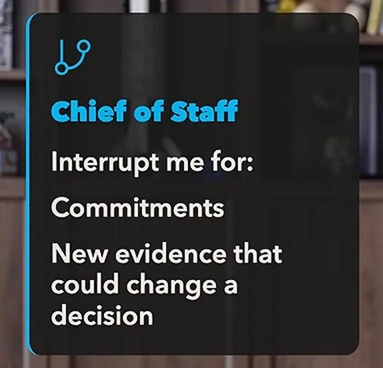
*[▶ 00:14:44](https://www.youtube.com/watch?v=NIRFVjttNvA&t=884s) · Chief of Staff interrupt criteria callout*

It prepares the choices; you decide and shift your attention elsewhere.

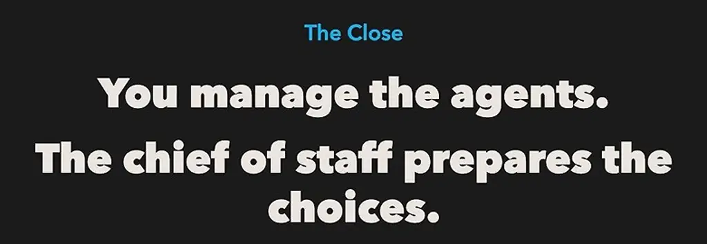
*[▶ 00:15:41](https://www.youtube.com/watch?v=NIRFVjttNvA&t=941s) · The Close: manage agents, prepare choices*

Decide to care, then communicate that intent so agents can focus. Track your fail modes: the moments when six agents overwhelm you.

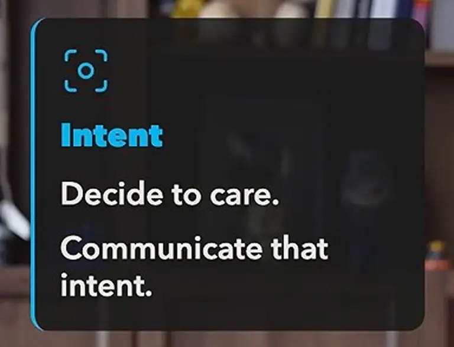
*[▶ 00:16:56](https://www.youtube.com/watch?v=NIRFVjttNvA&t=1016s) · Intent callout card*

AI should make preparing for more or less high-leverage work possible.

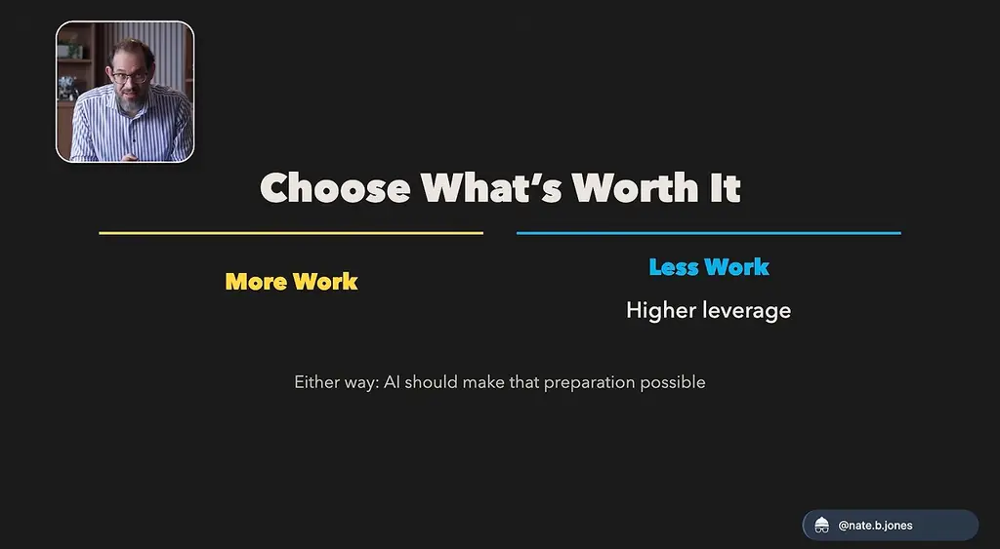
*[▶ 00:17:19](https://www.youtube.com/watch?v=NIRFVjttNvA&t=1039s) · Choose What's Worth It*

Ask of each agent: does it serve something I care about, is it a learning experiment, or did I forget to stop it?

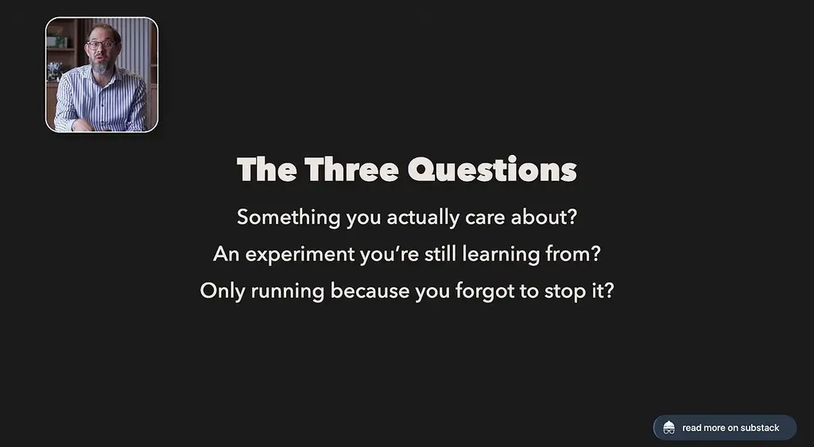
*[▶ 00:17:56](https://www.youtube.com/watch?v=NIRFVjttNvA&t=1076s) · The Three Questions*

Agents say "This matters," but you need to hear "This is just an experiment." The [Nate's newsletter](https://natesnewsletter.substack.com/p/ai-agent-overload?utm_source=youtube&utm_medium=video&utm_campaign=ai-agent-overload-launch&utm_content=description) post has a truth-teller prompt that makes agents report more honestly.

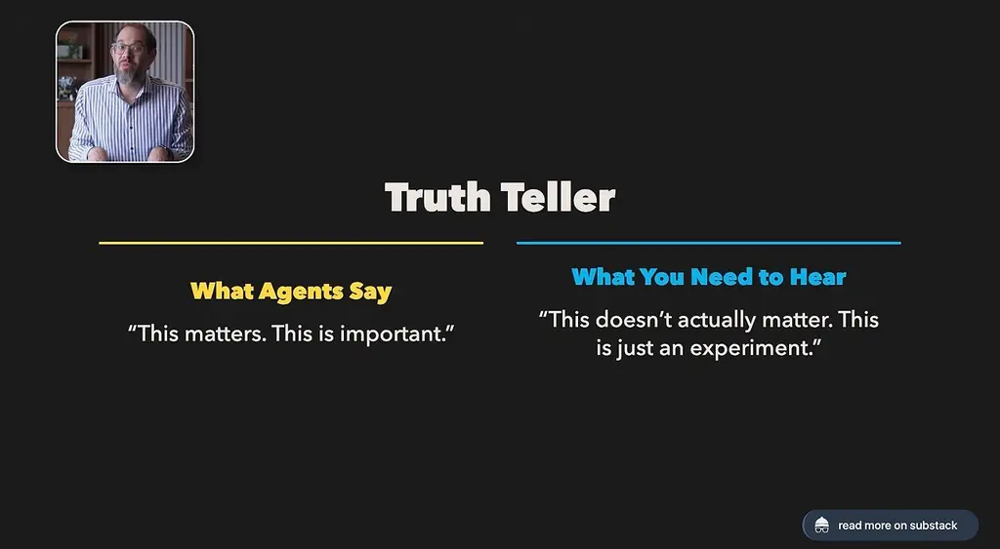
*[▶ 00:18:34](https://www.youtube.com/watch?v=NIRFVjttNvA&t=1114s) · Truth Teller*

## Links & resources

- [Nate's newsletter: AI agent overload article, written companion to the talk](https://natesnewsletter.substack.com/p/ai-agent-overload?utm_source=youtube&utm_medium=video&utm_campaign=ai-agent-overload-launch&utm_content=description) — <https://natesnewsletter.substack.com/p/ai-agent-overload?utm_source=youtube&utm_medium=video&utm_campaign=ai-agent-overload-launch&utm_content=description> · video description
- [Unlock AI guide: AI agent overload, companion guide from the description](https://unlock-ai.natebjones.com/guides/ai-agent-overload?utm_source=youtube&utm_medium=video&utm_campaign=ai-agent-overload-launch&utm_content=description) — <https://unlock-ai.natebjones.com/guides/ai-agent-overload?utm_source=youtube&utm_medium=video&utm_campaign=ai-agent-overload-launch&utm_content=description> · video description
- [Unlock AI guide: how to connect Nate's Library](https://unlock-ai.natebjones.com/guides/how-to-connect-nates-library?utm_source=youtube&utm_medium=video&utm_campaign=ai-agent-overload-launch&utm_content=description) — <https://unlock-ai.natebjones.com/guides/how-to-connect-nates-library?utm_source=youtube&utm_medium=video&utm_campaign=ai-agent-overload-launch&utm_content=description> · video description
