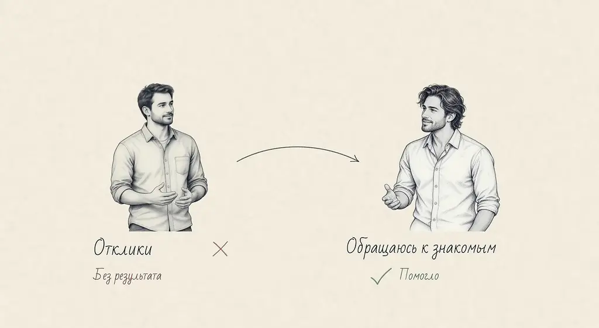
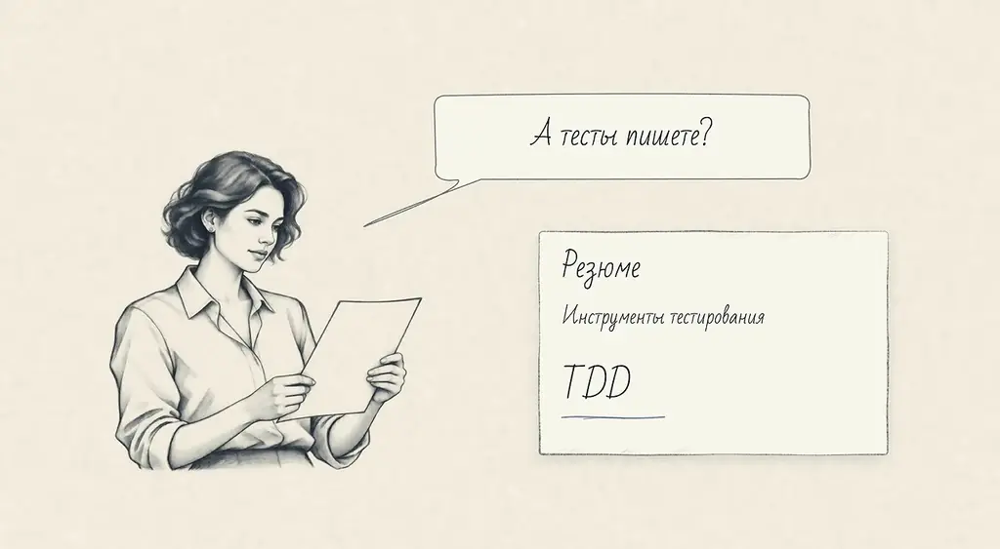
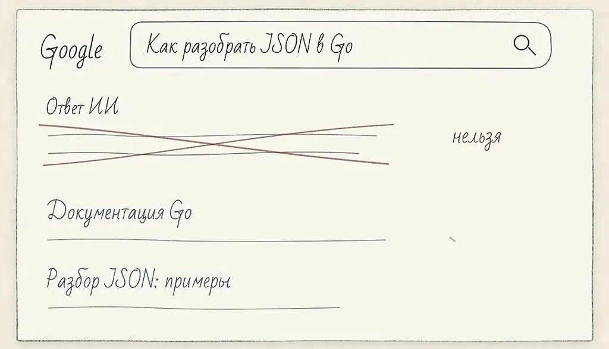
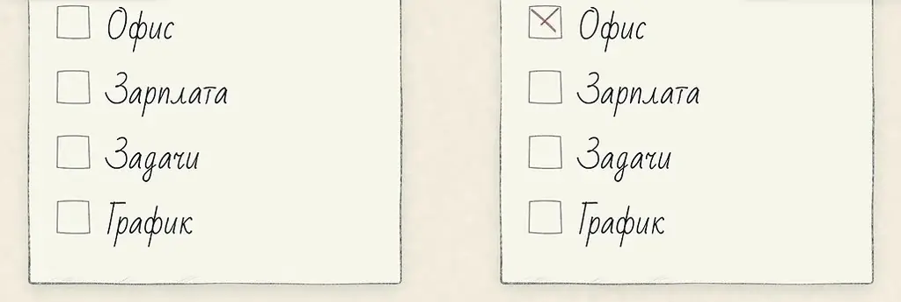

# Реакция: Как найти работу в ИТ сегодня

*Из реального опыта поиска работы в ИТ в 2026 году: как устроены собеседования, что смотрят HR и интервьюеры и как проверить компанию до выхода на работу.*

Источник: [Реакция: Как найти работу в ИТ сегодня](https://www.youtube.com/watch?v=eqvmXci-o38) · Илья · apakhomov · 1 ч 38 мин

## Коротко

Илья ищет работу в 2026 году после саббатикала и рассказывает, что рынок оказался строже и медленнее, чем он ожидал. Собеседования держатся на алгоритмах, system design и на случайном интервьюере, а резюме, пробелы в истории и даже тесты часто оцениваются не по существу. Главный вывод: исход сильно зависит от интервьюера, поэтому кандидату стоит проверять компанию по поведению HR, команде и формату собеседования. Для читателя это практическое понимание, на что обращать внимание и чего избегать при поиске работы.

## Главное

- Спрашивайте кандидата о работе с AI-агентами: как он ставит задачи, оценивает результат и какие харнесы писал, а не просто о расходе корпоративных токенов.
- Если в резюме указаны тесты или TDD, будьте готовы подробно рассказать о процессе: интеграционных и end-to-end тестах, стратегии и том, что вы тестируете до написания кода.
- Не скрывайте саббатикал и короткие места работы: трудовую книжку могут запросить, и сокрытие способно раскрыться; лучше просить её в начале процесса, а не в конце.
- Поведение HR говорит о компании: пропадание после собеседования, путаница, работает ли HR в компании или в агентстве, и скорость ответов показывают, как относятся к людям.
- Во время собеседования не бойтесь говорить о неоднозначности вопроса и уточнять его; если интервьюер не принимает верный ответ, это может быть признаком проблем в команде.
- Называйте вилку зарплаты сразу и не занижайте себя: компания может предложить позицию ниже обсуждённой, и поздно сообщённая вилка тратит время всех сторон.
- Во время испытательного срока сверяйте обещания HR и руководителя (офис, зарплата, задачи, график) со списком реальности и честно обсуждайте несовпадения.
- Оценивайте команду и руководителя: хороший руководитель важнее компании и проекта, а решения о смене команды или уходе лучше принимать взвешенно и сообщать руководству заранее.

## Зачем проверять работу с агентами и как изменился рынок

[▶ 00:00:00](https://www.youtube.com/watch?v=eqvmXci-o38&t=0s)

**В:** Зачем спрашивать про AI-агентов на собеседовании?

**О:** В 2026 году полезно спрашивать только о том, как кандидат работает с агентами. Тот, кто тратит корпоративные токены без оценки результата, не понимает своей роли в современной разработке. Один из участников удивился AI-команде, которая «руками не пишет», но почти весь день ревьюит код.

**В:** Как Илья готовился к собеседованиям?

**О:** Раз в год он проходил собеседования, чтобы держать форму: решал LeetCode medium и hard на Java, Rust и в лайве, а также system design.

**В:** Почему Илья не прошёл system design?

**О:** Он спроектировал систему поверх Cassandra как key-value, а интервьюер, по его словам, ждал SQL и не смог оценить такой подход. Другой участник рассказал о финальном собеседовании на Go с вопросами про ООП и системные вызовы; по общему мнению, многое зависит от интервьюера.

**В:** Как прошёл саббатикал?

**О:** Илья отдыхал четыре-пять месяцев. Отдых оказался полезным, но ему больше нравится работа в найме с задачами извне. По его словам, саббатикала как явления в России нет.

**В:** Чего Илья ожидал от рынка?

**О:** Он заранее ждал, что форматы собеседований устарели, резюме и GitHub могут не читать, а поиск займёт месяцы. Рынок его неприятно удивил.

**В:** Помогает ли публичный канал при поиске?

**О:** В резюме была ссылка на [Telegram-канал](https://t.me/tfeat), но её редко открывают. Интервьюеры спрашивали, тестирует ли он код, хотя канал во многом про TDD. Однажды HR, сославшись на провал дизайна, назвал его уровнем middle; после того как Илья указал на резюме, его пригласили в команду.

**В:** Как Илья искал работу?

**О:** Он начал в мае, во время отпуска, без спешки. Целился только в крупные компании и сразу отмёл маленькие.

## Рекомендации важнее откликов, а поведение HR говорит о компании

[▶ 00:09:23](https://www.youtube.com/watch?v=eqvmXci-o38&t=563s)

**В:** Почему собеседование может превратиться в проверку мелочей?

**О:** Илья рассказал, что в одной компании около 30 минут его спрашивали о передаче массивов и слайсов в Go через параметры. Он предложил написать тест, но ему ответили, что такой код может быть в продакшене и его нужно понимать. Собеседники согласились, что интервьюер часто демонстрирует превосходство, а должен выяснять, подходит ли человек.

**В:** Уйдут ли задачи в стиле LeetCode?

**О:** Илья считает, что они останутся надолго, но в перспективе найм будет идти через рекомендации, и люди будут приходить в компанию, уже зная, кто они.

**В:** Стоит ли готовиться к алгоритмическим задачам?

**О:** Илья решил около 60 задач, которые советовали рекрутеры, но позже перестал готовиться. Подготовка, по мнению собеседников, показывает в первую очередь умение готовиться к интервью, а не работу. Код, написанный по памяти, ближе к тому, как человек будет работать.

**В:** Нужны ли знакомства, чтобы найти работу?

**О:** Илья считает, что без них работу найти сложно. Его отклики получали отказ от HR, а после того как друзья переслали резюме, HR отвечали сразу.


*[▶ 00:14:07](https://www.youtube.com/watch?v=eqvmXci-o38&t=847s) · Cold applications vs. asking acquaintances*

Он советует ходить на митапы, участвовать в сообществах и чатах. Рекомендации показывают то, что на собеседовании увидеть трудно: как человек работает с командой.

**В:** Что поведение HR говорит о компании?

**О:** HR в некоторых компаниях пропадали, и Илья связывает это с брендом работодателя. В крупных компаниях процессы автоматизированы, поэтому перенести встречу легко. Общение с HR стоит воспринимать и как фильтр для себя. Илья не любит, когда HR задают технические вопросы.

**В:** Что Илья называет большой компанией?

**О:** Компанию, где найм постоянный и есть команда, которая ищет людей всё время. Он ценит масштаб сервисов и процессов и говорит, что такие нагрузки трудно найти в России.

## Пробелы в резюме и честность

[▶ 00:20:00](https://www.youtube.com/watch?v=eqvmXci-o38&t=1200s)

**В:** Стоит ли скрывать пробелы и короткие места работы?

**О:** HR не любят пробелы, например саббатикал, и места, где человек проработал несколько месяцев. Илье советовали убрать короткую работу из CV, но он не хочет врать. Выписку из трудовой иногда запрашивают, поэтому сокрытие может раскрыться.

**В:** Читают ли резюме?

**О:** Скорее нет: HR читают, но не понимают, а технические специалисты, которые поняли бы, обычно его не читают.

**В:** Почему на техническом интервью спросили, тестирует ли Илья код, если это есть в резюме?

**О:** В резюме у Ильи указаны тесты, фреймворки и TDD. Он ответил про интеграционные и end-to-end тесты, но разговор не углубился. По его мнению, так ответил бы любой, кто написал TDD в резюме, и смысл вопроса ему непонятен.


*[▶ 00:22:45](https://www.youtube.com/watch?v=eqvmXci-o38&t=1365s) · Resume: testing tools and TDD*

**В:** Нужно ли смотреть GitHub кандидата?

**О:** Илья даёт ссылки на GitHub и [Telegram-канал](https://t.me/tfeat) для проверки и считает, что обычный GitHub мало кому нужен. Собеседник предложил разбирать GitHub через агента вроде Claude. Илья сомневается, что резюме с персональными данными можно так передавать.

**В:** Когда стоит запрашивать трудовую книжку?

**О:** Илье попросили её в конце, после всех этапов, и он не понял зачем. Его совет: спрашивать в самом начале, чтобы не тратить время коллег.

**В:** Почему резюме отклоняли?

**О:** Илья подозревает, что автоматический фильтр отсеивал его из-за двух месяцев работы и саббатикала. Но HR одной компании нашёл его резюме в базе и сам написал, сочтя опыт релевантным.

## Культура компании видна в HR и в формате собеседования

[▶ 00:29:14](https://www.youtube.com/watch?v=eqvmXci-o38&t=1754s)

**В:** Что говорит поведение HR о компании?

**О:** Один HR после собеседования перестал отвечать, и это раздражало. Не всегда ясно, работает ли HR в компании или в агентстве. По словам участников, у адекватной компании обычно адекватное общение с HR, а от «залётной» компании ждите игнора.

**В:** Насколько важно, кто проводит собеседование?

**О:** Почти все собеседования теперь один на один, поэтому совпадение с интервьюером сильно влияет на исход. Участники считают, что два интервьюера должны участвовать равноправно: раньше часто один был ментором, а другой молчал. Совпадение не должно решать, ведь найм часто не в команду интервьюера, но HR мог бы прервать неудачный собес.

**В:** Какова сложность генерации n уникальных случайных чисел?

**О:** Кандидат ответил, что при хеш-сете для уникальности вставка в среднем O(1), значит по времени O(n), а по памяти O(n). Обычно отвечают O(n), а при реализации на деревьях получается O(n log n). Ответ зависит от реализации.

## Вопросы, на которые интервьюер сам не знает ответа

[▶ 00:34:17](https://www.youtube.com/watch?v=eqvmXci-o38&t=2057s)

**В:** Почему генерация n случайных уникальных чисел стоит n log n, если в алгоритме есть константа?

**О:** Это задача про «кроликов в шляпе»: каждый следующий элемент может повториться и перегенерируется. Сумма возрастающего ряда вероятностей даёт логарифм, поэтому итог n log n. Спрашивающий сам этого не знал.

**В:** Можно ли задавать вопрос, если сам не знаешь ответа?

**О:** Можно. Важно не то, совпал ли ответ с эталоном, а какие выводы вы из него делаете. Такой вопрос показывает ход рассуждений, логику и реакцию человека под вопросом.

**В:** Что делать, если кандидат ответил не так, как ожидалось?

**О:** Если принимаются оба ответа, всё в порядке. Если нужен конкретный, учитывайте стресс кандидата. Один из ведущих обычно не говорит, верно ли ответили, пока его не спросят, и сообщает в конце.

**В:** Важна ли теоретическая сложность на практике?

**О:** На реальных объёмах (тысячи–миллионы чисел) константа часто важнее асимптотики. Инженер, строящий систему, скорее назовёт сложность практически линейной.

## Алгоритмы на собеседовании и запрет тестов

[▶ 00:40:44](https://www.youtube.com/watch?v=eqvmXci-o38&t=2444s)

**В:** Почему до сих пор спрашивают алгоритмы?

**О:** Один из собеседников удивлён, но замены пока нет. По его мнению, сами алгоритмы уже неактуальны. Он предпочитает задачи на бизнес-логику, например `n` уникальных случайных чисел или параллельные запросы с обработкой ошибок.

**В:** Знает ли кандидат алгоритм или умеет писать код?

**О:** Это разные вещи. Один из собеседников вспоминает задачу реализовать Executor Service на Java. Она запомнилась сильнее очередной задачи с LeetCode.

**В:** Можно ли пользоваться IDE и запускать тесты?

**О:** Некоторые компании разрешают IDE, но в двух из них тесты запрещали запускать до готового решения: код нужно проверить в голове.

```go
func solve(input string) string {
    return input
}
```

*[▶ 00:44:02](https://www.youtube.com/watch?v=eqvmXci-o38&t=2642s) · Writing solve.go in Vim before running tests*

**В:** Зачем так делают?

**О:** Предположительно, чтобы увидеть, как кандидат строит код без подсказок IDE, которая после тестов исправляет синтаксис и семантику. Говорящий назвал такое требование абсурдом.

## Онколл без инструментов: зачем запрещают тесты

[▶ 00:45:11](https://www.youtube.com/watch?v=eqvmXci-o38&t=2711s)

**В:** Почему на собеседовании запрещают запускать код и тесты, если задача — разобраться в чужом коде?

**О:** Интервьюер объяснил, что на аварии нужно быстро понять код, а на доске инструментов нет. Гость с этим не согласен: на инциденте есть терминал, логи, git, тесты и безопасные рефакторинги. Полагаться на то, что «кто-то как-то понял код», опасно. Нужны воспроизводимые результаты, потому что в стрессе человек ошибается чаще.

**В:** Что ответил интервьюер, когда гость спросил об этом после собеседования?

**О:** Он согласился, что это плохой способ проверки, и сам к такому недоволен. Почему тогда он просил делать именно так, гость так и не понял.

**В:** Как на собеседовании воспринимают написание теста до кода?

**О:** Часто не понимают. Гость рассказывал, что его спрашивали, что он вообще собирается тестировать, если кода ещё нет. Он отвечал, что сначала напишет тест, а потом код.

**В:** Что гость думает об алгоритмических секциях?

**О:** Надеется, что они уйдут в прошлое, но считает, что пока они эффективны и решают нужные задачи.

## Системный дизайн как вайб-чек и странные вопросы

[▶ 00:51:37](https://www.youtube.com/watch?v=eqvmXci-o38&t=3097s)

**В:** Почему системный дизайн называют вайб-чеком?

**О:** Оценка сильно зависит от кругозора и навыков интервьюера. Задачи тоже повторяются: спикер получил проектирование мессенджера два дня подряд.


*[▶ 00:52:22](https://www.youtube.com/watch?v=eqvmXci-o38&t=3142s) · Day 1 and Day 2: design a messenger*

**В:** Кто должен проводить дизайн-интервью?

**О:** Желательно человек с похожим опытом или достаточно гибкий, чтобы понять контекст кандидата. Иначе разговор уходит в другой мир, например, низкоуровневый разработчик оценивает энтерпрайз-дизайн.

**В:** Что делать со странными собеседованиями?

**О:** Рассказывать об этом HR, иначе такие интервьюеры остаются. Спикер выписал вопросы и отметил спорные ответы: по многозадачности в Go единого правильного ответа нет.

**В:** Какие вопросы задавали на финальном собеседовании?

**О:** Принципы ООП. Спикер назвал четыре, включая инкапсуляцию, но интервьюер не принял его определение (сокрытие или объединение данных с методами).

**В:** Где больше системных вызовов: в Go-сервисе или в Node.js?

**О:** Спикер ответил про epoll, kqueue, read и write, но, по его словам, ответ был не тем, что ждали. Собеседник предположил, что стоило уточнить, какие вызовы и что за сервис имеются в виду. Спикер решил, что с таким коллегой работать не хочет.

## Спрашивать про реальный опыт и работу с агентами

[▶ 01:00:32](https://www.youtube.com/watch?v=eqvmXci-o38&t=3632s)

**В:** Почему на собеседованиях не спрашивают о реальном опыте из резюме?

**О:** По словам спикера, его никто не спрашивал о собственном опыте, даже на дизайн-интервью. Он советует подбирать задачи под резюме: так лучше видны сильные и слабые стороны. Кандидат, который пишет «настраивал CI», но не может рассказать про кэширование или запуск тестов, быстро выдаёт пустое резюме.

Спикер рассказал, что на собеседовании ему запретили смотреть сводку ИИ в Google: поиск можно было использовать, а сводку нет. Он прокрутил её вниз и открыл документацию Go и примеры разбора JSON.


*[▶ 01:04:27](https://www.youtube.com/watch?v=eqvmXci-o38&t=3867s) · Hand-drawn Google results: AI answer crossed out*

**В:** Что спрашивать про CI в 2026 году, если его настраивает Claude?

**О:** Важен не синтаксис, а процесс: канареечные выкатки, откаты по процентам, мутационные тесты, виды покрытия и то, как всё это измерялось. Кандидат может описать задачу, которую поставил агенту, и результат.

**В:** Что важнее всего спрашивать сейчас?

**О:** Собеседник считает, что главное — как человек работает с агентами: как ставит задачи, оценивает результат, какие харнесы писал и с какими проблемами столкнулся. Пустая трата корпоративных токенов без оценки результата — сигнал против кандидата.

**В:** Что думаете о шеринге скиллов в командах?

**О:** Спикер не понимает корпоративных библиотек скиллов: скилл для него личная вещь, часто костыль, который может вредить из-за контекста. Лучше использовать ванильные инструменты, а полезные инструменты распространять через CI/CD, релиз-трейны и тестирование.

## Обратная связь и проверка работодателя

[▶ 01:09:29](https://www.youtube.com/watch?v=eqvmXci-o38&t=4169s)

**В:** Стоит ли давать обратную связь о собеседованиях и HR?

**О:** Да. Илья после каждого собеседования записывал, что понравилось и что нет, и просил HR передать это компании. Передают ли фидбэк, зависит от HR: хорошие отзывы, по его опыту, возвращаются, поэтому он старается писать позитив. Записи встреч есть, и плохие интервьюеры могут быть перепроверены.

**В:** Что делать, если интервьюер не принимает верный ответ?

**О:** Говорить честно о неоднозначности: Илья объяснял, что инкапсуляция понимается по-разному. Но интервьюер может ошибаться. Однажды интервьюер назвал неверную сложность алгоритма, кандидат, отличный коллега, не согласился, и интервьюер записал это как минус. Илья этого не понимает.

**В:** Стоит ли делать вид, что не знаешь ответа?

**О:** Илья предлагает иногда попробовать, чтобы увидеть реакцию. Если из кандидата «клещами» тянут знания, это, скорее всего, red flag. Риск есть: такой ход может стоить оффера. Лучше вести диалог, а не допрос.

**В:** Можно ли перенести собеседование?

**О:** Илья переносит его за несколько дней, если не хочется идти, и заодно видит, как компания реагирует. За 5 минут он не переносит.

**В:** Что делать, если предлагают позицию ниже уровня?

**О:** Компания обсуждала с Ильёй senior, а предложила middle с зарплатой 250, тогда как senior, по его словам, берут от 400 до 600 «белыми». Вилку и позицию ему сообщили поздно, поэтому он отказался и потерял время на других компаниях. Илья советует сразу называть вилку и не занижать себя.


*[▶ 01:16:40](https://www.youtube.com/watch?v=eqvmXci-o38&t=4600s) · Discussed Senior vs offered Middle*

**В:** Сколько длился поиск?

**О:** Около полутора–двух месяцев фултайм, обычно параллельно с двумя–тремя компаниями. Несколько лет назад работу находили за пару недель.

## Испытательный срок: сверить обещания и говорить о несовпадении честно

[▶ 01:19:11](https://www.youtube.com/watch?v=eqvmXci-o38&t=4751s)

Спикер считает испытательный срок частью собеседования, поэтому не считает работу найденной, пока срок не закончился. В первые дни он выписывает всё, что обещали HR и руководители, и сравнивает с реальностью.

Список по колонкам: что обещали и что получилось. Пункты обычно такие: офис, зарплата, задачи, график.


*[▶ 01:19:41](https://www.youtube.com/watch?v=eqvmXci-o38&t=4781s) · Checklist: promised vs. actual on the job*

Такой список помогает решить, остаться, ротироваться или уйти. Решение получается взвешенным, а не импульсивным, и его проще объяснить потом, например, короткий опыт в резюме. Излагать список руководству нужно чётко и по порядку. По словам спикера, люди обычно идут навстречу, даже если отношения напряжённые.

Испытательный срок должен проходить откровенно: частые синхронизации с руководителем, понятные ожидания и доверие с обеих сторон. Руководитель должен давать задачи, соответствующие должности, и не делать за сотрудника. Сотрудник должен показывать свою компетентность.


*[▶ 01:21:02](https://www.youtube.com/watch?v=eqvmXci-o38&t=4862s) · Two speech bubbles: mutual fit question*

Не нужно работать на показуху. Спикер работает на испытательном сроке так же, как обычно, и не выходит на выходные ради него. Ведущий добавляет, что срок позволяет работодателю уволить без обычной процедуры, а честность помогает ему решить заранее.

Пример спикера: через три недели на текущем месте он сказал, что команда не срабатывается. Договорились о коротком сроке проверки, он перешёл в другую команду, и, по его словам, решение устроило всех.

Важнее всего **хороший руководитель**, чем даже компания или проект: у него можно учиться не только технике, но и смирению и общению. В команде должен быть один лидер. Спикер сталкивался с формальным и неформальным лидером, которые тянули в разные стороны.

Смотрите на коллег, встречи и ротации, и уточняйте это до собеседования. Могут врать, а могут искренне думать, что не врут. Аналитик в одном проекте сказал, что все увольняются. Не стоит соглашаться только ради денег, ходите на командные активности.

Не бойтесь ротироваться, уйти или первыми сказать руководителю о несовпадении. Спикер считает, что это показывает понимание своей слабости и располагает людей. Ведущий согласен. Короткий опыт в резюме может стать «клеймом», но спикер не жалеет о своём решении уйти.

## Выводы из поиска работы и AI-first команды

[▶ 01:30:40](https://www.youtube.com/watch?v=eqvmXci-o38&t=5440s)

**В:** Какие выводы Илья сделал из поиска работы?

**О:** Литкод, технические вопросы и system design, по его мнению, останутся надолго, потому что всё упирается в интервьюера. Хороший раскроет кандидата, плохой просто проведёт собес. Собеседования всё дальше от реальной работы и почти не отреагировали на ИИ.

**В:** Почему процесс найма не изменился с появлением ИИ?

**О:** Илья не знает ответа. Возможно, в мае–июне обновления ещё не успели произойти.

**В:** Как проверить, работает ли команда с ИИ?

**О:** Спросить про нейросети на финальном собеседовании и посмотреть на интерес людей. Подписки в больших компаниях обычно компенсируют, но команду нужно прособеседовать самому, уточнив, пишут ли там код руками.

**В:** Что насторожило Илью в AI-first компании?

**О:** Команда не пишет код руками, но почти весь день ревьюит. Илья счёл это звоночком: при безопасном использовании нейросетей ревью может быть не нужен.

**В:** Ревьюит ли Илья код, когда делает AI-продукты?

**О:** В основном чужой. Свой он смотрит по понятным этапам и знает проект, потому что раньше над ним работал.

## Ссылки и материалы

- GitHub спикера — упоминается, ссылка не показана · упомянуто [▶ 00:23:25](https://www.youtube.com/watch?v=eqvmXci-o38&t=1405s)
- [Telegram-канал спикера о поиске работы в ИТ](https://t.me/tfeat) — <https://t.me/tfeat> · описание видео
