# 10 Billion Records vs The Regulator: An Architectural Post Mortem of an 11TB Exadata Failure

*How a bank's 11TB Exadata outage was contained with a timeout change, a cache warm-up wait, and a write-side redesign, and how the team plans a zero-loss move to Cloud PostgreSQL.*

Source: [10 Billion Records vs The Regulator: An Architectural Post Mortem of an 11TB Exadata Failure](https://www.youtube.com/watch?v=TB45qqp-OxM) · Martin Ladecký · Devoxx · 49 min

## TL;DR

A bank's 11TB Oracle Exadata system, holding about 10 billion records, failed during a disaster recovery test, and users could not log in while every response still returned HTTP 200. The team contained the incident with fast fixes, including a longer front-end timeout and waiting for a cold flash cache to warm. The lasting fix moved deduplication from every read to the write path, so reads become a plain select from one large partitioned table. The talk matters because the root cause was architecture and hidden cache dependence, not the database engine itself.

## Key takeaways

- A healthy HTTP 200 status can hide a failing system, so monitor response times and saturation, not just error codes.
- A hardcoded 30-second front-end timeout locked out slow requests, and raising it, a code change deployed in 15 minutes, saved about 90% of users.
- Fast hardware can hide poor code for years: a cold Exadata Flash Cache that was never primed made a disaster recovery replica run slowly with an identical execution plan.
- For an incident, apply first aid that satisfies most clients rather than spending hours digging through the database.
- Restoring a dropped booking-date limit as a parameter avoids a full 11TB scan, but an untested change with an identical execution plan for any value and a 20,000-account test environment (versus 20 million in production) is an unproven fix.
- Moving deduplication from reads to writes trades a write about 20 ms slower for fast reads, and the team measured write volume (about twice read volume) before choosing this path.
- Change data capture was ruled out because it needs sysadmin rights on Exadata and installing anything there voids Oracle's SLA, so dual writes from the importers were used instead.
- Migrate with pilot users and staged traffic (1%, 2%, 5%, 10%, 20%, then 100%) with a rollback path to Oracle at every step, because the 99.998% availability target allows about 10 minutes of downtime per year.

## Architecture, not Oracle, caused the outage

[▶ 00:00:00](https://www.youtube.com/watch?v=TB45qqp-OxM&t=0s)

This talk sits in the architecture and modernization track.

```bash
$ devoxx search "migration"
$ devoxx pick --talk 16408
    ✓ track: architecture & modernization
```

*[▶ 00:00:03](https://www.youtube.com/watch?v=TB45qqp-OxM&t=3s) · Devoxx CLI: search and pick talk*

The Oracle database did not fail; the architecture did. The bank was down while the database kept running.

The bank's 11TB Oracle Exadata system failed at 10 billion records, triggering a BaFin investigation.

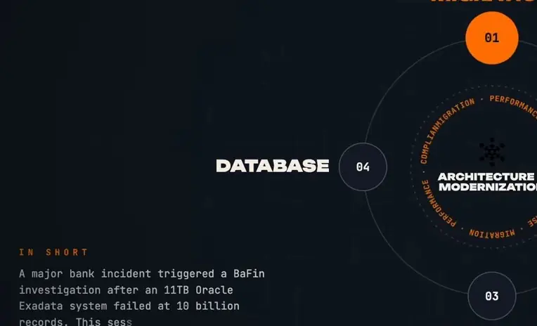
*[▶ 00:00:14](https://www.youtube.com/watch?v=TB45qqp-OxM&t=14s) · In short: bank incident summary*

Banks are critical infrastructure under EU law, so downtime must be self-reported to BaFin. A Monday emergency call with 200+ people replaced the daily stand-up.

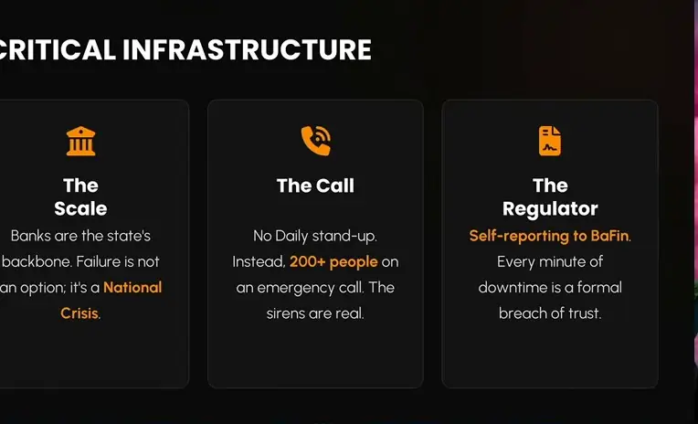
*[▶ 00:06:03](https://www.youtube.com/watch?v=TB45qqp-OxM&t=363s) · Critical infrastructure: scale, call, regulator*

The abstract frames it as a regulatory investigation that forced a data-strategy rethink.

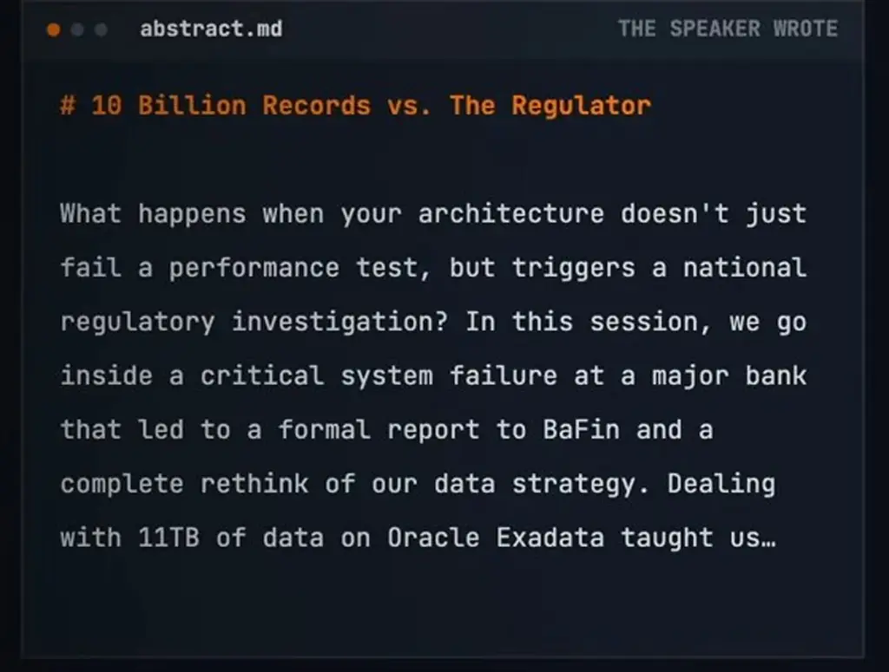
*[▶ 00:00:19](https://www.youtube.com/watch?v=TB45qqp-OxM&t=19s) · Speaker abstract in abstract.md*

## A healthy HTTP 200 can hide a failing system

[▶ 00:06:03](https://www.youtube.com/watch?v=TB45qqp-OxM&t=363s)

Users could not log in, yet no errors appeared. Database CPU and I/O were saturated, and response times rose from 20–40 ms to 20 minutes, all still returning HTTP 200.

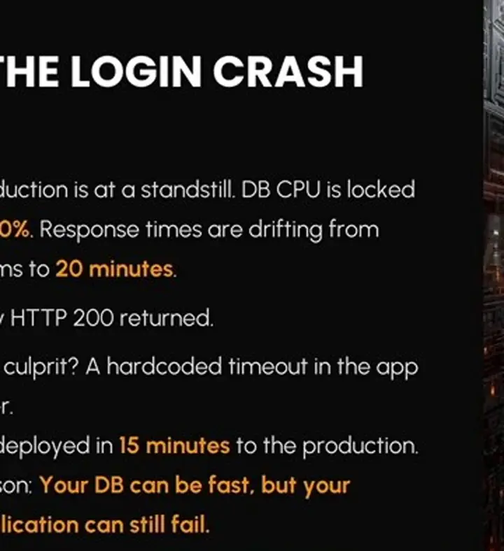
*[▶ 00:10:13](https://www.youtube.com/watch?v=TB45qqp-OxM&t=613s) · The login crash: symptoms and root cause*

A hardcoded 30-second front-end timeout locked out slow requests. Raising it saved about 90% of users, who responded within 3 minutes. The change was code, not a parameter, and reached production in 15 minutes.

## Cold caches hid behind Exadata's speed

[▶ 00:10:13](https://www.youtube.com/watch?v=TB45qqp-OxM&t=613s)

The database held about 10 billion records in 11TB, with roughly 20 million reads and 40 million writes daily.

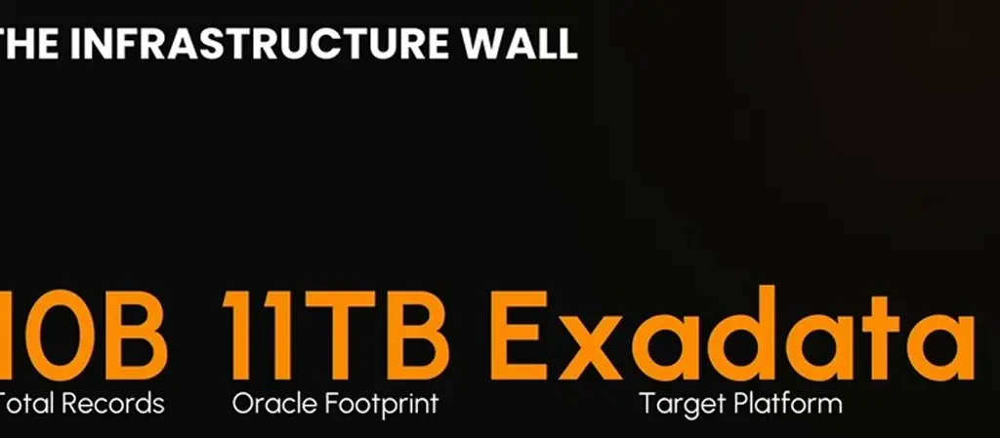
*[▶ 00:11:56](https://www.youtube.com/watch?v=TB45qqp-OxM&t=716s) · The infrastructure wall: key scale numbers*

A weekend disaster recovery test moved traffic to a second replica, which ran slowly at first with an identical execution plan. The cause was a cold **Exadata Flash Cache** that was never primed.

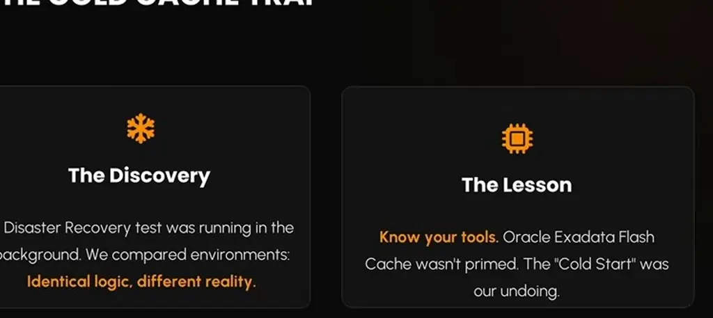
*[▶ 00:14:15](https://www.youtube.com/watch?v=TB45qqp-OxM&t=855s) · The Cold Cache Trap: Discovery and Lesson*

Exadata runs filters in parallel across cells, each with its own CPU and disk. The speaker bets the column cache drove the speed, though he cannot prove it.

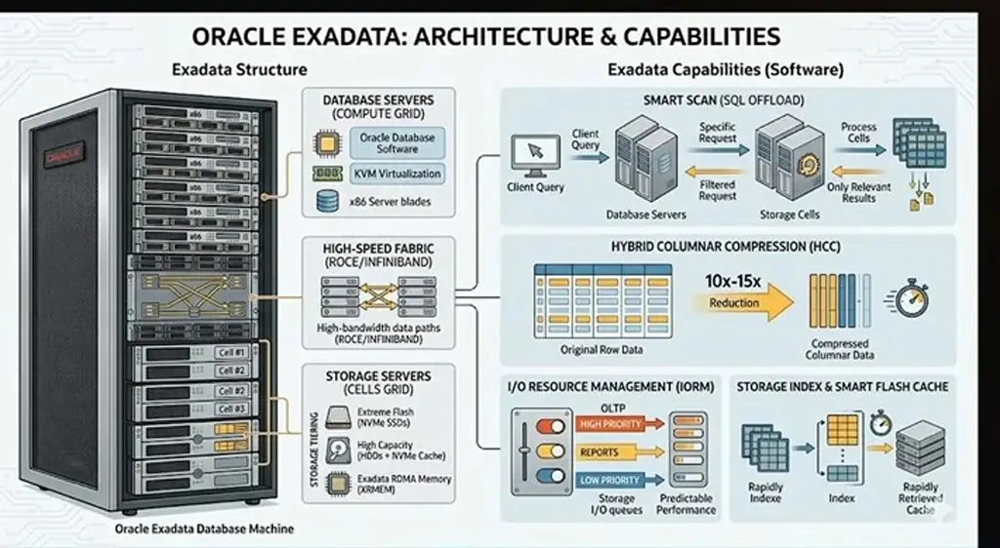
*[▶ 00:15:56](https://www.youtube.com/watch?v=TB45qqp-OxM&t=956s) · Oracle Exadata architecture and capabilities*

Fast hardware hid poor code for years.

## Waiting out a cold cache

[▶ 00:15:57](https://www.youtube.com/watch?v=TB45qqp-OxM&t=957s)

The primary replica wouldn't help; it had restarted with no cache either. Warming the cache with a full select was ruled out under 600 requests per second. So the team waited: first logins took three minutes, then were immediate once cached.


*[▶ 00:18:45](https://www.youtube.com/watch?v=TB45qqp-OxM&t=1125s) · The Strategic Decision: do nothing*

Outliers vanished as the cache warmed.

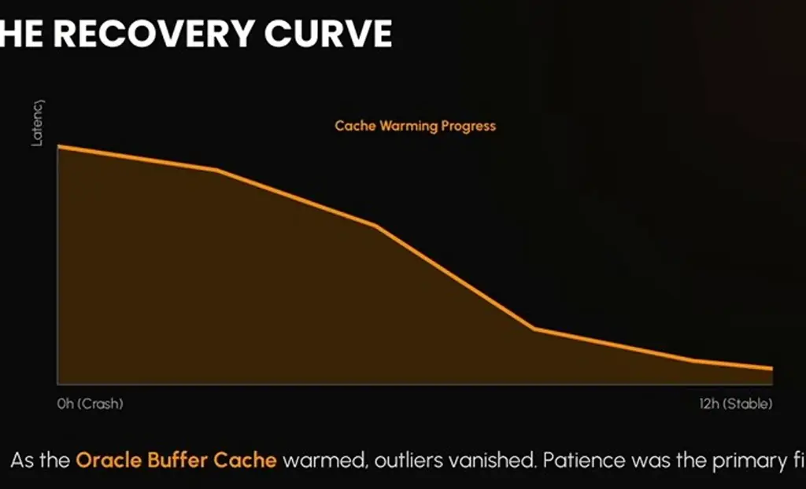
*[▶ 00:19:32](https://www.youtube.com/watch?v=TB45qqp-OxM&t=1172s) · The Recovery Curve: cache warming progress*

Small customers with up to a million transactions could take 20 minutes.

## Merging pending sources and deduplicating audit rows

[▶ 00:20:18](https://www.youtube.com/watch?v=TB45qqp-OxM&t=1218s)

Three sources feed the account view: the **booked** table, an internal pending table, and a real-time view from another team that is never deleted. Pending rows can repeat across sources or already be booked, so the query merges and deduplicates them.

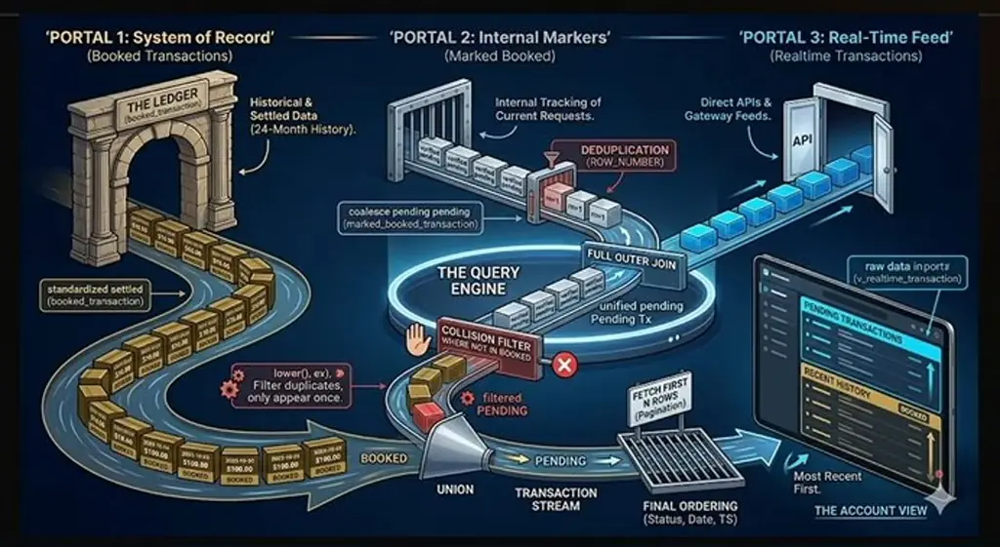
*[▶ 00:23:20](https://www.youtube.com/watch?v=TB45qqp-OxM&t=1400s) · Beast SQL data-flow diagram across three portals*

The marked-booked table is an audit log of every state change, so the query keeps only the newest row per transaction with `ROW_NUMBER()`.

```sql
…_filtered.*

SELECT
    mbt.*,
    ROW_NUMBER() OVER (
        PARTITION BY
            mbt_account_nr,
            mbt_account_currency_code,
            mbt_transaction_ref_id
        ORDER BY
            mbt_calculation_ts DESC NULLS LAST
    ) AS rn
FROM
    marked_booked_transaction mbt
WHERE
        mbt_account_nr = :1 AND mbt_account_currency_code = :2 AND mbt_valid_until > SYSDATE - 1…
…bt_filtered

mbt_filtered.rn = 1
mbt_filtered.mbt_transaction_status = 'PENDING'
```

*[▶ 00:24:55](https://www.youtube.com/watch?v=TB45qqp-OxM&t=1495s) · THE Beast SQL - first deduplication*

The join to booked is the real cost at 10 billion records and a 700 GB index. Every request repeats this work, yet the customer gets 40 transactions. The fix is to move the logic to the write side, since an external view could not be built in four months.

## Restoring a date limit as a parameter

[▶ 00:26:57](https://www.youtube.com/watch?v=TB45qqp-OxM&t=1617s)

A refactor three years ago dropped a 10-day booking-date limit; restoring it as a parameter avoids the 11TB scan in disaster recovery.

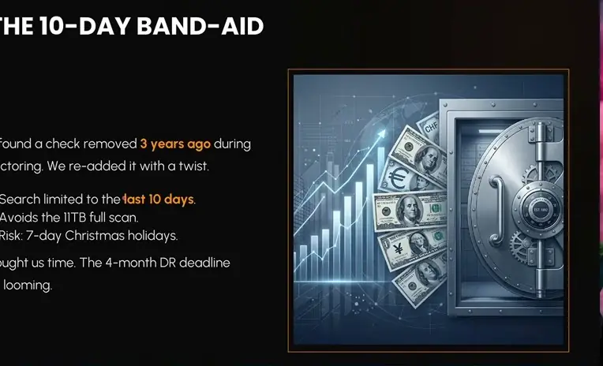
*[▶ 00:27:56](https://www.youtube.com/watch?v=TB45qqp-OxM&t=1676s) · The 10-day band-aid*

Ten days covers late bookings from weekends, holidays and slow customer transfers, but Christmas can still break it.

```sql
…
pending_tx
FT JOIN (
  SELECT
    tx_ACCOUNT_NR, tx_ACCOUNT_CURRENCY_CODE, tx_BOOKING_DATE,
    tx_BOOKING_TEXT, tx_BOOKING_TEXT_EN, tx_GVO, tx_AMOUNT,
    tx_VALUTA_DATE
  FROM
    booked_transaction
  WHERE
      tx_account_nr = :5 AND tx_account_currency_code = :6 AND
      tx_BOOKING_DATE >= sysdate-10
    AND tx_ACCOUNT_CURRENCY_CODE = :7 ) tx ON pending_tx.
    pending_tx_sepa_customer_ref = tx.tx_sepa_customer_ref
```

*[▶ 00:28:16](https://www.youtube.com/watch?v=TB45qqp-OxM&t=1696s) · Beast SQL second deduplication query*

The change shipped unproven: the execution plan is identical for any value, and the test environment had 20,000 accounts, not 20 million.

## Split pending and booked, deduplicate on write

[▶ 00:30:51](https://www.youtube.com/watch?v=TB45qqp-OxM&t=1851s)

Transactions went into two tables, pending and booked, not one. The two share only about five of their roughly 20 attributes.

Deduplication moved from reads to writes. Writes run at twice the read volume, so the team measured before choosing, and about half the transactions have moved so far.

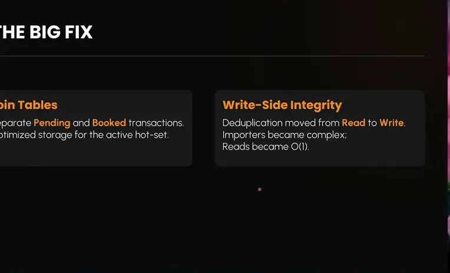
*[▶ 00:32:45](https://www.youtube.com/watch?v=TB45qqp-OxM&t=1965s) · The Big Fix: pending/booked split and write-side integrity*

Each of the 15 sources has its own importer. Importers check pending and booked before inserting. A write that is about 20 ms slower is acceptable if reads stay fast.

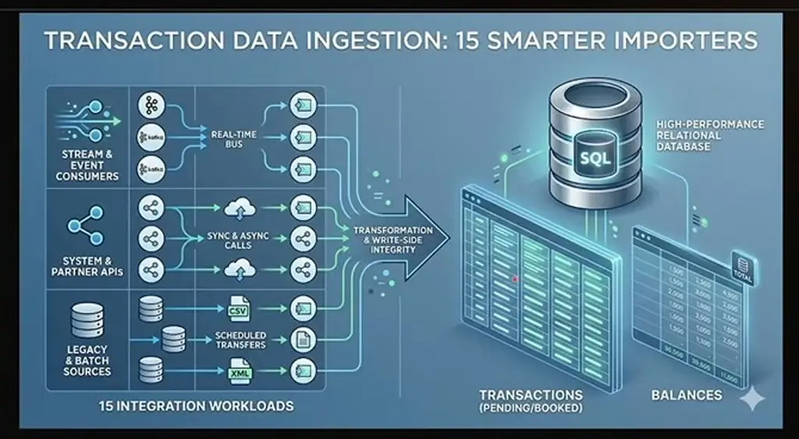
*[▶ 00:35:02](https://www.youtube.com/watch?v=TB45qqp-OxM&t=2102s) · Transaction ingestion: 15 smarter importers*

## Stay calm, prove it, migrate in stages

[▶ 00:35:03](https://www.youtube.com/watch?v=TB45qqp-OxM&t=2103s)

Keep a cool head. For an incident, apply first aid rather than spending hours digging through the database. A good-enough fix that satisfies 90% of clients eases the pressure.

With four months left before the next disaster recovery and no room for a large redesign, the team used a 10-day tactical window. "Hunch is nice, but prove it." They showed business colleagues that the slowdown cleared after about 20 minutes, once the data was cached. If data is missing, still choose a path and support it with whatever data you can get.

The strategic change moves everything from the read side to the write side, so the read side becomes a plain select from one large partitioned table.

Five stages lead to the cloud PostgreSQL exit: first aid, the 10-day fix, the write-side redesign, a pending/booked split with dual writes, and the exit.

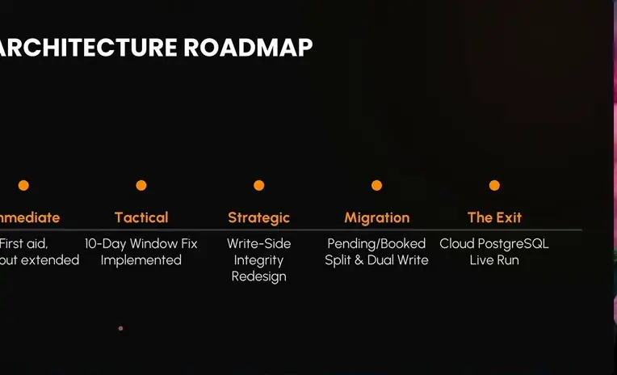
*[▶ 00:39:10](https://www.youtube.com/watch?v=TB45qqp-OxM&t=2350s) · Architecture roadmap: five stages*

Change data capture was ruled out. It requires sysadmin privileges on the Exadata, and installing anything there voids Oracle's SLA guarantees. Instead, the importers, the only writers to the schema, will write to Oracle and PostgreSQL simultaneously from 1 January 2027. Small differences in date and time are accepted.

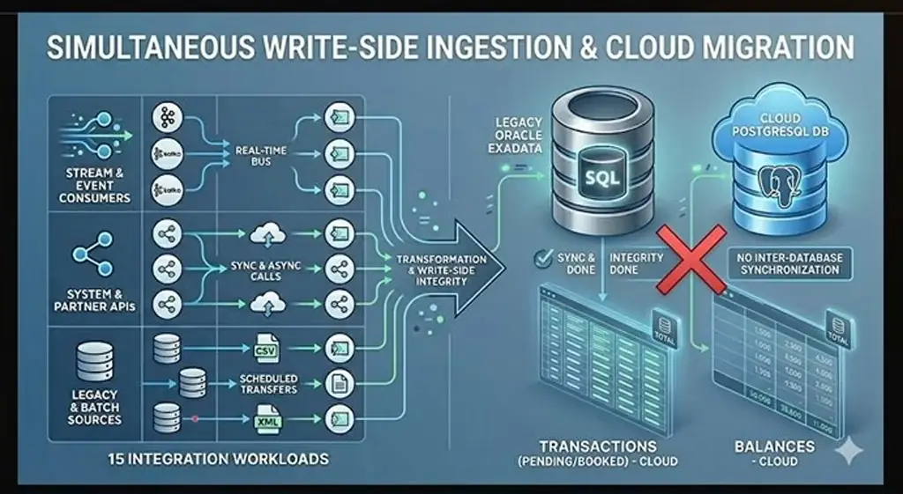
*[▶ 00:48:01](https://www.youtube.com/watch?v=TB45qqp-OxM&t=2881s) · Simultaneous write-side ingestion and cloud migration*

For the 11 TB of history, the team would not install unofficial open-source tools on bank production machines. A network transfer was estimated at about 30 days with no interruptions. The plan is an in-house migration application on Kubernetes, which has access to both sides, taking about four months.

Migrate with pilot users, never a big bang. About 600 pilot users can test the PostgreSQL feature and compare data. Traffic then moves 1%, 2%, 5%, 10%, 20%, then 100%; any problem sends everyone back to Oracle. The 99.998% availability target, about 10 minutes of downtime per year, constrains the plan.

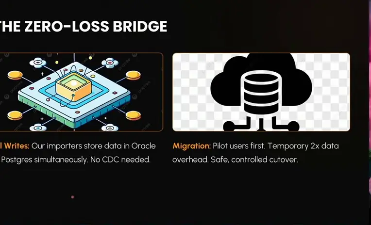
*[▶ 00:47:29](https://www.youtube.com/watch?v=TB45qqp-OxM&t=2849s) · The zero-loss bridge: dual writes and migration*

## Links & resources

- Speaker's code, said to be on the speaker's GitHub (URL not shown) · mentioned [▶ 00:23:28](https://www.youtube.com/watch?v=TB45qqp-OxM&t=1408s)
- Speaker's material to be posted to the conference (URL not shown) · mentioned [▶ 00:23:28](https://www.youtube.com/watch?v=TB45qqp-OxM&t=1408s)
- Tool from Dimitri's GitHub, name not captured in transcript · mentioned [▶ 00:44:07](https://www.youtube.com/watch?v=TB45qqp-OxM&t=2647s)
