# AI without spaghetti: Clean architecture in these of AI by Maarten Vandeperre en Lutske van der Mee

*How to keep AI-assisted code in a clean architecture, with a sample Quarkus and LangChain4j app that splits work across cheap and strong models.*

Source: [AI without spaghetti: Clean architecture in these of AI by Maarten Vandeperre en Lutske van der Mee](https://www.youtube.com/watch?v=E--oDq3X74E) · Maarten Vandeperre and Lutske van der Mee · Devoxx · 46 min

## TL;DR

AI-generated code can quickly turn into spaghetti: copied agent definitions silently switched a codebase to Kotlin, and generated code leaked database entities throughout the project. The talk's answer is clean architecture, with the domain model and use cases at the core and AI treated as infrastructure beside persistence. The speakers also split agentic coding across one role-specific agent per model, from a cheap local model to a stronger one, and back it with layered guardrails and architecture tests in CI. This matters because clean boundaries keep the context small, which cuts token cost and keeps you independent of any one AI or software vendor.

## Key takeaways

- Treat AI as infrastructure that sits beside persistence, not inside the domain, so the domain model and use cases stay at the core.
- Do not let generated code leak framework types such as Hibernate Panache entities into the domain; domain entities that mirror the database schema still depend on the database.
- Split agentic coding into single-role agents: a product owner model writes functional user stories, a stronger architect model turns them into technical requirements and small tasks, and a small local model executes them at low temperature.
- Benchmark each model for its specific job, because capabilities differ, and revalidate behavior after any model or runtime change, since prompts differ per model.
- Put guardrails in two layers: infrastructure guardrails such as input size limits, prompt-injection protection, and token limits in a proxy, and business guardrails such as domain rules in the domain layer.
- Enforce architecture rules with ArchUnit tests in CI, kept in a separate repository pulled in as a git submodule so AI changes to them get blocked.
- Keep a human in the loop for agentic coding, and run schema validation in CI.
- Build on open standards such as Jakarta REST and prefer open-source tooling, so the same core can run on different runtimes and you keep options open; data residency alone is not sovereignty.

## A legacy static site as the starting point

[▶ 00:00:00](https://www.youtube.com/watch?v=E--oDq3X74E&t=0s)

Leo wants his nonna's spaghetti, but he can't read her Italian recipe and isn't a developer.

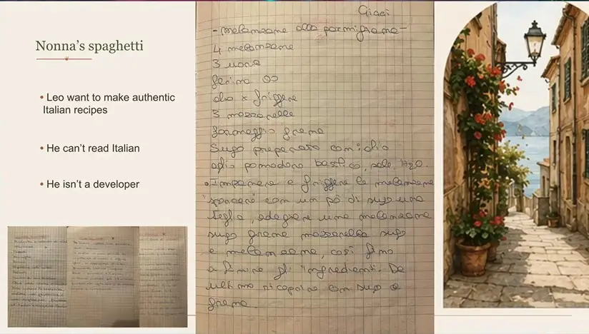
*[▶ 00:04:16](https://www.youtube.com/watch?v=E--oDq3X74E&t=256s) · Nonna's spaghetti*

Leo is a legacy system: an old static website, built in 2007, scraped from the internet and served by Python.

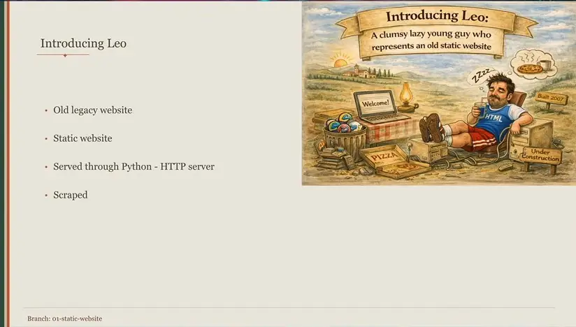
*[▶ 00:04:46](https://www.youtube.com/watch?v=E--oDq3X74E&t=286s) · What Leo is: bullet summary*

Run `python3 -m http.server 8000` in the site folder. Pasting two commands together breaks the port argument.

````bash
mvandepe@MacBook-Pro leo-legacy.be % python3 -m http.server 8000python3 -m http.server 8000
usage: server.py [-h] [--cgi] [--bind ADDRESS] [--directory DIRECTORY] [port]
server.py: error: argument port: invalid int value: '8000python3'

mvandepe@MacBook-Pro leo-legacy.be % python3 -m http.server 8000
Serving HTTP on :: port 8000 (http://[::]:8000/) ...

- All recipe pages, navigation, and resources

## How to Serve Locally

### Option 1: Python HTTP Server (Recommended)
```bash
cd leo-legacy.be
python3 -m http.server 8000
```

Then visit: http://localhost:8000

### Option 2: Node.js HTTP Server
```bash
cd leo-legacy.be
npx http-server -p 8000
```

Then visit: http://localhost:8000
````

*[▶ 00:05:05](https://www.youtube.com/watch?v=E--oDq3X74E&t=305s) · Serving the site with python3 http.server*

Localhost:8000 serves the Dutch site, to be translated later.

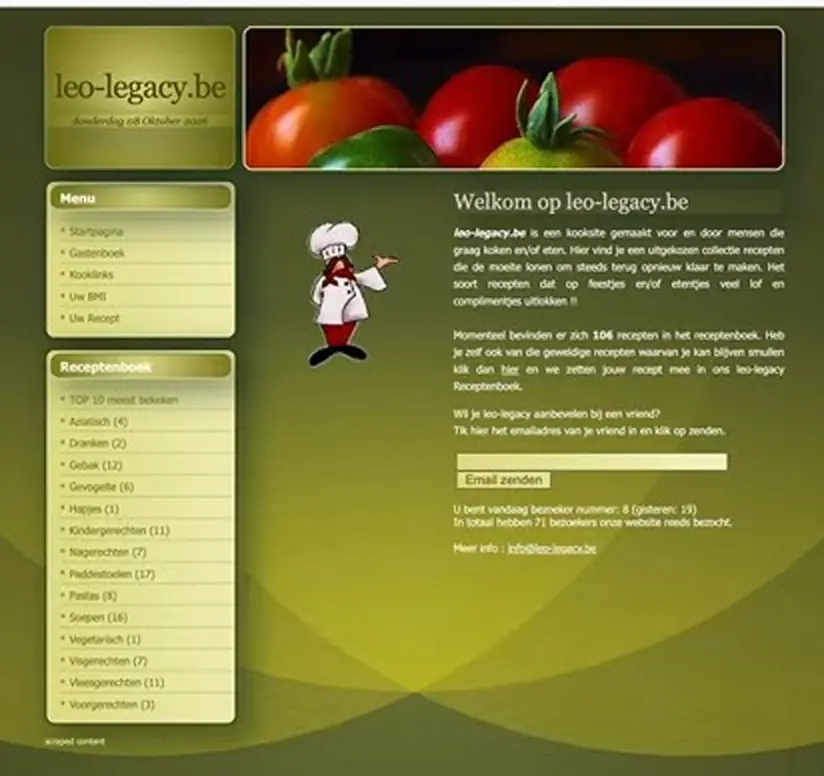
*[▶ 00:05:16](https://www.youtube.com/watch?v=E--oDq3X74E&t=316s) · Legacy leo-legacy.be site at localhost:8000*

The homepage lists 106 recipes by category, including Pastas.

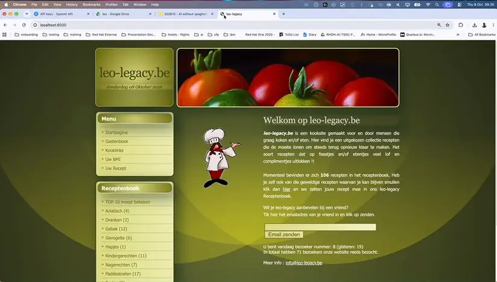
*[▶ 00:05:28](https://www.youtube.com/watch?v=E--oDq3X74E&t=328s) · Live demo: leo-legacy recipe website homepage*

The salmon pasta page is the content that Leo's spaghetti will replace.

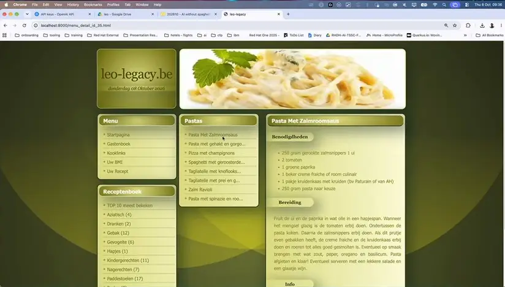
*[▶ 00:05:43](https://www.youtube.com/watch?v=E--oDq3X74E&t=343s) · Live demo: pasta recipe page in browser*

## Token limits, copy-paste risk, and database leakage

[▶ 00:05:54](https://www.youtube.com/watch?v=E--oDq3X74E&t=354s)

Tokens versus money is a deliberate choice. A $20-a-month subscription ran out on a small exercise, forcing waits of seven hours.

Copy-paste is risky. Copied skill and agent definitions silently switched the code to Kotlin, and the team only noticed around branch five or six.

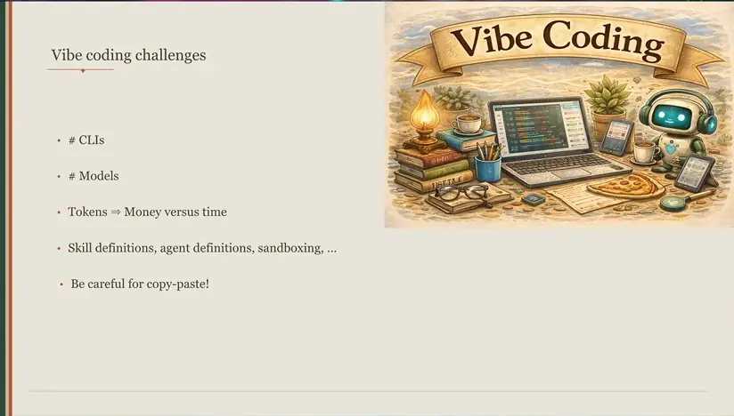
*[▶ 00:07:39](https://www.youtube.com/watch?v=E--oDq3X74E&t=459s) · Vibe coding challenges*

Leon, the static site, now has REST APIs and a simple Quarkus backend.

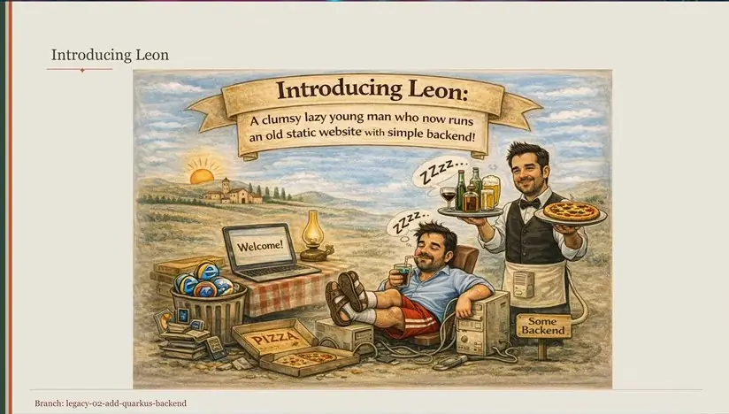
*[▶ 00:08:33](https://www.youtube.com/watch?v=E--oDq3X74E&t=513s) · Introducing Leon (persona illustration)*

The README's local options are Python's http.server (recommended) or Node's http-server.

````markdown
- All recipe pages, navigation, and resources

## How to Serve Locally

### Option 1: Python HTTP Server (Recommended)
```bash
cd leo-legacy.be
python3 -m http.server 8000
```
Then visit: http://localhost:8000

### Option 2: Node.js HTTP Server
```bash
cd leo-legacy.be
npx http-server -p 8000
```
Then visit: http://localhost:8000
````

*[▶ 00:10:21](https://www.youtube.com/watch?v=E--oDq3X74E&t=621s) · README local serve instructions in IntelliJ*

The first backend code is a version endpoint that reads `app.version` through MicroProfile Config and serves it at `/api/version`.

```java
package be.lutske.leolegacy.interfaceadapter.rest;

import ...

/**
 * REST resource that exposes the application version.
 *
 * The version value is read from application.properties via MicroProfile Config.
 */
@Path("/api/version")
public class VersionResource {

    @ConfigProperty(name = "app.version")
    String appVersion;

    @GET
    @Produces(MediaType.APPLICATION_JSON)
    public VersionResponse getVersion() { return new VersionResponse(appVersion); }
```

*[▶ 00:11:15](https://www.youtube.com/watch?v=E--oDq3X74E&t=675s) · VersionResource.java: app version endpoint*

```java
 *
 * The version value is read from application.properties via MicroProfile Config.
 */
@Path("/api/version")
public class VersionResource {

    @ConfigProperty(name = "app.version")
    String appVersion;

    @GET
    @Produces(MediaType.APPLICATION_JSON)
    public VersionResponse getVersion() { return new VersionResponse(appVersion); }
}
```

*[▶ 00:11:39](https://www.youtube.com/watch?v=E--oDq3X74E&t=699s) · VersionResource.java scrolled to class body*

Leonello adds Postgres and a database choice between JDBC and Hibernate.

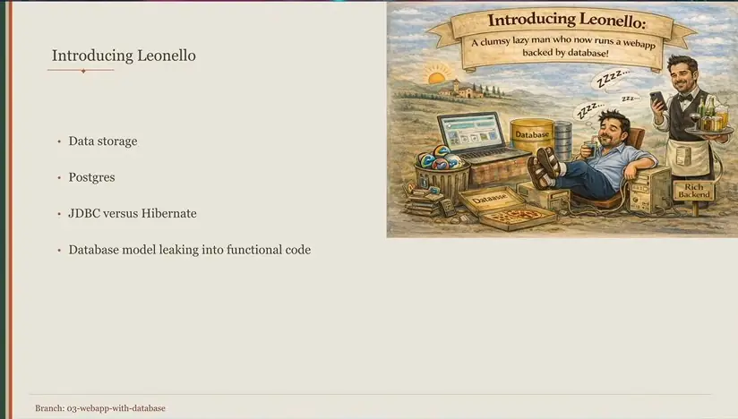
*[▶ 00:10:12](https://www.youtube.com/watch?v=E--oDq3X74E&t=612s) · Introducing Leonello: data storage topics*

Generated code leaked Hibernate Panache entities throughout the codebase. Domain entities that mirror the database schema still depend on the database, even if they look framework-free.

## Tesseract OCR fails on handwritten recipes

[▶ 00:11:58](https://www.youtube.com/watch?v=E--oDq3X74E&t=718s)

Recipe imports use Tesseract for Java with per-language files. `OcrService` configures the library path.

```java
public class OcrService {
static {
    configureJnaLibraryPath();
}

    private static final Map<String, Set<String>> LANGUAGE_HINTS = Map.of(
        k1: Set.of("ita", "il", "la", "di", "che", "per", "con", "una", "un", "gli",
            "ingredienti", "procedimento", "preparazione", "ricetta"),
        k2: Set.of("eng", "the", "and", "with", "ingredients", "directions", "method", "steps",
            "recipe", "mix", "bake"),
        k3: Set.of("nld", "de", "het", "en", "voor", "bereiding", "werkwijze", "ingredienten",
            "ingrediënten", "recept")
    );

    private final String tessdataPath;
    private final String configuredLanguage;
    private final …
```

*[▶ 00:13:52](https://www.youtube.com/watch?v=E--oDq3X74E&t=832s) · OcrService.java: Tesseract language setup*

Common words per language code, for Italian, English and Dutch, detect the recipe's language.

```java
public class OcrService {
    static {
        configureJnaLibraryPath();
    }

    private static final Map<String, Set<String>> LANGUAGE_HINTS = Map.of(
        "ita", Set.of("il", "la", "di", "che", "per", "con", "una", "un", "gli",
            "ingredienti", "procedimento", "preparazione", "ricetta"),
        "eng", Set.of("the", "and", "with", "ingredients", "directions", "method", "steps",
            "recipe", "mix", "bake"),
        "nld", Set.of("de", "het", "en", "voor", "bereiding", "werkwijze", "ingredienten",
            "ingredienten", "recept")
    );

    private final String tessdataPath;
    private final String configuredLanguage;
    private final boolean languageDetect…
```

*[▶ 00:14:36](https://www.youtube.com/watch?v=E--oDq3X74E&t=876s) · OcrService.java in IntelliJ with language hints*

Podman runs the database, and a Vite dev server starts the React front end on localhost:3000 while the backend compiles.

```shell
VITE v7.3.1  ready in 873 ms

→  Local:   http://localhost:3000/
→  Network: use --host to expose
→  press h + enter to show help
```

*[▶ 00:14:10](https://www.youtube.com/watch?v=E--oDq3X74E&t=850s) · Vite dev server started for the React front end*

```java
public class OcrService {
    static {
        configureJnaLibraryPath();
    }

    private static final Map<String, Set<String>> LANGUAGE_HINTS = Map.of(
        "ita", Set.of("il", "la", "di", "che", "per", "con", "una", "un", "gli",
            "ingredienti", "procedimento", "preparazione", "ricetta"),
        "eng", Set.of("the", "and", "with", "ingredients", "directions", "method", "steps",
            "recipe", "mix", "bake"),
        "nld", Set.of("de", "het", "en", "voor", "bereiding", "werkwijze", "ingrediënten",
            "ingrediënten", "recept")
    );

    private final String tessdataPath;
    private final String configuredLanguage;
    private final …

dist/index-…
dist/assets/index-DmxvY7R5.css  12.71 kB | gzip: 2.66 kB
dist/assets/index-DtQGQ9rJ.js  242.82 kB | gzip: 76.91 kB
✓ built in 596ms
<==========> 81% EXECUTING [1m 1s]
> IDLE
> IDLE
> :backend:compileTestJava
> IDLE
```

*[▶ 00:14:58](https://www.youtube.com/watch?v=E--oDq3X74E&t=898s) · OcrService.java language hints in IntelliJ*

The Dutch-language app's UI used Italian-flag red everywhere until the team reserved red for errors.

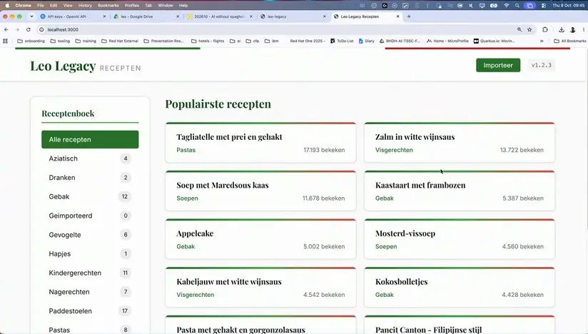
*[▶ 00:15:21](https://www.youtube.com/watch?v=E--oDq3X74E&t=921s) · Leo Legacy recipe app running in browser*

A handwritten Italian recipe imported as unreadable text.

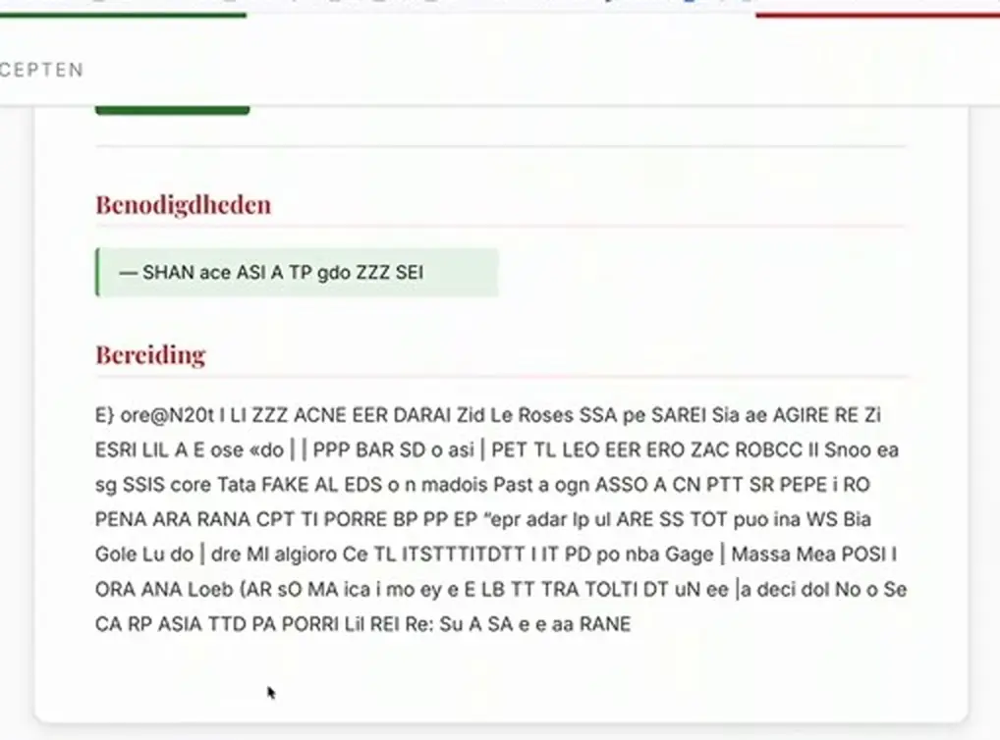
*[▶ 00:16:26](https://www.youtube.com/watch?v=E--oDq3X74E&t=986s) · Garbled OCR import result in recipe app*

OCR returns text, not structure, so the next step is an AI model via LangChain4j.

## Keeping the domain apart from infrastructure

[▶ 00:17:25](https://www.youtube.com/watch?v=E--oDq3X74E&t=1045s)

AI sits in infrastructure beside persistence, like another data store.

```java
package be.lutske.leolegacy.infrastructure.persistence.entity;

import ...

@Entity
@Table(name = "category")
public class CategoryEntity {

    @Id
    @GeneratedValue(strategy = GenerationType.IDENTITY)
    private Long id;

    private String name;

    public CategoryEntity() {
    }

    public CategoryEntity(Long id, String name) {
```

*[▶ 00:18:10](https://www.youtube.com/watch?v=E--oDq3X74E&t=1090s) · CategoryEntity JPA class in infrastructure persistence*

The extraction prompt demands strict JSON and warnings.

```java
public class LangChain4jRecipeExtractionService implements RecipeExtractionServi…
    private static final String EXTRACTION_PROMPT = """
…
4. If a field is not visible, unclear, or you are uncertain, set it to null.
5. Do not invent or hallucinate data that is not in the image.
6. Add warnings for any uncertainty or ambiguity.

Required JSON structure:
{
  "title": "string or null — brief summary if visible",
  "description": "string or null — brief summary if visible",
  "servings": "string or null — e.g. '4 servings'",
  "ingredients": ["string", ...] or null — each ingredient as a single string with
  "steps": ["string", ...] or null — each preparation step as a string,
  "source": "string or null — attribution if visible",
  "tags": ["string", ...] or null — categories or tags if visible,
  "warnings": ["string", ...] — list of warnings about uncertain/missing data
```

*[▶ 00:18:30](https://www.youtube.com/watch?v=E--oDq3X74E&t=1110s) · LangChain4j recipe extraction prompt*

Start with `:backend:quarkusDev`.

```shell
…37 modules transformed.
rendering chunks...
computing gzip size...
dist/index.html   0.69 kB │ gzip:  0.39 kB
dist/assets/index-BPtJNcUl.css   13.40 kB │ gzip:  2.78 kB
dist/assets/index-0YMfAeEz.js   246.63 kB │ gzip: 77.35 kB
✓ built in 597ms
<=============-> 93% EXECUTING [6s]
> :backend:quarkusDev
```

*[▶ 00:18:48](https://www.youtube.com/watch?v=E--oDq3X74E&t=1128s) · Starting backend with quarkusDev*

AI changed the Flyway scripts, so the database was reset with `podman compose down`.

```shell
[postgres] | 2026-10-08 07:49:31.881 UTC [1] LOG:  received fast shutdown request
[postgres] | 2026-10-08 07:49:31.884 UTC [1] LOG:  aborting any active transactions
[postgres] | 2026-10-08 07:49:31.884 UTC [1] LOG:  background worker "logical replication launcher" (PID 27) exited with exit code 1
[postgres] | 2026-10-08 07:49:31.885 UTC [22] LOG:  shutting down
[postgres] | 2026-10-08 07:49:31.885 UTC [22] LOG:  checkpoint starting: shutdown immediate
[postgres] | 2026-10-08 07:49:31.887 UTC [22] LOG:  checkpoint complete: wrote 3 buffers (0.0%); 0 WAL file(s) added, 0 removed, 0 recycled; write=0.001 s, sync=0.001 s, total=0.003 s; sync files=2, longest=0.001 s, average=0.001 s; distance=0 kB, estimate=0 kB; lsn=19E55A8, redo lsn=19E55A8
mvandepe@MacBook-Pro leo-by-lutske-and-maarten % [postgres] | 2026-10-08 07:49:31.890 UTC [1] LOG:  database system is shut down
mvandepe@MacBook-Pro leo-by-lutske-and-maarten % podman compose down
```

*[▶ 00:19:07](https://www.youtube.com/watch?v=E--oDq3X74E&t=1147s) · Shutting down Postgres with podman compose down*

Keep a human in the loop and run schema validation in CI.

Clean architecture puts the domain model and use cases at the core.

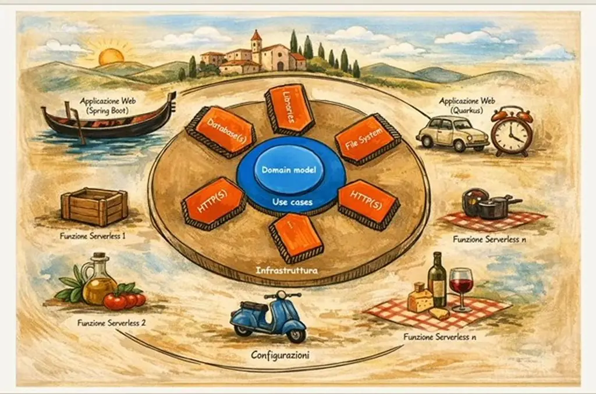
*[▶ 00:25:31](https://www.youtube.com/watch?v=E--oDq3X74E&t=1531s) · Clean architecture onion diagram*

Next come different models in the codebase and agentic coding with guardrails.

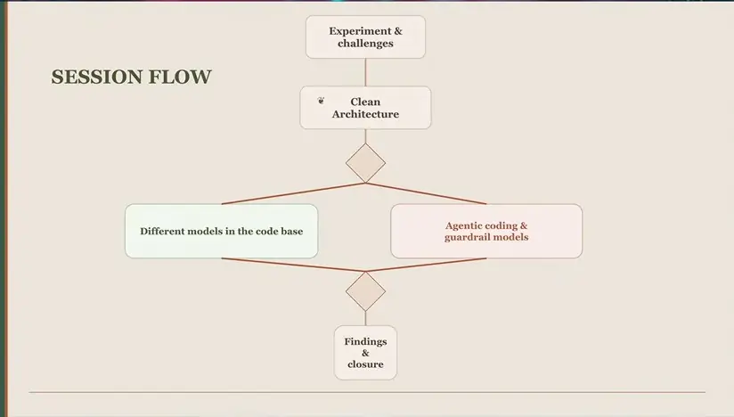
*[▶ 00:21:28](https://www.youtube.com/watch?v=E--oDq3X74E&t=1288s) · Session flow diagram*

## Sovereignty as keeping options open

[▶ 00:21:30](https://www.youtube.com/watch?v=E--oDq3X74E&t=1290s)

The speaker frames sovereignty as the same thinking as clean architecture, applied to infrastructure: be as independent as possible of technology and software vendors.

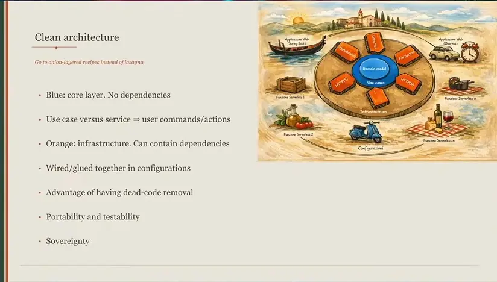
*[▶ 00:25:34](https://www.youtube.com/watch?v=E--oDq3X74E&t=1534s) · Clean architecture key points*

Keep the domain core, API modules and infrastructure modules separate, wired together by a thin layer. Build on open standards such as Jakarta REST, so the same core can run on Open Liberty, Quarkus or Spring Boot.

Data residency is not sovereignty. Who can access your data, for example under the US Cloud Act, matters. Prefer open-source tooling.

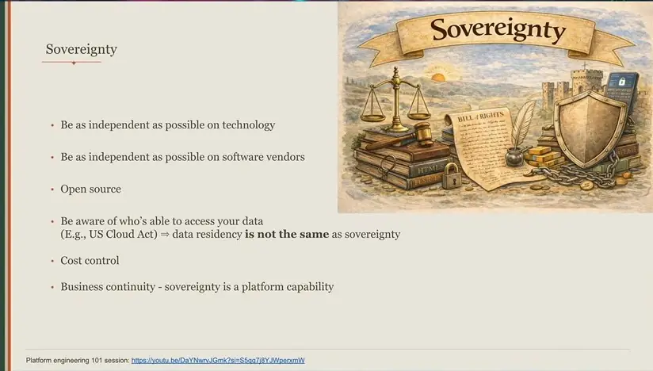
*[▶ 00:26:19](https://www.youtube.com/watch?v=E--oDq3X74E&t=1579s) · Sovereignty principles slide*

Changing an AI model keeps the contract but is still a dependency change, because prompts differ per model. Revalidate behavior after model or runtime upgrades.

The example app, Leonard, is built this way.

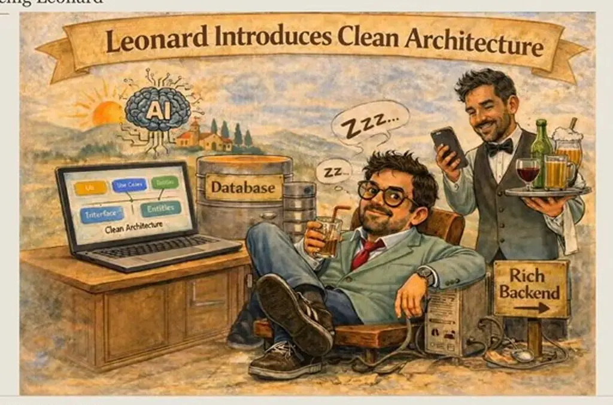
*[▶ 00:26:25](https://www.youtube.com/watch?v=E--oDq3X74E&t=1585s) · Introducing Leonard and clean architecture*

## Splitting the work across cheap and strong agents

[▶ 00:26:23](https://www.youtube.com/watch?v=E--oDq3X74E&t=1583s)

Subscription limits blocked work for hours after a few minutes of use, and one attempt with API keys cost $300. The fix was a pipeline of OpenCode agents, each with one role.

The product owner, an OpenAI model, turns a request into functional user stories with no technical detail.

```markdown
--- name: product-owne…e ---
…
You are in **Product Owner mode**.

Your ONLY responsibility is to convert requests into **clear functional user stories** that de…

You must think like a **product owner**, not a developer.

DO NOT propose technical solutions.
DO NOT mention frameworks, APIs, databases, architecture, or implementation details.

Your output must be **purely functional requirements**.

---

# Core responsibility
```

*[▶ 00:30:38](https://www.youtube.com/watch?v=E--oDq3X74E&t=1838s) · product-owner.md agent prompt in IDE*

The enterprise architect, Claude Sonnet 4, turns those stories into technical requirements, then into the smallest possible tasks.

```yaml
name: enterprise-architect
description: "Transforms an existing user story into very small, explicit technical tasks for a …
model: anthropic/claude-sonnet-4-20250514
temperature: 0.2
max_output_tokens: 4096

tools:
    read: true
    list: true
    glob: true
    grep: true
    write: true
    todoread: true
    todowrite: true
---
```

*[▶ 00:31:19](https://www.youtube.com/watch?v=E--oDq3X74E&t=1879s) · enterprise-architect.md agent config*

The junior developer is a local Qwen3 14B on OpenShift, set to temperature 0.05 for precise execution.

```yaml
---
name: software-developer-junior
description: "Implements exactly … technical-tasks, verifies compil…
model: redhat-openshift-vllm/qwen3-14b
temperature: 0.05
max_output_tokens: 8192

tools:
    read: true
    list: true
    glob: true
    grep: true
    bash: true
    patch: true
    edit: true
    write: true
---
```

*[▶ 00:31:41](https://www.youtube.com/watch?v=E--oDq3X74E&t=1901s) · software-developer-junior.md on qwen3-14b*

It later ran on a laptop as Qwen3.5-9B through MLX.

```yaml
---
name: software-developer-junior
description: "Implements exactly one technical task from sprint/technical-tasks, verifies compil…
model: mlx/mlx-community/Qwen3.5-9B-4bit
temperature: 0.05
max_output_tokens: 8192

tools:
  read: true
  list: true
  glob: true
  grep: true
  bash: true
  patch: true
  edit: true
  write: true
…
```

*[▶ 00:32:44](https://www.youtube.com/watch?v=E--oDq3X74E&t=1964s) · Agent config for software-developer-junior*

Reasoning wasted time. The architect had already done the thinking, so the small model only needed to follow instructions. Benchmark each model for this job, because capabilities differ.

Earlier in the branch, the OpenAI use case only wrapped a port to the repository.

```java
package be.lutske.leolegacy.usecase.recipe;

import ...

@ApplicationScoped
public class GetRecipeUseCase {

    private final RecipeQueryPort recipeQueryPort;

    public GetRecipeUseCase(RecipeQueryPort recipeQueryPort) { this.recipeQueryPort = recipeQueryPort; …

    public Optional<Recipe> execute(long recipeId) { return recipeQueryPort.findById(recipeId); }
}
```

*[▶ 00:27:56](https://www.youtube.com/watch?v=E--oDq3X74E&t=1676s) · GetRecipeUseCase depends on RecipeQueryPort*

The Anthropic version put the extraction port in the domain package, which is a mistake: ports should stay separate from the domain.

```java
package be.lutske.leolegacy.domain.port;

import be.lutske.leolegacy.domain.model.RecipeExtraction;

/**
 * Port for extracting structured recipe data from an image.
 * Infrastructure provides the LLM-based implementation.
 */
public interface RecipeExtractionService {

    RecipeExtraction extractRecipeFromImage(byte[] imageBytes, String mimeType);
}
```

*[▶ 00:28:26](https://www.youtube.com/watch?v=E--oDq3X74E&t=1706s) · RecipeExtractionService port interface*

The pipeline is unfinished. In about an hour, the junior agent produced the Gradle settings and the domain and use-case layouts. The code is in the [clean architecture sample project](https://github.com/maarten-vandeperre/clean-architecture-software-sample-project).

## Chatbot behind guardrails

[▶ 00:33:20](https://www.youtube.com/watch?v=E--oDq3X74E&t=2000s)

Leonardo gets chat through LangChain4j, wired to Anthropic or OpenAI via `ChatModelProducer`.

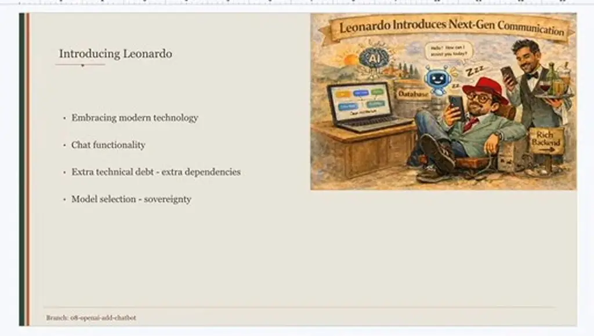
*[▶ 00:33:40](https://www.youtube.com/watch?v=E--oDq3X74E&t=2020s) · Introducing Leonardo*

Run it with `./gradlew quarkusDev` after a Gradle build.

```bash
For more on this, please refer to https://docs.gradle.org/9.3.1/userguide/command_line_interface.html#sec:command_line_warnings in the Gradle documentation.
BUILD SUCCESSFUL in 7m 14s
13 actionable tasks: 3 executed, 10 up-to-date
mvandepe@MacBook-Pro leo-by-lutske-and-maarten % ./gradlew quarkusDev
<===========--> 37% EXECUTING [2s]
> :backend:buildFrontend
```

*[▶ 00:34:05](https://www.youtube.com/watch?v=E--oDq3X74E&t=2045s) · Gradle build succeeds and quarkusDev starts*

Each provider has its own builder.

```java
public class ChatModelProducer {
    private ChatLanguageModel buildOpenAiModel(String apiKey, String modelName, String baseUrl) {
        return builder.build();
    }

    private ChatLanguageModel buildAnthropicModel() {
        return ChatAnthropicModel.builder()
            .apiKey(apiKey)
            .modelName(modelName)
            .temperature(temperature)
            .maxTokens(maxTokens)
            .timeout(Duration.ofSeconds(timeoutSeconds))
            .logRequests(false)
            .logResponses(false)
            .build();
    }
```

*[▶ 00:34:30](https://www.youtube.com/watch?v=E--oDq3X74E&t=2070s) · ChatModelProducer Anthropic model builder*

```java
public class ChatModelProducer {
    public ChatLanguageModel chatLanguageModel() {
    …
    }

    private ChatLanguageModel buildOpenAiModel(String apiKey, String modelName, String baseUrl) {
        var builder = OpenAiChatModel.builder()
            .apiKey(apiKey)
            .modelName(modelName)
            .temperature(temperature)
            .maxCompletionTokens(maxTokens)
            .timeout(Duration.ofSeconds(timeoutSeconds))
            .logRequests(false)
            .logResponses(false);

        if (baseUrl != null) {
            builder.baseUrl(baseUrl);
        }
```

*[▶ 00:35:14](https://www.youtube.com/watch?v=E--oDq3X74E&t=2114s) · ChatModelProducer OpenAI model builder*

Even with the same contract, a new model version or engine can change behavior, so validate each one.

Chatbots need guardrails; a car maker's bot reportedly recommended a competitor.

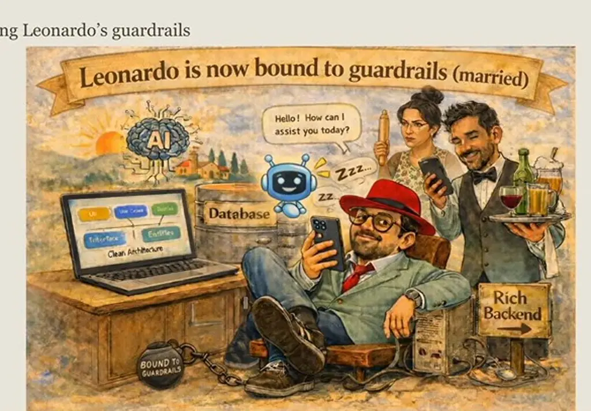
*[▶ 00:36:35](https://www.youtube.com/watch?v=E--oDq3X74E&t=2195s) · Introducing Leonardo's guardrails*

Validate input size and scope too, since huge prompts cost money. Guardrail types:
- Input guardrailing
- Output guardrailing
- Rate limiting per API and token
- Output token limiting

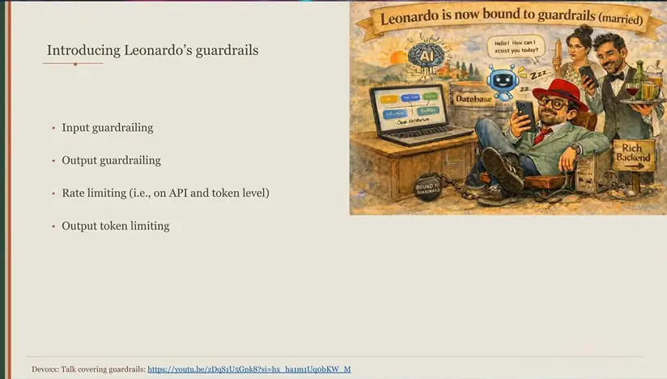
*[▶ 00:37:25](https://www.youtube.com/watch?v=E--oDq3X74E&t=2245s) · Introducing Leonardo's guardrails*

## Layered guardrails and architecture tests in CI

[▶ 00:37:26](https://www.youtube.com/watch?v=E--oDq3X74E&t=2246s)

Guardrails belong in more than one layer. Infrastructure guardrails, such as size limits and prompt-injection protection, sit in a proxy. Business guardrails, such as "no pineapple on pizza", belong in the domain layer.

ArchUnit works like a unit test for architecture: a rule forbidding domain classes from depending on frameworks fails when violated.

In the [clean architecture sample project](https://github.com/maarten-vandeperre/clean-architecture-software-sample-project), a framework-annotated domain class makes the test fail.

```text
Architecture Violation [Priority: MEDIUM] - Rule 'no classes that reside in a package 'be.lutske.leolegacy.domain..' should depend on classes that reside in any package ['jakarta..', 'io.quarkus..', 'org.hibernate..', ...]' was violated
Class <be.lutske.leolegacy.domain.ArchUnitBreak> is annotated with <jakarta.enterprise.context.ApplicationScoped> in (ArchUnitBreak.java:0)
java.lang.AssertionError: Architecture Violation [Priority: MEDIUM] - Rule 'no classes that reside in a package 'be.lutske.leolegacy.domain..' should depend on classes that reside in any package ['jakarta..', 'io.quarkus..', 'org.hibernate..', ...]' was violated
Class <be.lutske.leolegacy.domain.ArchUnitBreak> is annotated with <jakarta.enterprise.context.ApplicationScoped> in (ArchUnitBreak.java:0)
	at com.tngtech.archunit.lang.ArchRule$Assertions.assertNoViolation(ArchRule.java:94)
	at com.tngtech.archunit.lang.ArchRule$Assertions.check(ArchRule.java:86)
	at com.tngtech.archunit.lang.ArchRule$Factory$SimpleArchRule.check(ArchRule.java:165)
	at com.tngtech.archunit.lang.syntax.ObjectsShouldInternal.check(ObjectsShouldInternal.java:81)
```

*[▶ 00:42:43](https://www.youtube.com/watch?v=E--oDq3X74E&t=2563s) · Architecture violation stack trace in test output*

Keep architecture tests in a separate repository, pulled into projects as a git submodule in CI, so AI changes to them get blocked.

Agentic coding needs a human in the loop; CI pipelines need validations.

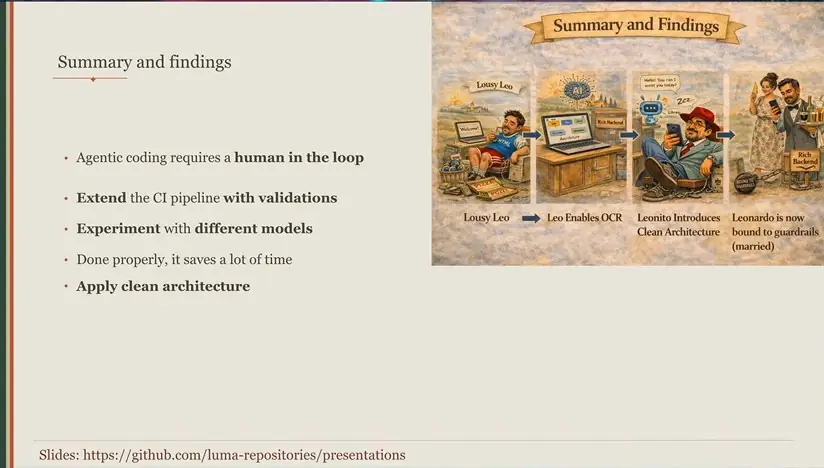
*[▶ 00:44:05](https://www.youtube.com/watch?v=E--oDq3X74E&t=2645s) · Summary and findings takeaways*

Try different models.

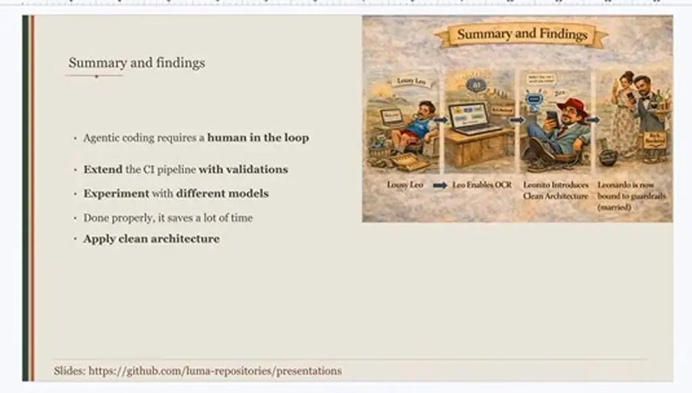
*[▶ 00:44:09](https://www.youtube.com/watch?v=E--oDq3X74E&t=2649s) · Summary and findings*

Clean boundaries keep the context small, so a model changes only relevant files, cutting token cost.


*[▶ 00:44:16](https://www.youtube.com/watch?v=E--oDq3X74E&t=2656s) · Clean architecture rings around domain model*

Simple changes, like editing a string value, don't need a senior developer and could be outsourced.

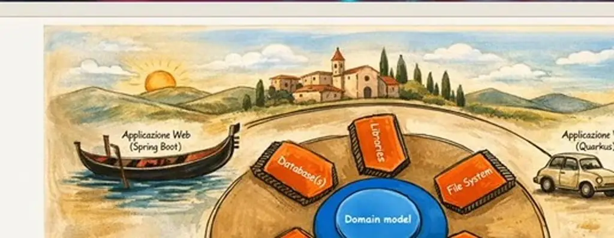
*[▶ 00:45:01](https://www.youtube.com/watch?v=E--oDq3X74E&t=2701s) · Clean architecture hexagonal diagram with serverless functions*

Done properly, clean architecture saves a lot of time.


*[▶ 00:45:18](https://www.youtube.com/watch?v=E--oDq3X74E&t=2718s) · Summary and findings*

## Links & resources

- [leo-legacy — live demo recipe website used in the talk](https://leo-legacy.be) — <https://leo-legacy.be> · on screen [▶ 00:05:28](https://www.youtube.com/watch?v=E--oDq3X74E&t=328s)
- [Clean architecture sample project — speaker's GitHub code, branches per step](https://github.com/maarten-vandeperre/clean-architecture-software-sample-project) — <https://github.com/maarten-vandeperre/clean-architecture-software-sample-project> · on screen [▶ 00:25:31](https://www.youtube.com/watch?v=E--oDq3X74E&t=1531s)
- [Sovereignty principles video — referenced in the talk](https://youtu.be/DaYNwrvJGmk?si=S5qq7j8YJWperxmW) — <https://youtu.be/DaYNwrvJGmk?si=S5qq7j8YJWperxmW> · on screen [▶ 00:26:19](https://www.youtube.com/watch?v=E--oDq3X74E&t=1579s)
- [Talk presentations repository — slides and summary and findings](https://github.com/luma-repositories/presentations) — <https://github.com/luma-repositories/presentations> · on screen [▶ 00:44:09](https://www.youtube.com/watch?v=E--oDq3X74E&t=2649s)
- Martin Fowler's book — basis for the speaker's example repository, URL not shown · mentioned [▶ 00:22:57](https://www.youtube.com/watch?v=E--oDq3X74E&t=1377s)
