# All you need to know about Maven 4! by Matthias Bünger

*What Maven 4 changes in the POM, reactor, lifecycle and project layout, and how to migrate from Maven 3.*

Source: [All you need to know about Maven 4! by Matthias Bünger](https://www.youtube.com/watch?v=TgkY2UmWtBo) · Matthias Bünger · Devoxx · 47 min

## TL;DR

Maven's POM format and APIs have accumulated legacy that blocks further change, because IDEs and build tools depend on the POM. Maven 4 requires Java 17 to run and splits the build POM (4.1.0) from a consumer POM (4.0.0) published to Maven Central. It also adds subprojects, explicit project roots, automatic versioning, stricter checks, a project-local repository and a tree-based lifecycle. Migrating means building cleanly on Maven 3.10 first, then moving to Java 17 and Maven 4.

## Key takeaways

- Maven 4 requires Java 17 to run, but applications built with it can still target any Java version.
- The build POM stays as model 4.1.0 in the repository, while Maven generates a model 4.0.0 consumer POM for remote upload to keep existing consumers compatible.
- Maven 4 renames modules to subprojects, using the `subproject` element in model 4.1.0, and `modules` still works but is deprecated.
- Declare the project root with a `.mvn` folder or a `root` attribute set to `true` in the parent POM, instead of relying on Maven 3's guessing.
- Maven 4 removes the need for a hardcoded parent version and explicit sibling dependency versions through automatic versioning, and `installAtEnd` and `deployAtEnd` now default to `true`.
- Maven 4 fails on duplicate declarations and missing profiles; use `-fos WARN` on Maven 3 to find these early, and prefix a profile with `?` (for example `-P?release`) to make a missing one only log an INFO message.
- Use `mvn verify` for regular builds and `install` only for libraries tested in other projects, since `clean install` is no longer needed for the project-local repository bug.
- To migrate, build successfully on Maven 3.10 with current 3.x plugins, prepare Java 17+, run Maven 4 and fix errors, and avoid the alpha or beta 4.x plugins that use the new plugin API.

## Why the POM blocks Maven's evolution

[▶ 00:00:00](https://www.youtube.com/watch?v=TgkY2UmWtBo&t=0s)

Matthias Bünger's talk is a 50-minute beginner session on Maven 4.

```json
{
  "id": 21675,
  "format": "Conference",
  "track": "Development Practices",
  "level": "Beginner",
  "duration": 50,
  "speakers": ["Matthias Bünger"],
  "tags": ["maven", "version", "features", "ecosy…
}
```

*[▶ 00:00:18](https://www.youtube.com/watch?v=TgkY2UmWtBo&t=18s) · Talk metadata in talk.json*

Maven's first release came in 2004 and Maven 3.0 in October 2010. The core team maintains about 100 artifacts, and the community adds roughly 6,000 plugins.

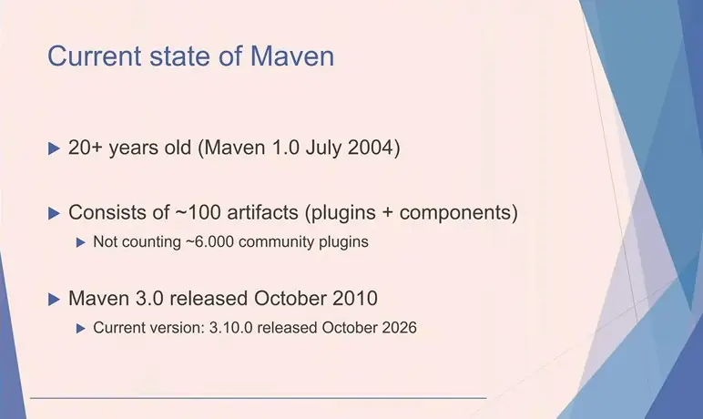
*[▶ 00:03:43](https://www.youtube.com/watch?v=TgkY2UmWtBo&t=223s) · Current state of Maven*

The POM describes how to build a project and is published to Maven Central so consumers can use it.

```xml
<project xmlns="http://maven.apache.org/POM/4.0.0"
         xmlns:xsi="http://www.w3.org/2001/XMLSchema-instance"
         xsi:schemaLocation="http://maven.apache.org/POM/4.0.0
         http://maven.apache.org/xsd/maven-4.0.0.xsd">
    <modelVersion>4.0.0</modelVersion>
    <groupId>test</groupId>
    <artifactId>JavaStuff</artifactId>
    <version>0.0.1-SNAPSHOT</version>
    <packaging>pom</packaging>
    <name>Mixed Javastuff</name>

    <modules>
        <module>JavaFeatures</module>
        <module>JavaProject</module>
    </modules>
```

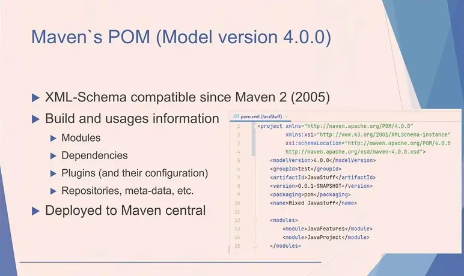
*[▶ 00:04:35](https://www.youtube.com/watch?v=TgkY2UmWtBo&t=275s) · Maven`s POM (Model version 4.0.0)*

Maven wants to change the POM, remove old APIs with unclear boundaries, and use newer Java versions.

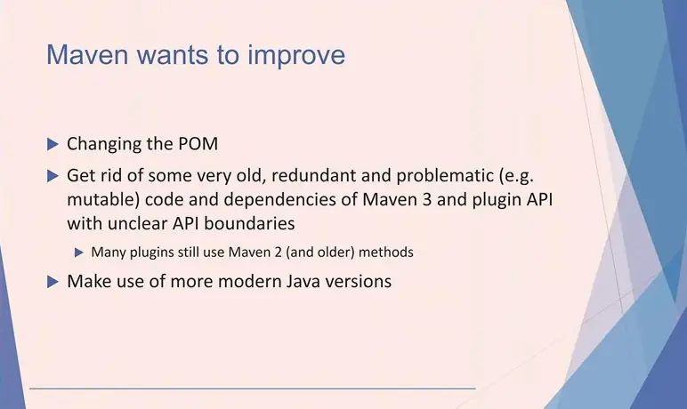
*[▶ 00:06:13](https://www.youtube.com/watch?v=TgkY2UmWtBo&t=373s) · Maven wants to improve*

Changing the POM is hard because IDEs such as Eclipse and IntelliJ IDEA, and build tools such as sbt and Ivy, depend on it.

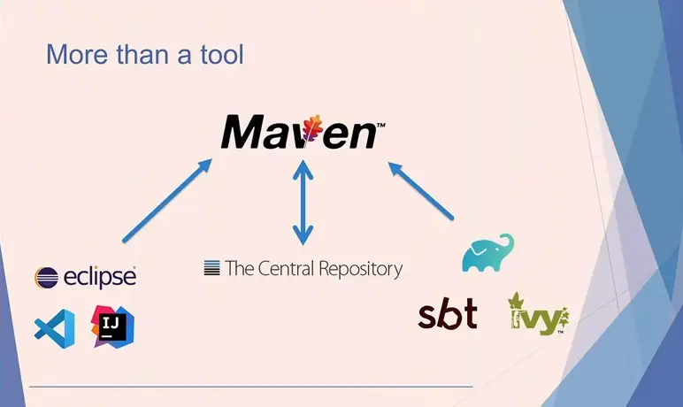
*[▶ 00:07:11](https://www.youtube.com/watch?v=TgkY2UmWtBo&t=431s) · More than a tool: Maven ecosystem*

Hervé Boutemy, Maven PMC chair, warned that keeping the schema frozen would leave Maven stuck on 3.x minor releases.

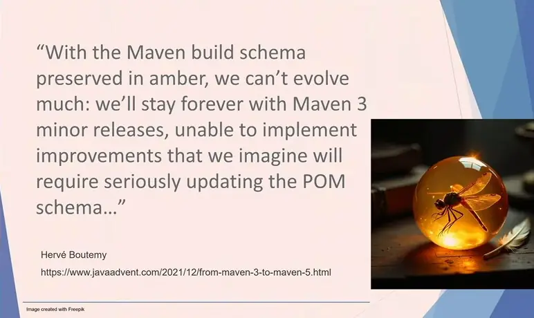
*[▶ 00:07:53](https://www.youtube.com/watch?v=TgkY2UmWtBo&t=473s) · Maven build schema preserved in amber*

## Java 17 to run Maven, and a split POM model

[▶ 00:07:52](https://www.youtube.com/watch?v=TgkY2UmWtBo&t=472s)

Maven 4 requires **Java 17 to run**, the only breaking change the speaker highlights. This applies to Maven itself, not your application, which can compile against any Java version.

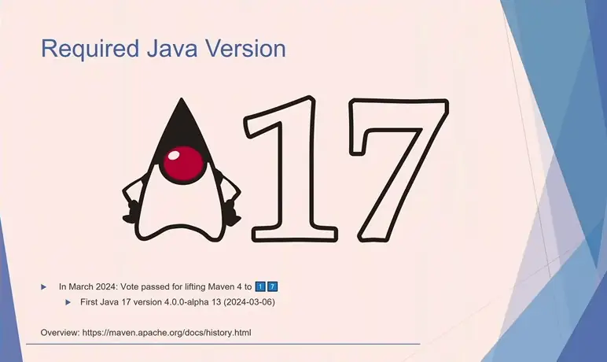
*[▶ 00:08:50](https://www.youtube.com/watch?v=TgkY2UmWtBo&t=530s) · Required Java Version: Java 17*

Java 8+ is updated continuously; Java 8 became the minimum in 3.9.0 (January 2023). The plugin API cleanup means:

- Old Maven 1/2 APIs warn in 3.9 and fail in 4.0.
- The new plugin API is experimental for now.
- Default plugin versions in the super POM are updated.
- The "Plexus" dependency resolver, deprecated since Maven 3.2 (2010), is removed.

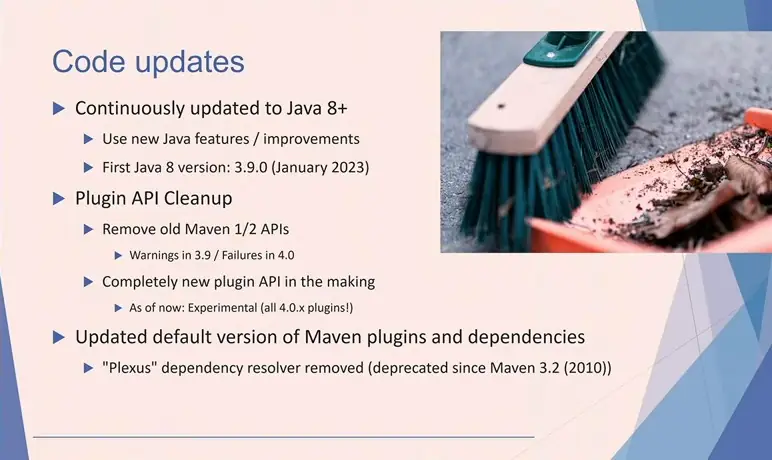
*[▶ 00:12:05](https://www.youtube.com/watch?v=TgkY2UmWtBo&t=725s) · Code updates*

The build POM stays in the repository as POM 4.1.0. Maven enriches it internally during the build, then generates a **consumer POM** in 4.0.0 for remote upload, keeping existing consumers compatible.

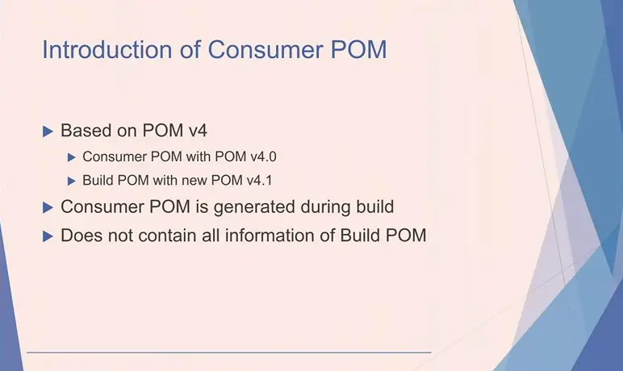
*[▶ 00:13:39](https://www.youtube.com/watch?v=TgkY2UmWtBo&t=819s) · Introduction of Consumer POM*

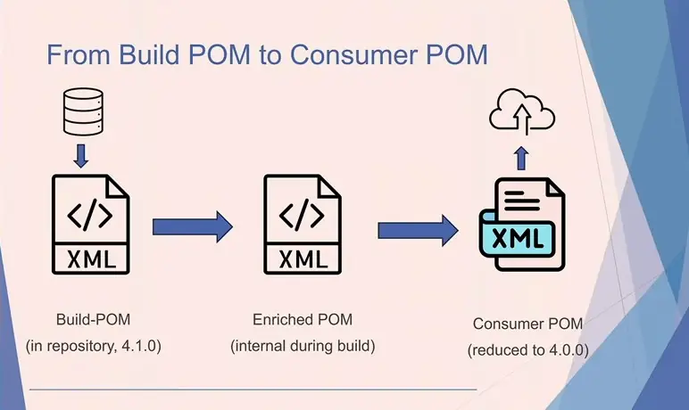
*[▶ 00:14:41](https://www.youtube.com/watch?v=TgkY2UmWtBo&t=881s) · From Build POM to Consumer POM*

The consumer POM drops properties, plugin configuration and full parent/subproject declarations, keeping third-party dependencies, repositories, profiles and project information.

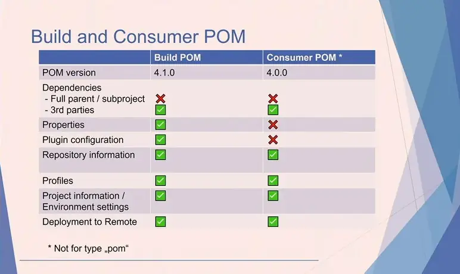
*[▶ 00:16:42](https://www.youtube.com/watch?v=TgkY2UmWtBo&t=1002s) · Build and Consumer POM comparison*

Modules become subprojects, which requires POM 4.1.0; the old tag still works but is deprecated.

```xml
    <name>Maven 4 Demo</name>

  <!--
    <modules>
        <module>ModuleA</module>
        <module>ModuleB</module>
    </modules>
-->
    <subprojects>
        <subproject>ModuleA</subproject>
        <subproject>ModuleB</subproject>
    </subprojects>
```

*[▶ 00:18:00](https://www.youtube.com/watch?v=TgkY2UmWtBo&t=1080s) · Modules are now called subprojects*

## Subprojects, BOM packaging and alternate POM syntaxes

[▶ 00:16:55](https://www.youtube.com/watch?v=TgkY2UmWtBo&t=1015s)

Maven 4 replaces "module" with **subproject**, since each module is already a full Maven project. Use the `subproject` element in model 4.1.0; `modules` is deprecated but still works.

Bill of materials files align dependency versions, like the JUnit BOM does. Maven 4 adds a `bom` packaging type, which requires POM 4.1.0 and handles project versions automatically. Before this, BOMs had to use the POM packaging type.

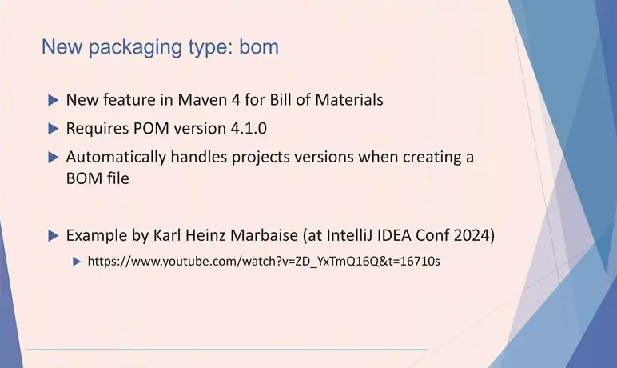
*[▶ 00:19:42](https://www.youtube.com/watch?v=TgkY2UmWtBo&t=1182s) · New packaging type: bom*

The Model Parser SPI lets a project be defined in other syntaxes, translated into Maven's internal model. Maven itself stays on XML for its schema and tooling. The [Mason](https://github.com/maveniverse/mason) extension already supports YAML, JSON5, TOML and HOCON.

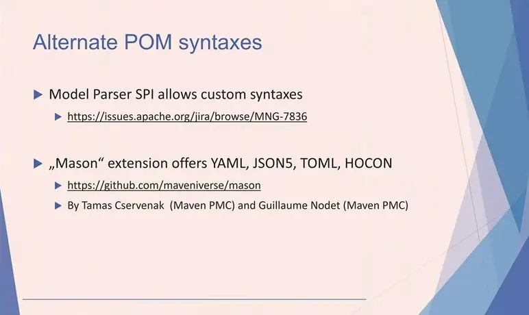
*[▶ 00:20:59](https://www.youtube.com/watch?v=TgkY2UmWtBo&t=1259s) · Alternate POM syntaxes*

## Reactor fixes and the project-local repository

[▶ 00:22:03](https://www.youtube.com/watch?v=TgkY2UmWtBo&t=1323s)

Maven 3's reactor bug: after a failure, the suggested resume command fails because the built module is no longer found. Maven 4 fixes this: `--also-make` works with `--resume-from`, and parallel builds detect successful modules.

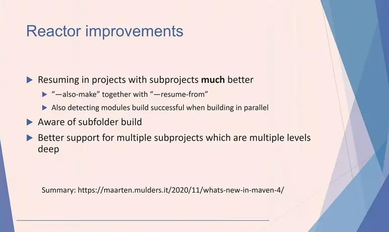
*[▶ 00:23:57](https://www.youtube.com/watch?v=TgkY2UmWtBo&t=1437s) · Reactor improvements*

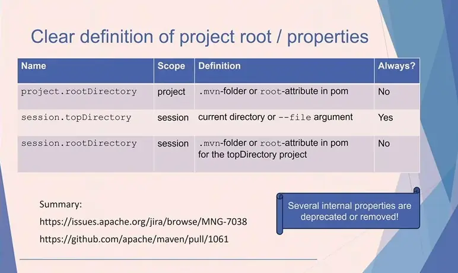
*[▶ 00:31:01](https://www.youtube.com/watch?v=TgkY2UmWtBo&t=1861s) · Clear definition of project root and properties*

A new **project-local repository** holds only the project's artifacts, so unreleased installs don't pollute the user repository.

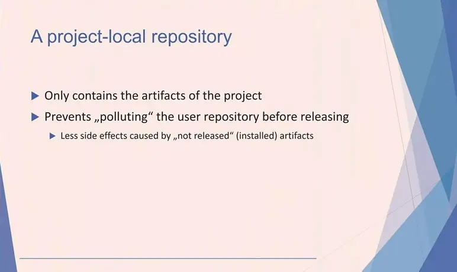
*[▶ 00:24:47](https://www.youtube.com/watch?v=TgkY2UmWtBo&t=1487s) · A project-local repository*

Skip `mvn clean install`, which old tutorials recommend for this bug. Use `mvn verify` for regular builds, and `install` for libraries tested in other projects or large projects with a build cache extension. `clean` removes all cached output.

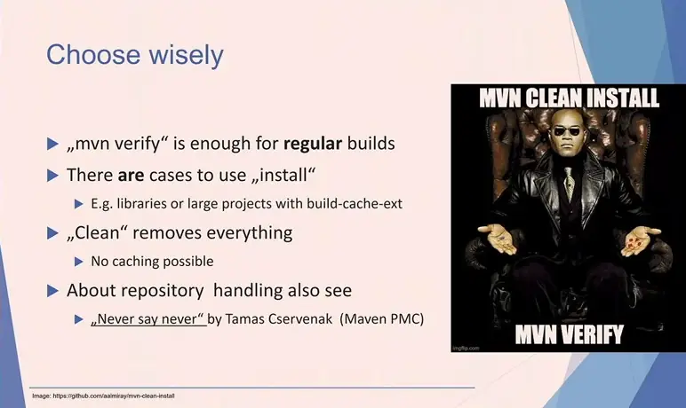
*[▶ 00:27:08](https://www.youtube.com/watch?v=TgkY2UmWtBo&t=1628s) · Choose wisely*

## Explicit project roots, automatic versions and stricter checks

[▶ 00:27:09](https://www.youtube.com/watch?v=TgkY2UmWtBo&t=1629s)

Maven 4 lets you declare the project root explicitly, either with a `.mvn` folder or with a `root` attribute set to `true` in the parent's `pom.xml`. Maven 3 has to guess the root. Without either, `project.rootDirectory` and `session.rootDirectory` have no value. `session.topDirectory` is always set: it is the directory the build starts from, or the directory of the file passed to the build.

Old internal properties, often with odd names such as internal repository root, were removed or deprecated. The build fails and points to them. See [MNG-7038](https://issues.apache.org/jira/browse/MNG-7038) and [pull request 1061](https://github.com/apache/maven/pull/1061).

Subprojects get one consistent timestamp across all their builds. `installAtEnd` and `deployAtEnd` now default to `true`, so a later failing module no longer leaves finished modules installed or deployed. Automatic versioning removes the need for a parent version and for sibling dependency versions.

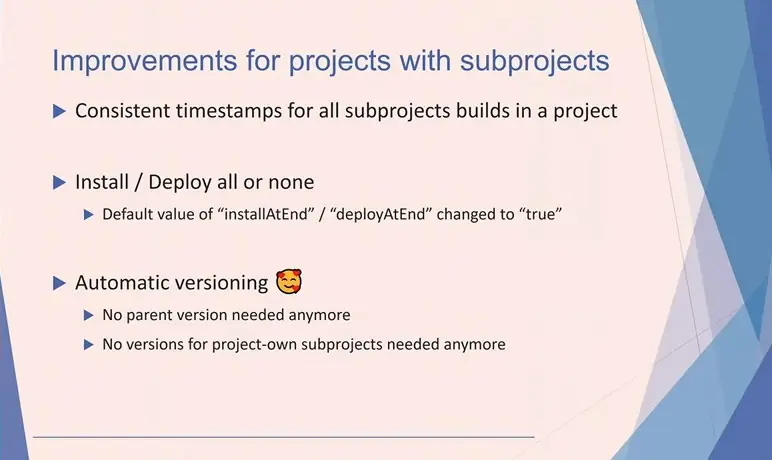
*[▶ 00:32:11](https://www.youtube.com/watch?v=TgkY2UmWtBo&t=1931s) · Improvements for projects with subprojects*

In Maven 3, the parent version must be hardcoded, and a sibling dependency needs a version, hardcoded or `${project.version}`.

```xml
<project xmlns="http://maven.apache.org/POM/4.0.0"
         xmlns:xsi="http://www.w3.org/2001/XMLSchema-instance"
         xsi:schemaLocation="http://maven.apache.org/POM/4.0.0 http://maven.apache.org/xsd/maven-4.0.0.xsd">

    <modelVersion>4.0.0</modelVersion>
    <artifactId>SubprojectB</artifactId>

    <parent>
        <groupId>demo.maven</groupId>
        <artifactId>TheParentProject</artifactId>
        <!-- The parents version must be "hardcoded" -->
        <version>0.0.1-SNAPSHOT</version>
    </parent>

    <dependencies>
        <dependency>
            <groupId>demo.maven</groupId>
            <artifactId>SubprojectA</artifactId>
            <!-- The subproject dependency version declaration can make use of the project.version property-->
            <version>${project.version}</version>
        </dependency>
    </dependencies>

    <!-- other declarations -->
</project>
```

*[▶ 00:32:35](https://www.youtube.com/watch?v=TgkY2UmWtBo&t=1955s) · Subproject declaration (Maven 3)*

Maven 4 needs neither. In the speaker's experience, forgetting to update subproject versions after changing only the parent caused missing-version errors.

```xml
<project xmlns="http://maven.apache.org/POM/4.1.0"
         xmlns:xsi="http://www.w3.org/2001/XMLSchema-instance"
         xsi:schemaLocation="http://maven.apache.org/POM/4.1.0 http://maven.apache.org/xsd/maven-4.1.0.xsd">

    <modelVersion>4.1.0</modelVersion>
    <artifactId>SubprojectB</artifactId>

    <parent>
        <groupId>demo.maven</groupId>
        <artifactId>TheParentProjecct</artifactId>
    </parent>

    <dependencies>
        <dependency>
            <groupId>demo.maven</groupId>
            <artifactId>SubprojectA</artifactId>
        </dependency>
    </dependencies>

    <!-- other declarations -->
</project>
```

*[▶ 00:32:44](https://www.youtube.com/watch?v=TgkY2UmWtBo&t=1964s) · Subproject declaration (Maven 4)*

CI-friendly variables such as `${revision}` arrived in Maven 3.5 but needed the Flatten plugin. Maven 4's reactor and property resolution handle them directly, so the Flatten plugin may no longer be needed. See the [Soebes blog post on Maven 4 part I](https://blog.soebes.io/posts/2024/03/2024-03-31-maven-4-part-i/).

Maven 4 also checks POM declarations more strictly. Declaring the same thing twice produces a warning in Maven 3.9 and fails in Maven 4. Maven 3 by default fails only on exceptions. Run with `-fos WARN` to break the build on warnings and find these early.

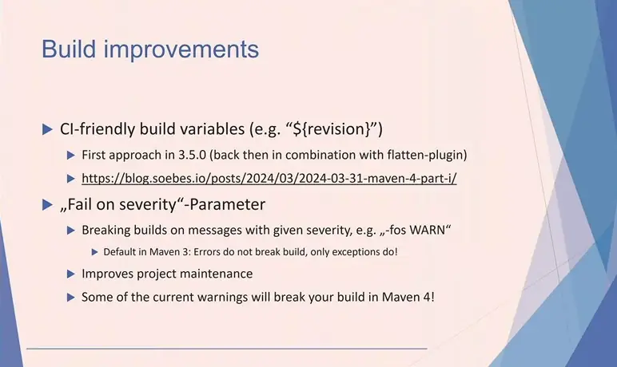
*[▶ 00:34:50](https://www.youtube.com/watch?v=TgkY2UmWtBo&t=2090s) · Build improvements*

A missing profile fails the build. Prefix the profile name with `?`, as in `-P?release`, and Maven logs an INFO message instead. Tracked in [MNG-7051](https://issues.apache.org/jira/browse/MNG-7051).

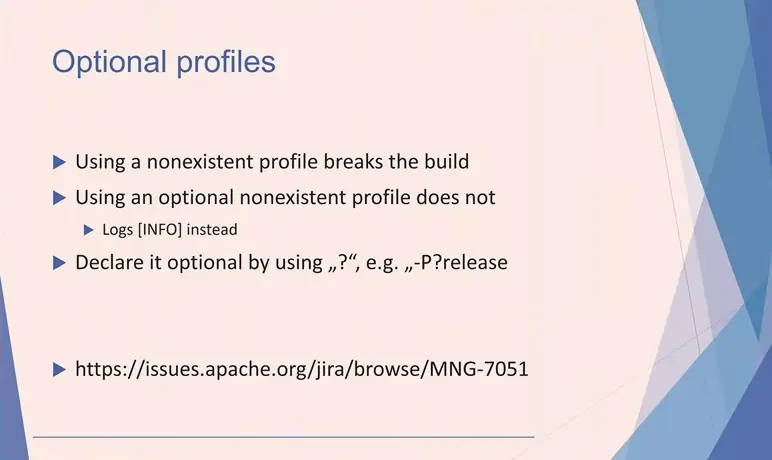
*[▶ 00:35:28](https://www.youtube.com/watch?v=TgkY2UmWtBo&t=2128s) · Optional profiles*

## Lifecycle as a tree, and a short path to Maven 4

[▶ 00:35:16](https://www.youtube.com/watch?v=TgkY2UmWtBo&t=2116s)

Maven 3 runs the build lifecycle as a fixed list of phases. Maven 4 models it as a tree. The default lifecycle is unchanged, but you can declare your own and skip phases, such as running integration tests without unit tests. Phases still depend on each other: you cannot compile without sources.

Each phase now has explicit **before** and **after** phases, so you no longer have to guess whether a pre- or processing phase exists. New `all` and `each` phases work at project level.

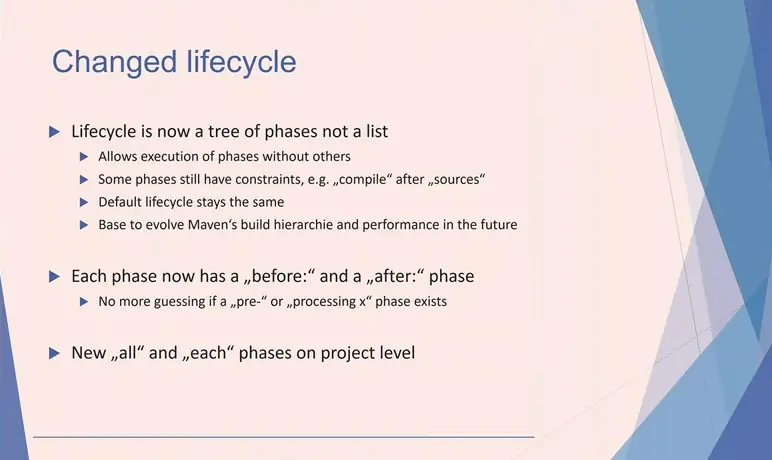
*[▶ 00:39:07](https://www.youtube.com/watch?v=TgkY2UmWtBo&t=2347s) · Changed lifecycle*

An experimental concurrent lifecycle builder lets a project start once a dependent phase is reached, instead of waiting for `package`. The speaker compares this to Gradle's cross-project task dependencies. It is not the default.

Maven 4 requires Java 17 and separates the build POM from the consumer POM.

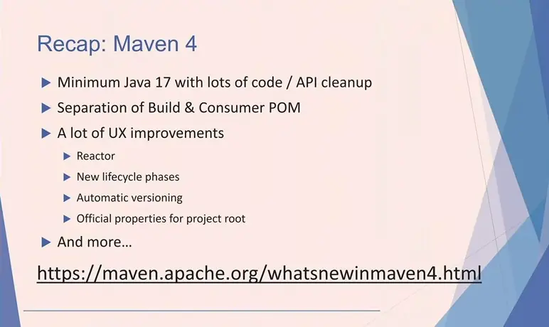
*[▶ 00:39:52](https://www.youtube.com/watch?v=TgkY2UmWtBo&t=2392s) · Recap: Maven 4*

To migrate:

1. Build successfully with Maven 3.10 (3.9 should work) and up-to-date 3.x plugins.
2. Prepare the environment for Java 17+.
3. Run Maven 4 and fix any errors, which usually come from unusual POM configuration.
4. Optionally, use Maven 4-only features (Model 4.1.0).

Avoid the 4.x plugins: they are alpha or beta and use the new plugin API.

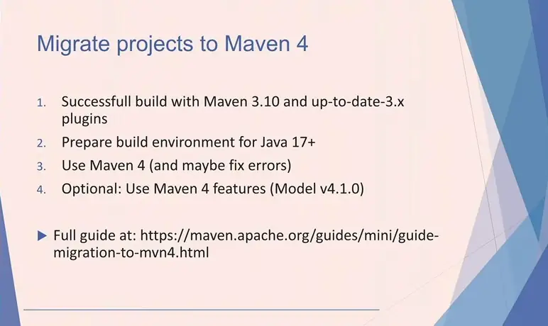
*[▶ 00:42:48](https://www.youtube.com/watch?v=TgkY2UmWtBo&t=2568s) · Migrate projects to Maven 4*

A built-in migration tool can update a project to Model 4.0.0 (Maven 3 compatible) or Model 4.1.0 (Maven 4 only).

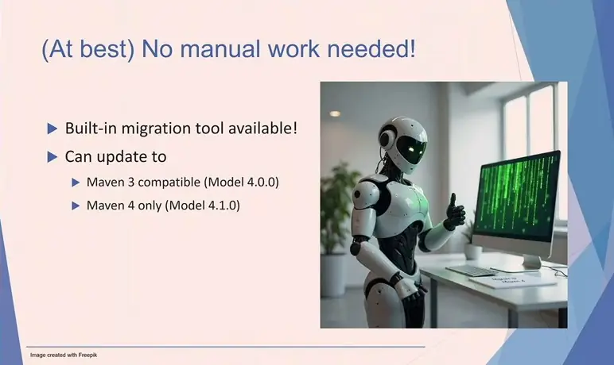
*[▶ 00:43:08](https://www.youtube.com/watch?v=TgkY2UmWtBo&t=2588s) · (At best) No manual work needed*

Maven 4.1 adds Model 4.2.0 and **Mixins**, which combine plugin configurations like multiple parent POMs. The speaker hopes Mixins can merge Spring's parent POM with company parent POMs. Also planned: plugin API work, better Java Module System support, and `-Tmax`, which uses all cores minus one.

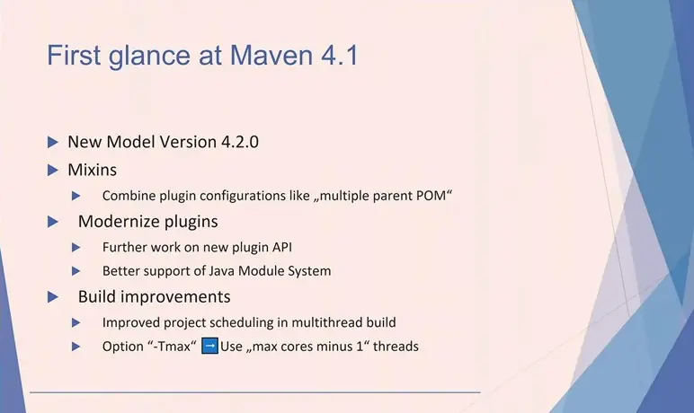
*[▶ 00:45:02](https://www.youtube.com/watch?v=TgkY2UmWtBo&t=2702s) · First glance at Maven 4.1*

Upgrade to the latest Maven 3.x, prepare for Java 17+, test the Maven 4 release candidate, and send feedback to users@maven.apache.org. The speaker expects release candidate 7 to be the last but gives no release date.

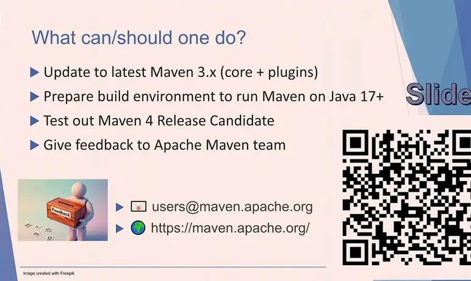
*[▶ 00:47:10](https://www.youtube.com/watch?v=TgkY2UmWtBo&t=2830s) · What can/should one do?*

## Links & resources

- [Maven 4 what's new — official recap page](https://maven.apache.org/whatsnewinmaven4.html) — <https://maven.apache.org/whatsnewinmaven4.html> · on screen [▶ 00:39:52](https://www.youtube.com/watch?v=TgkY2UmWtBo&t=2392s)
- [Migrate projects to Maven 4 — official migration guide](https://maven.apache.org/guides/mini/guide-migration-to-mvn4.html) — <https://maven.apache.org/guides/mini/guide-migration-to-mvn4.html> · on screen [▶ 00:42:48](https://www.youtube.com/watch?v=TgkY2UmWtBo&t=2568s)
- [Apache Maven project site](https://maven.apache.org) — <https://maven.apache.org> · on screen [▶ 00:47:10](https://www.youtube.com/watch?v=TgkY2UmWtBo&t=2830s)
- [Maven history and required Java version (Java 17)](https://maven.apache.org/docs/history.html) — <https://maven.apache.org/docs/history.html> · on screen [▶ 00:08:50](https://www.youtube.com/watch?v=TgkY2UmWtBo&t=530s)
- [From Maven 3 to Maven 5 — JavaAdvent 2021 article](https://www.javaadvent.com/2021/12/from-maven-3-to-maven-5.html) — <https://www.javaadvent.com/2021/12/from-maven-3-to-maven-5.html> · on screen [▶ 00:07:53](https://www.youtube.com/watch?v=TgkY2UmWtBo&t=473s)
- [bom packaging type — referenced video](https://www.youtube.com/watch?v=ZD_YxTmQ16Q&t=16710s) — <https://www.youtube.com/watch?v=ZD_YxTmQ16Q&t=16710s> · on screen [▶ 00:19:42](https://www.youtube.com/watch?v=TgkY2UmWtBo&t=1182s)
- [MNG-7836 — Jira issue on alternate POM syntaxes](https://issues.apache.org/jira/browse/MNG-7836) — <https://issues.apache.org/jira/browse/MNG-7836> · on screen [▶ 00:20:59](https://www.youtube.com/watch?v=TgkY2UmWtBo&t=1259s)
- [Mason — GitHub project for alternate POM syntaxes](https://github.com/maveniverse/mason) — <https://github.com/maveniverse/mason> · on screen [▶ 00:20:59](https://www.youtube.com/watch?v=TgkY2UmWtBo&t=1259s)
- [Maarten Mulders — What's new in Maven 4 blog post](https://maarten.mulders.it/2020/11/whats-new-in-maven-4/) — <https://maarten.mulders.it/2020/11/whats-new-in-maven-4/> · on screen [▶ 00:23:57](https://www.youtube.com/watch?v=TgkY2UmWtBo&t=1437s)
- [MNG-7038 — Jira issue on project root and properties](https://issues.apache.org/jira/browse/MNG-7038) — <https://issues.apache.org/jira/browse/MNG-7038> · on screen [▶ 00:31:01](https://www.youtube.com/watch?v=TgkY2UmWtBo&t=1861s)
- [Pull request 1061 — project root and properties change](https://github.com/apache/maven/pull/1061) — <https://github.com/apache/maven/pull/1061> · on screen [▶ 00:31:01](https://www.youtube.com/watch?v=TgkY2UmWtBo&t=1861s)
- [Soebes blog — Maven 4 part I, build improvements](https://blog.soebes.io/posts/2024/03/2024-03-31-maven-4-part-i/) — <https://blog.soebes.io/posts/2024/03/2024-03-31-maven-4-part-i/> · on screen [▶ 00:34:50](https://www.youtube.com/watch?v=TgkY2UmWtBo&t=2090s)
- [MNG-7051 — Jira issue on optional profiles](https://issues.apache.org/jira/browse/MNG-7051) — <https://issues.apache.org/jira/browse/MNG-7051> · on screen [▶ 00:35:28](https://www.youtube.com/watch?v=TgkY2UmWtBo&t=2128s)
- Speaker's slides, with clickable links, via QR code at the end — URL not shown · mentioned [▶ 00:19:32](https://www.youtube.com/watch?v=TgkY2UmWtBo&t=1172s)
