# Escaping Java's Allocation Gravity with Value Classes By Clément de Tastes, Remi Forax

*How Project Valhalla's value classes (JEP 401) remove allocation overhead for small types, with a ray-tracing benchmark and the restrictions that come with them.*

Source: [Escaping Java's Allocation Gravity with Value Classes By Clément de Tastes, Remi Forax](https://www.youtube.com/watch?v=lUB15M3mMLs) · Clément de Tastes and Remi Forax · Devoxx · 51 min

## TL;DR

Each object in a Java object array is a separate heap object with its own header and padding, and reaching it means chasing a pointer, while primitives lack abstraction. Project Valhalla's value classes (JEP 401, a preview in Java 28) let small types be used like objects while having no identity, so they can be stored and passed without per-instance overhead. The JIT can scalarize value objects so their fields live in registers instead of the heap. In the ray-tracing benchmark, allocation fell from 10.7 GiB to 316 MiB with nearly the same runtime, but value objects lose locks, weak references and identity, so they suit only small, immutable data.

## Key takeaways

- Declaring a class or record with `value` makes its instances identity-free, so `==` compares fields and the VM computes `hashCode` from those fields.
- Value objects cannot be used with `synchronized` or as weakly referenced keys, so code that depends on identity, such as `WeakHashMap` caches keyed by values, can break.
- Value classes must set all fields before `super()`, a rule that JEP 513 (Java 25) made possible, and a value class can extend only an abstract class that is also marked `value`.
- Flattening a value object inline is limited: three doubles (192 bits) exceed a 64-bit atomic reference width and risk torn reads, and a null marker leaves too few bits for the Vec3 example.
- Scalarization lets the JIT keep value-object fields in registers, which cut the ray tracer's allocation from 10.7 GiB to 316 MiB and its GC count from 128,000 to about zero.
- Single-thread microbenchmarks such as the 52,593 vs 48,566 ms/op ray-tracing comparison can miss GC work done on other threads, so timings alone understate the allocation savings.
- Value-based vector math written with records and `value` is much shorter than the equivalent primitive code while keeping the same performance, so the abstraction is not paid for in speed.
- Existing `Integer`, `Long`, `Optional` and most `java.time` types are already value classes, so code that synchronizes on them already breaks, as JEP 390 warned since JDK 16.

## Project Valhalla erases the seam between primitives and objects

[▶ 00:00:00](https://www.youtube.com/watch?v=lUB15M3mMLs&t=0s)

Value classes (JEP 401) arrive as a preview in Java 28.

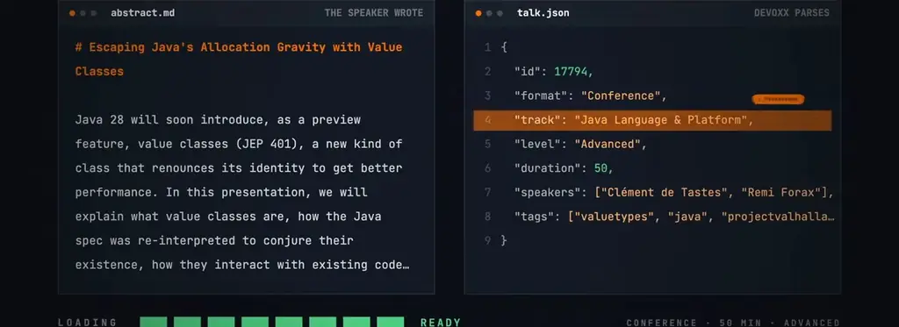
*[▶ 00:00:19](https://www.youtube.com/watch?v=lUB15M3mMLs&t=19s) · Talk abstract and parsed talk.json metadata*

Valhalla, an OpenJDK platform project, erases the seam between primitive and object types.

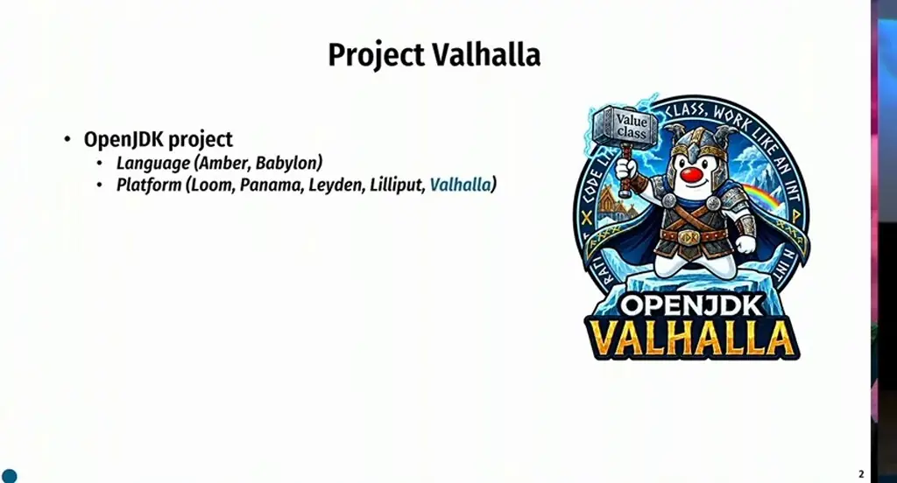
*[▶ 00:01:11](https://www.youtube.com/watch?v=lUB15M3mMLs&t=71s) · Project Valhalla in the OpenJDK structure*

Brian Goetz and John Rose started it in 2014.

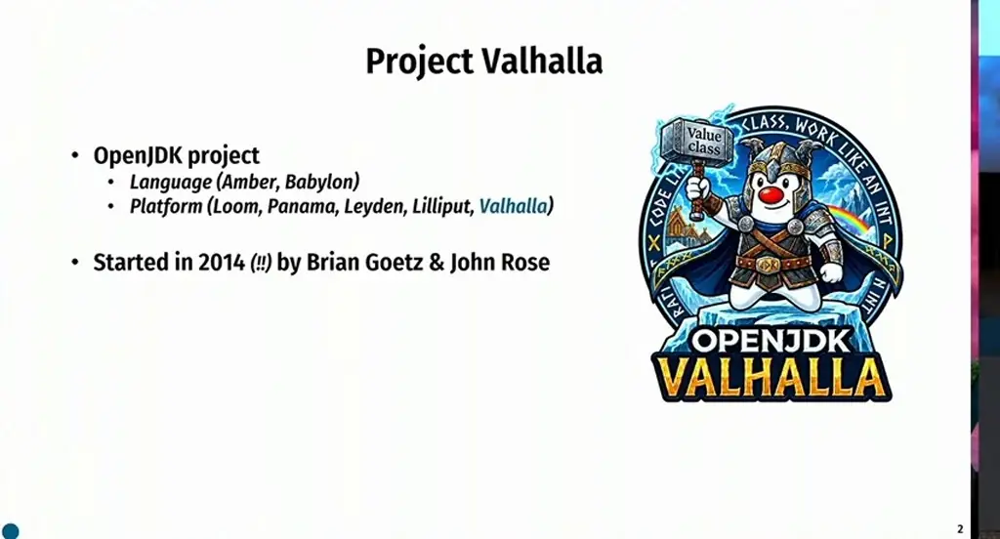
*[▶ 00:02:17](https://www.youtube.com/watch?v=lUB15M3mMLs&t=137s) · Valhalla start date and founders*

Goetz calls it "Java's epic refactor"; the motto is "codes like a class, works like an int."

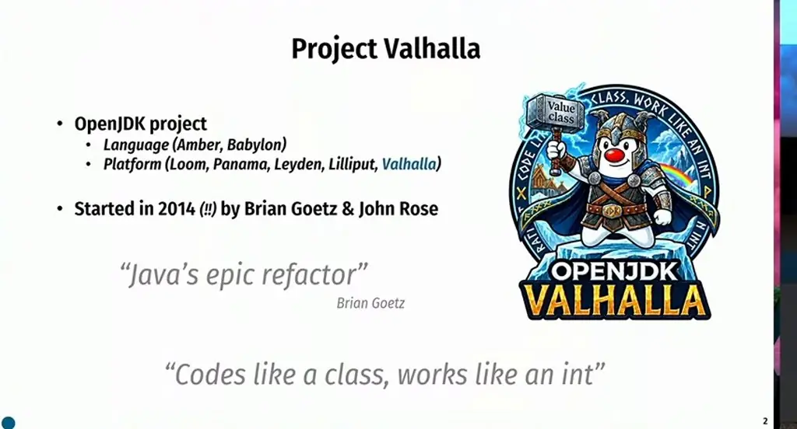
*[▶ 00:03:41](https://www.youtube.com/watch?v=lUB15M3mMLs&t=221s) · Valhalla quotes and motto*

Three goals: zero-cost abstraction, flat memory representation, primitive type rehabilitation.

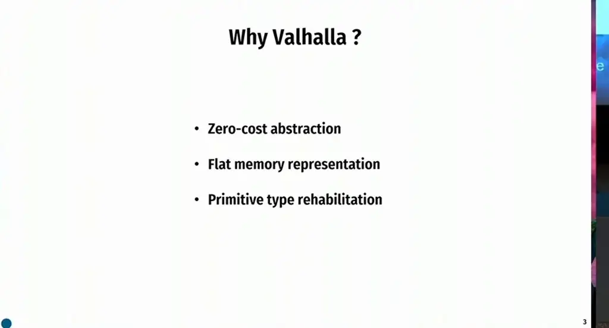
*[▶ 00:05:35](https://www.youtube.com/watch?v=lUB15M3mMLs&t=335s) · Why Valhalla ?*

Zero-cost abstraction means no trade-off with performance: a validated `Mass` type beats a plain `double`.

```java
public class Mass {
    private final double mass;

    public Mass(double mass) {
        if (mass < 0) {
            throw new IllegalArgumentException("Mass must be positive");
        }
        this.mass = mass;
  }
}
```

*[▶ 00:06:06](https://www.youtube.com/watch?v=lUB15M3mMLs&t=366s) · Zero-Cost Abstraction*

## Memory cost of object arrays and the path to value objects

[▶ 00:06:18](https://www.youtube.com/watch?v=lUB15M3mMLs&t=378s)

Each element of an object array references a separate heap object with its own header and padding, so most of that space is overhead.

```java
record Vec3(double x, double y, double z) {}
```

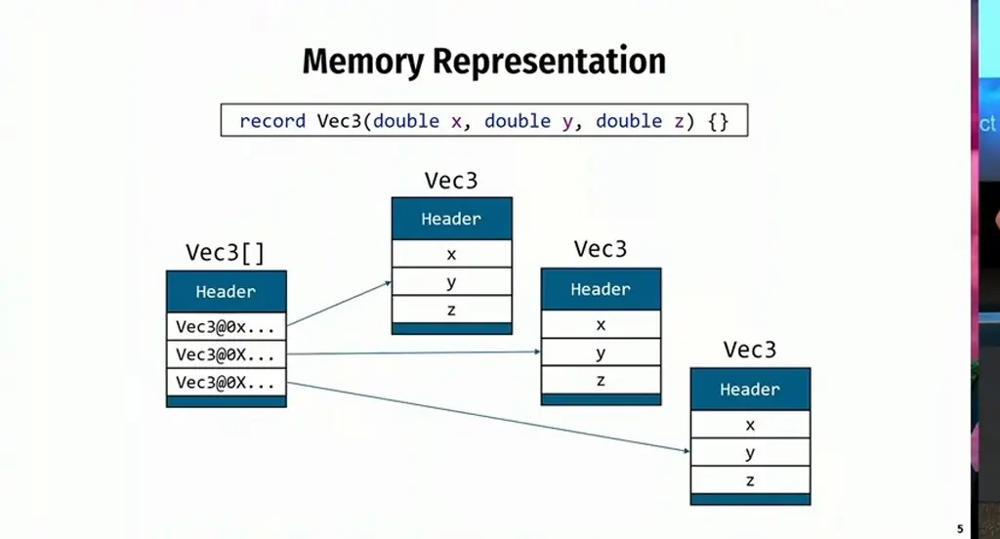
*[▶ 00:06:41](https://www.youtube.com/watch?v=lUB15M3mMLs&t=401s) · Memory Representation*

Every access chases a pointer, which risks cache misses and RAM reads.

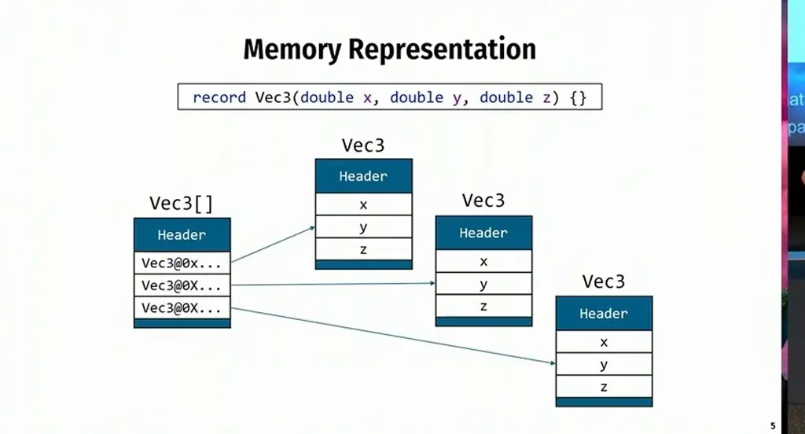
*[▶ 00:07:07](https://www.youtube.com/watch?v=lUB15M3mMLs&t=427s) · Memory Representation: array of references to objects*

A flat layout would inline x, y and z with no headers or padding, improving density and locality.

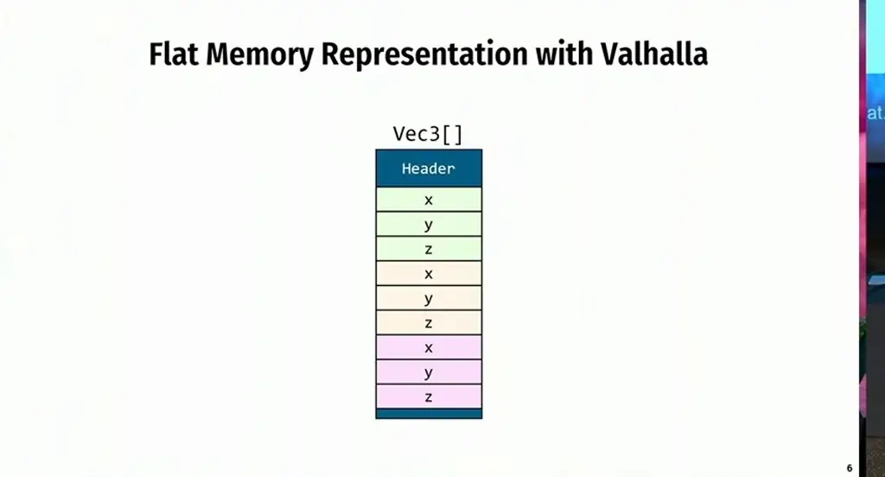
*[▶ 00:07:53](https://www.youtube.com/watch?v=lUB15M3mMLs&t=473s) · Flat memory representation with Valhalla*

Primitives are second-class citizens.

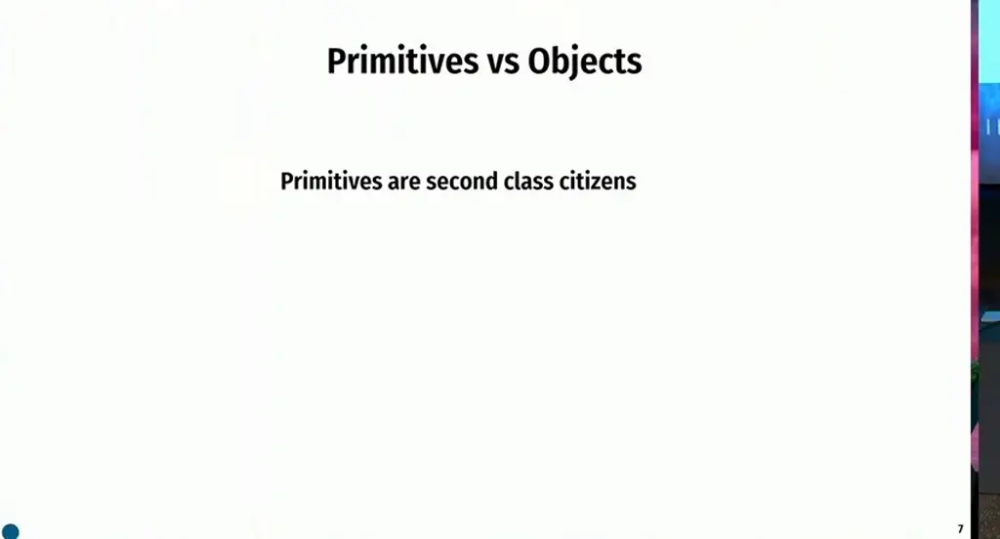
*[▶ 00:08:09](https://www.youtube.com/watch?v=lUB15M3mMLs&t=489s) · Primitives vs Objects*

They lack abstraction: no common array, no generics, no `toString()`, and `==` where objects need `equals()`.

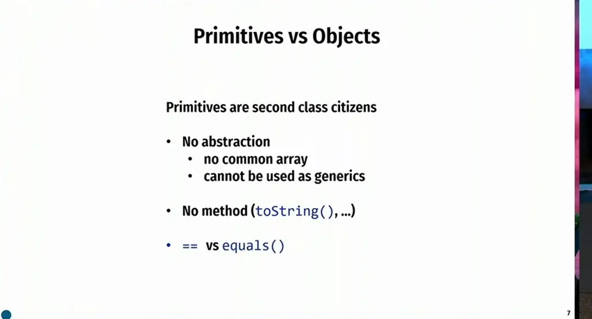
*[▶ 00:10:23](https://www.youtube.com/watch?v=lUB15M3mMLs&t=623s) · Primitives vs Objects*

Valhalla aims to make primitives usable as objects. JEP 401 brings value objects as a JDK 28 preview, with the feature targeted for March. Its pull request, with almost 3,000 commits, explains much of the wait.

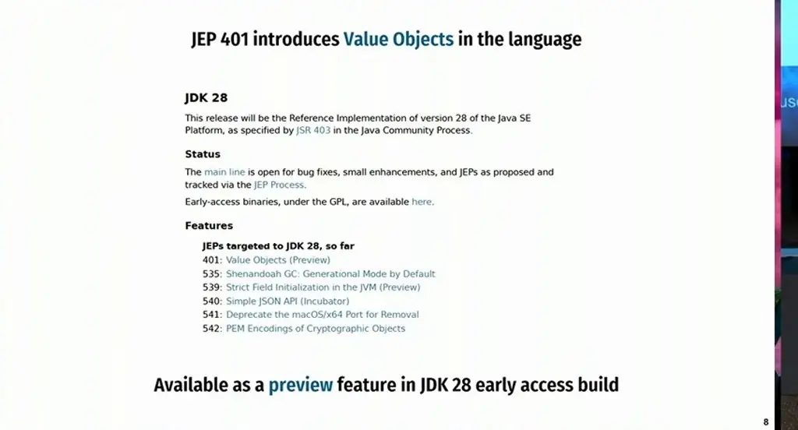
*[▶ 00:10:37](https://www.youtube.com/watch?v=lUB15M3mMLs&t=637s) · JEP 401 introduces Value Objects in the language*

## Identity-free values: == and hashCode work on fields

[▶ 00:13:26](https://www.youtube.com/watch?v=lUB15M3mMLs&t=806s)

Put `value` before a class or record to declare a value class. Its instances are used as values, not pointers.

```java
value record Vec3(double x, double y, double z) {}
```

*[▶ 00:15:31](https://www.youtube.com/watch?v=lUB15M3mMLs&t=931s) · New value keyword for value records*

Instances are passed by value, so a method takes and returns fields directly.

```java
static Point translate(Point p, double dx, double dy) {
  return new Point(p.x + dx, p.y + dy);
}
```

*[▶ 00:15:41](https://www.youtube.com/watch?v=lUB15M3mMLs&t=941s) · A value class instance is passed by value*

The VM may remove the allocation entirely through scalarization (covered later).

```java
static Point translate(Point p, double dx, double dy) {
  return new Point(p.x + dx, p.y + dy);
}

static (double, double) translate((double x, double y), double dx, double dy) {
  return (x + dx, y + dy);
}
```

*[▶ 00:16:08](https://www.youtube.com/watch?v=lUB15M3mMLs&t=968s) · Value class passed by value and scalarization*

Value objects are identity-free: no address and no header. They are unmodifiable (final fields, final class), and they suit only small structures.

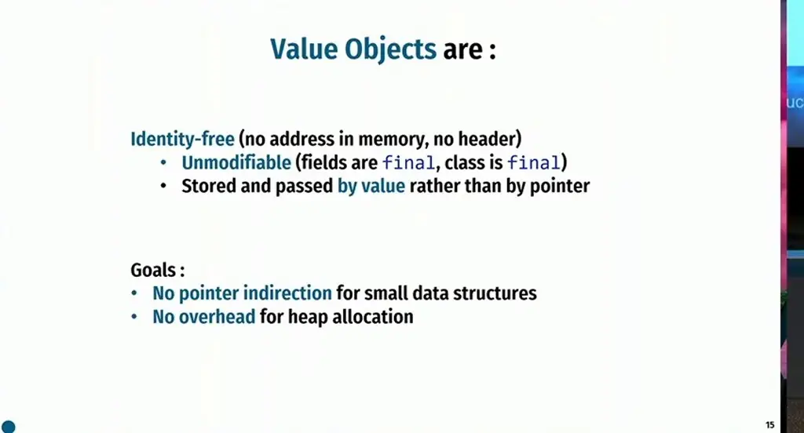
*[▶ 00:18:37](https://www.youtube.com/watch?v=lUB15M3mMLs&t=1117s) · Value Objects: definition and goals*

Without identity, `==` compares fields rather than addresses. Making classes that override `equals` fail to compile was rejected as not backward compatible.

Two `Vec3` instances with equal fields are created with `new`.

```java
    public String toString() {
        return "Vec3{" +
            "x=" + x +
            ", y=" + y +
            ", z=" + z +
            '}';
    }
}

void main() {

    IO.println(Runtime.version());
    IO.println();

    var v1 = new Vec3( x: 1.0,  y: 2.0,  z: 3.0);
    var v2 = new Vec3( x: 1.0,  y: 2.0,  z: 3.0);

    IO.println(v1);
    IO.println(v1.getClass().isValue());
    IO.println(v1 == v2);

    IO.println();

    // hashCode
```

*[▶ 00:21:57](https://www.youtube.com/watch?v=lUB15M3mMLs&t=1317s) · Two value instances with identical fields*

`isValue()` returns true, and so does `v1 == v2`.

```java
            ", y=" + y +
            ", z=" + z +
            '}';
    }
}

void main() {

    IO.println(Runtime.version());
    IO.println();

    var v1 = new Vec3( x: 1.0,  y: 2.0,  z: 3.0);
    var v2 = new Vec3( x: 1.0,  y: 2.0,  z: 3.0);

    IO.println(v1);
    IO.println(v1.getClass().isValue());
    IO.println(v1 == v2);

    IO.println();

    // hashCode
    IO.println(v1.hashCode());
    IO.println(v2.hashCode());
```

*[▶ 00:21:19](https://www.youtube.com/watch?v=lUB15M3mMLs&t=1279s) · Testing value equality with == and isValue*

`hashCode` is inherited from `Object`, but with no header to hold an identity hash, the VM computes it from the fields. The spec doesn't say exactly how. Both demo instances printed 1682288737.

`synchronized` on a value object is an error, since it needs identity (covered in the next chapter).

## No identity, so no locks or weak references

[▶ 00:24:40](https://www.youtube.com/watch?v=lUB15M3mMLs&t=1480s)

Value objects have no identity, so `synchronized` on one fails with "required: identity class." Hiding the value behind an `Object` variable compiles but throws `IdentityException` at runtime.

```java
  IO.println();

  // hashCode
  IO.println(v1.hashCode());
  IO.println(v2.hashCode());

  IO.println();

// synchronized (v1) {
//   // Do stuff
// }

  Object o = v1;
  synchronized (o) {
```

*[▶ 00:25:35](https://www.youtube.com/watch?v=lUB15M3mMLs&t=1535s) · Fooling the compiler with Object o = v1*

Weak references fail too, since they need an address. This can break `WeakHashMap` caches keyed by value objects.

```java
// Object o = v1;
// synchronized (o) {
// }

  var weakReference = new java.lang.ref.WeakReference<>(v1);
}
```

*[▶ 00:26:48](https://www.youtube.com/watch?v=lUB15M3mMLs&t=1608s) · WeakReference line on value class*

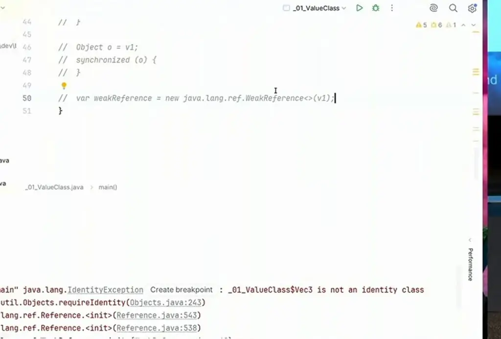
*[▶ 00:27:15](https://www.youtube.com/watch?v=lUB15M3mMLs&t=1635s) · Commented identity tests and WeakReference attempt*

The editor keeps these identity attempts side by side.

```java
  IO.println();

  // hashCode
  IO.println(v1.hashCode());
  IO.println(v2.hashCode());

  IO.println();

//  synchronized (v1) {
//   // Do stuff
//  }

//  Object o = v1;
//  synchronized (o) {
//  }

//  var weakReference = new java.lang.ref.WeakReference<>(v1);
}
```

*[▶ 00:27:30](https://www.youtube.com/watch?v=lUB15M3mMLs&t=1650s) · hashCode and synchronization experiments in editor*

A `value record` works: equal instances compare `==` as true, and records suit this because their fields are final.

```java
value record Vec3(double x, double y, double z) {}

void main() {
  var v1 = new Vec3( x: 1.0,  y: 2.0,  z: 3.0);
  var v2 = new Vec3( x: 1.0,  y: 2.0,  z: 3.0);
  IO.println(v1);
  IO.println(v1.getClass().isValue());
  IO.println(v1 == v2);
}
```

*[▶ 00:28:01](https://www.youtube.com/watch?v=lUB15M3mMLs&t=1681s) · value record Vec3 example output*

Value classes must be strictly initialized, because a value object must never have observable state that changes. Before Java 25, `super()` had to come first, exposing default field values. JEP 513 (Java 25) lets fields be set before `super()`. The compiler rejects unset ones, though IntelliJ does not yet report it.

A value class can extend only an abstract class also marked `value`, which makes it value-enabled. Its constructor must also set fields before `super()`.

```java
interface Vector {
  double magnitudeSquared();
}

// "value-enabled"
abstract value class AbstractVector implements Vector {
  double magnitude() {
    return Math.sqrt(magnitudeSquared());
  }
}

value class Vec3 extends AbstractVector {
  double x;
  double y;
  double z;
```

*[▶ 00:33:31](https://www.youtube.com/watch?v=lUB15M3mMLs&t=2011s) · Vector interface and abstract value class*

## Flattening value objects and the ray-tracing domain

[▶ 00:34:19](https://www.youtube.com/watch?v=lUB15M3mMLs&t=2059s)

Flattening stores fields inline instead of a pointer.

```java
class Ray {
    Vec3 origin;
    // ...
}

class Ray {
    double origin_x;
    double origin_y;
    double origin_z;
    // ...
}
```

*[▶ 00:34:50](https://www.youtube.com/watch?v=lUB15M3mMLs&t=2090s) · Storing value objects: Vec3 field versus flattened doubles*

The JVM spec requires atomic reference reads and writes. Three doubles (192 bits) exceed a 64-bit CPU's atomic width, risking torn reads across threads.

```java
class Ray {
    Vec3 origin;
    // ...
}

class Ray {
    double origin_x;
    double origin_y;
    double origin_z;
    // ...
}
```

*[▶ 00:36:15](https://www.youtube.com/watch?v=lUB15M3mMLs&t=2175s) · Atomicity cost of flattened value fields*

A null marker leaves 56 bits, so Vec3 is too large.

```java
class Ray {
    boolean origin_null;
    double  origin_x;
    double  origin_y;
    double  origin_z;
    // ...
}
```

*[▶ 00:37:00](https://www.youtube.com/watch?v=lUB15M3mMLs&t=2220s) · Null marker needed for flattened Ray origin*

Ray tracing casts about two million rays for HD and, at 100 steps, allocates roughly 200 million vectors.

The domain uses Ray, Vec3 and Color records.

```java
record Ray(Vec3 origin, Vec3 direction) {}

record Vec3(double x, double y, double z) {}

record Color(double r, double g, double b) {}
```

*[▶ 00:39:47](https://www.youtube.com/watch?v=lUB15M3mMLs&t=2387s) · Defining the Domain Model: Ray, Vec3, Color records*

Records allow methods, so Vec3 gets add, sub, mul and mag.

```java
value record Vec3(double x, double y, double z) {
  Vec3 add(Vec3 o) {
    return new Vec3(x + o.x, y + o.y, z + o.z);
  }

  Vec3 sub(Vec3 o) {
    return new Vec3(x - o.x, y - o.y, z - o.z);
  }

  Vec3 mul(double s) {
    return new Vec3(x * s, y * s, z * s);
  }

  double mag() {
    return Math.sqrt(x * x + y * y + z * z);
  }
}
```

*[▶ 00:40:07](https://www.youtube.com/watch?v=lUB15M3mMLs&t=2407s) · Vec3 as a value record with methods*

Identity and value Vec3 renders are nearly identical: 52,593 and 48,566 ms/op.

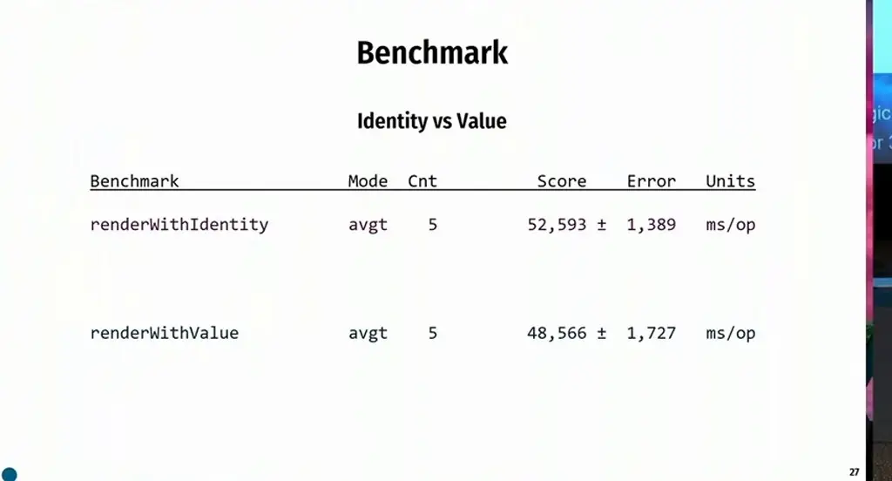
*[▶ 00:40:11](https://www.youtube.com/watch?v=lUB15M3mMLs&t=2411s) · Benchmark: renderWithIdentity vs renderWithValue*

## Same timings, far less allocation: how scalarization works

[▶ 00:40:09](https://www.youtube.com/watch?v=lUB15M3mMLs&t=2409s)

A benchmark of the same renderer, with and without `value`, takes nearly the same time (52,593 vs 48,566 ms/op), but the GC count falls from 128,000 to about zero.

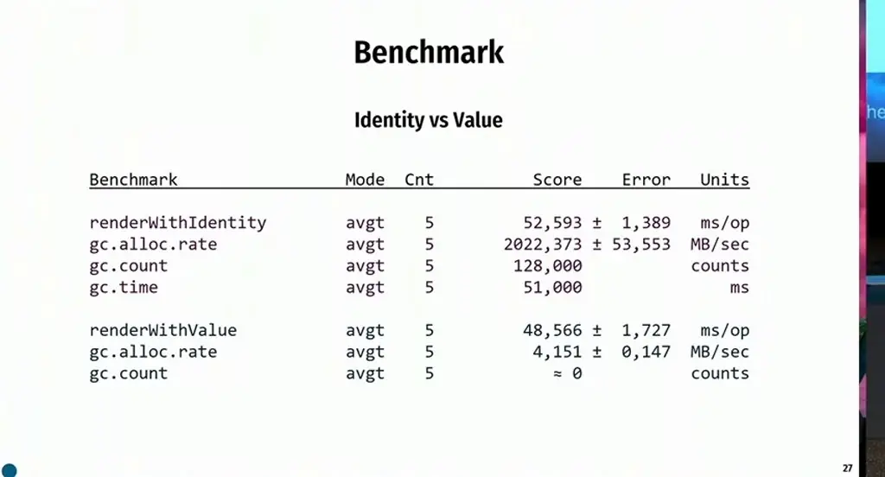
*[▶ 00:42:00](https://www.youtube.com/watch?v=lUB15M3mMLs&t=2520s) · Benchmark: Identity vs Value results*

The times match because the benchmark measures one thread while the collector's work runs on other threads. Single-thread microbenchmarks do not measure the whole system.

The identity profile shows `BlackholeGenerator$Vec3` at 10.7 GiB, 99.8% of all allocations, and the GC reclaims that memory frequently.

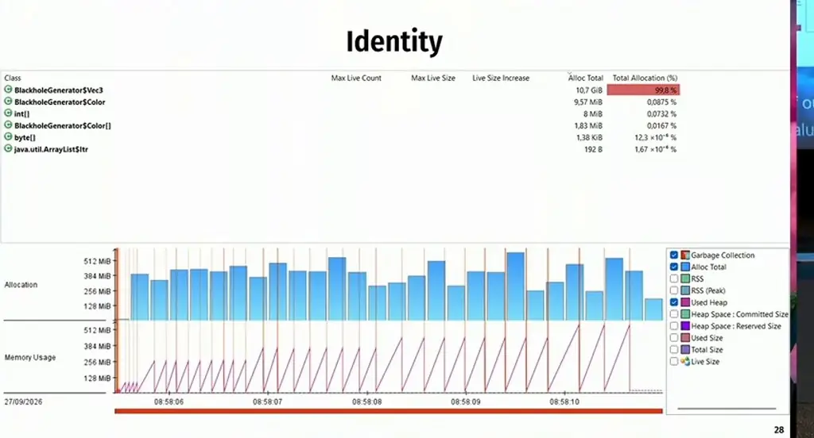
*[▶ 00:43:03](https://www.youtube.com/watch?v=lUB15M3mMLs&t=2583s) · JFR allocation profile for identity version*


*[▶ 00:43:46](https://www.youtube.com/watch?v=lUB15M3mMLs&t=2626s) · Identity: allocation profile with Vec3 dominating*

In the value profile, Vec3 allocations drop to 316 MiB, mostly at the start of the run.

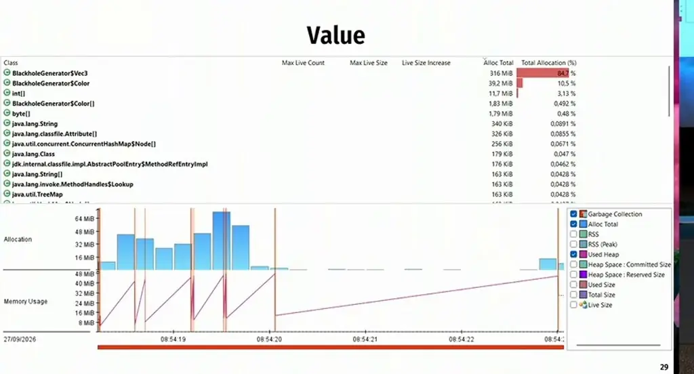
*[▶ 00:43:59](https://www.youtube.com/watch?v=lUB15M3mMLs&t=2639s) · Value: allocation profile after scalarization*

Scalarization is a runtime JIT optimization: objects stay on the heap until compilation, then their fields live in registers. Once the JIT kicks in, allocations stop. Other VMs may do this differently.

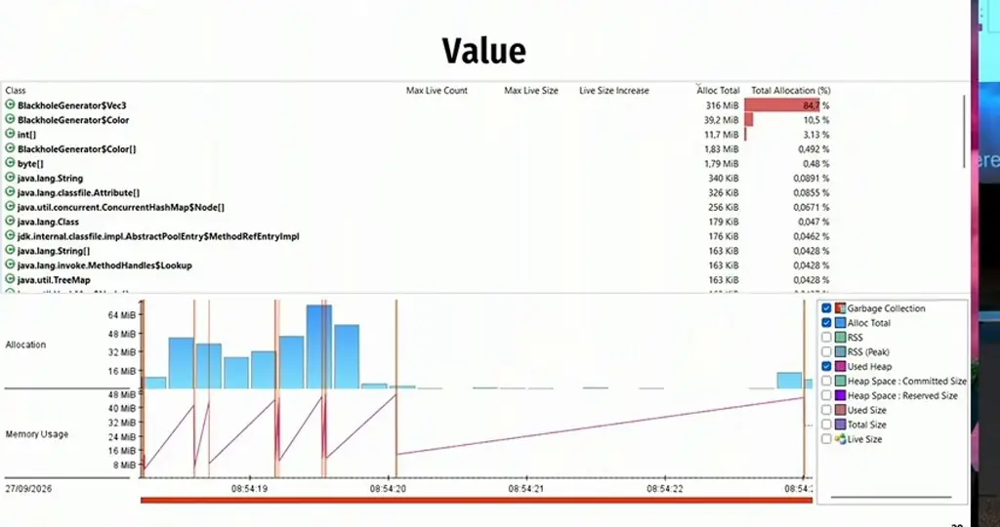
*[▶ 00:45:29](https://www.youtube.com/watch?v=lUB15M3mMLs&t=2729s) · Profiler allocation table and timeline*

Primitives would reach the same speed, but value classes keep the abstraction. The value-class vector math (top) is far shorter and easier to maintain than the primitive version (bottom).

```java
var vel = forward
            .add(right.mul(u))
            .add(trueUp.mul(v))
            .norm();

double velX = forwardX + rightX * u + trueUpX * v;
double velY = forwardY + rightY * u + trueUpY * v;
double velZ = forwardZ + rightZ * u + trueUpZ * v;

double mag = Math.sqrt(
    velX * velX +
    velY * velY +
    velZ * velZ
);

if (mag != 0.0) {
    double invMag = 1.0 / mag;

    velX *= invMag;
    velY *= invMag;
    velZ *= invMag;
}
```

*[▶ 00:47:05](https://www.youtube.com/watch?v=lUB15M3mMLs&t=2825s) · Algorithm's snippet with and without value class*

`Integer`, `Long`, `Optional` and most `java.time` types are already value classes. Synchronizing on them breaks, as JEP 390 has warned since JDK 16.

javac clears the identity bit and marks fields strict-init (JEP 539). Old code runs unchanged; recompiling adds a `LoadableDescriptors` attribute so the VM loads the class early and computes a better layout.

## Links & resources

- [Blackhole Devoxx repo with the value classes conclusion, on the speaker's GitHub](https://github.com/CodeSimcoe/blackhole-devoxx) — <https://github.com/CodeSimcoe/blackhole-devoxx> · on screen [▶ 00:51:05](https://www.youtube.com/watch?v=lUB15M3mMLs&t=3065s)
- OpenJDK pull request for value classes, on GitHub, URL not shown · mentioned [▶ 00:11:06](https://www.youtube.com/watch?v=lUB15M3mMLs&t=666s)
- Speaker's GitHub profile, URL not shown · mentioned [▶ 00:11:59](https://www.youtube.com/watch?v=lUB15M3mMLs&t=719s)
- Early-access JDK build with value classes, downloadable, URL not shown · mentioned [▶ 00:22:19](https://www.youtube.com/watch?v=lUB15M3mMLs&t=1339s)
- IntelliJ IDEA, which mostly works with the early-access build · mentioned [▶ 00:22:27](https://www.youtube.com/watch?v=lUB15M3mMLs&t=1347s)
