# High Performance Java Native AI with CUDA and the Vector API by Zoran Sevarac

*How Java can use CUDA GPUs and the Vector API for neural-network inference and training through Project Panama, with a fraud-detection demo and benchmarks.*

Source: [High Performance Java Native AI with CUDA and the Vector API by Zoran Sevarac](https://www.youtube.com/watch?v=8NURE3I4AJQ) · Zoran Sevarac · Devoxx · 49 min

## TL;DR

Java has lagged in AI because it is slow at the matrix math that AI relies on, GPU integration through JNI is hard to ship, and CPU auto-vectorization is unreliable. Deep Netts addresses this with Project Panama: the Foreign Function & Memory API with jextract generates CUDA bindings, and the Vector API handles SIMD on the CPU. Deep Netts hides both behind a tensor layer and pluggable accelerator backends, so developers never touch GPU transfers or vector registers. The talk shows that acceleration depends on workload size: the Vector API and GPU are both about 2x faster at 1M rows, but the GPU reaches about 9x at 10M rows.

## Key takeaways

- Java's AI gaps come from three places: slow numerical computing, GPU integration that JNI makes hard to distribute, and CPU auto-vectorization that rarely happens in practice.
- FFM arenas free native memory when a try-with-resources scope ends, and jextract generates Java bindings from CUDA headers, replacing error-prone manual JNI wrappers.
- Shipping CUDA from Java is costly: about 10 native libraries (roughly 1.5 GB), matching driver and toolkit versions, and either relying on installed libraries or bundling about 3 GB.
- The Vector API expresses array operations in SIMD registers; the loop loads chunks, operates on them, and stores results, with leftover elements handled by a scalar loop.
- Deep Netts puts CUDA (via FFM) and a Vector API implementation behind one accelerator service provider, so the same model runs with or without a GPU.
- On a small feedforward network, the Vector API and GPU were each about 2x faster than single-threaded CPU at 1M rows, while the GPU reached about 9x at 10M rows; small workloads may not need a GPU.
- Enabling acceleration takes JVM flags (--add-modules jdk.incubator.vector for the Vector API, --enable-native-access=ALL-UNNAMED for FFM) plus one Deep Netts setting per backend.
- GPU speedups are mostly limited by data transfer between main memory and GPU memory, so transfer efficiency and model size, depth and data volume drive results.

## Why Java lagged in AI, and what changed

[▶ 00:00:00](https://www.youtube.com/watch?v=8NURE3I4AJQ&t=0s)

Deep Netts is building a Java-native AI platform that adds hardware acceleration without leaving the Java ecosystem.

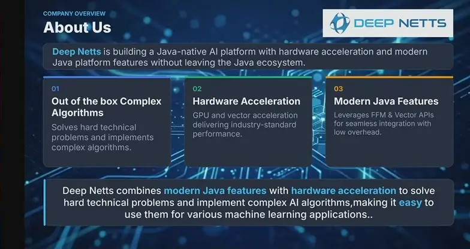
*[▶ 00:01:55](https://www.youtube.com/watch?v=8NURE3I4AJQ&t=115s) · About Us*

Three barriers have held Java back in AI:

- **Slow numerical computing:** modern AI is mostly matrix multiplication, and Java was not designed for that workload.
- **Weak GPU support:** GPU use was possible but hard to integrate and distribute, because of JNI.
- **No reliable CPU vectorization:** auto-vectorization rarely happens in practice, and it is hard to tell why.

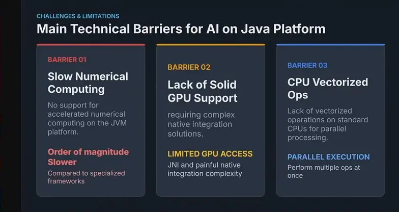
*[▶ 00:04:08](https://www.youtube.com/watch?v=8NURE3I4AJQ&t=248s) · Main Technical Barriers for AI on Java*

Two APIs from Project Panama address these problems.

- The **Foreign Function & Memory API** (available since Java 21, stable by Java 25) makes native calls easier and safer than JNI. **Jextract** generates binding code from a header file and a binary library, so regeneration after a version change is no longer manual.
- Native memory sits outside the garbage collector. FFM **arenas** free it when a try-with-resources scope ends. OS loaders can also handle native library dependencies.
- The **Vector API** lets you express operations on array chunks in vector registers. It handles the register width and data type, which are unknown in advance.

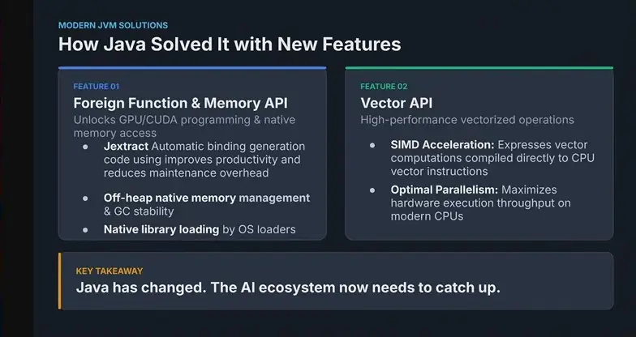
*[▶ 00:10:03](https://www.youtube.com/watch?v=8NURE3I4AJQ&t=603s) · How Java Solved It with New Features*

## How CUDA runs work on the GPU, and why it is hard to debug

[▶ 00:10:04](https://www.youtube.com/watch?v=8NURE3I4AJQ&t=604s)

CUDA is NVIDIA's API for its GPUs, built for numerical operations on huge arrays. Kernels run concurrently across array elements, and each launch maps threads into blocks and grids, each with three dimensions.

Data must move from the Java heap to native memory, then to GPU memory, and results return the same way. Debugging is hard for three reasons:

- You cannot directly inspect variables or state on the GPU.
- Functions often take more than six parameters, mostly raw pointers.
- Failures often yield vague errors like "BAD Param".

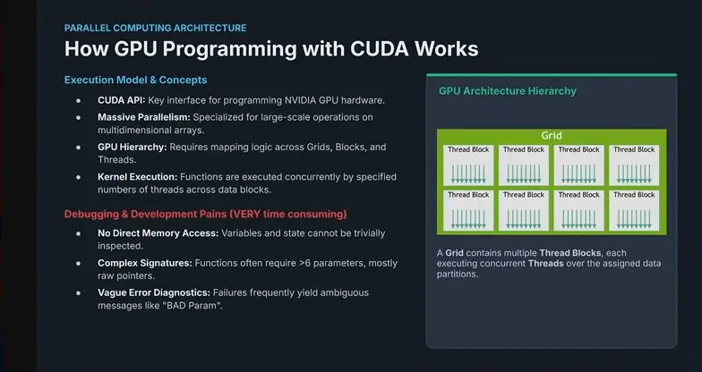
*[▶ 00:14:39](https://www.youtube.com/watch?v=8NURE3I4AJQ&t=879s) · How GPU Programming with CUDA Works*

## Why CUDA is hard to ship from Java

[▶ 00:14:40](https://www.youtube.com/watch?v=8NURE3I4AJQ&t=880s)

CUDA's programming model differs from Java's, and even NVIDIA engineers advise against writing kernels directly. Java code uses NVIDIA's libraries instead: cudart, cublas and cudnn.

The stack needs about 10 native libraries, roughly 1.5 GB in total. Windows adds requirements such as zlib and a C compiler, which means Visual Studio.

CUDA driver and toolkit versions must match, and each card supports different drivers. Shipping means either relying on installed libraries with a `jextract`-generated Java API for the matching version, or bundling about 3 GB of native libraries. There is no clean answer.

JNI had similar problems, but worse. FFM removes manual code generation, and the operating system now handles library loading.

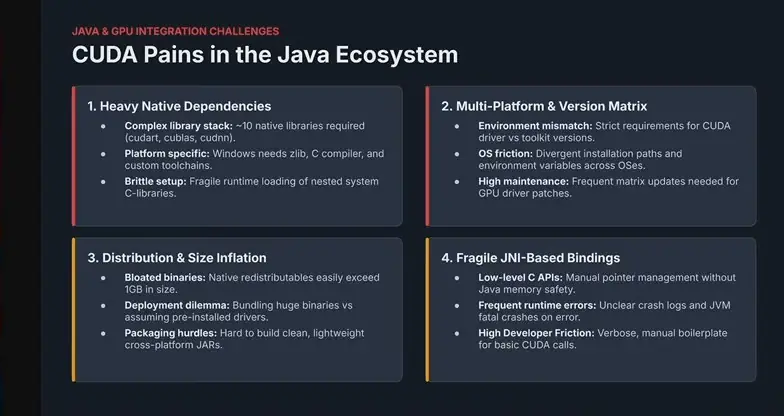
*[▶ 00:19:26](https://www.youtube.com/watch?v=8NURE3I4AJQ&t=1166s) · CUDA Pains in the Java Ecosystem*

## Generating CUDA bindings and managing off-heap memory with FFM

[▶ 00:19:27](https://www.youtube.com/watch?v=8NURE3I4AJQ&t=1167s)

Start with `jextract`, an open-source tool outside the JDK that generates Java classes of static methods from CUDA headers.

Off-heap memory is allocated in arenas and exposed as MemorySegments, replacing manual JNI wrappers that caused fatal JVM crashes.

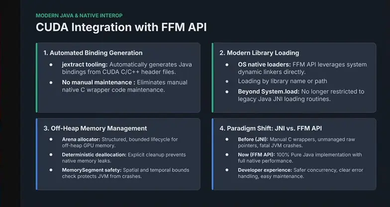
*[▶ 00:24:08](https://www.youtube.com/watch?v=8NURE3I4AJQ&t=1448s) · CUDA Integration with FFM API*

The Vector API builds on SIMD, where one CPU instruction processes many data slots at once.

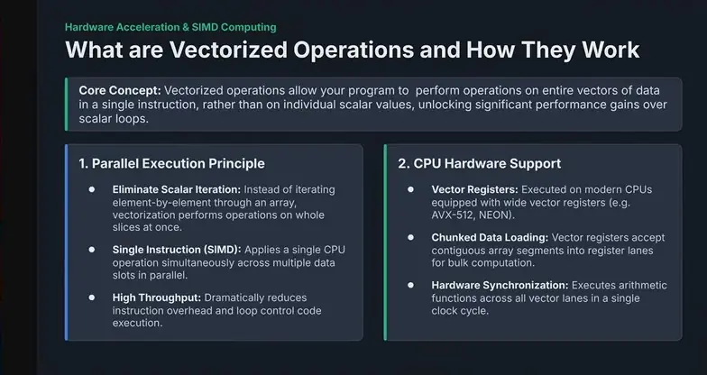
*[▶ 00:26:04](https://www.youtube.com/watch?v=8NURE3I4AJQ&t=1564s) · What are Vectorized Operations and How They Work*

## Vector registers and SIMD for array math

[▶ 00:24:10](https://www.youtube.com/watch?v=8NURE3I4AJQ&t=1450s)

SIMD (single instruction, multiple data) runs one instruction over a chunk of values held in a vector register, not one value at a time. It can reach 10x or more, depending on the amount of computation.

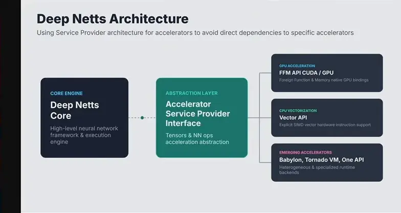
*[▶ 00:32:39](https://www.youtube.com/watch?v=8NURE3I4AJQ&t=1959s) · Deep Netts Architecture*

It suits math over vectors, not general object-oriented code.

The loop loads chunks, adds them in one operation, and stores the results.

```java
float[] a, float[] b, float[] c;
....
int i = 0;
int upperBound = SPECIES.loopBound(a.length);

for (; i < upperBound; i += SPECIES.length()) {
  // Load chunks from arrays into FloatVectors
  var va = FloatVector.fromArray(SPECIES, a, i);
  var vb = FloatVector.fromArray(SPECIES, b, i);

  // Perform parallel element-wise addition
  var vc = va.add(vb);

  // Store results back into destination array
  vc.intoArray(c, i);
}
...
```

*[▶ 00:29:12](https://www.youtube.com/watch?v=8NURE3I4AJQ&t=1752s) · Vector API explicit vectorization example*

Leftover elements go to a scalar loop. Vector code means reframing the problem around packing values into registers.

## Layered CUDA access and a fraud model built with plain Java objects

[▶ 00:29:14](https://www.youtube.com/watch?v=8NURE3I4AJQ&t=1754s)

Deep Netts hides accelerators behind an accelerator service provider: a specification for tensors and the costly neural-network operations, with interchangeable backends. The CUDA backend calls native libraries through the FFM API. Without a GPU, a Vector API implementation runs the same operations. The same design lets other accelerators, such as Babylon, TornadoVM, or oneAPI, plug in later.

Raw jextract bindings expose C functions full of pointers and parameters, so Deep Netts adds a Java layer. A tensor object hides memory handling and indexing.

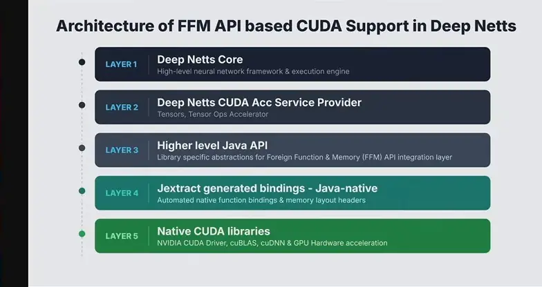
*[▶ 00:34:00](https://www.youtube.com/watch?v=8NURE3I4AJQ&t=2040s) · Layers of FFM API CUDA support*

The demo is credit-card fraud. Projected card-fraud losses are $407.6B over ten years. Rules are short-lived and fragile, so a learned model fits better.

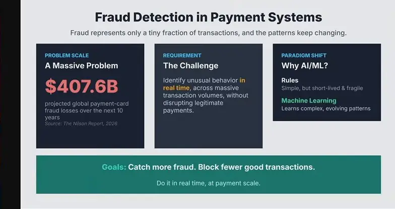
*[▶ 00:35:32](https://www.youtube.com/watch?v=8NURE3I4AJQ&t=2132s) · Fraud Detection in Payment Systems*

The dataset has 1M synthetic transactions, 8.74% of them fraudulent. Its seven features include distance from home, repeat retailer, and online order.


*[▶ 00:37:07](https://www.youtube.com/watch?v=8NURE3I4AJQ&t=2227s) · Credit Card Fraud Dataset*

A feedforward network with two ReLU hidden layers (32 and 16 units) and a sigmoid output estimates fraud probability. Developers never handle GPU transfers, memory, or vectors.

```java
FeedForwardNetwork neuralNet = FeedForwardNetwork.builder()
  .addInputLayer(numInputs)
  .addFullyConnectedLayer(32, ActivationType.RELU)
  .addFullyConnectedLayer(16, ActivationType.RELU)
  .addOutputLayer(numOutputs, ActivationType.SIGMOID)
  .lossFunction(LossType.CROSS_ENTROPY)
  .build();

neuralNet.getTrainer()
  .setStopError(0.03f)
  .setStopEpochs(100)
  .setLearningRate(0.001f);

neuralNet.train(trainingSet);

EvaluationMetrics evaluation = neuralNet.test(testSet);
```

*[▶ 00:38:08](https://www.youtube.com/watch?v=8NURE3I4AJQ&t=2288s) · Building and training a feedforward fraud-detection network*

Acceleration is enabled with one JVM option and one setting per backend.

```java
--add-modules jdk.incubator.vector
DeepNetts.getInstance()
  .setUseVectorAPI(true);

--enable-native-access=ALL-UNNAMED
DeepNetts.getInstance()
  .setUseCuda(true);
```

*[▶ 00:40:09](https://www.youtube.com/watch?v=8NURE3I4AJQ&t=2409s) · Enabling Acceleration for Vector API and CUDA*

## Switching on acceleration, and when it pays off

[▶ 00:38:10](https://www.youtube.com/watch?v=8NURE3I4AJQ&t=2290s)

Acceleration needs JVM options plus one Deep Netts setting per feature. The incubating Vector API needs `--add-modules jdk.incubator.vector`. FFM needs `--enable-native-access=ALL-UNNAMED`, which is only a warning today but will become mandatory, since it controls which code may reach native memory and libraries, a JNI security gap. CUDA needs one Deep Netts setting.

On a small feedforward network, the Vector API and GPU both run about 2x faster than single-threaded CPU at 1M rows, so small workloads may not need a GPU. From 10M rows the GPU reaches about 9x, while the Vector API stays near 2x.

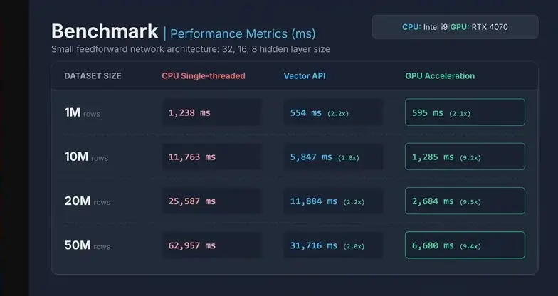
*[▶ 00:43:04](https://www.youtube.com/watch?v=8NURE3I4AJQ&t=2584s) · Benchmark: CPU vs Vector API vs GPU timings*

Results depend on model size, layer count and data volume. The GPU is mostly limited by moving data between main memory and GPU memory, so transfer efficiency drives many of the benchmark numbers.

## Serving a trained fraud model from Spring Boot

[▶ 00:43:04](https://www.youtube.com/watch?v=8NURE3I4AJQ&t=2584s)

A Spring Boot service loads the saved model at startup with `NeuralNetwork.load`, then runs transaction features through it to get a fraud probability.

```java
@Service
public class FraudDetectionService implements AutoCloseable {

private final String modelPath;
private final double threshold;
private FeedForwardNetwork network;

public FraudDetectionService(
@Value("${fraud.model-path}") String modelPath,
@Value("${fraud.threshold:0.70}") double threshold) {
  this.modelPath = modelPath;
  this.threshold = threshold;
}

@PostConstruct
public void loadModel() throws IOException {
  network = NeuralNetwork.load(modelPath,
                 FeedForwardNetwork.class);
}

public FraudResponse predict(FraudRequest request) {
float[] features = new float[] {
    request.amount().floatValue(),
    request.crossBorder() ? 1.0f : 0.0f,
    request.attemptsLast30Min().floatValue(),
    request.minutesSincePreviousTransaction().floatValue(),
    request.distanceFromPreviousTransactionKm().floatValue(
    ),
    request.differentMerchantsLast30Min().floatValue(),
    request.customerCategory().floatValue(),
    request.productCategory().floatValue()
};
float[] output = network.predict(features);
double prob = output[0]);
return new FraudResponse(prob, prob >= threshold, threshold);
}
```

*[▶ 00:43:09](https://www.youtube.com/watch?v=8NURE3I4AJQ&t=2589s) · Spring Boot Integration: Simple Fraud Detection Service*

Thresholds such as 0.5 or 0.8 trade false alarms against missed fraud.

Deep Netts is now open source, with templates to start from, plus a Java-developer AI course and workshops.


*[▶ 00:49:21](https://www.youtube.com/watch?v=8NURE3I4AJQ&t=2961s) · Call To Action: next steps at deepnetts.com*

Its speaker sits on a JCP Executive Committee working group that is building the Java AI ecosystem through use cases.

Asked about overhead over CUDA: PyTorch training matched closely, comparable to JNI.

## Links & resources

- NVIDIA CUDA download page — mentioned, URL not shown · mentioned [▶ 00:17:34](https://www.youtube.com/watch?v=8NURE3I4AJQ&t=1054s)
- Deep net website's machine learning course — mentioned, URL not shown · mentioned [▶ 00:43:27](https://www.youtube.com/watch?v=8NURE3I4AJQ&t=2607s)
