# In the loop , not in the dark: Staying in controlling the era dark software factories By Alex Gavr

*How one developer used Groma, a deterministic architecture map that agents update on every change, to review architecture instead of every line of AI-written code.*

Source: [In the loop , not in the dark: Staying in controlling the era dark software factories By Alex Gavr](https://www.youtube.com/watch?v=jhvT8hVYSvQ) · Alex Gavr · Devoxx · 45 min

## TL;DR

After shipping AI-written code without review, Alex Gavr's hackathon platform began returning 500 errors, and no one could easily find the cause. The root problem was architectural: each PR looked correct, but duplicated auth logic and stale or unused code accumulated. He built Groma, which scans code deterministically into a C4-style map that agents and humans curate and that updates live as agents change code. This shifts review from every line to the components that matter, which keeps humans in control of the architecture.

## Key takeaways

- Review the architecture rather than every line: keep a component map and review only the components agents change that matter.
- Best-practice rules such as reusable components, fewer UI-label tests, and a cognitive-complexity lint rule helped only temporarily, since duplicated auth logic returned weeks later.
- Generate the first architecture scan deterministically and offline, then let a human or agent curate connections and groupings, because automatic predicted links create connections that should not exist.
- Curation edits survive the next scan, so the curated map stays accurate as code changes.
- Use live diffs to see which components agents are touching while they run: blue for new, yellow for modified, red for deleted.
- Rescan only what changed, using deterministic IDs stored in the files, so per-PR architecture maps can be published through a GitHub Action or diffed between any two commits locally.
- Keep architecture maps in an open markdown format so they remain readable in any markdown viewer even without the tool installed.
- Experts should stay in the architect role, combining components, building reusable parts, and checking that agents follow the specs, and should rewrite AI output themselves rather than pasting it to colleagues.

## Faster shipping without review, then a production 500

[▶ 00:00:00](https://www.youtube.com/watch?v=jhvT8hVYSvQ&t=0s)

In January the author set a goal of more throughput with Backlog.md, Claude workflows, Beads and Ralph loops.

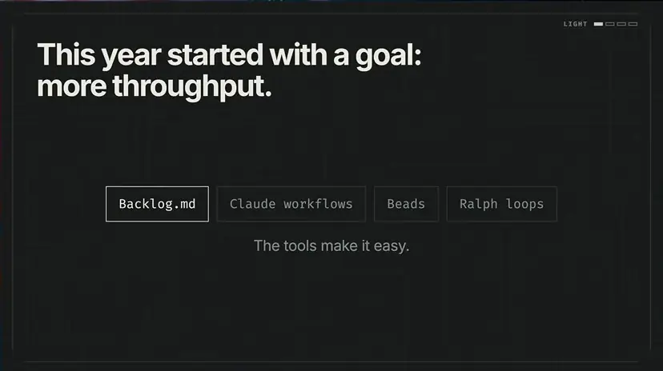
*[▶ 00:02:39](https://www.youtube.com/watch?v=jhvT8hVYSvQ&t=159s) · Goal: more throughput with AI tools*

Shipping fast seemed harmless, so he stopped reviewing code.

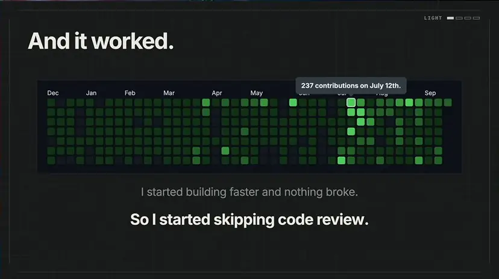
*[▶ 00:03:23](https://www.youtube.com/watch?v=jhvT8hVYSvQ&t=203s) · And it worked: contribution heatmap*

His vibe-coded hackathon platform began returning 500 errors. Despite 14 years and hundreds of incidents, he had never touched its codebase.

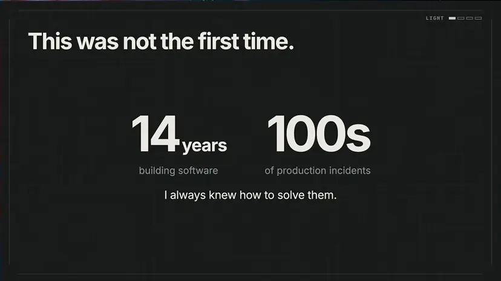
*[▶ 00:04:18](https://www.youtube.com/watch?v=jhvT8hVYSvQ&t=258s) · Not the first time: 14 years, 100s of incidents*

He couldn't reach production or read its logs, because an agent held the deploy token.

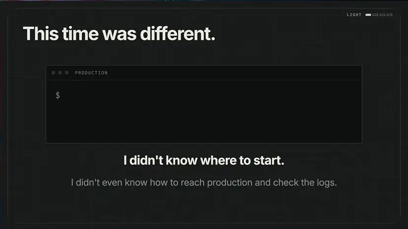
*[▶ 00:04:56](https://www.youtube.com/watch?v=jhvT8hVYSvQ&t=296s) · Did not know how to reach production*

He asked Codex to fix it. Codex tailed the production worker and found one SQL statement whose `IN` list grew without bound.

```text
codex › we have a 500 in production, pls fix!
✓ tailing the production worker · my Cloudflare CLI session
✓ root cause: one SQL statement
  SELECT * FROM table WHERE x IN (…0, 8391, 8392, 8393, 8394
→ hotfix and permanent fix proposed
```

*[▶ 00:05:40](https://www.youtube.com/watch?v=jhvT8hVYSvQ&t=340s) · AI power: Codex diagnoses production 500 error*

The emergency fix took 2 minutes by reducing WHERE clause entries. The permanent fix, deployed through CI/CD, took 20 minutes.

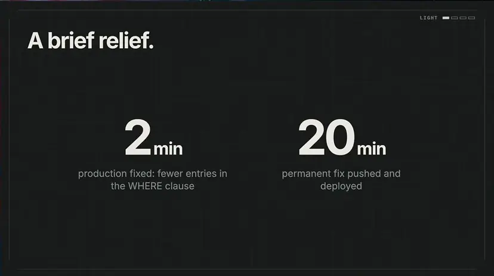
*[▶ 00:06:24](https://www.youtube.com/watch?v=jhvT8hVYSvQ&t=384s) · A brief relief*

## Agents Passed Every PR but Broke the Architecture

[▶ 00:06:13](https://www.youtube.com/watch?v=jhvT8hVYSvQ&t=373s)

He had never checked production, read its queries, or read the code, yet Codex could reach production easily.

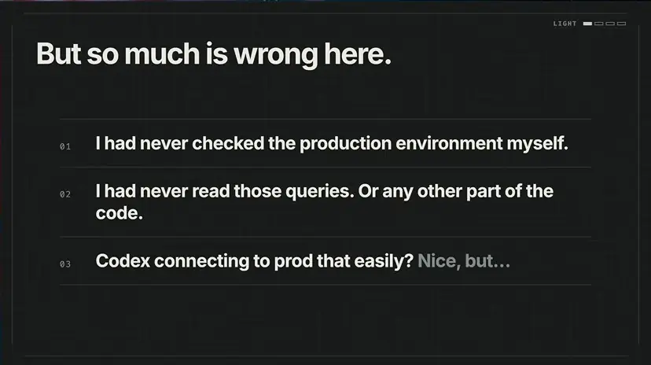
*[▶ 00:08:10](https://www.youtube.com/watch?v=jhvT8hVYSvQ&t=490s) · But so much is wrong here*

A SQL query with a `WHERE ... IN` clause passed his tests and broke in production once real user data grew the row counts.

The codebase had 20+ versions of a Button component, auth checked on every page with no middleware, unused leftovers, and 1,700+ tests, mostly checking UI labels.

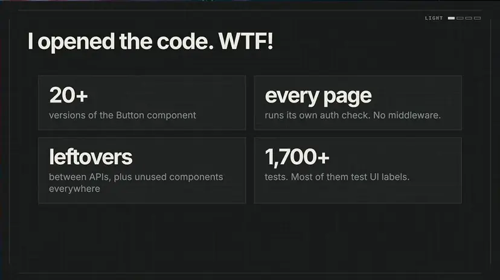
*[▶ 00:10:33](https://www.youtube.com/watch?v=jhvT8hVYSvQ&t=633s) · I opened the code. WTF!*

Each component was correct on its own. The problem was architectural: every line looked fine in its own PR.

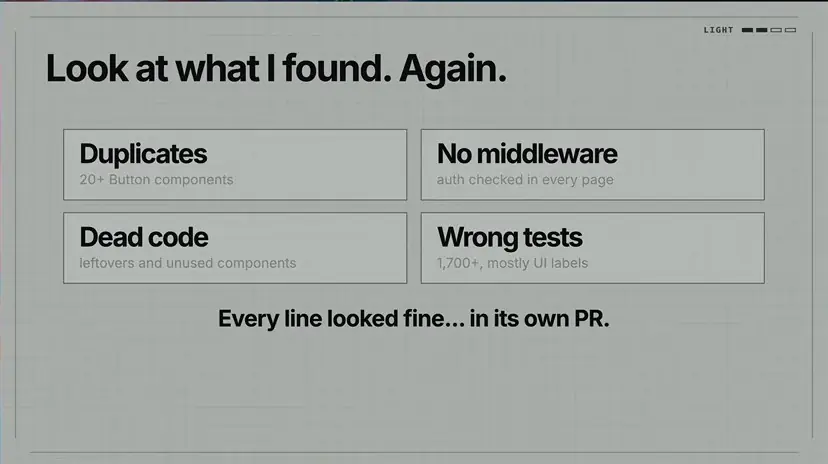
*[▶ 00:14:06](https://www.youtube.com/watch?v=jhvT8hVYSvQ&t=846s) · Every line looked fine, in its own PR*

Best practices helped only for a while:

- Reusable components and fewer UI-label tests in AGENTS.md
- Fewer, non-overlapping skills
- A cognitive-complexity lint rule against nested loops
- A simplify pass before finishing

Weeks later, duplicated auth logic returned.

Archifi, an open-source skill that has agents draw architecture diagrams, helped him spot problems but was one-off.

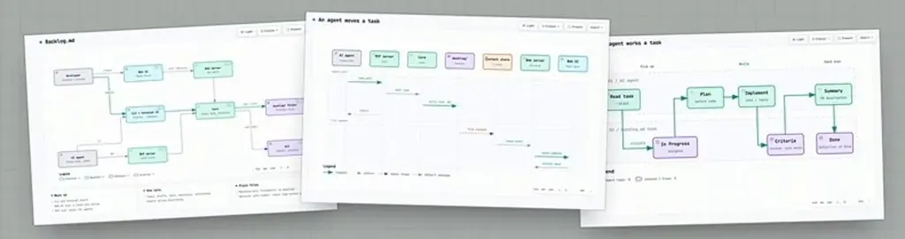
*[▶ 00:14:36](https://www.youtube.com/watch?v=jhvT8hVYSvQ&t=876s) · AI-drawn diagrams from Archifi*

After one commit, the diagrams were stale.

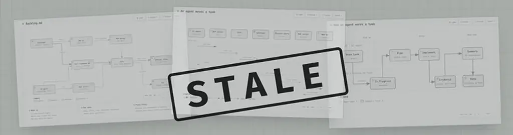
*[▶ 00:14:42](https://www.youtube.com/watch?v=jhvT8hVYSvQ&t=882s) · Generated diagrams become stale*

His goal was architecture generated without AI, fast enough to run on every change. The workflow: you define tasks, agents write code, and you review the architecture.

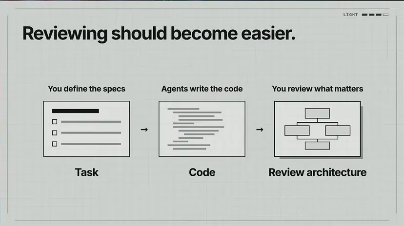
*[▶ 00:15:13](https://www.youtube.com/watch?v=jhvT8hVYSvQ&t=913s) · Reviewing should become easier*

## Four attempts, then a map you can review

[▶ 00:15:22](https://www.youtube.com/watch?v=jhvT8hVYSvQ&t=922s)

Attempt one, a UI mockup, went stale because AI generated it statically. Attempt two made 700 commits, and nothing worked. Attempt three worked only on its own repo, because the agent hardcoded every rule.

```c
if (n == 0) printf("even");
else if (n == 1) printf("odd");
else if (n == 2) printf("even");
else if (n == 3) printf("odd");
else if (n == 4) printf("even");
else if (n == 5) printf("odd");
```

*[▶ 00:17:51](https://www.youtube.com/watch?v=jhvT8hVYSvQ&t=1071s) · It worked. On its own repo.*

Attempt four started small, verifying each piece before adding features. Its markdown let the author correct drifting agents.

Loop: write intent-driven tasks, let agents build, then review architecture changes in the map.

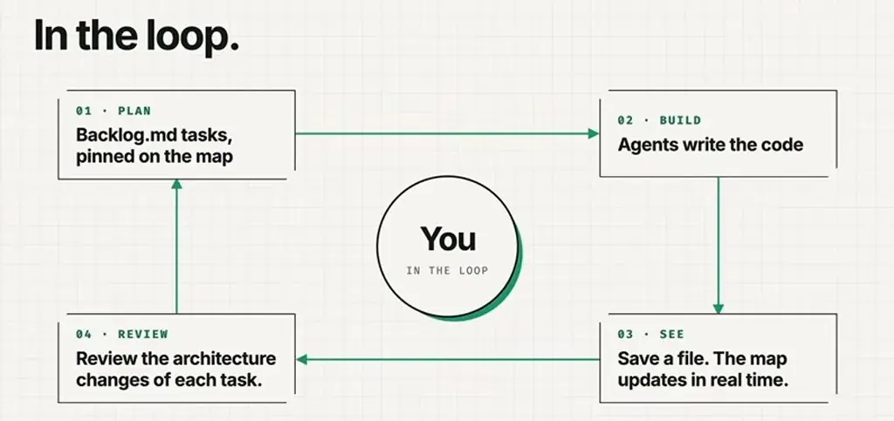
*[▶ 00:19:29](https://www.youtube.com/watch?v=jhvT8hVYSvQ&t=1169s) · In the loop: plan, build, see, review cycle*

Groma.md maps its own source in system, container, and component layers.

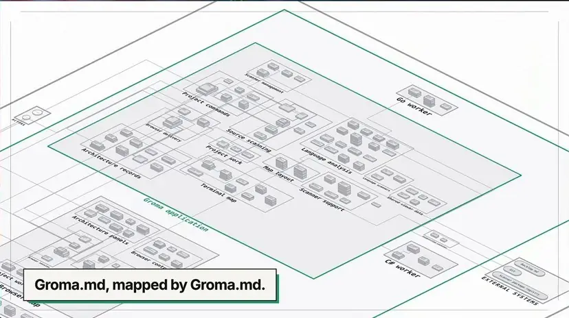
*[▶ 00:19:42](https://www.youtube.com/watch?v=jhvT8hVYSvQ&t=1182s) · Groma.md architecture map of Groma's own source*

The viewer lets you review those layers instead of raw markdown.

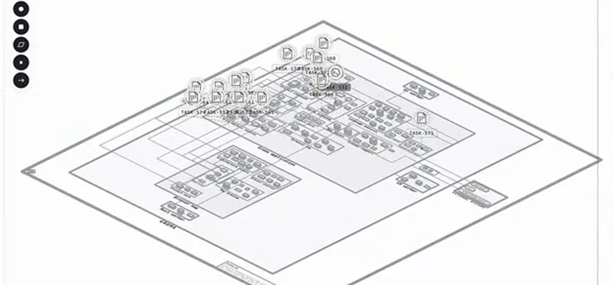
*[▶ 00:19:50](https://www.youtube.com/watch?v=jhvT8hVYSvQ&t=1190s) · Groma.md C4 architecture viewer (isometric)*

The code layer links to source, such as one local server that runs setup before serving the map.

```typescript
import {
  initializeRepository,
  type RepositoryInitDependencies,
} from '../init-command.ts'
import { gromaInitialization } from '../../initialize.ts'
import { loadProjectProfile } from '../../project-profile.ts'
import { discoverScanners, type ScannerDiscovery } from '../../scanner/modules/discovery.ts'
import { installSelectedScanners } from '../../scanner/modules/setup.ts'
import { createWebMapSession } from './map-session.ts'
import { renderSetupPage } from './startup/page.ts'
import { createStartupProgress } from './startup/progress.ts'

type MapSession = Awaited<ReturnType<typeof createWebMapSession>>

/** One local server owns setup and the ready map; the map starts only after initialization. */
export async function startWebViewer(
  repositoryRoot: string,
  options: {
    port?: number
    workSource?: WorkSource
    scan?: boolean
    onListening?: (url: string) => void
    initDependencies?: Partial<RepositoryInitDependencies>
  } = {},
): Promise<{ url: string; close: () => void }> {
  const initial = gromaInitialization(repositoryRoot)
  const progress = createStartupProgress()
  let projectName = (await loadProjectProfile(repositoryRoot))?.title ?? path.basename(repositoryRoot)
  let proposal: ScannerDiscovery | undefined
  let map: MapSession | undefined
  let error: string | undefined
  let preparation: Promise<void> | …
```

*[▶ 00:20:09](https://www.youtube.com/watch?v=jhvT8hVYSvQ&t=1209s) · Web viewer server startWebViewer function source*

```bash
$ git clone ~/projects/keycloak .
Cloning into '.'...
$ groma web --port 4803
```

*[▶ 00:22:39](https://www.youtube.com/watch?v=jhvT8hVYSvQ&t=1359s) · Clone Keycloak and open the map*

One scanner plugin per language needs no AI and scans in milliseconds on small projects.

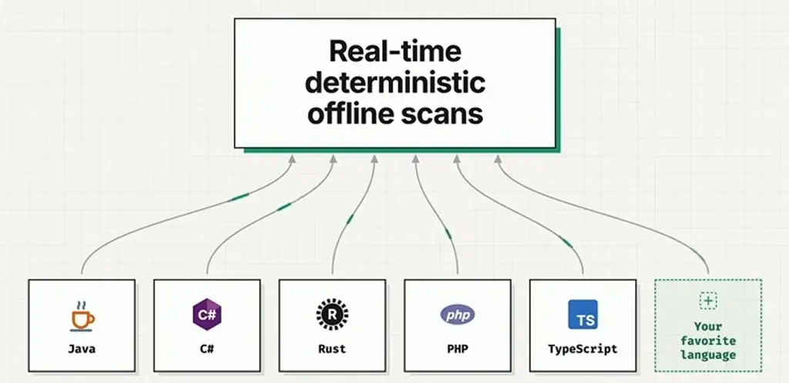
*[▶ 00:22:13](https://www.youtube.com/watch?v=jhvT8hVYSvQ&t=1333s) · Real-time deterministic offline scans*

## Curating a raw scan into a real architecture map

[▶ 00:22:37](https://www.youtube.com/watch?v=jhvT8hVYSvQ&t=1357s)

Groma's first scan is raw by design: it is deterministic and offline, gives each file a unique ID, and leaves out connections and groupings.

Alex stopped hard-coding predicted links, since people did not want automatic connections where they should not exist. A human or an agent curates instead, in about five minutes. Edits survive the next scan. Use this prompt:

```text
Curate this repository's architecture with Groma. Run groma agent-instructions and follow its curation workflow. Describe the architecture as it exists today; do not change application code.
```

*[▶ 00:25:17](https://www.youtube.com/watch?v=jhvT8hVYSvQ&t=1517s) · Groma first-scan prompt for curating a repo*

No AGENTS.md is needed; the agent learns Groma from `groma agent-instructions`.

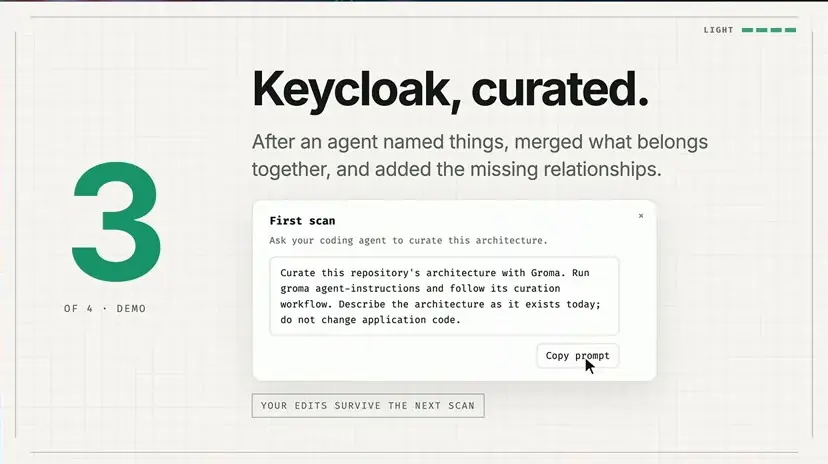
*[▶ 00:25:40](https://www.youtube.com/watch?v=jhvT8hVYSvQ&t=1540s) · Keycloak, curated: first scan prompt*

Codex runs the same prompt.

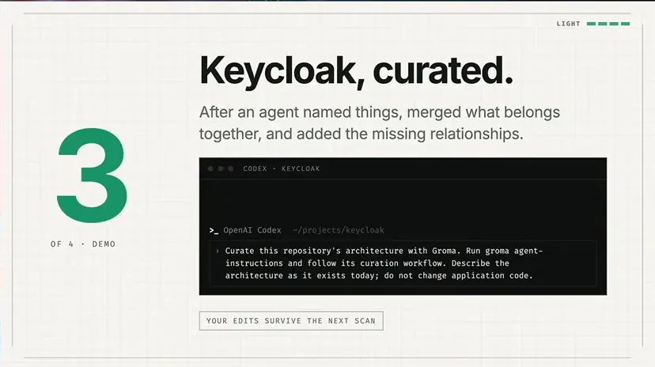
*[▶ 00:25:45](https://www.youtube.com/watch?v=jhvT8hVYSvQ&t=1545s) · Keycloak, curated: demo prompt to Codex*

The result: 8,467 Java files grouped into 57 components.

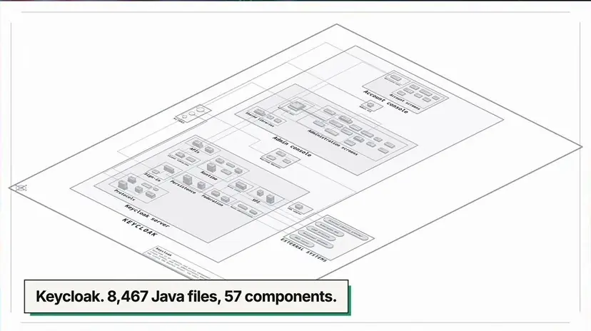
*[▶ 00:25:50](https://www.youtube.com/watch?v=jhvT8hVYSvQ&t=1550s) · Keycloak architecture overview diagram*

The server holds Protocols, Sign-in, Runtime, Persistence and more.

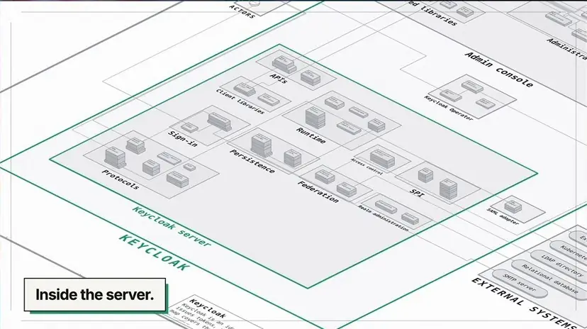
*[▶ 00:25:59](https://www.youtube.com/watch?v=jhvT8hVYSvQ&t=1559s) · Keycloak server internal components*

Each component links to its source files and methods.

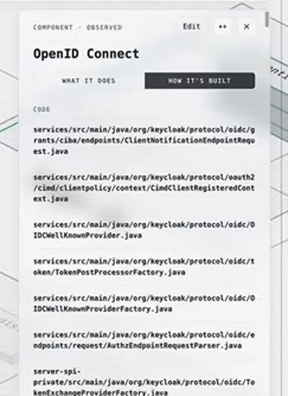
*[▶ 00:26:28](https://www.youtube.com/watch?v=jhvT8hVYSvQ&t=1588s) · Groma OpenID Connect component with source files*

Review what it produces. Karpathy's advice applies: give success criteria and review the architecture.

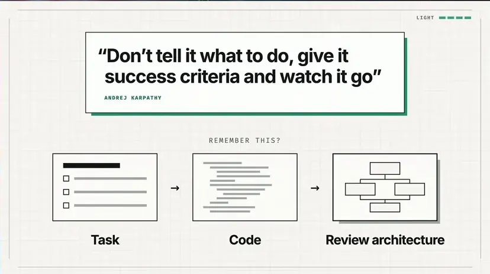
*[▶ 00:27:07](https://www.youtube.com/watch?v=jhvT8hVYSvQ&t=1627s) · Task, code, review architecture workflow*

## Live diffs and per-PR architecture maps

[▶ 00:28:21](https://www.youtube.com/watch?v=jhvT8hVYSvQ&t=1701s)

Live diffs show which components agents have touched while they are still running. Blue marks new components, yellow modified, and red deleted.

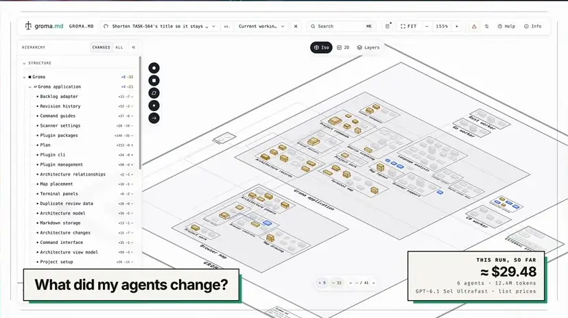
*[▶ 00:30:07](https://www.youtube.com/watch?v=jhvT8hVYSvQ&t=1807s) · Live diff of components changed by agents*

Groma rescans only what changed. Architecture nodes already carry deterministic IDs in the files, so the map computes just the new components and animates them in real time.

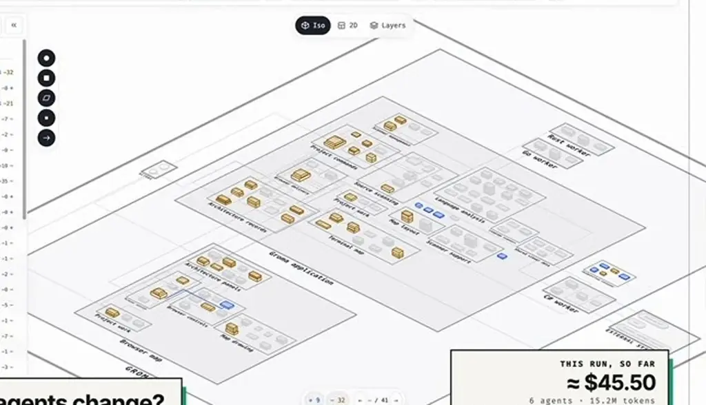
*[▶ 00:30:37](https://www.youtube.com/watch?v=jhvT8hVYSvQ&t=1837s) · Groma live diff view during agent run*

Groma is MIT-licensed. Its scans are deterministic, so they run offline with local models. The speaker prefers issues to pull requests, because his own agent workflows ingest issues.

Task tracking is a plugin. Backlog.md streams task changes live, and other trackers could be added. Agents built COBOL and assembly scanners on request.

A GitHub Action publishes an architecture-change page on each PR, and you can diff any two commits locally.

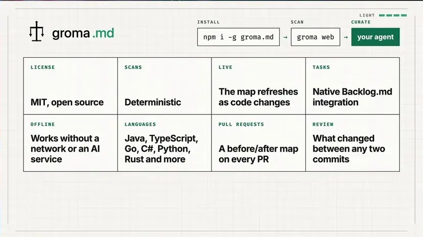
*[▶ 00:34:31](https://www.youtube.com/watch?v=jhvT8hVYSvQ&t=2071s) · Groma feature summary grid*

The map uses the C4 model, stored as OKF (Open Knowledge Format) Markdown.

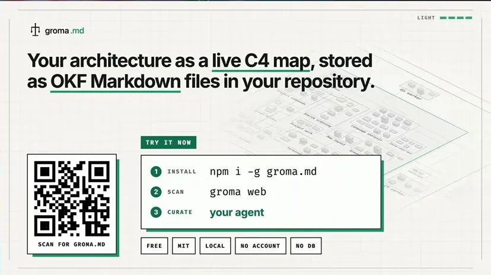
*[▶ 00:36:06](https://www.youtube.com/watch?v=jhvT8hVYSvQ&t=2166s) · Groma C4 map and try-it-now steps*

## Reviewing specs and architecture when agents write the code

[▶ 00:34:56](https://www.youtube.com/watch?v=jhvT8hVYSvQ&t=2096s)

He closes by answering the four questions he opened with.

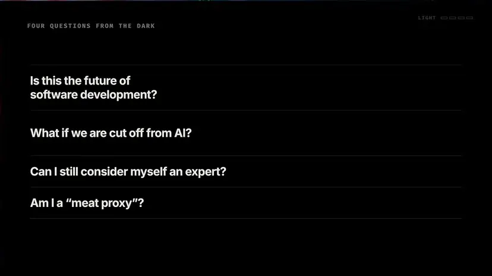
*[▶ 00:36:15](https://www.youtube.com/watch?v=jhvT8hVYSvQ&t=2175s) · Four questions from the dark*

Is this the future? Yes, but reviews have to move up a level. He can no longer review all the code agents write, so he sees two options: review only specs, such as behavior-driven tests, or keep a map and review only the components agents change that matter. Agents are good at gathering files and building relationships between them, which makes the map practical. The map works offline, so it still works if AI access is cut or local open models are used.

Experts stay in the architect role, overseeing the codebase: combining components, building reusable parts, and keeping modular monoliths, then checking that agents follow those specs. Don't be a "meat proxy." Don't paste Claude or Codex output to colleagues. Rewrite it yourself, even with typos, so they know it comes from you.

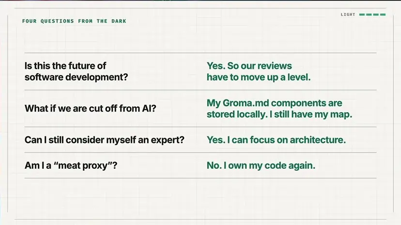
*[▶ 00:38:14](https://www.youtube.com/watch?v=jhvT8hVYSvQ&t=2294s) · Four questions from the dark*

Groma saves its maps as an open markdown bundle. Uninstall it and any markdown viewer still shows components and connections, just not the visual map. Groma is at groma.md.

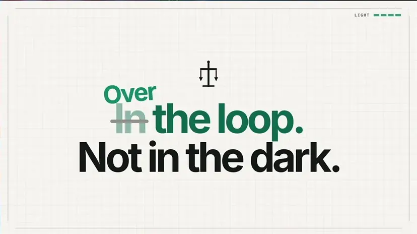
*[▶ 00:38:23](https://www.youtube.com/watch?v=jhvT8hVYSvQ&t=2303s) · Over the loop, not in the dark*

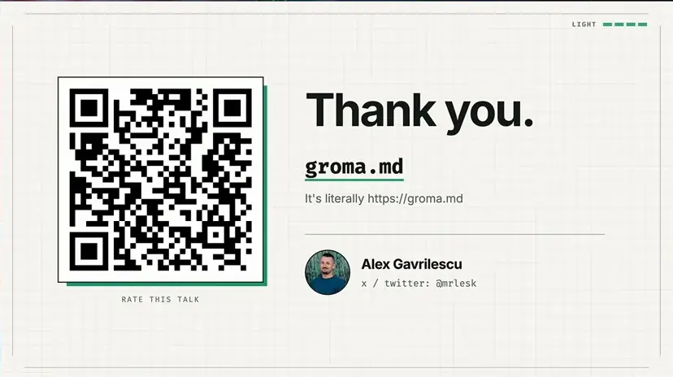
*[▶ 00:44:49](https://www.youtube.com/watch?v=jhvT8hVYSvQ&t=2689s) · Closing slide with groma.md link*

## Links & resources

- Groma — architecture-documentation tool shown in the talk; URL not shown · mentioned [▶ 00:25:20](https://www.youtube.com/watch?v=jhvT8hVYSvQ&t=1520s)
- Groma GitHub Action — installs on open source repos to generate architecture pages; URL not shown · mentioned [▶ 00:33:56](https://www.youtube.com/watch?v=jhvT8hVYSvQ&t=2036s)
- Talk slides — speaker offered them for review after the talk; URL not shown · mentioned [▶ 00:38:25](https://www.youtube.com/watch?v=jhvT8hVYSvQ&t=2305s)
