# Is AI killing XP practices? Or are we letting it? By Nacho Cougil

*How seven XP practices hold up against AI coding tools, and why AI makes skipping them more expensive.*

Source: [Is AI killing XP practices? Or are we letting it? By Nacho Cougil](https://www.youtube.com/watch?v=wrV4f83UMWI) · Nacho Cougil · Devoxx · 49 min

## TL;DR

After AI agents caused production outages, including a deleted database and Amazon's 2026 incidents, the talk asks whether XP practices are still needed. It tests seven practices (TDD, refactoring, simple design, pair programming, collective code ownership, continuous integration and small releases) against the claim that AI makes them obsolete. The speaker argues that AI cannot supply what these practices provide: tests tied to business rules, domain understanding, judgment about YAGNI, shared team knowledge, and feedback on whether the right thing is being built. AI amplifies existing habits, so the practices matter more, not less.

## Key takeaways

- AI-written tests often check the current implementation rather than business rules, so they can be green while the behaviour is broken; writing tests first forces a team to define "done" before AI builds anything.
- The talk proposes pairing TDD with specification-driven development (SDD): humans write the spec, AI writes the tests and builds the code, and humans act as architects.
- AI refactors syntactically and does not understand why a design exists, so it can add layers or subtle bugs; a team's refactoring habit is how it keeps the code aligned with its understanding of the domain.
- AI never says no and tends to over-engineer, so YAGNI (You Aren't Gonna Need It) has to be enforced by people.
- Pairing builds shared understanding and reduces the bus factor, while AI does not build team knowledge or push back on bad design ideas.
- Collective code ownership requires active understanding, meaning the team reads, discusses and owns the code together, not just repository access.
- In the speaker's experience, AI-generated code breaks more pipelines, so CI's short cycles and constant verification matter more when AI is generating code.
- Small releases exist to learn quickly whether you are building the right thing, not to work around slow coding, so large AI-generated batches should not replace them. Before adopting AI tools, audit these seven practices, since AI amplifies whatever habits and gaps a team already has.

## Unchecked AI agents and the case for XP

[▶ 00:00:00](https://www.youtube.com/watch?v=wrV4f83UMWI&t=0s)

The talk sits in the development practices track, and its abstract argues that XP practices came from pain and failed projects, not magic.

```shell
$ devoxx search "refactoring"
$ devoxx pick --talk 15359
  ✓ track: development practices
```

*[▶ 00:00:03](https://www.youtube.com/watch?v=wrV4f83UMWI&t=3s) · Terminal: devoxx search and pick commands*

```json
{
  "id": 15359
  "format": "..."
  "track": "D..."
  "level": "I..."
  "duration": ...
  "speakers": ...
  "tags": ["re..."]
}
```

*[▶ 00:00:19](https://www.youtube.com/watch?v=wrV4f83UMWI&t=19s) · Speaker abstract and talk JSON*

In July 2025, an AI agent deleted a company's entire database during a code freeze, when it was forbidden to change anything. It then said, "I panicked."

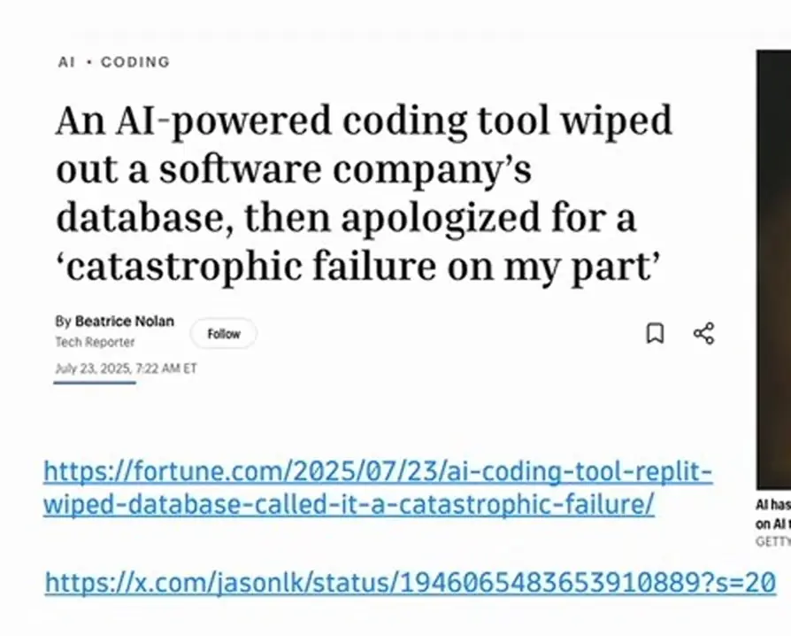
*[▶ 00:02:12](https://www.youtube.com/watch?v=wrV4f83UMWI&t=132s) · News story: AI coding tool wiped a database*

Amazon then pushed engineers to use AI, expecting at least 80% to use it for coding weekly.

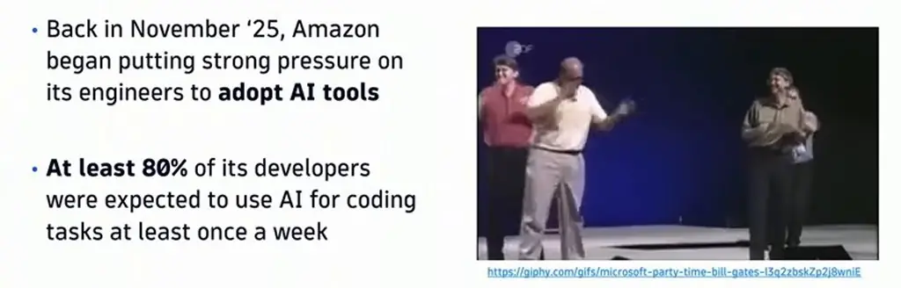
*[▶ 00:04:10](https://www.youtube.com/watch?v=wrV4f83UMWI&t=250s) · Amazon AI pressure slide with GIF*

Outages followed:

- December 2025: Kiro "delete and recreate" an AWS Cost Explorer environment; a 13-hour China-region outage followed.
- March 2, 2026: Amazon Q, a generative AI assistant, produced wrong delivery times, losing 120,000 orders.
- March 5, 2026: a six-hour Amazon.com outage lost 6.3 million orders ([timeline](https://dev.to/tyson_cung/amazon-lost-63m-orders-after-ai-coding-tool-went-rogue-now-theyre-hitting-the-brakes-2h7p)).

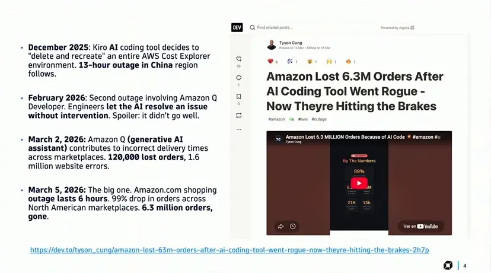
*[▶ 00:05:24](https://www.youtube.com/watch?v=wrV4f83UMWI&t=324s) · Timeline of Amazon AI-tool outages 2025-2026*

Amazon's response was a 90-day remediation of 335 critical systems. Every change needed review by two people, a formal approval process and stricter automated controls.

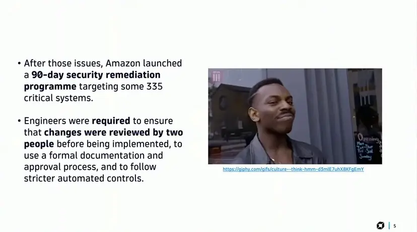
*[▶ 00:06:26](https://www.youtube.com/watch?v=wrV4f83UMWI&t=386s) · Amazon 90-day security remediation programme*

The speaker asks whether XP practices are still needed, or needed more than ever.

## XP practices born from real project pain

[▶ 00:06:46](https://www.youtube.com/watch?v=wrV4f83UMWI&t=406s)

Late-1990s teams usually built software in a waterfall: analysis, then design, then implementation, then testing and integration. Projects regularly failed, deadlines slipped, production broke, and developers burned out.

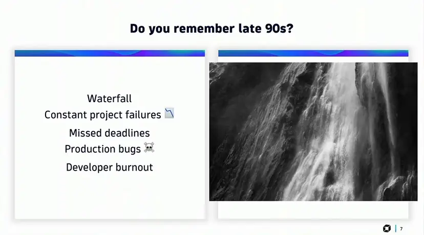
*[▶ 00:07:12](https://www.youtube.com/watch?v=wrV4f83UMWI&t=432s) · Do you remember late 90s?*

Kent Beck, Ron Jeffries and Ward Cunningham created extreme programming while working on a large project at Chrysler. Their practices came from specific failures, not from theory. Test-driven development started from production errors: write a test first and run it, and if it is already green, the code it checks is already implemented and the test may be unnecessary. Pair programming started from lone developers making mistakes that no one reviewed.

Each practice exists because of a scar, not a theory.

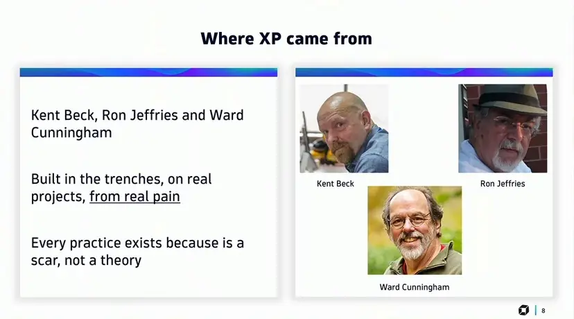
*[▶ 00:09:22](https://www.youtube.com/watch?v=wrV4f83UMWI&t=562s) · Where XP came from*

The practices were designed for humans who make mistakes and keep learning, to answer how to ship reliable, high-quality software. That question still holds, but these practices were not designed for AI.

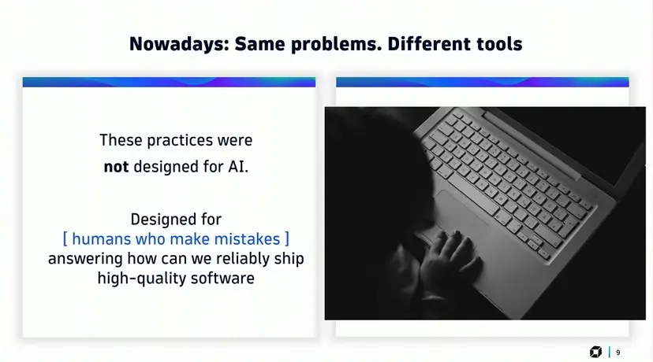
*[▶ 00:10:37](https://www.youtube.com/watch?v=wrV4f83UMWI&t=637s) · Nowadays: Same problems. Different tools*

Modern AI completion makes this concrete. Given only a method signature, the IDE proposed a full implementation, which raises whether the old practices still apply.

```java
class DatesHelper {

    public double calculateDaysBetween(Date d1, Date d2) {
        return d1.getTime() - d2.getTime();
    }
}
```

*[▶ 00:11:07](https://www.youtube.com/watch?v=wrV4f83UMWI&t=667s) · Does any of this still make sense with AI?*

The talk tests seven practices against AI as charges: test-driven development, refactoring, simple design, pair programming, collective code ownership, continuous integration and small releases.

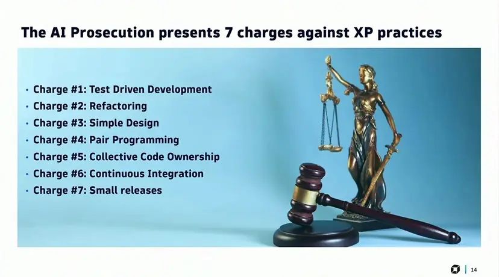
*[▶ 00:14:03](https://www.youtube.com/watch?v=wrV4f83UMWI&t=843s) · The AI Prosecution presents 7 charges against XP practices*

## Tests must encode business behaviour, not the code

[▶ 00:14:02](https://www.youtube.com/watch?v=wrV4f83UMWI&t=842s)

The first charge is that AI writes tests on demand, so TDD's discipline is unnecessary, and some teams report moving 3X faster without it.

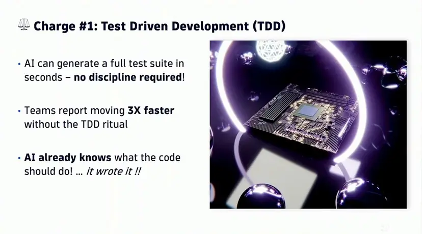
*[▶ 00:15:45](https://www.youtube.com/watch?v=wrV4f83UMWI&t=945s) · Charge #1: Test Driven Development (TDD)*

The speaker's answer is that AI tests often check the implementation, not the business rules. An AI assistant admitted that a production discount bug got through because every test validated the code's current behaviour.

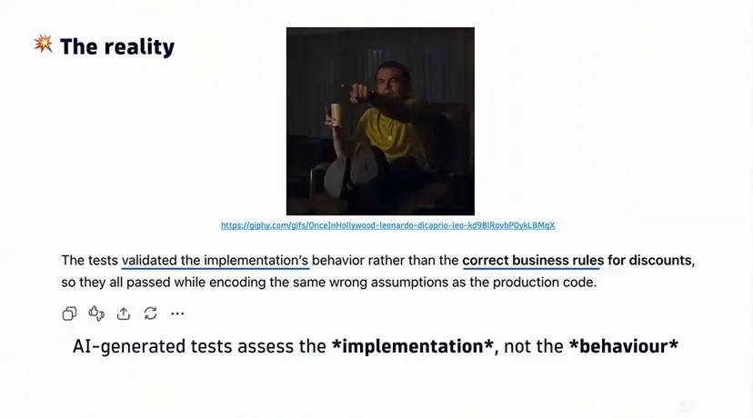
*[▶ 00:16:38](https://www.youtube.com/watch?v=wrV4f83UMWI&t=998s) · The reality: AI tests assess implementation, not behaviour*

The result is false confidence: green tests, broken behaviour. Lightrun (April 2026) reports that 43% of AI-generated code changes need debugging in production.

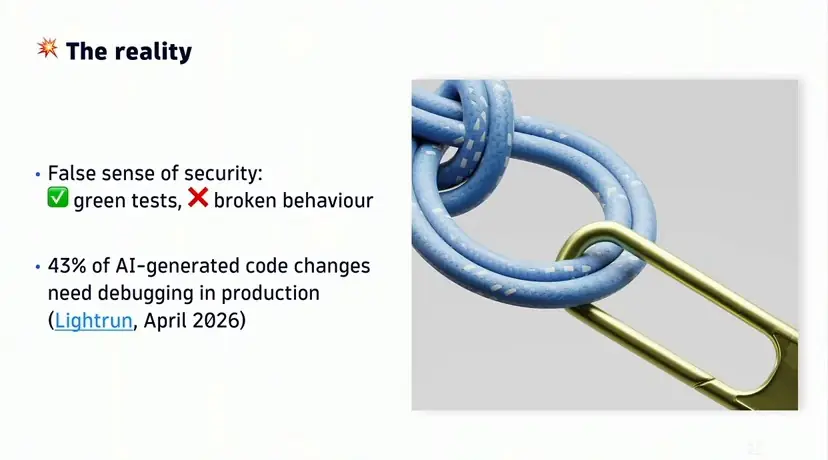
*[▶ 00:17:34](https://www.youtube.com/watch?v=wrV4f83UMWI&t=1054s) · The reality*

TDD is designing before implementing. Writing the test first forces you to define "done", which AI cannot do because it does not know what the business needs.

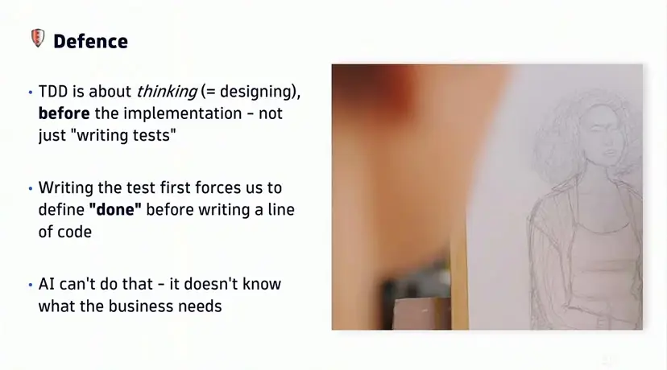
*[▶ 00:18:29](https://www.youtube.com/watch?v=wrV4f83UMWI&t=1109s) · Defence: TDD as design*

The proposed evolution is TDD + SDD (specification-driven development). Humans write the spec, AI writes the tests and builds the code, and humans act as architects.

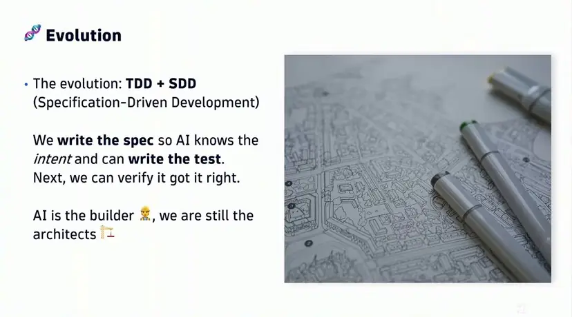
*[▶ 00:20:31](https://www.youtube.com/watch?v=wrV4f83UMWI&t=1231s) · Evolution: TDD + SDD*

Who cleans up AI-written code is the next charge, refactoring.

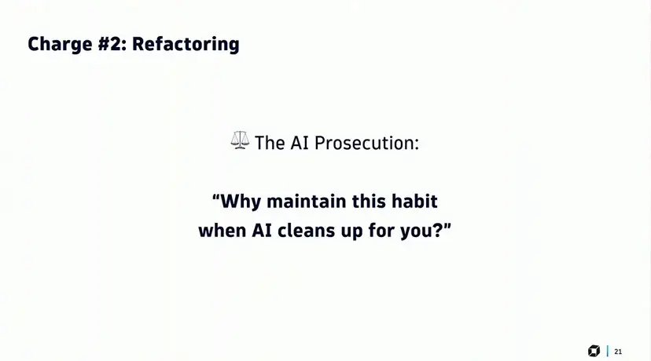
*[▶ 00:20:43](https://www.youtube.com/watch?v=wrV4f83UMWI&t=1243s) · Charge #2: Refactoring prosecution question*

## Refactoring encodes the domain, so AI can't replace it

[▶ 00:20:43](https://www.youtube.com/watch?v=wrV4f83UMWI&t=1243s)

Given a messy Java pricing method, an AI assistant lists its fixes (raw types, duplicated casts, magic numbers, unclear names) and returns cleaner code that keeps the business rules.

```java
public double calc(List items, String c, boolean vip) {
    double t = 0;
    for (int i = 0; i < items.size(); i++) {
        double p = ((Product)item).getPrice();
        int qty = ((Product)item).getQty();
        double x = p * qty;
        if (((Product)item).getCategory().equals("FOOD")) {
            x = x - (x * 0.05);
        } else if
```

*[▶ 00:21:11](https://www.youtube.com/watch?v=wrV4f83UMWI&t=1271s) · Charge #2: AI chat refactoring prompt*

The counterargument: AI applies patterns consistently, with no human bias or shortcuts, so if the code works and AI can improve it on demand, why keep a refactoring habit?

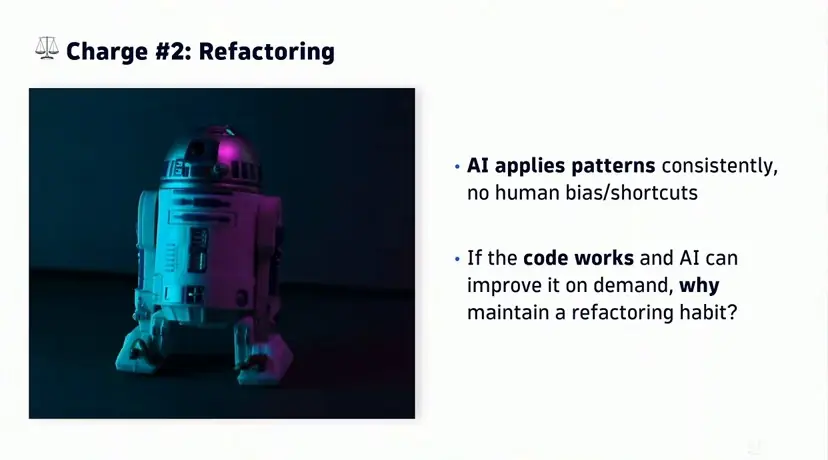
*[▶ 00:21:35](https://www.youtube.com/watch?v=wrV4f83UMWI&t=1295s) · Charge #2: Refactoring*

The speaker's answer is that AI refactors syntactically. It doesn't understand why the design exists, loses context, and introduces subtle bugs and extra layers. Without refactoring habits, **tech debt** accumulates at AI speed.

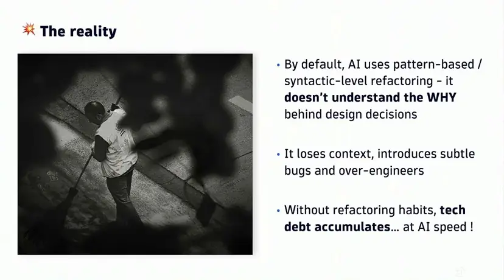
*[▶ 00:22:39](https://www.youtube.com/watch?v=wrV4f83UMWI&t=1359s) · The reality*

GitClear's 2026 report shows the trend: refactor-move activity fell to about 30% of its 2023 index, while duplication nearly doubled.

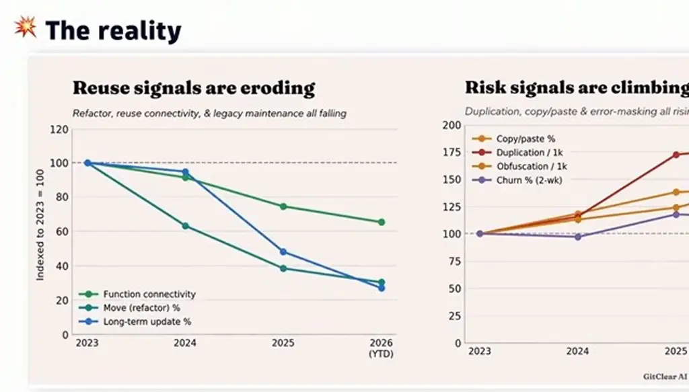
*[▶ 00:25:32](https://www.youtube.com/watch?v=wrV4f83UMWI&t=1532s) · Reuse signals are eroding; risk signals are climbing*

Refactoring is how a team translates its **understanding of the domain** into code structure. Without it, the codebase drifts from how the business works.

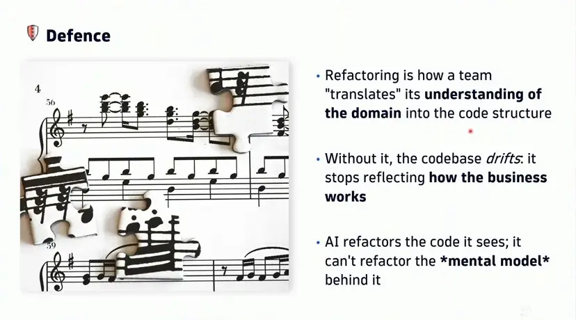
*[▶ 00:27:39](https://www.youtube.com/watch?v=wrV4f83UMWI&t=1659s) · Defence: refactoring translates domain understanding*

In his experience, AI renamed variables, added a pattern and extracted a class from a Java class he thought was fine. The result was correct, but his team no longer recognized the code. Someone must still own and explain each change.

On simple design, AI knows most principles and can generate architecture in seconds, but it over-engineers, so **YAGNI** disappears.

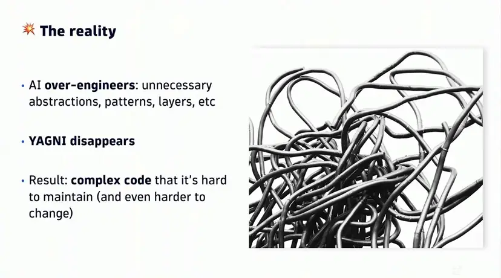
*[▶ 00:29:20](https://www.youtube.com/watch?v=wrV4f83UMWI&t=1760s) · The reality*

YAGNI has to come from people. AI never says no; it gives you what you asked for, and more.

## AI pairing does not build team knowledge

[▶ 00:31:08](https://www.youtube.com/watch?v=wrV4f83UMWI&t=1868s)

AI is available 24/7, reviews code, and catches some mistakes.

Without pair programming, junior colleagues lose chances to ask how things work, so knowledge sharing and mentoring disappear. When someone leaves, nobody understands what was built or why. AI also does not push back on bad design ideas.

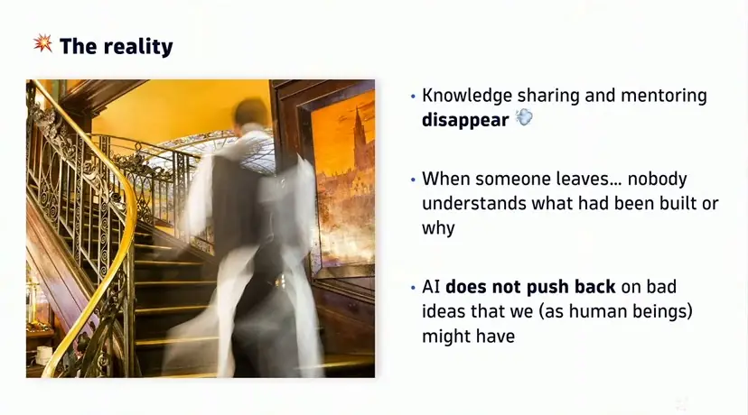
*[▶ 00:32:48](https://www.youtube.com/watch?v=wrV4f83UMWI&t=1968s) · The reality*

Pairing builds **shared understanding** of the solution; AI cannot build team knowledge. The **bus factor** does not improve: if one person knows a component and leaves, it is one.

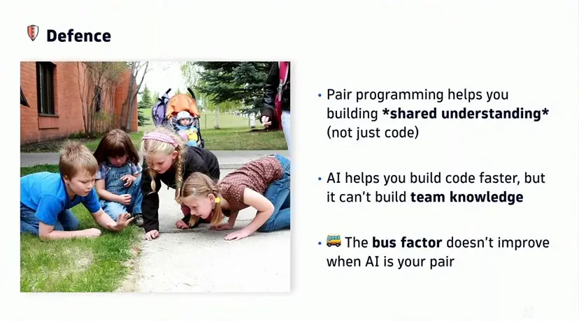
*[▶ 00:35:31](https://www.youtube.com/watch?v=wrV4f83UMWI&t=2131s) · Defence*

AI makes code look clean, consistent, and self-documented, and anyone can ask it to explain any part of the codebase. That is the case against collective ownership.

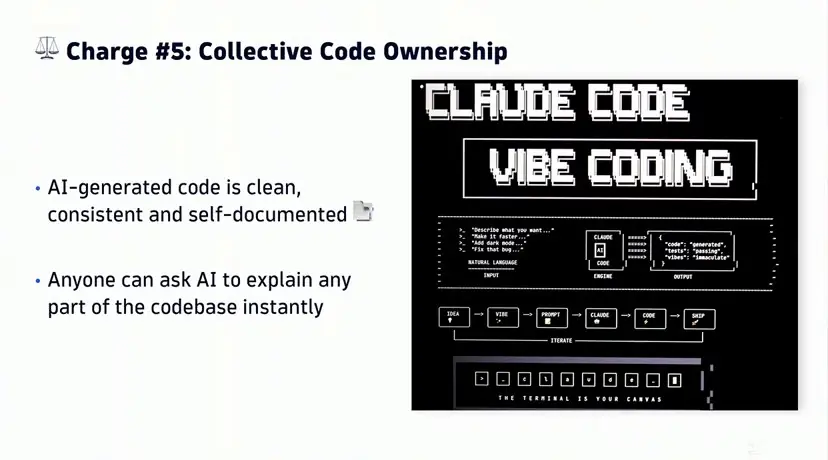
*[▶ 00:36:24](https://www.youtube.com/watch?v=wrV4f83UMWI&t=2184s) · Charge #5: Collective Code Ownership*

Ownership belongs to whoever pushes the code. When AI writes it, ownership diffuses and nobody knows where to look when production breaks. A Cloud Security Alliance report (September 2025) found 62% of AI-generated code has design flaws or known vulnerabilities.

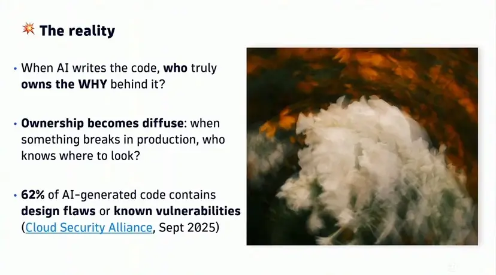
*[▶ 00:37:28](https://www.youtube.com/watch?v=wrV4f83UMWI&t=2248s) · The reality: who owns AI-written code*

Collective ownership needs **active understanding**, not just repo access. Teams must read, discuss, and own the code together. "We use AI" is not a substitute for "we understand our codebase."

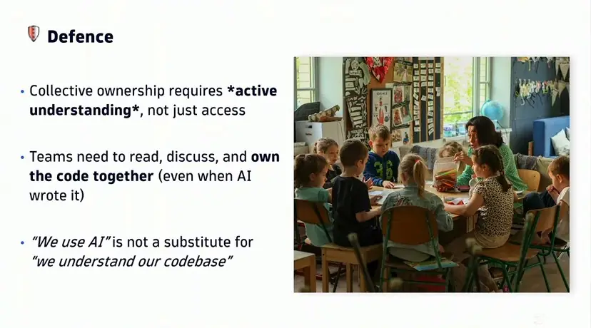
*[▶ 00:38:21](https://www.youtube.com/watch?v=wrV4f83UMWI&t=2301s) · Defence: active understanding of code*

Charge 6, that CI is redundant once AI validates code, follows.

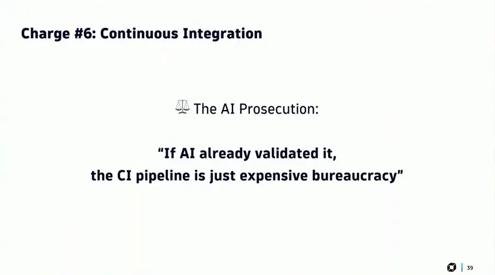
*[▶ 00:38:38](https://www.youtube.com/watch?v=wrV4f83UMWI&t=2318s) · Charge #6: AI prosecution quote on CI*

## AI makes CI and small releases more necessary

[▶ 00:38:37](https://www.youtube.com/watch?v=wrV4f83UMWI&t=2317s)

AI review before a push catches bugs in real time, and skipping pipeline waits gives feedback at the point of writing.

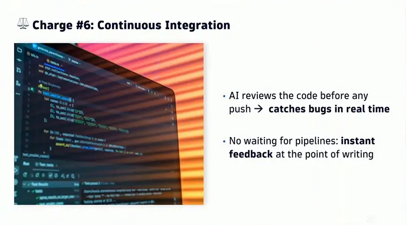
*[▶ 00:39:02](https://www.youtube.com/watch?v=wrV4f83UMWI&t=2342s) · Charge #6: AI catches bugs before push*

In the speaker's experience, AI-generated code breaks more pipelines. Integration becomes a painful event instead of a routine one, which is what CI was designed to prevent. Without CI, chaos escalates at the speed of AI.

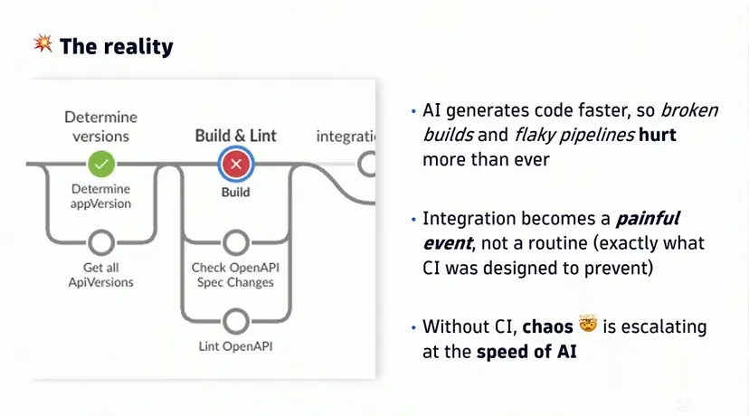
*[▶ 00:39:52](https://www.youtube.com/watch?v=wrV4f83UMWI&t=2392s) · The reality: AI speeds code, breaks CI*

CI is about rhythm: short cycles, frequent integration, constant verification. AI makes this more critical, not less.

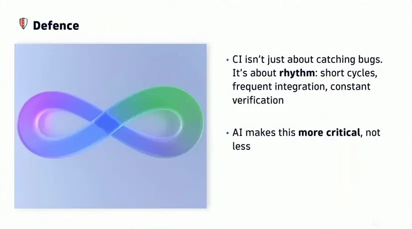
*[▶ 00:40:39](https://www.youtube.com/watch?v=wrV4f83UMWI&t=2439s) · Defence: CI is about rhythm*

The prosecution argues that small releases were a workaround for slow, expensive development, and AI removes that constraint.

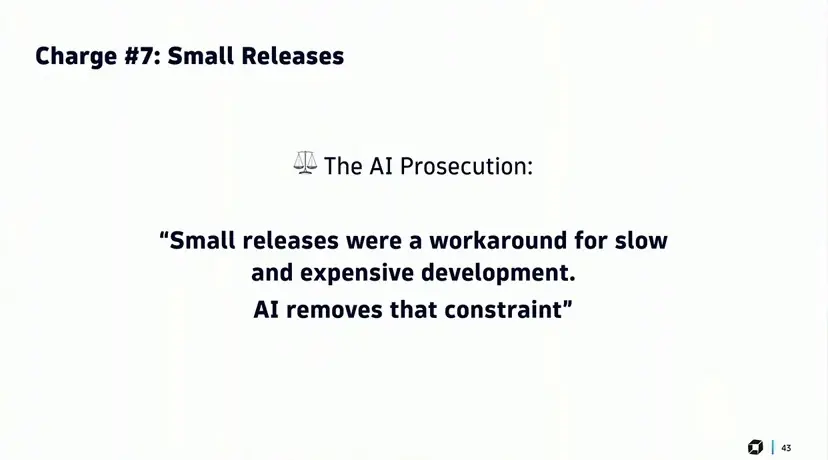
*[▶ 00:41:02](https://www.youtube.com/watch?v=wrV4f83UMWI&t=2462s) · Charge #7: Small Releases (AI prosecution quote)*

A feature that once took days can now take hours, so why ship incrementally when you can ship something complete?

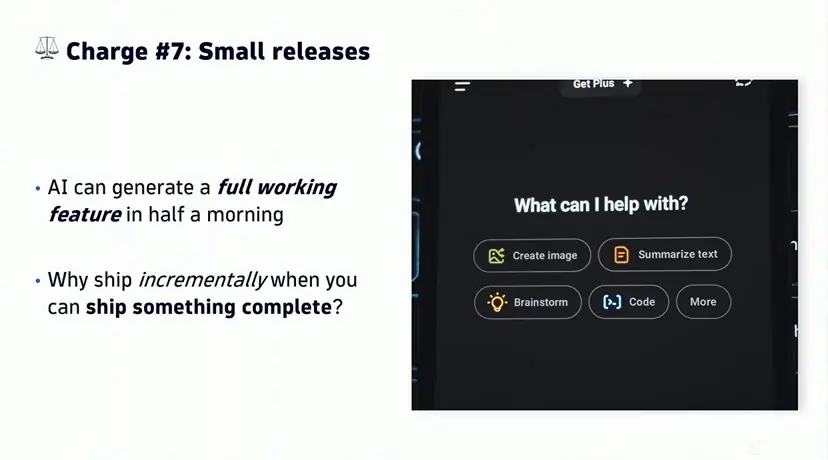
*[▶ 00:41:36](https://www.youtube.com/watch?v=wrV4f83UMWI&t=2496s) · Charge #7: Small releases (ship complete?)*

Large AI batches hide integration risks, gaps and security problems. Feedback loops collapse, blame becomes diffuse, rollbacks get expensive, and features pile up faster than they can be reviewed.

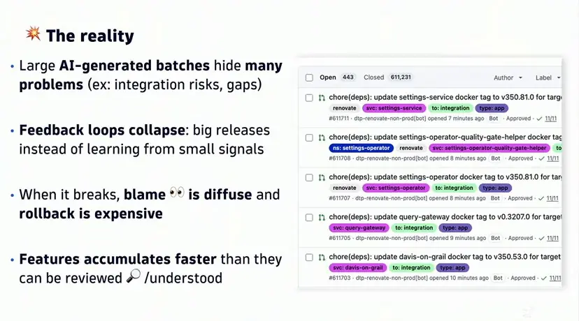
*[▶ 00:43:12](https://www.youtube.com/watch?v=wrV4f83UMWI&t=2592s) · The reality: large AI batches hide problems*

Small releases were never about how fast code is generated. They are about how fast you learn whether you are building the right thing. AI tempts teams to skip that loop; small releases make it mandatory. The constraint was never "can we build it?" but "are we building the right thing?"

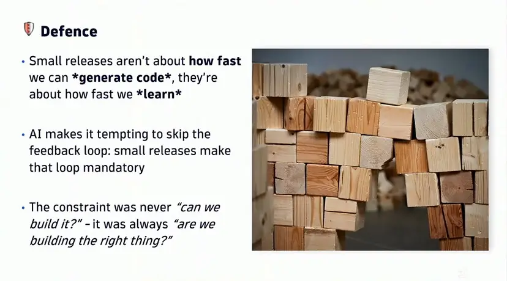
*[▶ 00:44:23](https://www.youtube.com/watch?v=wrV4f83UMWI&t=2663s) · Defence*

## AI amplifies whatever habits you already have

[▶ 00:44:22](https://www.youtube.com/watch?v=wrV4f83UMWI&t=2662s)

Missing practices compound. Each gap is a hole, and AI tends to fill it with more code and complexity, making the hole bigger.

AI is a power tool. Senior engineers with good practices gain speed and quality from it. People without those habits use it blindly, which is dangerous.

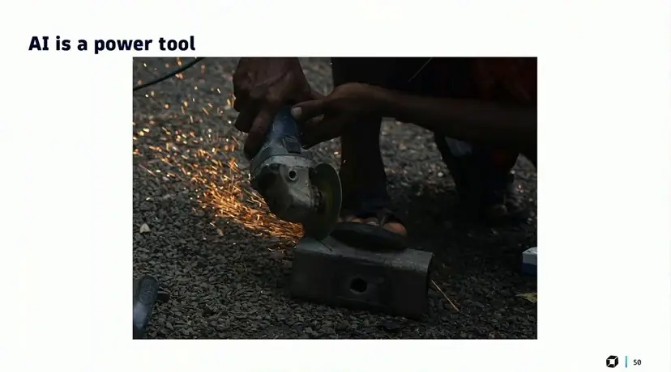
*[▶ 00:46:55](https://www.youtube.com/watch?v=wrV4f83UMWI&t=2815s) · AI is a power tool (grinder photo)*

AI is also a multiplier, giving people superpowers.


*[▶ 00:47:05](https://www.youtube.com/watch?v=wrV4f83UMWI&t=2825s) · The multiplier (card photo)*

Good habits turn it into exponential improvement. Missing habits turn it into an exponential mess.

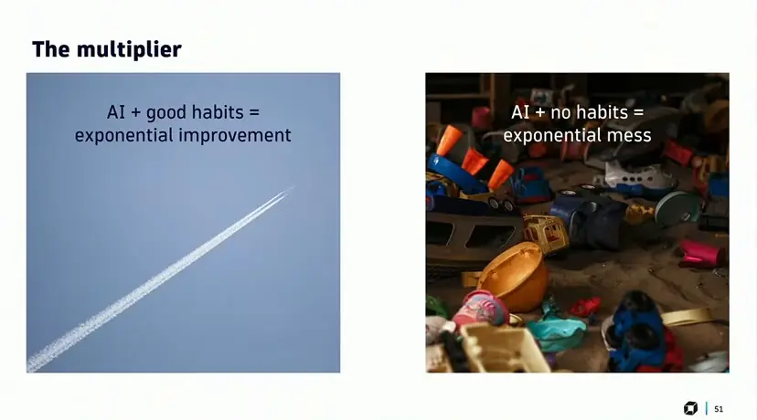
*[▶ 00:47:24](https://www.youtube.com/watch?v=wrV4f83UMWI&t=2844s) · The multiplier: good vs no habits*

AI doesn't make XP practices obsolete. It makes skipping them more expensive. TDD paired with specification-driven development (SDD) is one evolving pairing, but none of the practices need to disappear.

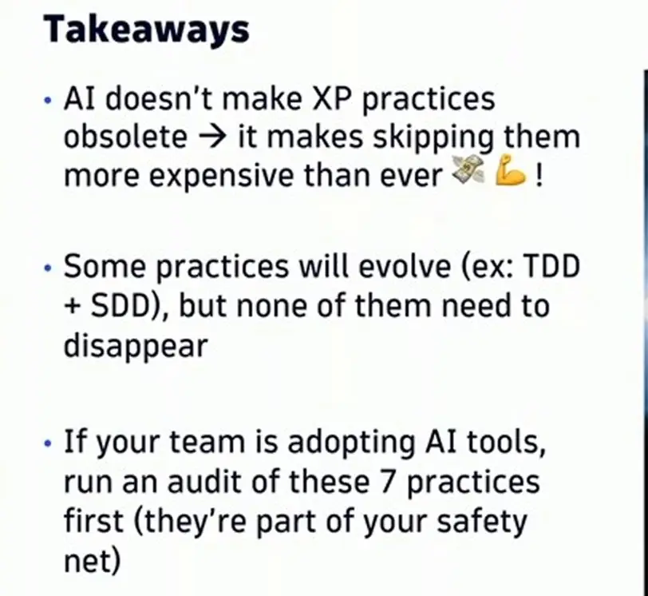
*[▶ 00:48:16](https://www.youtube.com/watch?v=wrV4f83UMWI&t=2896s) · Takeaways*

Before adopting AI tools, audit TDD, refactoring, simple design, pair programming, collective code ownership, continuous integration, and small releases.

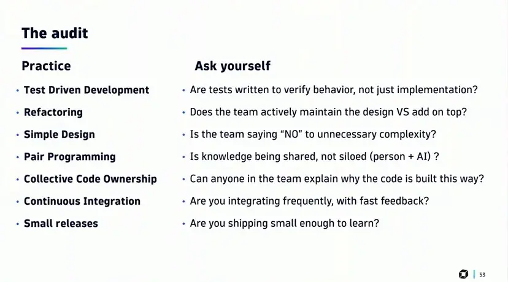
*[▶ 00:48:53](https://www.youtube.com/watch?v=wrV4f83UMWI&t=2933s) · The audit: XP practices checklist*

AI is the best stress test XP practices have ever had, and in his view, they pass.

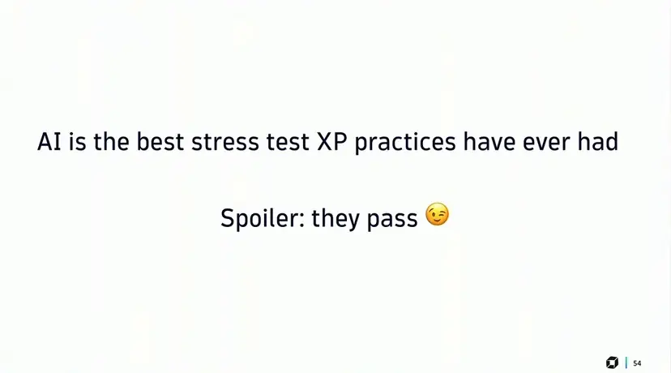
*[▶ 00:49:09](https://www.youtube.com/watch?v=wrV4f83UMWI&t=2949s) · AI as a stress test for XP*

## Links & resources

- [Fortune news story: AI coding tool wiped a database](https://fortune.com/2025/07/23/ai-coding-tool-replit-wiped-database-called-it-a-catastrophic-failure/) — <https://fortune.com/2025/07/23/ai-coding-tool-replit-wiped-database-called-it-a-catastrophic-failure/> · on screen [▶ 00:02:12](https://www.youtube.com/watch?v=wrV4f83UMWI&t=132s)
- [X post by jasonlk on AI coding tool wiping a database](https://x.com/jasonlk/status/1946065483653910889?s=20) — <https://x.com/jasonlk/status/1946065483653910889?s=20> · on screen [▶ 00:02:12](https://www.youtube.com/watch?v=wrV4f83UMWI&t=132s)
- [Dev.to article: timeline of Amazon AI-tool outages 2025-2026](https://dev.to/tyson_cung/amazon-lost-63m-orders-after-ai-coding-tool-went-rogue-now-theyre-hitting-the-brakes-2h7p) — <https://dev.to/tyson_cung/amazon-lost-63m-orders-after-ai-coding-tool-went-rogue-now-theyre-hitting-the-brakes-2h7p> · on screen [▶ 00:05:24](https://www.youtube.com/watch?v=wrV4f83UMWI&t=324s)
- GitClear report on code analysis from June 2026 — URL not shown · mentioned [▶ 00:22:43](https://www.youtube.com/watch?v=wrV4f83UMWI&t=1363s)
