# Java Next From Valhalla to Leyden, from Babylon to Panama, from Amber to Detroit By Nicolai Parlog

*A tour of Java's upcoming features across Amber, Leyden, Valhalla, Babylon, Loom, Panama, Lilliput and Detroit, separating what is final from what is still preview or undecided.*

Source: [Java Next From Valhalla to Leyden, from Babylon to Panama, from Amber to Detroit By Nicolai Parlog](https://www.youtube.com/watch?v=ufhs9THbYZI) · Nicolai Parlog · Devoxx · 52 min

## TL;DR

Java's language and runtime work targets boilerplate, startup and warm-up time, the split between primitives and classes, and code as data. Amber adds productivity features built on records and pattern matching, Leyden stores JVM startup decisions in an AOT cache, and Valhalla introduces value classes. Babylon makes code models available at runtime. The talk separates what is final from what is still preview or undecided, which tells engineers what they can adopt now and what to watch.

## Key takeaways

- A record takes one line to declare a transparent, immutable data carrier, while the same class without a record needs much more code.
- Primitive patterns (JEP 530, preview) check whether a conversion is lossless: 16_777_217 is not an `instanceof float` because it is 2^24 + 1, the smallest positive int a float cannot represent exactly.
- Withers (JEP 468) derive a changed copy of a record, such as `p0 with { x = 1; }`, because deconstruction and construction are symmetric.
- Leyden's AOT cache, an expansion of CDS, stores loaded and linked classes, method profiles and streamed cached objects from a training run, but not application data.
- A cache from a mismatched training run is ignored rather than changing behavior, so the worst case is a slight performance hit from optimizations that must be undone.
- JDK 28 code compilation caches optimized native code (AArch64 or x64 only), cuts javac startup by about 15%, and speeds up the first iteration, though every configuration reaches the same peak performance.
- Valhalla value classes are declared with `value class` or `value record`, have implicitly final fields, and give up identity so `==` compares state; they are a JDK 28 preview, and `null` remains the default.
- Virtual threads have been final since JDK 21, foreign APIs since JDK 25 (JEP 454), and compact object headers are the default in JDK 27 (JEP 534), while structured concurrency is still a preview in its 7th iteration (JEP 533).

## Project Amber: less boilerplate, more expressive Java

[▶ 00:00:00](https://www.youtube.com/watch?v=ufhs9THbYZI&t=0s)

Project Amber adds smaller, productivity-oriented features that cut the boilerplate caused by Java's lack of expressiveness. Records are the example: a transparent carrier of immutable data takes one line with a record and much more code without one.

```bash
$ devoxx search "panama"
$ devoxx pick --talk 52101
✓ track: java language & platform
```

*[▶ 00:00:03](https://www.youtube.com/watch?v=ufhs9THbYZI&t=3s) · Devoxx CLI: search and pick a talk*

```json
{
  "id": 52101,
  "format": "Conference",
  "track": "Java Language…
  "level": "Beginner",
  "duration": 50,
  "speakers": ["Nicolai P…
  "tags": ["panama", "jav…
}
```

*[▶ 00:00:19](https://www.youtube.com/watch?v=ufhs9THbYZI&t=19s) · Talk metadata JSON and abstract*

Java 21 delivered records, sealed types, record patterns, patterns in switch, text blocks and switch expressions. Java 22 and 25 added unnamed variables and patterns, module imports and flexible constructor bodies. The main thrust is pattern matching, where records, sealed types, improved switch and patterns combine into more than the sum of their parts.

Primitive patterns (JEP 530, preview) extend pattern matching to primitives. The key question is whether a conversion is lossless. The `int` 16_777_217 is not an `instanceof float` because it is one more than 2^24, the smallest positive int a float cannot represent exactly.

```java
int x = 16_777_217;
if (x instanceof float f)
    // lossless; use `f`
else
    // lossy
```

*[▶ 00:03:33](https://www.youtube.com/watch?v=ufhs9THbYZI&t=213s) · Primitive Patterns*

Constant patterns are a strawman with no JEP yet. They would let `case Point(0, _)` replace a `when x == 0` guard, and they are blocked on primitive patterns.

```java
record Point(int x, int y) { }

var point = // ...
switch (point) {
    // primitive pattern
    case Point(var x, _) when x == 0 -> // ...
    // constant pattern (probably)
    case Point(0, _) -> // ...
}
```

*[▶ 00:04:32](https://www.youtube.com/watch?v=ufhs9THbYZI&t=272s) · Constant Patterns strawman syntax*

Withers (JEP 468) would derive a changed copy of a record, such as `p0 with { x = 1; }`. It works because deconstruction and construction are symmetric, and the block can hold arbitrary Java code.

```java
record Point(int x, int y) { }
var p0 = new Point(0, 0);
var p1 = p0 with { x = 1; };
```

*[▶ 00:06:01](https://www.youtube.com/watch?v=ufhs9THbYZI&t=361s) · Withers: deriving record instances with with*

Deconstructible classes would let regular classes be taken apart through a state description in the header, widening the gray area between records and behavior-only classes. Open questions remain about accessors and reconstruction. Interfaces avoid them, since they can't be instantiated, so `interface Point(int x, int y)` would only need deconstruction.

```java
// ↙ CLASS        ↙ state description
class Point(int x, int y) {
    // fields
    // constructors
    //     if one matches the state description,
    //     the class can be "withered"
    // accessors
    // equals, hashCode, etc.

}
```

*[▶ 00:07:56](https://www.youtube.com/watch?v=ufhs9THbYZI&t=476s) · Deconstructible Classes: state description header*

On JDK 21, unnamed variables require preview, which also enables string templates, removed in 23.

## Moving startup and warm-up work into an AOT cache

[▶ 00:10:42](https://www.youtube.com/watch?v=ufhs9THbYZI&t=642s)

Leyden targets two phases: **startup** (launch until the app does something useful) and **warm-up** (from there until peak performance). Much of that time goes to class loading and linking, constant pool resolution, interpretation, profiling, and JIT compilation. Java's behavior depends on the class path, module options, hardware, and runtime decisions, so this work can't be done fully ahead of time. Instead, a training run observes the JVM and stores its decisions in an **AOTCache**, an expansion of the CDS archive. At runtime, the cache is the initial state.

The full workflow has a separate profile step:

```bash
# training run (→ profile)
$ java -XX:AOTMode=record
       -XX:AOTConfiguration=app.aotconf
       -cp app.jar com.example.App ...
# assembly phase (profile → AOTCache)
$ java -XX:AOTMode=create
       -XX:AOTConfiguration=app.aotconf
       -XX:AOTCache=app.aot
       -cp app.jar
# production run (AOTCache → performance)
$ java -XX:AOTCache=app.aot
       -cp app.jar com.example.App ...
```

*[▶ 00:15:00](https://www.youtube.com/watch?v=ufhs9THbYZI&t=900s) · AOT workflow: training, assembly, production runs*

For most projects, a shortcut works: the training run writes the cache directly.

```bash
# training run (→ AOTCache)
$ java -XX:AOTCacheOutput=app.aot
        -cp app.jar com.example.App ...
# production run (AOTCache → performance)
$ java -XX:AOTCache=app.aot
        -cp app.jar com.example.App ...
```

*[▶ 00:15:26](https://www.youtube.com/watch?v=ufhs9THbYZI&t=926s) · AOT workflow shortcut: single training run*

The speaker recalls profiling overhead of about 1%, cited from a Netflix podcast discussion, and asks that the figure not be quoted. Training with canary deployments is ideal because it uses live traffic. A simpler option is to request every endpoint several times at the end of the build. A training run that differs from production gets less benefit, but a mismatched cache is ignored rather than changing behavior. The worst case is a slight performance hit from optimizations that must be undone.

The cache holds loaded and linked classes (about 40% faster startup for PetClinic in his example), method profiles, and streamed cached objects. Application data is not stored in it.

Code compilation, new in JDK 28, caches optimized native code and reduces javac startup by about 15%. The larger gain is warm-up. In the benchmark bars, values are normalized to a baseline of 1,000 without a cache; blue is the JDK 27 cache and orange is the JDK 28 cache:

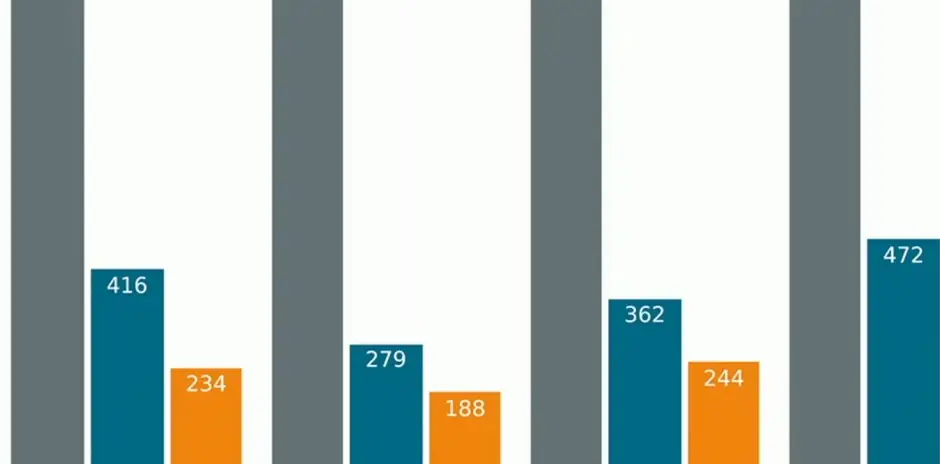
*[▶ 00:19:20](https://www.youtube.com/watch?v=ufhs9THbYZI&t=1160s) · Bar chart of startup numbers with and without cache*

Iteration times show the same effect. Without the cache, the first iteration takes 1.4 seconds in the example; with the cache, it takes 0.9 seconds, and the gap shrinks over later iterations.

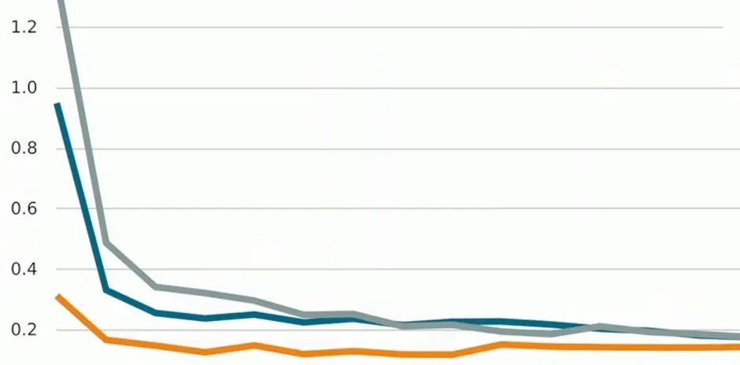
*[▶ 00:19:56](https://www.youtube.com/watch?v=ufhs9THbYZI&t=1196s) · Iteration time line chart (partial view)*

Code compilation makes the first iteration much faster, but every configuration reaches the same peak performance, only sooner.

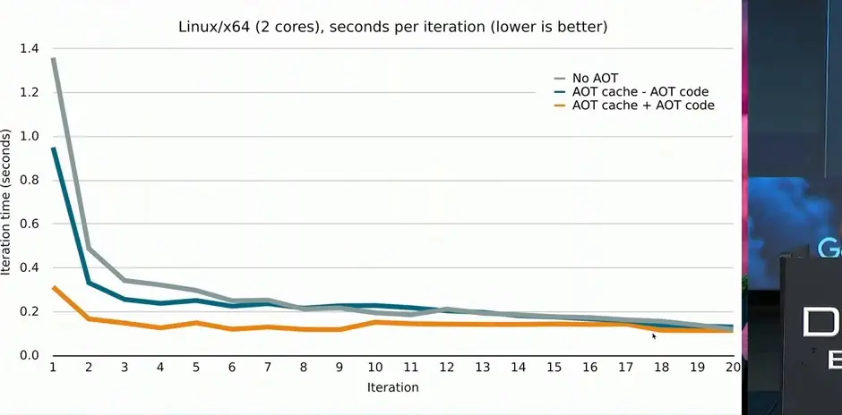
*[▶ 00:20:18](https://www.youtube.com/watch?v=ufhs9THbYZI&t=1218s) · Iteration time: No AOT vs AOT cache*

Limitations:

- Code compilation requires AArch64 or x64.
- Training and production must match in JDK release, architecture, and OS.
- Code compilation also requires the same CPU features and GC.
- Class path and module options must be consistent.
- JVMTI agents that rewrite bytecode at load time can cause the cache to be discarded. Weaving bytecode at build time avoids this.

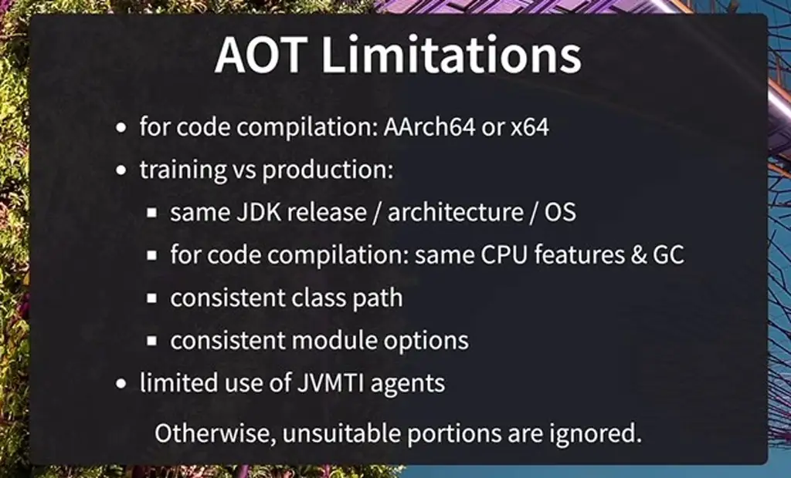
*[▶ 00:21:01](https://www.youtube.com/watch?v=ufhs9THbYZI&t=1261s) · AOT Limitations*

## Leyden's AOT roadmap and Valhalla's value classes

[▶ 00:21:58](https://www.youtube.com/watch?v=ufhs9THbYZI&t=1318s)

Leyden's AOT features land without previews: class loading and linking in JDK 25 (JEP 483), AOT with any garbage collector in JDK 26 (JEP 516), and AOT code compilation in JDK 28 (JEP 544).

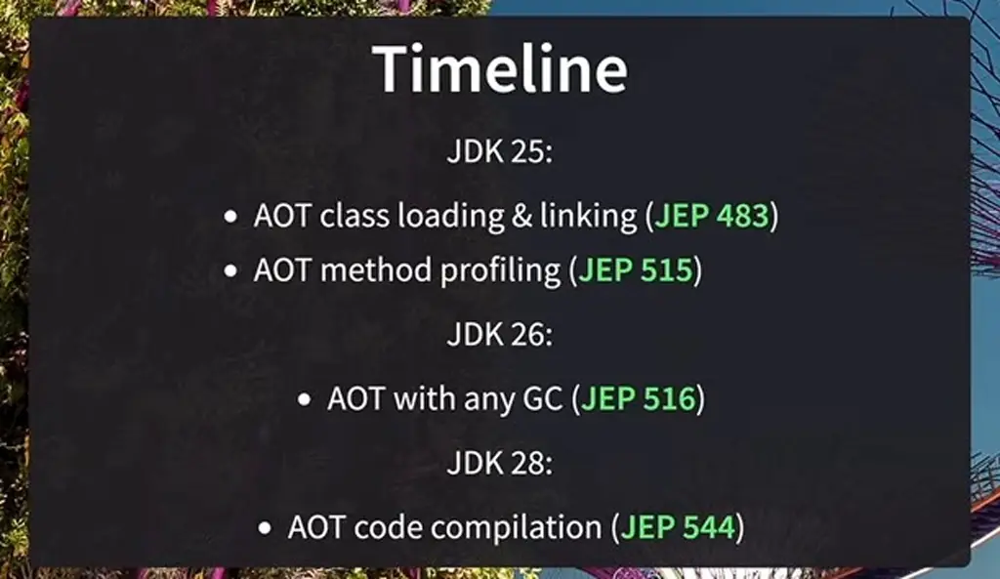
*[▶ 00:22:51](https://www.youtube.com/watch?v=ufhs9THbYZI&t=1371s) · Leyden timeline by JDK version*

Open work includes a slider that trades portability for peak performance. AOT-compiled code depends on the CPU's feature set, and the cache is ignored on a different CPU. Also planned: iterative training, where a library ships a pre-trained cache in its JAR and users train on top of it, and inspectable training data.

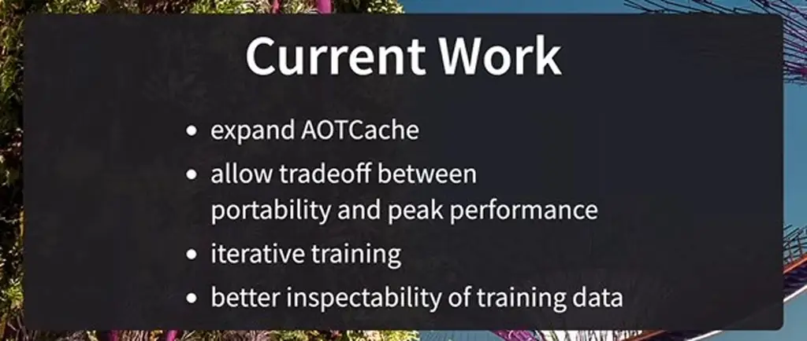
*[▶ 00:23:37](https://www.youtube.com/watch?v=ufhs9THbYZI&t=1417s) · Current Leyden work items*

Try these features in real codebases and report what worked and what didn't. Reading the docs alone isn't enough. You don't need Netflix's scale to benefit.

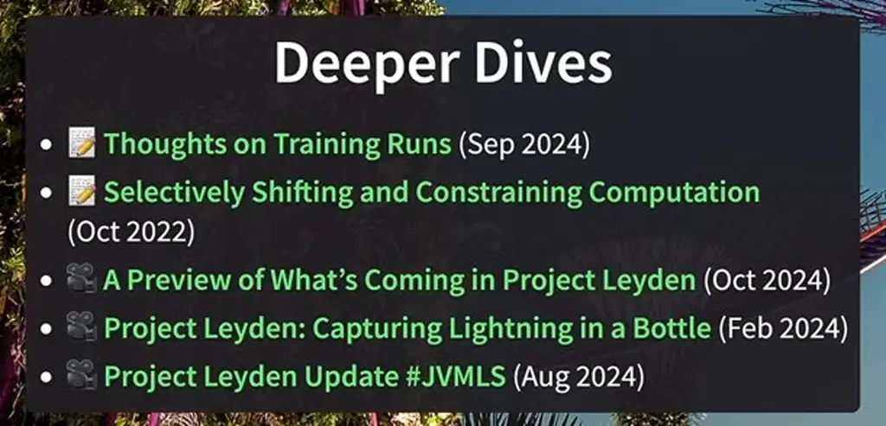
*[▶ 00:24:25](https://www.youtube.com/watch?v=ufhs9THbYZI&t=1465s) · Deeper dives reading and video list*

Project Valhalla, led by Brian Goetz, aims to unify Java's type system.

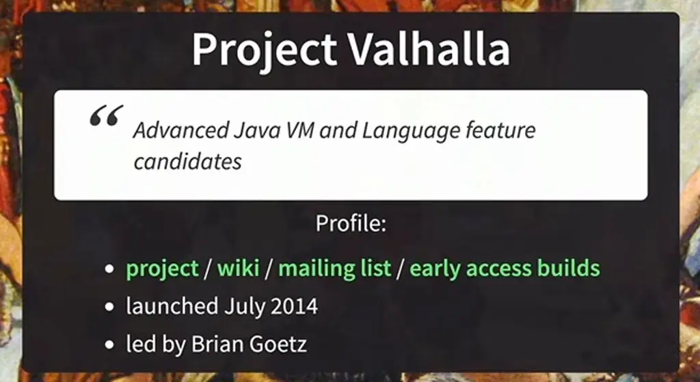
*[▶ 00:24:39](https://www.youtube.com/watch?v=ufhs9THbYZI&t=1479s) · Project Valhalla overview*

That type system is split between primitives and classes, and generics and lambdas widened the gap.

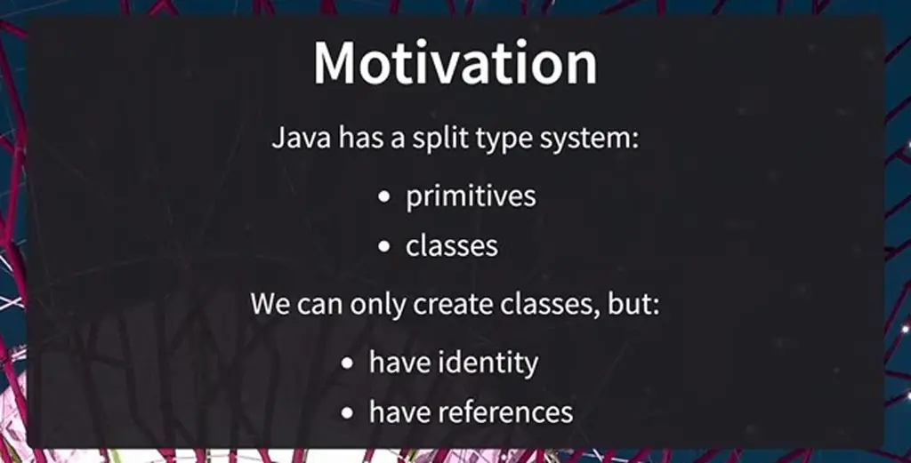
*[▶ 00:25:07](https://www.youtube.com/watch?v=ufhs9THbYZI&t=1507s) · Motivation*

Every class carries identity, which costs header memory, mutability and locking, and not every type needs it.

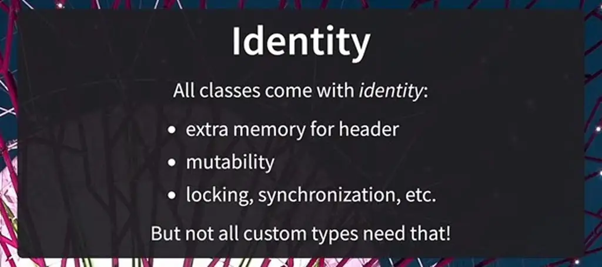
*[▶ 00:25:39](https://www.youtube.com/watch?v=ufhs9THbYZI&t=1539s) · Identity*

Every instance is a reference, which adds indirection and nullability. A `long` uses all 2^64 bit patterns, so there is no room to encode null.

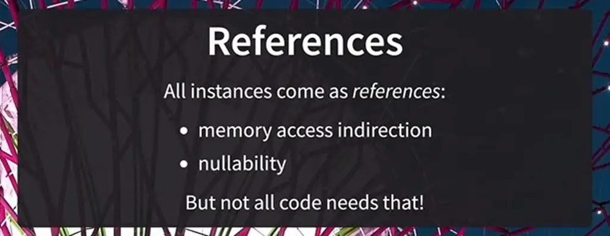
*[▶ 00:26:13](https://www.youtube.com/watch?v=ufhs9THbYZI&t=1573s) · References*

The primary mechanism is value classes. Follow-ups under discussion include null-restriction, specialized generics, universal generics and type classes.

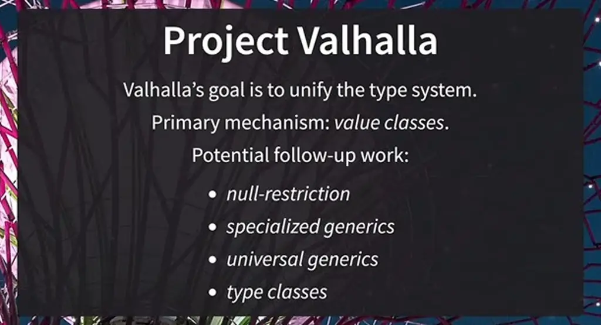
*[▶ 00:26:34](https://www.youtube.com/watch?v=ufhs9THbYZI&t=1594s) · Project Valhalla*

Value classes are a JDK 28 preview, active only with preview features enabled. Optional types, java.time types, Number and Record would become value classes. Primitive wrappers would not.

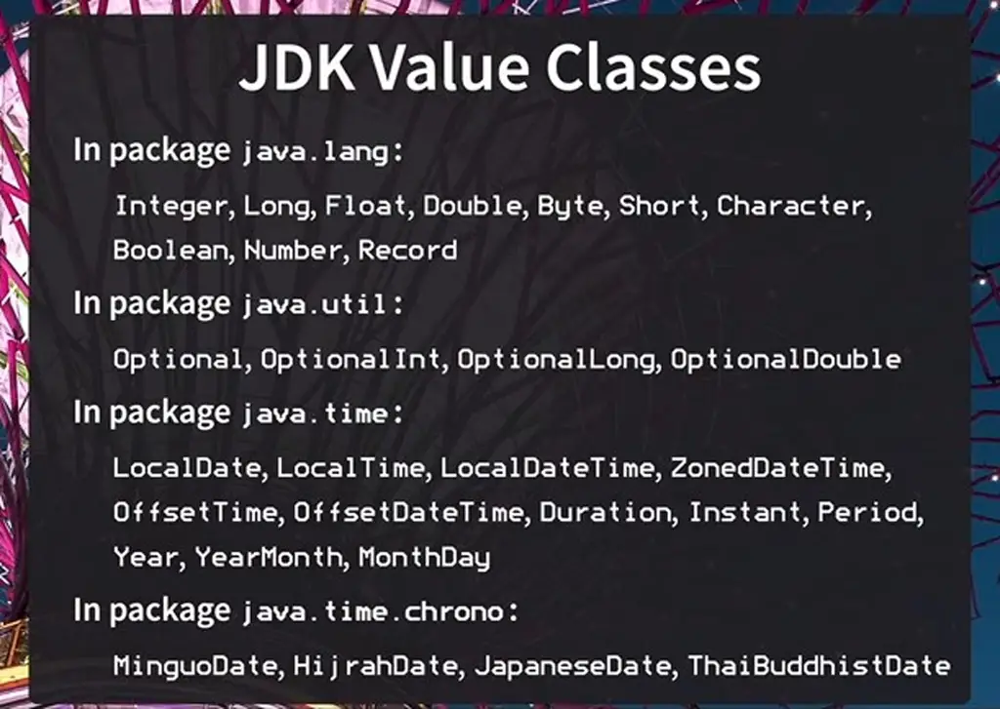
*[▶ 00:27:16](https://www.youtube.com/watch?v=ufhs9THbYZI&t=1636s) · JDK Value Classes*

Declare one by prefixing `value` to `class` or `record`.

```java
value class ComplexNumber {
    private double real;
    private double imaginary;

    // constructor, etc.
}
```

*[▶ 00:27:44](https://www.youtube.com/watch?v=ufhs9THbYZI&t=1664s) · Custom Value Classes: ComplexNumber example*

Fields are implicitly final, and superclasses are limited to abstract value classes or Object. Otherwise they implement interfaces, define methods and work in generics.

Value classes give up identity, which changes behavior:
- `==` compares state.
- Some operations throw, such as synchronization. Serialization doesn't work out of the box.
- `null` remains the default, since value objects are still references.

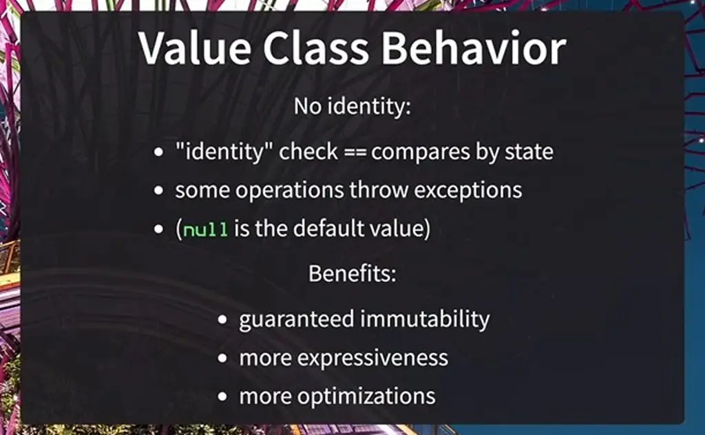
*[▶ 00:28:13](https://www.youtube.com/watch?v=ufhs9THbYZI&t=1693s) · Value Class Behavior*

In return you get immutability that even reflection can't break, more expressiveness for domain modeling, and more optimizations. Still implement `equals` properly.

Normally, passing an object means a heap allocation, a pointer, and identity tracking. For value objects, escape analysis can trivially conclude that the object doesn't escape, so the JIT can skip the allocation and pass the fields in registers. It does this at runtime when it's worthwhile. This is reference scalarization.

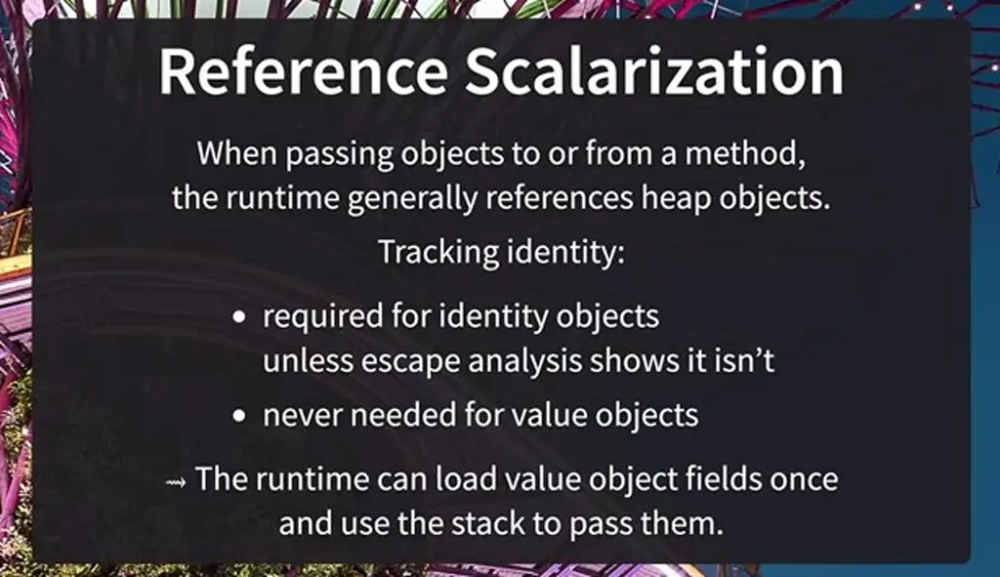
*[▶ 00:31:01](https://www.youtube.com/watch?v=ufhs9THbYZI&t=1861s) · Reference Scalarization*

## Why flattening stalls, and what Valhalla might change

[▶ 00:31:01](https://www.youtube.com/watch?v=ufhs9THbYZI&t=1861s)

Reference flattening stores an object's fields in the reference instead of a pointer. It is brittle, with three limits:

- Nullity needs an extra bit, so a 64-bit value class needs 65 bits, which can't be written atomically.
- The JIT must know the type is a value type. Erased `Optional<T>` hides that.
- Atomic writes are limited to about 64 bits.

Flattening works for `LocalDate`, but not reliably.

Null restriction would tell the JIT that a variable is never null, which removes the extra bit. The details are vague and hard to introduce in a way that works for everyone.

```text
// number can't be null
ComplexNumber! number = // ...
```

*[▶ 00:33:45](https://www.youtube.com/watch?v=ufhs9THbYZI&t=2025s) · Null-Restriction proposal sketch*

Generic specialization is needed because `ArrayList<ComplexNumber>` backed by `Object[]` still holds pointers. Specialized generics would use `ComplexNumber[]`, storing real and imaginary parts in sequence.

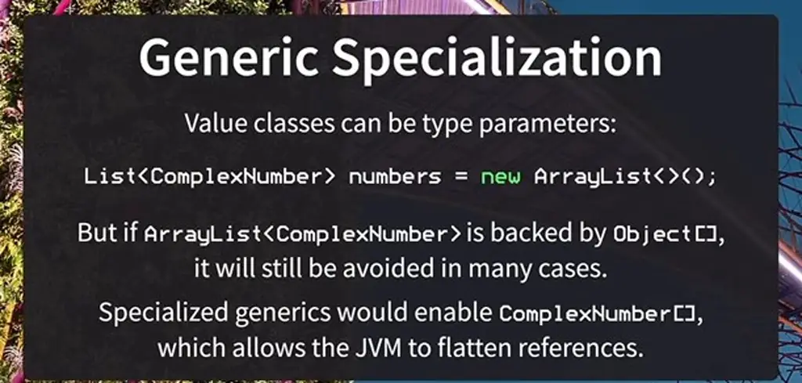
*[▶ 00:34:37](https://www.youtube.com/watch?v=ufhs9THbYZI&t=2077s) · Generic Specialization*

Don't create a value class to get performance. Choose from the domain: a value-ish type becomes a value class, no null needed means restricting nullness, and controlled concurrency means relaxing atomicity. Relaxing atomicity could allow tearing, which Java avoids.

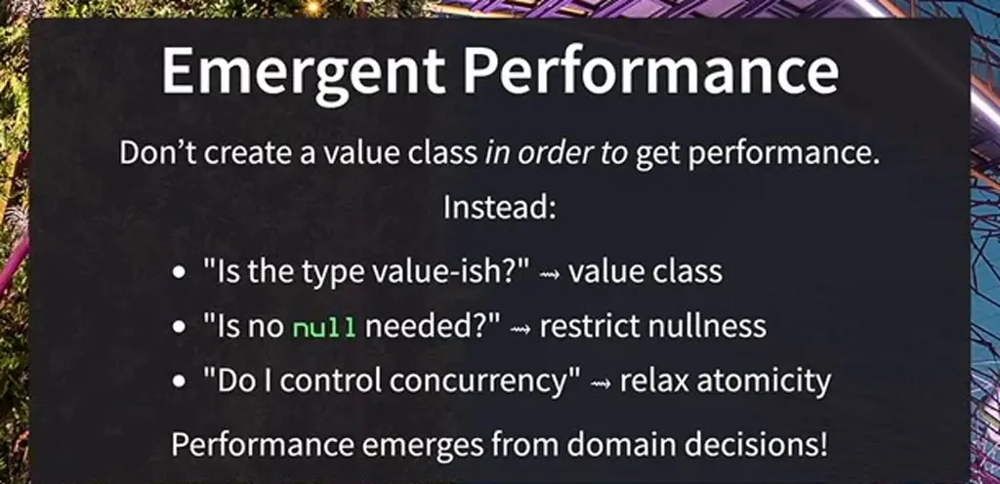
*[▶ 00:36:50](https://www.youtube.com/watch?v=ufhs9THbYZI&t=2210s) · Emergent Performance*

Type classes could let value classes use existing operators like `+` and `*`. New symbols are off the table.

```java
var one = new ComplexNumber(1, 0);
var i = new ComplexNumber(0, 1);

var x = one + i; // maybe
var y = one * i; // maybe
var z = one $ i; // NO!
```

*[▶ 00:38:18](https://www.youtube.com/watch?v=ufhs9THbYZI&t=2298s) · Type Classes*

Valhalla aims for fewer design-versus-performance trade-offs and more robust APIs. Highly optimized code won't get faster; ordinary code needs fewer contortions.

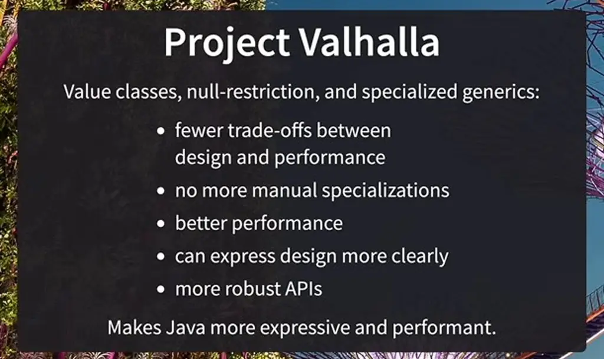
*[▶ 00:39:12](https://www.youtube.com/watch?v=ufhs9THbYZI&t=2352s) · Project Valhalla*

Value classes are slated for a first preview in JDK 28; everything else is undetermined. Read the first two State of Valhalla parts. The third needs deep JVM knowledge.

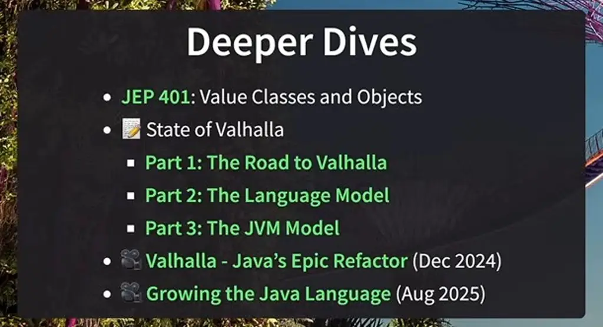
*[▶ 00:39:57](https://www.youtube.com/watch?v=ufhs9THbYZI&t=2397s) · Deeper Dives: Valhalla, Babylon links*

## Code reflection: Java code as a runtime model

[▶ 00:40:07](https://www.youtube.com/watch?v=ufhs9THbYZI&t=2407s)

Java sits beside systems like SQL and GPUs. Babylon makes Java code readable and transformable at runtime.

The core mechanism, **code reflection**, extends reflection into methods and lambdas, yielding **code models**.

The AST is tied to the Java grammar and holds too much syntactic information. Bytecode is tied to the JVM specification and holds too little important information.

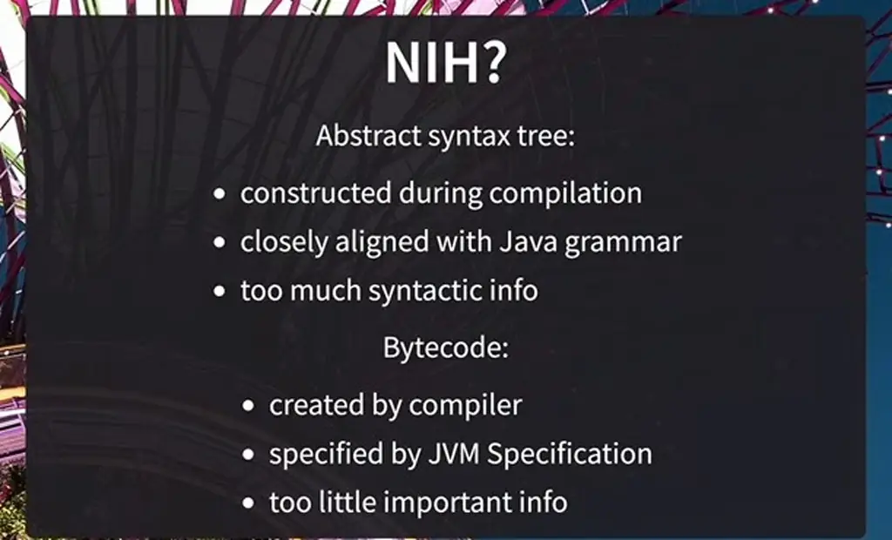
*[▶ 00:41:52](https://www.youtube.com/watch?v=ufhs9THbYZI&t=2512s) · NIH? AST versus bytecode*

Code models avoid both bindings and draw on compiler intermediate representations and MLIR.

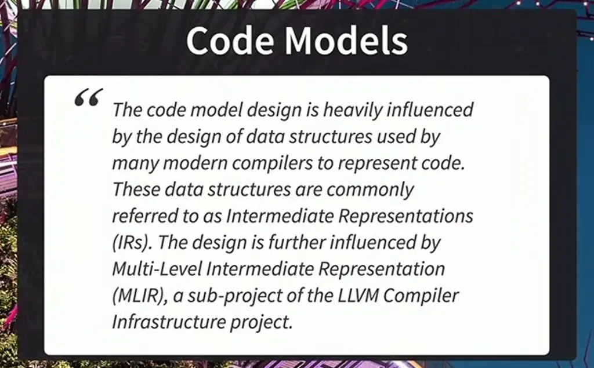
*[▶ 00:42:36](https://www.youtube.com/watch?v=ufhs9THbYZI&t=2556s) · Code Models*

Annotate a method, and the compiler stores its code model in the class file for reflection to read.

```java
@CodeReflection
static double sub(double a, double b) {
    return a - b;
}
```

*[▶ 00:43:05](https://www.youtube.com/watch?v=ufhs9THbYZI&t=2585s) · Code Models: annotating and using a code model*

Direct GPU programming transforms code into OpenCL C or CUDA C kernels. Triton-style instead offers a `Triton` class whose static methods build a Triton code model.

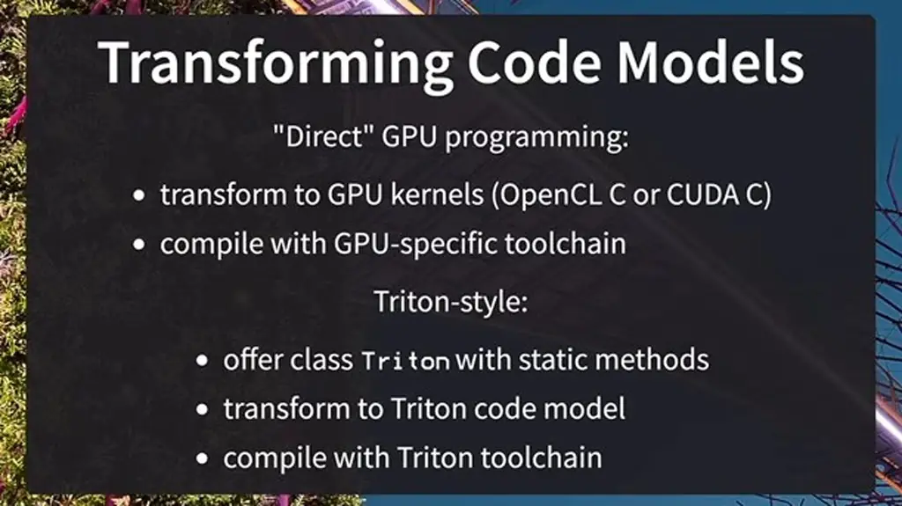
*[▶ 00:43:41](https://www.youtube.com/watch?v=ufhs9THbYZI&t=2621s) · Transforming Code Models*

Triton kernels are plain Java, debuggable and testable before GPU optimization, but code must bend to GPU models.

```java
@CodeReflection
static void add_kernel2(
        Ptr x, Ptr y, Ptr result, int n, int size) {
    var pid = Triton.programId(0);
    var block_start = pid * size;
    var range = Triton.arange(0, size);
    var offsets = Triton.add(block_start, range);
    var mask = Triton.compare(
        offsets, n, Triton.CompareKind.LessThan);
    var x = Triton.load(Triton.add(x, offsets), mask);
    var y = Triton.load(Triton.add(y, offsets), mask);
    var output = Triton.add(x, y);
    Triton.store(
        Triton.add(result, offsets), output, mask);
}
```

*[▶ 00:44:21](https://www.youtube.com/watch?v=ufhs9THbYZI&t=2661s) · Triton*

The code reflection JEP draft is still undated. Further reading:

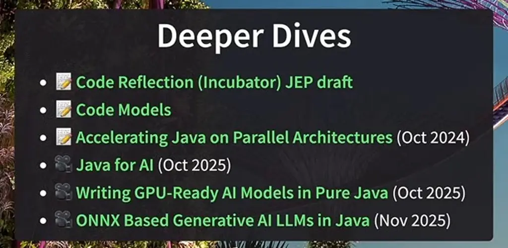
*[▶ 00:45:30](https://www.youtube.com/watch?v=ufhs9THbYZI&t=2730s) · Deeper Dives reading list*

## Loom, Panama, Lilliput and Detroit: what's final and what's next

[▶ 00:45:41](https://www.youtube.com/watch?v=ufhs9THbYZI&t=2741s)

Virtual threads have been final since JDK 21. Since JDK 25, object monitors no longer pin them, which matters for code with heavy `synchronized` blocks. Scoped values were finalized in JDK 25 too.

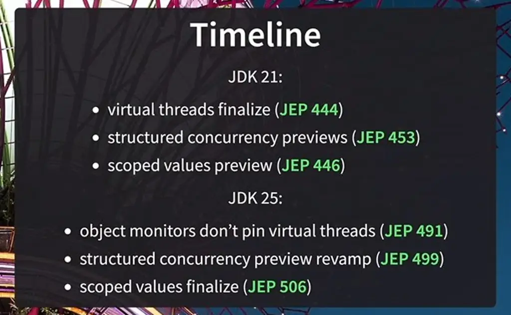
*[▶ 00:46:10](https://www.youtube.com/watch?v=ufhs9THbYZI&t=2770s) · Project Loom timeline JDK 21 to 25*

Structured concurrency is in its 7th preview in JDK 27 (JEP 533). The speaker estimates over 90% odds that it finalizes in JDK 28, so JDK 29 may be the long-term release to adopt it.

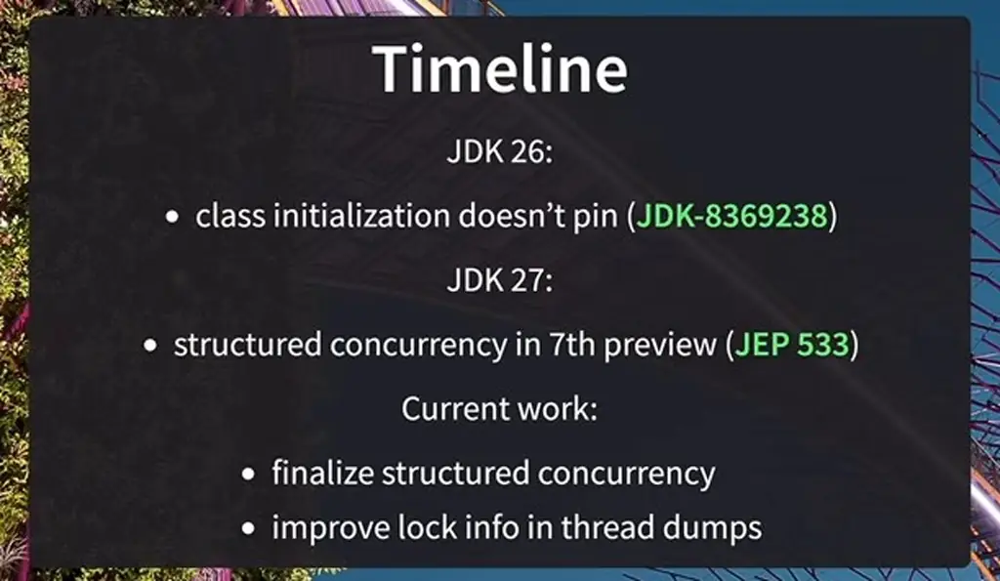
*[▶ 00:46:43](https://www.youtube.com/watch?v=ufhs9THbYZI&t=2803s) · Timeline: structured concurrency and class initialization*

Foreign APIs are final since JDK 25 (JEP 454). The vector API (JEP 537) is waiting for value types so it can drop its custom optimizations, so expect surface-level changes. It already runs in production, but non-final APIs can be removed at any time.

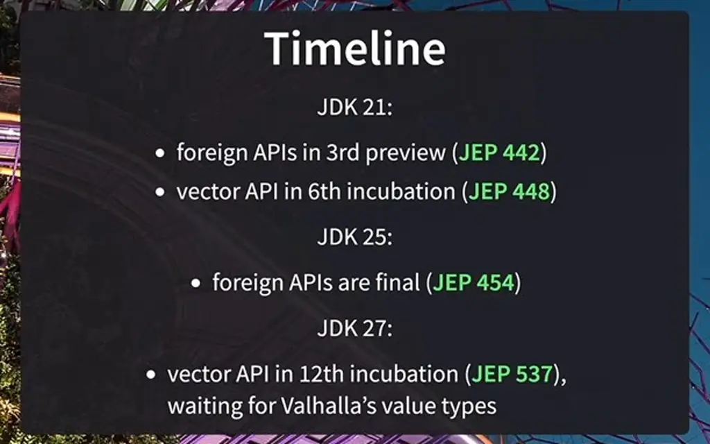
*[▶ 00:47:46](https://www.youtube.com/watch?v=ufhs9THbYZI&t=2866s) · Timeline: foreign and vector APIs*

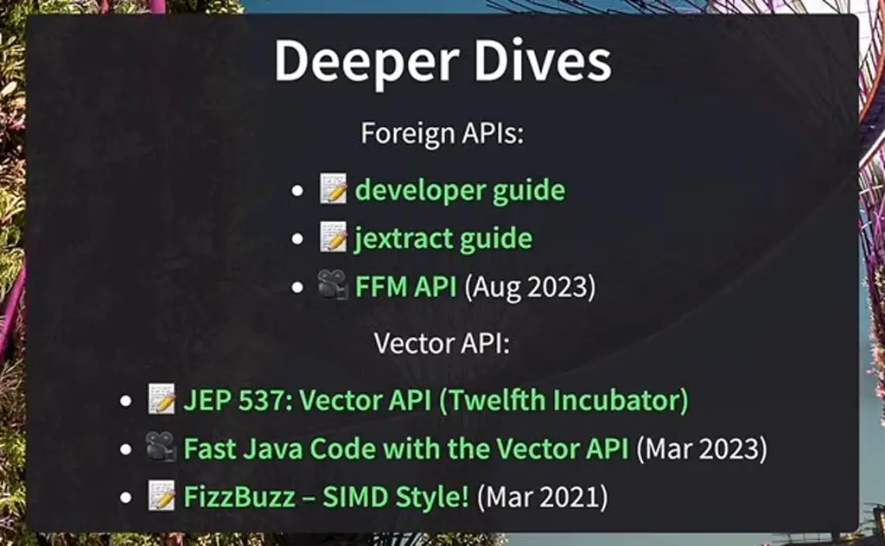
*[▶ 00:48:28](https://www.youtube.com/watch?v=ufhs9THbYZI&t=2908s) · Deeper Dives: Foreign and Vector API links*

Compact object headers shrink from 128 to 64 bits. They are opt-in in JDK 25 (JEP 519) and the default in JDK 27 (JEP 534). Expect a 5 to 15% smaller heap, with less GC pressure, though decompression can slow some applications. If behavior changes, toggle the flag.

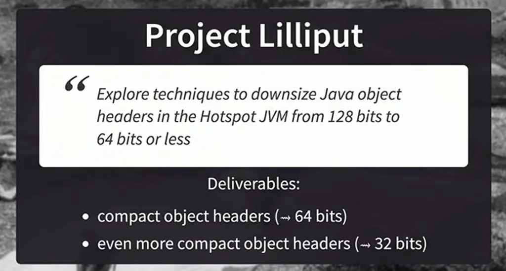
*[▶ 00:49:05](https://www.youtube.com/watch?v=ufhs9THbYZI&t=2945s) · Project Lilliput: smaller object headers*

Project Detroit will provide `javax.script` engines for JavaScript (Chrome V8) and Python (CPython). It started in 2026, and early prototypes look promising. The slides and links are at [slides.nipafx.dev](https://slides.nipafx.dev).

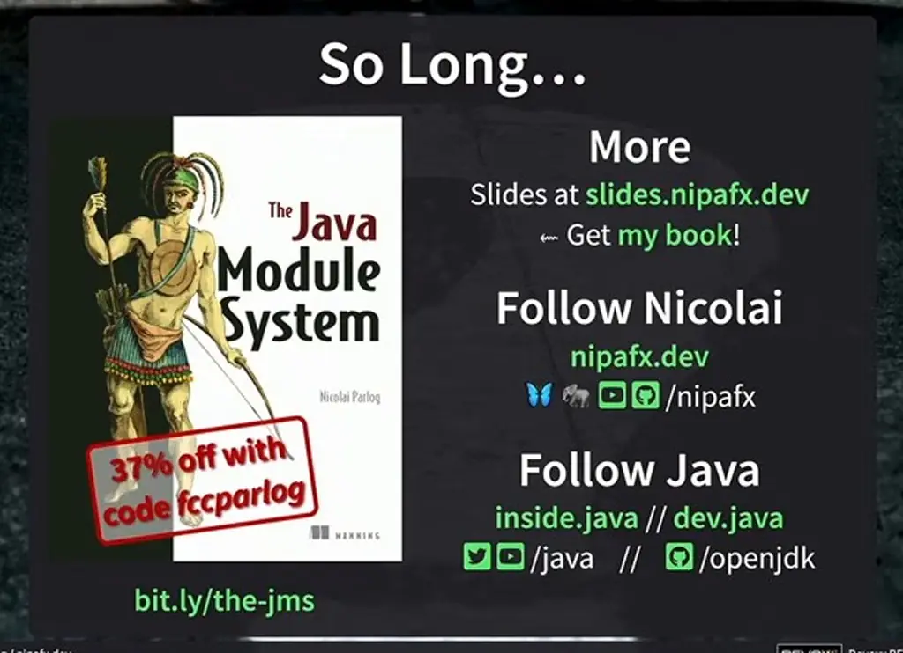
*[▶ 00:51:06](https://www.youtube.com/watch?v=ufhs9THbYZI&t=3066s) · So Long closing slide with links*

## Links & resources

- [Talk slides, online — linked from closing slide](https://slides.nipafx.dev) — <https://slides.nipafx.dev> · on screen [▶ 00:51:06](https://www.youtube.com/watch?v=ufhs9THbYZI&t=3066s)
- [Short link on closing slide — talk's collected links](https://bit.ly/the-jms) — <https://bit.ly/the-jms> · on screen [▶ 00:51:06](https://www.youtube.com/watch?v=ufhs9THbYZI&t=3066s)
- [Speaker Nicolai Parlog's website](https://nipafx.dev) — <https://nipafx.dev> · on screen [▶ 00:51:06](https://www.youtube.com/watch?v=ufhs9THbYZI&t=3066s)
- Deeper-dive links on slides for Leyden topics — URL not shown · mentioned [▶ 00:10:21](https://www.youtube.com/watch?v=ufhs9THbYZI&t=621s)
- State of Leyden document — mentioned, URL not shown · mentioned [▶ 00:39:46](https://www.youtube.com/watch?v=ufhs9THbYZI&t=2386s)
- Code reflection incubator JEP draft — linked on slide, URL not shown · mentioned [▶ 00:45:04](https://www.youtube.com/watch?v=ufhs9THbYZI&t=2704s)
- Foreign function and memory API guide (Panama) — mentioned, URL not shown · mentioned [▶ 00:47:48](https://www.youtube.com/watch?v=ufhs9THbYZI&t=2868s)
- jextract tool for Panama — mentioned, URL not shown · mentioned [▶ 00:47:48](https://www.youtube.com/watch?v=ufhs9THbYZI&t=2868s)
- Project Detroit — mentioned, URL not shown · mentioned [▶ 00:49:56](https://www.youtube.com/watch?v=ufhs9THbYZI&t=2996s)
