# Taming Microservice Overload: Our Journey to Modular Monoliths by Mario Klaver

*How one platform grew past 90 microservices, and how modular monoliths and event storming helped the team regain control.*

Source: [Taming Microservice Overload: Our Journey to Modular Monoliths by Mario Klaver](https://www.youtube.com/watch?v=v86SfHA5ISw) · Mario Klaver · Devoxx · 50 min

## TL;DR

A platform that started as one Swing frontend and one JEE backend grew to more than 90 microservices, with about 20 per team across five teams by 2024. The real problem was not the service count but boundaries that lacked clear business responsibility, so one business process spanned many services. The speaker's answer is to define boundaries with DDD and event storming, build modules inside Spring Modulith services, and extract a module only for a concrete reason. This matters because splitting a messy system into microservices spreads its complexity across the network instead of removing it.

## Key takeaways

- Track microservices per engineer (MTR): the speaker's team passed 4.5, while below 0.2 is team-oriented and 0.5 to 1.0 is the warning zone.
- Microservices gave independent deployment and scaling, team ownership, and smaller codebases, but each one added cross-team changes, many-log debugging, and infrastructure cost.
- Good boundaries have local changes, few cross-boundary dependencies, clear responsibility, and internal consistency, which means low coupling and high cohesion.
- Run an event storming workshop with business and tech people to map a process as domain events on a timeline, then cluster the events into bounded contexts before designing any services.
- Make each subdomain one deployable service, and move a capability out of it only if it needs independent scaling, a different owner, or belongs to another domain.
- Use Spring Modulith's verify() to fail the build on module cycles or on access to another module's internals, since importing a public class from another module otherwise compiles silently.
- Have modules communicate through domain events rather than direct calls, so a module can later become a separate service without rewriting its callers as REST calls.
- Migrate business responsibilities one capability at a time, adding new functionality beside legacy code and having the legacy service listen to new events, because a 24/7 system cannot be rewritten from scratch.

## How One Platform Grew Past 90 Microservices

[▶ 00:00:00](https://www.youtube.com/watch?v=v86SfHA5ISw&t=0s)

The talk is tagged for microservices and domain-driven design, aimed at teams that run many services:

```json
{
  "id": 8153,
  "format": "Conference",
  "track": "Architecture & Modernization",
  "level": "Intermediate",
  "duration": 50,
  "speakers": ["Mario Klaver"],
  "tags": ["domain-driven design", "microservices…
```

*[▶ 00:00:18](https://www.youtube.com/watch?v=v86SfHA5ISw&t=18s) · talk.json session metadata record*

The system started in 2010 as one Java Swing frontend and one JEE backend. By 2015 the backend had grown complex: changes broke unrelated features, four teams shared one codebase and waited on each other's releases, and scaling one busy queue meant scaling the whole backend.

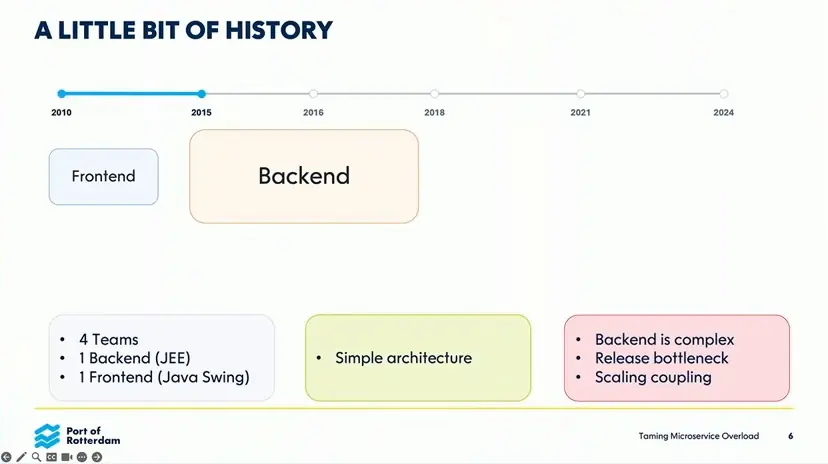
*[▶ 00:03:55](https://www.youtube.com/watch?v=v86SfHA5ISw&t=235s) · A little bit of history: 2010 to 2015*

Extracting microservices seemed like the fix. The team set a rule that every service must be rebuildable from scratch within four weeks, and the backend split into more than ten services by 2016.

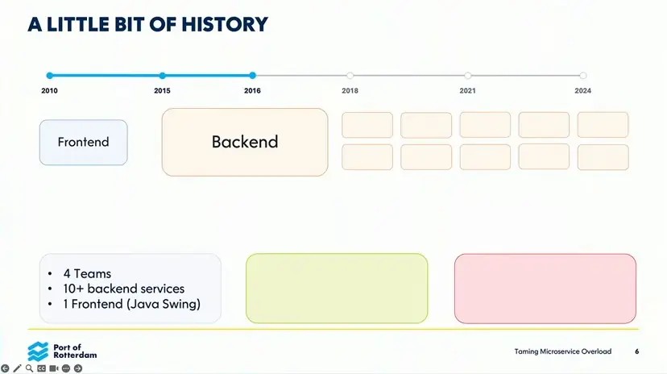
*[▶ 00:04:11](https://www.youtube.com/watch?v=v86SfHA5ISw&t=251s) · A little bit of history: 2016, growing backend services*

Growth continued without cleanup. Rewritten services were added beside the old ones, and micro frontends were added on top. By 2024, five teams ran more than 90 microservices, about 20 per team.

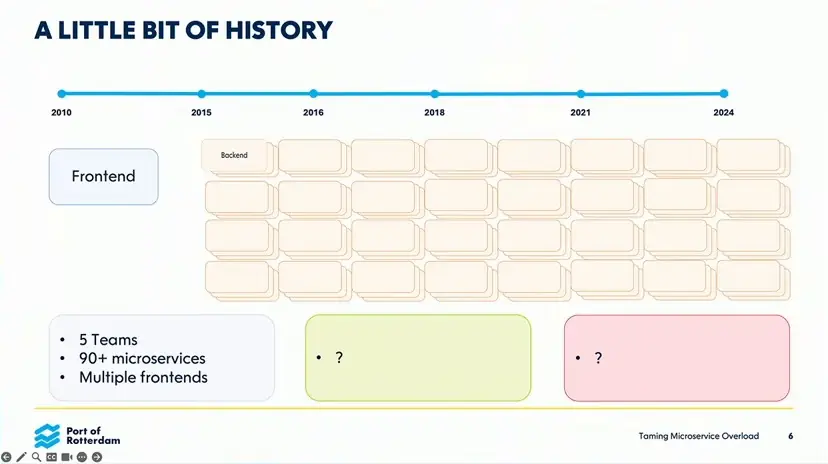
*[▶ 00:05:22](https://www.youtube.com/watch?v=v86SfHA5ISw&t=322s) · A little bit of history*

The speaker measures this with microservices per engineer (MTR):

- Below 0.2: team-oriented, excellent cognitive load
- 0.2 to 0.5: the sweet spot, balanced
- 0.5 to 1.0: the warning zone, where complexity creeps in
- Above 1.0: microservice proliferation, a high danger zone

His team passed 4.5, which he calls an operational nightmare.

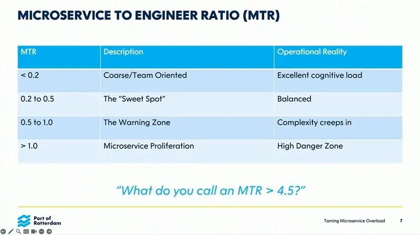
*[▶ 00:06:23](https://www.youtube.com/watch?v=v86SfHA5ISw&t=383s) · Microservice to engineer ratio (MTR)*

## Microservice gains and their costs

[▶ 00:06:24](https://www.youtube.com/watch?v=v86SfHA5ISw&t=384s)

Microservices gave four gains: independent deployment and scaling, team ownership, and smaller codebases.

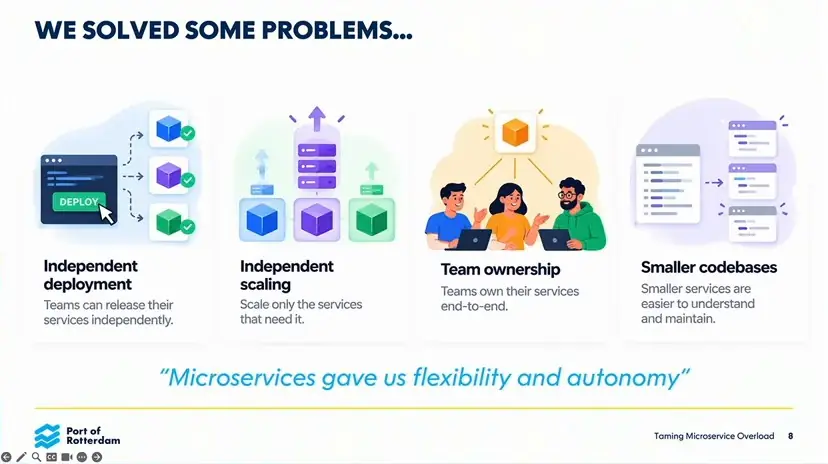
*[▶ 00:07:33](https://www.youtube.com/watch?v=v86SfHA5ISw&t=453s) · We solved some problems*

Each gain had a cost. Changes span several teams, one library upgrade becomes dozens of changes, debugging spans many logs, and each service adds infrastructure cost.

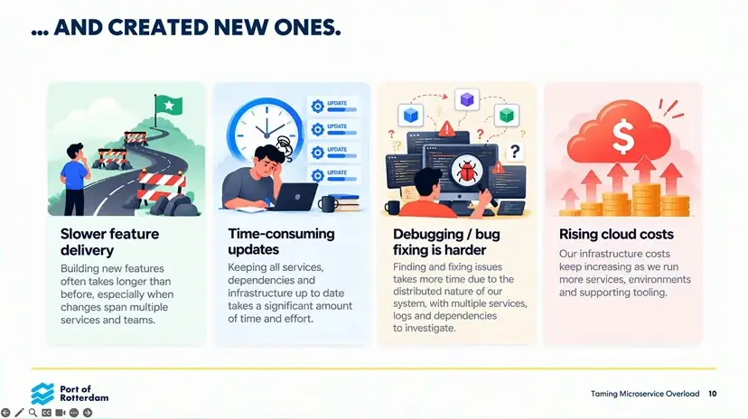
*[▶ 00:09:20](https://www.youtube.com/watch?v=v86SfHA5ISw&t=560s) · ...And created new ones*

Large companies hit the same wall: Netflix, Amazon, Spotify and Uber report the same problems.


*[▶ 00:09:47](https://www.youtube.com/watch?v=v86SfHA5ISw&t=587s) · Are we the only ones struggling with this?*

Uber cites up to 50 services and over 12 teams per issue. Spotify's Java migration took 8 months.

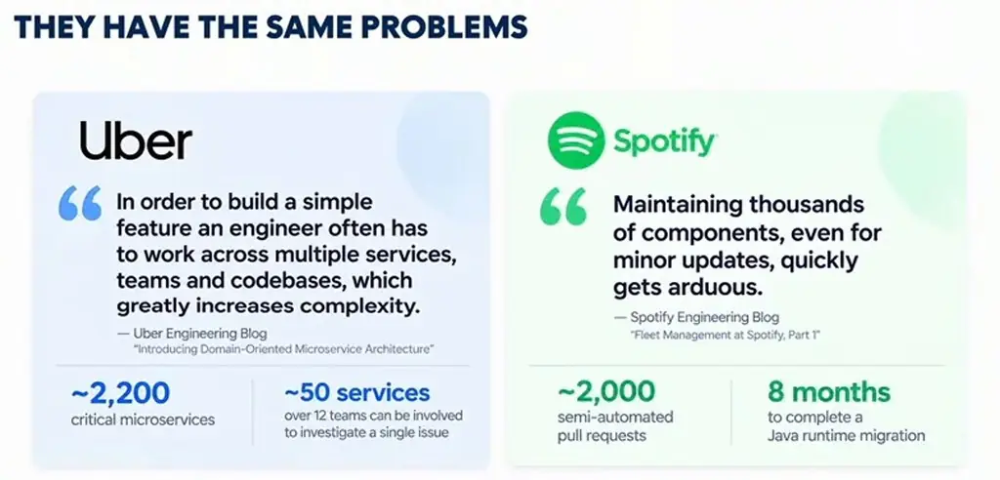
*[▶ 00:10:41](https://www.youtube.com/watch?v=v86SfHA5ISw&t=641s) · They have the same problems*

## Boundaries, not service count, were the real problem

[▶ 00:10:41](https://www.youtube.com/watch?v=v86SfHA5ISw&t=641s)

Uber's blog post concluded that the answer was **better boundaries**: services organized around business domains. Platform engineering supports this by giving teams shared tooling for deployment and observability.

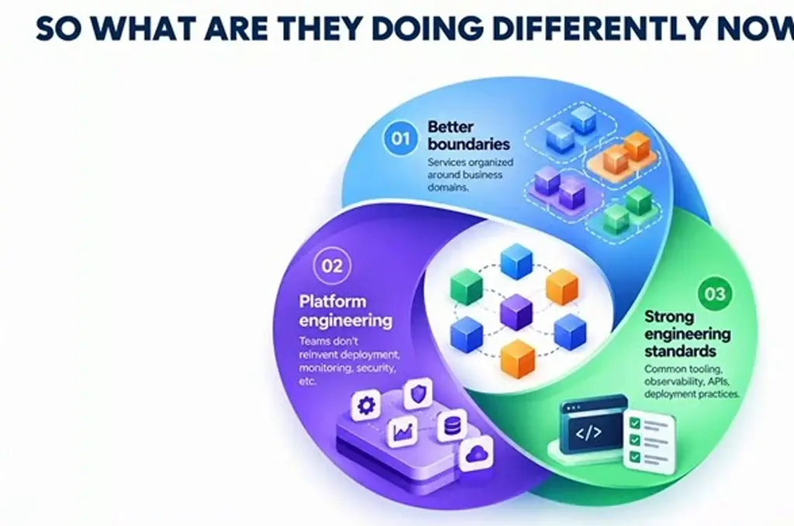
*[▶ 00:12:25](https://www.youtube.com/watch?v=v86SfHA5ISw&t=745s) · So what are they doing differently now?*

Their architecture showed the cost: one business process spanned many services.

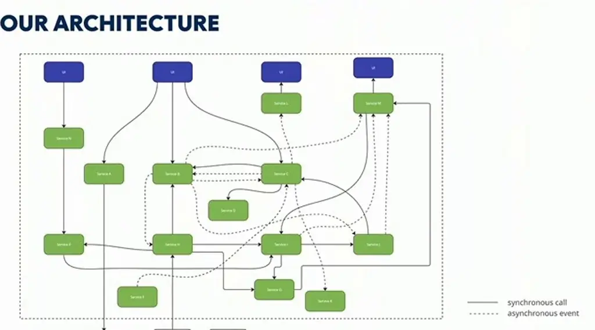
*[▶ 00:13:00](https://www.youtube.com/watch?v=v86SfHA5ISw&t=780s) · Part of our architecture*

On paper, each service had one clear job, such as deciding port entry or berth ability.

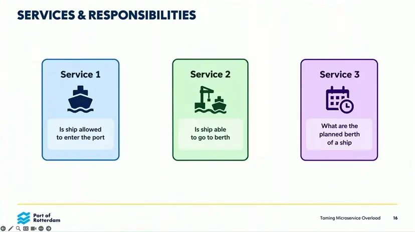
*[▶ 00:13:54](https://www.youtube.com/watch?v=v86SfHA5ISw&t=834s) · Services & Responsibilities*

In practice they were tightly coupled. One process needed all three to finish, so a change touched three services, and Service 2 made Service 1's entry decision.

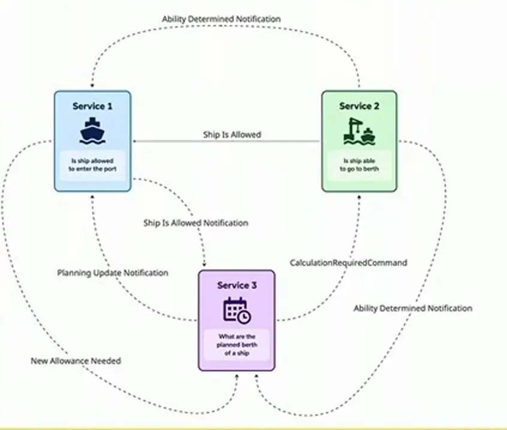
*[▶ 00:15:22](https://www.youtube.com/watch?v=v86SfHA5ISw&t=922s) · Hidden Reality (Coupling)*

The main problem wasn't the number of services but boundaries without clear business responsibility.

Good boundaries have local changes, few cross-boundary dependencies, clear responsibility and internal consistency: low coupling, high cohesion.

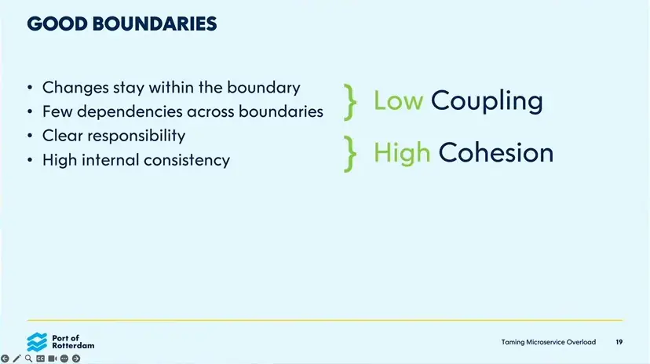
*[▶ 00:17:12](https://www.youtube.com/watch?v=v86SfHA5ISw&t=1032s) · Good Boundaries*

Drawing boxes on a diagram had already failed. Domain-driven design starts by understanding the business, defines boundaries from natural clusters of responsibility, then aligns software with them.

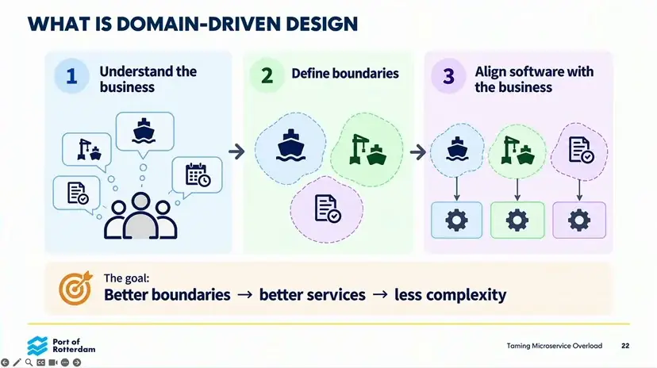
*[▶ 00:19:29](https://www.youtube.com/watch?v=v86SfHA5ISw&t=1169s) · What is domain-driven design*

## Event storming: mapping the business before the code

[▶ 00:19:30](https://www.youtube.com/watch?v=v86SfHA5ISw&t=1170s)

Event storming, introduced by Alberto Brandolini, is a collaborative workshop where business and tech people map a process as domain events on stickies along a timeline.

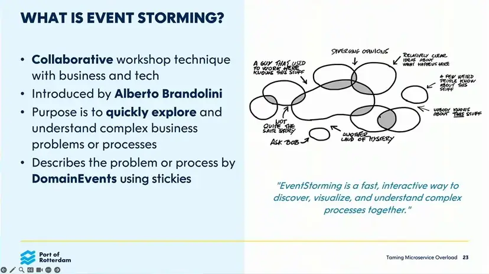
*[▶ 00:21:02](https://www.youtube.com/watch?v=v86SfHA5ISw&t=1262s) · What is EventStorming?*

Invite every perspective: business experts know why, developers know how, others know exceptions.

Three levels: big picture for organization-wide flows, process modelling for one workflow, design-level for aggregates.

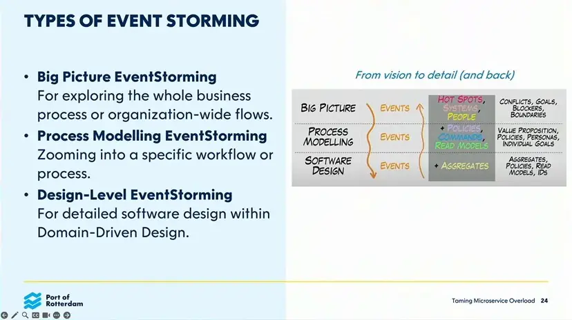
*[▶ 00:22:24](https://www.youtube.com/watch?v=v86SfHA5ISw&t=1344s) · Types of EventStorming*

Sticky colours mark types: domain events, hotspots, actors, systems, boundaries.

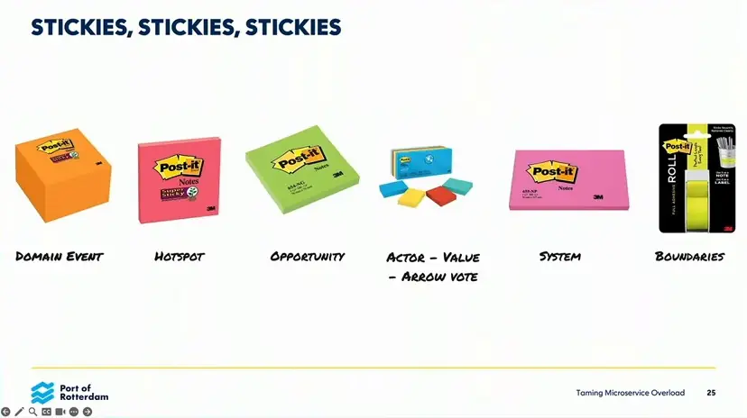
*[▶ 00:22:33](https://www.youtube.com/watch?v=v86SfHA5ISw&t=1353s) · Stickies, stickies, stickies*

Five steps: chaotic exploration, enforcing the timeline, adding actors, explicit walkthrough, then clustering into boundaries.

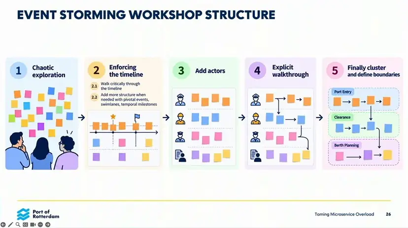
*[▶ 00:25:12](https://www.youtube.com/watch?v=v86SfHA5ISw&t=1512s) · Event storming workshop structure (5 steps)*

Clusters of events sharing responsibility or language suggest bounded contexts; event storming supplies boundaries, not microservices.

## Subdomains become Spring Modulith modules

[▶ 00:25:12](https://www.youtube.com/watch?v=v86SfHA5ISw&t=1512s)

Big-picture event storming produces huge boards; don't be overwhelmed by the stickies.

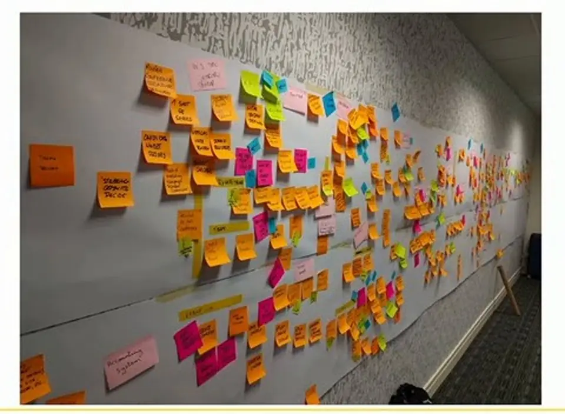
*[▶ 00:25:28](https://www.youtube.com/watch?v=v86SfHA5ISw&t=1528s) · Outcome of big picture event storming (photo)*

Pivotal events marked natural boundaries, which became subdomains such as **Port Clearance**. The team admits the split is "okay-ish" and will fine-tune it.

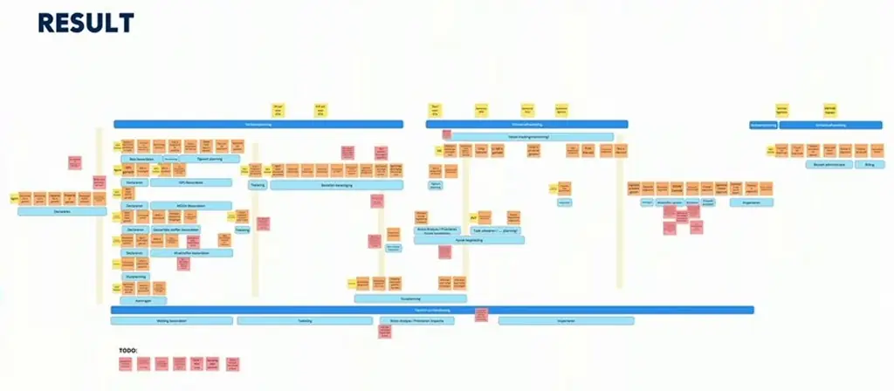
*[▶ 00:25:51](https://www.youtube.com/watch?v=v86SfHA5ISw&t=1551s) · Result: event storming board with subdomain boundaries*

The sticky clusters were named as business areas, including Port Clearances.

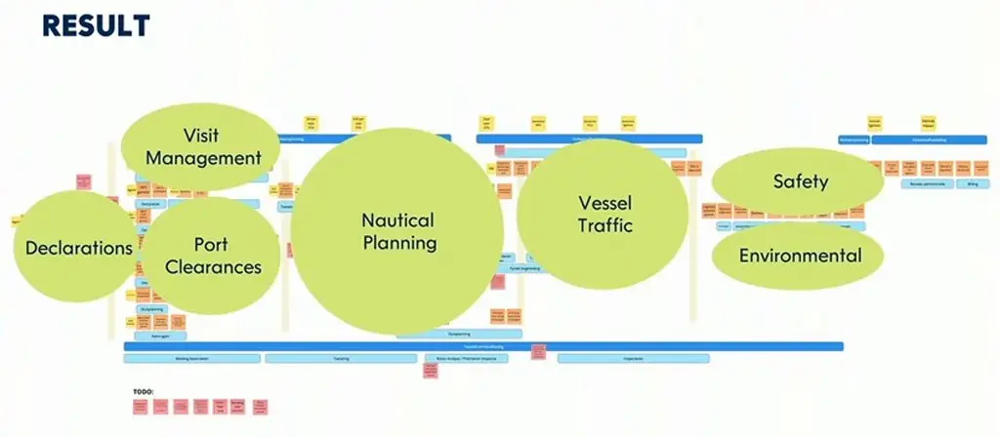
*[▶ 00:27:05](https://www.youtube.com/watch?v=v86SfHA5ISw&t=1625s) · Result: domain clusters on the event storming board*

Each subdomain became one deployable service, with its capabilities inside. A capability moves out only if it needs independent scaling, a different owner, or belongs to another domain.

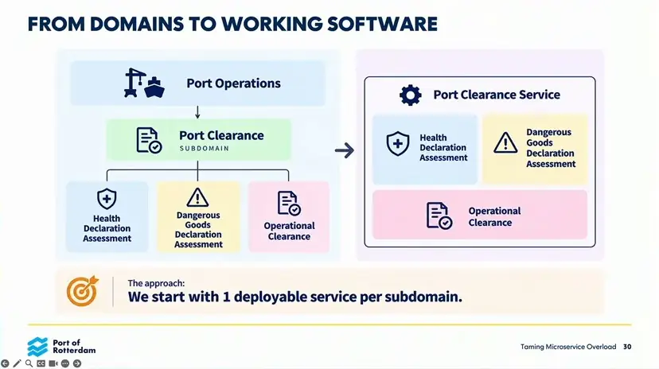
*[▶ 00:29:04](https://www.youtube.com/watch?v=v86SfHA5ISw&t=1744s) · From domains to working software*

Modules keep that service from becoming a smaller monolith: each capability owns its logic and access rules.

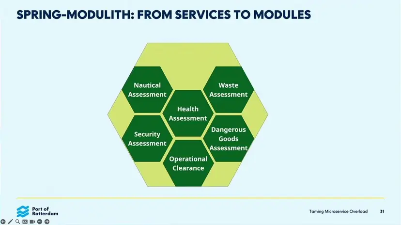
*[▶ 00:30:26](https://www.youtube.com/watch?v=v86SfHA5ISw&t=1826s) · Port Clearance modules in Spring Modulith*

In Spring Modulith, other modules may use only a module's API package. IntelliJ marks exposed packages with green locks and internal ones with red.

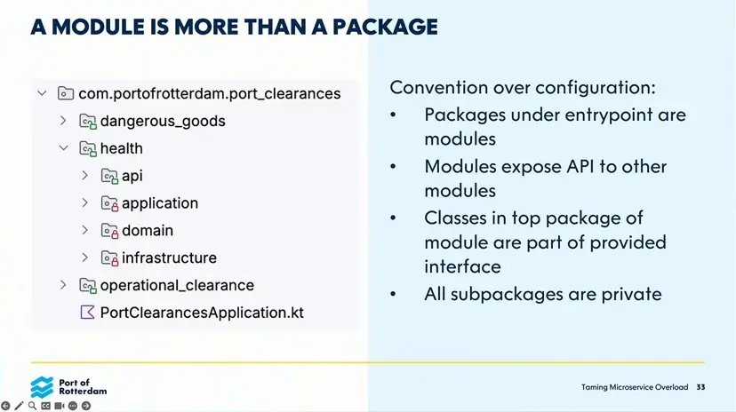
*[▶ 00:32:23](https://www.youtube.com/watch?v=v86SfHA5ISw&t=1943s) · A module is more than a package*

## Enforcing boundaries and communicating through events

[▶ 00:32:23](https://www.youtube.com/watch?v=v86SfHA5ISw&t=1943s)

Boundaries erode as code grows, because importing another module's public class compiles without complaint. Spring Modulith's `verify()` checks the declared module rules and fails on cycles or access to another module's internals.

```kotlin
@Test
fun `verify module structure`() {
    // Verify the application is a valid modulith
    ApplicationModules
        .of(PortClearancesApplication::class.java).verify()
}
```

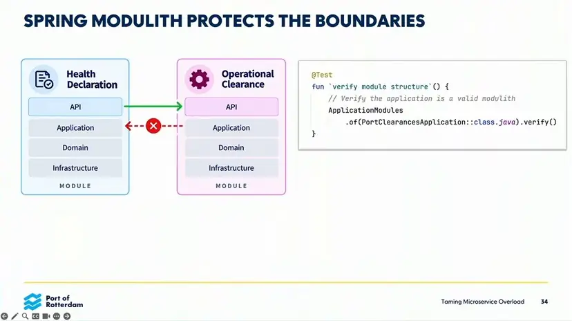
*[▶ 00:34:07](https://www.youtube.com/watch?v=v86SfHA5ISw&t=2047s) · Spring Modulith protects the boundaries*

Direct calls couple modules and would become REST calls if a module were extracted. Instead, the health declaration module publishes a domain event, the same business event identified during event storming. Any module or service can listen, and the event can travel over Kafka or AMQ.

```kotlin
@Service
class HealthDeclarationAssessmentService(
    private val events: ApplicationEventPublisher
) {
    @Transactional
    fun check(vesselId: String) {
        val result = HealthDeclarationAssessmentCompleted(vesselId, true)
        events.publishEvent(result)
    }
}

@ApplicationModuleListener
fun on(event: HealthDeclarationAssessmentCompleted) {
}
```

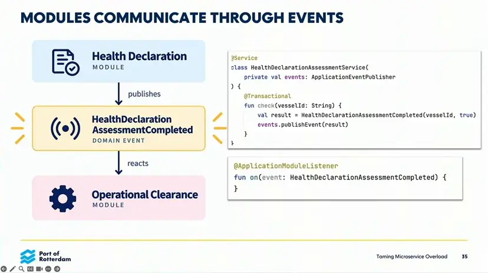
*[▶ 00:35:51](https://www.youtube.com/watch?v=v86SfHA5ISw&t=2151s) · Modules communicate through events*

`ApplicationModuleTest` in STANDALONE mode starts only one module's Spring context, so a test can publish an event and wait for the resulting one.

```kotlin
@ApplicationModuleTest(ApplicationModuleTest.BootstrapMode.STANDALONE)
class ApplicationModuleTest {
    @Test
    fun operationalClearanceIntegrationTest(scenario: Scenario) {
        scenario.publish(HealthDeclarationAssessmentCompleted(vesselId = "123", approved = true))
            .andWaitForEventOfType(OperationalClearanceGranted::class.java)
            .matching { event -> event.vesselId == "123" }
            .toArrive()
    }
}
```

*[▶ 00:36:45](https://www.youtube.com/watch?v=v86SfHA5ISw&t=2205s) · Integration tests with Spring Modulith*

Extract a module only for a real reason: independent scaling, team ownership, independent deployment, or different technical requirements. Modular first, distributed when needed.

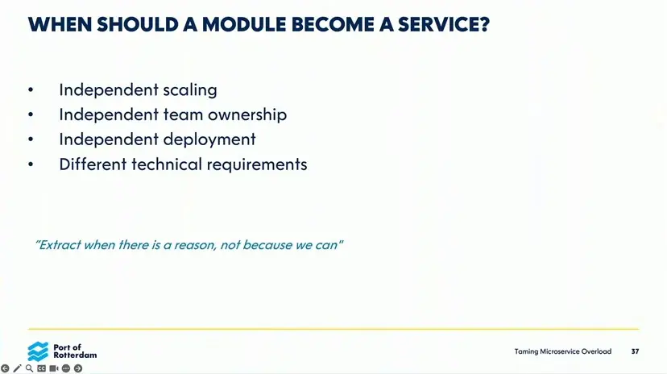
*[▶ 00:38:03](https://www.youtube.com/watch?v=v86SfHA5ISw&t=2283s) · When should a module become a service?*

## Migrating one capability at a time

[▶ 00:38:09](https://www.youtube.com/watch?v=v86SfHA5ISw&t=2289s)

Migrate business responsibilities, not services. The system runs 24/7, so a greenfield rewrite is not an option.

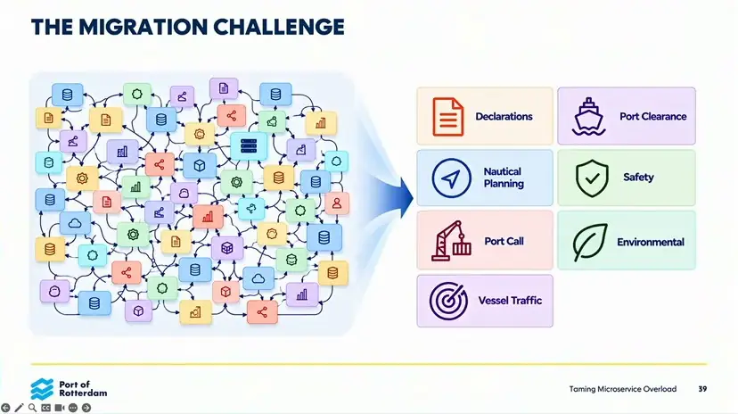
*[▶ 00:39:24](https://www.youtube.com/watch?v=v86SfHA5ISw&t=2364s) · The migration challenge*

Adding functionality is relatively straightforward because no legacy code changes. The ISPS assessment becomes a module in the Port-Clearance service, listening to the legacy service's movement-updated event.

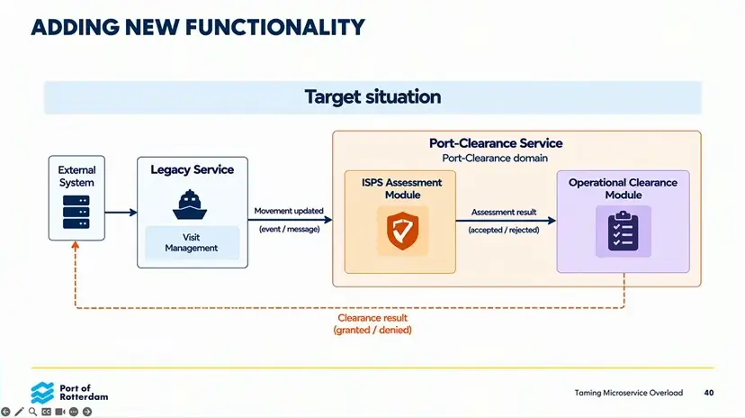
*[▶ 00:41:17](https://www.youtube.com/watch?v=v86SfHA5ISw&t=2477s) · Adding new functionality*

Moving a capability means moving its code out of several services. Dangerous-goods code from services A, B and C went into a new Declarations service as three packages. Service D now listens to that service's events for the part it still owns.

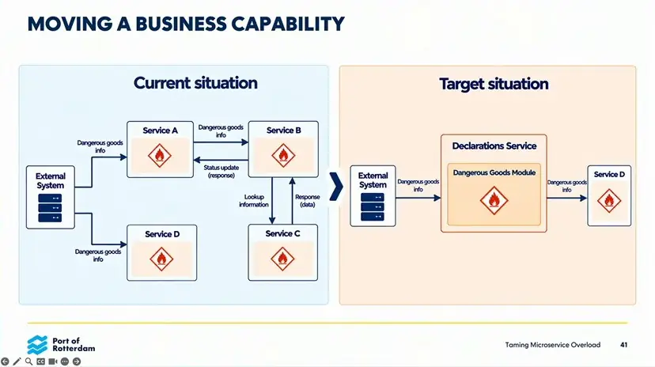
*[▶ 00:42:40](https://www.youtube.com/watch?v=v86SfHA5ISw&t=2560s) · Moving a business capability*

Moving only the visit declaration part out of the legacy service required the legacy service to listen to the new event, so its remaining processes kept working.

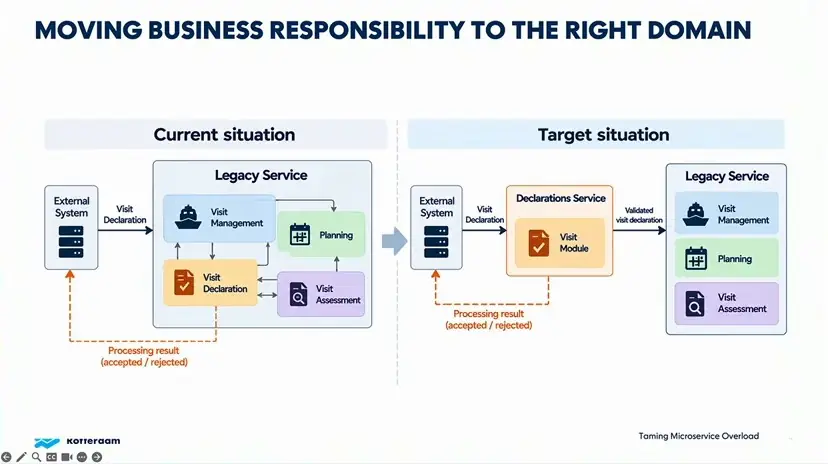
*[▶ 00:43:45](https://www.youtube.com/watch?v=v86SfHA5ISw&t=2625s) · Moving business responsibility to the right domain*

The hardest case is when service boundaries don't match business boundaries. Capability 3 was spread across services A, B and C, so capability 3 alone moved to a new Nautical Planning service and was removed from the other three.

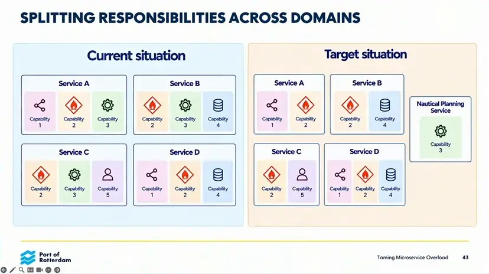
*[▶ 00:45:04](https://www.youtube.com/watch?v=v86SfHA5ISw&t=2704s) · Splitting responsibilities across domains*

## Boundaries matter more than microservices

[▶ 00:45:05](https://www.youtube.com/watch?v=v86SfHA5ISw&t=2705s)

Splitting a messy monolith into microservices spreads its problems across the network. The real challenge is boundaries, found through DDD and EventStorming.

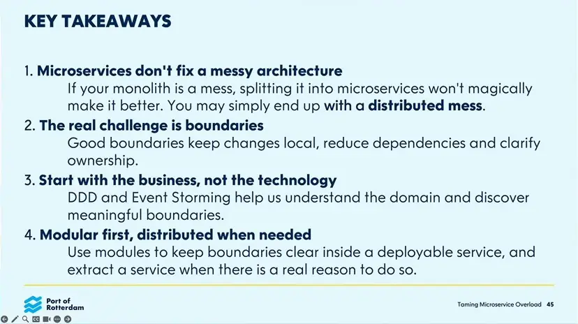
*[▶ 00:46:22](https://www.youtube.com/watch?v=v86SfHA5ISw&t=2782s) · Key Takeaways*

Microservices distribute complexity, but good boundaries control it. Stay modular: enforce boundaries inside one service and extract a module only when there's a real reason.

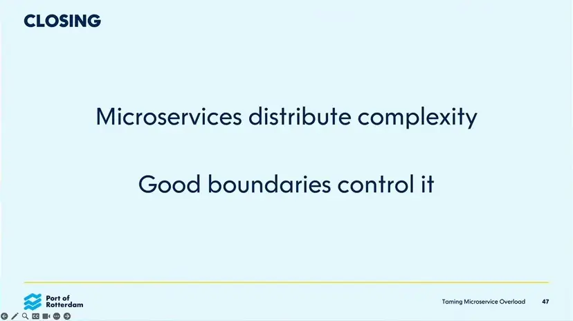
*[▶ 00:48:06](https://www.youtube.com/watch?v=v86SfHA5ISw&t=2886s) · Closing: Complexity and Boundaries*

Two unmeasured hypotheses: clear boundaries cut coordination and lead time; consolidation cuts services, deployments and infrastructure to run.

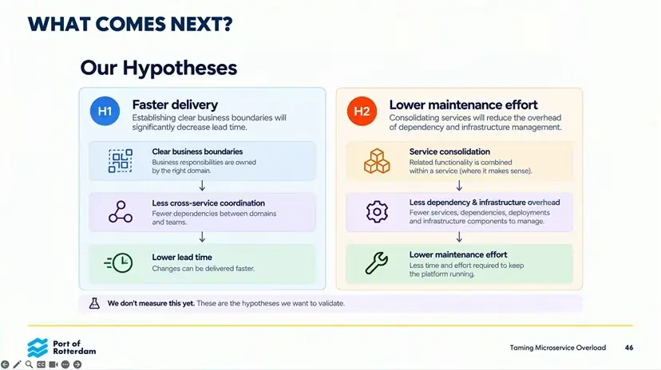
*[▶ 00:47:58](https://www.youtube.com/watch?v=v86SfHA5ISw&t=2878s) · What Comes Next: Our Hypotheses*

The speaker recommends Event Storming (Alberto Brandolini) and Architecture Modernization (Nick Tune, Jean-Georges Perrin) for modernizing live systems.

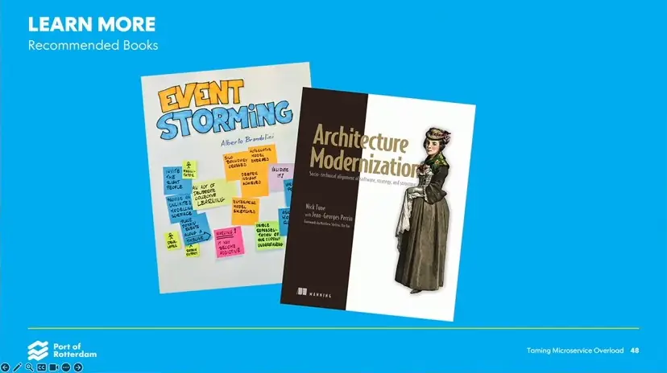
*[▶ 00:48:33](https://www.youtube.com/watch?v=v86SfHA5ISw&t=2913s) · Learn More: Recommended Books*

## Links & resources

- Uber blog post on microservices conclusion — mentioned, URL not given · mentioned [▶ 00:10:48](https://www.youtube.com/watch?v=v86SfHA5ISw&t=648s)
