# We created our own AI orchestrator and it became so much more! by Ricky van Rijn

*How one team built its own AI orchestrator on Embabel Agent, and what changed in its roles, specs, reviews and trust model when agents began writing the code.*

Source: [We created our own AI orchestrator and it became so much more! by Ricky van Rijn](https://www.youtube.com/watch?v=niBYuCuViGw) · Ricky van Rijn · Devoxx · 52 min

## TL;DR

The team wanted to move from engineers writing code, to AI assisting, to AI writing code, starting with a migration of an internal Node.js backend to Java. Their first attempt produced oversized specs and a 225-file pull request full of assumptions, so they built a shared orchestrator on Embabel Agent with centralized agent definitions, skills, guardrails and spec files in one git repository. The lasting lesson is that requirements, not code, became the main review pressure, and that trust in agents has to rest on explicit conditions and human accountability. The Node-to-Java migration took 18 productive hours of employee time and now runs in production.

## Key takeaways

- Keep agent definitions, skills, MCP config and guardrails in one shared git repository so review feedback, such as dropping short notations, reaches the whole team.
- Turn Jira user stories into structured, version-controlled spec files, and render them as markdown so the business can spot unclear requirements. Importing a story with AI is not the same as understanding it.
- Keep specs small and concrete with clear acceptance criteria; a single oversized spec of over 500 lines burned tokens before any code existed and led agents to invent assumptions.
- Raise objections during spec refinement, not after a spec enters the agentic workflow, because later concerns only burn tokens.
- Use the harness to enforce boundaries: a guardrail states what an agent must not do, and the harness is the fence that enforces it.
- Earn auto-merge trust gradually, for example by reviewing small dependency bumps first, and allow auto-merge only when every check passes while humans still press the button.
- Expect product decisions and stakeholder alignment to become the bottleneck once agents speed up coding, review and testing, so involve the product owner in analysis early.
- Steer the AI rather than letting it run unattended: the team's Node-to-Java migration took 18 productive hours of employee time and now runs in production.

## From assisted AI to agentic work

[▶ 00:00:00](https://www.youtube.com/watch?v=niBYuCuViGw&t=0s)

A Devoxx search for "agentic" returns talks on the topic.

```shell
$ devoxx search "agentic"
▸ Using Structured Concurrency and Scoped Values to Crea…
▸ GraalVM Community BOF
▸ Consistency Patterns in Event-Driven Architecture
▸ LangChain4j Community BOF
▸ Building the Trusted Agent Ecosystem
▸ From vibe coding to harness engineering: modernizing…
```

*[▶ 00:00:02](https://www.youtube.com/watch?v=niBYuCuViGw&t=2s) · Terminal search for agentic talks*

The team built an orchestrator on Embabel Agent, Skills, and Spec files.

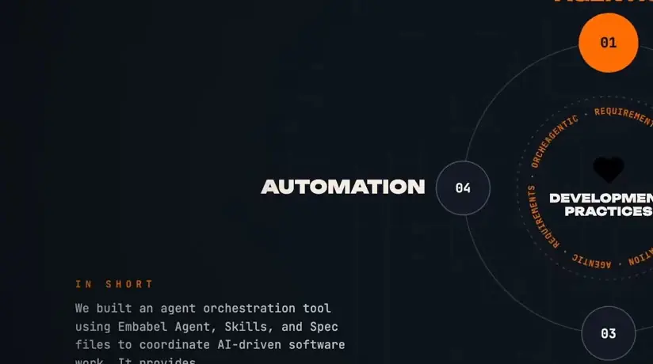
*[▶ 00:00:14](https://www.youtube.com/watch?v=niBYuCuViGw&t=14s) · Agent orchestration tool in short*

It uses Agent, Skills, and Spec files from default locations, so other tools can use them.

```json
{
  "id": 23531…
  "format": "…
  "track": "D…
  "level": "I…
  "duration":…
  "speakers":…
  "tags": ["a…
}
```

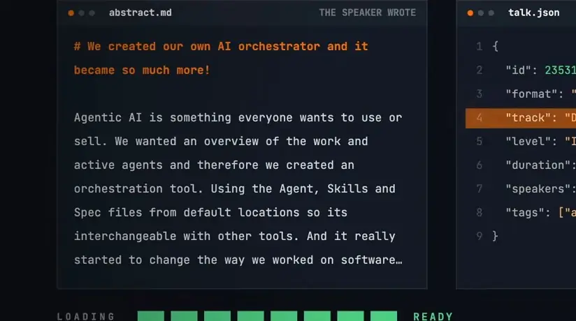
*[▶ 00:00:19](https://www.youtube.com/watch?v=niBYuCuViGw&t=19s) · Speaker abstract and talk metadata*

The team's phases: traditional (engineers write code), assisted (AI helps write), agentic (AI writes code).

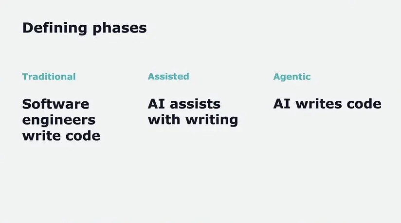
*[▶ 00:02:53](https://www.youtube.com/watch?v=niBYuCuViGw&t=173s) · Defining phases*

Opportunity: AI drafts code from a goal. Multiplier: agents work in parallel.

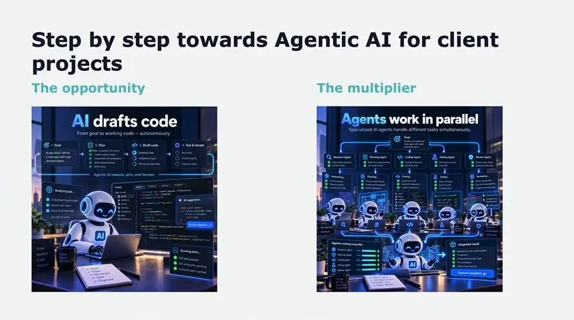
*[▶ 00:03:19](https://www.youtube.com/watch?v=niBYuCuViGw&t=199s) · Step by step towards Agentic AI for client projects*

The first use case: migrating an internal Node.js backend to Java.

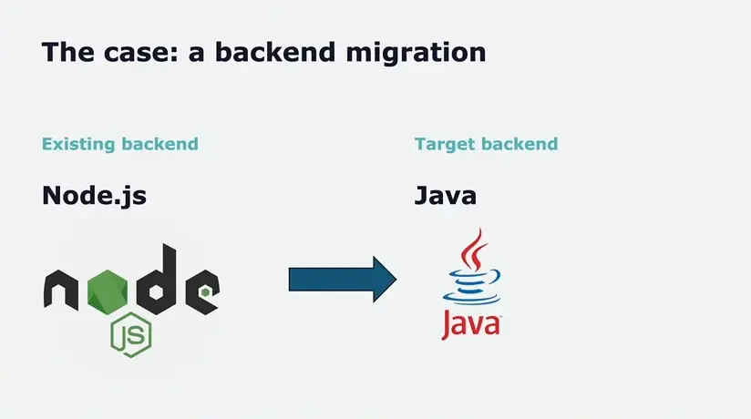
*[▶ 00:04:49](https://www.youtube.com/watch?v=niBYuCuViGw&t=289s) · The case: a backend migration*

## Defining agent roles and turning Jira stories into specs

[▶ 00:04:48](https://www.youtube.com/watch?v=niBYuCuViGw&t=288s)

Agents got clear roles, documented on a Confluence page that people rarely read. Agent responsibility stayed separate from human accountability: agents write code, humans review it.

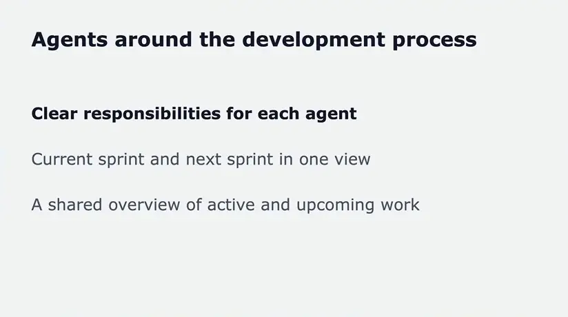
*[▶ 00:07:50](https://www.youtube.com/watch?v=niBYuCuViGw&t=470s) · Agents around the development process*

Jira user stories were turned into spec files through an MCP server, with AI drafting the specs. Specs are structured, version-controlled markdown that coding agents consume, and rendered markdown let the business spot unclear requirements. Importing a story with AI is not the same as understanding it.

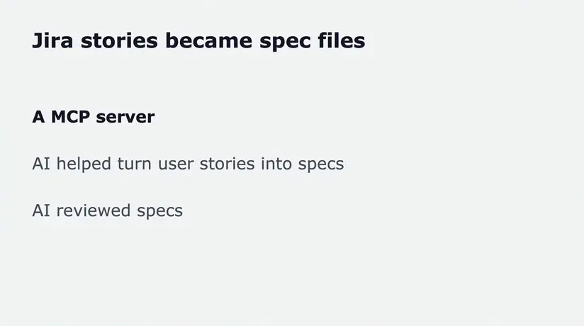
*[▶ 00:10:24](https://www.youtube.com/watch?v=niBYuCuViGw&t=624s) · Jira stories became spec files*

## Vague specs produced oversized, assumption-filled pull requests

[▶ 00:10:22](https://www.youtube.com/watch?v=niBYuCuViGw&t=622s)

A short user story became a spec file over 500 lines, burning tokens before any code existed.

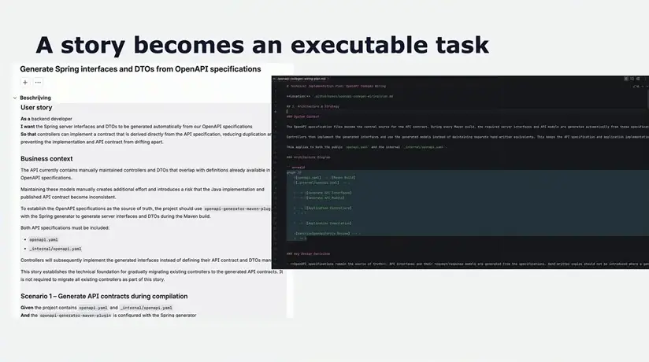
*[▶ 00:11:26](https://www.youtube.com/watch?v=niBYuCuViGw&t=686s) · A story becomes an executable task*

The agents filled spec gaps with assumptions, such as building an employee service that already existed.

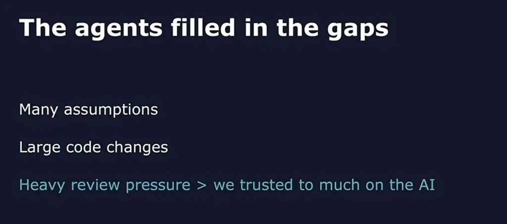
*[▶ 00:12:49](https://www.youtube.com/watch?v=niBYuCuViGw&t=769s) · The agents filled in the gaps*

The first pull request changed 225 files, adding 19,525 lines, and was too large to follow.

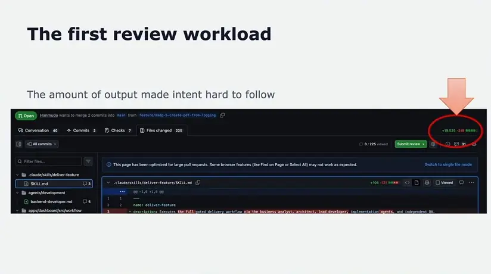
*[▶ 00:13:50](https://www.youtube.com/watch?v=niBYuCuViGw&t=830s) · The first review workload*

Large pull requests also bred misunderstanding between agents focused on security and on coding guidelines.

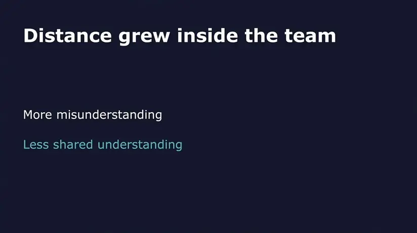
*[▶ 00:15:50](https://www.youtube.com/watch?v=niBYuCuViGw&t=950s) · Distance grew inside the team*

## Centralizing agent definitions to end team silos

[▶ 00:15:40](https://www.youtube.com/watch?v=niBYuCuViGw&t=940s)

Each person worked in a separate room with headphones, the shared goal was lost, and even refinements became passive.

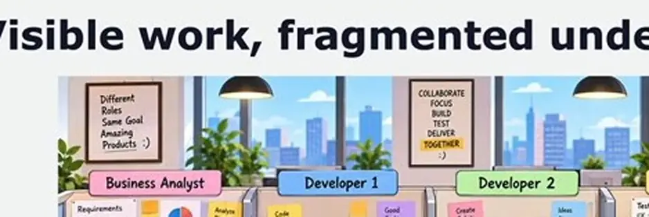
*[▶ 00:16:49](https://www.youtube.com/watch?v=niBYuCuViGw&t=1009s) · People working in separate silos*

The business analyst owned the spec file alone. Centralization moved agent definitions, skills, MCP config and guardrails out of individual setups and into one git repository.

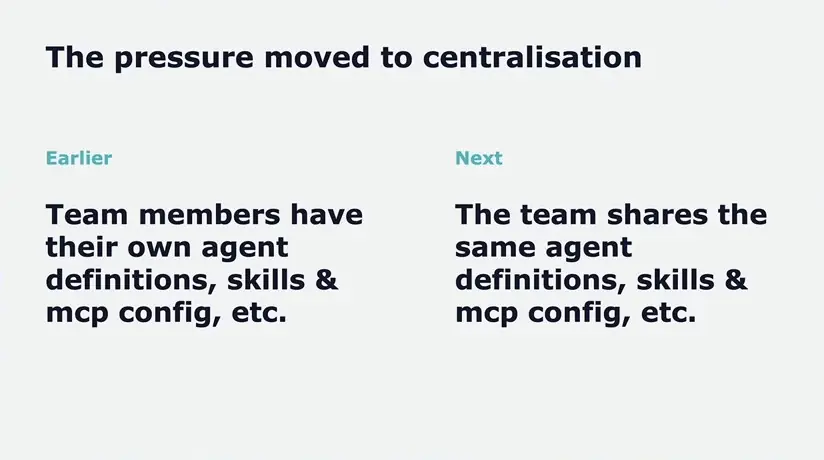
*[▶ 00:18:27](https://www.youtube.com/watch?v=niBYuCuViGw&t=1107s) · The pressure moved to centralisation*

Shared config made review feedback stick. A fix, such as dropping short notations, went into the repository and reached everyone. Individual strengths became team behavior in the agents.

Spec files stayed per project, but agents stayed per team, since the same agents served several clients and carried the team's quality standards.

The foundation was Embabel Agent on the JVM, with agents, skills, guardrails and spec files in default locations, plus a visual cockpit for activity and next tasks.

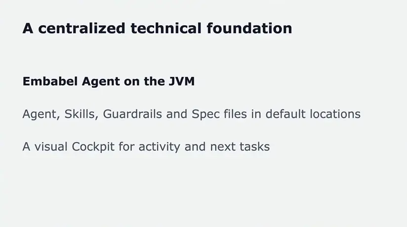
*[▶ 00:20:57](https://www.youtube.com/watch?v=niBYuCuViGw&t=1257s) · A centralized technical foundation*

The first draft, built in Java with a React frontend, loaded the agents, read spec files and connected to git. The product owner could change queue size, stop runs or add instructions.

The dashboard tracks each spec through workflow stages and quality checks such as unit test coverage, OWASP ZAP and ISO 25010, which is what clients see.

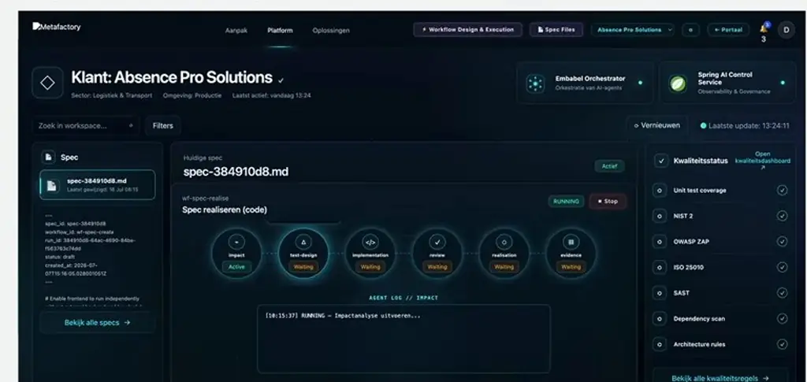
*[▶ 00:25:53](https://www.youtube.com/watch?v=niBYuCuViGw&t=1553s) · Dashboard view of the orchestrator*

Workflows run as the triggering user, not a system account, so people are accountable for what they deliver.

## Requirements now carry the review pressure

[▶ 00:25:51](https://www.youtube.com/watch?v=niBYuCuViGw&t=1551s)

Review pressure moved from large code outputs to requirements. The team sliced its largest spec files into smaller use-case specs.

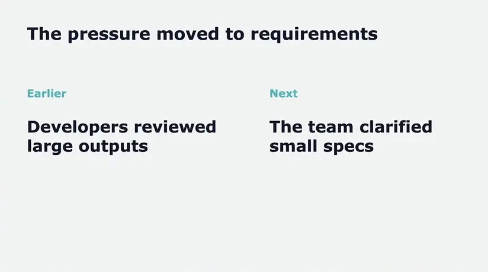
*[▶ 00:29:26](https://www.youtube.com/watch?v=niBYuCuViGw&t=1766s) · The pressure moved to requirements*

Requirements have to be concrete before execution. Asking ChatGPT to write them yields answers that please rather than specify. Small specs with clear acceptance criteria made a roughly 100-line pull request easy to check against its linked use cases.

```markdown
…

**Frontend**: Not applicable.

---

## 2. Implementation Milestones

> **Instructions for Implementation Agent**:
> Keep this change intentionally small.
> Do not add controller implementations, DTO migrations, or unrelated refactoring.

### Milestone 1: Add OpenAPI Generation to Maven

**Goal**: Generate API interfaces and models from `openapi.yaml` automatically during Maven compilation.

**Scope** (~1-3 files):

- [ ] `api/pom.xml` - Configure OpenAPI generation as part of the build.
- [ ] `openapi.yaml` - Use the existing specification as generator input.
- [ ] Existing build configuration, only if required - Ensure generated sources are compiled automatically.

**Implementation Guidance**:

- Add a single generator execution for `openapi.yaml`.
- Use the Spring generator with interface-only generation.
- Generate API interfaces and models only.
- Place generated files under the normal Maven build output.
- Ensure generated source folders are available before Java compilation starts.
- Prefer existing project package conventions rather than introducing a new structure.
- Avoid generator-specific customization unless it is required for successful generation.
```

*[▶ 00:30:13](https://www.youtube.com/watch?v=niBYuCuViGw&t=1813s) · A smaller, clearer spec (PR markdown)*

Concerns raised after a spec enters the agentic workflow only burn tokens, so objections belong in refinement.

Mixed expertise changed the work: developers, the business analyst and the product owner shared one goal, brought different perspectives and talked before execution.

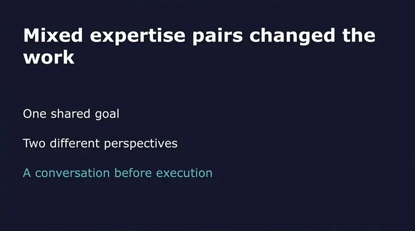
*[▶ 00:31:26](https://www.youtube.com/watch?v=niBYuCuViGw&t=1886s) · Mixed expertise pairs changed the work*

The better collaboration then surfaced more ideas, led by token cost.

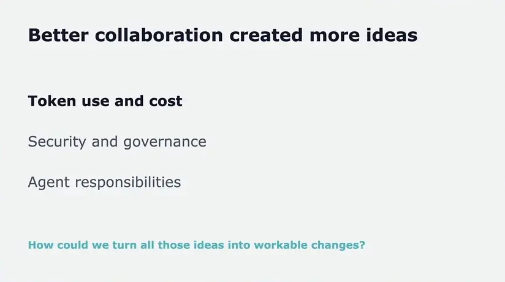
*[▶ 00:37:18](https://www.youtube.com/watch?v=niBYuCuViGw&t=2238s) · Better collaboration created more ideas*

## Token costs, hybrid models and earning auto-merge trust

[▶ 00:33:02](https://www.youtube.com/watch?v=niBYuCuViGw&t=1982s)

Token costs pushed the team from the newest models to a hybrid setup that includes Qwen running locally. Local runs are slower, but one agent left a pull request by morning.

A guardrail says what an agent must not do; a harness is the fence that enforces the boundary.

Weekly reviews of small dependency bumps built trust, so the team is adding an auto-merge option that merges only when every check passes. Humans stay accountable: they still press the button.

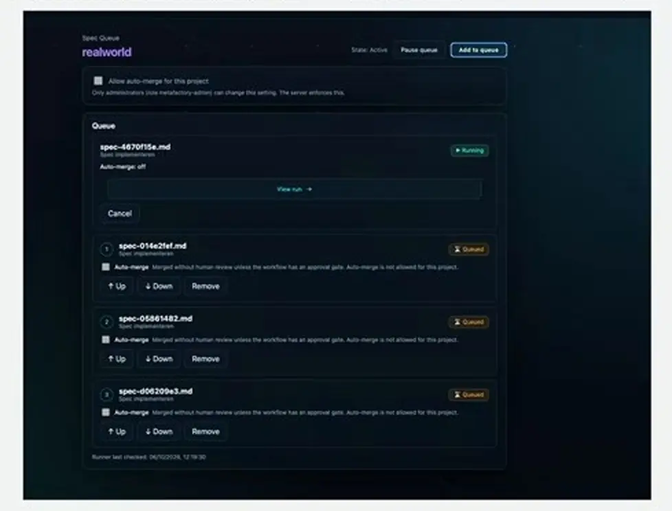
*[▶ 00:37:45](https://www.youtube.com/watch?v=niBYuCuViGw&t=2265s) · Spec queue UI with auto-merge option*

A visual workflow designer replaces the comma-separated agent list, so business users can lay out the process.

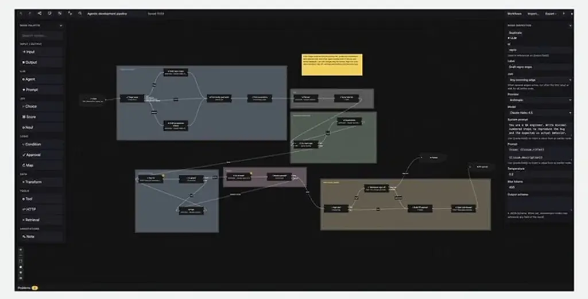
*[▶ 00:38:37](https://www.youtube.com/watch?v=niBYuCuViGw&t=2317s) · Workflow designer canvas for agent pipeline*

Trust now rests on explicit conditions: the team agreed where human judgement matters, and unclear requirements return to analysis.

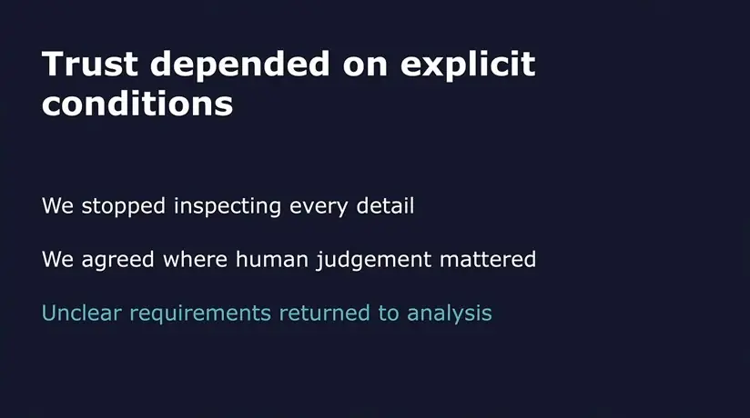
*[▶ 00:40:53](https://www.youtube.com/watch?v=niBYuCuViGw&t=2453s) · Trust depended on explicit conditions*

A gap exposes an unclear requirement; the team makes intent explicit, and the follow-up spec re-enters the queue.

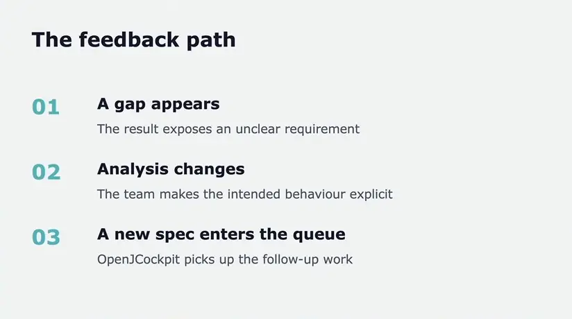
*[▶ 00:41:35](https://www.youtube.com/watch?v=niBYuCuViGw&t=2495s) · The feedback path*

## Execution outran product decisions

[▶ 00:41:20](https://www.youtube.com/watch?v=niBYuCuViGw&t=2480s)

Agents sped up coding, review, and testing so much that product decisions became the bottleneck. Sprints finished early, but stakeholder alignment still took time.

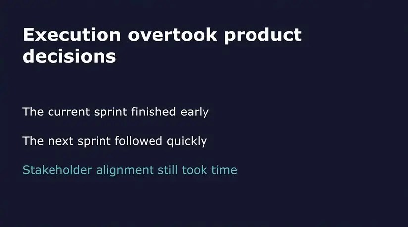
*[▶ 00:44:02](https://www.youtube.com/watch?v=niBYuCuViGw&t=2642s) · Execution overtook product decisions*

The product owner joined analysis early. Prerequisites became part of the conversation, long-term plans became near-term work, and readiness decided what entered the queue.

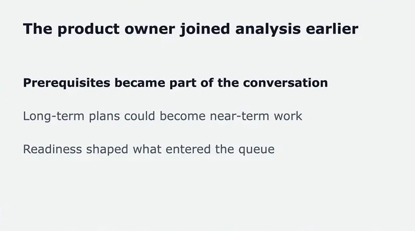
*[▶ 00:44:57](https://www.youtube.com/watch?v=niBYuCuViGw&t=2697s) · The product owner joined analysis earlier*

Developers review evidence and give precise feedback. Business analysts make functional requirements executable. The product owner steers value, readiness and priorities.

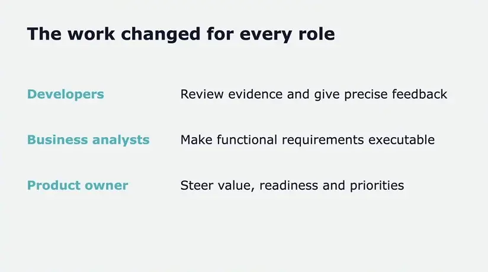
*[▶ 00:45:54](https://www.youtube.com/watch?v=niBYuCuViGw&t=2754s) · The work changed for every role*

The Node-to-Java back-end migration took 18 productive hours of employee time and now runs in production. The key was steering the AI rather than letting it work unattended.

Three takeaways for the next project:

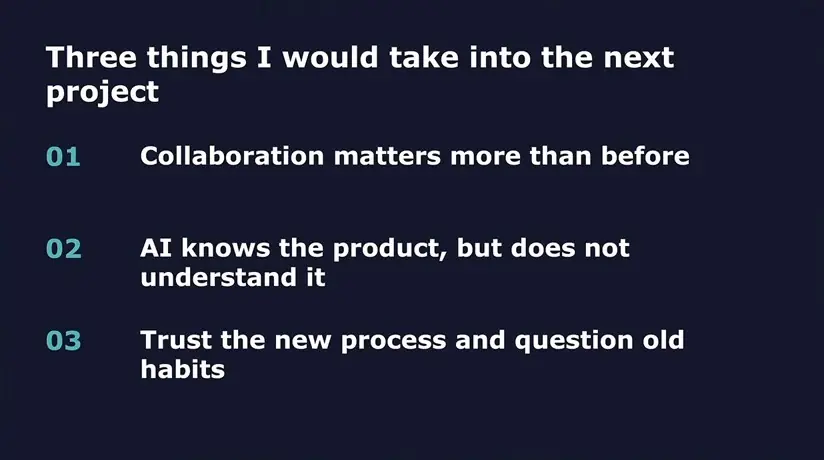
*[▶ 00:50:36](https://www.youtube.com/watch?v=niBYuCuViGw&t=3036s) · Three things I would take into the next project*

Collaboration improved when people split up and then came back together. AI knows the product but not its purpose, context or consequences. Trust the new process and question old habits.

AI also includes machine learning, contextual bandits and graphs, not only language models.

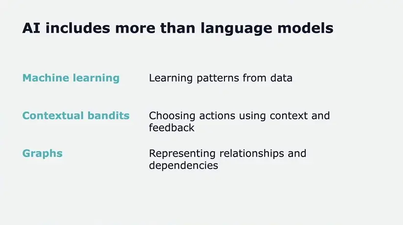
*[▶ 00:50:59](https://www.youtube.com/watch?v=niBYuCuViGw&t=3059s) · AI includes more than language models*

The AI orchestrator, [OpenJCockpit](https://github.com/OpenJCockpit), is now open source, and community contributions are welcome.

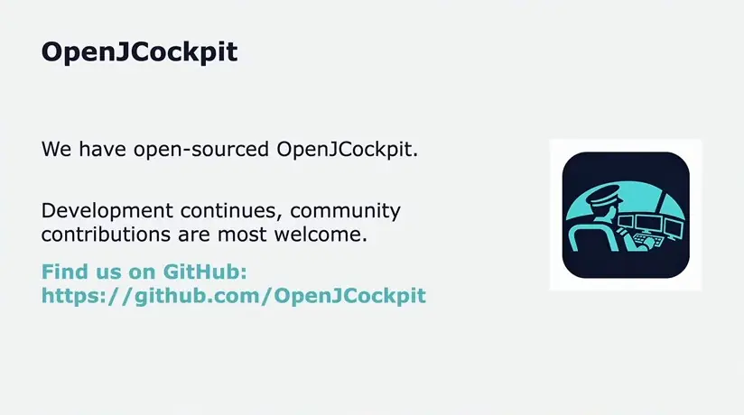
*[▶ 00:51:20](https://www.youtube.com/watch?v=niBYuCuViGw&t=3080s) · OpenJCockpit open-source announcement*

## Links & resources

- [OpenJCockpit: open-source project on GitHub, star and test it](https://github.com/OpenJCockpit) — <https://github.com/OpenJCockpit> · on screen [▶ 00:51:20](https://www.youtube.com/watch?v=niBYuCuViGw&t=3080s)
- Central git repository holding shared agent definitions, URL not shown · mentioned [▶ 00:17:10](https://www.youtube.com/watch?v=niBYuCuViGw&t=1030s)
