# Agent Helidon: License to Scale

*How Helidon 4 uses virtual threads and declarative annotations to build AI agents and MCP servers that scale, with LangChain4j for models and retrieval.*

Source: [Agent Helidon: License to Scale](https://www.youtube.com/watch?v=ewSwIZvN9lY) · Ryan Eberhard · Java · 38 min

## TL;DR

Enterprise AI agents need to handle many concurrent requests, but older Helidon versions gave each request a pooled platform thread, which capped scalability and pushed teams toward hard-to-debug reactive code. Helidon 4 rebuilt its web server on virtual threads, giving each request its own lightweight thread, and pairs that with LangChain4j for models, retrieval, and tool calling. The demo shows declarative `@Ai.Service` agents, model choice set in configuration, and tools moved to MCP with a small config change. This matters because the scaling and performance of agents and their backing services, not just their prompts, determine whether they work in production.

## Key takeaways

- Helidon 1–3 gave each request a pooled platform thread, which capped scalability; Helidon 4 rebuilt its web server on virtual threads so each request gets its own.
- Platform threads cost hundreds of kilobytes to megabytes and top out at thousands of concurrent threads, while virtual threads cost a few hundred bytes and reach millions.
- Virtual thread pinning was fixed in JDK 23 and 24 but not backported to JDK 21, so pinning limits scaling on 21.
- LangChain4j offers a unified API across 20+ models and 30+ embedding and vector store integrations, so an agent call can switch models or mix several in one app.
- An `@Ai.Service` interface becomes a chat service, and its model comes from `application.yaml`, so switching models requires only a configuration change.
- `@Ai.ChatModel` binds an agent to a specific model so cheap models can handle easy requests, and `outputKey` passes each agent's result to the next agent through shared context.
- Input guardrails check prompts before the LLM sees them to help block prompt injection, and output guardrails can catch hallucinations.
- To move a tool to MCP, uncomment the `mcp-clients` block in configuration and replace `@AI.Tools` with `@AI.McpClients`; the expert prompts stay unchanged.

## Why LangChain4j, and three enterprise use cases

[▶ 00:00:00](https://www.youtube.com/watch?v=ewSwIZvN9lY&t=0s)

The Helidon team chose LangChain4j for its unified API across 20+ models, which makes it easy to switch models per agent call or mix several in one application. It also offers 30+ embedding and vector store integrations.

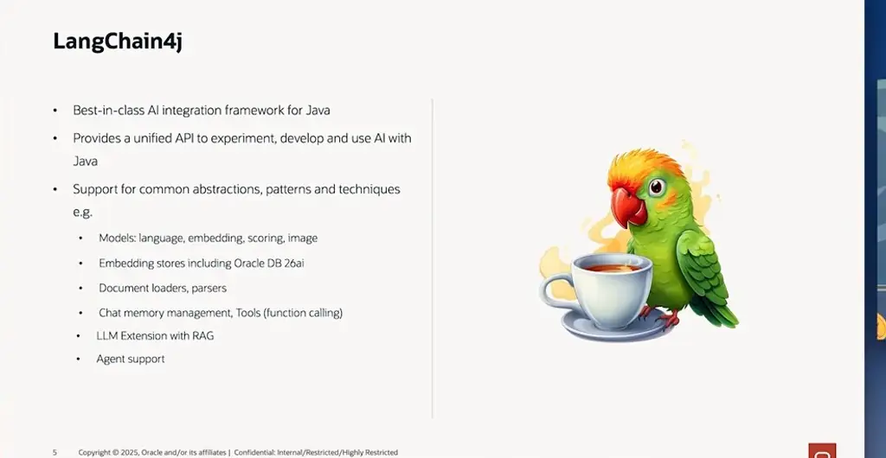
*[▶ 00:02:58](https://www.youtube.com/watch?v=ewSwIZvN9lY&t=178s) · LangChain4j overview and feature list*

Three use cases drove the demo application:

1. **RAG over enterprise content:** embeddings and vector stores retrieve only the relevant passages, which keeps requests within the context window, lowers cost, and reduces hallucinations.
2. **Tool calling:** the model creates tickets, queries an HR system, or checks inventory, moving from chat replies to automation with clear control points.
3. **Multi-step agents:** splitting triage or option comparison across agents is easier to unit test and maintain than hand-rolled orchestration.

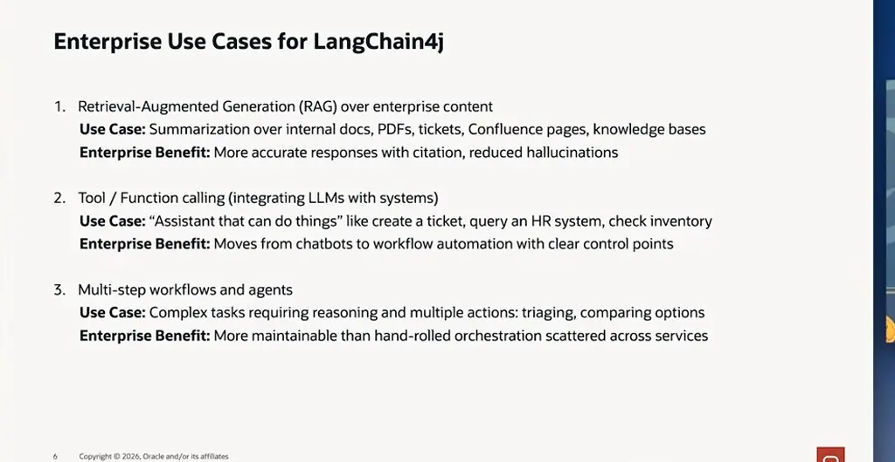
*[▶ 00:05:13](https://www.youtube.com/watch?v=ewSwIZvN9lY&t=313s) · Enterprise use cases for LangChain4j*

## Virtual threads as the foundation of Helidon 4

[▶ 00:05:14](https://www.youtube.com/watch?v=ewSwIZvN9lY&t=314s)

Helidon is a Java microservices framework that balances simplicity, performance and functionality. Its roadmap follows Java's tip-and-tail model: Helidon 27 tracks Java 27, and Helidon 29 tracks the next LTS. Tip releases suit speed; LTS suits production.

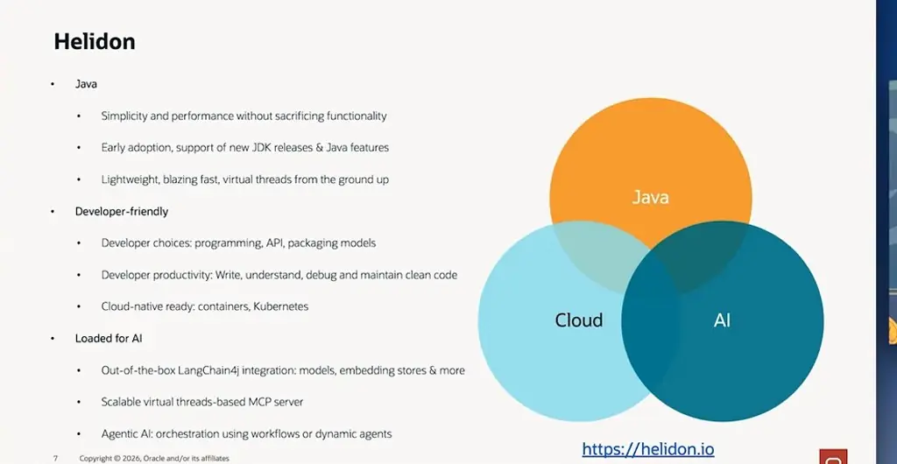
*[▶ 00:09:09](https://www.youtube.com/watch?v=ewSwIZvN9lY&t=549s) · Helidon overview: Java, developer-friendly, AI*

Declarative annotations compile into plain builder-style code, with no CDI container, for fast and predictable startup.

Virtual threads are lightweight threads managed by the JVM, distinct from OS platform threads. Helidon 1–3 gave each request a pooled platform thread, which capped scalability and pushed teams toward reactive code that is hard to debug.

Virtual threads reached production in JDK 21, but pinning limited scaling. The Java team fixed it in JDK 23 and 24 without backporting to 21.

Helidon 4 rebuilt its web server from scratch on virtual threads, giving each request its own.

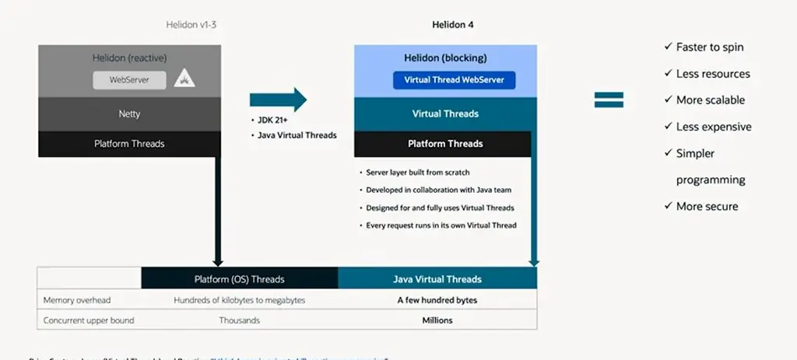
*[▶ 00:12:48](https://www.youtube.com/watch?v=ewSwIZvN9lY&t=768s) · Virtual-thread base makes scale normal and effortless*

Platform threads cost hundreds of kilobytes to megabytes and top out at thousands of concurrent threads. Virtual threads cost a few hundred bytes and reach millions.

## Two programming styles and a clear split of responsibilities

[▶ 00:12:49](https://www.youtube.com/watch?v=ewSwIZvN9lY&t=769s)

Helidon leads plaintext throughput at roughly 10 million requests per second.

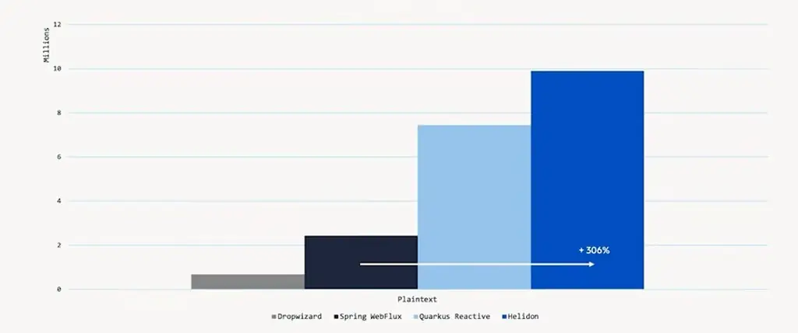
*[▶ 00:12:59](https://www.youtube.com/watch?v=ewSwIZvN9lY&t=779s) · Performance comparison: plaintext threads*

Helidon offers two styles: plain-Java **imperative** code, and **declarative** annotations that generate imperative code at build time with no runtime reflection.

```java
@RestServer.Endpoint
@Http.Path("/greet")
@Service.Singleton
class GreetEndpoint {

  private static final HeaderName HEADER = HeaderNames.create("X-DEV2DEV");

  @Http.GET
  String getDefaultMessageHandler(@Http.HeaderParam(HEADER_NAME) String name) {
    return "Hello " + name + "!";
  }
}

/**
 * Updates HTTP Routing.
 */
static void routing(HttpRouting.Builder routing) {
    routing.register("/greet", new GreetService());
}

class GreetService implements HttpService {
    private static final HeaderName HEADER = HeaderNames.create("X-DEV2DEV");

    @Override
    public void routing(HttpRules rules) {
        rules.get("/", this::getDefaultMessageHandler);
    }

    private void getDefaultMessageHandler(ServerRequest request,
                                          ServerResponse response) {
        response.send("Hello " + request.headers().get(HEADER).get() + "!");
    }
}
```

*[▶ 00:13:37](https://www.youtube.com/watch?v=ewSwIZvN9lY&t=817s) · Imperative vs. declarative Helidon styles*

Integrations with metrics, logging, and OpenTelemetry keep growing.

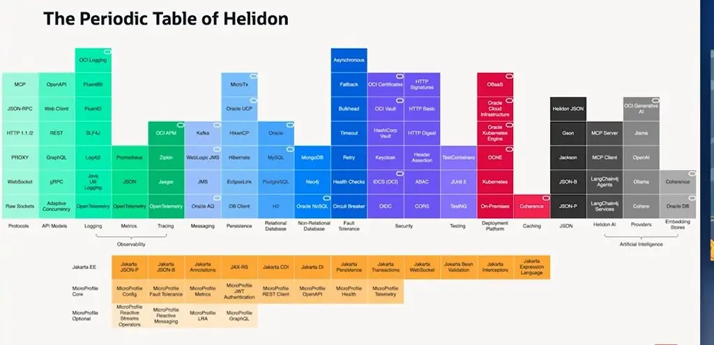
*[▶ 00:14:04](https://www.youtube.com/watch?v=ewSwIZvN9lY&t=844s) · The Periodic Table of Helidon*

4.4 adds faster startup with Leyden, expanded declarative APIs, and throughput limits.

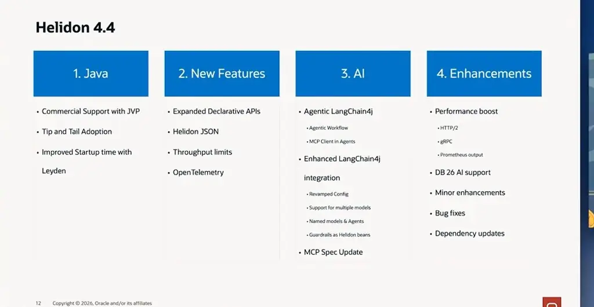
*[▶ 00:15:15](https://www.youtube.com/watch?v=ewSwIZvN9lY&t=915s) · Helidon 4.4 release highlights*

Helidon MCP implements the MCP protocol, while LangChain4j supplies models and retrieval.

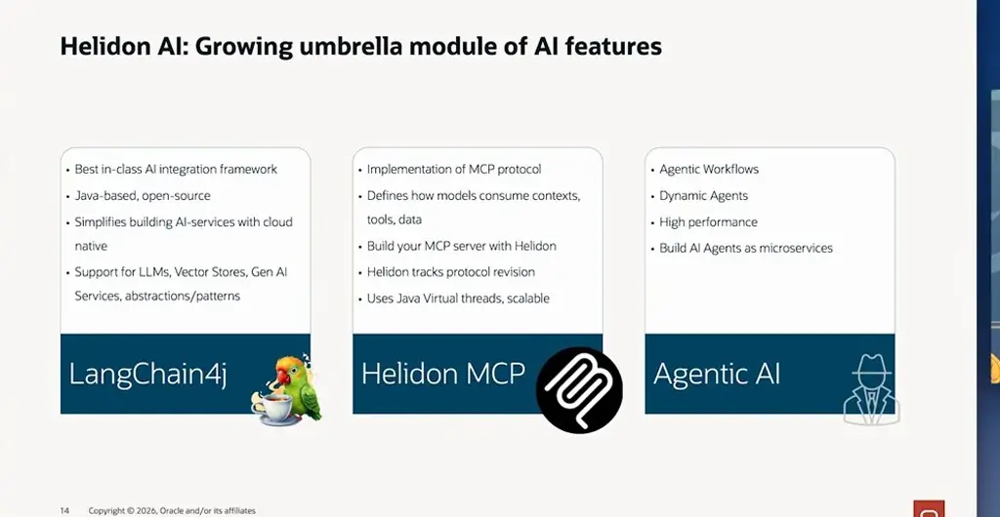
*[▶ 00:15:46](https://www.youtube.com/watch?v=ewSwIZvN9lY&t=946s) · Helidon AI: growing umbrella module*

The demo assistant routes questions to Helidon MP or SE experts via a classifier, router, and summarizer agent.

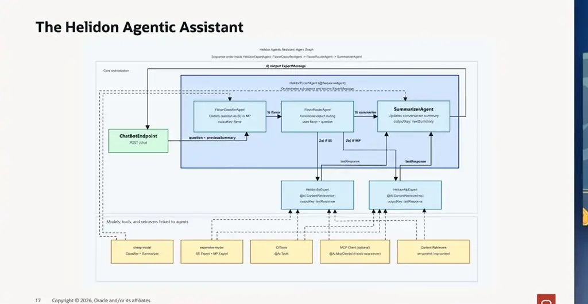
*[▶ 00:17:34](https://www.youtube.com/watch?v=ewSwIZvN9lY&t=1054s) · Helidon Agentic Assistant agent graph*

Helidon handles startup, DI, HTTP, JSON, and configuration; LangChain4j handles agents, prompts, and tool calling.

## Declarative building blocks for AI in Helidon

[▶ 00:19:21](https://www.youtube.com/watch?v=ewSwIZvN9lY&t=1161s)

An `@Ai.Service` interface becomes a chat service, and the model comes from `application.yaml`, so switching models needs no code change.

```java
@Ai.Service
public interface ChatAiService {
    String chat(String question);
}

var chatSvc = Services.get(ChatAiService.class);
String response = chatSvc.chat("Tell me a joke about Java");

langchain4j:
  open-ai:
    chat-model:
      enabled: true
      api-key: "demo"
      model-name: "gpt-4o-mini"
```

*[▶ 00:20:21](https://www.youtube.com/watch?v=ewSwIZvN9lY&t=1221s) · Helidon and LangChain4j Simple Example*

`@Ai.ChatModel` binds an agent to a model, letting cheap models take easy requests. `outputKey` stores each agent's result in shared context for the next agent.

```java
@Ai.Agent("flavor-classifier")
@Ai.ChatModel("cheap-model")
public interface FlavorClassifierAgent {

    @UserMessage("""
            Analyze the following user request about Helidon framework and categorize it as 'mp' - MicroProfile flavor
            or 'se' - Standard Edition flavor of Helidon.

            In case the request doesn't belong to any of those categories categorize it as 'se'.
            Reply with only one of those words and nothing else.
            The user request is: '{{question}}'.
            """)
    @Agent(value = "Categorize a user request", outputKey = "flavor")
    HelidonFlavor classify(@V("question") String question);
}
```

*[▶ 00:22:00](https://www.youtube.com/watch?v=ewSwIZvN9lY&t=1320s) · Declarative Agent Definition and Model Binding*

`@SequenceAgent` runs sub-agents in order from a front-door agent.

```java
@Ai.Agent("helidon-expert")
public interface HelidonExpertAgent {

    @SequenceAgent(outputKey = "jsonResponse", subAgents = {
            FlavorClassifierAgent.class,
            FlavorRouterAgent.class,
            SummarizerAgent.class
    })
    @SystemMessage("""
            You are Frank, a helpful Helidon expert.
            ...
            Use the following conversation summary to keep context and maintain continuity:
            {{previousSummary}}
            """)
    ExpertMessage chat(@V("question") String question, @V("previousSummary") String previousConversationSummary);
}
```

*[▶ 00:22:48](https://www.youtube.com/watch?v=ewSwIZvN9lY&t=1368s) · Agent Orchestration with Sequence*

Input guardrails check prompts before the LLM sees them, guarding against prompt injection, via keyword checks or a cheaper agent. Output guardrails can catch hallucinations.

```java
@Ai.Agent("helidon-se-expert")
public interface HelidonSeExpert {

    @UserMessage("""
            You are a Helidon SE expert.
            Analyze the following user request about Helidon SE and provide the best possible answer.
The user request is {{request}}.
            """)
    @Agent(value = "A Helidon SE expert", outputKey = "response")
    @InputGuardrails(ForbiddenWordsInputGuardrail.class)
    String askExpert(@V("request") String request);
}
```

*[▶ 00:24:34](https://www.youtube.com/watch?v=ewSwIZvN9lY&t=1474s) · Guardrails: input guardrail on Helidon SE expert agent*

The simplest guardrail is a Java class that rejects forbidden words.

```java
@Service.Singleton
public class ForbiddenWordsInputGuardrail implements InputGuardrail {

    ...

    @Override
    public InputGuardrailResult validate(UserMessage userMessage) {
        for (String forbiddenWord : forbidden) {
            if (userMessage.singleText().contains(forbiddenWord)) {
                return this.fatal("Inappropriate Helidon question! Prompt containing: " + forbiddenWord);
            }
        }
        return this.success();
    }
}
```

*[▶ 00:25:50](https://www.youtube.com/watch?v=ewSwIZvN9lY&t=1550s) · Guardrails: ForbiddenWordsInputGuardrail implementation*

`@Ai.Tools` exposes local Java methods, such as a `@Tool`-annotated method that returns the latest Helidon version, to the LLM during a request.

```java
@Ai.Agent("helidon-se-expert")
@Ai.Tools(CliTools.class)
public interface HelidonSeExpert {

    @UserMessage("""
            You are a Helidon SE expert.
            Analyze the following user request about Helidon SE and provide the best possible answer.
            The user request is {{question}}.
            """)
    @Agent(value = "A Helidon SE expert", outputKey = "lastResponse")
    String askExpert(@V("question") String question);
}
```

*[▶ 00:26:34](https://www.youtube.com/watch?v=ewSwIZvN9lY&t=1594s) · Local Tools: exposing a Java method as a tool*

```java
@Service.Singleton
public class CliTools {

    @Tool("Returns a version of the latest released Helidon")
    String getLatestHelidonVersion() {
        var version = config.get("app.latest-helidon-version").asString().orElse("4.0.0");
        LOGGER.log(INFO, "Latest released Helidon version: " + version);
        return version;
    }
}
```

*[▶ 00:26:45](https://www.youtube.com/watch?v=ewSwIZvN9lY&t=1605s) · Local Tools: CliTools getLatestHelidonVersion method*

## Routing questions to specialist agents

[▶ 00:26:46](https://www.youtube.com/watch?v=ewSwIZvN9lY&t=1606s)

The final JAR starts on port 8080.

```text
10:16:14 INFO: Started all channels in 5 milliseconds. 224 milliseconds since JVM startup. Java 25.0.2+10-LTS-69
Helidon Assistant is running at http://localhost:8080
10:16:57 INFO: Activate SE Expert!
^C10:18:41 INFO: Shutdown requested by JVM shutting down
10:18:41 INFO: [0x305dbdc0] default socket closed.
10:18:41 INFO: Helidon WebServer stopped all channels.
10:18:41 INFO: Shutdown finished
rjeberha@Ryans-MacBook-Pro final % java -jar target/helidon-agentic-assistant.jar
10:18:26 INFO: Logging at runtime configured using classpath: logging.properties
WARNING: A restricted method in java.lang.System has been called
WARNING: java.lang.System::load has been called by ai.onnxruntime.OnnxRuntime in an unnamed module (file:/Users/rjebeha/Development/HOL5/langchain4j-agentic-code/final/target/libs/onnxruntime-1.20.0.jar)
WARNING: Use --enable-native-access=ALL-UNNAMED to avoid a warning for callers in this module
WARNING: Restricted methods will be blocked in a future release unless native access is enabled
10:18:28 INFO: Found matching platform from: jar:file:/Users/rjebeha/Development/HOL5/langchain4j-agentic-code/final/target/libs/tokenizers-0.31.1.jar!/native/lib/tokenizers.properties
10:18:28 INFO: [0x2101e5c0] http://0.0.0.0:8080 bound for socket 'default'
10:18:28 INFO: Helidon SE 4.4.0 features: [Config, Encoding, JSON, Langchain4j, Media, Registry, WebServer]
10:18:28 WARNING: You are using incubating features. These APIs are not production ready
10:18:28 INFO: Incubating features: JSON Binding (JSON/Binding)
10:18:28 WARNING: You are using preview features. These APIs are production ready, yet may change more frequently. …
10:18:28 INFO: Preview feature: Langchain4j (Langchain4j)
10:18:28 INFO: Preview feature: Langchain4j In-Process Models (Langchain4j/In-Process)
10:18:28 INFO: Preview feature: Langchain4j OpenAI (Langchain4j/OpenAI)
10:18:28 INFO: Started all channels in 3 milliseconds. 1920 milliseconds since JVM startup. Java 25.0.2+10-LTS-69
Helidon Assistant is running at http://localhost:8080
```

*[▶ 00:27:24](https://www.youtube.com/watch?v=ewSwIZvN9lY&t=1644s) · Terminal startup logs for the final JAR*

A classifier agent routes MP questions to a RAG agent over Helidon MP details.

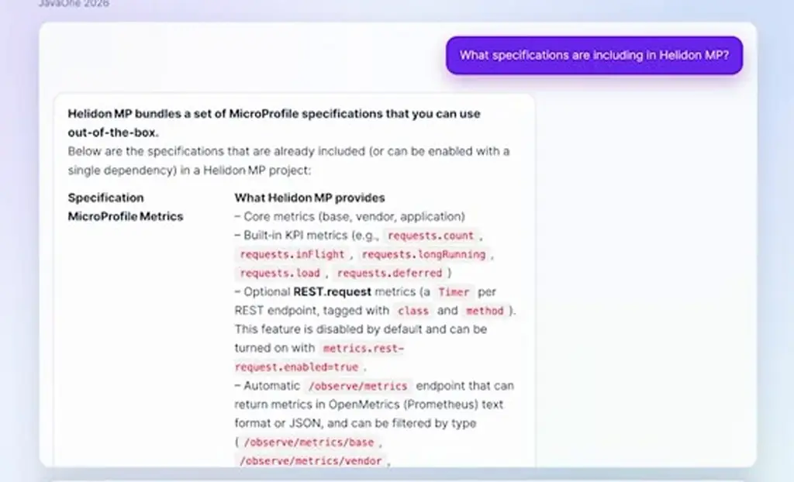
*[▶ 00:28:41](https://www.youtube.com/watch?v=ewSwIZvN9lY&t=1721s) · Browser answer listing Helidon MP specifications*

Observability dependencies bring in the MicroProfile specs automatically.

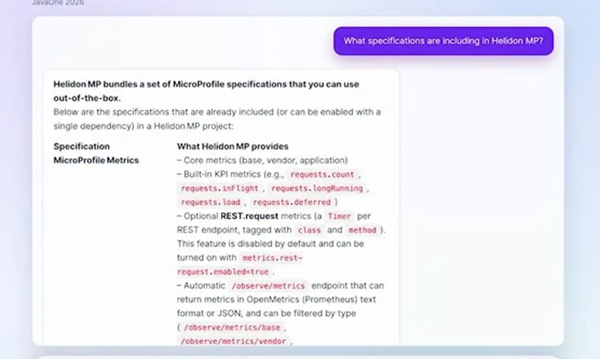
*[▶ 00:28:51](https://www.youtube.com/watch?v=ewSwIZvN9lY&t=1731s) · Helidon Agentic Assistant answers MP specifications question*

```xml
<!-- … -->
<dependency>
    <groupId>io.helidon.webserver</groupId>
    <artifactId>helidon-webserver-observe-info</artifactId>
</dependency>

<!-- Logging observability -->
<dependency>
    <groupId>io.helidon.webserver</groupId>
    <artifactId>helidon-webserver-observe-log</artifactId>
</dependency>
```

*[▶ 00:29:02](https://www.youtube.com/watch?v=ewSwIZvN9lY&t=1742s) · Observability dependencies for Helidon MP*

The lab avoids external services with an in-memory vector store.

DI uses the service registry, annotation processing and `@Service` injection.

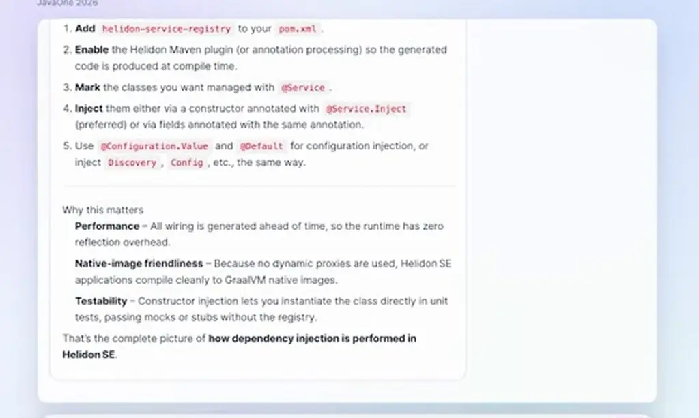
*[▶ 00:29:54](https://www.youtube.com/watch?v=ewSwIZvN9lY&t=1794s) · Assistant's Helidon SE dependency injection answer*

The summary recapped only DI and missed the earlier MP discussion.

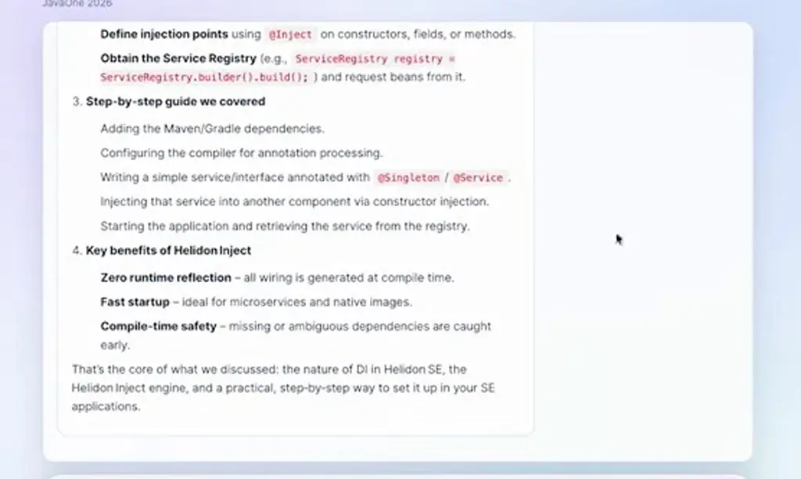
*[▶ 00:30:31](https://www.youtube.com/watch?v=ewSwIZvN9lY&t=1831s) · Assistant's conversation summary on Helidon DI*

## Config-driven models and tools, moved to MCP

[▶ 00:30:33](https://www.youtube.com/watch?v=ewSwIZvN9lY&t=1833s)

The `server` section sets port, host and static content.

```yaml
#
# Copyright (c) 2026 Oracle and/or its affiliates.
#
# Licensed under the Apache License, Version 2.0 (the "License");
# you may not use this file except in compliance with the License.
# You may obtain a copy of the License at
#
#     http://www.apache.org/licenses/LICENSE-2.0
#
# Unless required by applicable law or agreed to in writing, software
# distributed under the License is distributed on an "AS IS" BASIS,
# WITHOUT WARRANTIES OR CONDITIONS OF ANY KIND, either express or implied.
# See the License for the specific language governing permissions and
# limitations under the License.
#

server:
  port: 8081
  host: 0.0.0.0

app:
  latest-helidon-version: 4.4.0-FROM-MCP-SERVER

declarative:
  ignore-incubating: true
```

*[▶ 00:31:03](https://www.youtube.com/watch?v=ewSwIZvN9lY&t=1863s) · Helidon application.yaml configuration file*

`ignore-incubating: true` allows the incubating APIs the demo uses, before OpenJDK adoption.

```yaml
# See the License for the specific language governing permissions and
# limitations under the License.
#
server:
  host: "0.0.0.0"
  port: 8080
  features:
    static-content:
      classpath:
        - context: "/"
          location: "/WEB"
          welcome: "index.html"

declarative:
  ignore-incubating: true

langchain4j:
  providers:
    lc4j-in-process:
      type: all_minilm_l6_v2_q

    open-ai:
      # Using OpenAI provider to call OCI GenAI model over OpenAI compatible API
      api-key: "${OCI_API_KEY}"
      base-url: https://inference.generativeai.us-chicago-1.oci.oraclecloud.com/20231130/actions
      log-requests: false
      log-responses: false

    lc4j-content-retriever:
      embedding-model: assistant-embedding-model
      max-results: 20
      min-score: 0.6

models:
  assistant-embedding-model:
```

*[▶ 00:32:09](https://www.youtube.com/watch?v=ewSwIZvN9lY&t=1929s) · ignore-incubating flag in application.yaml*

The `open-ai` provider calls a live OCI Generative AI system through an OpenAI-compatible API.

```yaml
# Unless required by applicable law or agreed to in writing, software
# distributed under the License is distributed on an "AS IS" BASIS,
# WITHOUT WARRANTIES OR CONDITIONS OF ANY KIND, either express or implied.
# See the License for the specific language governing permissions and
# limitations under the License.
#
server:
  host: "0.0.0.0"
  port: 8080
  features:
    static-content:
      classpath:
        - context: "/"
          location: "/WEB"
          welcome: "index.html"

declarative:
  ignore-incubating: true

langchain4j:
  providers:
    lc4j-in-process:
      type: all_minilm_l6_v2_q

    open-ai:
      # Using OpenAI provider to call OCI GenAI model over OpenAI compatible API
      api-key: "${OCI_API_KEY}"
      base-url: https://inference.generativeai.us-chicago-1.oci.oraclecloud.com/20231130/actions
      log-requests: false
      log-responses: false

    lc4j-content-retriever:
      embedding-model: assistant-embedding-model
      max-results: 20
      min-score: 0.6
```

*[▶ 00:31:19](https://www.youtube.com/watch?v=ewSwIZvN9lY&t=1879s) · application.yaml server, declarative and providers*

`cheap-model` runs Llama 4 Scout, one of the cheapest options.

```yaml
features:
  static-content:
    classpath:
      - context: "/"
        location: "/WEB"
        welcome: "index.html"

declarative:
  ignore-incubating: true

langchain4j:
  providers:
    lc4j-in-process:
      type: all_minilm_l6_v2_q

    open-ai:
      # Using OpenAI provider to call OCI GenAI model over OpenAI compatible API
      api-key: "${OCI_API_KEY}"
      base-url: https://inference.generativeai.us-chicago-1.oci.oraclecloud.com/20231130/actions
      log-requests: false
      log-responses: false

    lc4j-content-retriever:
      embedding-model: assistant-embedding-model
      max-results: 20
      min-score: 0.6

models:
  assistant-embedding-model:
    provider: lc4j-in-process

  cheap-model:
    provider: open-ai
    model-name: "meta.llama-4-scout-17b-16e-instruct"
```

*[▶ 00:32:28](https://www.youtube.com/watch?v=ewSwIZvN9lY&t=1948s) · Providers, embedding model and cheap model*

`expensive-model` runs gpt-oss-120b. Swapping models needs only a configuration change.

```yaml
declarative:
  ignore-incubating: true

langchain4j:
  providers:
    lc4j-in-process:
      type: all_minilm_l6_v2_q

    open-ai:
      # Using OpenAI provider to call OCI GenAI model over OpenAI compatible API
      api-key: "${OCI_API_KEY}"
      base-url: https://inference.generativeai.us-chicago-1.oci.oraclecloud.com/20231130/actions
      log-requests: false
      log-responses: false

    lc4j-content-retriever:
      embedding-model: assistant-embedding-model
      max-results: 20
      min-score: 0.6

models:
  assistant-embedding-model:
    provider: lc4j-in-process

  cheap-model:
    provider: open-ai
    model-name: "meta.llama-4-scout-17b-16e-instruct"

  expensive-model:
    provider: open-ai
    model-name: "openai.gpt-oss-120b"
```

*[▶ 00:33:06](https://www.youtube.com/watch?v=ewSwIZvN9lY&t=1986s) · Open-AI provider and model definitions*

To move a tool to MCP, uncomment the `mcp-clients` block and swap `@AI.Tools` for `@AI.McpClients`. Expert prompts need no change.

The server log confirms the call, and the returned version stays verbatim in the generated `helidon init` command.

```text
helidon init --batch \
  --version 4.4.0-FROM-MCP-SERVER \
  --name javaone-demo \
  -Dpackage=com.example.javaonedemo \
  -Dflavor=SE \
  -Dapp-type=quickstart

INFO Latest released Helidon version: 4.4.0-FROM-MCP-SERVER
INFO Init with Helidon cli cmd called, version: 4.4.0-FROM-MCP-SERVER, project name: javaone-demo
```

*[▶ 00:35:06](https://www.youtube.com/watch?v=ewSwIZvN9lY&t=2106s) · Bonus lab doc: expected CLI and log output*

## Links & resources

- [Helidon project site and docs](https://helidon.io) — <https://helidon.io> · video description
- [Helidon GitHub repository, with the Agentic Assistant lab code](https://github.com/helidon-io/helidon) — <https://github.com/helidon-io/helidon> · video description
