# How does Java fit into the world of AI—and how can it become an even better fit?

*How Java fits into AI today, where it is hardest to use, and how Babylon's code reflection could translate Java into GPU and other foreign runtimes.*

Source: [How does Java fit into the world of AI—and how can it become an even better fit?](https://www.youtube.com/watch?v=rL3sWS_8b-g) · Paul Sandoz · Java · 50 min

## TL;DR

Java has 30 years of compressed engineering knowledge, but AI work has mostly gone to Python, and Java's fit varies sharply across the four AI layers. Agent layers are easy in Java because they are ordinary software built on HTTP, JSON and SSE, while training and GPU inference are hard. The talk's main idea is that Java can target those harder layers by translating differentiated Java code into foreign models such as CUDA, OpenCL and ONNX, using Babylon's code reflection together with Panama and Valhalla. This matters because it could let Java developers reach GPU and training work without leaving the language.

## Key takeaways

- AI work has four layers: training, inference, agents (inference composed with tools and information sources), and agentic systems (agents composed with dynamic context), and Java's ease differs across them.
- Agent layers are easy in Java because they are ordinary software engineering using HTTP, JSON and SSE, while training is the hardest layer.
- Inference can use Panama's FFM API to run ONNX models and the Vector API for CPU runtimes, Babylon's HAT for GPU runtimes, Valhalla for numeric types like float16, and Detroit to run PyTorch.
- Code reflection exposes method and lambda code at run time as a standard code model (an AST), so Java code can be translated without reverse-engineering bytecode.
- Code models are immutable, so a transform rebuilds the tree while traversing it, letting you copy, drop, or replace each element, for example adding a println before each return.
- The HAT demo shows the pattern of writing portable Java, debugging it on the CPU, and running it on the GPU, with Java shaders translated to OpenCL C99.
- Reverse-mode autodiff is the hard part of training, since forward mode cannot scale to models with very many parameters, and automatic data movement that keeps data on the GPU is key to performance.
- Code reflection remains an incubator API under JDK scope and the `@Reflect` annotation is a stopgap, so its final form may change before it moves to Java SE.

## Java's 30 years of adapting to change

[▶ 00:00:00](https://www.youtube.com/watch?v=rL3sWS_8b-g&t=0s)

Agentic AI will become essential to software development, and developers must adapt technically and culturally, as H.G. Wells (1945) and Andy Grove (1983) urged.

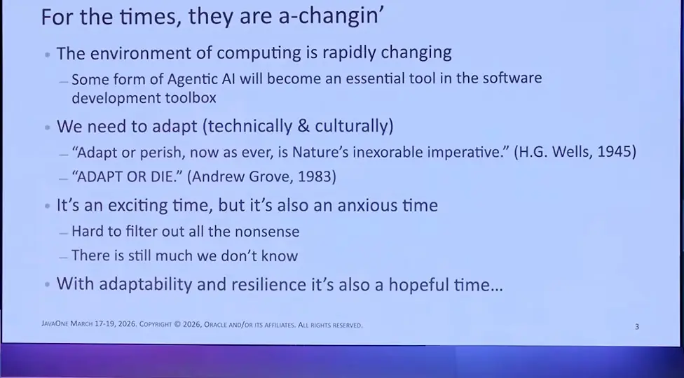
*[▶ 00:00:07](https://www.youtube.com/watch?v=rL3sWS_8b-g&t=7s) · For the times, they are a-changin'*

Reinhold's 2018 talk, "Change is the Only Constant," described Java adapting through the module system and a six-month release process.


*[▶ 00:02:38](https://www.youtube.com/watch?v=rL3sWS_8b-g&t=158s) · Change is the only constant keynote*

Development of Java (Oak) began in 1991 and first released in 1995. Java has since absorbed object-oriented programming, the Internet, the World Wide Web, open source, and mobile and cloud computing.

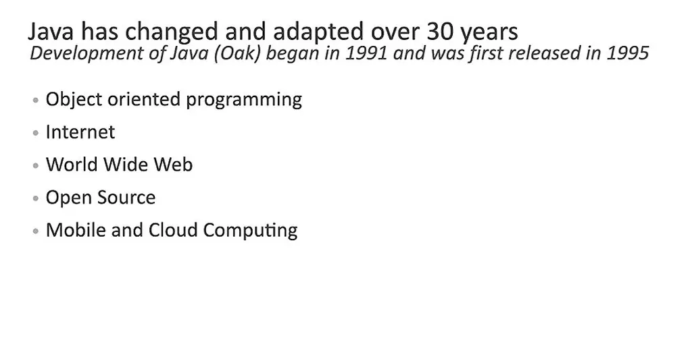
*[▶ 00:03:44](https://www.youtube.com/watch?v=rL3sWS_8b-g&t=224s) · Java has changed and adapted over 30 years*

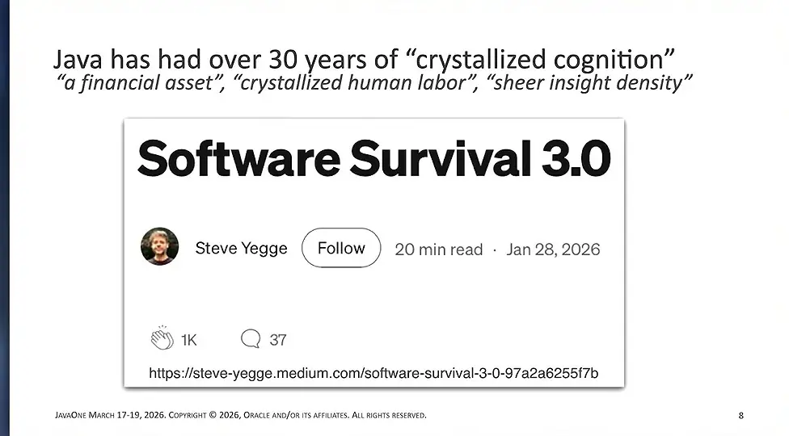
*[▶ 00:05:49](https://www.youtube.com/watch?v=rL3sWS_8b-g&t=349s) · Java's crystallized cognition and Software Survival 3.0*

Companies such as Sun Microsystems did not adapt. Each shift changed paradigms, application areas, deployment styles and hardware.

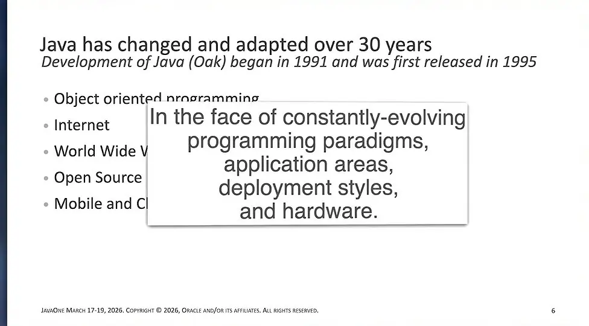
*[▶ 00:04:40](https://www.youtube.com/watch?v=rL3sWS_8b-g&t=280s) · Java adapting to changing paradigms and hardware*

AI and agentic AI now join that list.

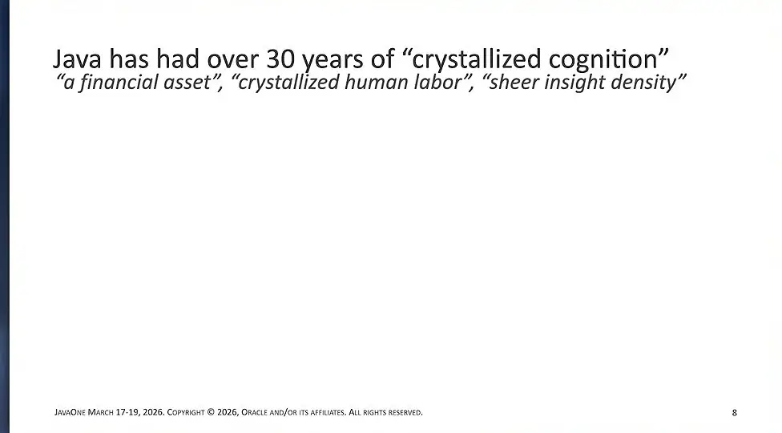
*[▶ 00:04:48](https://www.youtube.com/watch?v=rL3sWS_8b-g&t=288s) · Java adding AI and agentic AI to its trends*

## Java's crystallized cognition

[▶ 00:05:04](https://www.youtube.com/watch?v=rL3sWS_8b-g&t=304s)

Java's 30 years of source, specifications, and ecosystem keep behaving the same way. The speaker calls this crystallized cognition. Rebuilding it from scratch is a daunting research project.

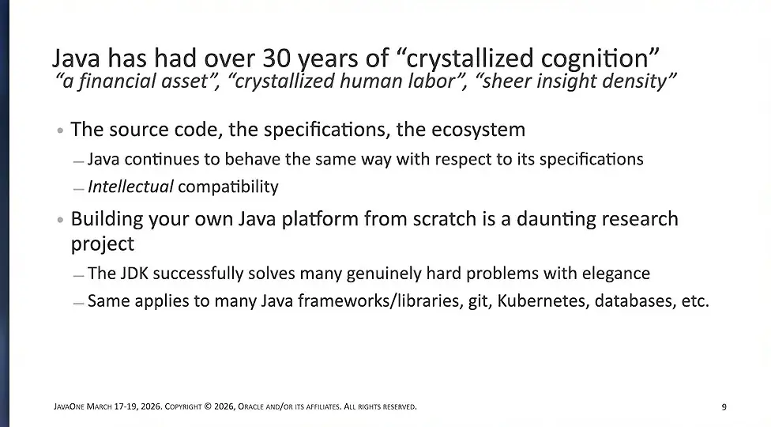
*[▶ 00:07:45](https://www.youtube.com/watch?v=rL3sWS_8b-g&t=465s) · Java's crystallized cognition and building from scratch*

Re-synthesizing Java with an LLM would waste tokens. OpenJDK is a `git clone` away at a fraction of the cost, and supported JDKs cost less than regenerating one.

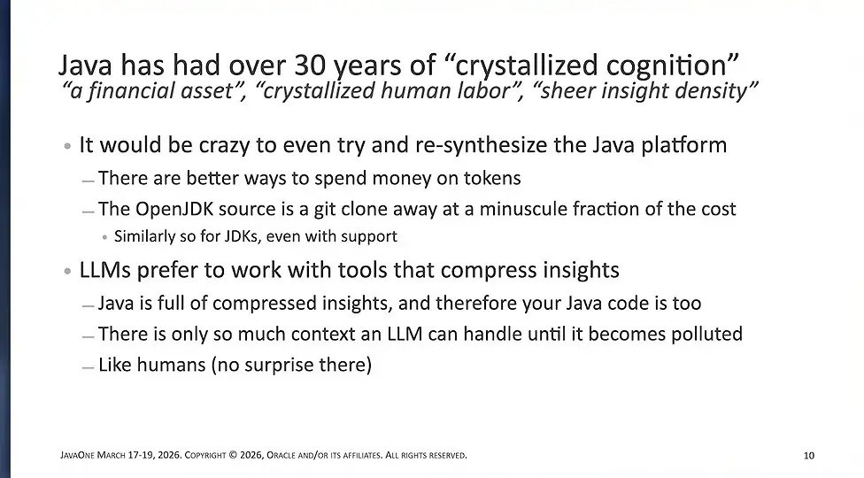
*[▶ 00:08:01](https://www.youtube.com/watch?v=rL3sWS_8b-g&t=481s) · Why not re-synthesize Java; LLMs and compressed insight*

LLMs prefer tools that compress insight, and context gets polluted as it fills, just like human memory.

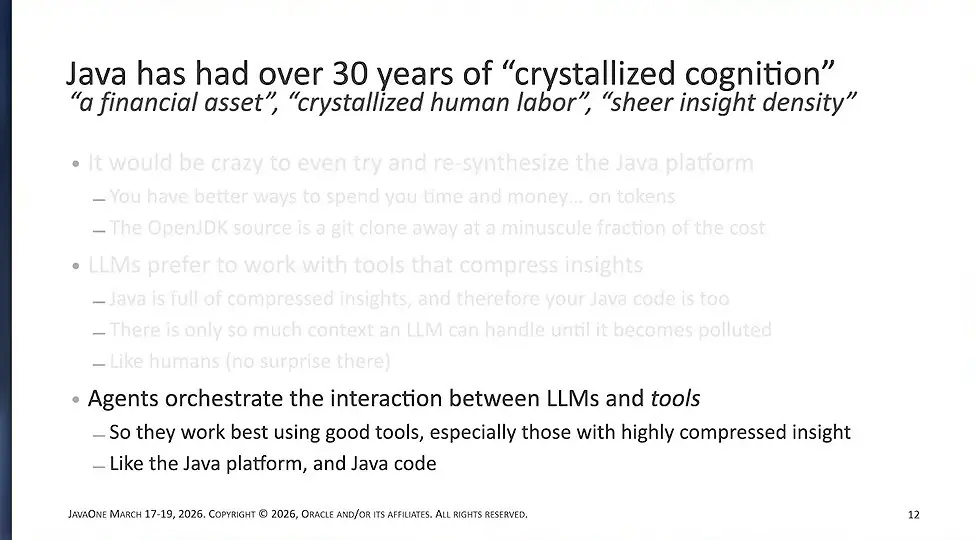
*[▶ 00:09:11](https://www.youtube.com/watch?v=rL3sWS_8b-g&t=551s) · Crystallized cognition slide with Douglas Adams popup*

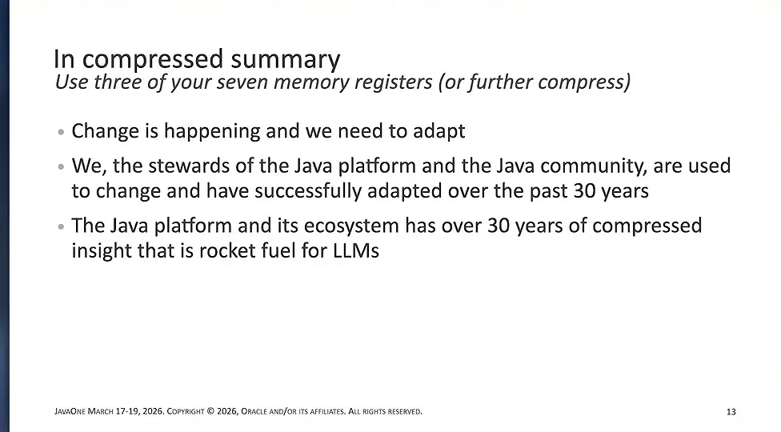
*[▶ 00:10:18](https://www.youtube.com/watch?v=rL3sWS_8b-g&t=618s) · In compressed summary*

Agents orchestrate LLM–tool interaction, so they work best with good, highly compressed tools like the Java platform.

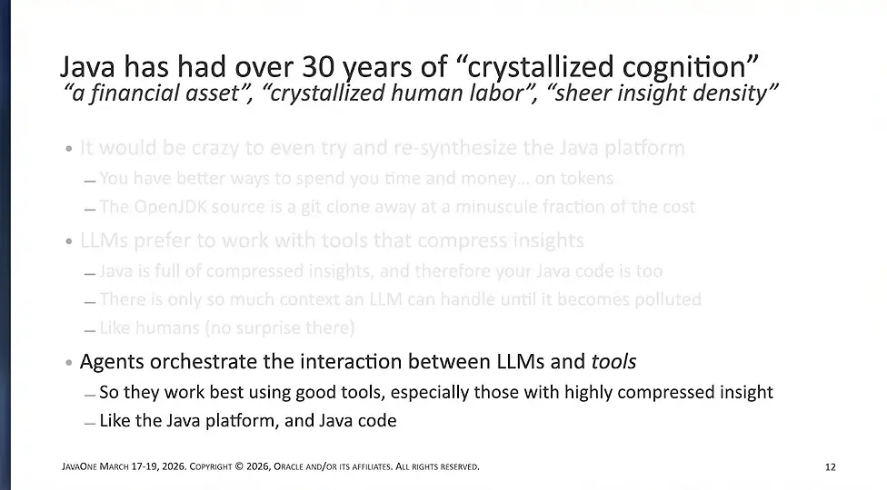
*[▶ 00:09:39](https://www.youtube.com/watch?v=rL3sWS_8b-g&t=579s) · Agents orchestrate LLM and tool interaction*

## Four AI layers and where Java is easiest

[▶ 00:10:15](https://www.youtube.com/watch?v=rL3sWS_8b-g&t=615s)

AI has four layers. **Training** consumes enormous data and compute. **Inference**, its product, uses more compute in aggregate. An **agent** composes inference with tools and information sources. **Agentic** systems compose agents with dynamic context to orchestrate workflows.

Training is hardest, and Java ease is the inverse of pain. Agent layers are easy in Java because they are ordinary software engineering, using HTTP, JSON and SSE.

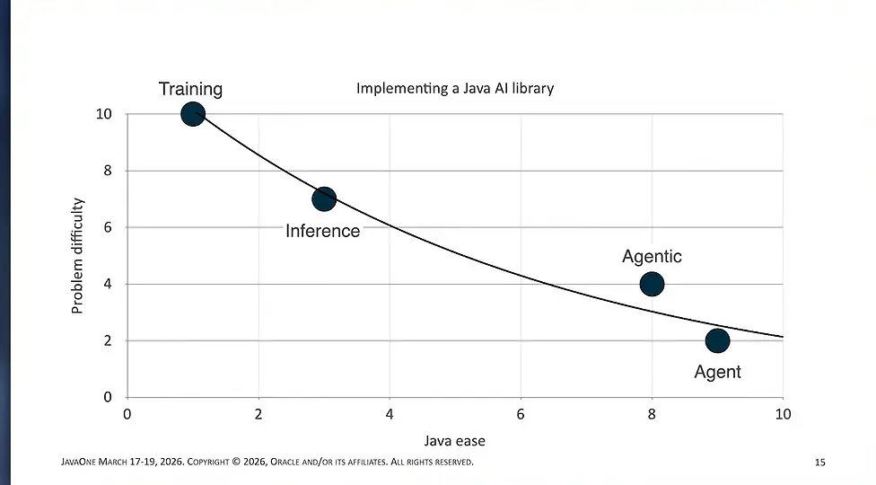
*[▶ 00:13:30](https://www.youtube.com/watch?v=rL3sWS_8b-g&t=810s) · Implementing a Java AI library: difficulty vs ease*

The goal is to shift the whole curve toward easier Java without making problems easier, with the biggest gains in inference and training.

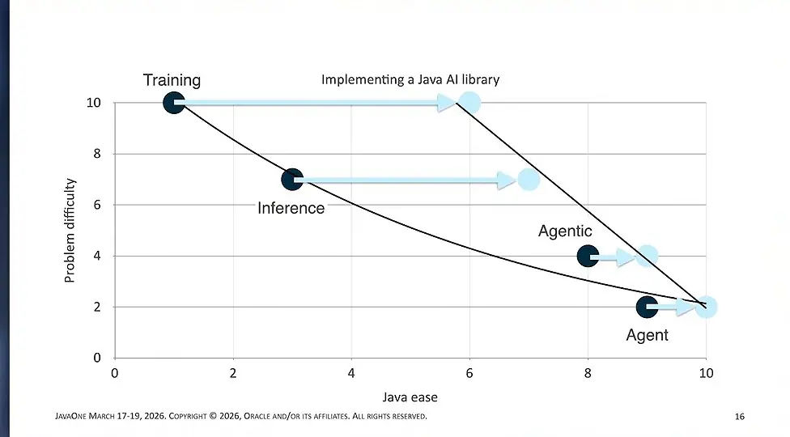
*[▶ 00:14:02](https://www.youtube.com/watch?v=rL3sWS_8b-g&t=842s) · Shifting the curve toward easier Java*

Ideally the curve becomes vertical: everything easy, even when the problem is harder.

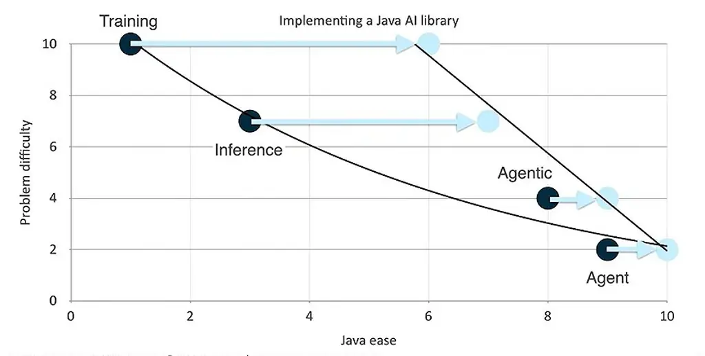
*[▶ 00:14:07](https://www.youtube.com/watch?v=rL3sWS_8b-g&t=847s) · Problem difficulty vs. Java ease*

Agentic work needs reused patterns, not magic. Each release can help, such as better string handling and process execution.

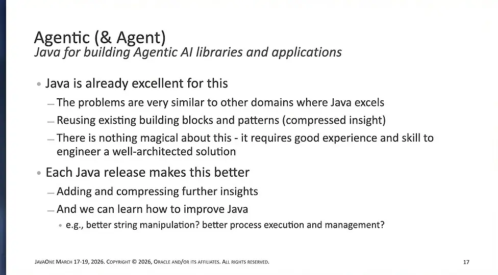
*[▶ 00:14:04](https://www.youtube.com/watch?v=rL3sWS_8b-g&t=844s) · Agentic (& Agent): Java for agentic AI*

Qualitatively, Java fits: 30 years of compressed insight. Quantitatively, evidence is scarce; agent swarms will likely favor fast compile and test cycles.

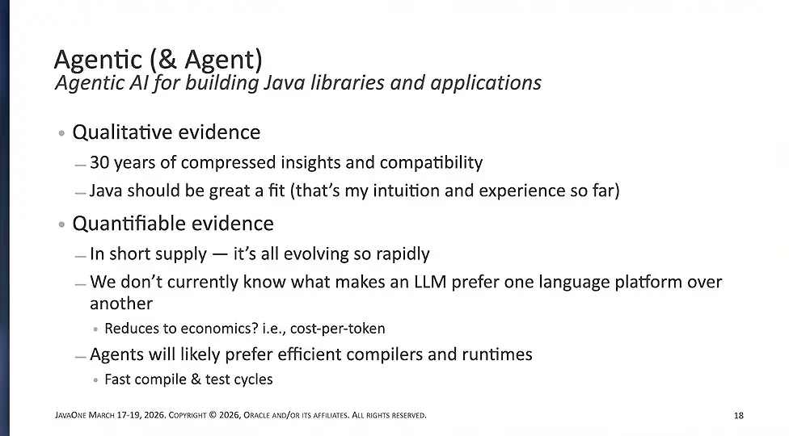
*[▶ 00:16:33](https://www.youtube.com/watch?v=rL3sWS_8b-g&t=993s) · Agentic (& Agent): Evidence for Java*

The challenge: build JavaPaw, a safer, more deployable agentic assistant in Java, then use it to build Java software. Open question: how to detect drift from instructions.

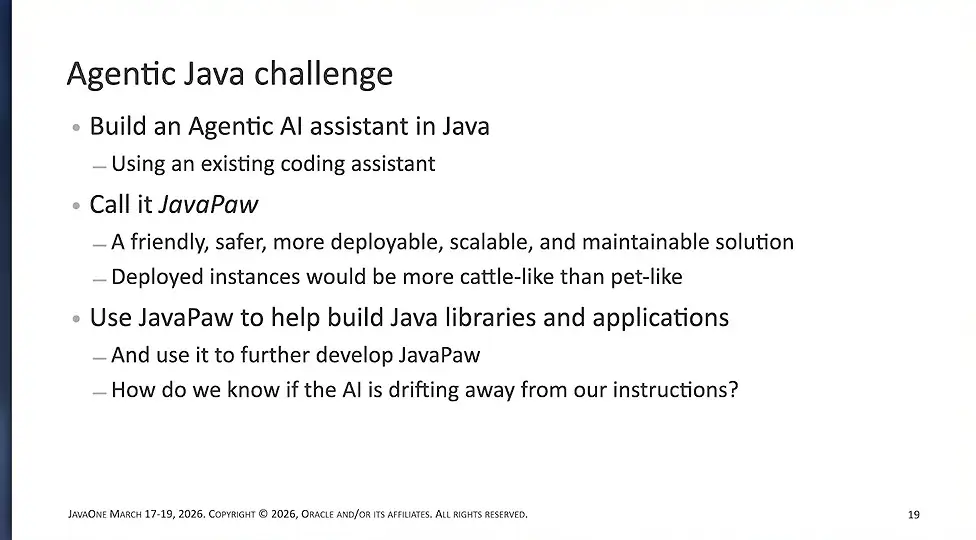
*[▶ 00:17:41](https://www.youtube.com/watch?v=rL3sWS_8b-g&t=1061s) · Agentic Java challenge: JavaPaw*

## Translating Java into GPU and foreign runtimes

[▶ 00:18:17](https://www.youtube.com/watch?v=rL3sWS_8b-g&t=1097s)

Inference uses Panama's FFM API to run ONNX models and the Vector API for CPU runtimes. Babylon's HAT covers GPU runtimes, Valhalla adds numeric types like float16 that behave like int, and Detroit runs PyTorch.

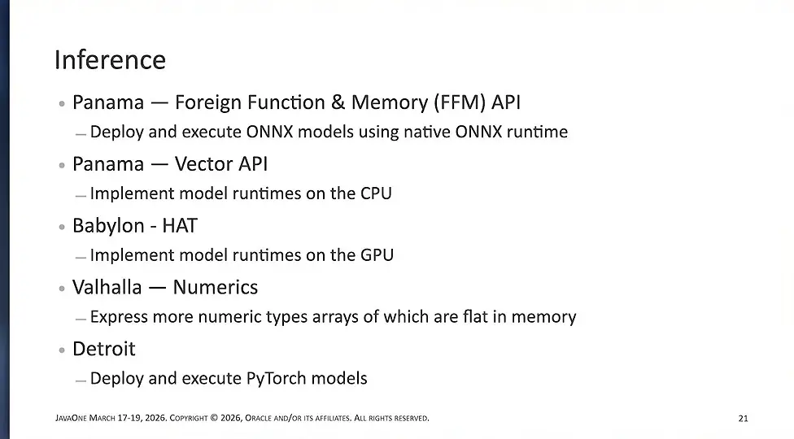
*[▶ 00:19:54](https://www.youtube.com/watch?v=rL3sWS_8b-g&t=1194s) · Inference: which OpenJDK project provides what*

Training is the hardest case. Babylon targets differentiating mathematical code, which stochastic gradient descent needs, and GPU development. It also serves SQL and eBPF.

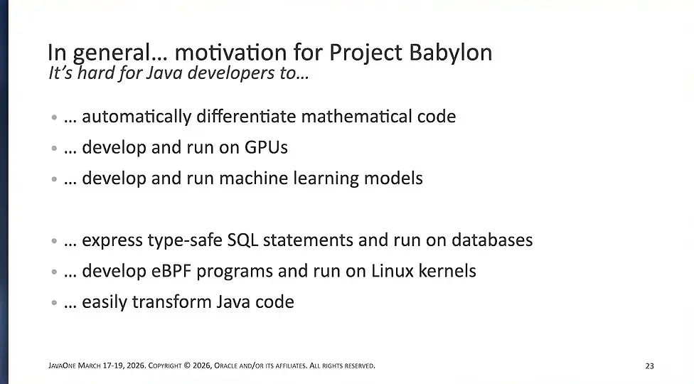
*[▶ 00:21:12](https://www.youtube.com/watch?v=rL3sWS_8b-g&t=1272s) · Motivation for Project Babylon*

Current Java options are inferior: embedding non-Java code in text blocks, writing tedious data-structure code, or using unsafe inspection. Portable Java that represents GPU code would make Java developers implicitly CUDA developers.

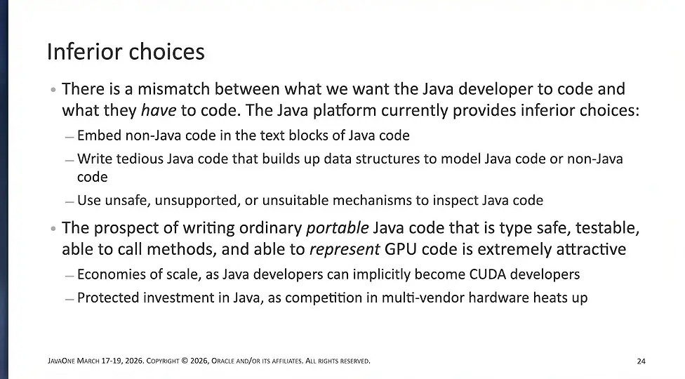
*[▶ 00:22:11](https://www.youtube.com/watch?v=rL3sWS_8b-g&t=1331s) · Inferior choices*

These cases share one pattern: translating Java into a foreign programming model. Translation is partial, since not all Java maps to GPU code, and it targets differentiated Java on the JVM or CUDA and ONNX runtimes.

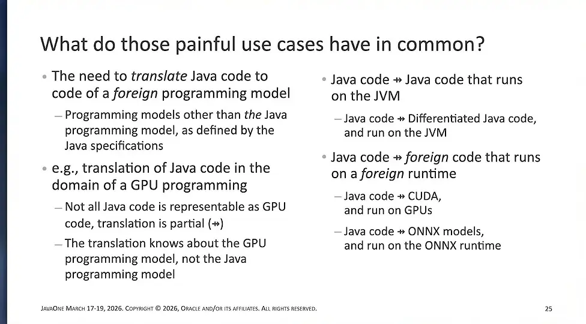
*[▶ 00:23:08](https://www.youtube.com/watch?v=rL3sWS_8b-g&t=1388s) · Common traits of painful use cases*

Code reflection gives standard access to method and lambda code at run time as a code model, an AST suited to translation. The speaker calls it a Swiss Army knife.

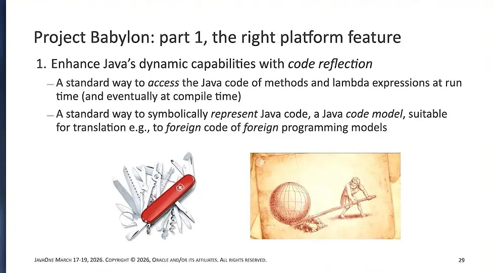
*[▶ 00:24:44](https://www.youtube.com/watch?v=rL3sWS_8b-g&t=1484s) · Project Babylon part 1: platform feature*

HAT proves code reflection: write portable Java, debug on the CPU, run on the GPU. It uses code reflection to translate Java and Panama's FFM to call GPU compilers. Code reflection is now JEP-submitted.

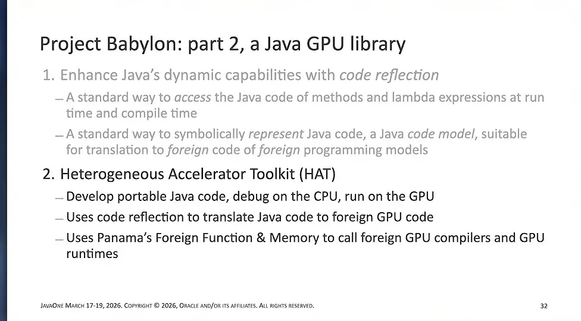
*[▶ 00:26:09](https://www.youtube.com/watch?v=rL3sWS_8b-g&t=1569s) · Project Babylon part 2: Java GPU library*

## Java shaders running on the GPU

[▶ 00:27:33](https://www.youtube.com/watch?v=rL3sWS_8b-g&t=1653s)

The demo runs a Java shader on the GPU, translated to OpenCL C99. TruchetShader reaches about 2 FPS on one CPU thread and about 25 multithreaded, and the same code can be debugged on the CPU.

The shader is plain Java methods marked `@Reflect`, using `vec2` and `vec3` types that mirror the OpenGL shading language.

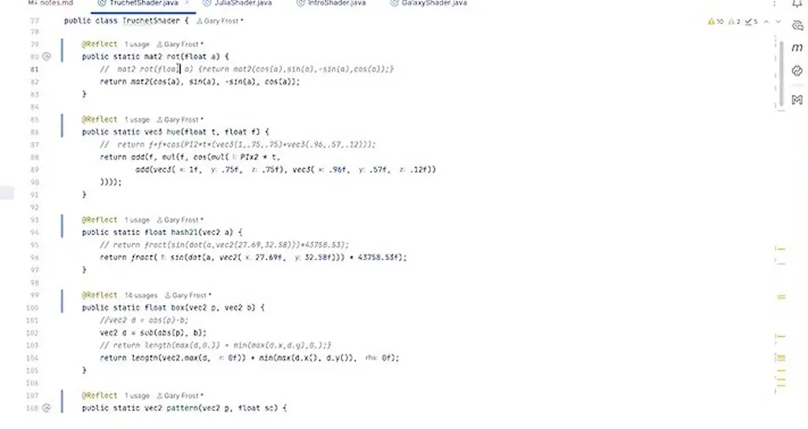
*[▶ 00:31:37](https://www.youtube.com/watch?v=rL3sWS_8b-g&t=1897s) · TruchetShader.java shader methods in Java*

Valhalla value classes could make these vector types cheaper by reducing garbage.

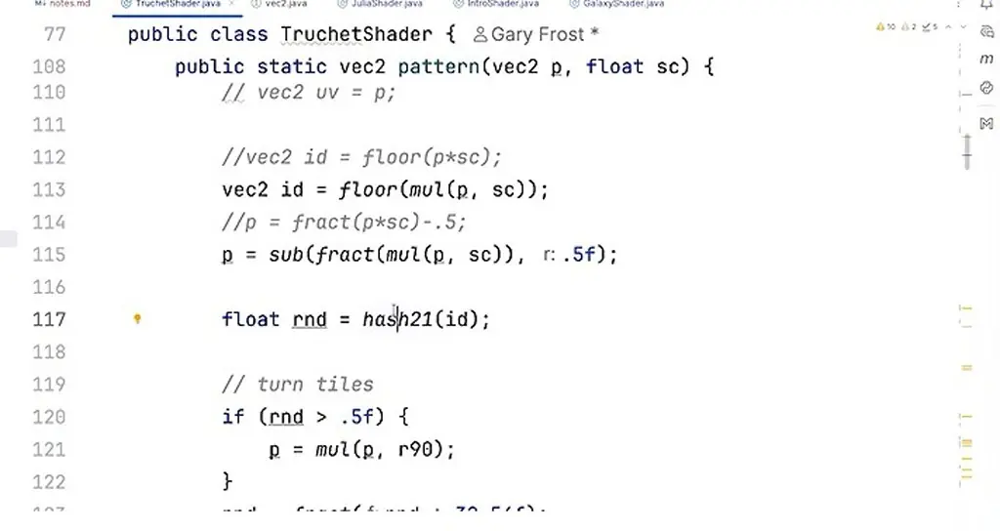
*[▶ 00:32:21](https://www.youtube.com/watch?v=rL3sWS_8b-g&t=1941s) · TruchetShader pattern method cell logic*

`main` creates an `Accelerator`, wraps the class in a `ShaderViewer`, and starts a loop that calls `acc.compute`.

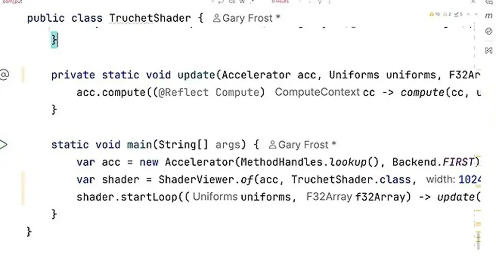
*[▶ 00:32:30](https://www.youtube.com/watch?v=rL3sWS_8b-g&t=1950s) · TruchetShader update and main entry points*

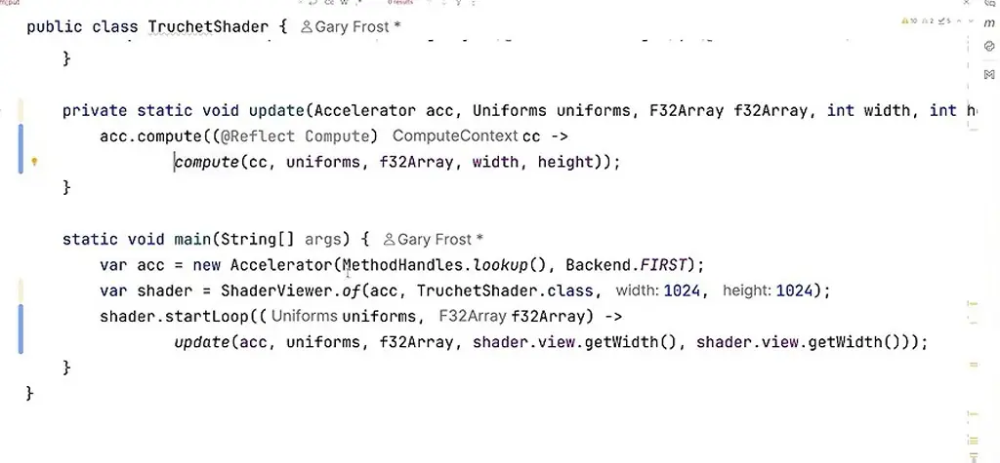
*[▶ 00:32:38](https://www.youtube.com/watch?v=rL3sWS_8b-g&t=1958s) · Compute call and shader loop launch*

Each demo runs with `java @toy` and a class name, listed in `notes.md`.

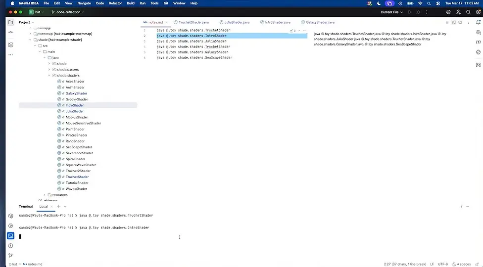
*[▶ 00:29:43](https://www.youtube.com/watch?v=rL3sWS_8b-g&t=1783s) · Terminal: launching shader classes with java @toy*

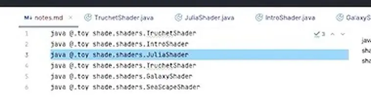
*[▶ 00:30:33](https://www.youtube.com/watch?v=rL3sWS_8b-g&t=1833s) · notes.md command list and terminal runs*

GalaxyShader drops from 58 FPS on the GPU to 2 FPS in Java MT mode. The speaker sees the visual feedback as a possible teaching tool for Java and math.

## Reading and rewriting a lambda's code model

[▶ 00:34:16](https://www.youtube.com/watch?v=rL3sWS_8b-g&t=2056s)

Reflecting a lambda with `@Reflect` and calling `Op.ofLambda(o).orElseThrow()` returns its code model, so there is no bytecode reverse-engineering. `toText()` prints that immutable tree in a readable form.

```java
import jdk.incubator.code.Op;
import jdk.incubator.code.Reflect;

void main() throws Throwable {
    @Reflect
    IntBinaryOperator o = (int a, int b) -> a + b;

    Op.ofLambda(o).orElseThrow()
}
```

*[▶ 00:35:00](https://www.youtube.com/watch?v=rL3sWS_8b-g&t=2100s) · Reflecting the lambda with Op.ofLambda*

Printing the model shows loads of the parameters, the `add`, and the `return`.

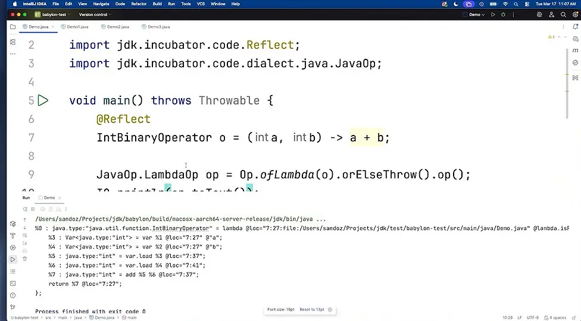
*[▶ 00:35:34](https://www.youtube.com/watch?v=rL3sWS_8b-g&t=2134s) · Printing the code model as text*

Code models are immutable, so `transform` rebuilds them while traversing: each element can be copied, dropped, or replaced. Here, each return op gets a `println("Hello!")` before it.

```java
void main() throws Throwable {
    @Reflect
    IntBinaryOperator o = ( int a,   int b) -> a + b;

    Quoted<JavaOp.LambdaOp> oQuotedModel = Op.ofLambda(o).orElseThrow();
    JavaOp.LambdaOp lop = oQuotedModel.op();
    IO.println(lop.toText());

    JavaOp.LambdaOp transformedLop = lop.transform(CodeContext.create(), ( Builder b,  Op op) -> {
        if (op instanceof CoreOp.ReturnOp rop) {
            Op.Result c = b.op(CoreOp.constant(J_L_STRING,  value: "Hello!"));
            b.op(JavaOp.invoke(
                    MethodRef.method(IO.class,  name: "println", void.class, Object.class),
                    c));

%2 : Var<java.type:"int"> = var %0 @loc="17:27" @"a";
%3 : Var<java.type:"int"> = var %1 @loc="17:27" @"b";
%4 : java.type:"int" = var.load %2 @loc="17:37";
%5 : java.type:"int" = var.load %3 @loc="17:41";
%6 : java.type:"int" = add %4 %5 @loc="17:37";
%7 : java.type:"java.lang.String" = constant @"Hello!";
invoke %7 @java.ref:"java.lang.IO::println(java.lang.Object):void";
return %6 @loc="17:27";
```

*[▶ 00:38:05](https://www.youtube.com/watch?v=rL3sWS_8b-g&t=2285s) · Transformer adds println call in IDE*

The transform can also be more involved. A version in `Demo3.java` prints the method's return value too.

```java
void main() throws Throwable {
    IO.println(lop.toText());

    JavaOp.LambdaOp transformedLop = lop.transform(CodeContext.create(), ( Builder b,  Op op) -> {
        if (op instanceof CoreOp.ReturnOp rop) {
            Op.Result c = b.op(CoreOp.constant(J_L_STRING,  value: "Hello!"));
            b.op(JavaOp.invoke
                MethodRef.method(IO.class,  name: "println", void.class, Object.class),
                c));

            Op.Result box = b.op(JavaOp.invoke
                MethodRef.method(Integer.class,  name: "valueOf", Integer.class, int.class),
                b.context().getValue(rop.returnValue())));
            b.op(JavaOp.invoke
                MethodRef.method(IO.class,  name: "println", void.class, Object.class),
                box));

            b.op(rop);
        } else {
            b.op(op);
        }
        return b;
    });
    IO.println(transformedLop.toText());
    IO.println(SSA.transform(transformedLop).toText());
```

*[▶ 00:39:41](https://www.youtube.com/watch?v=rL3sWS_8b-g&t=2381s) · Demo3.java: lambda transform with println and valueOf*

`IO.println` takes `Object`, so the `int` result must be boxed first with `Integer.valueOf`.

```java
void main() throws Throwable {
    JavaOp.LambdaOp transformedLop = lop.transform(CodeContext.create(), ( Builder b,  Op op) -> {
            Op.Result box = b.op(JavaOp.invoke(
                    MethodRef.method(Integer.class,  name: "valueOf", Integer.class, int.class),
                    b.context().getValue(rop.returnValue()))));
        b.op(JavaOp.invoke(
                MethodRef.method(IO.class,  name: "println", void.class, Object.class),
                box));
```

*[▶ 00:39:48](https://www.youtube.com/watch?v=rL3sWS_8b-g&t=2388s) · Demo3.java: lambda printing a method's return value*

The printed IR shows the `invoke` to `valueOf` before the second `println`.

```java
void main() throws Throwable {
    @Reflect
    IntBinaryOperator o = ( int a,  int b) -> a + b;

    Quoted<JavaOp.LambdaOp> oQuotedModel = Op.ofLambda(o).orElseThrow();
    JavaOp.LambdaOp lop = oQuotedModel.op();
    IO.println(lop.toText());

    JavaOp.LambdaOp transformedLop = lop.transform(CodeContext.create(), ( Builder b,  Op op) -> {
        if (op instanceof CoreOp.ReturnOp rop) {
            Op.Result c = b.op(CoreOp.constant(J_L_STRING, value: "Hello!"));
            b.op(JavaOp.invoke(
                MethodRef.method(IO.class, name: "println", void.class, Object.class),
                c));

            Op.Result box = b.op(JavaOp.invoke(
                MethodRef.method(Integer.class, name: "valueOf", Integer.class, int.class),
                …

lambda @loc="16:27":file:///Users/sandoz/Projects/jdk/test/babylon-test/src/main/java/p/Demo3.java" @lambda.isReflectable=true (%0 : java.type…
    %2 : java.type:"int" = add %0 %1 @loc="16:37";
    %3 : java.type:"java.lang.String" = constant @"Hello!";
    invoke %3 @java.ref:"java.lang.IO::println(java.lang.Object):void";
    %4 : java.type:"java.lang.Integer" = invoke %2 @java.ref:"java.lang.Integer::valueOf(int):java.lang.Integer"
    invoke %4 @java.ref:"java.lang.IO::println(java.lang.Object):void";
    return %2 @loc="16:27";
```

*[▶ 00:40:27](https://www.youtube.com/watch?v=rL3sWS_8b-g&t=2427s) · Demo3 lambda transform and IR output*

Rather than building snippets node by node, you can reflect a helper method and call `Inliner.inline` inside the transform, letting the compiler build its model.

```java
…
    JavaOp.LambdaOp lop = oQuotedModel.op();
    IO.println(lop.toText());

    CoreOp.FuncOp pModel = Op.ofMethod(Holder.class.getDeclaredMethod("p", int.class…
    JavaOp.LambdaOp transformedLop = lop.transform(CodeContext.create(), (Builder b, Op op) ->
        if (op instanceof CoreOp.ReturnOp rop) {
            Inliner.inline(b, pModel, List.of(b.context().getValue(rop.returnValue())),
                    (Builder _, Value _) -> {
                    });
            b.op(rop);
        } else {
            b.op(op);
        }
    return b;

lambda @loc="16:27":file:///Users/sandoz/Projects/jdk/test/babylon-test/src/main/java/p/Demo3.java" @lambda.isReflectable=true (%0 : java.type…
%2 : java.type:"int" = add %0 %1 @loc="16:37";
%3 : java.type:"java.lang.String" = constant @"Hello!";
invoke %3 @java.ref:"java.lang.IO::println(java.lang.Object):void";
%4 : java.type:"java.lang.Integer" = invoke %2 @java.ref:"java.lang.Integer::valueOf(int):java.lang.Integer";
invoke %4 @java.ref:"java.lang.IO::println(java.lang.Object):void";
return %2 @loc="16:27";
```

*[▶ 00:41:42](https://www.youtube.com/watch?v=rL3sWS_8b-g&t=2502s) · Inlining Holder.p into the lambda transform*

A coding assistant pointed at the Babylon repo can help generate and explain such transforms.

## Scope, autodiff, and GPU data movement

[▶ 00:42:51](https://www.youtube.com/watch?v=rL3sWS_8b-g&t=2571s)

Code reflection stays under JDK scope because it is an incubator API. It moves to Java SE once the design settles.

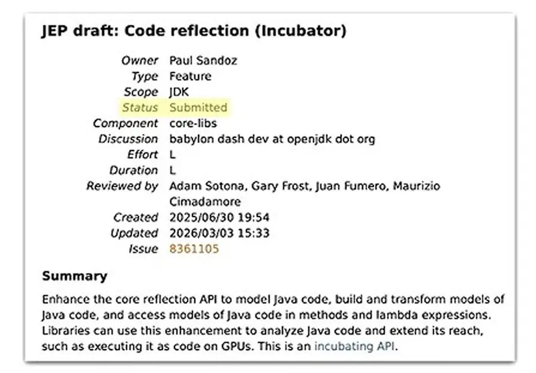
*[▶ 00:43:42](https://www.youtube.com/watch?v=rL3sWS_8b-g&t=2622s) · JEP draft: Code reflection (Incubator)*

The `@Reflect` annotation is a stopgap, not the final way to mark reflectable lambdas. The team does not want to change the language in the first incubator because the right change is not yet known.

```java
import ...

void main() throws Throwable {
    @Reflect
    IntBinaryOperator o = ( int a,  int b) -> a * b;

    Quoted<JavaOp.LambdaOp> qQuotedModel = Op.ofLambda(o).orElseThrow();
    JavaOp.LambdaOp lop = qQuotedModel.op();
    IO.println(lop.toText());

    CoreOp.FuncOp pModel = Op.ofMethod(Holder.class.getDeclaredMethod( name: "p", int.class)).orElseThrow();
    JavaOp.LambdaOp transformedLop = lop.transform(CodeContext.create(), ( Builder b,  Op op) -> {
        if (op instanceof CoreOp.ReturnOp rop) {
            Inliner.inline(b, pModel, List.of(b.context().getValue(rop.returnValue())),
                    ( Builder _,  Value _) -> {
                    });
            b.op(rop);
        } else {
            b.op(op);
        }
        return b;
    });
    IO.println(transformedLop.toText());
    IO.println(SSA.transform(transformedLop).toText());

    MethodHandle h = BytecodeGenerator.generate(MethodHandles.lookup(), transformedLop);
    int r = (int) h.invokeExact( ...args: 1, 2);
```

*[▶ 00:43:00](https://www.youtube.com/watch?v=rL3sWS_8b-g&t=2580s) · IntelliJ Demo4.java: Code Model transform example*

Reverse-mode autodiff is the hard part of training, not forward mode. Models have too many parameters for forward mode to scale, and no one has built reverse mode in Java yet. Swift built autodiff into its language for TensorFlow, which the speaker calls a maintenance burden for maintainers who are not autodiff experts.

Java could beat Python's ML libraries over the long term by bringing scale-out strengths from projects like Apache Spark and Lucene to training, along with more maintainable models.

Data transfer is automatic and keeps data on the GPU when it must stay there. Code reflection drives both kernel translation and analysis of how kernels are called, which optimizes data movement between kernels. The speaker calls this key to performance, and programs stay normal-looking.

## Links & resources

- [Software Survival 3.0 — Steve Yegge's blog post](https://steve-yegge.medium.com/software-survival-3-0-97a2a6255f7b) — <https://steve-yegge.medium.com/software-survival-3-0-97a2a6255f7b> · on screen [▶ 00:05:49](https://www.youtube.com/watch?v=rL3sWS_8b-g&t=349s)
- Babylon — OpenJDK repository for code reflection, URL not shown · mentioned [▶ 00:27:12](https://www.youtube.com/watch?v=rL3sWS_8b-g&t=1632s)
