# How To Write Great Java Apps With LLMs and Agents

*How a short set of standards-based rules, shared vocabulary, and reviewed agent output can produce maintainable Java code from LLMs.*

Source: [How To Write Great Java Apps With LLMs and Agents](https://www.youtube.com/watch?v=MMIPCyXZDAk) · Java · 56 min

## TL;DR

The talk asks whether LLMs can write great Java when they are given a small set of standards-based rules. Java's open specifications, such as Jakarta EE and MicroProfile, are well represented in model training, so prompts only need to cover what is specific to a project. The speaker shows short prompts and agent skills producing business-component code, tests, and scripts, with every output reviewed by a human. This matters because it can cut token and inference costs while keeping the code portable across Jakarta and MicroProfile implementations.

## Key takeaways

- Keep prompts short by relying on standards the LLM already knows, such as Jakarta REST annotations and MicroProfile, and only specify what is unique to the project.
- Use the Jakarta API alone in application code (for example, only jakarta.ws.rs types), so the same code runs on Quarkus, Helidon, or Open Liberty and a migration changes only pom.xml and the config file.
- Share a project vocabulary such as BCE terms (business components, boundaries, entities) in skills or rules so that a prompt like "create speakers component" is enough.
- Ban generic class names such as manager, handler, service, and repository in project skills, which forces more specific names and reduces ambiguity in generated code.
- Verify each agent change with a fast build check such as `mvn compile -q`, and review generated names and code against the real requirements, since agents are non-deterministic.
- Use Java 25 single-file programs with a shebang line in place of shell scripts for readable, rerunnable, and easily reviewed tooling, and add explicit timeouts to HTTP calls.
- Ask agents for a spec (such as requirements with SHALL-style acceptance criteria) before code, so the design stays consistent across business components.
- Estimate token savings from fewer exploration and correction rounds; the speaker's estimate for 200 business components was about 80% lower with BCE, though he expects 50–60% in practice.

## Why Java suits LLM-written code

[▶ 00:00:00](https://www.youtube.com/watch?v=MMIPCyXZDAk&t=0s)

This talk is a sequel to last year's session. Its question: can LLMs write great Java when they are taught a small set of standards-based rules?

The speaker works in backend Java all the time, on the JVM, currently Java 25. He likes the work.

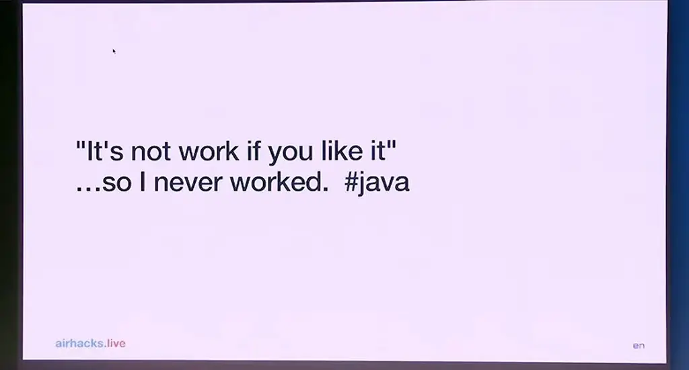
*[▶ 00:01:11](https://www.youtube.com/watch?v=MMIPCyXZDAk&t=71s) · Quote: it's not work if you like it (stage view)*

Speed drives his choice. He cites Java as about 35 times faster than Ruby, Perl, Python and Lua, and speed means cost savings.

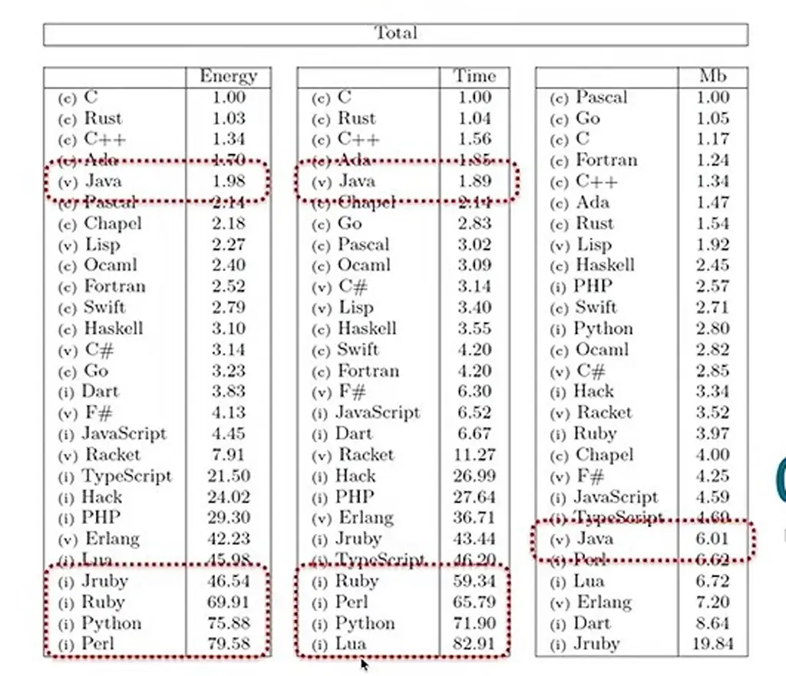
*[▶ 00:03:45](https://www.youtube.com/watch?v=MMIPCyXZDAk&t=225s) · Language energy, time, and memory comparison*

The rules are kept short on bce.design, and this talk gives them to an LLM.

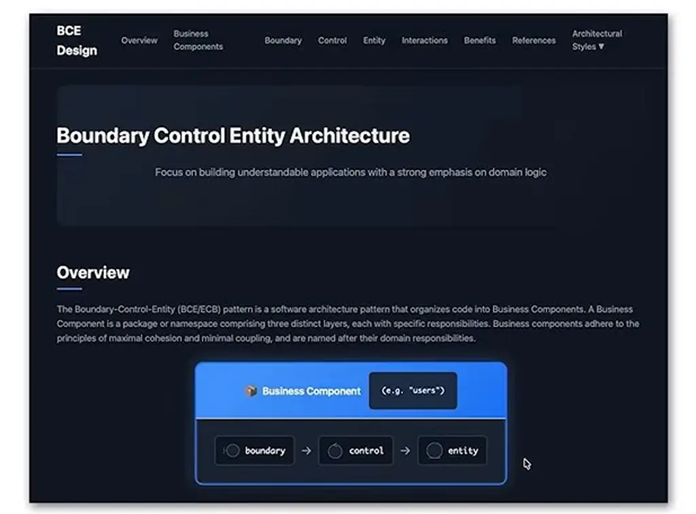
*[▶ 00:03:14](https://www.youtube.com/watch?v=MMIPCyXZDAk&t=194s) · bce.design website: BCE architecture overview*

In the Tencent AutoCodeBench study, Java solves 78.7% of problems error-free, against 59% for JavaScript and 60% for Python.

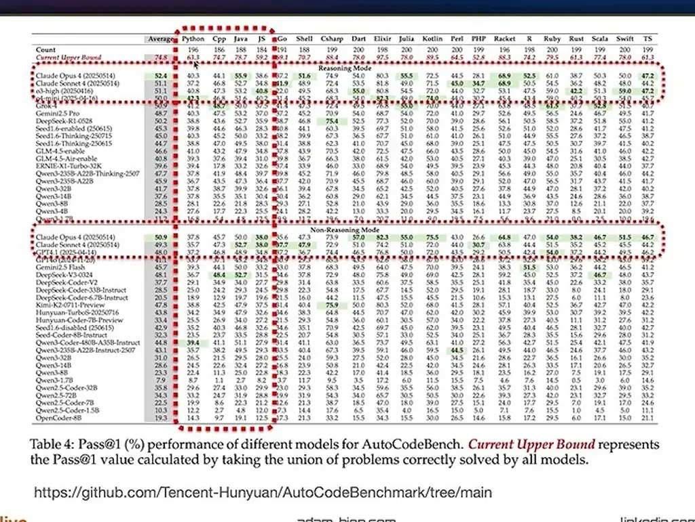
*[▶ 00:04:26](https://www.youtube.com/watch?v=MMIPCyXZDAk&t=266s) · AutoCodeBench Pass@1 results table*

## Source code as the carrier of intent

[▶ 00:04:27](https://www.youtube.com/watch?v=MMIPCyXZDAk&t=267s)

Source code still matters: if nobody cares about it, just write bytecode. The speaker generated some with an LLM as an April 1 joke, and it worked.

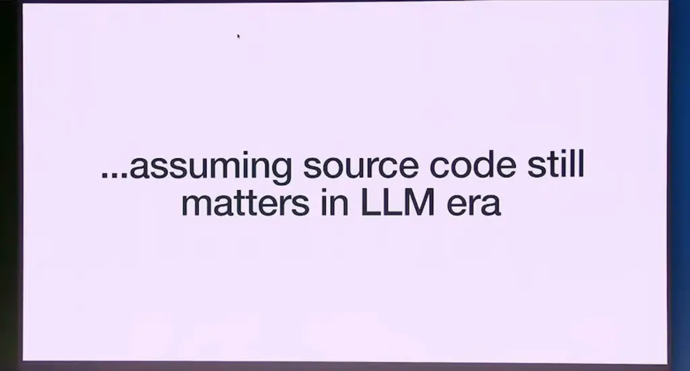
*[▶ 00:05:59](https://www.youtube.com/watch?v=MMIPCyXZDAk&t=359s) · Assuming source code still matters*

Twenty years ago, the speaker found plain Java clearer than UML and pseudo-language specs for offshore teams. Prompts face the same problem: how much context can they carry?

Maintainability matters too. A JDK 11 application moved to Java 26 after 20 years must still be understood, and unstructured prompts can look worse than getters and setters.

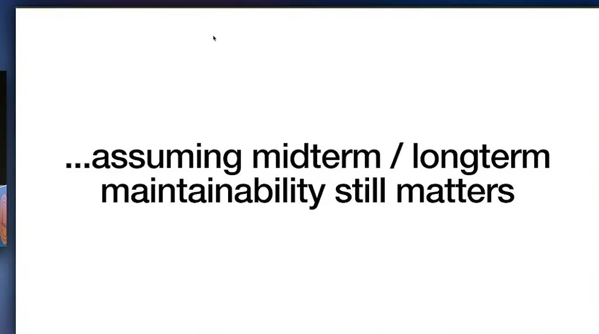
*[▶ 00:08:11](https://www.youtube.com/watch?v=MMIPCyXZDAk&t=491s) · Slide: assuming maintainability still matters*

The approach is to put as much as possible into code that humans and machines can both read, so prompts stay short. The question is what stops you from writing the best possible code now.


*[▶ 00:08:50](https://www.youtube.com/watch?v=MMIPCyXZDAk&t=530s) · Question slide on writing the best code*

## Standards as a strategy

[▶ 00:08:52](https://www.youtube.com/watch?v=MMIPCyXZDAk&t=532s)

Standards are the strategy: they change slowly, stay backward compatible, and are openly published, so LLMs already know them from training. Jakarta REST (JAX-RS) uses RFC 2119 keywords like MUST, which makes its rules precise for LLMs.

```java
package com.example.hello;

public class Hello {
    public static void main(String args[]) {
        System.out.println("Hello World");
    }
}
```

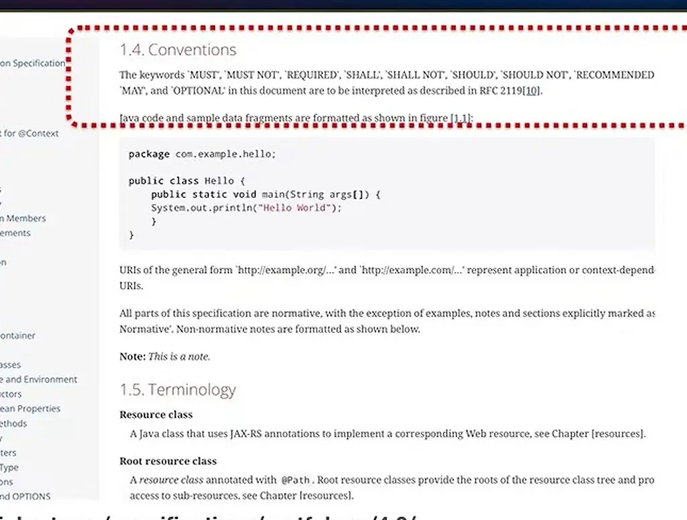
*[▶ 00:10:48](https://www.youtube.com/watch?v=MMIPCyXZDAk&t=648s) · 1.4 Conventions: RFC 2119 keywords*

Open Liberty, Helidon and Quarkus all implement the same Jakarta annotations. So the speaker tells the LLM to use only the API, which leaves one path and fewer hallucinations. Vendor extensions, like Helidon's ServerRequest context, layer on top of it.

```java
package io.openliberty.guides.rest;

import java.util.Properties;

import jakarta.ws.rs.GET;
import jakarta.ws.rs.Path;
import jakarta.ws.rs.Produces;
import jakarta.ws.rs.core.MediaType;

@Path("properties")
public class PropertiesResource {

    @GET
    @Produces(MediaType.APPLICATION_JSON)
    public Properties getProperties() {
        return System.getProperties();
    }
}
```

*[▶ 00:11:24](https://www.youtube.com/watch?v=MMIPCyXZDAk&t=684s) · Jakarta REST PropertiesResource on Open Liberty*

```java
#Path("myresource")
public class MyResource {

    @GET
    public void get(@Context ServerRequest serverRequest) {
        Application app = serverRequest.context().get(Application.class).get();
    }
}

io.helidon.examples.MyApplication:
  routing-path:
    path: "/my-application"

io.helidon.examples.MyApplication.routing-path.path=/my-application

jakarta.ws.rs.core.Application.routing-path.path=/my-application
```

*[▶ 00:11:34](https://www.youtube.com/watch?v=MMIPCyXZDAk&t=694s) · Helidon Jakarta REST: accessing Application instances*

Quarkus's hello-world endpoint uses only `jakarta.ws.rs` types. This is the "No Variations" trick: the API grounds the LLM, and each server is an SPI.

```java
package org.acme.rest;

import jakarta.ws.rs.GET;
import jakarta.ws.rs.Path;

@Path("")
public class Endpoint {

    @GET
    public String hello() {
        return "Hello, World!";
    }
}

<dependency>
    <groupId>io.quarkus</groupId>
    <artifactId>quarkus-rest</artifactId>
</dependency>
```

*[▶ 00:11:45](https://www.youtube.com/watch?v=MMIPCyXZDAk&t=705s) · Quarkus REST guide: API annotated against SPI*

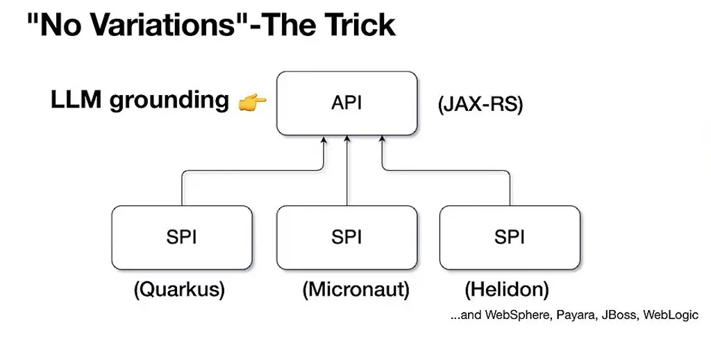
*[▶ 00:12:42](https://www.youtube.com/watch?v=MMIPCyXZDAk&t=762s) · No Variations: the trick*

The project is a brownfield Quarkus MicroProfile hello-world. Asked about Java generation, Claude Code credits BCE's placement and dependency rules.

````markdown
# AGENTS.md
## Build & Test
### Development Mode
```bash
cd service
mvn quarkus:dev
```

### Build
```bash
mvn clean package
```

### Run System Tests
System tests require the service to be running:
```bash
````

*[▶ 00:15:26](https://www.youtube.com/watch?v=MMIPCyXZDAk&t=926s) · Five ways BCE helps code generation*

Generated code still needs review. LLMs trained on Stack Overflow produce getters, setters and extra tests, so the speaker explicitly loads a short skill, `/microprofile-server`, to cut inference cost.

## Short prompts work when BCE vocabulary is shared

[▶ 00:17:15](https://www.youtube.com/watch?v=MMIPCyXZDAk&t=1035s)

Asking for "create coffee BC" produced a resource, a record entity, and tests. He approved edits for the session only and reviewed the code, which resembles last year's hand-written version.

```java
package airhacks.qmp.coffee.boundary;

import org.eclipse.microprofile.rest.client.inject.RegisterRestClient;

import jakarta.json.JsonObject;
import jakarta.ws.rs.GET;
import jakarta.ws.rs.Path;
import jakarta.ws.rs.Produces;
import jakarta.ws.rs.core.MediaType;

@Path("coffees")
@RegisterRestClient(configKey = "base_uri")
public interface CoffeesResourceClient {

    @GET
    @Produces(MediaType.APPLICATION_JSON)
    JsonObject coffees();
}

- import jakarta.json.JsonObject;
import jakarta.ws.rs.GET;
import jakarta.ws.rs.Path;
import jakarta.ws.rs.Produces;

Bash(cd /Users/abien/work/workspaces/junk/javaone2026/quarkus-microprofile/service-st && mvn compile -q 2>&1 | tail -20)
  └ (No output)
Both modules compile. Created the coffee BC with three files:
- service/.../coffee/boundary/CoffeesResource.java — GET /coffees returning a JSON-P object with name and strength
- service-st/.../coffee/boundary/CoffeesResourceClient.java — MicroProfile REST Client interface
- service-st/.../coffee/boundary/CoffeesResourceIT.java — System test using AssertJ
* Cooked for 40s
> /model
  └ Set model to Opus 4.6 (1M context) (default)
```

*[▶ 00:19:04](https://www.youtube.com/watch?v=MMIPCyXZDAk&t=1144s) · CoffeesResourceClient interface and generated coffee BC output*

The agent knows BCE terms, so "create speakers component" suffices.

```java
click)
 import org.eclipse.microprofile.rest.client.inject.RegisterRestClien

import jakarta.jso…rray;
import jakarta.ws…;
import jakarta…h;
import jakart…
import jakart…iaTyp…;
… +8 lines (ctrl+o to expand)
· Canc…
```

*[▶ 00:22:08](https://www.youtube.com/watch?v=MMIPCyXZDAk&t=1328s) · Claude Code session showing Java imports*

It verifies its work with `mvn compile`.

```bash
click)
9 import jakarta.inject.Inject;
… +13 lines (ctrl+o to expand)

Bash(mvn compile -q 2>&1 | tail -10)
  └ (No output)

…ash(cd /Users/abien/work/workspaces/junk/jav…
  …Running…
```

*[▶ 00:22:14](https://www.youtube.com/watch?v=MMIPCyXZDAk&t=1334s) · Claude Code running Maven compile*

Speakers came out as a `SpeakersResource` and a three-speaker enum; he checked the names against the real speakers to rule out hallucination.

```java
import jakarta.json.JsonObject;

publi…

    …, "Father of Java"),
    VenkatSubramaniam("Java", "Agile Developer"),
    AdamBien("Jakarta EE", "Java Champion");

    String topic;
    String bio;

    Speaker(String topic, String bio) {
        this.topic = topic;
        this.bio = bio;
    }

    public JsonObject toJSON() {
        return Json.createObjectBuilder()
            …add("name", name())

Bash(mvn compile -q 2>&1 | tail -10)
  └ (No output)

Bash(cd /Users/abien/work/workspaces/junk/javaone2026/quarkus-microprofile/service-st && mvn compile -q…
  └ (No output)

Done. Speakers BC created:
- Entity — Speaker enum with JamesGosling, VenkatSubramaniam, AdamBien (topic + bio)
- Boundary — SpeakersResource at GET /speakers returning all as JSON array
- ST — Client + test asserting size 3
- package-info.java included
```

*[▶ 00:22:33](https://www.youtube.com/watch?v=MMIPCyXZDAk&t=1353s) · Speaker enum and Speakers BC output*

His skill asks for useful Java examples and JSON-P serialization.

```bash
Bash(cd /Users/abien/work/workspaces/junk/javac…
  └ (No output)

Done. Speakers BC created:
- Entity — Speaker enum with JamesGosling, Venk…
- Boundary — …ersResource at GET /speakers
- ST — Cl…asserting size 3
…info.java included
```

*[▶ 00:22:36](https://www.youtube.com/watch?v=MMIPCyXZDAk&t=1356s) · Speakers BC summary in terminal*

Each BC needs a `package-info.java`, which the agent initially omitted.

```bash
Bash(cd /Users/abien/work/workspaces/junk/javaone2026/quarkus-microprofile/se…
  └ (No output)

Done. Speakers BC created:
- Entity — Speaker enu…JamesGosling, VenkatSubramaniam, AdamBien (topic…
- Boundary — Speakers…t GET /speakers returning all as JSON array
- ST — Client + test… size 3
- package-info.java
```

*[▶ 00:22:48](https://www.youtube.com/watch?v=MMIPCyXZDAk&t=1368s) · Speakers BC summary with package-info*

## Iterating with short prompts and consistent code

[▶ 00:23:24](https://www.youtube.com/watch?v=MMIPCyXZDAk&t=1404s)

The first generated `Session` was an enum of three hardcoded talks that nobody had asked for.

```java
public enum Session {

    JavaAfterThirty("Java After Thirty", "Keynote", "JamesGosling"),
    FunctionalJava("Functional Programming in Java 25", "Deep Dive", "VenkatSubramaniam"),
    CloudNativeJakarta("Cloud Native Jakarta EE", "Session", "AdamBien");

    String title;
    String type;
    String speaker;

    Session(String title, String type, String speaker) {
        this.title = title;
        this.type = type;
        this.speaker = speaker;
    }

    public JsonObject toJSON() {
```

*[▶ 00:24:23](https://www.youtube.com/watch?v=MMIPCyXZDAk&t=1463s) · Session enum with three sample talks*

Asking for mutability gave a mutable class. Asking for a record gave an immutable one.

```java
public class Session {

    String title;
    String type;
    String speaker;

    public Session(String title, String type, String speaker) {
        this.title = title;
        this.type = type;
        this.speaker = speaker;
    }

    public static Session fromJSON(JsonObject json) {
        return new Session(
                json.getString("title"),
                json.getString("type"),
                json.getString("speaker")
```

*[▶ 00:24:41](https://www.youtube.com/watch?v=MMIPCyXZDAk&t=1481s) · Session as mutable class with fromJSON*

```java
package airhacks.qmp.sessions.entity;

import jakarta.json.Json;
import jakarta.json.JsonObject;

public record Session(String title, String type, String speaker) {

    public static Session fromJSON(JsonObject json) {
        return new Session(
                json.getString("title"),
                json.getString("type"),
                json.getString("speaker")
        );
    }

    public JsonObject toJSON() {
        return Json.createObjectBuilder()
                .add("title", this.title)
```

*[▶ 00:25:25](https://www.youtube.com/watch?v=MMIPCyXZDAk&t=1525s) · Session converted to an immutable record*

Project skills ban generic names like manager, handler, service, and repository, which forces better names and keeps prompts short.

He had the model keep data in memory, with no JPA, because this is a proof of concept. Persistence comes later.

```java
public class SessionsResource {
…
    public Response sessions() {
…
                .map(Session::toJSON)
                .forEach(builder::add);
        return Response.ok(builder.build()).build();
    }

    @POST
    public Response add(JsonObject json) {
        var session = Session.fromJSON(json);
        this.sessions.add(session);
        return Response.status(Response.Status.CREATED)
                .entity(session.toJSON())
                .build();
    }
}
```

*[▶ 00:26:08](https://www.youtube.com/watch?v=MMIPCyXZDAk&t=1568s) · SessionsResource POST add endpoint*

```java
@Path("sessions")
@Consumes(MediaType.APPLICATION_JSON)
@Produces(MediaType.APPLICATION_JSON)
@ApplicationScoped
public class SessionsResource {

    List<Session> sessions = new CopyOnWriteArrayList<>();

    @GET
    public Response sessions() {
        var builder = Json.createArrayBuilder();
        this.sessions.stream()
                .map(Session::toJSON)
                .forEach(builder::add);
        return Response.ok(builder.build()).build();
    }

    @POST
```

*[▶ 00:26:40](https://www.youtube.com/watch?v=MMIPCyXZDAk&t=1600s) · SessionsResource with CopyOnWriteArrayList*

The registration BC then reused the codebase's record and JSON pattern.

```java
package airhacks.qmp.registration.entity;

import jakarta.json.Json;
import jakarta.json.JsonObject;

public record Registration(String attendeeName, String email, String sessionTitle) {

    public static Registration fromJSON(JsonObject json) {
        return new Registration(
            json.getString("attendeeName"),
            json.getString("email"),
            json.getString("sessionTitle")
        );
    }

    public JsonObject toJSON() {
        return Json.createObjectBuilder()
            .add("attendeeName", this.attendeeName)
```

*[▶ 00:29:53](https://www.youtube.com/watch?v=MMIPCyXZDAk&t=1793s) · Agent asks to write Registration.java*

Consistent code keeps projects portable across LLMs. Shorter prompts cut inference costs.

## Spec-driven agents from one-line prompts

[▶ 00:30:23](https://www.youtube.com/watch?v=MMIPCyXZDAk&t=1823s)

A one-line prompt drove the demo: Kiro turned `create an attendee BC` into a requirements.md with SHALL-style acceptance criteria.

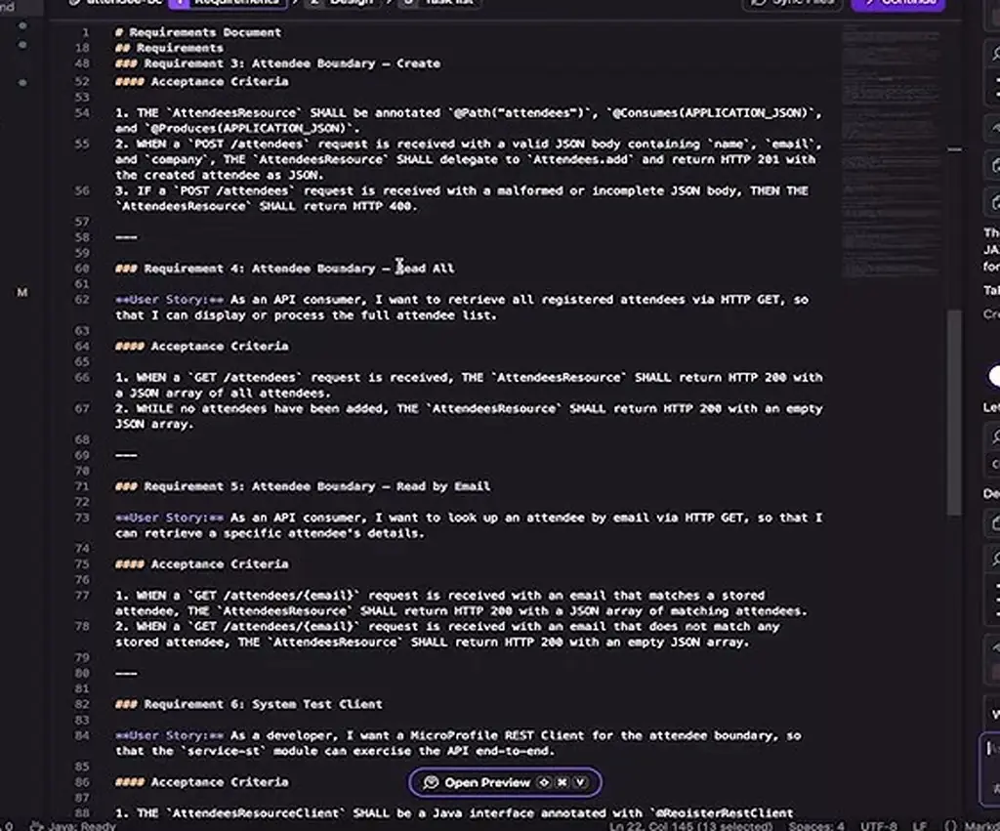
*[▶ 00:35:12](https://www.youtube.com/watch?v=MMIPCyXZDAk&t=2112s) · Kiro requirements spec in editor*

Earlier, the agent built a registration BC from a short prompt and followed the BCE pattern. The speaker forbade names like RegistrationManager.

```java
✓ Created Registration.java
package airhacks.qmp.registration.entity;

import jakarta.json.Json;
import jakarta.json.JsonObject;

public record Registration(String attendeeName, String email, String sessionTitle) {

    public static Registration fromJSON(JsonObject json) {
        return new Registration(
            json.getString("attendeeName"),
… (13 more lines)
✓ Created Registrations.java
package airhacks.qmp.registration.control;

import java.util.List;
import java.util.concurrent.CopyOnWriteArrayList;

import airhacks.qmp.registration.entity.Registration;
import jakarta.enterprise.context.ApplicationScoped;

@ApplicationScoped
public class Registrations {
… (23 more lines)
```

*[▶ 00:30:41](https://www.youtube.com/watch?v=MMIPCyXZDAk&t=1841s) · Agent created Registration and Registrations classes*

Its summary listed the new BC's four endpoints.

```text
✓ Ran find service/src/main/java/airhacks/qmp/registration -type f -name "*.java"
  │ service/src/main/java/airhacks/qmp/registration/entity/Registration.java
  │ service/src/main/java/airhacks/qmp/registration/boundary/RegistrationsResource.java
  │ service/src/main/java/airhacks/qmp/registration/control/Registrations.java
  └ service/src/main/java/airhacks/qmp/registration/package-info.java
✓ Ran cd service && mvn compile -q
  └ (no content)

Perfect! The registration BC has been created successfully. Here's what was implemented:

Registration BC Structure
service/src/main/java/airhacks/qmp/registration/
├── boundary/RegistrationsResource.java  # JAX-RS endpoint
├── control/Registrations.java           # Business logic
├── entity/Registration.java             # Domain object
└── package-info.java                    # Package documentation

Key Features
Entity: Immutable Registration record with JSON serialization Control: Thread-safe registration management with query methods Boundary: REST endpoints for CRUD operations with path parameters

Endpoints Available
● GET /registrations - Get all registrations
● POST /registrations - Create new registration
● GET /registrations/session/{title} - Get registrations by session
● GET /registrations/attendee/{email} - Get registrations by attendee

The implementation follows the BCE pattern consistently with the existing codebase style.

> list
```

*[▶ 00:31:17](https://www.youtube.com/watch?v=MMIPCyXZDAk&t=1877s) · Terminal: registration BC created and endpoints listed*

`list BCs` shows six BCs.

```text
service/src/main/java/airhacks/qmp/registration/
├── boundary/RegistrationsResource.java  # JAX-RS endpoint
├── control/Registrations.java           # Business logic
├── entity/Registration.java             # Domain object
└── package-info.java                    # Package documentation

Key Features
Entity: Immutable Registration record with JSON serialization Co…
methods Boundary: REST endpoints for CRUD operations with path p…

Endpoints Available
● GET /registrations - Get all registrations
● POST /registrations - Create new registration
● GET /registrations/session/{title} - Get registrations by sess…
● GET /registrations/attendee/{email} - Get registrations by att…

The implementation follows the BCE pattern consistently with the…

list BCs

Here are the current Business Components (BCs) in the project:

airhacks.qmp/
├── coffee/        # Coffee management
├── greetings/     # Greeting messages
├── health/        # Health checks
├── registration/  # Conference registration (just created)
├── sessions/      # Conference sessions
└── speakers/      # Speaker management

Each BC follows the BCE pattern with boundary/, control/, and en…
```

*[▶ 00:31:34](https://www.youtube.com/watch?v=MMIPCyXZDAk&t=1894s) · Terminal: list of business components*

```text
service/src/main/java/airhacks/qmp/registration/
├── boundary/RegistrationsResource.java  # JAX-RS endpoint
├── control/Registrations.java  # Business logic
├── entity/Registration.java  # Domain object
└── package-info.java  # Package documentation

airhacks.qmp/
├── coffee/  # Coffee management
├── greetings/  # Greeting messages
├── health/  # Health checks
├── registration/  # Conference registration (just created)
├── sessions/  # Conference sessions
└── speakers/  # Speaker management
```

*[▶ 00:35:31](https://www.youtube.com/watch?v=MMIPCyXZDAk&t=2131s) · Vibe terminal: registration BC and BC list*

Generated property-based tests stand in for hand-written end-to-end tests. Agents are non-deterministic, so he skips cross-checks; writing and reviewing good tests is the deterministic safeguard.

Three parallel agents ran, but the running service lacked attendee endpoints, since Kiro was still discussing the spec.

```text
    - GET (consumes: application/json) (produces:application/json)
    - /registrations/session/{sessionTitle}
        - GET (consumes: application/json) (produces:application/json)
    - /sessions
        - POST (consumes: application/json) (produces:application/json)
    - /sessions
        - GET (consumes: application/json) (produces:application/json)
    - /coffees
        - GET (produces:application/json)
    - /hello
        - POST (consumes: text/plain)
    - /hello
        - GET (produces:text/plain;charset=UTF-8)

Additional endpoints
    - http://localhost:8080/q/arc
        - CDI Overview
    - http://localhost:8080/q/arc/beans
        - Active CDI Beans
    - http://localhost:8080/q/arc/observers
        - Active CDI Observers
    - http://localhost:8080/q/arc/removed-beans
        - Removed CDI Beans
    - http://localhost:8080/q/dev-ui
        - Dev UI
    - http://localhost:8080/q/health
        - Health Check
    - http://localhost:8080/q/health-ui
        - Health UI
    - http://localhost:8080/q/health/group
        - Health Group Check
    - http://localhost:8080/q/health/group/*
        - Health Group Check
    - http://localhost:8080/q/health/live
        - Health Liveness Check
    - http://localhost:8080/q/health/ready
        - Health Readiness Check
    - http://localhost:8080/q/health/started
        - Health Started Check
    - http://localhost:8080/q/health/well
        - Health Wellness Check
```

*[▶ 00:36:41](https://www.youtube.com/watch?v=MMIPCyXZDAk&t=2201s) · Quarkus dev endpoint listing in terminal*

## Java 25 single-file scripts instead of shell scripts

[▶ 00:36:43](https://www.youtube.com/watch?v=MMIPCyXZDAk&t=2203s)

Java 25 single-file programs with a shebang line can replace shell scripts. The speaker prefers them to `curl` because they are readable, easy to assess for security, and rerunnable.

```bash
Additional endpoints
    - http://localhost:8080/q/arc
        - CDI Overview
    - http://localhost:8080/q/arc/beans
        - Active CDI Beans
    - http://localhost:8080/q/arc/observers
        - Active CDI Observers
    - http://localhost:8080/q/arc/removed-beans
        - Removed CDI Beans
    - http://localhost:8080/q/dev-ui
        - Dev UI
    - http://localhost:8080/q/health
        - Health Check
    - http://localhost:8080/q/health-ui
        - Health UI
    - http://localhost:8080/q/health/group
        - Health Group Check
    - http://localhost:8080/q/health/group/*
        - Health Group Check
    - http://localhost:8080/q/health/live
        - Health Liveness Check
    - http://localhost:8080/q/health/ready
        - Health Readiness Check
    - http://localhost:8080/q/health/started
        - Health Started Check
    - http://localhost:8080/q/health/well
        - Health Wellness Check

quarkus-microprofile 18 ❯ curl localhost:8080/q/health
{
    "status": "UP",
    "checks": [
        {
            "name": "application-live",
            "status": "UP"
        },
        {
            "name": "application-ready",
            "status": "UP"
        }
    ]
}
quarkus-microprofile 18 ❯
```

*[▶ 00:37:09](https://www.youtube.com/watch?v=MMIPCyXZDAk&t=2229s) · Quarkus health endpoints and curl check*

Pointed at the health boundary class, the agent produced a script that uses Java's built-in HTTP client.

```java
#!/usr/bin/java --enable-preview --source 25

import java.net.URI;
import java.net.http.HttpClient;
import java.net.http.HttpRequest;
import java.net.http.HttpResponse;

void main(String... args) {
    var base = args.length > 0 ? args[0] : "http://localhost:8080";
    var uri = URI.create(base + "/q/health");
```

*[▶ 00:38:10](https://www.youtube.com/watch?v=MMIPCyXZDAk&t=2290s) · Generated healthcheck single-file Java script*

The speaker flagged the missing timeout but gave only the hint "think about timeout," since correct values may change across Java versions. The agent added a five-second timeout.

The agent also replaced raw ANSI codes with a small Solarized-colored `Log` enum, mapping errors to red and health output to cyan.

```diff
74 +     } else {
75 +         Log.error("DOWN (status: " + response.statusCode() + ")");
76 +     }
77 +     Log.health(response.body());
78       } catch (Exception e) {
24 -         System.out.println(RED + "DOWN: " + e.getMessage() + RESET);
79 +         Log.error("DOWN", e);
80       }
81   }
```

*[▶ 00:40:19](https://www.youtube.com/watch?v=MMIPCyXZDAk&t=2419s) · Claude Code replaces ANSI codes with Log enum*

A later prompt linking speakers to sessions also went straight to the components and passed `mvn compile -q`.

```text
                .map(Session::toJSON)
        .forEach(sessi…lder::add);
return Json.createObj…(speaker.toJSON())

Bash(mvn compile -q 2>&1 | tail -10)
└ (No output)
```

*[▶ 00:43:36](https://www.youtube.com/watch?v=MMIPCyXZDAk&t=2616s) · Compile succeeds after Speaker change*

```text
37        .map(Session::toJSON)
38        .forEach(sessionsBuilder::add);
39 return Json.createObjectBuilder(speaker.toJSON())

Bash(mvn comp…2>&1 | tail -10)
└ (No output)

* Crunched for 52s
```

*[▶ 00:43:55](https://www.youtube.com/watch?v=MMIPCyXZDAk&t=2635s) · Agent output: Speaker enum refactor*

```text
37        .map(Session::toJSON)
38        .forEachSessionsBuilder::add);
39 return Json.createObjectBuilder(speaker.toJSON())

Bash(mvn compile -q 2>&1 | tail…
└ (No output)

* Crunched for 52s
```

*[▶ 00:44:01](https://www.youtube.com/watch?v=MMIPCyXZDAk&t=2641s) · Agent output: Session uses Speaker enum*

## Generating a business-component diagram and estimating token savings

[▶ 00:44:02](https://www.youtube.com/watch?v=MMIPCyXZDAk&t=2642s)

Asked for a BC overview diagram, the agent found seven business components. The speaker chose the between-components level, since within-component views show classes and get too busy, and Mermaid, because it renders in a GitHub README.

````diff
23 +
24 + classDef bc fill:#dae8fc,stroke:#6c8ebf,color:#000
25 + class Speakers,Sessions,Registration,Attendee,Coffee,Health,Greetings bc
26 + ```
27 +
28 ## Modules
29
30 - [service](service/README.md) - Quarkus application module with BCE structure

Added a Mermaid BC overview diagram to README.md:

- Conference subgraph groups Speakers, Sessions, Registration, and Attendee
- Speakers ⇄ Sessions bidirectional dependency shown explicitly
- Registration loosely references Sessions and Attendee (dashed arrows)
- Infrastructure subgraph for Health and Greetings
- Coffee stands alone

Crunched for 1m 10s
````

*[▶ 00:46:34](https://www.youtube.com/watch?v=MMIPCyXZDAk&t=2794s) · Agent adds Mermaid BC diagram to README*

Speakers and sessions depend on each other both ways. Registration references sessions and attendee. Coffee stands alone.

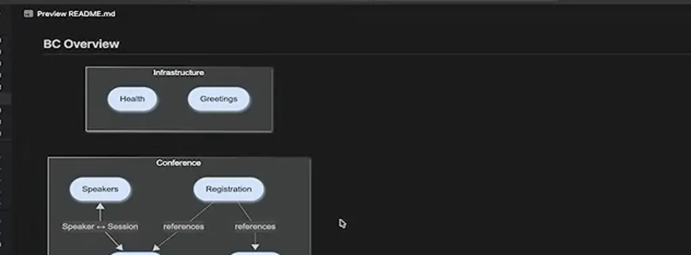
*[▶ 00:48:09](https://www.youtube.com/watch?v=MMIPCyXZDAk&t=2889s) · Rendered Mermaid BC overview diagram in preview*

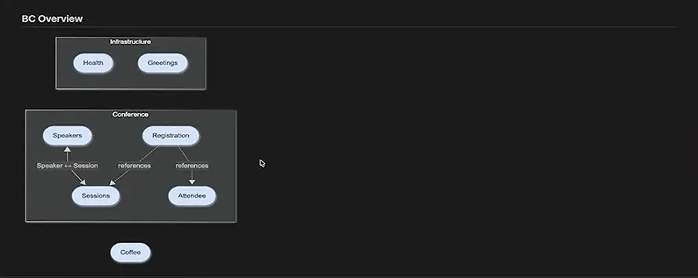
*[▶ 00:48:54](https://www.youtube.com/watch?v=MMIPCyXZDAk&t=2934s) · BC overview diagram in README preview*

Asked about token costs, Claude cited less exploration, smaller prompts, fewer correction rounds and short instructions. Standards drive this: LLMs already know Java, Jakarta EE and MicroProfile, so prompts only need to cover what is unique.

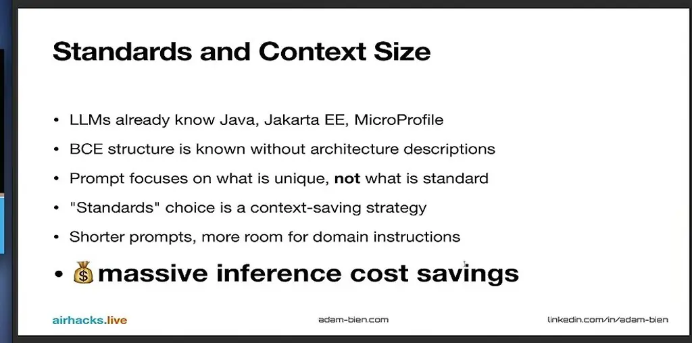
*[▶ 00:48:57](https://www.youtube.com/watch?v=MMIPCyXZDAk&t=2937s) · Standards and Context Size*

The agent's estimate for 200 BCs is about 603,000 tokens with BCE, including 3,000 fixed for the skill file and AGENTS.md, against 3,000,000 without. That is roughly 80% savings. The speaker calls that a bit high and expects 50–60% in inference cost.

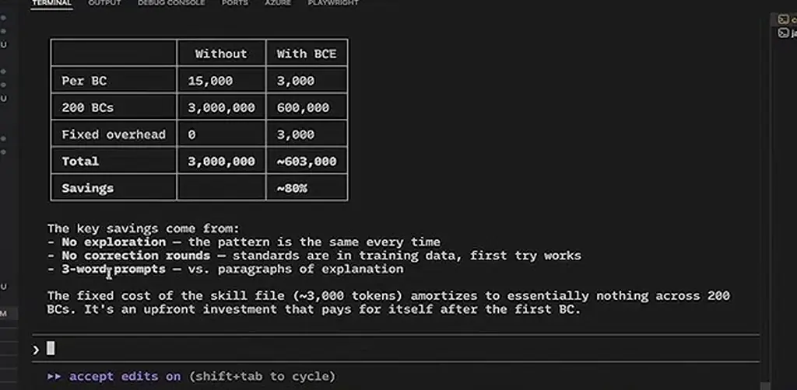
*[▶ 00:50:59](https://www.youtube.com/watch?v=MMIPCyXZDAk&t=3059s) · Token cost table, Claude Code terminal*

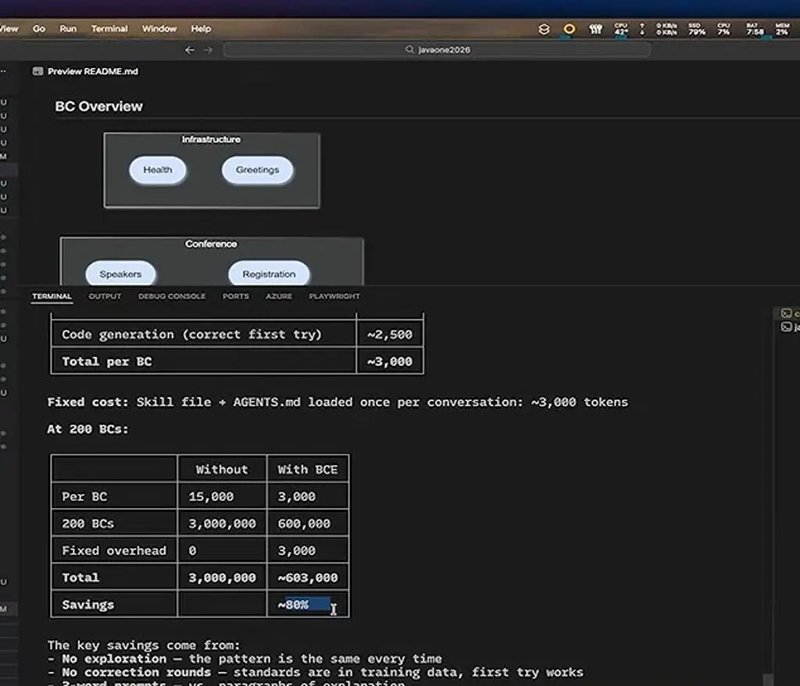
*[▶ 00:51:33](https://www.youtube.com/watch?v=MMIPCyXZDAk&t=3093s) · Cost breakdown per BC and at 200 BCs*

## Standards make the code portable

[▶ 00:51:34](https://www.youtube.com/watch?v=MMIPCyXZDAk&t=3094s)

Java standards were written so several products could implement one API, and applications built only against that API stay portable. A MicroProfile project was migrated from Quarkus to Helidon live on stage. Only `pom.xml` and the config file name changed, because the code has no Quarkus-specific imports. Business logic and REST endpoints stayed unchanged.

```text
- All BCE structure and packages
- JAX-RS resources (@Path, @GET, @POST)
- CDI (@ApplicationScoped, @Inject)
- MicroProfile Config (@ConfigProperty)
- MicroProfile Health (@Liveness, @Readiness)
- JSON-P (Json.createObjectBuilder)
- All entity classes and records
- All system tests (MicroProfile REST Client)

What changes:
- pom.xml — swap Quarkus BOM/plugins for Helidon BOM/plugins
- application.properties — Helidon uses microprofile-config.properties (same format, different filename)
- Remove Quarkus-specific test annotations (@QuarkusTest → standard test setup)

What doesn't exist in this project (the reason it's easy):
- No quarkus-specific imports in any Java file
- No Quarkus Dev Services
- No Quarkus extensions beyond standard MicroProfile
- No @QuarkusTest in the service module (only in -st)

That's the whole point of coding against MicroProfile standards rather than framework APIs. The BCs, the business logic, the REST endpoints — zero changes. It's a pom.xml swap.
```

*[▶ 00:54:37](https://www.youtube.com/watch?v=MMIPCyXZDAk&t=3277s) · Claude Code summary of Quarkus-to-Helidon migration*

The agent rules, published at [airrails.dev](https://airrails.dev), limit generated output across tests, JavaDoc, exceptions, style and naming. Without them, the speaker says, the code works but is worse.

```markdown
- do not write tests for implementations that cannot fail (enums, records, getters/setters)
- create minimalistic tests first
- generate at most three tests per class under test (applies separately to UTs, ITs, and STs)
- use AssertJ library instead of JUnit assertions
- the presence of isEqualTo assertion makes less specific checks (startsWith, isNotNull) obsolete
- do not use private visibility in tests

## Integration Tests
- integration tests end with IT suffix and are executed by the failsafe maven plugin (no configuration necessary)

## System Tests (ST)
- system tests are created in a dedicated Maven module ending with "-st"
- use microprofile-rest-client for testing JAX-RS resources
- REST client interfaces: src/main/java of the -st module
- test classes: src/test/java of the -st module
- name client interfaces after the resource with "Client" suffix (e.g., GreetingsResource -> GreetingsResourceClient)
- RegisterRestClient configKey: "service_uri"
- STs end with "IT" suffix
- do not use RestAssured. Write e2e test in the -st module
- execute system tests after every major change to the service module
- in PoC mode (user-activated), system test execution is skipped

## JAX-RS
- resources should be named in plural (e.g., SpeakersResource not SpeakerResource)
- @Consumes and @Produces should be declared on class-level
- do not implement business logic in JAX-RS resources; delegate instead
- prefer returning JAX-RS Response over JsonObject in resources
- do not create new "@RegisterRestClient(configKey)" - reuse existing

## JSON Serialization (JSON-P)
- prefer JSON-P over JSON-B
- record entities should ship with toJSON method returning a JSON-P object
- always map JSON-P in the boundary to entities
- create record entities from JSON-P JsonObject in static method: fromJSON(JsonObject json)

## HTTP Client
- prefer synchronous HttpClient APIs
- use asynchronous Http APIs (HttpClient.sendAsync) only if explicitly requested

## Project Management
- always ad… before changing pom.xml
- on opening existing projects, load AGENTS.md (if present) before making changes
- do not create or change any files on opening existing projects; stop after initialization and wait for instructions
- do not generate code initially in an empty project
- Maven pom.xml must not be created for Java 25 CLI applications
- never use quarkus-hibernate-validator
- create metrics and observability features with OTEL / opentelemetry
```

*[▶ 00:55:01](https://www.youtube.com/watch?v=MMIPCyXZDAk&t=3301s) · Agent rules: testing, ST, JAX-RS, JSON-P, project*

```markdown
- document the intentions and the "why", not implementation details
- either describe the "why" or do not comment at all
- follow links in Javadoc to external specifications and use them for code generation
- use popular, also funny, technical terms from the Java SE, MicroProfile and Jakarta EE ecosystems as examples in unit tests and javadoc

## README Guidelines
- write brief, 'to the point' README.md files for advanced developers
- use precise and concise language; avoid generic adjectives like "simple", "lightweight"
- do not include detailed project structure (file/folder listings); high-level module descriptions are acceptable
- never list REST resources in READMEs
- if modules are listed, provide links
- do not use "Orchestrates" term; use more specific alternatives

## Testing
- unit test methods must not start with "test" or "should"
- avoid writing repetitive or trivial unit tests; keep only essential tests verifying core functionality
- do not write tests for implementations that cannot fail (enums, records, getters/setters)
- create minimalistic tests first
- generate at most three tests per class under test (applies separately to UTs, ITs, and STs)
- use AssertJ library instead of JUnit assertions
- the presence of isEqualTo assertion makes less specific checks (startsWith, isNotNull) obsolete
- do not use private visibility in tests

## Integration Tests
- integration tests end with IT suffix and are executed by the failsafe maven plugin (no configuration necessary)

## System Tests (ST)
- system tests are created in a dedicated Maven module ending with "-st"
- use microprofile-rest-client for testing JAX-RS resources
- REST client interfaces: src/main/java of the -st module
- test classes: src/test/java of the -st module
- name client interfaces after the resource with "Client" suffix (e.g., GreetingsResource -> GreetingsResourceClient)
- RegisterRestClient configKey: "service_uri"
- STs end with "IT" suffix
- do not use RestAssured. Write e2e test in the -st module
- execute system tests after every major change to the service module
- in PoC mode (user-activated), system test execution is skipped

## JAX-RS
- resources should be named in plural (e.g., SpeakersResource not SpeakerResource)
- @Consumes and @Produces should be declared on class-level
- do not implement business logic in JAX-RS resources; delegate instead
- prefer returning JAX-RS Response over JsonObject in resources
- do not create new "@RegisterRestClient(configKey)" - reuse existing

## JSON Serialization (JSON-P)
- prefer JSON-P over JSON-B
- record entities should ship with toJSON method returning a JSON-P object
```

*[▶ 00:55:05](https://www.youtube.com/watch?v=MMIPCyXZDAk&t=3305s) · Agent rules: JavaDoc, README, testing, ST, JAX-RS*

```markdown
- prefer enums over plain strings for finite, well-defined values
- reuse enum constants as values if possible; enum constants do not have to follow naming conventions
- prefer try-with-resources over explicitly closing resources

## Simplicity Principles
- keep the design KISS and YAGNI
- always implement the simplest possible solution
- write simple code first; ask before implementing enhancements or optional features
- never over-engineer; ask about adding optional features or extension points
- create new components with minimal business logic and essential fields only

## Exceptions
- create custom exceptions only if it significantly improves robustness or maintainability
- use explicit exceptions like BadRequestException for Response.Status.BAD_REQUEST
- always use WebApplicationException in compact constructors in JAX-RS projects
- do not re-throw exceptions with "throw e" without adding value

## JavaDoc
- do not write obvious JavaDoc comments that rephrase code
- document the intentions and the "why", not implementation details
- either describe the "why" or do not comment at all
- follow links in JavaDoc to external specifications and use them for code generation
- use popular, also funny, technical terms from the Java SE, MicroProfile and Jakarta EE ecosystems as examples in unit tests and javadoc

## README Guidelines
- write brief, 'to the point' README.md files for advanced developers
- use precise and concise language; avoid generic adjectives like "simple", "lightweight"
- do not include detailed project structure (file/folder listings); high-level module descriptions are acceptable
- never list REST resources in READMEs
- if modules are listed, provide links
- do not use "Orchestrates" term; use more specific alternatives

## Testing
- unit test methods must not start with "test" or "should"
- avoid writing repetitive or trivial unit tests; keep only essential tests verifying core functionality
- do not write tests for implementations that cannot fail (enums, records, getters/setters)
- create minimalistic tests first
- generate at most three tests per class under test (applies separately to UTs, ITs, and STs)
- use AssertJ library instead of JUnit assertions
- the presence of isEqualTo assertion makes less specific checks (startsWith, isNotNull) obsolete
- do not use private visibility in tests

## Integration Tests
- integration tests end with IT suffix and are executed by the failsafe maven plugin (no configuration necessary)

## System Tests (ST)
- system tests are created in a dedicated Maven module ending with "-st"
- use microprofile-rest-client for testing JAX-RS resources
```

*[▶ 00:55:27](https://www.youtube.com/watch?v=MMIPCyXZDAk&t=3327s) · Agent rules: exceptions, JavaDoc, testing, ST*

```markdown
- prefer List.of over String[] or new ArrayList<>()
- avoid creating unnecessary intermediate collections when streaming arrays
- prefer variable declaration over lengthy method chaining

## Code Style
- prefer multiple simpler lines to one more complex line
- prefer multiline Strings (text blocks) over String concatenations
- prefer imports over fully qualified class names
- use "this" to reference instance fields
- remove unused imports
- extract variables to eliminate duplication
- prefer enums over plain Strings for finite, well-defined values
- use enum constants as values if possible; enum constants do not have to follow naming conventions
- prefer try-with-resources over explicitly closing resources

## Simplicity Principles
- keep the design KISS and YAGNI
- always implement the simplest possible solution
- write simple code first; ask before implementing enhancements or optional features
- never over-engineer; ask about adding optional features or extension points
- create new components with minimal business logic and essential fields only

## Exceptions
- create custom exceptions only if it significantly improves robustness or maintainability
- use explicit exceptions like BadRequestException for Response.Status.BAD_REQUEST
- always use WebApplicationException in compact constructors in JAX-RS projects
- do not re-throw exceptions with "throw e" without adding value

## JavaDoc
- do not write obvious JavaDoc comments that rephrase code
- document the intentions and the "why", not implementation details
- either describe the "why" or do not comment at all
- follow links in JavaDoc to external specifications and use them for code generation
- use popular, also funny, technical terms from the Java SE, MicroProfile and Jakarta EE ecosystems as examples in unit tests and javadoc

## README Guidelines
- write brief, 'to the point' README.md files for advanced developers
- use precise and concise language; avoid generic adjectives like "simple", "lightweight"
- do not include detailed project structure (file/folder listings); high-level module descriptions are acceptable
- never list REST resources in READMEs
- if modules are listed, provide links
- do not use "Orchestrates" term; use more specific alternatives

## Testing
- unit test methods must not start with "test" or "should"
- avoid writing repetitive or trivial unit tests; keep only essential tests verifying core functionality
- do not write tests for implementations that cannot fail (enums, records, getters/setters)
- create minimalistic tests first
```

*[▶ 00:55:39](https://www.youtube.com/watch?v=MMIPCyXZDAk&t=3339s) · Agent rules: style, exceptions, JavaDoc, testing*

```markdown
## Class Naming Conventions
- name classes after their responsibilities
- avoid meaningless suffixes: *Impl, *Service, *Manager, *Creator
- class names must not end with "Control"
- only use "Resource" suffix for JAX-RS classes
- only use "Factory" suffix for actual GoF Factory pattern
- only use "Builder" suffix for classes with typical builder structure (method chaining)

## Visibility & Modifiers
- avoid private visibility; prefer package-private (default) visibility
- avoid "private static" methods; prefer default visibility
- do not use final for fields (exception: static final for LOGGER)
- do not use constructor injection

## Interfaces & Classes
- only use interfaces with multiple implementations or for strategy pattern
- do not create to abstract classes/abstract methods implemented by a single class; use classes directly
- create multiple classes only if it decreases complexity and increases readability

## Method Naming & Design
- avoid "getter" methods starting with "get"; prefer record convention (e.g., configuration() not getConfiguration())
- keep methods short and testable
- create well-named methods for coarse-grained, cohesive, self-contained logic
- if a lambda requires multiple statements or braces (), extract it into a well-named helper method
- do not create multiline lambda expressions; use method references instead
- prefer extracting inline predicates into explaining methods and use method references (e.g., `.filter(this::isSkillFile)` over `.filter(p -> p.endsWith("SKILL.md"))`
- complex `.filter()` with multiple `&&`/`||` conditions split into chained `.filter()` calls
- extract repeated calculations or string concatenations into helper methods (DRY principle)
- do not create empty delegates which just call methods without added value

## Stream & Collections
- prefer java.util.stream.Stream API over for loops
- avoid forEach; prefer Stream methods
- prefer Stream.of to Arrays.stream
- prefer toList() to .collect(Collectors.toList())
- prefer List.of over String[] or new ArrayList<>()
- avoid creating unnecessary intermediate collections when streaming arrays
- prefer variable declaration over lengthy method chaining

## Code Style
- prefer multiple simpler lines to one more complex line
- prefer multiline Strings (text blocks) over String concatenations
- prefer imports over fully qualified class names
- use "this" to reference instance fields
- remove unused imports
- extract variables to eliminate duplication
- prefer enums over plain Strings for finite, well-defined values
```

*[▶ 00:56:00](https://www.youtube.com/watch?v=MMIPCyXZDAk&t=3360s) · Agent rules: naming, methods, streams, code style*

## Links & resources

- [Conference talk playlist — linked in the video description](https://www.youtube.com/playlist?list=PLX8CzqL3ArzUMVSzm-z_-if8BIB55EGl4) — <https://www.youtube.com/playlist?list=PLX8CzqL3ArzUMVSzm-z_-if8BIB55EGl4> · video description
- BCE design rules website — speaker's site, URL not shown · mentioned [▶ 00:03:02](https://www.youtube.com/watch?v=MMIPCyXZDAk&t=182s)
- [AutoCodeBench Pass@1 results table — Tencent-Hunyuan benchmark on GitHub](https://github.com/Tencent-Hunyuan/AutoCodeBenchmark/tree/main) — <https://github.com/Tencent-Hunyuan/AutoCodeBenchmark/tree/main> · on screen [▶ 00:04:26](https://www.youtube.com/watch?v=MMIPCyXZDAk&t=266s)
- [RFC 2119 — normative language definitions for MUST, SHOULD, and similar terms](https://www.ietf.org/rfc/rfc2119.txt) — <https://www.ietf.org/rfc/rfc2119.txt> · on screen [▶ 00:10:08](https://www.youtube.com/watch?v=MMIPCyXZDAk&t=608s)
- MicroProfile server example — on the speaker's GitHub, URL not shown · mentioned [▶ 00:16:56](https://www.youtube.com/watch?v=MMIPCyXZDAk&t=1016s)
- [Open Liberty guide — creating a Jakarta REST resource](https://openliberty.io/guides/rest-intro.html#creating-a-restful-application) — <https://openliberty.io/guides/rest-intro.html#creating-a-restful-application> · on screen [▶ 00:11:24](https://www.youtube.com/watch?v=MMIPCyXZDAk&t=684s)
- [Quarkus REST guide — API annotated against the SPI](https://quarkus.io/guides/rest) — <https://quarkus.io/guides/rest> · on screen [▶ 00:11:45](https://www.youtube.com/watch?v=MMIPCyXZDAk&t=705s)
- [airails.dev — README and speakers-component prompt example](https://airails.dev) — <https://airails.dev> · on screen [▶ 00:21:48](https://www.youtube.com/watch?v=MMIPCyXZDAk&t=1308s)
- [airrails.dev — skill and agents guidelines page](https://airrails.dev) — <https://airrails.dev> · on screen [▶ 00:52:19](https://www.youtube.com/watch?v=MMIPCyXZDAk&t=3139s)
