# OOP vs. Data-Oriented Programming: Which One to Choose?

*When a class hierarchy with polymorphism adds more cost than benefit, and how a data-oriented switch with sealed types and records can replace it.*

Source: [OOP vs. Data-Oriented Programming: Which One to Choose?](https://www.youtube.com/watch?v=EMdxiVYyMtU) · Venkat Subramaniam · Java · 49 min

## TL;DR

Polymorphism-heavy OOP can become hard to read and maintain: in the talk's trade-audit example, a parallel TradeAudit hierarchy adds complexity and moves failures to runtime. The speaker replaces it with a pattern-matching switch over Trade, using records and a sealed interface so the compiler enforces exhaustiveness. The trade-off is that adding a new Trade type requires editing the switch, which the speaker considers a small cost. The practical takeaway is to weigh each design by whether it nets a positive benefit and to mix OOP and data-oriented code where each fits.

## Key takeaways

- Polymorphism lets a call run the runtime type's method, which makes code extensible, but it can add heavy complexity when used past the point of benefit.
- When you cannot modify a third-party library, a simple direct check before calling perform() can be cleaner than an AspectJ interception for the same requirement.
- A pluggable design built from a parallel hierarchy (TradeAudit, BuyAudit, SellAudit mirroring Trade, Buy, Sell) multiplies code to read and maintain.
- Reflection-based class lookup defers a missing class to runtime failure, while a compile-time error would surface the same gap earlier.
- Records plus a sealed Trade interface permitting only Buy and Sell let a switch expression be exhaustive, so no default branch is needed.
- If a new type is added to a sealed hierarchy, the switch stops compiling, which prompts the team to define the new behavior instead of shipping a silent runtime bug.
- Data-driven changes are cheap because the compiler flags each place needing an update, while a class hierarchy must be built first.
- Principles such as Open-Closed and DRY should be weighed against their cost in context, and the best way to decide between two designs is to prototype both side by side.

## Polymorphism as the core of OOP

[▶ 00:00:00](https://www.youtube.com/watch?v=EMdxiVYyMtU&t=0s)

**Polymorphism** is the core of OOP: a call runs the method of the runtime type, not the compile-time type, which makes code extensible. The speaker ranks inheritance as the weakest of the four pillars.

Consider an OrderProcessor whose processOrder accepts only a CreditCard.

```java
package client;

import ...

public class Sample {
  public static void main(String[] args) {
    var orderProcessor = new OrderProcessor();

    orderProcessor.processOrder(new CreditCard(/* ... details ...*/));
  }
}
```

*[▶ 00:02:12](https://www.youtube.com/watch?v=EMdxiVYyMtU&t=132s) · Sample.java calling processOrder with CreditCard*

That tight coupling makes the class hard to test and extend. Accepting another payment method would mean changing OrderProcessor, which violates the open closed principle.

```java
import payments.CreditCard;

public class OrderProcessor {
    //It is tightly coupled to CreditCard
    //tight coupling makes it harder to test and to extend code

    //What if we want to accept payment via some other method, for
    //example, through bank transfer, etc.

    //In order to do that, we have to change the OrderProcess class.
    //This, we know as, a violation of the Open Closed Principle
    //To solve it we may use Dependency Injection Principle

    public void processOrder(CreditCard creditCard) {
        //... do work
        creditCard.charge(1000);
        //... do more work
    }
}
```

*[▶ 00:02:44](https://www.youtube.com/watch?v=EMdxiVYyMtU&t=164s) · OrderProcessor.java coupling and OCP comments*

The goal is to pass a PalPal payment without touching OrderProcessor.

```java
package client;

import ...

public class Sample {
  public static void main(String[] args) {
    var orderProcessor = new OrderProcessor();

    //orderProcessor.processOrder(new CreditCard(/* ... details ...*/));
    orderProcessor.processOrder(new PalPal(/* ... details ...*/));
  }
}
```

*[▶ 00:03:27](https://www.youtube.com/watch?v=EMdxiVYyMtU&t=207s) · Sample.java calls processOrder with PalPal*

The fix is an abstraction: a **PaymentMethod** interface with one `charge(int amount)` method.

```java
package orders;

public interface PaymentMethod {
  void charge(int amount);
}
```

*[▶ 00:04:13](https://www.youtube.com/watch?v=EMdxiVYyMtU&t=253s) · PaymentMethod interface with charge method*

CreditCard implements it, applying dependency inversion, and PalPal would do the same.

```java
package payments;

import orders.PaymentMethod;

public class CreditCard implements PaymentMethod {
    public void charge(int amountInCents) { System.out.println("charging credit card for …
}
```

*[▶ 00:04:32](https://www.youtube.com/watch?v=EMdxiVYyMtU&t=272s) · CreditCard implements PaymentMethod*

processOrder then accepts any PaymentMethod, so new payment types need no changes to it.

```java
    //example, through bank transfer, etc.

    //In order to do that, we have to change the OrderProcess class.
    //This, we know as, a violation of the Open Closed Principle
    //To solve it we may use Dependency Injection Principle

    public void processOrder(PaymentMethod paymentMethod) {
        //... do work
        paymentMethod.charge(1000);
        //... do more work
    }
}
```

*[▶ 00:05:18](https://www.youtube.com/watch?v=EMdxiVYyMtU&t=318s) · OrderProcessor.processOrder takes PaymentMethod*

## Adding behavior to code you cannot modify

[▶ 00:06:47](https://www.youtube.com/watch?v=EMdxiVYyMtU&t=407s)

Assume `Trade`, `Buy`, and `Sell` come from a third-party library you cannot modify, which is common when other teams own the code. A legal requirement says buys above 5,000 quantity and sells above 10,000 must be audited.

```java
package trade;

public interface Trade {
  void perform();
}
```

*[▶ 00:07:40](https://www.youtube.com/watch?v=EMdxiVYyMtU&t=460s) · Trade interface with perform method*

```java
import ...

public class SampleTrade {
  public static void main(String[] args) {
    //Trade, Buy, Sell are third party class
    processTrade(new Buy(s: "GOOG", i: 200));
    processTrade(new Buy(s: "AMZN", i: 60000));

    processTrade(new Sell(s: "MSFT", i: 300));
    processTrade(new Sell(s: "INTC", i: 30000));
  }

  private static void processTrade(Trade trade) { 4 usages
    //suppose your business says we need to conform to
    //a legal requirement.
    //If buys are for quantity > 5000 or sells are for
    //quantity > 10000 we need to audit
```

*[▶ 00:08:10](https://www.youtube.com/watch?v=EMdxiVYyMtU&t=490s) · SampleTrade main and processTrade with audit rule*

Intercepting `perform()` with AspectJ added complexity without benefit, so the speaker calls `AuditRules.audit` directly, before `perform()`.

```java
    processTrade(new Buy(s: "AMZN", i: 60000));

    processTrade(new Sell(s: "MSFT", i: 300));
    processTrade(new Sell(s: "INTC", i: 30000));
  }

  private static void processTrade(Trade trade) { 4 usages
    //suppose your business says we need to conform to
    //a legal requirement.
    //If buys are for quantity > 5000 or sells are for
    //quantity > 10000 we need to audit

    AuditRules.audit(trade);
    trade.perform();
  }
}
```

*[▶ 00:09:18](https://www.youtube.com/watch?v=EMdxiVYyMtU&t=558s) · processTrade calls AuditRules.audit before perform*

For extensibility, `audit` delegates to a `TradeAudit` interface. The speaker calls this the "kick the can down the road" pattern: the problem moves to the next function.

```java
package client;

import trade.Trade;

public class AuditRules {
    public static void audit(Trade trade) {
        TradeAudit
    }
}
```

*[▶ 00:09:43](https://www.youtube.com/watch?v=EMdxiVYyMtU&t=583s) · AuditRules audit method in IntelliJ*

```java
package client;

import trade.Trade;

public class AuditRules {
    public static void audit(Trade trade) {
        TradeAudit tradeAudit = null;

        tradeAudit.audit(trade);
        //Kick the can down the road
    }
}
```

*[▶ 00:10:29](https://www.youtube.com/watch?v=EMdxiVYyMtU&t=629s) · AuditRules.java in IntelliJ: delegating audit call*

`BuyAudit` implements `TradeAudit`. Its `audit` must accept `Trade`, because a `Buy` parameter breaks the override signature. So it checks `instanceof Buy`, flags quantities above 5,000, and throws a `RuntimeException` for anything else.

```java
import trade.Buy;
import trade.Trade;

public class BuyAudit implements TradeAudit { 1 usage
  @Override 1 usage
  public void audit(Trade trade) {
    if(trade instanceof Buy buy) {
      if(buy.quantity > 5000)
    }
  }
}
```

*[▶ 00:12:16](https://www.youtube.com/watch?v=EMdxiVYyMtU&t=736s) · BuyAudit.java: buy quantity check in progress*

```java
import trade.Buy;
import trade.Trade;

public class BuyAudit implements TradeAudit { 1 usage
  @Override 1 usage
  public void audit(Trade trade) {
    if(trade instanceof Buy buy) {
      if(buy.quantity > 5000) {
        System.out.println("auditing buy....");
      } else {
        throw new RuntimeException("Unexpected trade");
      }
    }
  }
}
```

*[▶ 00:12:53](https://www.youtube.com/watch?v=EMdxiVYyMtU&t=773s) · BuyAudit.java: completed buy audit*

`SellAudit` comes from copy-and-paste, which the speaker admits "mildly violated" DRY. Copying leaves stale names behind that others later file as Jira tickets.

```java
package client;

import trade.Trade;

public class SellAudit implements TradeAudit { 1 usage
  @Override 1 usage
  public void audit(Trade trade) {

  }
}
```

*[▶ 00:13:24](https://www.youtube.com/watch?v=EMdxiVYyMtU&t=804s) · SellAudit.java: new empty class*

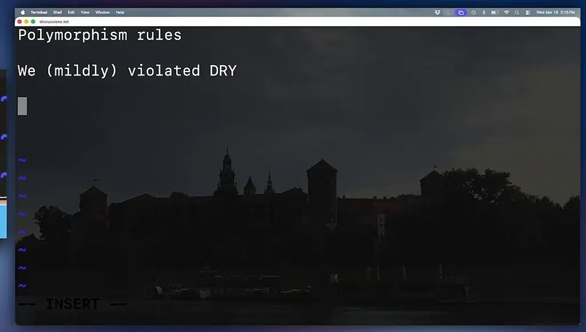
*[▶ 00:14:32](https://www.youtube.com/watch?v=EMdxiVYyMtU&t=872s) · Vim notes: Polymorphism rules*

## Extensibility bought with runtime risk

[▶ 00:14:38](https://www.youtube.com/watch?v=EMdxiVYyMtU&t=878s)

Picking the audit with an `instanceof` chain is not extensible, so the speaker rejects it.

```java
import trade.Trade;

public class AuditRules {
    public static void audit(Trade trade) {
        TradeAudit tradeAudit = createAudit(trade);

        tradeAudit.audit(trade);
        //Kick the can down the road
    }

  private static TradeAudit createAudit(Trade trade) {
    if(trade instanceof Buy) {
      return new BuyAudit();
    }
  }

}
```

*[▶ 00:15:39](https://www.youtube.com/watch?v=EMdxiVYyMtU&t=939s) · createAudit returns BuyAudit for Buy*

He switches to reflection. The class name comes from `getSimpleName()`, and `Class.forName` creates the audit. Each exception is wrapped in a `RuntimeException`, which hides where the failure starts.

```java
private static TradeAudit createAudit(Trade trade) { 1 usage
…= "client." + trade.getClass().getSimpleName() + "Audit";
…
    return (TradeAudit) Class.forName(className).getDeclaredConstructor().newInstance…
  } catch (InstantiationException e) {
    throw new RuntimeException(e);
  } catch (IllegalAccessException e) {
    throw new RuntimeException(e);
  } catch (InvocationTargetException e) {
    throw new RuntimeException(e);
  } catch (NoSuchMethodException e) {
    throw new RuntimeException(e);
  } catch (ClassNotFoundException e) {
    throw new RuntimeException(e);
  }
}
```

*[▶ 00:16:54](https://www.youtube.com/watch?v=EMdxiVYyMtU&t=1014s) · createAudit reflection with exception handling*

`audit` just calls whatever `createAudit` returns.

```java
…

import java.lang.reflect.InvocationTargetException;

public class AuditRules { 1 usage
    public static void audit(Trade trade) { 1 usage
        TradeAudit tradeAudit = createAudit(trade);

        tradeAudit.audit(trade);
        //Kick the can down the road
    }
```

*[▶ 00:17:30](https://www.youtube.com/watch?v=EMdxiVYyMtU&t=1050s) · AuditRules.audit delegates to createAudit*

The design follows the Open Closed Principle and uses DIP, but it builds a parallel hierarchy: TradeAudit, BuyAudit and SellAudit mirror Trade, Buy and Sell. He calls this a lot of complexity for almost no benefit.

The benefit: a new Trade type needs only a new Audit class, with no existing code changed.

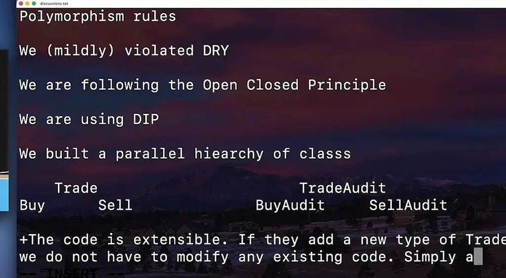
*[▶ 00:20:21](https://www.youtube.com/watch?v=EMdxiVYyMtU&t=1221s) · Extensibility point typed into notes*

The cost: a missing Audit class fails at runtime, not at compile time.

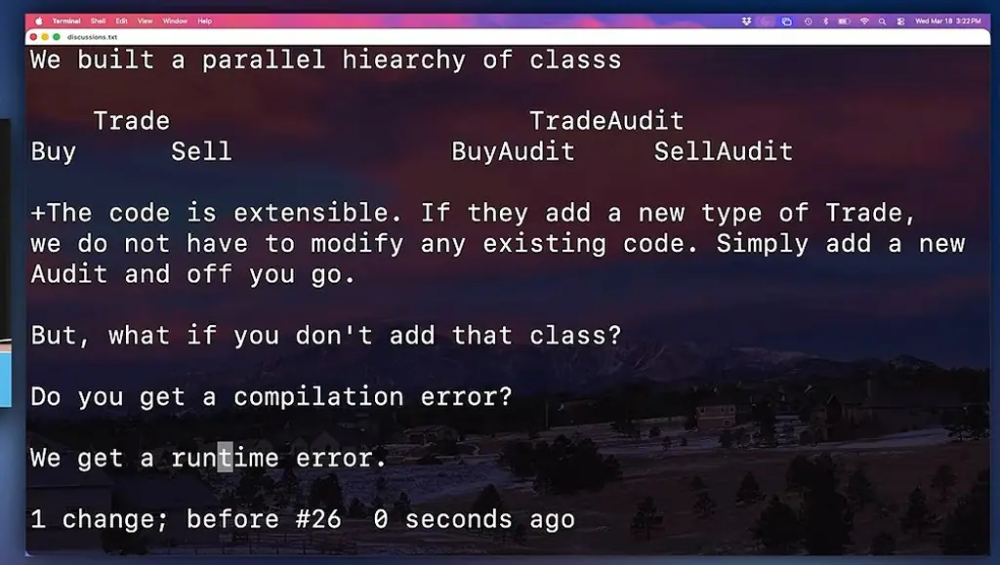
*[▶ 00:21:37](https://www.youtube.com/watch?v=EMdxiVYyMtU&t=1297s) · Runtime error instead of compilation error*

He would rather get a compilation error than a runtime bug that turns into a Jira ticket later.

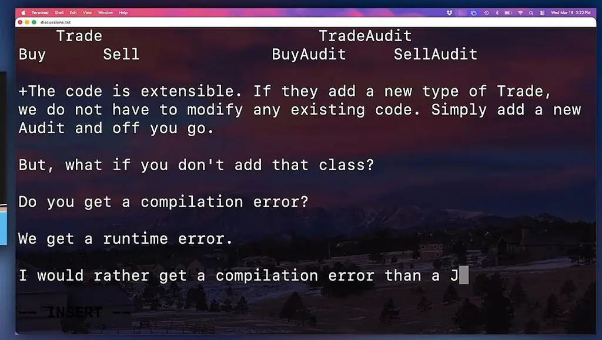
*[▶ 00:21:46](https://www.youtube.com/watch?v=EMdxiVYyMtU&t=1306s) · Preference: compilation error over Jira ticket*

## Cognitive load and the falling cost of change

[▶ 00:22:19](https://www.youtube.com/watch?v=EMdxiVYyMtU&t=1339s)

Extensible OOP can fail only at runtime when an Audit class is missing. The speaker would rather get a compilation error than a JIRA ticket.

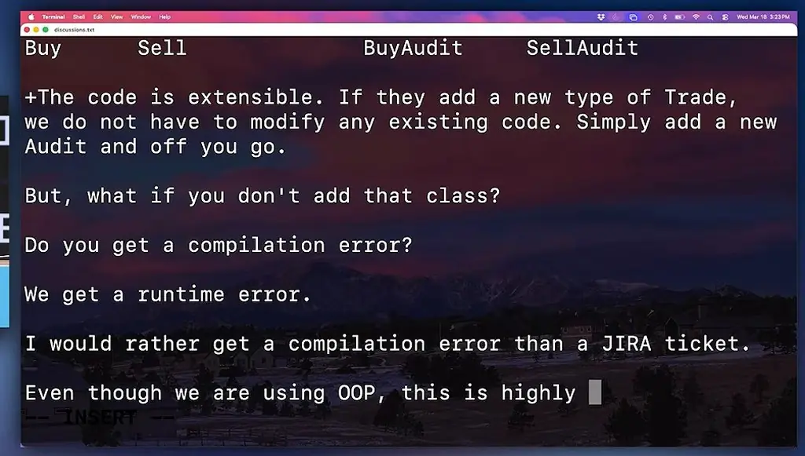
*[▶ 00:22:33](https://www.youtube.com/watch?v=EMdxiVYyMtU&t=1353s) · Terminal: notes on OOP complexity in discussions.txt*

The result is highly complex: more code, a lot to read, a lot to maintain.

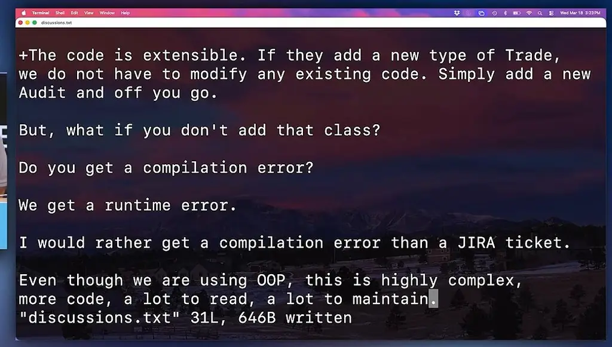
*[▶ 00:23:07](https://www.youtube.com/watch?v=EMdxiVYyMtU&t=1387s) · Terminal: discussions.txt written with OOP critique*

A newcomer or domain expert must trace connections before any change. That is **cognitive load**.

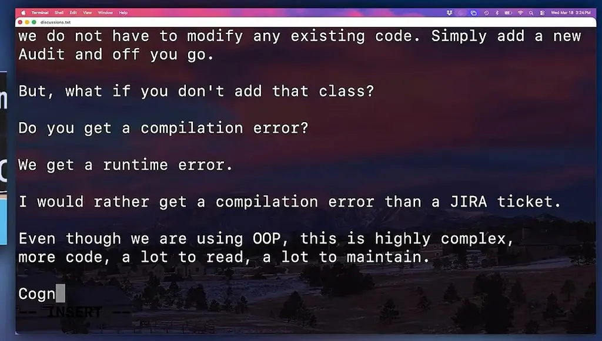
*[▶ 00:23:15](https://www.youtube.com/watch?v=EMdxiVYyMtU&t=1395s) · Terminal: discussions.txt, next point being typed*

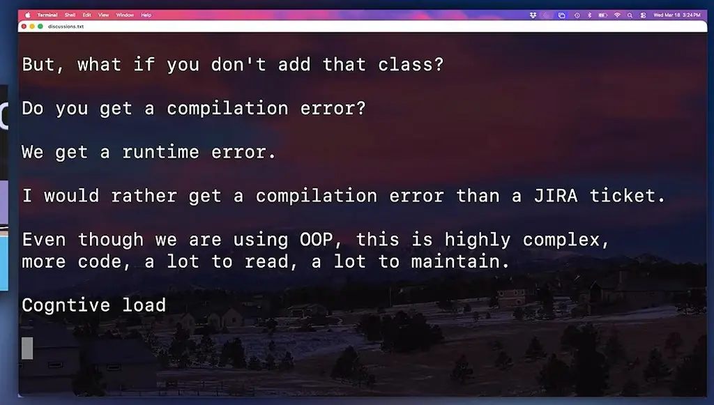
*[▶ 00:23:44](https://www.youtube.com/watch?v=EMdxiVYyMtU&t=1424s) · Terminal notes: cognitive load discussion*

Past a tipping point, OOP's **diminishing returns** set in, and polymorphism becomes a monster. He still loves OOP.

Decades ago change was costly: a 3,000-class C++ codebase had no IDE, and grep returned a thousand files. Today an IDE refactor changes thousands of files in milliseconds.

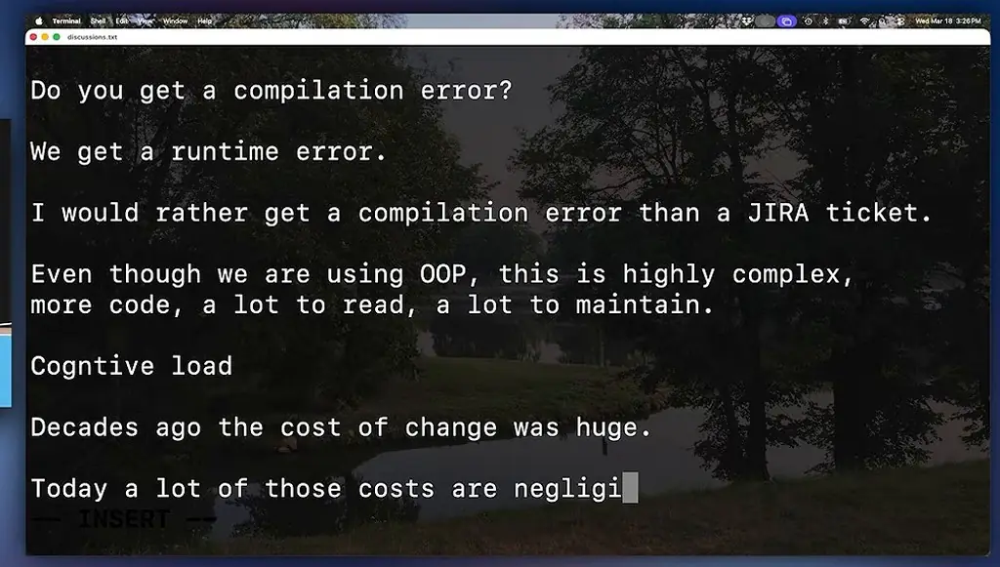
*[▶ 00:26:03](https://www.youtube.com/watch?v=EMdxiVYyMtU&t=1563s) · Terminal notes on cognitive load and change cost*

Consultants see enormously complex code justified by design principles. Principles apply in context and need re-evaluation.

Deleting the TradeAudit class triggers an IntelliJ conflict warning, which he overrides with "Refactor Anyway."

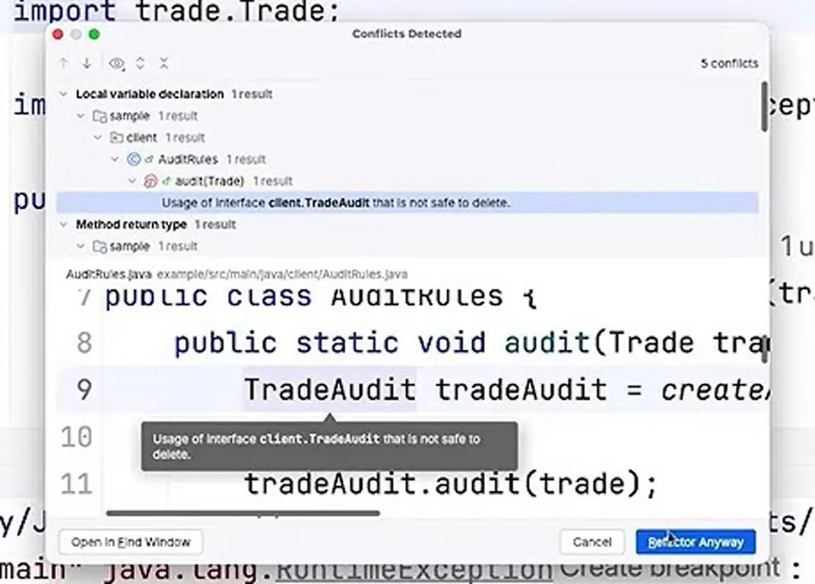
*[▶ 00:28:16](https://www.youtube.com/watch?v=EMdxiVYyMtU&t=1696s) · Refactor conflict dialog for TradeAudit deletion*

```java
public class AuditRules {
    public static void audit(Trade trade) {
        TradeAudit tradeAudit = Buy;

        tradeAudit.audit(trade);
        //Kick the can down the road
    }
}
```

*[▶ 00:28:46](https://www.youtube.com/watch?v=EMdxiVYyMtU&t=1726s) · AuditRules.java: TradeAudit assigned to Buy*

## Replacing the class hierarchy with a switch

[▶ 00:28:54](https://www.youtube.com/watch?v=EMdxiVYyMtU&t=1734s)

Since a trade here is mostly data, the speaker replaces the class design with a pattern-matching `switch` on `Trade`.

A catch-all case throws a `RuntimeException`, to be refined later.

```java
…trade.Trade;

public class AuditRules {
    public static void audit(Trade trade) {
      var auditInfo = switch (trade) {
        case Trade trade -> new RuntimeException("");
      };

      System.out.println(auditInfo);
    }
}
```

*[▶ 00:30:32](https://www.youtube.com/watch?v=EMdxiVYyMtU&t=1832s) · Trade case returns RuntimeException with empty message*

A quantity guard selects large Buy trades.

```java
…trade.Trade;

public class AuditRules {
    public static void audit(Trade trade) {
      var auditInfo = switch (trade) {
        case Buy buy when buy.quantity > 5000 -> "auditing "
        case Trade aTrade -> new RuntimeException("Unexpected trade");
      };

      System.out.println(auditInfo);
    }
}
```

*[▶ 00:31:01](https://www.youtube.com/watch?v=EMdxiVYyMtU&t=1861s) · Buy guard added with unexpected trade exception*

A Sell case follows, guarded at 10,000.

```java
…trade.Trade;

public class AuditRules {
    public static void audit(Trade trade) {
      var auditInfo = switch (trade) {
        case Buy buy when buy.quantity > 5000 -> "auditing buy";
        c
        …ntimeException("Unexpected trade");
      …

      …;
    }
```

*[▶ 00:31:08](https://www.youtube.com/watch?v=EMdxiVYyMtU&t=1868s) · Typing the next case label*

Other Buy and Sell trades return empty strings.

```java
public class AuditRules {
    public static void audit(Trade trade) {
        var auditInfo = switch (trade) {
            case Buy buy when buy.quantity > 5000 -> "auditing buy";
            case Sell sell when sell.quantity > 10000 -> "audting sell";
            case Buy buy -> "";
            case S
            case …Exception("Unexpected trade");
        };
```

*[▶ 00:31:40](https://www.youtube.com/watch?v=EMdxiVYyMtU&t=1900s) · Typing a new case in AuditRules switch*

The result is short, simple and obvious, readable without a walkthrough.

```java
import trade.Sell;
import trade.Trade;

public class AuditRules {
    public static void audit(Trade trade) {
        var auditInfo = switch (trade) {
            case Buy buy when buy.quantity > 5000 -> "auditing buy";
            case Sell sell when sell.quantity > 10000 -> "audting sell";
            case Buy buy -> "";
            case Sell sell -> "";
            case Trade aTrade -> new RuntimeException("Unexpected trade");
        };

        System.out.println(auditInfo);
    }
}
```

*[▶ 00:32:27](https://www.youtube.com/watch?v=EMdxiVYyMtU&t=1947s) · Full AuditRules class in editor*

The cost is the Open-Closed Principle: a new `Trade` type means editing the switch. He judges that edit almost trivial next to maintaining a parallel `Trade`/`TradeAudit` hierarchy.

Weigh costs against benefits rather than follow principles blindly. Pedantic extensibility brings heavy complexity for little benefit, and this design still mildly violates DRY.

He cannot edit the third-party library, so he imagines its maintainers making `Buy` and `Sell` records with `ticker` and `quantity` in a new release.

Records add a small benefit: less code, plus pattern-matching syntax.

```java
package trade;

public record Sell(String ticker, int quantity) implements Trade {
  public void perform() {
    System.out.println("Performing Sell of ticker %s quantity %d".formatted(ticker, quantity));
  }
}
```

*[▶ 00:37:04](https://www.youtube.com/watch?v=EMdxiVYyMtU&t=2224s) · Sell record implementing Trade in TextMate*

## Modern Java and safety

[▶ 00:37:12](https://www.youtube.com/watch?v=EMdxiVYyMtU&t=2232s)

Record deconstruction lets a `case` bind a record's components directly and filter on them in a `when` guard.

```java
import trade.Sell;
import trade.Trade;

public class AuditRules {
  //International symbol for "
    public static void audit(Trade trade) {
      var auditInfo = switch (trade) {
        case Buy(var ticker, var quantity) when quantity > 5000 -> "auditing buy";
        case Sell(var ticker, var quantity) when quantity > 10000 -> "audting sell";
        case Buy buy -> "";
        case Sell sell -> "";
        case Trade aTrade -> new RuntimeException("Unexpected trade");
      };

      System.out.println(auditInfo);
    }
}
```

*[▶ 00:38:39](https://www.youtube.com/watch?v=EMdxiVYyMtU&t=2319s) · Comment placeholder and unused ticker*

Unused bindings can be written as `_`, the unnamed-variable symbol. Unlike `ignore1` and `ignore2`, it can repeat any number of times, so several unused parameters never need names.

```java
import trade.Sell;
import trade.Trade;

public class AuditRules {
  //International symbol for "I don't care" _
    public static void audit(Trade trade) {
      var auditInfo = switch (trade) {
        case Buy(var _, var quantity) when quantity > 5000 -> "auditing buy";
        case Sell(var _, var quantity) when quantity > 10000 -> "audting sell";
        case Buy buy -> "";
        case Sell sell -> "";
      };

      System.out.println(auditInfo);
    }
}
```

*[▶ 00:40:12](https://www.youtube.com/watch?v=EMdxiVYyMtU&t=2412s) · AuditRules switch over Trade, no default*

A switch expression that misses a case fails to compile. Making `Trade` a **sealed** interface that permits only `Buy` and `Sell` keeps the switch exhaustive, so the `default` is unnecessary.

```java
package trade;

public sealed interface Trade permits Buy, Sell {
  void perform();
}
```

*[▶ 00:40:44](https://www.youtube.com/watch?v=EMdxiVYyMtU&t=2444s) · Trade as a sealed interface permitting Buy and Sell*

Don't write a `default` that isn't needed. If a new type is added, the switch stops compiling, and the team goes back to the business to define what the new type should do.

If a caller is recompiled against a new type while the middle code is not, Java's bytecode supplies a default that throws a match exception at runtime. Recompiling surfaces the problem at compile time.

The argument: this switch is simple and does not violate DRY, but it violates OCP. Adding a third-party type that the code does not handle produces a compile error.

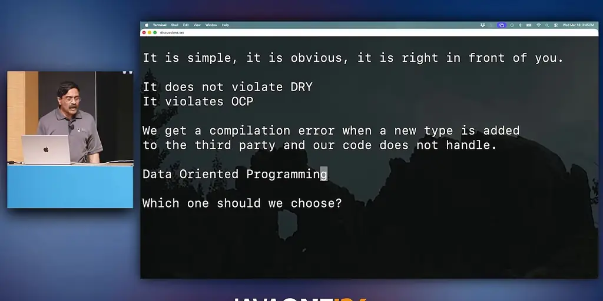
*[▶ 00:44:33](https://www.youtube.com/watch?v=EMdxiVYyMtU&t=2673s) · Terminal notes: OOP vs data-oriented compile-error argument*

## Using OOP and data-oriented code together

[▶ 00:44:11](https://www.youtube.com/watch?v=EMdxiVYyMtU&t=2651s)

OOP relies on class hierarchies and polymorphism; DOP centers on data, often from a third party.

Choose both, wherever each makes sense. Judge each choice by whether it nets positive.

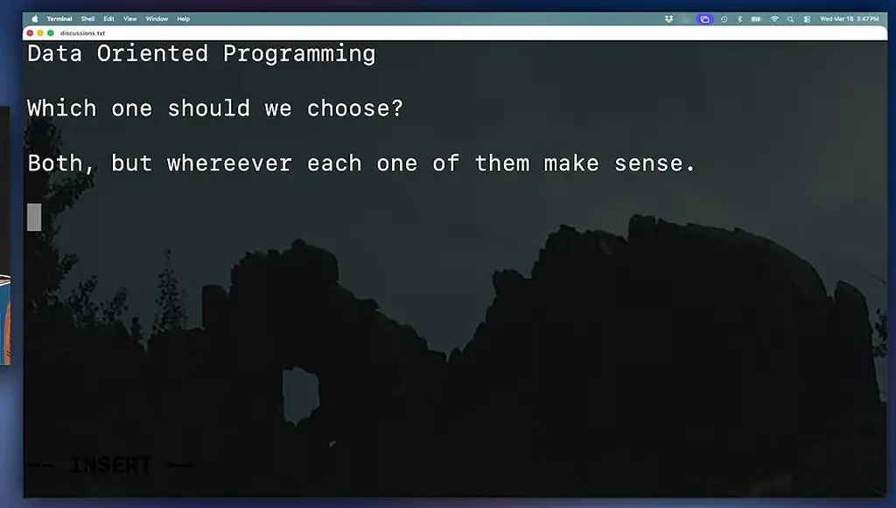
*[▶ 00:46:39](https://www.youtube.com/watch?v=EMdxiVYyMtU&t=2799s) · Terminal notes: which approach to choose*

Data-driven changes are cheap: the compiler flags each place to update, unlike a class hierarchy that must be built first.

Polymorphism is to OOP as pattern matching is to DOP. Use each where it fits, without going overboard.

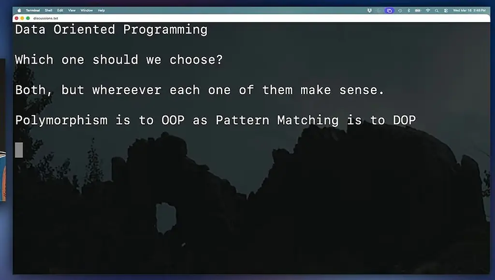
*[▶ 00:47:53](https://www.youtube.com/watch?v=EMdxiVYyMtU&t=2873s) · Discussion notes: OOP vs DOP choice*

Skip the argument: prototype both side by side and ask how it feels, the decision that closes the talk's checklist.

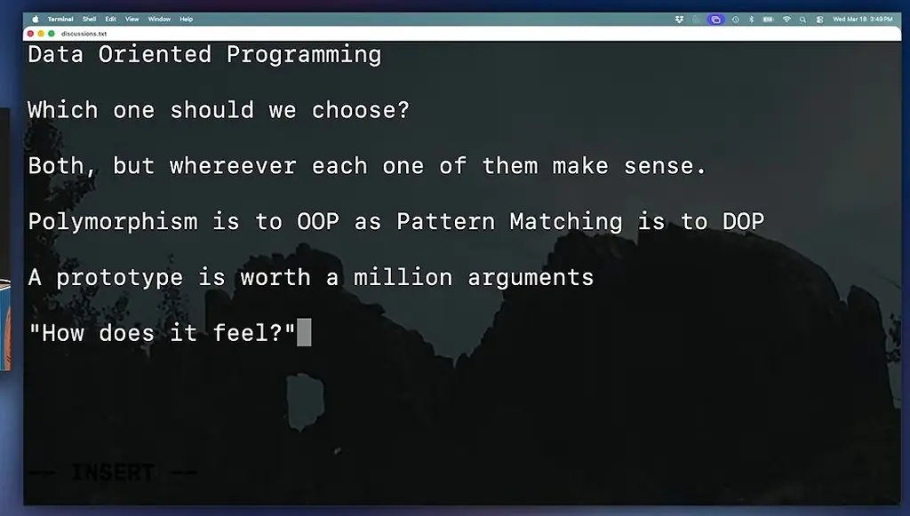
*[▶ 00:48:37](https://www.youtube.com/watch?v=EMdxiVYyMtU&t=2917s) · Vim discussion notes on Data Oriented Programming*

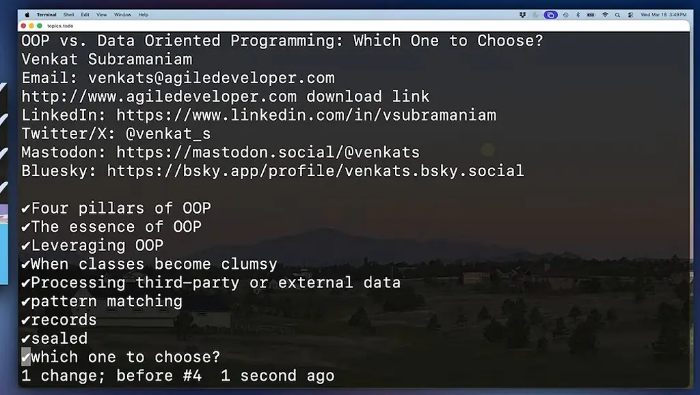
*[▶ 00:49:05](https://www.youtube.com/watch?v=EMdxiVYyMtU&t=2945s) · Terminal outline of topics.todo*

## Links & resources

- [Talk playlist — related conference talks](https://www.youtube.com/playlist?list=PLX8CzqL3ArzUMVSzm-z_-if8BIB55EGl4) — <https://www.youtube.com/playlist?list=PLX8CzqL3ArzUMVSzm-z_-if8BIB55EGl4> · video description
