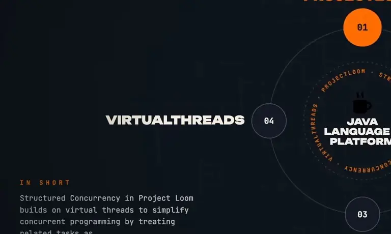
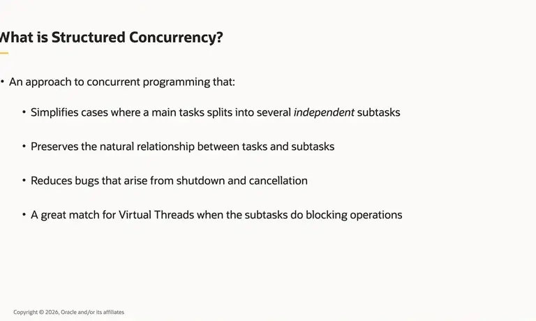
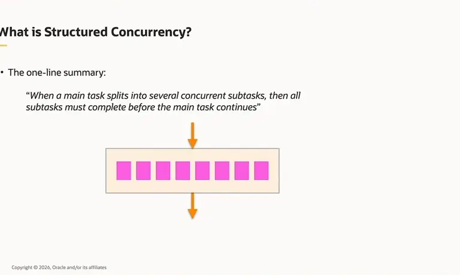
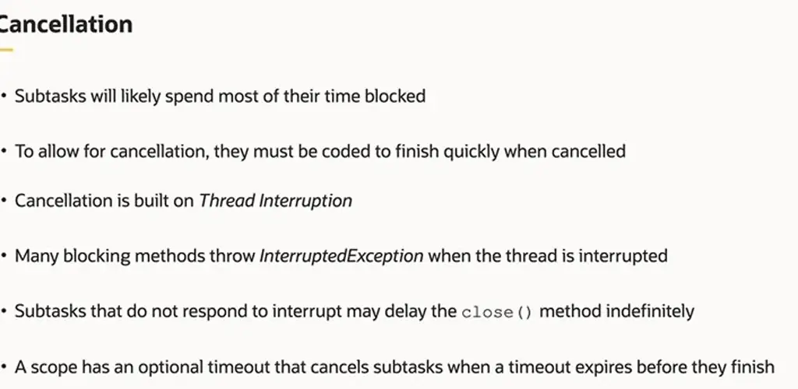
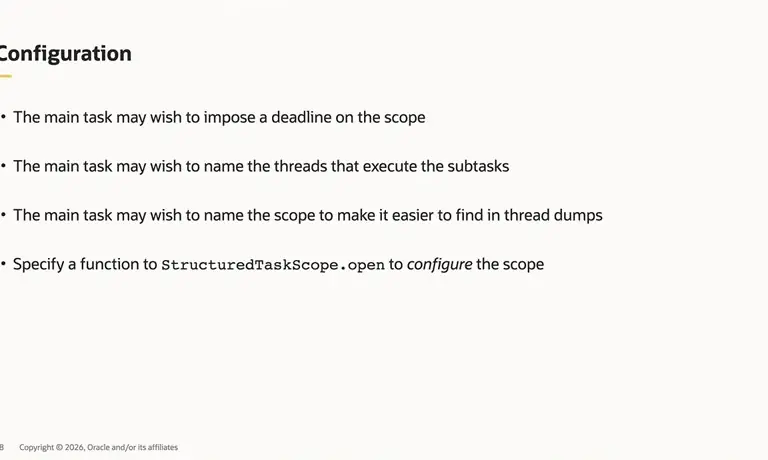
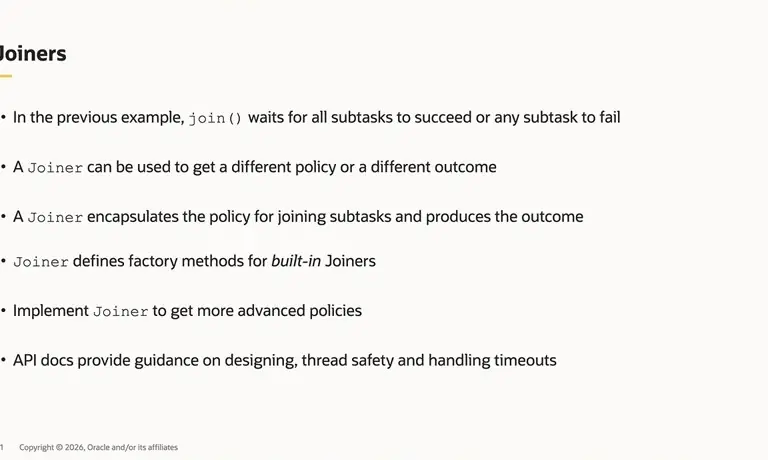
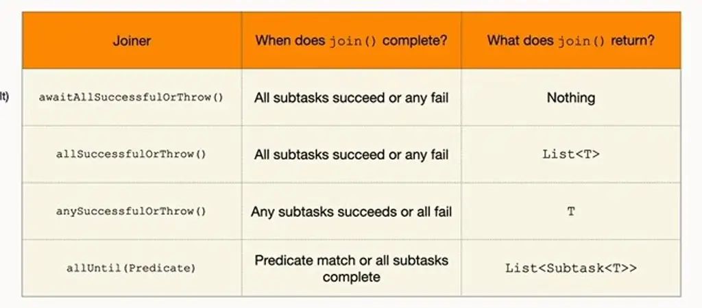

# Structured Concurrency Looms

*How StructuredConcurrency scopes in Project Loom tie forked virtual-thread subtasks to a parent's lifetime, and how joiners, timeouts, and exception design shape their failure behavior.*

Source: [Structured Concurrency Looms](https://www.youtube.com/watch?v=oS01pSRWKmg) · Java · 51 min

## TL;DR

Concurrent code with executors and futures makes task lifetimes, failure routing, and cancellation hard to control, and a thread dump loses the link between a waiting parent and the subtask it depends on. Structured concurrency addresses this for fan-out: a main task that forks subtasks must wait for all of them before continuing, so no thread or resource outlives the scope. The StructuredTaskScope API implements this with try-with-resources, a single join(), and cancellation built on thread interruption. Its joiner policies, timeouts, and JSON thread dumps make the behavior and the stuck work easier to reason about and debug.

## Key takeaways

- Wrap a StructuredTaskScope in try-with-resources so the implicit close waits for any remaining subtasks, meaning nothing keeps running after the block.
- Use one join() to wait for all subtasks as a unit, then call get() on each Subtask to read its result.
- When one subtask fails under the default policy, its siblings are cancelled and join() throws an ExecutionException whose cause is the failed subtask's exception, without waiting for the siblings.
- Pick a joiner by fan-out pattern: allSuccessfulOrThrow for run-all, anySuccessfulOrThrow for first-success (such as cache or database), and allUntil with a predicate for collecting partial results under a timeout.
- Set a timeout when opening the scope; it starts at open() and ends at join(), and on expiry join() throws an ExecutionException caused by CancelledByTimeoutException.
- Subtasks must respond to interruption and finish quickly when cancelled, because a subtask that ignores interrupts can block close() indefinitely.
- Keep business logic out of a custom joiner, since it should only decide task outcomes, and put exception handling on the try-with-resources rather than in nested try blocks.
- Dump threads with jcmd using Thread.dump_to_file -format=json to keep the parent-child structure that a flat thread dump loses.

## Why naive concurrency breaks down

[▶ 00:00:00](https://www.youtube.com/watch?v=oS01pSRWKmg&t=0s)

The talk places **structured concurrency** in Project Loom as a layer on virtual threads that treats related tasks as one unit.


*[▶ 00:00:14](https://www.youtube.com/watch?v=oS01pSRWKmg&t=14s) · Project Loom topic wheel with short summary*

The running example is deliberately dull: fetch a customer from a database and an order from a web service, then combine them into an `OrderSummary`. The sequential version is easy to read, maintain and debug. A failure gives a useful stack trace, a hang shows up in a thread dump or debugger, and a failed fetch needs no extra cleanup. Its cost is that the two fetches run one after another.

```java
Customer customer = fetchCustomer();
Order order = fetchOrder();
var orderSummary = new OrderSummary(customer, order);
```

*[▶ 00:03:03](https://www.youtube.com/watch?v=oS01pSRWKmg&t=183s) · Sequential code*

Running the fetches concurrently with a virtual-thread-per-task executor and futures can be faster, but failures break it. If `fetchOrder` throws while the main task is blocked in `fetchCustomer.get()`, the main task waits for a result it no longer needs. The executor's `close()` also waits for every task. In a thread dump, the main thread shows only `Future::get`, so the link to the subtask that hangs is lost.

```java
try (var executor = Executors.newVirtualThreadPerTaskExecutor()) {
    Future<Customer> customer = executor.submit(() -> fetchCustomer());
    Future<Order> order = executor.submit(() -> fetchOrder());
    var orderSummary = new OrderSummary(customer.get(), order.get());
 }
```

*[▶ 00:05:28](https://www.youtube.com/watch?v=oS01pSRWKmg&t=328s) · Concurrent code*

A completion-service version fixes the timing: it throws promptly and calls `shutdownNow()` to interrupt the other task. The speaker calls it fragile, hard to maintain, and hard to observe.

```java
try (var executor = Executors.newVirtualThreadPerTaskExecutor()) {
    var completionService = new ExecutorCompletionService<Object>(executor);
    Future<Object> customer = completionService.submit(() -> fetchCustomer());
    Future<Object> order = completionService.submit((() -> fetchOrder()));
    try {
        completionService.take().get();
        completionService.take().get();
        var orderSummary = new OrderSummary((Customer) customer.get(), (Order) order.get());
    } catch (InterruptedException | ExecutionException e) {
        executor.shutdownNow();
        throw e;
    }
 }
```

*[▶ 00:07:11](https://www.youtube.com/watch?v=oS01pSRWKmg&t=431s) · Concurrent code (fixed?)*

Concurrent code in general makes task lifetimes hard to control, failures hard to route, cancellation delayed or missing, and resource leaks hard to avoid.

Structured concurrency targets the case where a main task splits into independent subtasks. It preserves that parent-child relationship at runtime, reduces shutdown and cancellation bugs, and suits virtual threads, because subtasks spend most of their time blocked.


*[▶ 00:09:40](https://www.youtube.com/watch?v=oS01pSRWKmg&t=580s) · What is Structured Concurrency?*

The rule is that when a main task splits into concurrent subtasks, all subtasks must complete before the main task continues. No thread or resource is left behind, whether the method succeeds or throws.


*[▶ 00:10:20](https://www.youtube.com/watch?v=oS01pSRWKmg&t=620s) · The one-line summary*

The ideas predate the term. Earlier libraries, including Python's trio, introduced them, and similar concepts appear in older literature. The API's goals are fewer shutdown and cancellation bugs and more observable concurrent code. It is not meant to be the definitive structured concurrency API for Java.

## Scopes bound the lifetime of forked subtasks

[▶ 00:11:33](https://www.youtube.com/watch?v=oS01pSRWKmg&t=693s)

A `StructuredTaskScope` is used in a try-with-resources block. `open()` creates it, and the implicit close at the end of the block waits for any remaining subtasks, so nothing keeps running after the block. Work happens in three steps:

```java
try (var scope = StructuredTaskScope.open()) {

    Subtask<Customer> customer = scope.fork(() -> fetchCustomer());

    Subtask<Order> order = scope.fork(() -> fetchOrder());

    scope.join();

    return new OrderSummary(customer.get(), order.get());
}
```

*[▶ 00:14:00](https://www.youtube.com/watch?v=oS01pSRWKmg&t=840s) · StructuredTaskScope*

- **Fork:** each `fork` starts a subtask in a virtual thread by default, as a child of the current thread.
- **Join:** one `join()` waits for all subtasks as a unit, not a join per fork as in other `java.util.concurrent` APIs.
- **Process:** `get()` on each `Subtask` reads its result.

```java
try (var scope = StructuredTaskScope.open()) {

    Subtask<Customer> customer = scope.fork(() -> fetchCustomer());
    Subtask<Order> order = scope.fork(() -> fetchOrder());


    scope.join();


    return new OrderSummary(customer.get(), order.get());

} // close
```

*[▶ 00:13:38](https://www.youtube.com/watch?v=oS01pSRWKmg&t=818s) · The API on one slide*

If one subtask fails, the others are cancelled and `join()` throws an `ExecutionException` whose cause is the failed subtask's exception. The main task does not wait for the siblings.

```java
try (var scope = StructuredTaskScope.open()) {
    Subtask<Customer> customer = scope.fork(() -> fetchCustomer());
    Subtask<Order> order = scope.fork(() -> fetchOrder());
    scope.join();
}

Exception in thread "main" java.util.concurrent.ExecutionException: java.net.ConnectException: Operation timed out (connect failed)
	at java.base/java.util.concurrent.Joiners$AwaitSuccessfulResult.result(Joiners.java:219)
	at java.base/java.util.concurrent.Joiners$AwaitSuccessfulResult.result(Joiners.java:196)
	at java.base/java.util.concurrent.StructuredTaskScopeImpl.join(StructuredTaskScopeImpl.java:255)
	at Demo.main(Demo.java:30)
Caused by: java.net.ConnectException: Operation timed out (connect failed)
	at java.base/sun.nio.ch.Net.pollConnect(Native Method)
	at java.base/sun.nio.ch.Net.pollConnectNow(Net.java:642)
	at java.base/sun.nio.ch.NioSocketImpl.connect(NioSocketImpl.java:401)
	at java.base/java.net.SocksSocketImpl.connect(SocksSocketImpl.java:286)
	at java.base/java.net.Socket.connect(Socket.java:673)
	at java.base/sun.security.ssl.SSLSocketImpl.connect(SSLSocketImpl.java:304)
	:
	at java.base/sun.net.www.protocol.https.HttpsURLConnectionImpl.getInputStream(HttpsURLConnectionImpl.java:223)
	at java.base/java.net.URL.openStream(URL.java:1240)
	at Demo.fetch(Demo.java:48)
	at Demo.fetchCustomer(Demo.java:38)
	at Demo.lambda$main$0(Demo.java:26)
	at java.base/java.util.concurrent.StructuredTaskScopeImpl$SubtaskImpl.run(StructuredTaskScopeImpl.java:345)
	at java.base/java.lang.VirtualThread.run(VirtualThread.java:470)
```

*[▶ 00:16:18](https://www.youtube.com/watch?v=oS01pSRWKmg&t=978s) · Subtask failure cancels scope*

Subtasks can open their own scopes, forming a tree.

```java
try (var scope = StructuredTaskScope.open()) {

    var customer = scope.fork(() -> fetchCustomer());
    var order = scope.fork(() -> fetchOrder());

    scope.join();

    return new OrderSummary(customer.get(), order.get());
}

Customer fetchCustomer() throws Exception {
    try (var scope = StructuredTaskScope.open()) {
        var profile = scope.fork(() -> fetchCustomerProfile());
        var preferences = scope.fork(() -> fetchCustomerPreferences());
        var accountStatus = scope.fork(() -> fetchAccountStatus());

        scope.join();

        return new Customer(profile.get(), preferences.get(), accountStatus.get());
    }
}
```

*[▶ 00:17:42](https://www.youtube.com/watch?v=oS01pSRWKmg&t=1062s) · Let's plant a tree: nested scopes*

When a leaf fails, its siblings are cancelled, the parent fails, and the cancellation propagates upward. The `Caused by` chain in the stack trace traces the path down to the failing subtask.

```java
try (var scope = StructuredTaskScope.open()) {

    var customer = scope.fork(() -> fetchCustomer());
    var order = scope.fork(() -> fetchOrder());

    scope.join();
}

Exception in thread "main" java.util.concurrent.ExecutionException: java.net.UnknownHostException: www.dummstream.com
	at java.base/java.util.concurrent.Joiners$AwaitSuccessful.result(Joiners.java:219)
	…
Caused by: java.net.UnknownHostException: www.dummstream.com
	…
Caused by: java.net.UnknownHostException: www.dummstream.com
	…
	at Demo.fetchCustomerAccount(Demo.java:44)
	at Demo.fetchCustomer(Demo.java:41)
	…
... 2 more
```

*[▶ 00:18:44](https://www.youtube.com/watch?v=oS01pSRWKmg&t=1124s) · The tree is no more: cancelled subtasks and stack trace*

## Cancellation, timeouts and joiner policies

[▶ 00:18:45](https://www.youtube.com/watch?v=oS01pSRWKmg&t=1125s)

Subtasks in this API are coarse, blocking calls such as database or web-service fetches, so they spend most of their time blocked. Cancellation is built on thread interruption, which the platform has supported since its early days. Blocking methods such as `Object.wait` and `Thread.sleep` throw `InterruptedException`, so a subtask must react to interruption and finish quickly when cancelled. A subtask that ignores interrupts can block `close()` indefinitely.


*[▶ 00:21:58](https://www.youtube.com/watch?v=oS01pSRWKmg&t=1318s) · Cancellation*

A scope can also be configured when it is opened. `StructuredTaskScope.open` takes a function that receives the default configuration and returns an overridden one. The main task can set:

- a timeout, which cancels unfinished subtasks
- a thread factory for the subtask threads
- a name, so the scope is easy to find in thread dumps


*[▶ 00:22:48](https://www.youtube.com/watch?v=oS01pSRWKmg&t=1368s) · Configuration options for a scope*

The options can be used alone or combined:

```java
Duration timeout = Duration.ofSecond(10);
try (var scope = StructuredTaskScope.open(cfg -> cfg.withTimeout(timeout))) {
    :
}

ThreadFactory factory = Thread.ofVirtual().name("worker-", 0).factory();
try (var scope = StructuredTaskScope.open(cfg -> cfg.withThreadFactory(factory))) {
    :
}

try (var scope = StructuredTaskScope.open(cfg -> cfg.withName("MyScope"))) {
    :
}

try (var scope = StructuredTaskScope.open(cfg -> cfg.withTimeout(timeout)
                                                  .withThreadFactory(factory)
                                                  .withName("MyScope"))) {
    :
}
```

*[▶ 00:23:54](https://www.youtube.com/watch?v=oS01pSRWKmg&t=1434s) · Examples of configuring a StructuredTaskScope*

The timeout starts when the scope opens, not at the first `fork`, and ends at `join()`. When it expires, `join()` throws an `ExecutionException` whose cause is a `CancelledByTimeoutException`. A timeout does not guarantee clean termination: a subtask that ignores interruption stays stuck, and try-with-resources cannot release it. That makes the stuck task easier to identify.

```java
Duration timeout = Duration.ofSeconds(10);

try (var scope = StructuredTaskScope.open(cfg -> cfg.withTimeout(timeout))) { // timeout starts here

    Subtask<Customer> customer = scope.fork(() -> fetchCustomer());

    Subtask<Order> order = scope.fork(() -> fetchOrder());

    scope.join();  // join throws if timeout expires

    return new OrderSummary(customer.get(), order.get());

} catch (ExecutionException e) {

    switch (e.getCause()) {
        case CancelledByTimeoutException _ -> { .. }

        case ..
    }

}
```

*[▶ 00:25:53](https://www.youtube.com/watch?v=oS01pSRWKmg&t=1553s) · Timeouts with StructuredTaskScope*

By default, `join()` waits until all subtasks succeed or any fails. A `Joiner` is the policy object that decides when `join()` completes and what it returns.


*[▶ 00:27:52](https://www.youtube.com/watch?v=oS01pSRWKmg&t=1672s) · Joiners: policies for joining subtasks*

`Joiner` provides factory methods for built-in policies. `awaitAllSuccessfulOrThrow()` is the default and returns nothing. `allSuccessfulOrThrow()` returns a `List<T>`, and `anySuccessfulOrThrow()` returns a single `T` as soon as one subtask succeeds. `allUntil(Predicate)` completes on a predicate match or when all subtasks finish.


*[▶ 00:29:36](https://www.youtube.com/watch?v=oS01pSRWKmg&t=1776s) · Built-in Joiners comparison table*

Keep business logic out of a custom joiner; it should only decide task outcomes. The API docs cover joiner design, thread safety and timeout handling.

## Joiners, exception design, and where structured concurrency goes next

[▶ 00:29:36](https://www.youtube.com/watch?v=oS01pSRWKmg&t=1776s)

The three built-in joiners cover common fan-out patterns. **allSuccessfulOrThrow** returns all results and cancels the scope on any failure, making it the run-all-concurrently primitive.

```java
<T> List<T> runConcurrently(List<Callable<T>> tasks)
        throws ExecutionException, InterruptedException {

    try (var scope = StructuredTaskScope.open(Joiner.<T>allSuccessfulOrThrow())) {
        tasks.forEach(scope::fork);
        return scope.join();
    }
}
```

*[▶ 00:30:14](https://www.youtube.com/watch?v=oS01pSRWKmg&t=1814s) · allSuccessfulOrThrow joiner and runConcurrently*

**anySuccessfulOrThrow** returns the first successful result and cancels the rest. It suits cases like "check the cache, or the database," where the fastest answer wins.

```java
<T> T race(List<Callable<T>> tasks) throws ExecutionException, InterruptedException {
    try (var scope = StructuredTaskScope.open(Joiner.<T>anySuccessfulOrThrow())) {
        tasks.forEach(scope::fork);
        return scope.join();
    }
}
```

*[▶ 00:30:36](https://www.youtube.com/watch?v=oS01pSRWKmg&t=1836s) · anySuccessfulOrThrow joiner and race*

**allUntil** is the Swiss army knife. A predicate that always returns false never cancels, so the scope runs until a timeout. Here a 500 ms timeout collects the subtasks that finished in time, filtered by `SUCCESS`. Unlike the other two, it never makes `join()` throw on failures or timeouts.

```java
Duration timeout = Duration.ofMillis(500);

try (var scope = StructuredTaskScope.open(
        Joiner.<SearchResult>allUntil(_ -> false),          // do not cancel
        cf -> cf.withTimeout(timeout))) {                   // timeout starts here

    scope.fork(() -> searchDocuments(query));
    scope.fork(() -> searchJira(query));
    scope.fork(() -> searchConfluence(query));

    List<Subtask<SearchResult>> subtasks = scope.join();    // all subtasks

    List<SearchResult> results = subtasks.stream()
            .filter(s -> s.state() == Subtask.State.SUCCESS)
            .map(Subtask::get)
            .toList();

    :
}
```

*[▶ 00:32:07](https://www.youtube.com/watch?v=oS01pSRWKmg&t=1927s) · allUntil joiner with timeout*

Subtasks may throw any checked or unchecked exception, and Java has no union type to declare a precise set. "Throws nothing" and "unchecked only" both fail, since `StackOverflowError` and `OutOfMemoryError` can strike anywhere.

By default `join()` wraps subtask exceptions in `ExecutionException`, as `java.util.concurrent` does. A rethrown original would show only where the subtask ran, not where the main thread was waiting. A Joiner factory can take a wrapping function instead, such as `CompletionException::new`, so code that knows nothing will fail avoids a forced checked catch.

```java
<T> T race(List<Callable<T>> tasks) throws InterruptedException {

    try (var scope = StructuredTaskScope.open(
            Joiner.<T, CompletionException>anySuccessfulOrThrow(CompletionException::new))) {
        tasks.forEach(scope::fork);
        return scope.join();
    }
}
```

*[▶ 00:36:58](https://www.youtube.com/watch?v=oS01pSRWKmg&t=2218s) · Exceptions: API allows any exception; custom joiner*

Put the catch on the try-with-resources rather than in nested tries during forking or result handling. Decide whether to log, distinguish exception kinds (for example, switch on `e.getCause()` to separate `IOException` from `CancelledByTimeoutException`), or return a result type. A "not found" can become a default value inside the subtask.

**ScopedValue** passes an object to methods without parameters, like a short-lived thread-local. Threads running subtasks inherit bindings made around the scope, a cheap way to propagate context. It became permanent in JDK 25. In the speaker's view, it is mostly a framework-level API.

```java
var ctxt = new SecurityContext("duke", "admin");

OrderSummary orderSummary = ScopedValue.where(SECURITY_CONTEXT, ctxt).call(() -> {
    try (var scope = StructuredTaskScope.open()) {

        var customer = scope.fork(() -> fetchCustomer());

        var order = scope.fork(() -> fetchOrder());

        scope.join();

        return new OrderSummary(customer.get(), order.get());

    }
});
```

*[▶ 00:41:21](https://www.youtube.com/watch?v=oS01pSRWKmg&t=2481s) · ScopedValue shared with structured subtasks*

A flat thread dump cannot show subtask relationships. A JSON dump from `jcmd <pid> Thread.dump_to_file -format=json` keeps the parent–child structure, placing subtask virtual threads under their owning scope. `Thread.dump_to_file` shows all threads, while `Thread.dump` shows only mounted virtual threads.

```json
$ jcmd <pid> Thread.dump_to_file -format=json
 threads.json

{
  "tid": 3,
  "time": "2026-10-02T06:35:33.5906082",
  "name": "main",
  "state": "WAITING",
  "stack": [
    "java.base/jdk.internal.misc.Unsafe.park(Native Method)",
    "java.base/java.util.concurrent.locks.LockSupport.park(LockSupport.java:369)",
    "java.base/jdk.internal.misc.ThreadFlock.awaitAll(ThreadFlock.java:305)",
    "java.base/java.util.concurrent.StructuredTaskScopeImpl.join(StructuredTaskScopeImpl.java:240)",
    "Demo.main(Demo.java:59)"
  ]
},
{
  "container": "fetch-URLs/jdk.internal.misc.ThreadFlock$ThreadContainerImpl@6a8b023",
  "parent": "<root>",
  "owner": 3,
  "threads": [
    {
      "tid": 36,
      "time": "2026-10-02T06:35:33.5940562",
      "virtual": true,
      "name": "",
      "state": "WAITING",
      "stack": [ ]
    },
    {
      "tid": 38,
      "time": "2026-10-02T06:35:33.5963368",
      "virtual": true,
      "name": "",
      "state": "WAITING",
      "stack": [ ]
    }
  ],
  "threadCount": 2
}
```

*[▶ 00:43:44](https://www.youtube.com/watch?v=oS01pSRWKmg&t=2624s) · Thread dump JSON keeps parent-child structure*

The API has been preview since JDK 21 and is proposed as permanent in JDK 28. Proposals that hide the structure behind `invokeAll`-style combinators were rejected, and exception handling proved hardest.

It is an on-ramp to structured concurrency and a strong fit for fan-out with virtual threads, but not the definitive API. Dependent tasks, workflow engines, producer-consumer pipelines, and channels need more.

Every prototype rested on a few runtime primitives, such as thread termination hooks, scope-value inheritance, and observability, exposed through an internal low-level API that did not change during prototyping. That API may be exposed. An arena tied to a structured lifetime, for subtasks sharing a memory segment, is worth exploring.

## Links & resources

- [Devoxx video playlist — other talks from the same conference series](https://www.youtube.com/playlist?list=PLDH5XPPpzxzc) — <https://www.youtube.com/playlist?list=PLDH5XPPpzxzc> · video description
- Nathaniel J. Smith's blog posts — introduced structured concurrency to Java, URL not shown · mentioned [▶ 00:09:14](https://www.youtube.com/watch?v=oS01pSRWKmg&t=554s)
- Trio — Python structured concurrency library by Nathaniel J. Smith, URL not shown · mentioned [▶ 00:09:21](https://www.youtube.com/watch?v=oS01pSRWKmg&t=561s)
